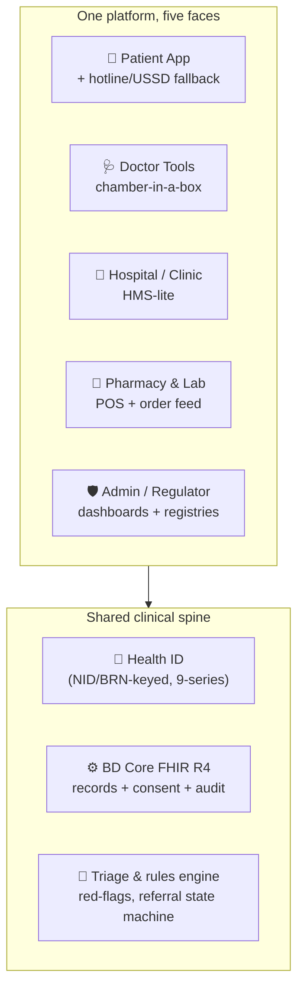
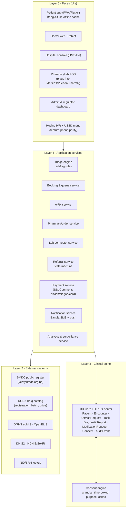
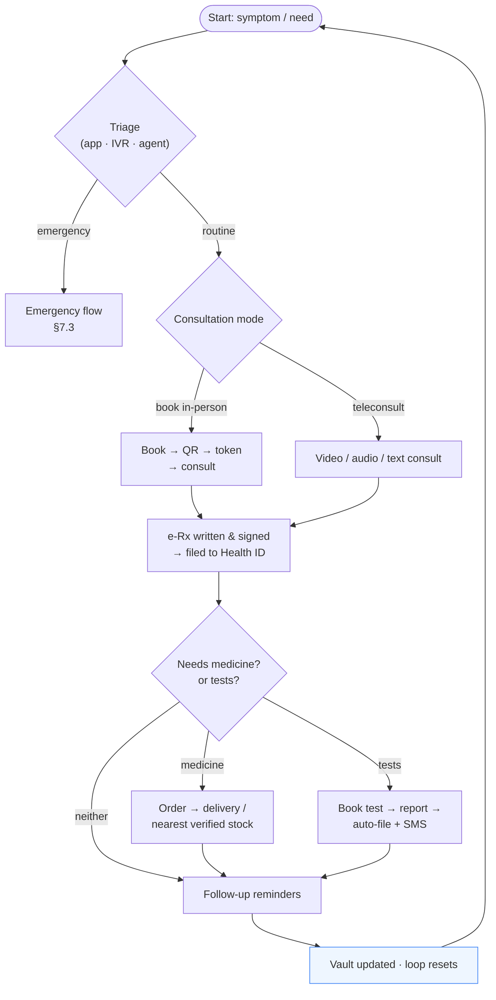
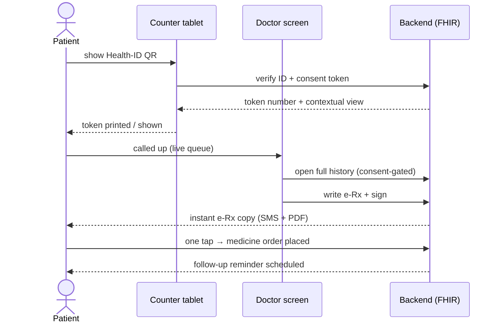
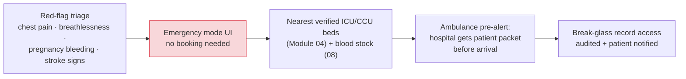
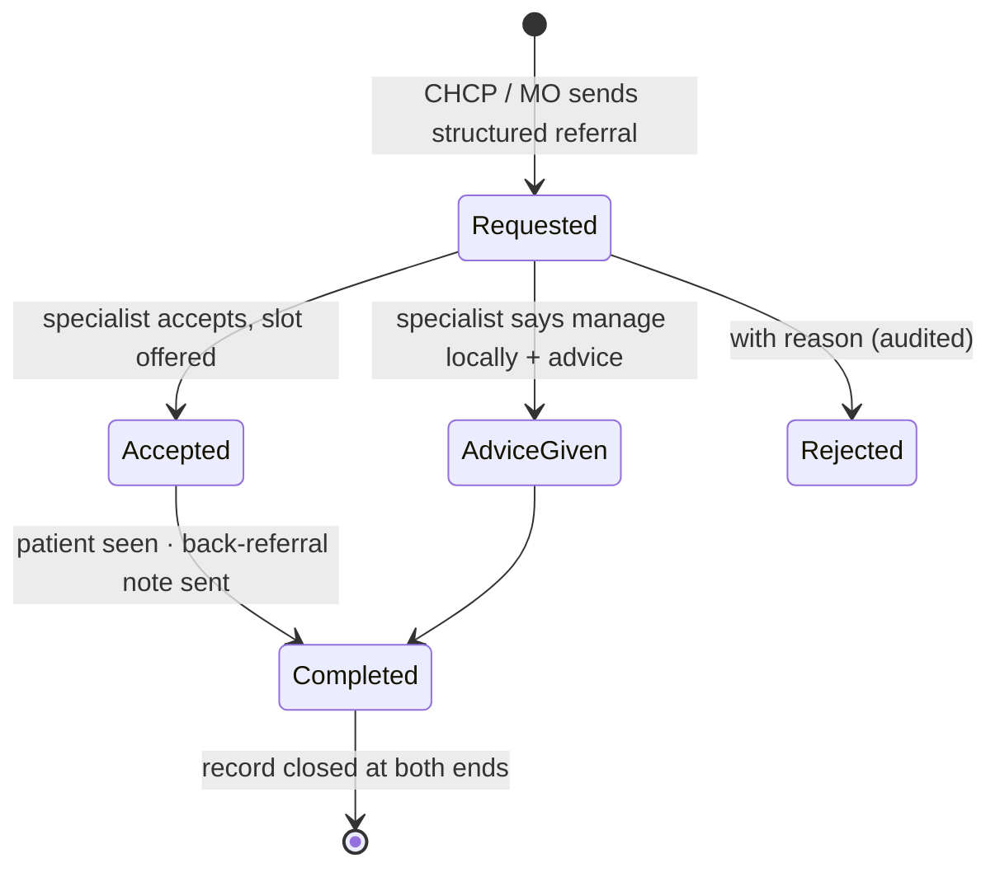
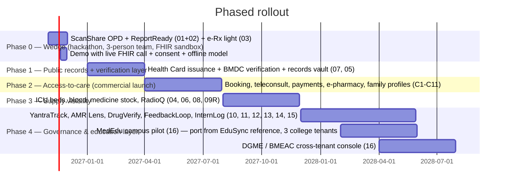

# CareLoop — Unified Platform Plan
## A Digital Medicare Platform for Bangladesh

> **One-line pitch:** *One Health ID, one complete healthcare loop — register, consult, prescribe, deliver medicine, test, refer, follow up — with no lost paper, no fake doctors, no dead ends.*

> **Note on naming:** This is the unified planning document for the platform also referred to as **BD-HealthLoop** in [`modules/`](../modules/README.md) and pitched as **CareLoop** in the E-Health Hackathon 2026 research ([`hackathon-research/`](../hackathon-research/MASTER_PLAN.md)). Same platform, same spine — this document ties everything together.

**Version:** 1.0 · **Date:** Nov 2026 · **Status:** Planning

---

## Table of contents

1. [Why this platform](#1-why-this-platform)
2. [The platform at a glance](#2-the-platform-at-a-glance)
3. [Who it serves](#3-who-it-serves)
4. [Feature catalog](#4-feature-catalog)
5. [How the platform works](#5-how-the-platform-works)
6. [How each user uses it](#6-how-each-user-uses-it)
7. [End-to-end app flows](#7-end-to-end-app-flows)
8. [Trust, safety and privacy](#8-trust-safety-and-privacy)
9. [Business model and sustainability](#9-business-model-and-sustainability)
10. [Technology stack](#10-technology-stack)
11. [Rollout roadmap](#11-rollout-roadmap)
12. [Risks and lessons from failures](#12-risks-and-lessons-from-failures)
13. [Document map](#13-document-map)

> For the detailed problem–evidence–solution mapping, see the companion doc **[`PROBLEM_AND_SOLUTION.md`](./PROBLEM_AND_SOLUTION.md)**.

---

## 1. Why this platform

Bangladesh's healthcare system works hard but leaks at every step of the patient journey:

| Stage | What breaks | Evidence |
|---|---|---|
| **Paying** | The patient pays for almost everything | **79.31%** of health spending is out-of-pocket (World Bank 2023); insurance covers <1% of the population |
| **Getting in** | No booking system, hours in queues, ~48-second consultations | DMCH ~7,000 OPD/day; specialist wait 2–3 months |
| **Getting seen by the right person** | No referral loop — patients jump straight to Dhaka tertiary hospitals | **59% of tertiary inpatients self-refer**; 58% don't know a referral system exists |
| **Being treated safely** | Paper prescriptions, fake doctors, antibiotic overuse | ~80% prescriptions illegible; only **4.81%** of physicians keep digital records; **32%** of the health workforce is unqualified |
| **Getting medicine** | Stock-outs, price opacity, counterfeit drugs | 22% essential-medicine availability in public facilities; **Tk 600 crore/yr** counterfeit market |
| **Knowing the result** | Lab reports delayed, re-tested, or lost | OpenELIS exists in ~100 hospitals but never notifies patients |
| **Being tracked** | Every visit starts from zero | 51.4% paper records, 22% store nothing at all |
| **Trusting** | Brokers (dalals), bribes, fake clinics | 48.7% of government-facility users experienced corruption (TIB); ~5,000 illegal clinics identified |

**Why now:** Bangladesh's *Digital Health Strategy 2023–2028* mandates a national Health ID (NID/BRN-keyed), a consent-based shared health record (SeHR) and an open exchange (NDHIE) — the infrastructure mandate exists, but almost nothing is built on it yet. Private startup funding in health was only ~$32M (2015–2023), so no incumbent owns the space. Meanwhile phone penetration (73%+ of households own smartphones), bKash/Nagad, and BMDC's public doctor registry make a build like this feasible for the first time.

This platform is designed to sit **on top of that mandated infrastructure** — the Health ID and BD Core FHIR — and make the card *do something useful at a real service point* on day one.

---

## 2. The platform at a glance

CareLoop is **one system with five faces** — every stakeholder gets the tools they need, all sharing one clinical spine.



**The four anchor pillars:**

| Pillar | Meaning | Key modules |
|---|---|---|
| **1. Identity & Records** | One patient = one ID = one longitudinal record, forever | 07 Health Card, 05 Integrated Core |
| **2. Access to care** | Get seen, get referred, get admitted — without brokers or chaos | 01 Appointment, 04 ICU Beds, 08 Blood Bank, 09 RadioQ |
| **3. Treatment quality** | Verifiable prescriptions, verified drugs, rational antibiotic use | 03 Prescription, 13 DrugVerify, 11 AMR Lens, 12 NCD Sathi |
| **4. Trust & accountability** | Verified doctors, transparent prices, real feedback loops | 14 FeedbackLoop, 10 YantraTrack, admin registries |

**Retention engine (product-design insight):** booking and consultation are low-frequency events. What keeps users returning between illness episodes — the proven pattern from India's Eka Care and Tata 1mg — is the **records vault**, **chronic-medicine refills** and **family profiles**. These are first-class features here, not afterthoughts.

---

## 3. Who it serves

| Stakeholder | Their pain today | What they get |
|---|---|---|
| **Patient / family** | Pay, queue, self-refer, lose papers, buy medicine blindly | One ID, booking, teleconsult, e-Rx, medicine delivery, lab-to-phone, records vault, price transparency |
| **Doctor** | 50+ patients/day, no digital tools, manual fees, multi-chamber practice | Chamber-in-a-box: token queue, structured e-Rx, drug-interaction checks, practice analytics, teleconsult income |
| **Rural first-line worker (CHCP/CHW)** | Manual double entry, no decision support, no feedback on referrals | Offline Bangla protocol assistant (NCD Sathi), referral inbox, closed-loop responses |
| **Hospital / clinic** | Paper OPD, idle equipment, stock blindness, no patient history | HMS-lite: QR check-in, queue, billing, bed/blood/radiotherapy visibility, referral management |
| **Pharmacy / diagnostic lab** | Counterfeit exposure, no Rx verification, demand opacity, expiry waste | DGDA-catalog POS, Rx verification gate, automated order feed, expiry alerts |
| **NGO / corporate (RMG factories)** | Employee health is opaque and costly | Health packages, factory clinic digitization, salary-deduction payment, surveillance dashboards |
| **Medical students & faculty** | Colleges run on WhatsApp + notice boards; 43% teaching posts vacant; assessments are signature-only | **MedEdu campus layer (Module 16)**: courses, assignments, timed auto-graded quizzes, study groups, lectures, duty rosters, accreditation evidence |
| **Regulator / government (DGHS, DGDA, BMDC)** | 114 fragmented initiatives, no unified picture | One analytics layer: AMR surveillance, equipment uptime, drug-stock maps, fake-practitioner flags |

---

## 4. Feature catalog

### 4.1 Core patient-facing features (the commerce layer)

| # | Feature | What it does | Why it wins |
|---|---|---|---|
| C1 | **Health ID + QR card** | NID/BRN-keyed ID, 9-series test IDs; durable QR; works on shared phones | The mandated national infrastructure; all other features hang on it |
| C2 | **Symptom triage → doctor match** | Bangla-first, voice-friendly rules engine; red-flag rules escalate to emergency | Routes to the *right level* of care; never diagnoses (BMDC compliance) |
| C3 | **Appointment booking (Scan & Share)** | Book or walk in, show QR, token in seconds, live queue display | India's model cut OPD wait from 30–40 min to 5–10 min |
| C4 | **Teleconsultation** | Video → auto-degrades to audio → text at 2G; in-consult payment | Extends scarce specialist supply to rural patients |
| C5 | **Digital prescription (e-Rx)** | Structured, tamper-proof, QR-verifiable; auto-fills pharmacy cart | Kills illegibility; enables the medicine delivery loop |
| C6 | **E-pharmacy / medicine finder** | Order from prescription; locate nearby stock; generic cheaper alternatives | Connects Rx → delivery in one tap |
| C7 | **Drug verification (DrugVerify)** | Scan 2D DataMatrix to check DGDA registration + batch + expiry | Direct weapon against the counterfeit market |
| C8 | **Lab tests & reports** | Book tests, home sample collection, report auto-files to ID, Bangla SMS + PIN | Ends re-testing and lost reports |
| C9 | **Records vault** | Every visit, Rx, report, admission auto-files under the Health ID; consent-gated sharing | The retention moat; nothing starts from zero again |
| C10 | **Family profiles** | Parent/guardian manages children + elders; proxy access with consent | Matches how rural users actually share phones |
| C11 | **Payments** | bKash, Nagad, Rocket, cards via SSLCommerz; cash option; corporate wallet | Native to how Bangladesh pays |

### 4.2 The 16 specialist modules (supply-side and governance layer)

Full specs live in [`modules/`](../modules/README.md) — each module has README, APP_FLOW, FEATURES and IMPLEMENTATION docs.

> A teaching hospital is a *campus AND a hospital* — the platform digitizes the hospital half, and **Module 16 (MedEdu)** supplies the campus half.

| Module | One-line summary | Solved leak |
|---|---|---|
| [01 Appointment](../modules/01-appointment/README.md) | QR Scan & Share check-in, smart token, live queue | Queue chaos, 48-s consultations unstructured |
| [02 Test Reports](../modules/02-test-reports/README.md) | Auto-file reports to Health ID, Bangla SMS, critical-value alerts | Lost/repeated tests |
| [03 Prescription](../modules/03-prescription/README.md) | Digital Rx, DGDA catalog, interaction checks, AWaRe stewardship | Illegible/outdated Rx, irrational prescribing |
| [04 ICU Beds](../modules/04-icu-beds/README.md) | Verified real-time ICU bed map, anti-gaming audit, ambulance pre-alert | 1.7 ICU beds/100k, 38/64 districts with zero |
| [05 Integrated Core](../modules/05-integrated-system/README.md) | FHIR R4 spine, longitudinal record, consent engine | 51.4% paper records, data silos |
| [06 Medicine Stock](../modules/06-medicine-stock/README.md) | Geolocated stock finder, generic advisor, eLMIS bridge | 84% of patients return empty-handed from public clinics |
| [07 Health Card](../modules/07-health-card/README.md) | Health ID, QR card, offline PWA, proxy access, break-glass | No unified identifier in active service |
| [08 Blood Bank](../modules/08-blood-bank/README.md) | Live hospital blood inventory, rare-type network, FIFO expiry | 1M+ bags needed/yr, zero stock visibility |
| [09 Prodona](../modules/09-prodona/README.md) | Verified medical crowdfunding, organ pledge registry, equipment aid | OOP spending pushing millions into poverty |
| [09 RadioQ](../modules/09-radioq/README.md) | National radiotherapy waiting list, published-rule priority, machine-down replan | 7,500 patients waiting; 4/6 NICRH machines down |
| [10 YantraTrack](../modules/10-yantra-track/README.md) | QR equipment fault reporting, SLA timers, public uptime | 52% of diagnostic equipment idle 1+ year |
| [11 AMR Lens](../modules/11-amr-lens/README.md) | Antibiotic sale surveillance over existing pharmacy POS | ~45% antibiotics sold without Rx |
| [12 NCD Sathi](../modules/12-ncd-sathi/README.md) | Offline Bangla hypertension/diabetes protocol for CHCPs | 15.8% adults with undiagnosed hypertension |
| [13 DrugVerify](../modules/13-drug-verify/README.md) | Batch-level 2D DataMatrix authenticity scan | Tk 600 crore counterfeit market |
| [14 FeedbackLoop](../modules/14-feedback-loop/README.md) | Outbound SMS feedback, facility ratings, grievance escalation | No feedback channel; corruption invisible |
| [15 InternLog](../modules/15-intern-log/README.md) | Competency e-logbook for MBBS interns, supervisor OTP sign-off | 66%+ of interns assessed only by a signature |
| [16 MedEdu](../modules/16-med-edu/README.md) | EduSync-derived campus layer: courses, assignments, auto-graded quizzes, study groups, lectures, duty rosters, evidence chains | Medical colleges run on WhatsApp + notice boards; 43% faculty vacancy unmitigated; zero assessment analytics |

> **Depth vs the MVP wedge:** for the hackathon (3–5 Dec 2026, team of 3), only modules **01 + 02/05 + 03** are built live against the FHIR sandbox — that is the original CareLoop pitch. This document is the *full platform* those modules grow into. See section 11 for the build order.

---

## 5. How the platform works

### 5.1 Architecture in layers



### 5.2 The core mechanics

1. **Identity:** every person is one FHIR `Patient` keyed to a Health ID (NID/BRN). No service can start without resolving the ID — this is what makes records, referrals and prescriptions *continuous*.

2. **Consent-gated records:** any access to records produces a consent artifact (who, what, why, until when). Patients can see the access history. Emergency "break-glass" access exists but triggers an audit and immediate patient notification.

3. **The feedback loop (why it closes):**
   ```mermaid
   flowchart LR
       A["Book / walk in<br/>(QR token)"] --> B["Consult<br/>(in-person or video)"]
       B --> C["e-Rx filed<br/>to Health ID"]
       C --> D["Medicine ordered /<br/>delivered"]
       C --> E["Lab test booked"]
       E --> F["Report auto-filed<br/>+ Bangla SMS"]
       D --> G["Follow-up reminder<br/>D+3 / D+7"]
       F --> G
       G --> H["Records vault<br/>(next visit starts here)"]
       H -.-> A
       style H fill:#eef6ff,stroke:#3b82f6
   ```
   The loop is closed at every step — the prescription is data, the medicine order springs from it, the report flies back to the same ID, and the follow-up restarts the cycle. Nothing ends as paper.

4. **Verification gates (where trust is enforced):**
   - *Doctor gate:* a practitioner cannot be listed before BMDC registration is verified live against `verify.bmdc.org.bd`. The BMDC number shows on every profile and prescription.
   - *Drug gate:* a prescription-only medicine cannot be dispensed without a valid e-Rx or verified uploaded prescription; every dispensed batch is checked against the DGDA catalog.
   - *Facility gate:* clinics and labs list only with license numbers (Medical Practice Act 1982 regime; DGHS/DGDA files).

5. **Graded degradation (no single point of failure):**
   ```mermaid
   flowchart LR
       A["Smartphone + internet<br/>full app"] -->|2G| B["Video → audio → text consult"]
       A -->|offline| C["Cached UI, queued actions,<br/>sync on reconnect"]
       B -->|no smartphone| D["Hotline IVR (Bangla)<br/>call-center triage"]
       D -->|no phone| E["CHCP / agent-assisted<br/>counter tablet, printed QR"]
       style C fill:#fff3cd
   ```
   Shared phones are the realistic rural case (26% of *individuals* use smartphones even though 73% of households own one) — hence family profiles, proxy access, and printed QR cards.

---

## 6. How each user uses it

### 6.1 Patient — *"Rahima"*

**First time (onboard once):**
1. Opens the app (or an agent/USSD does it for her) → phone number + OTP → creates her Health ID from NID/BRN.
2. Adds family members as profiles (mother, son) — each with their own sub-ID under her guardianship.
3. Receives/prints a durable QR card. Done — she now has a record that never resets.

**Every illness episode:**
1. Symptoms → triage (Bangla, voice-friendly). Chest pain → immediate emergency routing. Common cold → nearest community clinic / pharmacist level.
2. Books a slot (or walks in and scans her QR at the counter → token in seconds; her full history opens on the doctor's screen).
3. Consults — in person or video. Doctor writes a structured e-Rx; it lands in her app as soon as it's written.
4. One tap on the e-Rx → medicine order → delivery or nearest stocked pharmacy (verified batches only).
5. If tests are needed → book, sample collected, report auto-files to her ID + Bangla SMS "আপনার রিপোর্ট তৈরি" with a PIN.
6. D+3/D+7 → follow-up reminder. Next visit anywhere in the country starts with her history, not from zero.

### 6.2 Doctor — *"Dr. Karim"*

1. Onboards once: BMDC verification → creates chamber slots (online + walk-in merged).
2. At each session, opens the **chamber-in-a-box** screen: live token queue, patient history beside the consult form.
3. Writes the e-Rx with drug-catalog autocomplete, interaction warnings, and AWaRe allergy/antibiotic guardrails; signs; the patient's copy is delivered digitally (SMS + PDF).
4. Referral: one structured form to a specialist (module 02/ReferLoop state machine); gets asynchronous advice or acceptance instead of waving the patient off.
5. Teleconsult slots run through the same tools — payment collected in-consult, prescription auto-delivered.
6. Monthly: practice analytics (no-shows, patient mix, revenue).

### 6.3 Rural first-line worker (CHCP) — *"Nasrin"*

1. Opens the offline-capable Bangla protocol app (NCD Sathi) at the community clinic — works with no network, syncs later.
2. Takes blood pressure/glucose → follows the built-in decision support → risk-classified → needs specialist? sends a structured referral from inside the app.
3. Gets the specialist's advice or acceptance *back in the same thread* — the loop Nasrin has never seen in 20 years.
4. Patient History and visits auto-sync to DHIS2 — no afternoon of double entry.

### 6.4 Hospital / clinic administrator

1. Registers the facility with a license number; gets the HMS-lite console (OPD queue, billing, referral inbox).
2. Deploys Scan & Share tablets at counters; patients self-check-in with QR.
3. Feeds bed, blood, equipment and radiotherapy-capacity data through the module dashboards (04, 08, 09R, 10) — public visibility replaces phone-call begging, and exposes queues the old way never did.
4. Receives patient feedback (14) and grievances with an escalation trail.

### 6.5 Pharmacy / lab

1. Pharmacy installs the DGDA-catalog POS (or plugs its existing MediPOS/Jeeon/Pharmly POS into the AMR Lens data layer).
2. Checks every e-Rx against the verification gate → dispenses → batch scan logs authenticity (13) and antibiotic sales data (11).
3. Receives prescription-originated orders (C6) with delivery routing; expiry (FIFO) alerts cut waste.
4. Lab connects via the OpenELIS-style connector; results push to the patient's ID automatically (02).

### 6.6 Regulator / government (view-only plus registry management)

1. Dashboards: antibiotic sales (AMR), equipment downtime, drug-stock maps, facility ratings, consultation volumes, disease-signal surveillance (to DHIS2/NDHIE-compatible profiles).
2. Registry reconciliation: platform-listed doctors vs the BMDC register → expiry/cancellation → automatic delisting; reported fake-practitioner flags.
3. The data hand-off is open-FHIR based; open-sourced modules can be adopted rather than rebuilt (the lesson from Babyl Rwanda's collapse).

---

## 7. End-to-end app flows

### 7.1 Master flow — everything hangs on one loop



### 7.2 The consultation-day flow (Scan & Share)



### 7.3 Emergency flow (the "do not queue" path)



### 7.4 Referral loop (up and back)



Every referral has a **mirror back** — the "back-referral note" is what keeps public-hospital OPDs functioning instead of choking, and is the single most requested feature reported missing today (58% of patients are unaware a referral system even exists).

### 7.5 Offline / feature-phone parity

| Capability | App | IVR hotline | USSD | Agent/CHW |
|---|---|---|---|---|
| Register / get ID | ✅ | ✅ (assisted) | ✅ *333-consistent menu* | ✅ |
| Triage | ✅ rules engine | ✅ Bangla IVR tree | limited | ✅ |
| Book | ✅ | ✅ callback | ✅ token code | ✅ |
| Consult | ✅ video→audio→text | ✅ audio | — | ✅ assisted video |
| e-Rx delivery | ✅ PDF/push | ✅ SMS link | ✅ SMS code | ✅ print |
| Reports | ✅ vault | ✅ SMS | ✅ SMS | ✅ |

This is not optional scope for Bangladesh — the collapse of Shastho Batayon 16263 (provider unpaid for 22 months) and of the DGHS telecentre network (234 → ~35 centres) shows that *demand without a self-sustaining payment model dies*. The agent-assisted channel is the sustainable answer: agents earn commission per verified service, replacing donor-subsidized call centers.

---

## 8. Trust, safety and privacy

| Trust requirement | How the platform enforces it |
|---|---|
| **No fake doctors** | BMDC live verification at onboarding; BMDC number displayed on profile & every e-Rx; auto-delist when registration expires/cancels; user "report a practitioner" flow feeding a reconciliation queue |
| **No counterfeit medicine** | DGDA-catalog gates on Rx dispensing and pharmacy listings; batch-level DataMatrix verification (13); prescription-only drugs locked behind valid e-Rx (per Drugs & Cosmetics Act 2023) |
| **No symptom-app answering** | Triage = routing, never diagnosis; LLM output only ever surfaces to a doctor as a prefill, never to the patient as advice (BMDC Telemedicine Guidelines 2020: AI may not counsel or prescribe); Bangla disclaimers everywhere |
| **Rational antibiotic use** | AWaRe-classification guardrails in the e-Rx tool; AMR Lens filters/watch-class sale surveillance; stewardship feedback to prescribers |
| **Teleconsult legality** | BMDC-registered doctors only; drug-prescribing matrix by consult mode; no anonymity; recorded consult metadata |
| **Data privacy (PDPO 2025)** | Health data = sensitive class: granular consent artifacts, purpose-locked & time-boxed access, complete audit log, patient-visible access history, breach-notification workflow, DPO role, data residency posture (regional hosting) |
| **Shared phones** | PIN-protected vault; SMS carries no clinical values; printed QR card + proxy/family access |
| **No gambling with the record** | Every write to the FHIR spine generates an `AuditEvent`; nothing user-facing mutates clinical records |

---

## 9. Business model and sustainability

**The hardest truth from the evidence:** demand without a payment model has already killed two national telehealth services (Shastho Batayon 16263, the USAID-backed telecentres), and a pure marketplace killed Doctorola (patients wouldn't pay commission; hospitals wouldn't either). CareLoop prices **service delivery**, not access.

| Revenue stream | Model | Benchmark |
|---|---|---|
| **Teleconsult & booking take-rate** | 10–30% on platform-sourced consults; first consult often 0% to seed a doctor-patient relationship | Practo ≈ 6–7% blended take on ~₹3,500cr GMV |
| **E-pharmacy & lab margin** | 8–15% on Rx drugs; 20–30% commission on lab tests; chronic-refill subscriptions anchor retention | Tata 1mg lab take-rates |
| **Clinic/hospital SaaS** | HMS-lite tiers (≈ BDT equivalent of ₹999–1,500/mo entry tier) | Practo Ray pattern |
| **Family health subscription** | Free/5 consult credits, delivery discounts, records vault features | 1mg / Practo Plus pattern |
| **Corporate & RMG packages** | Factory-clinic digitization + salary-deduction wallet; pero-employee pricing | MILVIK/BIMA already bundles tele+insurance via mobile wallet in BD |
| **Agency channel margin** | Commission per verified assisted service (rural agents replacing donor-funded call centers) | The self-sustaining replacement for collapsed telecentre networks |
| **Government delegation** | Contract running of national hotlines/lists (RadioQ-style registries) | A2i/DGHS procurement precedent |

**Unit-economics guardrails:**
- Target LTV:CAC ≥ 3:1; BD social/organic CAC is materially cheaper than Western markets (FB/YouTube dominance).
- Retention anchored on chronic refills + records habits, *not* booking (month-1 D30 medians are low-single-digits for health apps).
- Scalping check: never carry revenue on a feature that collapses if a donor pulls out. Every stream above pays in cash or takes a transaction fee.

---

## 10. Technology stack

| Layer | Choice | Notes |
|---|---|---|
| Mobile | **Flutter** (or PWA-first for the hackathon demo) | offline cache (sqflite/Drift), ≤20MB, 2G tolerable |
| Web doctor/hospital console | Next.js | SSR-light, works on counter tablets |
| Backend | Node.js (NestJS) or FastAPI | modular services |
| Database | PostgreSQL (+ Redis) | ACID for records; queues for OTP/notifications |
| Clinical standard | **BD Core FHIR R4** + base FHIR where profiles are missing | sandbox: `sandbox.fhir.dghs.gov.bd/fhir` |
| Storage | S3-compatible | reports, imaging, Rx PDFs |
| Payments | **SSLCommerz** (bKash/Nagad/Rocket/cards in one integration) | direct bKash tokenized when volume justifies |
| SMS/OTP | SSL Wireless / Alpha Net | DB-registered sender ID |
| Video | 100ms / Agora / Jitsi | degrade to audio, then to text |
| ID/verification | BMDC public register API-ish; NID/BRN lookup; DGDA catalog | mock adapters for pilot phases |
| Infra / residency | AWS ap-south-1 (or local DC) | PDPO 2025 posture |

A full ER diagram and integration spec per module lives in each module's `IMPLEMENTATION.md`.

---

## 11. Rollout roadmap



**Principle:** each phase is independently useful, independently fundable, and uses synthetic data until any production integration is signed (Health IDs start with a **9** in tests — **never** a real NID). **Module 16 (MedEdu)** is *not* built from scratch — it is ported from the working **EduSync** reference codebase (courses, assignments, auto-graded quizzes, study groups, Socket.IO realtime bridge), re-tenanted per medical college, and welded to Module 15's identity so students and interns are one continuous record.

---

## 12. Risks and lessons from failures

| Failure observed elsewhere | Lesson applied here |
|---|---|
| **Doctorola** — a pure booking marketplace that went dormant | Don't sell access; build the loop (RxCart, vault) patients return to between visits |
| **Shastho Batayon 16263 / USAID telecentres collapse** | Every assisted channel must carry its own revenue (agent commission model) — no donor-dependent lines |
| **Babyl Rwanda** (collapsed with its vendor) | Open-source the spine; hand ownership paths to DGHS from day one |
| **Kenya M-TIBA** (health wallet shut 2026) | Don't build the product *on a wallet*; wallets are a payment rail, not a moat |
| **Brazil SISREG** (central list bypassed, 33% late ICU authorizations) | Any national waiting list (RadioQ, ICU beds) needs published rules + audit + stakeholder buy-in, not just a database |
| **India Kilkari** (16M reach, no outcome change) | Instrument *outcomes* (referral accepted %, loops closed, critical values delivered) — not badge numbers |
| Its own risk register (see [`hackathon-research/MASTER_PLAN.md` §8](../hackathon-research/MASTER_PLAN.md)) | Privacy (PDPO), no internet at pilot sites, shared phones, clinical liability, specialist time, DGHS builds-it-first, vendor lock-in, invented clinical thresholds — with mitigations |

---

## 13. Document map

| Area | Document |
|---|---|
| **This unified plan** | [`docs/UNIFIED_PLATFORM_PLAN.md`](./UNIFIED_PLATFORM_PLAN.md) |
| **Problem–solution mapping (dedicated)** | [`docs/PROBLEM_AND_SOLUTION.md`](./PROBLEM_AND_SOLUTION.md) |
| Hackathon master plan & scoring | [`hackathon-research/MASTER_PLAN.md`](../hackathon-research/MASTER_PLAN.md) |
| BD healthcare & digital-health research (fresh, Nov 2026) | [`research-bangladesh-healthcare.md`](../research-bangladesh-healthcare.md) |
| 15 module specs (README / APP_FLOW / FEATURES / IMPLEMENTATION) | [`modules/README.md`](../modules/README.md) |
| Bangladesh problems (original research) | [`hackathon-research/02_bangladesh_problems.md`](../hackathon-research/02_bangladesh_problems.md) |
| Global gap analysis (50 innovations) | [`hackathon-research/03_global_gap_analysis.md`](../hackathon-research/03_global_gap_analysis.md) |
| MVP idea details & demo scripts | [`hackathon-research/05_final_ideas.md`](../hackathon-research/05_final_ideas.md) |
| EduSync reference codebase (source of Module 16) | `C:\Users\Pritam\Downloads\edusnycdemo` (README + docs/) |
