# E-Health Hackathon 2026 — Master Plan (CareLoop)

**Event:** E-Health Hackathon & Symposium, MoHFW + WHO, 3–5 Dec 2026, Dhaka
**Research date:** 26 Oct 2026 · **Sources merged:** `00_summary`, `01`–`05`, `reports/`, `research_notes/`
**Charts:** Mermaid. They render in VS Code (Markdown Preview Mermaid Support), GitHub and Obsidian.

---

## 1. Executive summary

The organisers' one stated goal: *"solutions that power the national e-Health Card."*
So win by making the card **do something useful at a real service point**.

| Decision | Answer |
|---|---|
| **Main pitch** | **CareLoop** = ScanShare (arrive) + ReferLoop (move) + ReportReady (know) on one Health ID |
| **One-line pitch** | *CareLoop makes the e-Health Card register you, refer you and return your results on day one.* |
| **Stand-out alternative** | RadioQ (national radiotherapy waiting list) — most unique |
| **Team size** | Max **3 people** (official), not 3–5 |
| **Register by** | ~**17 Nov 2026** (opened 18 Oct, "one month", no exact date) |
| **Funnel** | 50 teams → 25 → top 5, 10-member screening committee |
| **Prize** | Recognition + possible government adoption. No cash found |

---

## 2. Hackathon intel

### 2.1 Known vs missing priority areas (6 of 15)

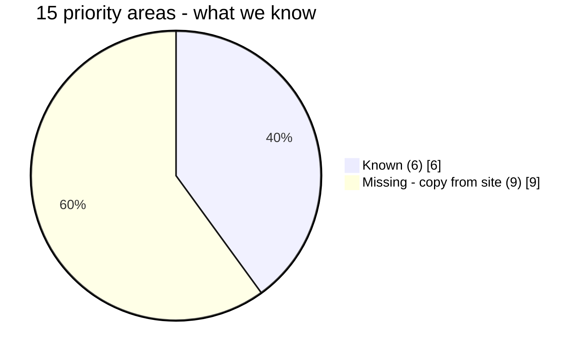

Known: primary care · electronic records · referrals · pharmacy · labs · ambulance services.
Press examples of pain points: **diagnosis backlogs, unverifiable prescriptions, lost referrals.**

### 2.2 Selection funnel

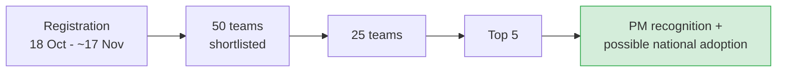

### 2.3 Timeline

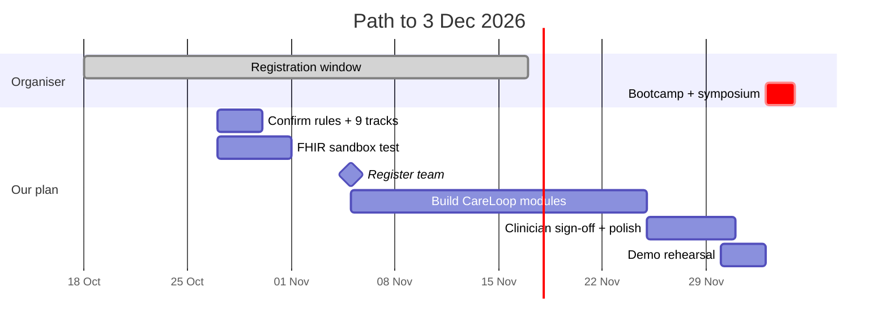

### 2.4 What judges likely want

- **Interoperability**, no "separate silos" (minister's words)
- **Transparency** — "every penny spent transparently"
- **Primary care** push: PHU in every union, 100,000 new CHWs
- A **live call to the FHIR sandbox** in the demo = most credible proof

---

## 3. The problem: evidence by stakeholder

### 3.1 Key numbers

| Area | Fact | Source |
|---|---|---|
| Cost | **79.31%** of health spending is out-of-pocket (2023) | World Bank |
| Consultation | **48 seconds** primary-care visit, shortest of 67 countries | BMJ Open |
| Referral | **59%** of tertiary patients self-refer; 58% unaware a system exists | BMC HSR 2024 |
| Occupancy | **148%** secondary, **137%** tertiary | BMC HSR 2024 |
| Pharmacy | **~45%** antibiotics sold without prescription; **7.56%** of Dhaka pharmacies have a registered pharmacist | PMC 2025 |
| NCD | Undiagnosed hypertension **15.8%** vs diagnosed 12.2% | BDHS |
| Mental health | **92.3%** untreated | WHO |
| Workforce | **12.78** doctors+nurses+midwives per 10,000 (WHO: 44.5) | Daily Star 2026 |
| Violence | **>80%** of health staff saw/experienced it; ~25% reported | TBS |
| Equipment | **52%** of diagnostic equipment unused for a year; **79%** of service gaps from malfunctions | PPRC 2026 |
| Budget | **94%** of institutions ended year with unspent budget | PPRC 2026 |
| Essential medicines | **22%** average availability | PPRC 2026 |
| Cancer | **~7,500** waiting for radiotherapy; 4 of 6 NICRH machines down | Dhaka Tribune, 20 Oct 2026 |
| Smartphones | **26%** rural use vs 73.4% households own one, so phones are shared | GSMA / BBS |

### 3.2 Where the system leaks (patient journey)

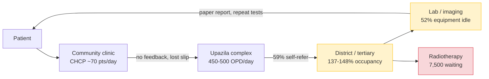

### 3.3 Institutional waste: money is not the bottleneck, information is

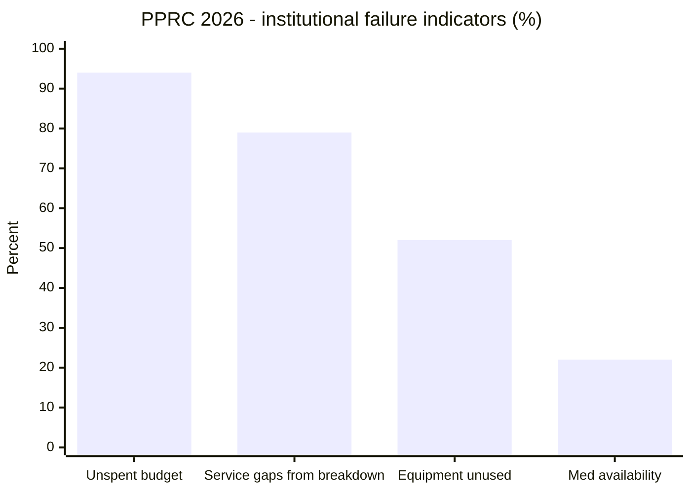

### 3.4 Medical education

| Fact | Number |
|---|---|
| MBBS seats | 11,101 across ~103 colleges (572 cut for 2025–26) |
| Government teaching posts vacant | ~43% |
| Interns assessed only by signature | >66% |
| Interns with no assessment after major rotation | ~54% |
| Colleges accredited by BMEAC | 2 |
| Postgraduate seats vs graduates | ~3,500 vs >11,000 per year |

---

## 4. Global gap analysis: proven abroad, missing at home

50 foreign innovations were checked against Bangladesh.

| Model | Result abroad | Bangladesh status | Verdict |
|---|---|---|---|
| **Vula** (South Africa) referral | 16 min median reply, 85.5% accepted | No closed loop | **Gap** |
| **Telessaúde** (Brazil) | 56–77% referrals avoided | Absent | **Gap** |
| **Scan & Share** (India) | Wait 30–40 → 5–10 min, 17,481 facilities | Absent | **Gap** |
| **SMS lab results** (Zambia) | Replaced 44.2-day postal delivery | OpenELIS in 100 hospitals, no push | **Gap** |
| **MEMMS** (Rwanda) | National equipment registry, >80% registered | Absent | **Gap** |
| **ePOCT+** (Tanzania) | Antibiotics 70.1% → 23.2% | Child IMCI done in Barishal; adult NCD open | **Partial** |
| Teleconsultation | — | 16263, DocTime | Saturated |
| Blood-donor matching | — | Bloodman, Facebook | Saturated |
| Drug-stock dashboard | — | DGHS eLMIS live | Saturated |
| Child IMCI app | — | All 319 Barishal facilities | Saturated |
| Ambulance dispatch | — | CriticaLink, TraumaLink, URAL, 999 | Saturated |

### Failures to learn from

| Failure | Lesson |
|---|---|
| India **Kilkari**: 16M reach, no breastfeeding effect | Reach is not outcome |
| Kenya **M-TIBA** wallet shut 2026 | Don't depend on a wallet |
| **Babyl Rwanda** collapsed with its vendor, 2023 | Open source, hand ownership to government |
| Brazil **SISREG**: 33% ICU authorisations late, 54% admissions bypass | A central register fails without enforcement |

**Pitch rule:** show an outcome metric, an offline fallback, and a government ownership plan.

---

## 5. The ten ideas, scored

Scores: **U**niqueness · **F**easibility 48h · **I**mpact · **J**udge-appeal · **D**ata availability (each /5).

| Rank | Idea | Area | U | F | I | J | D | **Total** |
|---|---|---|---|---|---|---|---|---|
| 1 | **ScanShare OPD**: Health-ID QR registration | records, primary care | 4 | 5 | 4 | 5 | 5 | **23** |
| 2 | **ReferLoop**: closed-loop referral | referrals | 4 | 4 | 5 | 5 | 4 | **22** |
| 3 | **RadioQ**: national radiotherapy list | labs, referrals | 5 | 4 | 5 | 5 | 3 | **22** |
| 4 | **ReportReady**: lab result to Health ID + SMS | labs, records | 4 | 5 | 4 | 4 | 4 | **21** |
| 5 | **YantraTrack**: QR equipment uptime | labs / operations | 5 | 5 | 4 | 4 | 3 | **21** |
| 6 | **AMR Lens**: antibiotic-sale data layer | pharmacy | 4 | 4 | 4 | 4 | 3 | **19** |
| 7 | **NCD Sathi**: adult HTN/diabetes protocol | primary care | 3 | 3 | 5 | 4 | 4 | **19** |
| 8 | **InternLog**: MBBS internship e-logbook | records (weak) | 3 | 5 | 3 | 3 | 4 | **18** |
| 9 | **AmbuSathi**: ambulance QR + ER pre-alert | ambulance | 3 | 4 | 4 | 4 | 2 | **17** |
| 10 | **FairOSCE**: digital OSCE scoring | records (weak) | 4 | 5 | 3 | 2 | 3 | **17** |

### 5.1 Total score chart

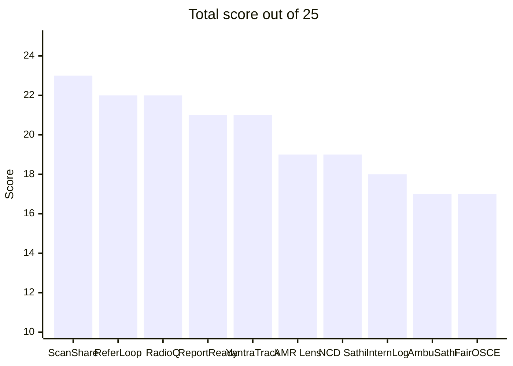

### 5.2 Impact vs feasibility

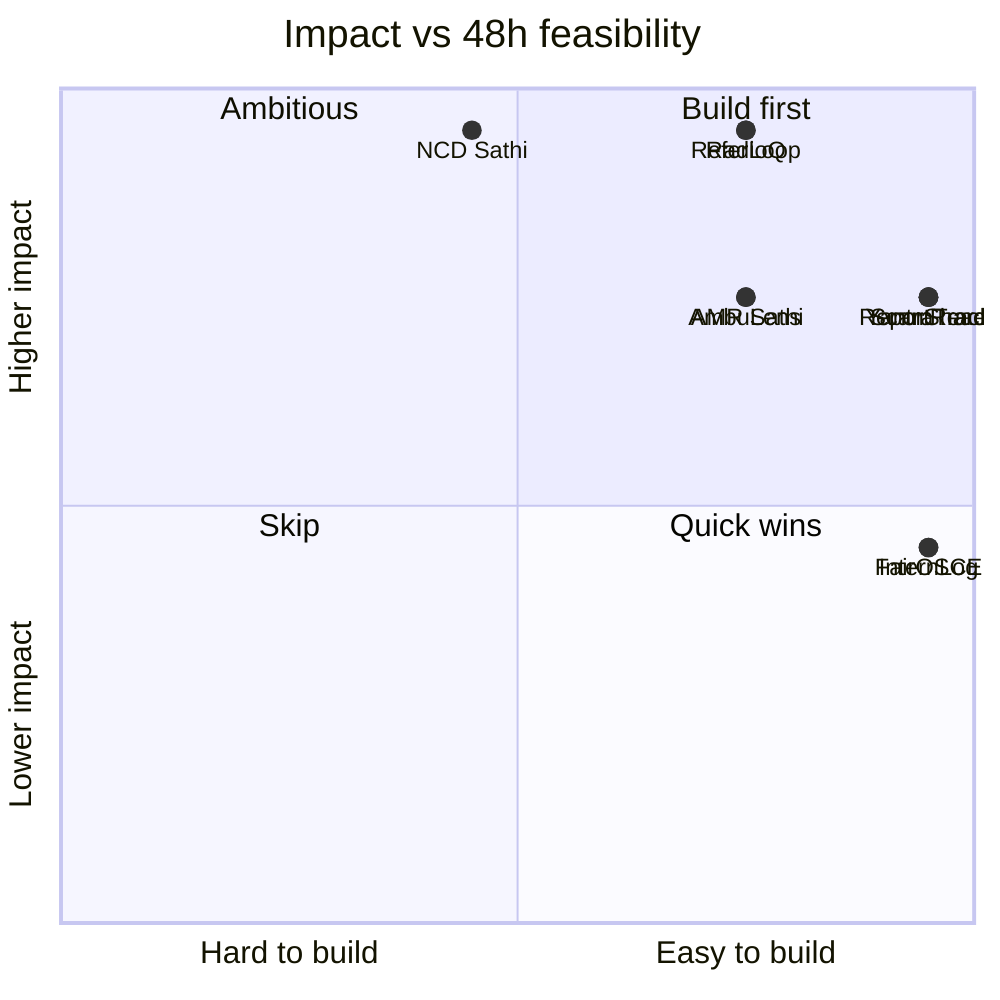

### 5.3 Stakeholder coverage

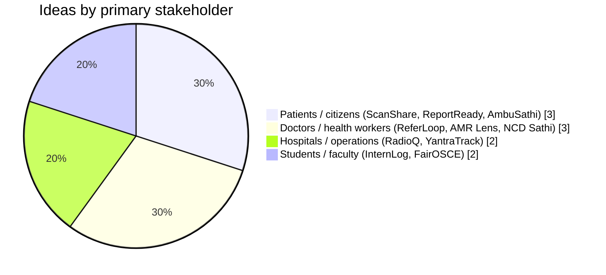

### 5.4 Rejected as generic or already covered

Telemedicine · OPD booking · symptom checker · e-prescription · hospital management system · drug-stock dashboard · child IMCI · blood-donor matching · standalone ambulance dispatch.

### 5.5 Reserve ideas

1. National blood-**stock** visibility (inventory absent, donor matching saturated)
2. Health-worker violence incident registry (only ~25% reported)
3. Outbound post-visit patient feedback (Mera Aspataal model)
4. Bangla neonatal-resuscitation serious game

---

## 6. Recommended: CareLoop

One Health ID, one patient journey, three screens, one backend.

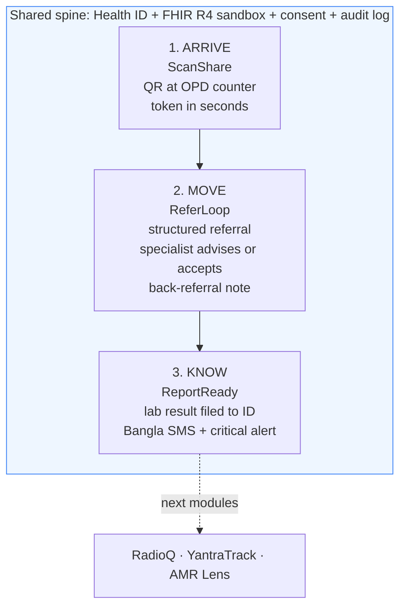

### 6.1 Architecture

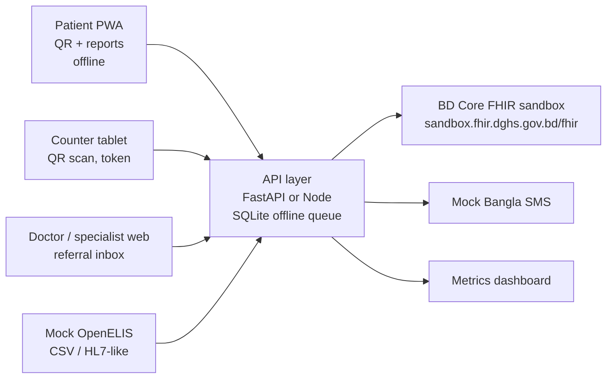

**FHIR resources:** `Patient` · `Encounter` · `ServiceRequest` + `Task` · `Communication` · `DiagnosticReport` + `Observation`.
Where the BD Core guide has no profile (ServiceRequest, Task), use base FHIR R4 and say so.

### 6.2 Team split (3 people)

| Person | Owns |
|---|---|
| **1** | QR PWA, counter screen, offline token queue |
| **2** | Referral form, specialist inbox, back-referral, status machine |
| **3** | Lab connector, Bangla SMS, critical alerts, dashboard |

### 6.3 Referral state machine

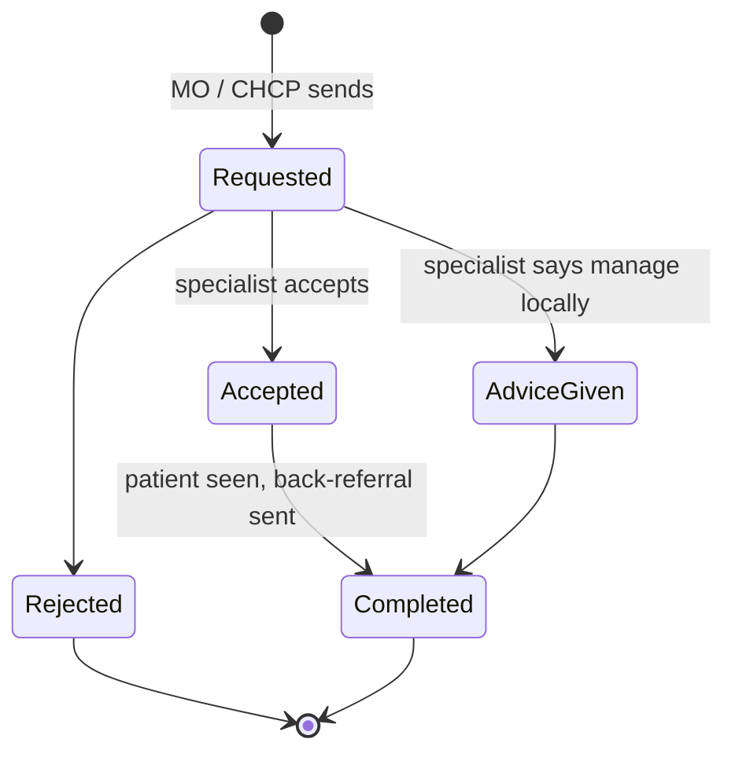

### 6.4 Demo flow (3 minutes)

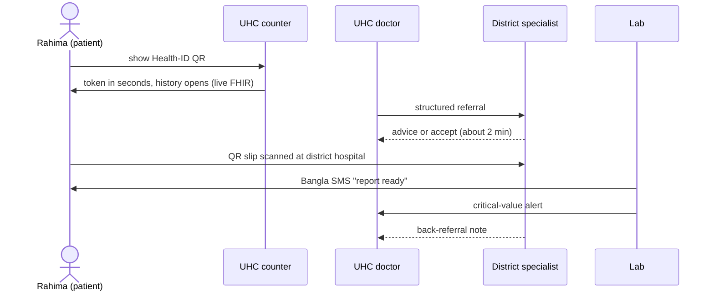

### 6.5 Pitch dashboard (one screen)

- Seconds to register
- Median specialist reply time
- % referrals managed locally
- % loops closed
- Hours from lab result to patient knowing

### 6.6 Foreign evidence behind each module

| Module | Evidence |
|---|---|
| ScanShare | India: 30–40 → 5–10 min wait |
| ReferLoop | Vula 16 min reply; Telessaúde 56–77% avoided |
| ReportReady | Zambia SMS replaced 44.2-day delivery |

---

## 7. Alternative: RadioQ (stand-out pitch)

Pick it if you want to stand out rather than fit in. No equivalent exists in Bangladesh, and the NICRH story is two days newer than the hackathon launch.

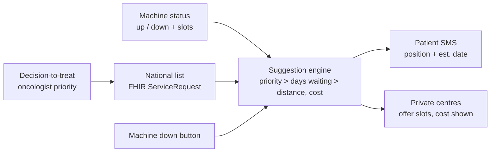

- **Hook:** 7,500 waiting, 4 of 6 machines down, appointments to end-2028
- **Policy use:** allocate the **17 new LINACs** due by June 2027 (6 Dhaka, 11 outside)
- **Rules:** clinicians set priority, software only orders by published rules, never auto-assign private slots, public view shows position number only
- **Data:** all synthetic. Label it clearly
- **Risk:** Brazil SISREG lesson, central lists get bypassed without enforcement

---

## 8. Risk register

| Risk | Hits | Mitigation |
|---|---|---|
| **Privacy (PDPO 2025)** health data is sensitive | all | Consent screen, access log, QR holds ID + token only |
| **No internet** at pilot sites | all | Offline queue, sync later, SMS fallback |
| **Shared phones**, 26% rural smartphone use | ScanShare, ReportReady | SMS carries no values, PIN, printed QR, proxy mode |
| **Clinical liability** | ReferLoop, NCD Sathi | Advice only, audit trail, physician signs off thresholds |
| **DGHS builds it themselves** | ScanShare | Open-source module, offer as adoptable pilot |
| **Vendor lock-in** (Babyl) | all | Open source, hand ownership to DGHS |
| **Specialist time** | ReferLoop | Async replies, urgency triage, CPD credit log |
| **Nurse/CHCP non-adoption** (Vula lesson) | ReferLoop | Design for CHCPs from day one |
| **Invented clinical thresholds** | ReportReady, NCD Sathi | Copy from guides, clinician sign-off, never invent |
| **Real patient data** | all | Synthetic data only. Health IDs start with 9. **Never use a real NID** |

Risk heat (likelihood vs severity):

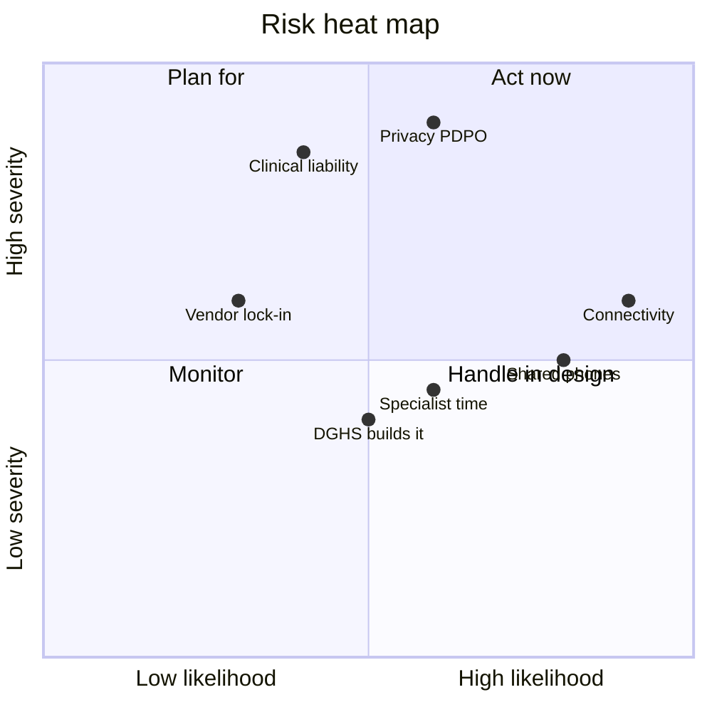

---

## 9. Action checklist

**This week**

- [ ] Open ehealthhackathonbd.org in a normal browser (site blocks bots). Copy the **15 priority areas**, judging criteria, deliverables
- [ ] Confirm **team limit = 3** on the registration form
- [ ] Test FHIR sandbox: write and read back one `Patient` with a fake Health ID starting "9"
- [ ] Re-rank ideas once the 9 missing areas are known

**Before ~17 Nov**

- [ ] Register team (individual or company)
- [ ] Lock choice: **CareLoop** or **RadioQ**
- [ ] Find a physician to sign off referral and lab-alert logic

**Build rules (from day one)**

- [ ] Consent screen + access log
- [ ] Offline queue
- [ ] Bangla UI and Bangla SMS
- [ ] Synthetic data only, labelled
- [ ] Use only the public DHIS2 demo instance, never production

**Corrections to the original brief**

| Brief said | Research found |
|---|---|
| Team 3–5 | **Max 3** |
| Out-of-pocket 69% | **79.31%** (World Bank 2023); 69% is a different series (NHA 2020) |
| Absenteeism 40% | **35%** overall; 40% is physicians at larger clinics, 2003 data |
| Private MBBS cost | **BDT 30–45 lakh** total |

---

## 10. Unknowns that could change the plan

1. The **9 unread priority areas**
2. **Judging criteria** and weights, and deliverable format
3. Whether the five-district e-Health Card pilot (Khulna, Noakhali, Bogura, Sirajganj, Narsingdi) has actually started
4. PDPO enforcement under the 2026 government
5. Venue (BICC vs "to be announced")

---

## 11. Source files

| File | Content |
|---|---|
| `00_summary.md` | Short summary |
| `01_hackathon_intel.md` | Tracks, timeline, rules, fetch log |
| `02_bangladesh_problems.md` | Problems by stakeholder |
| `03_global_gap_analysis.md` | 50 foreign innovations vs Bangladesh |
| `04_medical_education_and_institutions.md` | Education + hospital data |
| `05_final_ideas.md` | Full MVP plans, demo scripts, scores for all 10 ideas |
| `reports/Bangladesh eHealth hackathon ideas.md` | Narrative report |
| `research_notes/.../06_bangladesh_competitor_check.md` | Saturation verdicts |

Companion files carry the full citations and URLs for every number above.
