# 🔄 Application Flow — Hospital Appointment & Queue System

## Complete User Journeys, State Machines & Edge Case Handling

---

## Table of Contents

- [Overview](#overview)
- [Patient Registration Flow](#patient-registration-flow)
- [QR Code Scan Process](#qr-code-scan-process)
- [Appointment Lifecycle](#appointment-lifecycle)
- [Queue Management Flow](#queue-management-flow)
- [Token Calling System](#token-calling-system)
- [Offline Mode Flow](#offline-mode-flow)
- [Emergency Bypass Flow](#emergency-bypass-flow)
- [Edge Cases](#edge-cases)
- [Data Synchronization](#data-synchronization)

---

## Overview

This document describes every user journey and system flow within the Hospital Appointment & Queue Management System. Each flow is designed for **Bangladesh's public healthcare context** — intermittent connectivity, shared phones, paper-to-digital transition, and the reality of **~7,000 patients/day** at facilities like DMCH.

> [!NOTE]
> All flows are designed **offline-first**. The system must function even when internet connectivity drops — a common occurrence at rural UHCs and community clinics across Bangladesh.

### Flow Architecture Overview

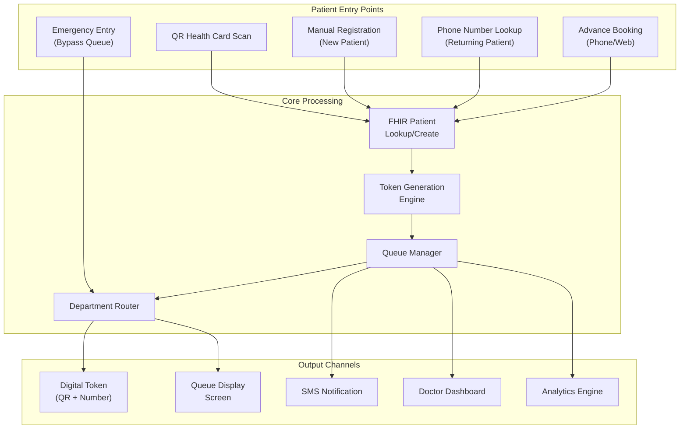

---

## Patient Registration Flow

### Flow 1: New Patient Registration (First Visit)

This is the most common flow at facilities without prior digital records. The patient has **no e-Health Card** and has never been registered digitally.

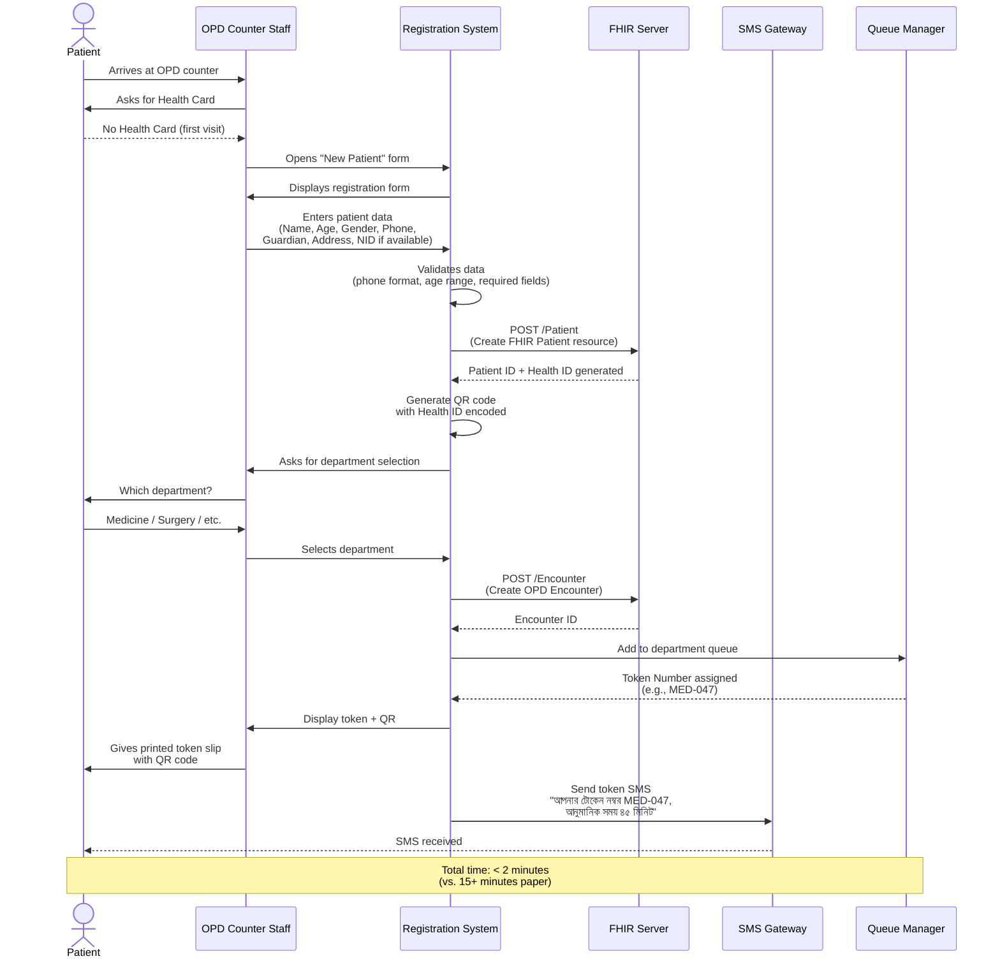

### Flow 2: Returning Patient with Health Card (QR Scan)

This is the **fastest flow** — the target experience for all patients once Health IDs are widely issued.

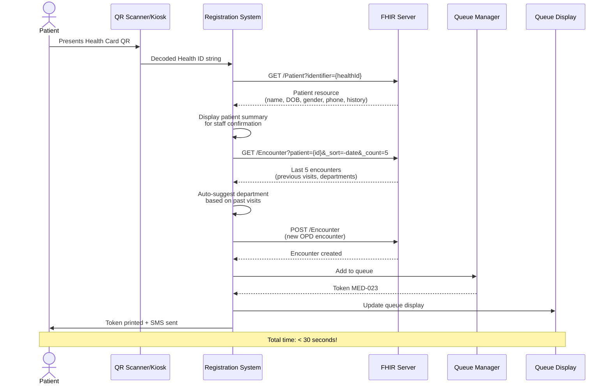

### Flow 3: Returning Patient Without Card (Phone Lookup)

When a patient has visited before but doesn't have their Health Card. Uses phone number as the lookup key.

> [!TIP]
> Since **73.4% of Bangladeshi households** own at least one mobile phone, phone number is the most reliable secondary identifier after the Health Card QR code.

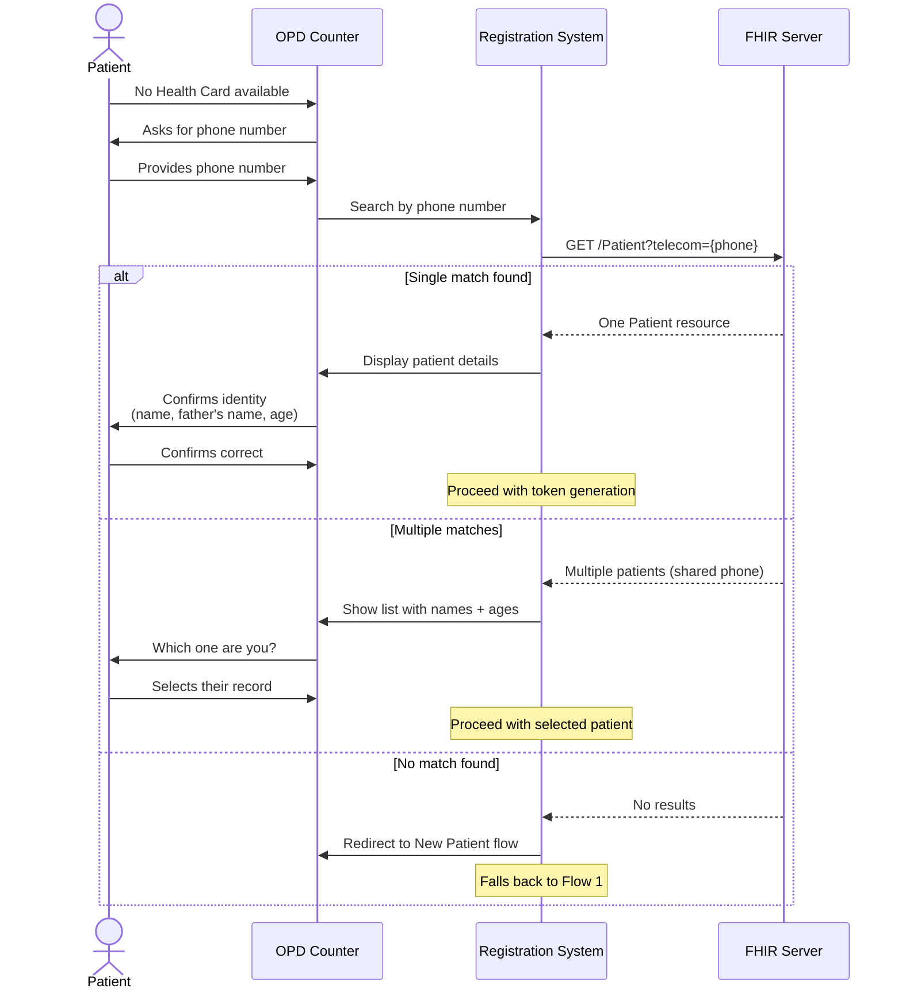

---

## QR Code Scan Process

### Detailed QR Scan Flow

The QR code on the e-Health Card encodes the patient's **Health ID** in a structured format. The scan flow validates, looks up, and creates an encounter in under 30 seconds.

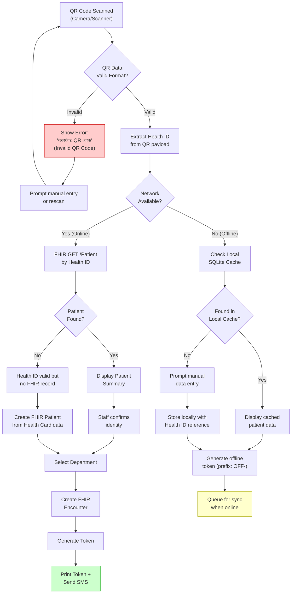

### QR Payload Structure

| Field | Format | Example |
|-------|--------|---------|
| Health ID | `BD-HID-XXXXXXXXXXXXX` | `BD-HID-2024051500123` |
| Version | Numeric | `1` |
| District Code | 2-digit | `33` (Dhaka) |
| Issue Date | YYYYMMDD | `20240515` |
| Checksum | CRC-16 | `A3F2` |

> [!WARNING]
> QR codes from **damaged or worn cards** may produce partial reads. The system must handle partial decodes by prompting the staff to enter the printed Health ID number manually (visible on card below the QR code).

---

## Appointment Lifecycle

### State Diagram — Complete Appointment Lifecycle

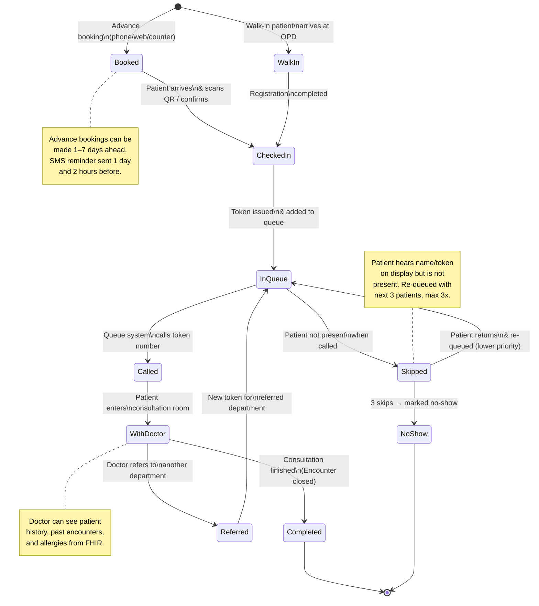

### Appointment Status Codes

| Status | Code | Description | Trigger |
|--------|------|-------------|---------|
| Booked | `BOOKED` | Advance appointment created | Patient/staff books |
| Checked-In | `CHECKED_IN` | Patient confirmed at facility | QR scan / counter confirmation |
| In Queue | `IN_QUEUE` | Token active, waiting | Token generated |
| Called | `CALLED` | Token number announced | Queue system calls next |
| Skipped | `SKIPPED` | Patient not present when called | 2-minute timeout |
| With Doctor | `WITH_DOCTOR` | Consultation in progress | Patient enters room |
| Completed | `COMPLETED` | Visit finished | Doctor marks done |
| Referred | `REFERRED` | Sent to another department | Doctor refers |
| No Show | `NO_SHOW` | Patient never appeared | 3 skips or day ends |
| Cancelled | `CANCELLED` | Appointment cancelled | Patient/staff cancels |

---

## Queue Management Flow

### Queue Processing Logic

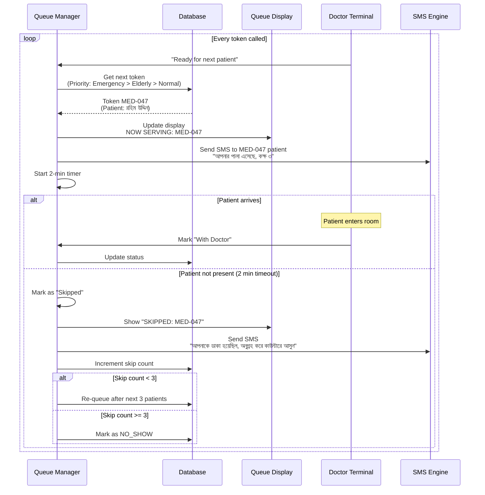

### Queue Priority Rules

| Priority Level | Category | Rule |
|---------------|----------|------|
| **P0** | Emergency | Bypass queue entirely, immediate attention |
| **P1** | Elderly (65+) | Auto-elevated, first 20% of queue |
| **P2** | Pregnant women | Auto-elevated from FHIR Patient data |
| **P3** | Disabled / Special needs | Flag at registration |
| **P4** | Advance appointment | Honored at booked time slot |
| **P5** | Normal walk-in | First-come-first-served |
| **P6** | Skipped / Re-queued | After next 3 normal patients |

> [!IMPORTANT]
> Priority elevation is **automatic** for elderly patients (age calculated from FHIR Patient.birthDate) and pregnant women (from active FHIR Condition). Manual override available for staff.

### Estimated Wait Time Calculation

The system calculates estimated wait time using:

```
estimatedWait = (positionInQueue × avgConsultationTime) + bufferTime

Where:
- positionInQueue = number of patients ahead (same department)
- avgConsultationTime = rolling average of last 20 consultations for that doctor
- bufferTime = 2 minutes (for transition between patients)
```

---

## Token Calling System

### Token Number Format

```
[DEPT_CODE]-[PRIORITY_PREFIX][SEQUENCE]

Examples:
  MED-047     → Medicine department, normal patient #47
  SUR-E003    → Surgery department, emergency patient #3
  GYN-P012    → Gynecology, priority patient #12
  ENT-OFF019  → ENT, offline-generated token #19
```

### Display Flow

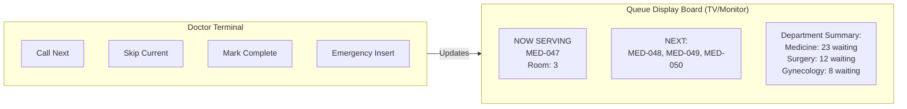

---

## Offline Mode Flow

### Offline-First Architecture

> [!WARNING]
> Internet connectivity is **unreliable** at many rural UHCs and community clinics in Bangladesh. Power outages are common. The system MUST function fully offline and sync when connectivity returns.

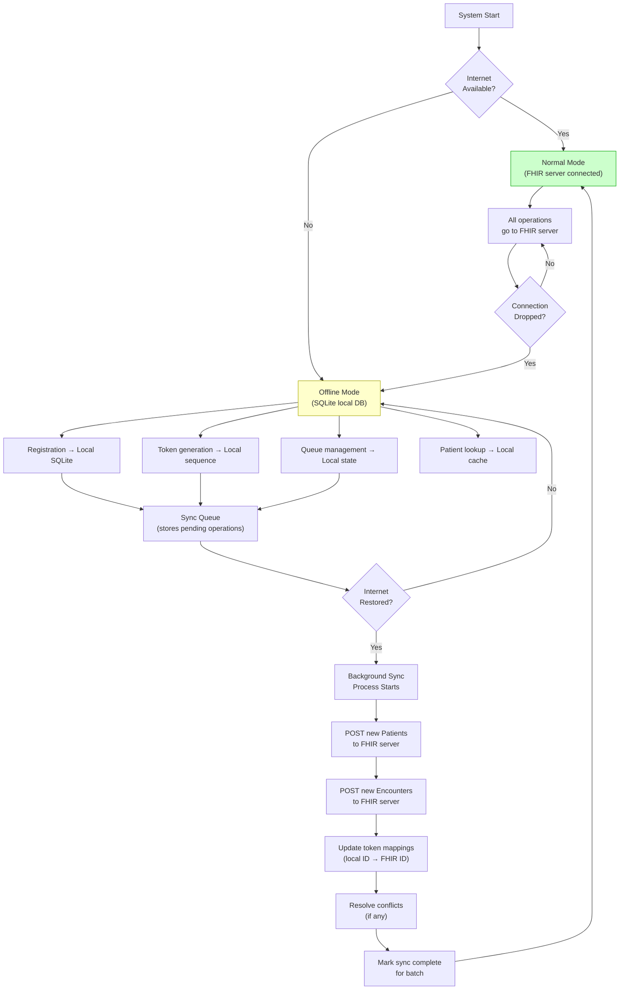

### Offline Sync Queue Schema

| Field | Type | Description |
|-------|------|-------------|
| `sync_id` | UUID | Unique sync operation ID |
| `operation` | ENUM | `CREATE_PATIENT`, `CREATE_ENCOUNTER`, `UPDATE_TOKEN` |
| `payload` | JSON | Full FHIR resource JSON |
| `created_at` | DATETIME | When operation was queued |
| `synced_at` | DATETIME | When successfully synced (null if pending) |
| `retry_count` | INT | Number of sync attempts |
| `status` | ENUM | `PENDING`, `SYNCING`, `SYNCED`, `FAILED` |
| `error_message` | TEXT | Error details if failed |

### Conflict Resolution Rules

| Conflict Type | Resolution |
|--------------|------------|
| Patient exists on server (same Health ID) | Merge: keep server record, update local reference |
| Encounter already created (duplicate) | Skip: mark local as synced, use server Encounter ID |
| Token number collision | Re-map: assign new token number from server sequence |
| Phone number changed on server | Keep server version (more recent update wins) |

---

## Emergency Bypass Flow

### Emergency Patient Registration

Emergency patients **bypass the regular queue entirely**. This flow is triggered when a patient arrives via ambulance, emergency department referral, or staff identifies a critical case.

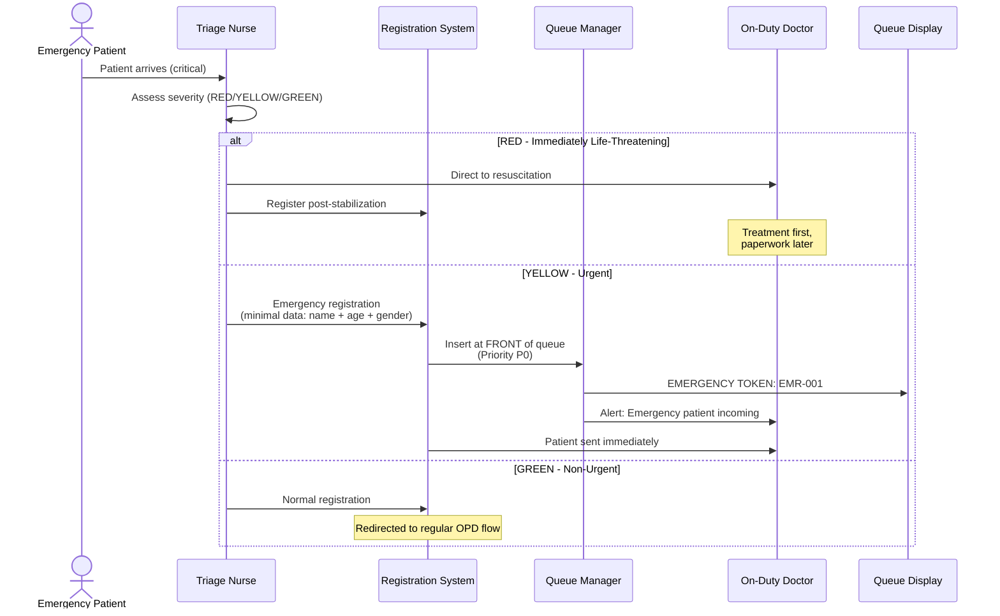

### Emergency Triage Categories

| Category | Color | Description | Queue Action |
|----------|-------|-------------|-------------|
| **Immediate** | 🔴 RED | Life-threatening | Bypass queue, direct to doctor |
| **Urgent** | 🟡 YELLOW | Serious but stable | Insert at front of queue |
| **Non-urgent** | 🟢 GREEN | Can wait safely | Normal queue with priority flag |

---

## Edge Cases

### Edge Case 1: Invalid QR Code

**Scenario**: Patient presents a damaged, expired, or non-standard QR code.

| Step | Action |
|------|--------|
| 1 | Scanner attempts to decode QR |
| 2 | Decoding fails or format doesn't match `BD-HID-*` pattern |
| 3 | System displays: "অকার্যকর QR কোড — অনুগ্রহ করে ম্যানুয়ালি নম্বর দিন" |
| 4 | Staff enters the Health ID number printed below QR on card |
| 5 | If manual entry also fails → fall back to phone number lookup |
| 6 | If phone lookup fails → create new patient record |
| 7 | Log the failed scan for quality monitoring |

### Edge Case 2: First-Time Patient with No Phone

**Scenario**: Patient (often elderly, rural) has no mobile phone.

| Step | Action |
|------|--------|
| 1 | Registration form allows phone field to be empty |
| 2 | System asks for guardian/family member phone (optional) |
| 3 | If no phone at all → token printed only, no SMS |
| 4 | Queue display becomes the primary notification channel |
| 5 | Patient advised to watch the display board |

### Edge Case 3: Shared Phone / Proxy Registration

**Scenario**: In Bangladesh, multiple family members often share one phone. A family member registers on behalf of another.

> [!NOTE]
> **73.4% of Bangladeshi households** own at least one mobile phone, but individual ownership is lower. It's common for one phone to be shared among 3–5 family members.

| Step | Action |
|------|--------|
| 1 | Registering person provides their phone number |
| 2 | System asks: "নিজের জন্য নাকি অন্য কারো জন্য?" (For yourself or someone else?) |
| 3 | If proxy → enter actual patient's name, age, gender separately |
| 4 | Phone number linked as "guardian phone" in FHIR Patient.contact |
| 5 | SMS sent to this number with patient name in message for clarity |
| 6 | Multiple patients can share one phone number (system handles this) |

### Edge Case 4: Multiple Departments Same Visit

**Scenario**: Patient needs to visit Medicine AND then get an X-ray referral.

| Step | Action |
|------|--------|
| 1 | Patient registered for Medicine → Token MED-023 |
| 2 | Doctor refers to Radiology |
| 3 | System auto-generates referral token RAD-015 |
| 4 | Same Encounter ID links both visits |
| 5 | Patient sees new queue position on display |
| 6 | SMS: "রেডিওলজিতে রেফার করা হয়েছে, নতুন টোকেন RAD-015" |

### Edge Case 5: Power Failure Mid-Registration

| Step | Action |
|------|--------|
| 1 | PWA service worker keeps app running |
| 2 | If device has battery → continues offline mode |
| 3 | If device dies → on restart, SQLite recovers uncommitted transactions |
| 4 | Partially entered data saved via auto-save every 5 seconds |
| 5 | Sync queue replays pending operations on reconnection |

### Edge Case 6: Doctor Absent / Leaves Mid-Day

| Step | Action |
|------|--------|
| 1 | Admin marks doctor as unavailable |
| 2 | Queue manager redistributes patients to available doctors |
| 3 | Affected patients get SMS: "আপনার ডাক্তার পরিবর্তন হয়েছে, নতুন কক্ষ ৫" |
| 4 | Token numbers preserved, only room assignment changes |

---

## Data Synchronization

### Sync Architecture

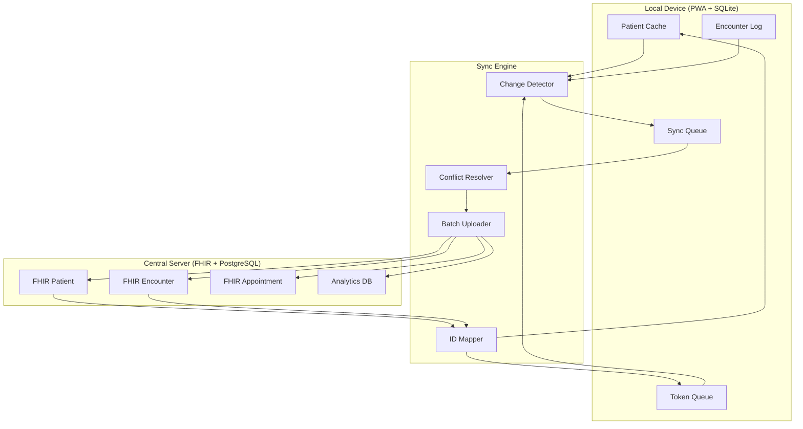

### Sync Frequency & Rules

| Condition | Sync Behavior |
|-----------|--------------|
| Online + WiFi | Real-time sync (every operation) |
| Online + Mobile data | Batch sync every 5 minutes |
| Just came online | Immediate full sync of pending queue |
| Offline | All operations queued locally |
| Sync conflict | Last-write-wins with server authority |
| Failed sync (3 retries) | Alert admin, hold for manual review |

---

## Flow Summary Table

| Flow | Trigger | Duration | Requires Internet | FHIR Resources |
|------|---------|----------|-------------------|----------------|
| New Patient Registration | Walk-in, no card | < 2 min | Preferred, not required | Patient, Encounter |
| QR Scan Registration | Health Card scan | < 30 sec | Preferred, not required | Patient (read), Encounter |
| Phone Lookup | No card, has phone | < 1 min | Preferred, not required | Patient (search), Encounter |
| Advance Booking | Phone/web/counter | < 3 min | Required | Appointment, Schedule, Slot |
| Emergency Bypass | Triage assessment | Immediate | Not required | Patient (minimal), Encounter |
| Queue Processing | Doctor calls next | Continuous | Not required | Encounter (update) |
| Offline Sync | Connectivity restored | Background | Required | All pending resources |

---

> [!IMPORTANT]
> All flows have been designed with input from UHC field staff and DMCH OPD managers. The flows account for the reality of 450–500 patients/day at a typical UHC and up to 7,000/day at DMCH.

---

*Last updated: November 2026 | See also: [FEATURES.md](./FEATURES.md) | [IMPLEMENTATION.md](./IMPLEMENTATION.md)*
