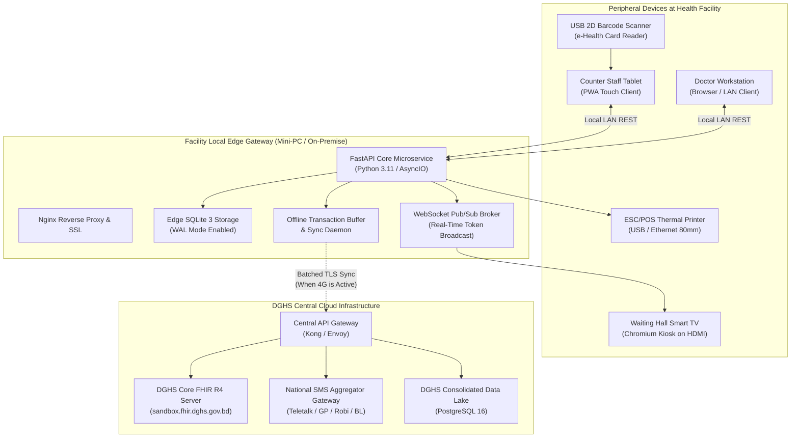
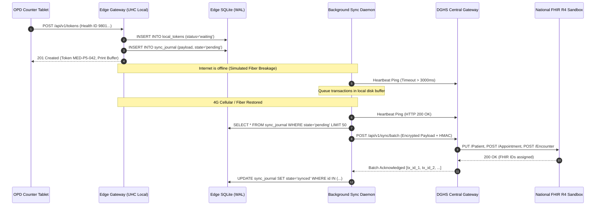
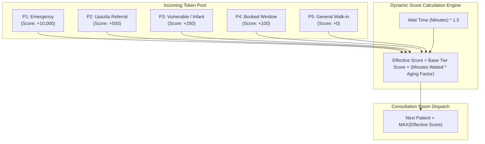
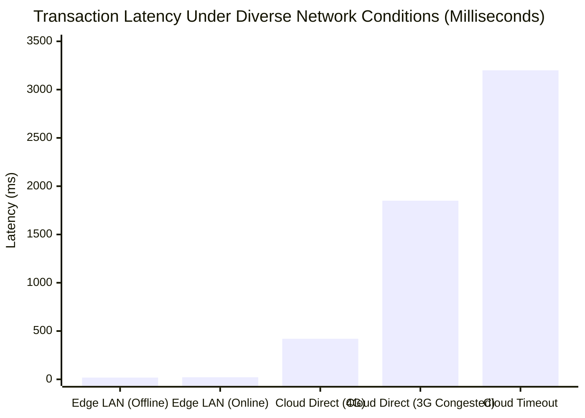

# 🛠️ Technical Implementation Guide — Hospital Appointment & Queue System

## Module 01 — Production Architecture, Offline Engine, Database Schemas & Integrations

---

## Table of Contents

- [Architectural Overview & Design Principles](#architectural-overview--design-principles)
- [System Component Blueprint](#system-component-blueprint)
- [Edge vs Cloud Data Synchronization Engine](#edge-vs-cloud-data-synchronization-engine)
- [Database Schemas & DDL](#database-schemas--ddl)
- [Token Allocation Algorithm & Priority Queue](#token-allocation-algorithm--priority-queue)
- [Bangladesh Core FHIR R4 Integration](#bangladesh-core-fhir-r4-integration)
- [Hardware Interfaces: Printers, Displays & Scanners](#hardware-interfaces-printers-displays--scanners)
- [Bangla SMS & Chime Dispatch Subsystem](#bangla-sms--chime-dispatch-subsystem)
- [Security, Consent & PDPO 2025 Compliance](#security-consent--pdpo-2025-compliance)
- [Deployment, Containerization & Health Monitoring](#deployment-containerization--health-monitoring)

---

## Architectural Overview & Design Principles

Designing hospital software for Bangladesh requires accounting for harsh infrastructural constraints:
1. **Severe Bandwidth Throttling & Network Outages**: Fiber cuts occur regularly along highway expansion routes; rural Upazila Health Complexes (UHCs) often rely on volatile 3G/4G dongles.
2. **Extreme Peak Patient Density**: Facilities like Dhaka Medical College Hospital (DMCH) handle **~7,000 OPD and emergency patients daily**. Counters must not freeze or wait on remote cloud handshakes.
3. **The 48-Second Doctor Consultation Limit**: Medical Officers have zero tolerance for sluggish software. The consultation UI must respond in **under 200 milliseconds** over local LAN.



> [!IMPORTANT]
> **Zero Cloud Dependency for Core OPD Flow**: A complete internet fiber severance must not interrupt patient registration, token printing, audio calling, or doctor consultation. All local transactions are committed to the local Edge SQLite store first, with monotonic write-ahead logging (WAL).

---

## System Component Blueprint

### Technology Stack Selection

| Layer | Technology | Justification |
|---|---|---|
| **Edge Server Runtime** | Python 3.11 + FastAPI + Uvicorn | High asynchronous concurrency, native typing, lightweight footprint on low-cost hardware (e.g., Intel N100 / Raspberry Pi 4). |
| **Edge Database** | SQLite 3 (WAL mode, PRAGMA synchronous=NORMAL) | Zero-configuration, zero-maintenance, embedded transactional reliability with microsecond read latencies. |
| **Edge Pub/Sub** | In-Memory AsyncIO WebSocket Broker | Eliminates external Redis dependencies on resource-constrained local edge hardware. |
| **Counter & Doctor UI** | React 18 + Vite + TailwindCSS (PWA) | Fast render cycle, full service-worker caching, keyboard-shortcut accessibility (`Spacebar`, `F1`-`F5`). |
| **TV Display Driver** | Vanilla HTML5 / Canvas + WebSockets | Renders ultra-smooth animations and token flashing with zero browser memory leakage during 16-hour hospital shifts. |
| **Cloud Central Server** | Node.js / Go + PostgreSQL 16 + TimescaleDB | High-throughput aggregation of national OPD encounters and DHIS2 analytics. |

---

## Edge vs Cloud Data Synchronization Engine

The synchronization daemon manages intermittent connectivity using an **Append-Only Idempotent Transaction Journal**.



### Conflict Resolution Strategy
Because tokens are minted strictly within each physical hospital, token sequence collisions across facilities are mathematically impossible through the use of composite facility keys:
$$\text{Global Token ID} = \text{Facility GEO Code} + \text{Department Code} + \text{Date} + \text{Sequence}$$
*Example*: `GEO-3026-MED-20261103-0042` (Keraniganj UHC, Medicine, Nov 3, 2026, Token 42).

---

## Database Schemas & DDL

### 1. Edge SQLite Schema (`edge_opd.db`)

```sql
PRAGMA journal_mode = WAL;
PRAGMA foreign_keys = ON;
PRAGMA busy_timeout = 5000;

-- Cached Patient Demographics (Preloaded or Created Offline)
CREATE TABLE IF NOT EXISTS local_patients (
    health_id TEXT PRIMARY KEY, -- Starts with '9'
    national_id TEXT UNIQUE,
    birth_reg_no TEXT UNIQUE,
    full_name_en TEXT NOT NULL,
    full_name_bn TEXT NOT NULL,
    gender TEXT CHECK(gender IN ('male', 'female', 'other')),
    birth_date TEXT NOT NULL,
    mobile_phone TEXT NOT NULL,
    emergency_contact TEXT,
    created_offline BOOLEAN DEFAULT 0,
    created_at DATETIME DEFAULT CURRENT_TIMESTAMP
);

-- Active OPD Tokens for Current Date
CREATE TABLE IF NOT EXISTS opd_tokens (
    token_id TEXT PRIMARY KEY, -- UUIDv4
    facility_code TEXT NOT NULL,
    dept_code TEXT NOT NULL,
    room_number TEXT NOT NULL,
    token_serial INTEGER NOT NULL,
    token_display TEXT NOT NULL, -- e.g., 'MED-P3-021'
    priority_tier TEXT NOT NULL CHECK(priority_tier IN ('P1', 'P2', 'P3', 'P4', 'P5')),
    health_id TEXT NOT NULL,
    status TEXT NOT NULL DEFAULT 'waiting' 
        CHECK(status IN ('waiting', 'called', 'in_consultation', 'completed', 'absent', 'cancelled')),
    issued_at DATETIME DEFAULT CURRENT_TIMESTAMP,
    called_at DATETIME,
    completed_at DATETIME,
    doctor_bmdc_no TEXT,
    FOREIGN KEY(health_id) REFERENCES local_patients(health_id)
);

CREATE INDEX IF NOT EXISTS idx_tokens_dept_status ON opd_tokens(dept_code, status, priority_tier);
CREATE INDEX IF NOT EXISTS idx_tokens_date ON opd_tokens(issued_at);

-- Transaction Sync Journal
CREATE TABLE IF NOT EXISTS sync_journal (
    journal_id INTEGER PRIMARY KEY AUTOINCREMENT,
    event_type TEXT NOT NULL, -- TOKEN_CREATED, STATUS_UPDATED, PATIENT_REGISTERED
    entity_id TEXT NOT NULL,
    payload_json TEXT NOT NULL,
    state TEXT DEFAULT 'pending' CHECK(state IN ('pending', 'processing', 'synced', 'failed')),
    retry_count INTEGER DEFAULT 0,
    created_at DATETIME DEFAULT CURRENT_TIMESTAMP,
    synced_at DATETIME
);

CREATE INDEX IF NOT EXISTS idx_sync_state ON sync_journal(state, retry_count);
```

---

## Token Allocation Algorithm & Priority Queue

To prevent token starvation of walk-in patients while ensuring prompt care for critical referrals and vulnerable citizens, Module 01 implements a **Weighted Fair Priority Scheduler**.



### Python Implementation of Queue Aging

```python
import time
from typing import Dict, Any

class TokenScheduler:
    BASE_SCORES = {
        "P1": 10000, # Emergency: preempts all queues
        "P2": 500,   # Official clinic referral
        "P3": 250,   # Elderly (>65y), Infant (<1y), Disabled, Muktijoddha
        "P4": 100,   # Advance scheduled slot
        "P5": 0      # Standard walk-in
    }
    
    AGING_FACTOR_PER_MINUTE = 2.5 # Prevents P5 starvation during heavy P3/P4 surges

    @classmethod
    def calculate_effective_priority(cls, token: Dict[str, Any]) -> float:
        tier = token["priority_tier"]
        base = cls.BASE_SCORES.get(tier, 0)
        
        # Calculate minutes elapsed since issuance
        elapsed_minutes = (time.time() - token["issued_timestamp"]) / 60.0
        
        # Emergency tier does not require aging
        if tier == "P1":
            return float(base)
            
        return base + (elapsed_minutes * cls.AGING_FACTOR_PER_MINUTE)
```

---

## Bangladesh Core FHIR R4 Integration

Module 01 serializes OPD encounters into standard FHIR R4 resources conforming to the **DGHS BD Core Implementation Guide v0.4.6**.

### Sample FHIR R4 `Appointment` & `Encounter` Bundle

```json
{
  "resourceType": "Bundle",
  "type": "transaction",
  "entry": [
    {
      "fullUrl": "urn:uuid:6b399d21-f81d-4eb7-a722-1f480ce27891",
      "resource": {
        "resourceType": "Appointment",
        "identifier": [
          {
            "system": "https://fhir.dghs.gov.bd/identifier/token",
            "value": "GEO-3026-MED-20261103-0042"
          }
        ],
        "status": "fulfilled",
        "priority": 3,
        "description": "General Outpatient Consultation - Medicine",
        "start": "2026-11-03T10:15:00+06:00",
        "end": "2026-11-03T10:18:00+06:00",
        "participant": [
          {
            "actor": {
              "reference": "Patient/9801442190821209",
              "display": "Rahima Begum"
            },
            "status": "accepted"
          },
          {
            "actor": {
              "reference": "Practitioner/BMDC-A-48291",
              "display": "Dr. Tanvir Ahmed, MO"
            },
            "status": "accepted"
          }
        ]
      },
      "request": {
        "method": "POST",
        "url": "Appointment"
      }
    },
    {
      "fullUrl": "urn:uuid:8a221b19-e331-419a-9e12-4219cc01a334",
      "resource": {
        "resourceType": "Encounter",
        "status": "finished",
        "class": {
          "system": "http://terminology.hl7.org/CodeSystem/v3-ActCode",
          "code": "AMB",
          "display": "ambulatory"
        },
        "subject": {
          "reference": "Patient/9801442190821209"
        },
        "serviceProvider": {
          "reference": "Organization/GEO-3026",
          "display": "Keraniganj Upazila Health Complex"
        },
        "period": {
          "start": "2026-11-03T10:16:10+06:00",
          "end": "2026-11-03T10:17:35+06:00"
        }
      },
      "request": {
        "method": "POST",
        "url": "Encounter"
      }
    }
  ]
}
```

---

## Hardware Interfaces: Printers, Displays & Scanners

### 1. ESC/POS Thermal Slip Printing (Python Raw ESC/POS)
The Edge server generates standard raw ESC/POS commands directly over TCP/Port 9100 or USB `/dev/usb/lp0`, bypassing heavy Windows/CUPS print drivers.

```python
import socket

def print_opd_token(printer_ip: str, token_data: dict):
    # ESC/POS byte sequences
    ESC = b'\x1b'
    GS = b'\x1d'
    
    payload = bytearray()
    payload += ESC + b'@'                # Initialize printer
    payload += ESC + b'a\x01'           # Center alignment
    payload += ESC + b'!\x38'           # Double height + double width font
    payload += b"KERANIGANJ UHC\n"
    payload += ESC + b'!\x00'           # Standard font
    payload += b"Outpatient Department (OPD)\n"
    payload += b"--------------------------------\n"
    payload += ESC + b'!\x30'           # Quad-area bold font for token
    payload += f"{token_data['token_display']}\n".encode('ascii')
    payload += ESC + b'!\x00'           # Reset font
    payload += f"Room: {token_data['room_number']} ({token_data['dept_name']})\n".encode('utf-8')
    payload += f"Health ID: {token_data['health_id']}\n".encode('ascii')
    payload += f"Est. Wait: {token_data['est_wait_min']} Minutes\n".encode('utf-8')
    payload += b"--------------------------------\n"
    payload += GS + b'V\x41\x00'        # Cut paper
    
    with socket.socket(socket.AF_INET, socket.SOCK_STREAM) as s:
        s.settimeout(2.0)
        s.connect((printer_ip, 9100))
        s.sendall(payload)
```

### 2. Waiting Hall TV HDMI Display Interface
- Kiosk mode command on edge device:
  `chromium-browser --kiosk --noerrdialogs --disable-infobars http://localhost:8000/display/waiting-hall`
- WebSockets deliver immediate screen updates without full page reloads:
  ```javascript
  const socket = new WebSocket(`ws://${window.location.host}/ws/queue-display`);
  socket.onmessage = (event) => {
    const data = JSON.parse(event.data);
    if (data.type === "CALL_TOKEN") {
      highlightTokenOnScreen(data.token_display, data.room_number);
      playAudioNotification(data.audio_chime_url);
    }
  };
  ```

---

## Bangla SMS & Chime Dispatch Subsystem

### 1. SMS Aggregator Unicode Payload (Bangla UCS-2)
When internet is operational, the Edge Sync worker triggers the DGHS national SMS aggregator using standard 16-bit UCS-2 hex encoding:

```python
import httpx

async def send_bangla_queue_sms(mobile_number: str, token_str: str, room_no: str):
    message_text = f"কেরানীগঞ্জ ইউএইচসি: টোকেন {token_str} প্রস্তুত। রুম {room_no}-এ আসুন।"
    
    # Encode message into UCS-2 Hex format for mobile operators
    ucs2_hex = message_text.encode('utf-16-be').hex().upper()
    
    params = {
        "user": "DGHS_OPD",
        "pass": "GovBD#Secure2026",
        "msisdn": mobile_number,
        "message": ucs2_hex,
        "sid": "DGHSNOTICE",
        "type": "unicode"
    }
    
    async with httpx.AsyncClient(timeout=5.0) as client:
        response = await client.post("https://api.dghs.gov.bd/sms/send", params=params)
        return response.status_code == 200
```

> [!CAUTION]
> **SMS Rate Limiting & Aggregator Congestion**: During morning peak hours (08:30–10:30 AM), telco SMS gateways can throttle outbound traffic. The system maintains an in-memory sliding window rate-limiter (maximum 15 SMS/second per facility) to avoid SMS queue drops.

---

## Security, Consent & PDPO 2025 Compliance

The system strictly adheres to the **Personal Data Protection Ordinance (PDPO) 2025** of Bangladesh:
1. **Consent Token Requirement**: QR codes generated by the patient app contain an ephemeral HMAC token valid for only **15 minutes**.
2. **Restricted PII Storage**: Edge gateways only retain patient identifying data for the active 24-hour cycle. Nightly batch archival drops demographic fields from edge disk, retaining only anonymized statistical rows for DHIS2.
3. **Audit Trails**: Every counter staff lookup and doctor record access is logged with timestamp, user ID, and machine MAC address in a tamper-resistant SQLite log.

---

## Deployment, Containerization & Health Monitoring

### Edge Gateway `docker-compose.yml`

```yaml
version: '3.8'

services:
  opd-edge-api:
    image: dghs-opd/edge-service:v1.2.0
    container_name: opd_edge_core
    restart: always
    network_mode: "host"
    environment:
      - FACILITY_CODE=GEO-3026
      - DATABASE_PATH=/data/edge_opd.db
      - PRINTER_IP=192.168.1.200
      - CLOUD_SYNC_URL=https://gateway.dghs.gov.bd/opd/sync
    volumes:
      - /opt/dghs/data:/data
      - /opt/dghs/logs:/var/log/opd
    healthcheck:
      test: ["CMD", "curl", "-f", "http://localhost:8000/health"]
      interval: 10s
      timeout: 3s
      retries: 3

  opd-kiosk-display:
    image: dghs-opd/kiosk-display:v1.2.0
    container_name: opd_tv_display
    restart: always
    environment:
      - DISPLAY=:0
    network_mode: "host"
    depends_on:
      - opd-edge-api
```

---

## System Latency vs Network Reliability Benchmark



> [!TIP]
> Operating the primary registration and token generation on a local Edge SQLite instance achieves **18ms transaction speed**, ensuring that even under extreme morning surges at DMCH or Keraniganj UHC, the counter experience remains instantaneous.
