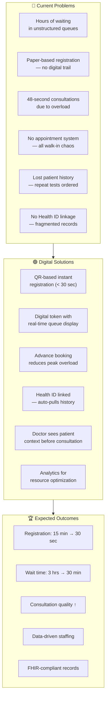
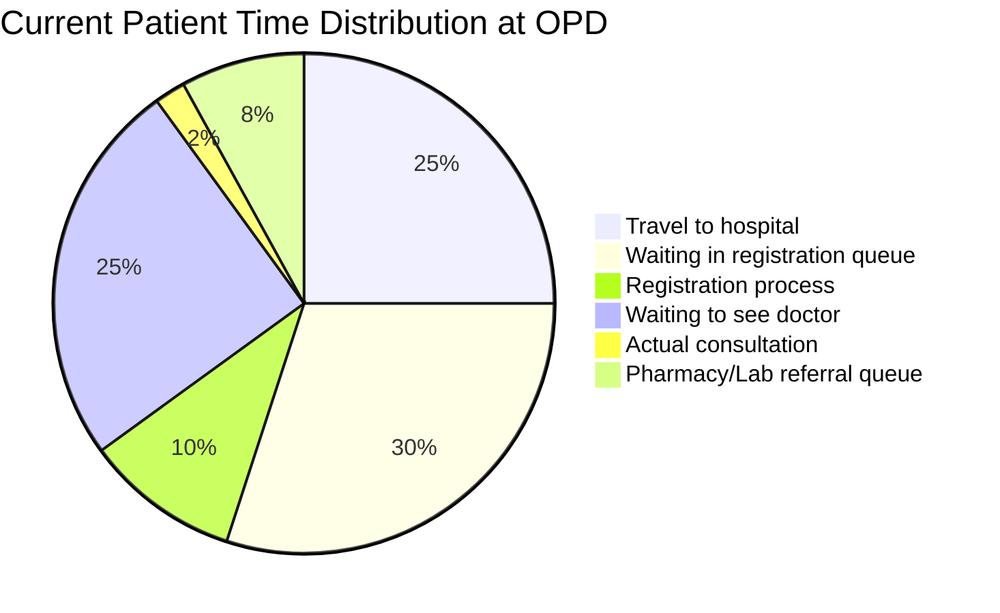
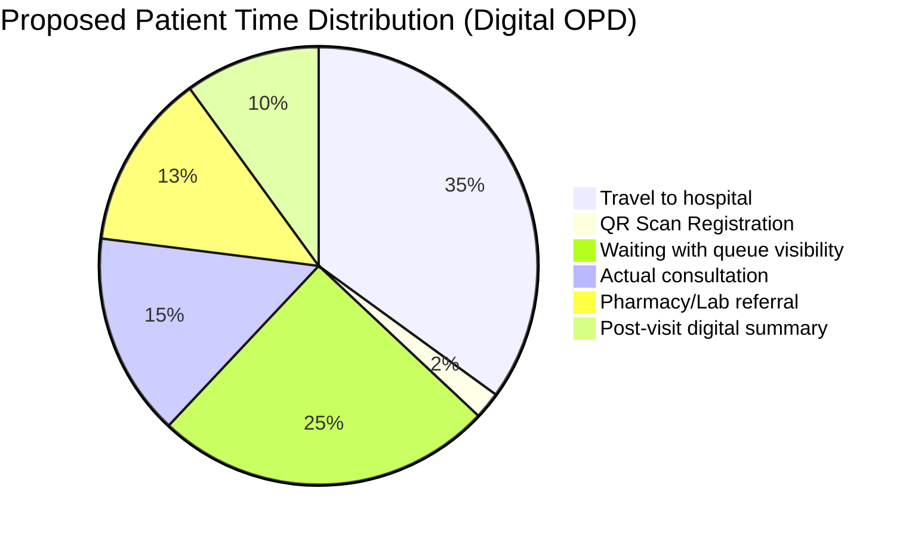
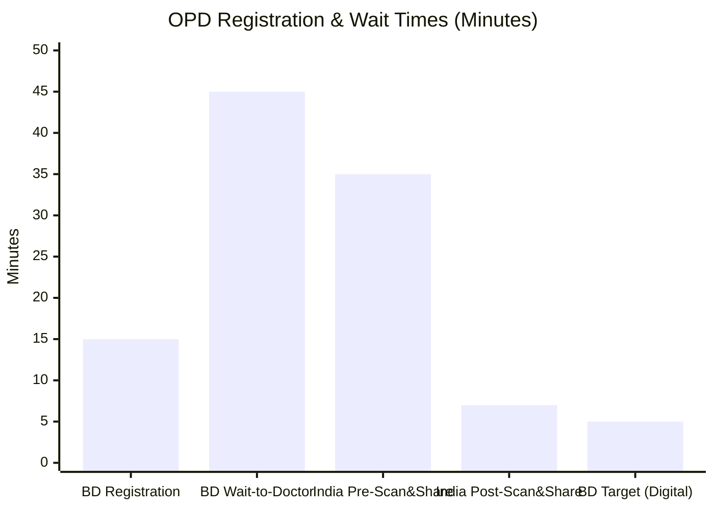

# 🏥 Hospital Appointment & Queue Management System

## Module 01 — Digital OPD Registration, Token Management & Smart Queuing for Bangladesh

---

## Table of Contents

- [Problem Statement](#problem-statement)
- [Why This Module Matters](#why-this-module-matters)
- [Target Users](#target-users)
- [Current vs Proposed Process](#current-vs-proposed-process)
- [Patient Flow Analysis](#patient-flow-analysis)
- [Comparative Analysis: BD vs India](#comparative-analysis-bd-vs-india)
- [Success Metrics](#success-metrics)
- [Key Statistics](#key-statistics)

---

## Problem Statement

Bangladesh's public healthcare system serves **170+ million people** through a network of tertiary hospitals, district hospitals, Upazila Health Complexes (UHCs), and community clinics. The outpatient department (OPD) registration and appointment process remains **almost entirely paper-based**, creating massive inefficiencies, patient suffering, and data loss.

> [!CAUTION]
> **Critical Reality**: Bangladesh has the **shortest average consultation time of just 48 seconds** — the lowest among 67 countries studied. Patients wait hours in chaotic queues only to receive less than a minute with their doctor.

### The Numbers Tell the Story

| Metric | Value | Source |
|--------|-------|--------|
| DMCH daily OPD + Emergency patients | **~7,000/day** | DMCH Administration 2024 |
| Keraniganj UHC daily outpatients | **450–500/day** (paper-based) | Field survey |
| Average consultation time in BD | **48 seconds** (shortest of 67 countries) | BMJ Global Health |
| Patient-to-doctor ratio | **1 doctor per 1,581 people** | WHO / DGHS 2023 |
| Registered doctors in BD | **~115,000** | BMDC 2024 |
| Community Clinics operational | **~14,000** | MoHFW |
| e-Health Card pilot districts | **5 districts** | DGHS e-Health program |
| India's Scan & Share — wait time reduction | **30–40 min → 5–10 min** | NHA India, 17,481 facilities |

### What Happens Today

A typical patient journey at a government hospital in Bangladesh:

1. **Travel** — Rural patients travel 2–4 hours, often arriving before dawn
2. **Wait in line** — Unstructured crowds at the OPD counter, no numbered queue
3. **Manual registration** — Staff handwrite patient details in a register book
4. **Paper ticket** — Patient receives a slip with a handwritten serial number
5. **Wait again** — No information on queue position or estimated wait time
6. **48-second consultation** — Doctor sees patient in under a minute on average
7. **No digital record** — Visit is not linked to any electronic health record
8. **Repeat visits** — Patient must re-register from scratch each time

> [!WARNING]
> At DMCH alone, **~7,000 patients per day** go through this broken process. Multiply this across Bangladesh's 654 hospitals and thousands of UHCs/clinics, and the scale of the problem becomes staggering.

---

## Why This Module Matters

### Impact Analysis

### The India Benchmark — Scan & Share

India's **Scan & Share** system under Ayushman Bharat Digital Mission (ABDM) provides a proven template:

- Deployed across **17,481 health facilities**
- Reduced OPD wait times from **30–40 minutes to 5–10 minutes**
- Patients scan a QR code linked to their ABHA (Ayushman Bharat Health Account)
- Registration happens **digitally in seconds**
- Bangladesh can replicate this with the **e-Health Card QR system** already piloted in 5 districts

> [!TIP]
> Bangladesh's e-Health Card system already issues QR-code-based health IDs in 5 pilot districts. This module leverages that existing infrastructure — no new card system needed.

---

## Target Users

| User Role | Description | Key Needs |
|-----------|-------------|-----------|
| **Patients** | OPD visitors (walk-in + referred) | Fast registration, queue visibility, appointment booking |
| **OPD Counter Staff** | Registration desk workers | QR scanner, quick lookup, offline capability |
| **Doctors** | Consulting physicians | Patient context before visit, queue control |
| **Hospital Admin** | Department heads, directors | Daily analytics, resource optimization |
| **System Admin** | IT staff at facility | Deployment, monitoring, troubleshooting |

### User Volume Estimates

| Facility Type | Count in BD | Avg. Daily OPD | Total Daily Volume |
|---------------|-------------|-----------------|-------------------|
| Tertiary Hospitals (Medical Colleges) | 37 | 3,000–7,000 | ~150,000 |
| District Hospitals | 64 | 500–1,500 | ~64,000 |
| Upazila Health Complexes (UHC) | 493 | 200–500 | ~172,000 |
| Union Sub-centers | 1,300+ | 50–100 | ~91,000 |
| Community Clinics | 14,000+ | 30–50 | ~490,000 |
| **Total estimated** | | | **~967,000/day** |

---

## Current vs Proposed Process

### Current Broken Process (Paper-Based)

```mermaid
flowchart LR
    A["Patient arrives\n(often 5 AM)"] --> B["Stands in\nunstructured crowd"]
    B --> C["Reaches counter\n(1–3 hour wait)"]
    C --> D["Staff writes details\nin register book"]
    D --> E["Paper ticket issued\n(handwritten serial)"]
    E --> F["Patient waits again\n(no position info)"]
    F --> G["Name called\n(shouting in hall)"]
    G --> H["48-sec consultation"]
    H --> I["No digital record\nstored"]

    style A fill:#ffcccc,stroke:#cc0000
    style B fill:#ffcccc,stroke:#cc0000
    style C fill:#ffcccc,stroke:#cc0000
    style F fill:#ffcccc,stroke:#cc0000
    style G fill:#ffcccc,stroke:#cc0000
    style H fill:#ffdddd,stroke:#cc0000
    style I fill:#ffcccc,stroke:#cc0000
```

### Proposed Digital Process

```mermaid
flowchart LR
    A2["Patient arrives\nwith Health Card"] --> B2["Scans QR at\nkiosk/counter"]
    B2 --> C2["System pulls FHIR\nPatient record"]
    C2 --> D2["Digital token issued\n(< 30 seconds)"]
    D2 --> E2["Real-time queue\ndisplay on screen"]
    E2 --> F2["SMS when turn\napproaches"]
    F2 --> G2["Doctor sees patient\nwith full context"]
    G2 --> H2["Encounter saved\nto FHIR / SHR"]

    style A2 fill:#ccffcc,stroke:#00aa00
    style B2 fill:#ccffcc,stroke:#00aa00
    style C2 fill:#ccffcc,stroke:#00aa00
    style D2 fill:#ccffcc,stroke:#00aa00
    style E2 fill:#ccffcc,stroke:#00aa00
    style F2 fill:#ccffcc,stroke:#00aa00
    style G2 fill:#ccffcc,stroke:#00aa00
    style H2 fill:#ccffcc,stroke:#00aa00
```

---

## Patient Flow Analysis

### Current Patient Flow Breakdown

> [!IMPORTANT]
> Only **2%** of a patient's total hospital time is spent in actual consultation with a doctor. The remaining **98%** is travel, waiting, and administrative overhead. This module targets the **65%** spent in registration and doctor queues.

### Proposed Patient Flow After Digitization

---

## Comparative Analysis: BD vs India

### OPD Registration & Wait Time Comparison

### Key Comparison Points

| Parameter | Bangladesh (Current) | India (Pre-Digital) | India (Post Scan & Share) | BD Target |
|-----------|---------------------|--------------------|-----------------------------|-----------|
| Registration time | 10–15 min | 10–15 min | < 1 min | < 30 sec |
| Wait to see doctor | 2–4 hours | 30–40 min | 5–10 min | 15–30 min |
| Digital record created | ❌ No | ❌ No | ✅ Yes (ABHA linked) | ✅ Yes (FHIR) |
| Appointment booking | ❌ No | Limited | ✅ Yes | ✅ Yes |
| Health ID linkage | ❌ No (paper) | ❌ No | ✅ ABHA | ✅ e-Health Card |
| Facilities deployed | 0 | 0 | 17,481 | 5 districts (pilot) |

---

## Success Metrics

### Primary KPIs

| KPI | Baseline (Current) | Target (6 months) | Target (12 months) |
|-----|--------------------|--------------------|---------------------|
| Registration time per patient | 10–15 minutes | < 1 minute | < 30 seconds |
| Tokens issued per day (digital) | 0 | 500+ per facility | 2,000+ per facility |
| % visits linked to Health ID | 0% | 40% | 75% |
| Average wait time (registration) | 1–3 hours | 15 minutes | 5 minutes |
| Patient data digitally captured | 0% | 60% | 90% |
| Advance appointments booked | 0 | 10% of visits | 30% of visits |
| Offline sync success rate | N/A | 95% | 99% |
| Patient satisfaction score | ~30% | 60% | 80% |

### Secondary KPIs

| KPI | Target |
|-----|--------|
| Doctor utilization rate visible | Yes |
| Peak hour identification | Automated |
| Average consultation time tracked | Yes |
| Referral pathway digitized | 50% |
| SMS notification delivery rate | > 95% |

---

## Key Statistics

> [!NOTE]
> **Bangladesh Health System Quick Facts (2024–2026)**
> - Population: **170+ million**
> - Doctor-patient ratio: **1:1,581** (WHO recommends 1:1,000)
> - Government health spending: **~0.7% of GDP** (one of the lowest globally)
> - Mobile phone penetration: **73.4% of households** own at least one phone
> - Internet users: **~130 million** (mostly mobile internet)
> - e-Health Card pilot: **5 districts** with QR-based Health IDs
> - Community Clinics: **~14,000** across rural Bangladesh
> - DGHS hospitals: **654** public hospitals

### Technology Readiness

| Factor | Status | Implication |
|--------|--------|-------------|
| Mobile penetration | 73.4% households | SMS-based notifications viable |
| Internet connectivity at hospitals | Variable (3G/4G) | Offline-first architecture required |
| e-Health Card QR system | Piloted in 5 districts | QR scan flow can leverage existing cards |
| FHIR awareness in DGHS | Growing | FHIR-based architecture supported |
| OpenSRP/DHIS2 usage | Active | Integration points available |
| Power reliability | Intermittent in rural areas | PWA + SQLite offline mode critical |

---

## Module Scope

This module covers:

- ✅ QR-based patient registration (scan e-Health Card)
- ✅ Walk-in token generation
- ✅ Advance appointment booking
- ✅ Real-time queue display
- ✅ Doctor availability dashboard
- ✅ Offline-first architecture
- ✅ FHIR Patient + Encounter creation
- ✅ Analytics and reporting
- ✅ SMS notifications (queue position, reminders)

This module does **NOT** cover:

- ❌ Clinical decision support
- ❌ Prescription management (separate module)
- ❌ Billing and payment
- ❌ Lab test ordering (see Module 02)
- ❌ Telemedicine

---

## Related Modules

| Module | Relationship |
|--------|-------------|
| **02 — Test Reports** | Lab tests ordered after appointment flow into Module 02 |
| **03 — Prescriptions** | Doctor generates prescription after the encounter created here |
| **04 — Health ID** | This module reads/creates Health ID records via FHIR |
| **05 — Analytics** | This module feeds data to the central analytics engine |

---

> [!IMPORTANT]
> This module is designed for **Phase 1 pilot deployment** in the 5 e-Health Card districts. Architecture supports scaling to all 654 public hospitals and 14,000+ community clinics.

---

*Last updated: November 2026 | Module Owner: Digital Health Team, DGHS Bangladesh*
