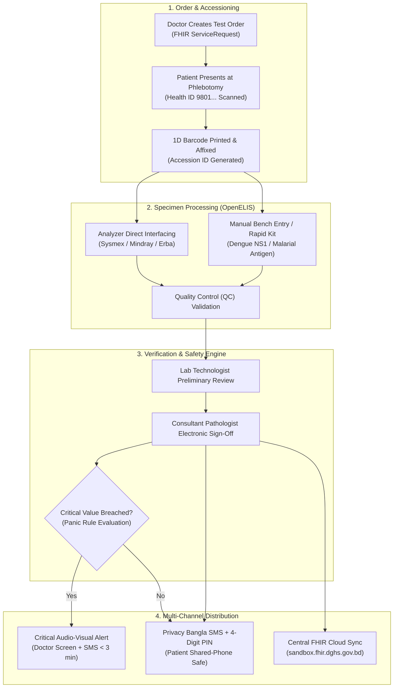
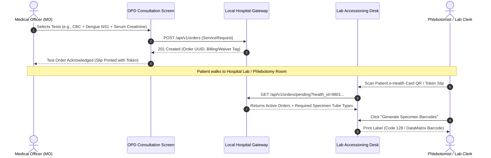
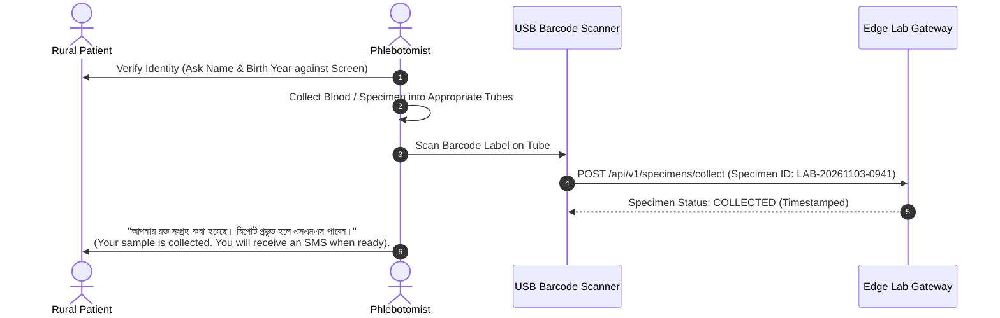
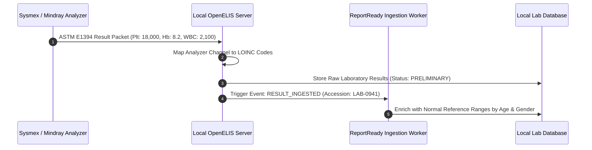
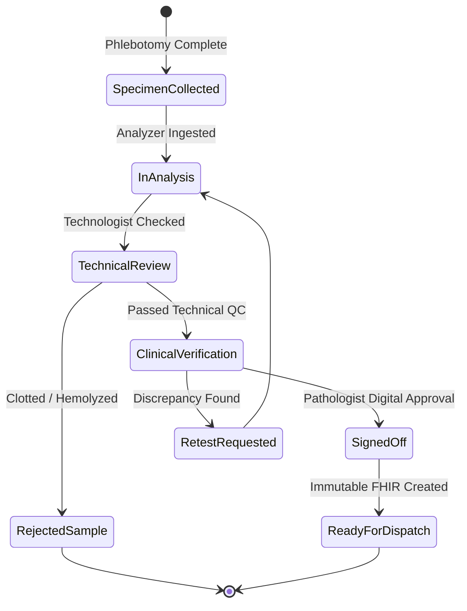
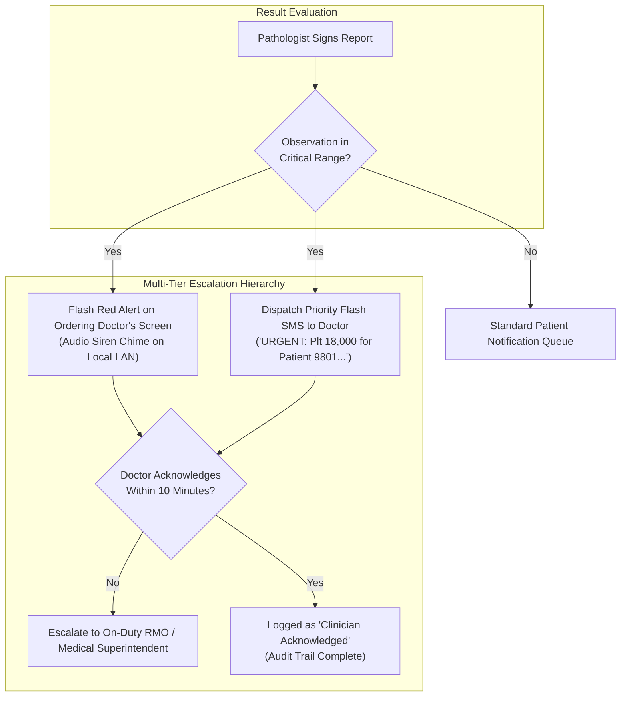
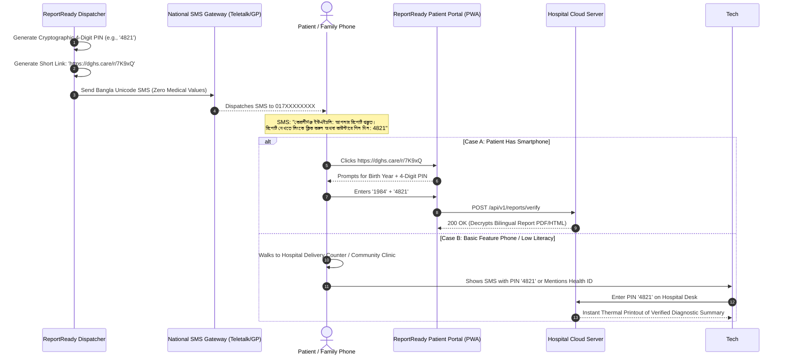
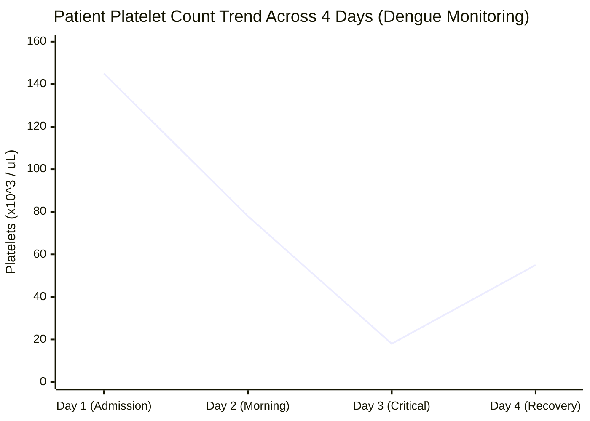
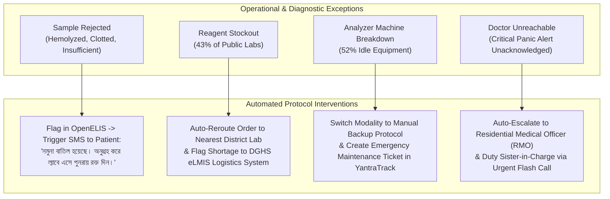

# 🔄 Application Flow — Digital Diagnostic Test Reports & Alert System

## Module 02 — End-to-End Diagnostic Lifecycles, State Machines, Critical Alerting & Exception Handling

---

## Table of Contents

- [Workflow Architecture Overview](#workflow-architecture-overview)
- [Flow 1: Test Ordering & Barcode Accessioning](#flow-1-test-ordering--barcode-accessioning)
- [Flow 2: Specimen Collection & Phlebotomy Check-In](#flow-2-specimen-collection--phlebotomy-check-in)
- [Flow 3: OpenELIS Analyzer Ingestion & Result Capture](#flow-3-openelis-analyzer-ingestion--result-capture)
- [Flow 4: Two-Tier Review & Pathologist Electronic Sign-Off](#flow-4-two-tier-review--pathologist-electronic-sign-off)
- [Flow 5: Critical Panic Value Detection & Clinician Escalation](#flow-5-critical-panic-value-detection--clinician-escalation)
- [Flow 6: Privacy-Preserving Patient Notification & PIN Retrieval](#flow-6-privacy-preserving-patient-notification--pin-retrieval)
- [Flow 7: Clinician Trend Review in the 48-Second Consultation](#flow-7-clinician-trend-review-in-the-48-second-consultation)
- [Flow 8: Offline Laboratory Operation & Cloud Synchronization](#flow-8-offline-laboratory-operation--cloud-synchronization)
- [Exception Workflows: Rejections, Stockouts & Failures](#exception-workflows-rejections-stockouts--failures)

---

## Workflow Architecture Overview

Module 02 governs the entire diagnostic pipeline inside public health facilities, bridging the gap between isolated laboratory instruments and the national health ecosystem. It operates in environments where **OpenELIS is deployed in approximately 100 public hospitals**, yet where **52% of diagnostic equipment sits idle** and **43% of laboratories suffer reagent shortages** (PPRC 2026).

---

## Flow 1: Test Ordering & Barcode Accessioning

### 1.1 Trigger & Pre-Conditions
During an outpatient consultation (Module 01) or inpatient ward round, the Medical Officer identifies clinical indications for diagnostic evaluation (e.g., suspected Dengue Hemorrhagic Fever, chronic kidney disease, severe anemia).

> [!NOTE]
> **Automated Exemption for Freedom Fighters & Indigent Patients**: Under DGHS hospital regulations, Freedom Fighters (*Muktijoddha*) and destitute patients receive 100% diagnostic fee waivers. The system automatically reads the exemption flag encoded on the Health ID, preventing administrative delays at the cashier window.

---

## Flow 2: Specimen Collection & Phlebotomy Check-In

### 2.1 Tube Labeling & Specimen Identity
The phlebotomist draws blood or collects bodily fluids into barcoded vacutainer tubes:
- **Purple Top (EDTA)**: Complete Blood Count (CBC), ESR, Malaria.
- **Red/Gold Top (Serum Clot Activator)**: Electrolytes, Dengue NS1, LFT, Creatinine.
- **Grey Top (Sodium Fluoride)**: Fasting Blood Glucose (FBG).

---

## Flow 3: OpenELIS Analyzer Ingestion & Result Capture

### 3.1 Interfacing with Automated Analyzers
In facilities where automated analyzers are present (e.g., Sysmex XN-350 hematology, Mindray BS-240 biochemistry), the analyzer reads the tube barcode and fetches the test requisition via bidirectional ASTM 1381/1394 or HL7 v2.5.1 protocols.

### 3.2 Manual & Semi-Automated Bench Entry
Where analyzers are absent or during reagent stockouts (affecting **43% of public labs**), lab technologists enter manual test strip readings (e.g., rapid immunochromatographic Dengue NS1/IgG/IgM kits or urine dipsticks) through an optimized keyboard-first interface:

---

## Flow 4: Two-Tier Review & Pathologist Electronic Sign-Off

### 4.1 Medical Verification Responsibility
To prevent diagnostic errors, public hospital protocols mandate two distinct verification checkpoints:
1. **Tier 1 (Technical Verification)**: Conducted by the Medical Technologist (Laboratory). Confirms analyzer calibration, control runs, and absence of clotted samples.
2. **Tier 2 (Clinical Sign-off)**: Conducted by the Consultant Pathologist / Biochemist. Evaluates cross-parameter clinical plausibility and authorizes external release.

---

## Flow 5: Critical Panic Value Detection & Clinician Escalation

### 5.1 Defining Life-Threatening Panic Thresholds
When an observation violates defined critical safety boundaries, the system bypasses standard batched reporting and triggers the **Immediate Panic Protocol**.

| Test Parameter | LOINC Code | Critical Low Threshold | Critical High Threshold | Clinical Risk |
|---|---|---|---|---|
| **Platelet Count** | `777-3` | **< 20,000 /µL** | — | Spontaneous Dengue Shock / Hemorrhage |
| **Serum Potassium (K+)** | `2823-3` | **< 2.8 mEq/L** | **> 6.2 mEq/L** | Fatal Cardiac Arrhythmia / Asystole |
| **Hemoglobin (Hb)** | `718-7` | **< 6.5 g/dL** | — | Acute Decompensated Severe Anemia / Shock |
| **Serum Creatinine** | `2160-0` | — | **> 6.0 mg/dL** | Acute Kidney Injury / Uremic Encephalopathy |
| **Blood Glucose** | `2345-7` | **< 2.8 mmol/L** | **> 25.0 mmol/L** | Severe Hypoglycemic Coma / DKA |

> [!CAUTION]
> **Strict Clinician Accountability**: If the ordering Medical Officer fails to click "Acknowledge Panic Alert" within **10 minutes**, the system automatically triggers a secondary escalation SMS to the **Residential Medical Officer (RMO)** and the Hospital Duty Superintendent, preventing avoidable deaths during busy night shifts.

---

## Flow 6: Privacy-Preserving Patient Notification & PIN Retrieval

### 6.1 Addressing the Shared Family Phone Challenge
Because **73.4% of households own a phone** but individual smartphone use in rural areas is **only 26%** (BBS 2026, GSMA 2024), phones are routinely accessed by husbands, in-laws, and neighbors. Sending explicit clinical findings via unencrypted SMS represents an acute privacy violation.

---

## Flow 7: Clinician Trend Review in the 48-Second Consultation

### 7.1 Addressing the BMJ Consultation Constraint
With doctors constrained to an average of **48 seconds per patient** in public OPDs (BMJ Global Health), physicians have zero time to leaf through crumpled paper records.

When a returning patient presents their e-Health Card token in the consultation room, the clinician's workstation instantly renders a **Longitudinal Diagnostic Sparkline**:

- **Visual Cues**: Trends are rendered with automated clinical color-coding:
  - 🟢 Normal Range (Green)
  - 🟡 Borderline / Moderately Abnormal (Yellow)
  - 🔴 Panic / Critical Threshold (Flashing Red)
- The doctor absorbs the patient's entire diagnostic trajectory in **under 3 seconds**, enabling rapid therapeutic decisions (e.g., ordering immediate platelet transfusion or IV fluids).

---

## Flow 8: Offline Laboratory Operation & Cloud Synchronization

### 8.1 Resilience Against Fiber Severance & Outages
At rural Upazila Health Complexes, local laboratory testing must continue unabated even when internet backhaul is down:
1. **Local Accessioning & Printing**: Barcode issuance, analyzer ingestion, and local paper slip generation function entirely on the hospital's local edge server.
2. **Transaction Spooling**: Reports signed during network outages are committed to the local encrypted SQLite datastore and tagged as `SYNC_PENDING`.
3. **Automated Resumption**: Once 3G/4G connectivity is re-established, the sync daemon streams batched FHIR bundles to the DGHS central repository and dispatches queued SMS notifications.

---

## Exception Workflows: Rejections, Stockouts & Failures

### Exception Detail: Handling the 43% Reagent Shortage
When a lab technologist marks a reagent as *Out of Stock* (e.g., Dengue NS1 reagents during peak monsoon season), the system:
1. Instantly greys out the test on the OPD consultation screens of all Medical Officers at that facility, preventing doctors from ordering tests that cannot be performed.
2. Suggests alternate diagnostic strategies (e.g., Complete Blood Count + Hematocrit monitoring).
3. Transmits an automated requisition alert upstream to the DGHS Central Medical Stores Depot (CMSD) and eLMIS portal.
