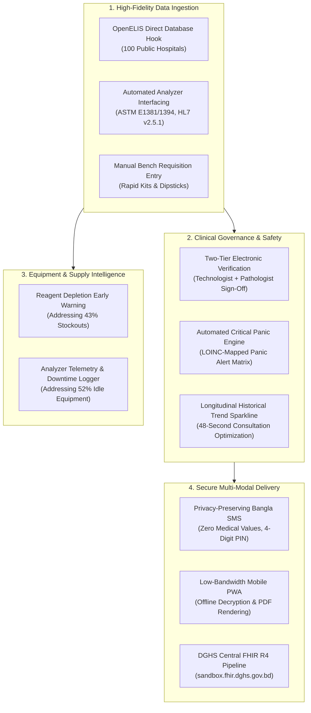
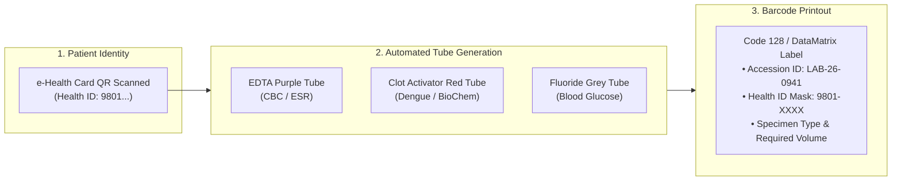
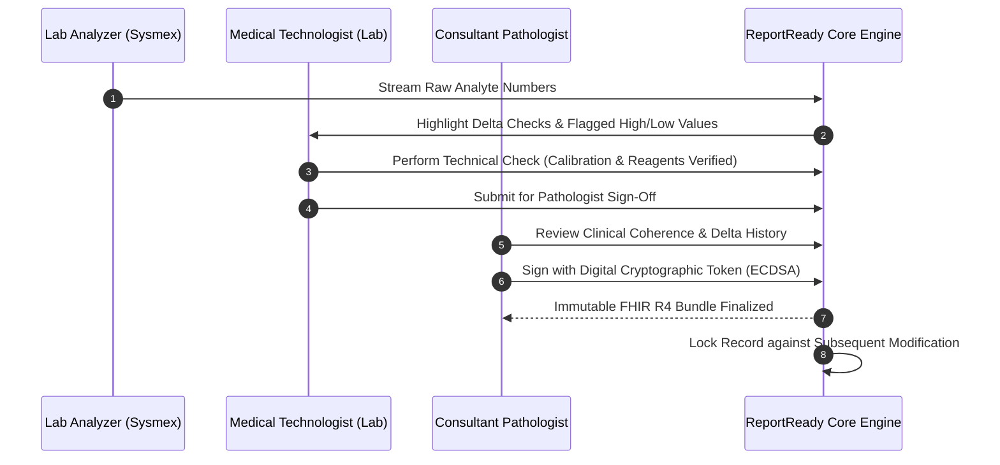
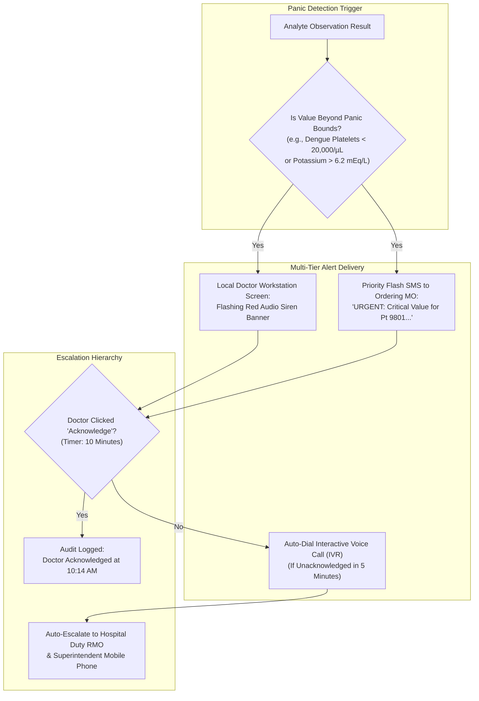
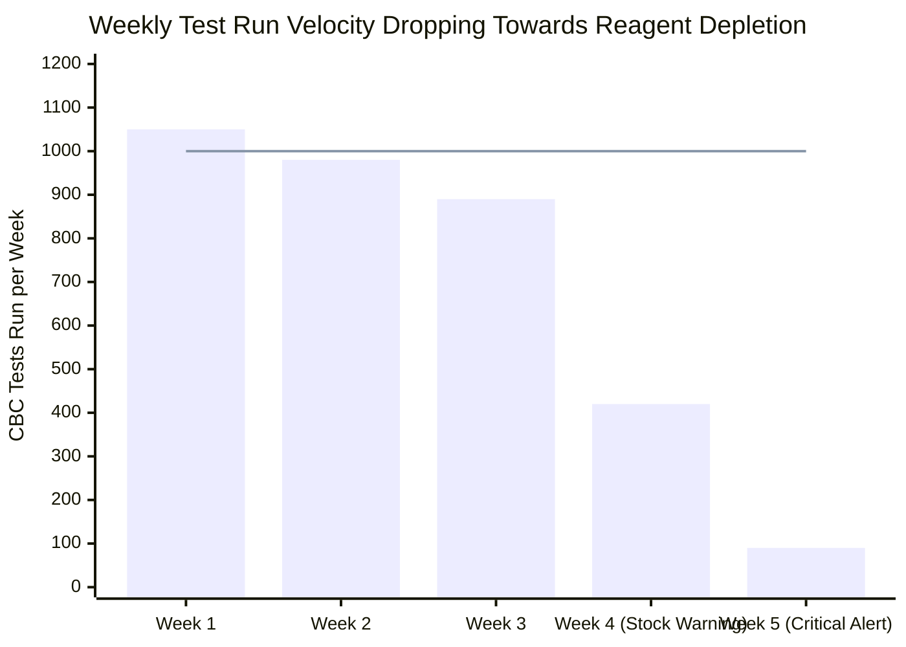
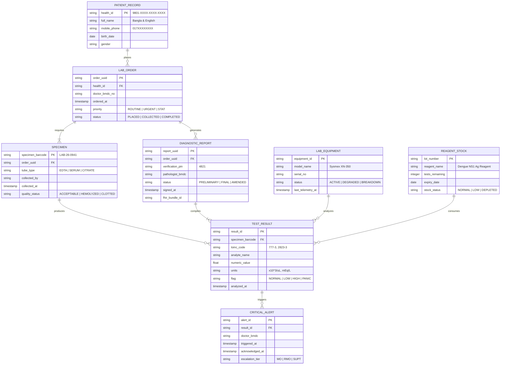

# 📋 Feature Specifications — Digital Diagnostic Test Reports & Alert System

## Module 02 — Automated Lab Ingestion, Critical Panic Alerts & Privacy-Preserving Results for Bangladesh

---

## Table of Contents

- [System Overview & Functional Architecture](#system-overview--functional-architecture)
- [Comprehensive Feature Matrix](#comprehensive-feature-matrix)
- [Feature 1: OpenELIS & Analyzer Interoperability Engine](#feature-1-openelis--analyzer-interoperability-engine)
- [Feature 2: Barcoded Accessioning & Pre-Analytical Quality Control](#feature-2-barcoded-accessioning--pre-analytical-quality-control)
- [Feature 3: Two-Tier Clinical Verification & Digital Signatures](#feature-3-two-tier-clinical-verification--digital-signatures)
- [Feature 4: Automated Critical Panic Value Alert Engine](#feature-4-automated-critical-panic-value-alert-engine)
- [Feature 5: Privacy-Preserving Patient Delivery Subsystem](#feature-5-privacy-preserving-patient-delivery-subsystem)
- [Feature 6: Reagent Stockout & Equipment Uptime Early Warning](#feature-6-reagent-stockout--equipment-uptime-early-warning)
- [Feature 7: Longitudinal Diagnostic Sparklines for Consultations](#feature-7-longitudinal-diagnostic-sparklines-for-consultations)
- [Feature 8: National Laboratory TAT & DHIS2 Analytics](#feature-8-national-laboratory-tat--dhis2-analytics)
- [Domain Entity-Relationship Architecture](#domain-entity-relationship-architecture)
- [Bangladesh Core FHIR R4 Profile Mapping](#bangladesh-core-fhir-r4-profile-mapping)

---

## System Overview & Functional Architecture

Module 02 (**ReportReady**) is engineered to bridge the severe informational disconnect within Bangladesh's diagnostic ecosystem. While the Directorate General of Health Services (DGHS) has established **OpenELIS in approximately 100 public tertiary and secondary hospitals**, diagnostic reporting remains largely paper-bound. 

Crucially, **52% of diagnostic equipment in public hospitals sits unused for over a year**, and **43% of laboratories suffer chronic reagent stockouts** (PPRC 2026 National Health Investigation). This forces patients—who already incur **79.31% out-of-pocket health expenses**—to repeat expensive blood and imaging tests at private clinics when paper records are lost.



---

## Comprehensive Feature Matrix

| ID | Feature Name | Primary Target User | Upazila (UHC) | District / Tertiary | Offline Resilient |
|---|---|---|---|---|---|
| **F-101** | OpenELIS & Analyzer Connector | Lab Technologists | Optional | Core Standard | Yes (Local Ingestion) |
| **F-102** | Barcoded Sample Accessioning | Phlebotomists | Core Standard | Core Standard | Yes (Local Printing) |
| **F-103** | Two-Tier Digital Verification | Consultant Pathologists | Medical Officer | Specialist Pathologist | Yes (Local Gateway) |
| **F-104** | Critical Panic Value Alerts | Attending Physicians (MOs) | Core Standard | Core Standard | Yes (Local LAN Siren) |
| **F-105** | Privacy-Preserving PIN Delivery | Rural Patients (Shared Phones) | Core Standard | Core Standard | Queued until Online |
| **F-106** | Reagent & Equipment Tracker | Hospital Superintendents | Core Standard | Core Standard | Batched Sync |
| **F-107** | Longitudinal Sparkline Viewer | Outpatient Doctors (48-sec visit)| Core Standard | Core Standard | Yes (Cached Profile) |
| **F-108** | DGHS DHIS2 Aggregate Reporting| Directorate of MIS, DGHS | Core Standard | Core Standard | Batched Nightly Sync |

---

## Feature 1: OpenELIS & Analyzer Interoperability Engine

### 1.1 Technical Scope
The platform provides a lightweight, non-invasive software bridge that mounts alongside existing OpenELIS PostgreSQL instances and automated laboratory analyzers across public healthcare facilities.

### 1.2 Multi-Protocol Ingestion Capabilities
1. **Direct Analyzer Serial / TCP Interfacing**:
   - Ingests standard **ASTM E1381/E1394** and **HL7 v2.5.1 (ORU^R01)** packet streams from automated hematology and clinical biochemistry analyzers (e.g., Sysmex XN-350, Mindray BC-5000, Erba Chem-7).
2. **OpenELIS Database Change Data Capture (CDC)**:
   - Continuously polls local OpenELIS databases for state transitions (`status = 'COMMITTED'`) and automatically maps proprietary laboratory parameter codes into standardized **LOINC (Logical Observation Identifiers Names and Codes)**.
3. **Offline Manual Entry Fallback**:
   - For rural Upazila Health Complexes (UHCs) operating without automated analyzers or during power cuts, the interface provides a rapid tabular data entry grid with keyboard navigation (`Tab`, `Enter`) allowing rapid transcription of semi-quantitative strip tests (e.g., Dengue NS1 Ag, Malaria Pf/Pv, Urine Albumin).

---

## Feature 2: Barcoded Accessioning & Pre-Analytical Quality Control

### 2.1 The Specimen Mix-up Risk in Public Wards
In crowded government phlebotomy rooms, handwritten patient names on sample tubes are prone to smudging, leading to disastrous diagnostic mix-ups where blood groups or serology results are mismatched.



### 2.2 Quality Control & Rejection Checkpoints
Before entering the analyzer track, specimens are checked against standardized pre-analytical rejection criteria:
- **Hemolysis (Grade 1–4)**: Flags potential artificial potassium elevation.
- **Gross Lipemia / Icterus**: Automatically triggers analyzer blank compensation.
- **Clotted EDTA Tubes**: Immediate rejection notification to prevent analyzer microbore tubing blockage.

---

## Feature 3: Two-Tier Clinical Verification & Digital Signatures

### 3.1 Medical Legal Compliance
In accordance with DGHS regulations and the **Personal Data Protection Ordinance (PDPO) 2025**, laboratory reports must possess an auditable chain of custody before public distribution.



---

## Feature 4: Automated Critical Panic Value Alert Engine

### 4.1 Clinician Escalation Matrix
The system continuously monitors observation outputs against hospital-approved clinical panic values. Any breach initiates immediate multi-channel escalation:



> [!CAUTION]
> **Zero Tolerance for Unacknowledged Panic Alerts**: If an alert remains unacknowledged for more than **10 minutes**, the system automatically alerts the **Residential Medical Officer (RMO)** via urgent SMS, maintaining an immutable forensic audit log for hospital administration.

---

## Feature 5: Privacy-Preserving Patient Delivery Subsystem

### 5.1 The Shared Device Dilemma in Bangladesh
According to Bangladesh Bureau of Statistics (BBS 2026) data, **73.4% of households own a mobile phone**, but rural personal smartphone ownership is only **26%** (GSMA 2024). Consequently, phones are predominantly held by family heads or shared among siblings.

### 5.2 Technical Privacy Specification
1. **Zero Diagnostic Data in SMS**: Text messages strictly exclude clinical diagnoses, disease tags, or numerical findings.
2. **Ephemeral Verification PIN**: Every finalized report generates a pseudorandom 4-digit numeric PIN with a 72-hour validity window.
3. **Bangla SMS Template**:
   ```text
   কেরানীগঞ্জ উপজেলা স্বাস্থ্য কমপ্লেক্স: 
   আপনার পরীক্ষার রিপোর্ট প্রস্তুত হয়েছে। 
   রিপোর্ট দেখতে ভিজিট করুন: https://dghs.care/r/9X2K 
   অথবা হাসপাতালে এই পিনটি প্রদর্শন করুন: 4821
   ```
4. **Counter Thermal Fallback**: For elderly, illiterate, or feature-phone users, presenting the 4-digit PIN at the hospital delivery desk prints a compact thermal paper summary in **clear Bangla script**.

---

## Feature 6: Reagent Stockout & Equipment Uptime Early Warning

### 6.1 Combating the 52% Equipment Failure & 43% Reagent Deficit
The PPRC 2026 investigation exposed that public hospital diagnostic failures stem primarily from administrative blindness: machines break down and sit unrepaired for over 12 months, while reagent shortages are discovered only when a sick patient reaches the phlebotomy desk.



### 6.2 Predictive Depletion Algorithm
- **Velocity Tracker**: Calculates the 7-day rolling average of completed tests per analyte.
- **Stock Depletion Forecasting**: Compares run velocity against logged reagent pack volumes.
- **Automated Requisition Alert**: When stock falls below **7 days of projected consumption**, an automated procurement alert is pushed upstream to the DGHS Central Medical Stores Depot (CMSD) and eLMIS dashboard.
- **Analyzer Telemetry Watchdog**: If an analyzer fails to emit telemetry for more than 48 operating hours, a ticket is automatically spawned in the DGHS **YantraTrack** equipment maintenance system.

---

## Feature 7: Longitudinal Diagnostic Sparklines for Consultations

### 7.1 Reclaiming the 48-Second Doctor Consultation
With public hospital doctors seeing up to **120 patients per morning shift** and spending an average of only **48 seconds per patient** (BMJ Global Health), physicians cannot manually decipher historic multi-page laboratory forms.

### 7.2 The Instant Sparkline Component
When a patient's Health ID is scanned in the consultation room, the doctor's workstation renders a compact, color-coded diagnostic sparkline:
- **Dengue Trajectory**: Displays a 5-day dual curve tracking **Platelet Count** against **Hematocrit (HCT)** to detect plasma leakage at a glance.
- **Renal Function Curve**: Renders 12-month **Serum Creatinine** and **eGFR** trajectories.
- **Diabetic Glycemic Control**: Plots the last 4 quarterly **HbA1c** readings alongside fasting blood sugar markers.

> [!TIP]
> The sparkline component renders in **under 150 milliseconds** using vector SVG, utilizing zero external CDN dependencies and operating seamlessly over hospital offline LANs.

---

## Feature 8: National Laboratory TAT & DHIS2 Analytics

### 8.1 Hospital Superintendent Dashboard
- **Turnaround Time (TAT) Analytics**: Real-time measurement of duration from blood draw to clinical sign-off, highlighting laboratory bottlenecks.
- **Volume & Out-of-Stock Rate**: Tracks the percentage of ordered tests cancelled due to reagent shortages.
- **Critical Panic Resolution Time**: Quantifies the average minutes taken by clinicians to acknowledge and act upon critical panic values.

### 8.2 DGHS Central Pipeline
Aggregated monthly laboratory statistics are automatically packaged into standard **DHIS2 Data Value Sets** (`/api/dataValueSets`), delivering national disease surveillance intelligence (e.g., Dengue NS1 positivity rate by district) to the Ministry of Health.

---

## Domain Entity-Relationship Architecture



---

## Bangladesh Core FHIR R4 Profile Mapping

All diagnostic reports and laboratory observations are mapped to the **DGHS BD Core Implementation Guide v0.4.6** and published to `https://sandbox.fhir.dghs.gov.bd/fhir`:

| System Entity | FHIR R4 Resource | Profile Standard | Identifiers / Terminology |
|---|---|---|---|
| **Diagnostic Report** | `DiagnosticReport` | `https://fhir.dghs.gov.bd/StructureDefinition/bd-diagnostic-report` | LOINC Diagnostic Study Codes (`883-9` CBC, etc.) |
| **Analyte Observation** | `Observation` | `https://fhir.dghs.gov.bd/StructureDefinition/bd-lab-observation` | LOINC Analyte Codes + UCUM Units of Measure |
| **Specimen Sample** | `Specimen` | Base FHIR R4 `Specimen` | SNOMED CT Specimen Codes (`119297000` Blood) |
| **Panic Alert Flag** | `Flag` | Base FHIR R4 `Flag` | Code: `critical-panic-value` |
| **Test Requisition** | `ServiceRequest` | `https://fhir.dghs.gov.bd/StructureDefinition/bd-service-request` | SNOMED CT / Local Hospital Catalog |
| **Patient Identification**| `Patient` | `https://fhir.dghs.gov.bd/StructureDefinition/bd-patient` | National Health ID starting with `9` |

> [!NOTE]
> Where the current BD Core Implementation Guide does not define explicit profiles for auxiliary resources (e.g., `Specimen` and `Flag`), Module 02 strictly adheres to standard **HL7 FHIR R4 core specifications**, ensuring forward compatibility when DGHS expands future national profiles.
