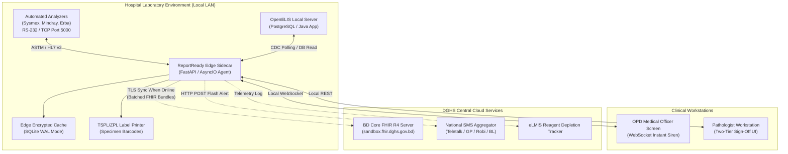
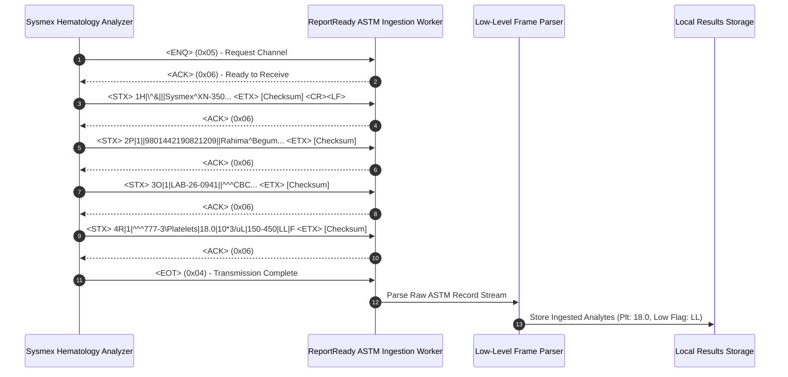
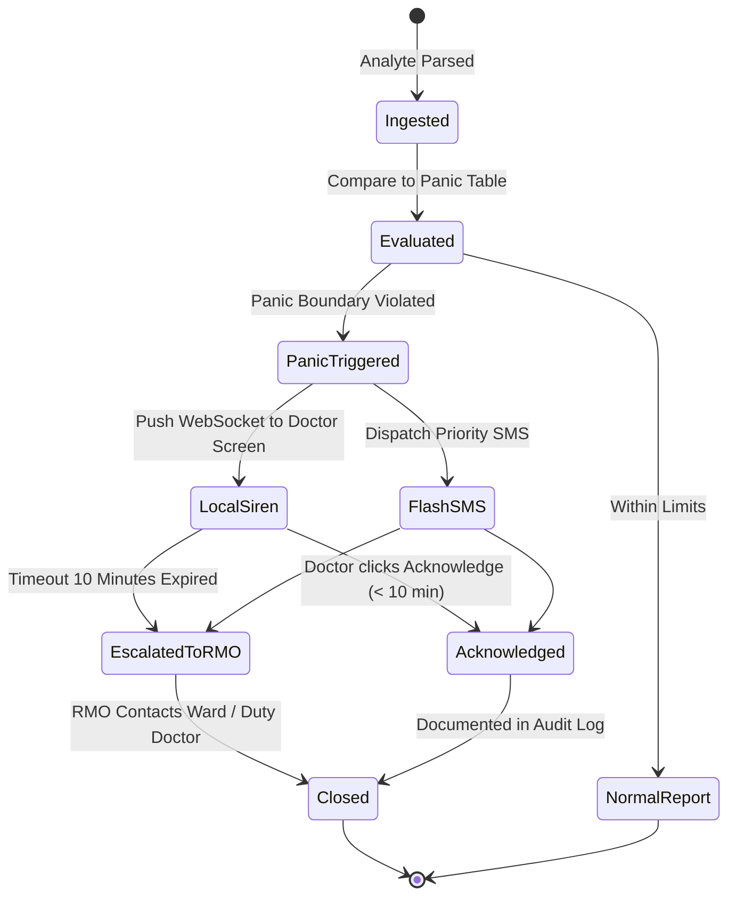
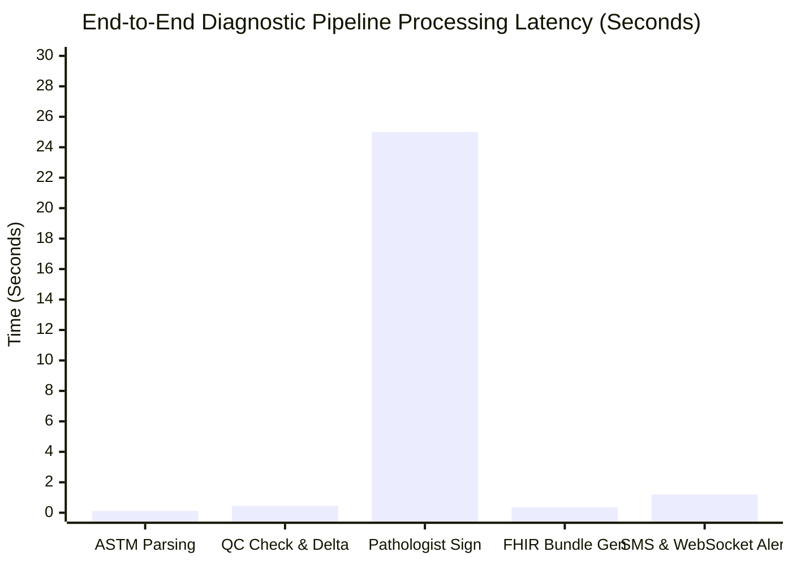

# 🛠️ Technical Implementation Guide — Digital Diagnostic Test Reports & Alert System

## Module 02 — OpenELIS Adapter, ASTM/HL7 Parsers, FHIR R4 Schemas & Edge Deployment

---

## Table of Contents

- [Architectural Philosophy & System Topology](#architectural-philosophy--system-topology)
- [OpenELIS Adapter & Analyzer Protocols](#openelis-adapter--analyzer-protocols)
- [ASTM E1381/E1394 Protocol Parser Implementation](#astm-e1381e1394-protocol-parser-implementation)
- [Bangladesh Core FHIR R4 Serialization Engine](#bangladesh-core-fhir-r4-serialization-engine)
- [Critical Panic Value Rule & Escalation Engine](#critical-panic-value-rule--escalation-engine)
- [Privacy-Preserving PIN Verification Subsystem](#privacy-preserving-pin-verification-subsystem)
- [Database Schemas & DDL (Edge & Cloud)](#database-schemas--ddl-edge--cloud)
- [Bangla SMS Dispatcher & Telco Integration](#bangla-sms-dispatcher--telco-integration)
- [Hardware Interfaces: Label Printers & Barcode Scanners](#hardware-interfaces-label-printers--barcode-scanners)
- [Deployment, Containerization & Benchmarks](#deployment-containerization--benchmarks)

---

## Architectural Philosophy & System Topology

The technical design of Module 02 (**ReportReady**) is governed by the structural realities of Bangladesh's public health system:
1. **Non-Invasive Sidecar Integration**: The system does not replace the **OpenELIS deployment active in ~100 public hospitals**. Instead, it mounts as an asynchronous event-driven adapter that monitors laboratory transactions without introducing downtime.
2. **Resilience to Infrastructure Failure**: Accounting for **52% idle diagnostic equipment** and **43% reagent stockouts** (PPRC 2026), the software tracks machine uptime telemetry, monitors reagent depletion curves, and supports rapid manual entry fallbacks.
3. **Bandwidth-Conservative Serialization**: Rural Upazila Health Complexes (UHCs) often communicate over high-latency 3G/4G connections. Test payloads are compressed and synced using lightweight delta bundles to the central DGHS FHIR sandbox.



---

## OpenELIS Adapter & Analyzer Protocols

### 1. Change Data Capture (CDC) from OpenELIS
For facilities with functional OpenELIS setups, the adapter attaches to the local OpenELIS PostgreSQL instance via a read-only replication connection or scheduled differential polling query:

```sql
-- CDC Query to Extract Finalized Laboratory Tests from OpenELIS
SELECT 
    tr.id AS test_result_id,
    so.order_number,
    p.health_id,
    p.first_name,
    p.last_name,
    p.gender,
    p.birth_date,
    t.loinc_code,
    t.test_name,
    tr.result_value,
    tr.units,
    tr.min_normal,
    tr.max_normal,
    tr.status,
    tr.completed_date,
    pr.bmdc_registration_number AS verifier_bmdc
FROM test_results tr
JOIN analysis a ON tr.analysis_id = a.id
JOIN sample_item si ON a.sample_item_id = si.id
JOIN sample s ON si.sample_id = s.id
JOIN sample_order so ON s.order_id = so.id
JOIN patient p ON so.patient_id = p.id
JOIN test t ON a.test_id = t.id
JOIN practitioner pr ON tr.verified_by_id = pr.id
WHERE tr.status = 'FINALIZED'
  AND tr.exported_to_dghs = FALSE
ORDER BY tr.completed_date ASC
LIMIT 50;
```

---

## ASTM E1381/E1394 Protocol Parser Implementation

Many public hospital automated hematology analyzers (such as the Sysmex XN-350 or Mindray BC-5000) emit patient results via serial RS-232 or TCP socket connections formatted according to the **ASTM E1381/E1394-97 standard**.



### Python ASTM E1394 Frame Parser

```python
import re
from typing import Dict, Any, List

class ASTMParser:
    """Parses standard ASTM E1394 raw message frames from automated lab instruments."""
    
    @staticmethod
    def parse_message(raw_frames: List[str]) -> Dict[str, Any]:
        result_bundle = {
            "patient": {},
            "order": {},
            "observations": []
        }
        
        for frame in raw_frames:
            # Strip framing characters (<STX>, <ETX>, frame numbers, checksums)
            clean_frame = re.sub(r'^\x02\d|[\x03\x17].*$', '', frame).strip()
            fields = clean_frame.split('|')
            record_type = fields[0]
            
            if record_type == 'P':  # Patient Record
                result_bundle["patient"]["health_id"] = fields[3]
                result_bundle["patient"]["name"] = fields[5].replace('^', ' ')
            elif record_type == 'O':  # Order Record
                result_bundle["order"]["accession_id"] = fields[2]
                result_bundle["order"]["test_panel"] = fields[4]
            elif record_type == 'R':  # Result Record
                # Analyte identifier field: ^^^<LOINC>\<Name>
                analyte_info = fields[2].split('^')
                loinc = analyte_info[3] if len(analyte_info) > 3 else "UNKNOWN"
                name = analyte_info[4] if len(analyte_info) > 4 else "Analyte"
                
                result_bundle["observations"].append({
                    "loinc_code": loinc,
                    "analyte_name": name,
                    "value": float(fields[3]),
                    "units": fields[4],
                    "reference_range": fields[5],
                    "abnormal_flag": fields[6], # 'N', 'L', 'H', 'LL', 'HH'
                    "status": fields[8]
                })
                
        return result_bundle
```

---

## Bangladesh Core FHIR R4 Serialization Engine

The adapter serializes laboratory data into standard **FHIR R4 DiagnosticReport and Observation bundles** aligned with `sandbox.fhir.dghs.gov.bd/fhir`.

### Standard FHIR R4 `DiagnosticReport` Payload

```json
{
  "resourceType": "DiagnosticReport",
  "id": "rep-lab-20261103-0941",
  "meta": {
    "profile": ["https://fhir.dghs.gov.bd/StructureDefinition/bd-diagnostic-report"]
  },
  "identifier": [
    {
      "system": "https://fhir.dghs.gov.bd/identifier/lab-accession",
      "value": "LAB-26-0941"
    }
  ],
  "status": "final",
  "category": [
    {
      "coding": [
        {
          "system": "http://terminology.hl7.org/CodeSystem/v2-0074",
          "code": "HM",
          "display": "Hematology"
        }
      ]
    }
  ],
  "code": {
    "coding": [
      {
        "system": "http://loinc.org",
        "code": "58410-2",
        "display": "Complete blood count (CBC) panel"
      }
    ]
  },
  "subject": {
    "reference": "Patient/9801442190821209",
    "display": "Rahima Begum"
  },
  "effectiveDateTime": "2026-11-03T10:45:00+06:00",
  "issued": "2026-11-03T11:15:30+06:00",
  "performer": [
    {
      "reference": "Organization/GEO-3026",
      "display": "Keraniganj Upazila Health Complex Pathology Lab"
    }
  ],
  "result": [
    {
      "reference": "Observation/obs-plt-0941",
      "display": "Platelet Count"
    },
    {
      "reference": "Observation/obs-hb-0941",
      "display": "Hemoglobin"
    }
  ]
}
```

### Accompanying FHIR R4 `Observation` (Platelet Count - Panic Level)

```json
{
  "resourceType": "Observation",
  "id": "obs-plt-0941",
  "meta": {
    "profile": ["https://fhir.dghs.gov.bd/StructureDefinition/bd-lab-observation"]
  },
  "status": "final",
  "category": [
    {
      "coding": [
        {
          "system": "http://terminology.hl7.org/CodeSystem/observation-category",
          "code": "laboratory"
        }
      ]
    }
  ],
  "code": {
    "coding": [
      {
        "system": "http://loinc.org",
        "code": "777-3",
        "display": "Platelets [#/volume] in Blood by Automated count"
      }
    ]
  },
  "subject": {
    "reference": "Patient/9801442190821209"
  },
  "valueQuantity": {
    "value": 18000,
    "unit": "/uL",
    "system": "http://unitsofmeasure.org",
    "code": "/uL"
  },
  "interpretation": [
    {
      "coding": [
        {
          "system": "http://terminology.hl7.org/CodeSystem/v3-ObservationInterpretation",
          "code": "LL",
          "display": "Critical Low"
        }
      ]
    }
  ],
  "referenceRange": [
    {
      "low": { "value": 150000, "unit": "/uL" },
      "high": { "value": 450000, "unit": "/uL" }
    }
  ]
}
```

---

## Critical Panic Value Rule & Escalation Engine



### Python Critical Alert Rule Engine

```python
import asyncio
from datetime import datetime, timezone

PANIC_THRESHOLDS = {
    "777-3": {"name": "Platelets", "low": 20000.0, "high": None, "unit": "/uL"},
    "2823-3": {"name": "Potassium", "low": 2.8, "high": 6.2, "unit": "mEq/L"},
    "718-7": {"name": "Hemoglobin", "low": 6.5, "high": None, "unit": "g/dL"},
    "2160-0": {"name": "Creatinine", "low": None, "high": 6.0, "unit": "mg/dL"}
}

async def evaluate_and_escalate(observation: dict, doctor_ws_clients: dict, telco_client):
    loinc = observation.get("loinc_code")
    val = float(observation.get("value", 0))
    
    if loinc in PANIC_THRESHOLDS:
        rule = PANIC_THRESHOLDS[loinc]
        is_panic = False
        reason = ""
        
        if rule["low"] is not None and val < rule["low"]:
            is_panic = True
            reason = f"CRITICAL LOW {rule['name']} ({val} {rule['unit']})"
        elif rule["high"] is not None and val > rule["high"]:
            is_panic = True
            reason = f"CRITICAL HIGH {rule['name']} ({val} {rule['unit']})"
            
        if is_panic:
            alert_payload = {
                "type": "CRITICAL_PANIC_ALERT",
                "patient_health_id": observation["health_id"],
                "analyte": rule["name"],
                "value": val,
                "unit": rule["unit"],
                "reason": reason,
                "timestamp": datetime.now(timezone.utc).isoformat()
            }
            
            # 1. Immediate Broadcast over Hospital Local Area Network
            for ws in doctor_ws_clients.values():
                await ws.send_json(alert_payload)
                
            # 2. Priority Flash SMS to Ordering Physician
            sms_text = f"জরুরি সতর্কবার্তা: রোগী {observation['health_id']} এর {reason} পাওয়া গেছে। অবিলম্বে ব্যবস্থা নিন।"
            await telco_client.send_priority_sms(observation["doctor_phone"], sms_text)
```

---

## Privacy-Preserving PIN Verification Subsystem

To honor the **Personal Data Protection Ordinance (PDPO) 2025** across shared family smartphones (73.4% household penetration vs 26% personal rural penetration), the PIN generator employs HMAC-SHA256 with an ephemeral salt.

```python
import hmac
import hashlib
import time

SECRET_KEY = b"DGHS_LAB_SALT_2026_KRN"

def generate_report_pin(health_id: str, report_uuid: str) -> str:
    """Generates a secure, rate-limited 4-digit numeric verification PIN."""
    seed = f"{health_id}:{report_uuid}:{time.time() // 86400}".encode('utf-8')
    digest = hmac.new(SECRET_KEY, seed, hashlib.sha256).hexdigest()
    # Map high entropy digest into 4-digit human-friendly PIN (1000 - 9999)
    pin = int(digest[:6], 16) % 9000 + 1000
    return str(pin)

def verify_report_access(input_pin: str, stored_pin: str, attempts: int) -> bool:
    """Enforces constant-time comparison and 3-attempt brute-force lockout."""
    if attempts >= 3:
        raise PermissionError("PIN Locked: Exceeded 3 failed verification attempts.")
    return hmac.compare_digest(input_pin, stored_pin)
```

---

## Database Schemas & DDL (Edge & Cloud)

### Edge Laboratory Database (`edge_lab.db`)

```sql
PRAGMA journal_mode = WAL;
PRAGMA foreign_keys = ON;

-- Barcoded Specimen Accession Tracking
CREATE TABLE IF NOT EXISTS laboratory_specimens (
    specimen_barcode TEXT PRIMARY KEY, -- e.g., 'LAB-26-0941'
    health_id TEXT NOT NULL,
    order_uuid TEXT NOT NULL,
    tube_color TEXT NOT NULL CHECK(tube_color IN ('PURPLE', 'RED', 'GREY', 'BLUE')),
    collected_by TEXT NOT NULL,
    collected_at DATETIME DEFAULT CURRENT_TIMESTAMP,
    status TEXT NOT NULL DEFAULT 'COLLECTED' 
        CHECK(status IN ('COLLECTED', 'IN_PROCESS', 'REJECTED', 'COMPLETED')),
    rejection_reason TEXT
);

-- Analyte Observations Extracted from Analyzer
CREATE TABLE IF NOT EXISTS analyte_results (
    result_id TEXT PRIMARY KEY,
    specimen_barcode TEXT NOT NULL,
    loinc_code TEXT NOT NULL,
    analyte_name TEXT NOT NULL,
    numeric_value REAL,
    string_value TEXT,
    units TEXT,
    abnormal_flag TEXT CHECK(abnormal_flag IN ('NORMAL', 'LOW', 'HIGH', 'PANIC_LOW', 'PANIC_HIGH')),
    verified_by_tech BOOLEAN DEFAULT 0,
    created_at DATETIME DEFAULT CURRENT_TIMESTAMP,
    FOREIGN KEY(specimen_barcode) REFERENCES laboratory_specimens(specimen_barcode)
);

-- Finalized Diagnostic Reports
CREATE TABLE IF NOT EXISTS diagnostic_reports (
    report_uuid TEXT PRIMARY KEY,
    health_id TEXT NOT NULL,
    specimen_barcode TEXT UNIQUE NOT NULL,
    verification_pin TEXT NOT NULL,
    pathologist_bmdc TEXT NOT NULL,
    report_pdf_path TEXT,
    status TEXT NOT NULL DEFAULT 'SIGNED' CHECK(status IN ('SIGNED', 'DISPATCHED', 'REVOKED')),
    signed_at DATETIME DEFAULT CURRENT_TIMESTAMP,
    synced_to_cloud BOOLEAN DEFAULT 0,
    FOREIGN KEY(specimen_barcode) REFERENCES laboratory_specimens(specimen_barcode)
);

-- Equipment Telemetry & Reagent Depletion Tracker
CREATE TABLE IF NOT EXISTS equipment_telemetry (
    telemetry_id INTEGER PRIMARY KEY AUTOINCREMENT,
    equipment_serial TEXT NOT NULL,
    model_name TEXT NOT NULL,
    test_run_count INTEGER NOT NULL,
    reagent_lot TEXT NOT NULL,
    reagent_units_left INTEGER NOT NULL,
    logged_at DATETIME DEFAULT CURRENT_TIMESTAMP
);
```

---

## Bangla SMS Dispatcher & Telco Integration

```python
import httpx

class TelcoSMSDispatcher:
    def __init__(self, endpoint: str, auth_token: str):
        self.endpoint = endpoint
        self.auth_token = auth_token

    async def dispatch_report_ready_sms(self, recipient_phone: str, short_code: str, pin: str):
        """Dispatches privacy-safe Bangla SMS containing PIN and short URL."""
        message = (
            f"কেরানীগঞ্জ ইউএইচসি: আপনার পরীক্ষার রিপোর্ট প্রস্তুত। "
            f"রিপোর্ট দেখতে ভিজিট করুন: https://dghs.care/r/{short_code} "
            f"অথবা কাউন্টারে এই পিন প্রদর্শন করুন: {pin}"
        )
        
        # 16-Bit Big-Endian Hex String for Bangla UCS-2 Delivery
        ucs2_payload = message.encode('utf-16-be').hex().upper()
        
        headers = {"Authorization": f"Bearer {self.auth_token}"}
        payload = {
            "recipient": recipient_phone,
            "sender_id": "DGHSCARE",
            "encoding": "UCS2",
            "message": ucs2_payload
        }
        
        async with httpx.AsyncClient(timeout=4.0) as client:
            resp = await client.post(self.endpoint, json=payload, headers=headers)
            return resp.status_code == 200
```

---

## Hardware Interfaces: Label Printers & Barcode Scanners

### TSPL Specimen Label Generation (50mm x 25mm Vacutainer Label)
The edge service talks directly to TSC / Xprinter thermal barcode label printers over USB raw stream:

```text
SIZE 50 mm, 25 mm
GAP 2 mm, 0 mm
DIRECTION 1
CLS
TEXT 20,15,"3",0,1,1,"KERANIGANJ UHC LAB"
BARCODE 20,45,"128",40,1,0,2,2,"LAB-26-0941"
TEXT 20,95,"2",0,1,1,"ID: 9801-4421-9082-1209"
TEXT 20,120,"2",0,1,1,"EDTA (CBC) - 03 Nov 10:30"
PRINT 1,1
```

---

## Deployment, Containerization & Benchmarks

### Docker Compose Configuration for Hospital Edge Mini-PC

```yaml
version: '3.8'

services:
  reportready-adapter:
    image: dghs-lab/reportready-edge:v2.1.0
    container_name: lab_reportready_core
    restart: always
    network_mode: "host"
    environment:
      - FACILITY_CODE=GEO-3026
      - ASTM_PORT=5000
      - OPENELIS_DB_HOST=192.168.1.150
      - OPENELIS_DB_PORT=5432
      - OPENELIS_DB_USER=openelis_readonly
      - OPENELIS_DB_PASS=GovBD#LabSecure2026
      - DATABASE_PATH=/data/edge_lab.db
      - CENTRAL_FHIR_URL=https://sandbox.fhir.dghs.gov.bd/fhir
    volumes:
      - /opt/dghs/lab_data:/data
      - /opt/dghs/lab_logs:/var/log/reportready
    devices:
      - "/dev/usb/lp0:/dev/usb/lp0" # Barcode Printer
      - "/dev/ttyUSB0:/dev/ttyUSB0" # Analyzer Serial Interface
```

---

## Laboratory Processing Latency Breakdown



> [!TIP]
> The automated ingestion, critical panic evaluation, and FHIR serialization require **less than 1.5 seconds of total compute time**. By automating result ingestion directly from instruments, hospital laboratory technologists eliminate manual typing backlogs entirely, freeing clinical time for specimen quality validation.
