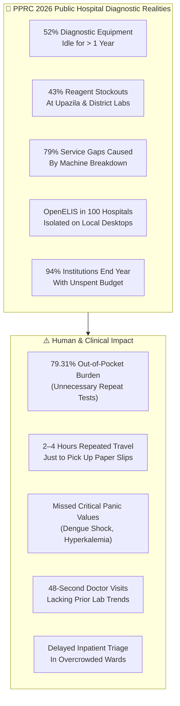
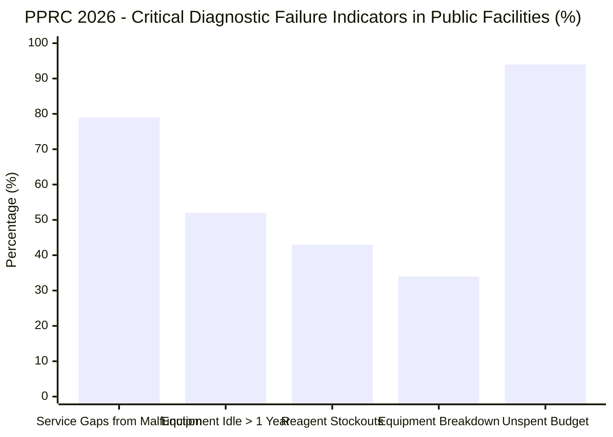
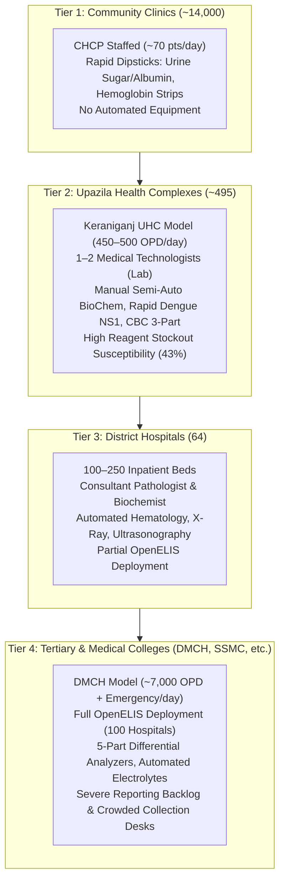
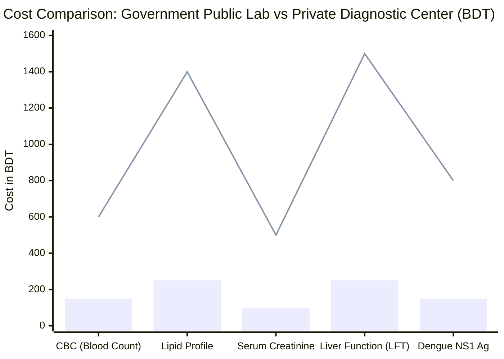
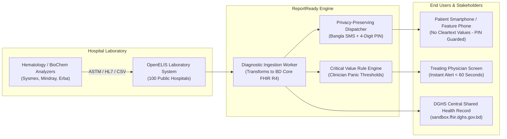
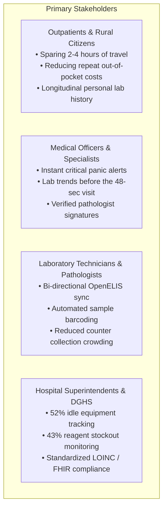
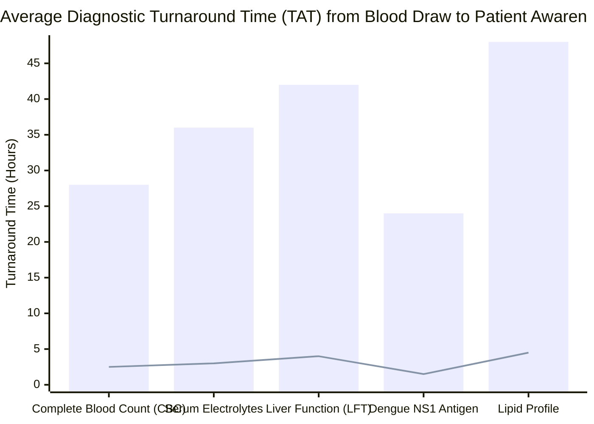
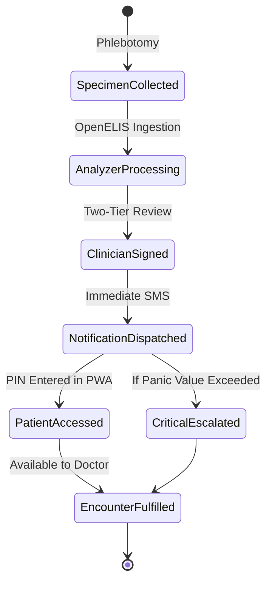
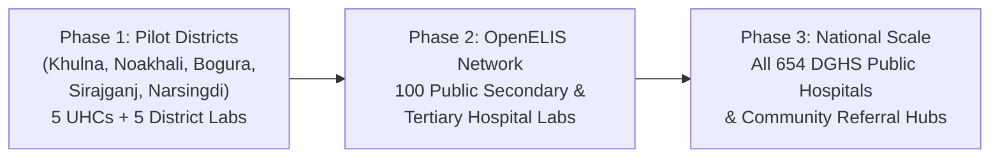

# 🔬 Digital Diagnostic Test Reports & Alert System (ReportReady)

## Module 02 — Automated Lab Ingestion, Critical Panic Alerts & Privacy-Preserving Results for Bangladesh

---

## Table of Contents

- [Executive Summary & Problem Statement](#executive-summary--problem-statement)
- [The Reality in Bangladesh Public Hospitals](#the-reality-in-bangladesh-public-hospitals)
- [Healthcare Tiers & Diagnostic Capacities](#healthcare-tiers--diagnostic-capacities)
- [Economic Burden & Out-of-Pocket Expenditure](#economic-burden--out-of-pocket-expenditure)
- [Diagnostic Cost Comparison: Public vs Private Sector](#diagnostic-cost-comparison-public-vs-private-sector)
- [Why ReportReady Matters](#why-reportready-matters)
- [Target Users & Stakeholders](#target-users--stakeholders)
- [Current Paper Workflow vs ReportReady Digital Workflow](#current-paper-workflow-vs-reportready-digital-workflow)
- [National Clinical Governance & Regulatory Alignment](#national-clinical-governance--regulatory-alignment)
- [International Precedents & Benchmarks](#international-precedents--benchmarks)
- [Success Metrics & Key Performance Indicators](#success-metrics--key-performance-indicators)
- [Risk Register & Mitigation Matrix](#risk-register--mitigation-matrix)
- [Phased National Rollout Strategy](#phased-national-rollout-strategy)
- [Module Scope & Inter-Module Relationships](#module-scope--inter-module-relationships)

---

## Executive Summary & Problem Statement

In Bangladesh, diagnostic pathology and radiology services represent one of the most critical and dysfunctional bottlenecks in the public healthcare delivery chain. Although the Directorate General of Health Services (DGHS) has deployed **OpenELIS (Open Enterprise Laboratory Information System) across approximately 100 public tertiary and secondary hospitals**, laboratory results remain largely trapped on isolated laboratory desktops or distributed via physical paper slips.

This operational disconnect creates severe financial, clinical, and human costs:
1. **Catastrophic Out-of-Pocket Expenditure**: Bangladeshis pay **79.31% of total healthcare expenditures out-of-pocket (World Bank 2023)**—the highest proportion in South Asia. When paper lab reports are lost, torn, or delayed, impoverished patients are forced to repeat expensive blood tests and ultrasound examinations out-of-pocket at predatory private diagnostic clinics.
2. **Massive Diagnostic Equipment Breakdown**: According to the Power and Participation Research Centre (PPRC 2026) comprehensive diagnostic audit, **52% of diagnostic equipment in public hospitals sits completely idle for over a year**, and **79% of public hospital service gaps are caused directly by equipment malfunction**.
3. **Chronic Reagent Stockouts**: The same PPRC study revealed that **43% of public hospital laboratories experience severe reagent stockouts**, while **34% suffer recurring instrument breakdowns**. Strikingly, **94% of public health institutions ended the fiscal year with unspent capital budgets** due to bureaucratic procurement bottlenecks.
4. **The Punitive Travel Penalty**: A rural patient at an Upazila Health Complex (UHC) like Keraniganj or a district hospital frequently travels **2 to 4 hours each way** on multiple consecutive days: Day 1 for doctor consultation and specimen collection, and Day 2 or 3 solely to collect a physical paper report from a chaotic, overcrowded distribution window.
5. **Critical Panic Value Blindspots**: When life-threatening abnormalities are detected—such as a dengue patient whose platelet count plummets below **20,000/µL**, or a renal patient with serum potassium exceeding **6.2 mEq/L**—there is **no automated mechanism** to alert the treating physician. The report sits on a laboratory shelf while the patient deteriorates in the waiting ward.

---

## The Reality in Bangladesh Public Hospitals

### Key Empirical Statistics

| Indicator | Empirical Value | Authoritative Source |
|---|---|---|
| **Out-of-Pocket Health Expenditure** | **79.31%** (Highest in South Asia) | World Bank 2023 / National Health Accounts |
| **Public Hospital Equipment Idle Rate** | **52%** unused for > 12 months | PPRC National Health Study 2026 |
| **Diagnostic Service Gaps from Breakdown** | **79%** of all service interruptions | PPRC 2026 Health Facility Survey |
| **Reagent Stockout Prevalence** | **43%** of government hospital laboratories | Prothom Alo / PPRC Investigation 2026 |
| **Unspent Institutional Budget** | **94%** of institutions have unspent funds | PPRC Public Expenditure Audit 2026 |
| **OpenELIS Deployment** | **~100 public secondary & tertiary hospitals** | DGHS Shared Health Record (SHR) Directorate |
| **Household Mobile Ownership** | **73.4%** of households own a phone | Bangladesh Bureau of Statistics (BBS 2026) |
| **Rural Individual Smartphone Ownership** | **26%** (Phones are heavily shared) | GSMA Mobile Economy / TBS 2024 |
| **Average Consultation Time** | **48 seconds** (Lowest of 67 countries) | BMJ Global Health / Ross et al. |
| **Lost Paper Test Reports** | Leading cause of repeat diagnostic orders | icddr,b Urban Health Study |

> [!CAUTION]
> **The Shared Phone Privacy Trap**: While **73.4% of households own a phone**, personal smartphone use in rural Bangladesh is only **26%**. Most mobile devices are shared among extended family members or controlled exclusively by the male household head. Sending diagnostic results (such as pregnancy screening, sexually transmitted infections, or psychiatric blood markers) in cleartext SMS directly violates patient privacy and can lead to severe domestic harm.

---

## Healthcare Tiers & Diagnostic Capacities

Bangladesh's public healthcare structure is divided into distinct administrative tiers, each exhibiting unique diagnostic constraints:

### Institutional Diagnostic Bottlenecks by Tier

1. **Community Clinics**: Lack all automated instrumentation; patients must be referred upwards even for basic complete blood counts (CBC).
2. **Upazila Health Complexes (UHCs)**: Handle massive outpatient surges (e.g., Keraniganj UHC serving 450–500 outpatients every morning). Reagent stockouts force lab staff to turn away up to 40% of ordered tests.
3. **District Hospitals**: Feature pathologists but lack automated alert channels; critical panic findings often sit unreviewed until evening duty handover.
4. **Tertiary Medical Colleges (e.g., DMCH)**: High analytical throughput (>10,000 lab tests daily), but paper distribution windows create dangerous bottlenecks, lost slips, and patient disputes.

---

## Economic Burden & Out-of-Pocket Expenditure

The financial impact of diagnostic failure on Bangladeshi families is acute:
- **79.31% Out-of-Pocket Share**: When public hospital labs fail due to breakdown (52% idle machines) or lack of reagents (43%), patients are directed to nearby commercial diagnostic centers.
- **Repeat Test Multipliers**: Studies by icddr,b demonstrate that **22% to 28% of all outpatient laboratory tests ordered in tertiary facilities are duplicate orders**, triggered solely because the patient failed to bring previous paper reports or the handwritten results were illegible.
- **Cost of Duplication**: A routine diagnostic workup (CBC, Serum Creatinine, SGPT, Electrolytes, Urine R/M/E) costs approximately **150–250 BDT** in a public hospital, but **1,800–3,200 BDT** in a private commercial laboratory. For a rural family surviving on a daily household income of 500–700 BDT, a single lost paper report triggers catastrophic spending.

---

## Diagnostic Cost Comparison: Public vs Private Sector

*(Bars indicate subsidized public hospital user fees; Line indicates private commercial diagnostic clinic charges in Dhaka and Upazila towns).*

> [!IMPORTANT]
> When a patient loses their paper report or when the hospital machine is down (52% idle rate), the family is forced to pay private commercial rates that are **4x to 6x higher**, directly pushing marginal households below the poverty line.

---

## Why ReportReady Matters

Module 02 (**ReportReady**) establishes an automated, closed-loop diagnostic ingestion, alerting, and notification bridge. It unlocks data already being generated inside hospital laboratories and connects it seamlessly to the patient's **National Health ID (starting with 9)** and the treating clinician's screen.

### Core Value Pillars

1. **Elimination of "Report Collection" Trips**: Patients receive an instant Bangla SMS notification the moment their test is clinically verified. They can review their results digitally via a lightweight PWA or pick up their physical printout in a single coordinated visit.
2. **Zero Cleartext Values over SMS**: Respecting the reality of shared household phones and the **Personal Data Protection Ordinance (PDPO) 2025**, SMS messages contain **no medical diagnoses or numerical values**. Instead, they receive a notification with a secure 4-digit verification PIN and a short link.
3. **Automated Critical Value Escalation**: When critical laboratory thresholds are breached (e.g., severe thrombocytopenia during dengue outbreaks), the system immediately dispatches high-priority audiovisual alerts to the attending doctor's dashboard and triggers automated SMS alerts to on-duty medical officers.
4. **Longitudinal Health Record Continuity**: Test results are ingested as standard **FHIR R4 `DiagnosticReport` and `Observation`** resources, filed permanently under the patient's national Health ID. When the patient visits another hospital months later, their laboratory history is instantly available, preventing duplicate blood draws.
5. **Equipment Downtime & Reagent Intelligence**: By monitoring test ingestion rates across hospital analyzers, the platform detects sudden drops in volume, automatically flagging probable machine breakdowns or reagent depletion before complete diagnostic failure occurs.

---

## Target Users & Stakeholders

---

## Current Paper Workflow vs ReportReady Digital Workflow

| Dimension | Current Paper-Based System | ReportReady Digital System |
|---|---|---|
| **Specimen Accessioning** | Handwritten register ledger; manual serials on tubes. | Pre-printed 1D/2D barcode linked directly to national Health ID. |
| **Analyzer Result Entry** | Technicians retype numbers from analyzer printouts into Word/paper. | Direct bidirectional HL7 v2 / ASTM / CSV ingestion from OpenELIS. |
| **Result Verification** | Pathologist physically signs piles of paper slips once daily. | Digital two-tier electronic sign-off directly inside the dashboard. |
| **Patient Notification** | None. Patient travels blindly to the lab counter to check status. | Automated Bangla SMS sent within 30 seconds of sign-off. |
| **Result Delivery Channel** | Physical paper slip handed over at crowded OPD window. | Secure PWA viewer + PIN-guarded web link + thermal summary slip. |
| **Critical Panic Alerts** | None. Doctor discovers life-threatening values only at next visit. | Real-time push alert to doctor screen + urgent SMS escalation. |
| **Historical Comparison** | None. Old paper reports lost or stored at home. | Longitudinal trend graphs (e.g., Platelet curve over 5 days). |
| **Privacy Safeguards** | High risk (lost papers, anyone in family reads report). | Cryptographic 4-digit PIN protection; zero sensitive SMS text. |
| **Equipment Monitoring** | Failures logged only when staff complain weeks later. | Automated run-velocity telemetry detecting idle machines (52% idle).|
| **Reagent Stockout Alerts**| Discovered when technician opens empty refrigerator. | Predictive 7-day velocity alert sent to CMSD / eLMIS (43% shortage).|

---

## National Clinical Governance & Regulatory Alignment

ReportReady strictly aligns with national healthcare mandates and legal standards:
- **Personal Data Protection Ordinance (PDPO) 2025**: Explicit legal treatment of personal diagnostic and clinical data as sensitive health records requiring cryptographic safeguards, consent management, and immutable audit logs.
- **Bangladesh Medical and Dental Council (BMDC) Code of Ethics**: Guarantees that diagnostic interpretations remain exclusively under registered clinicians and licensed consultant pathologists.
- **DGHS Bangladesh Core FHIR R4 Implementation Guide v0.4.6**: Guarantees vendor-neutral interoperability across the Shared Health Record (SHR) and National Health Data Warehouse.
- **National Drug & Medical Device Regulatory Authority (DGDA)**: Compliance with medical laboratory equipment data standards.

---

## International Precedents & Benchmarks

### 1. Zambia SMS Lab Delivery Model (WHO Study)
- **Problem**: In rural Zambia, infant dried blood spot (DBS) test results for HIV had an average postal turnaround time of **44.2 days**.
- **Intervention**: Deployment of an automated SMS printer and direct phone alert system.
- **Outcome**: Turnaround time was slashed drastically, eliminating lost paper records and saving thousands of lives through early antiretroviral therapy (ART) initiation.

### 2. India ABDM & e-Hospital Online Diagnostic Portal
- **Problem**: Millions of outpatients at AIIMS and public tertiary hospitals crowded lab counters daily for paper printouts.
- **Intervention**: National integration connecting hospital laboratory information systems (e-Hospital/OpenELIS) to the ABHA Health ID.
- **Outcome**: Immediate reduction of diagnostic counter congestion by over 60%, with lab results accessible via the national health wallet.

*(Bars indicate current paper-based turnaround; Line indicates ReportReady digital notification speed).*

---

## Success Metrics & Key Performance Indicators

### Primary KPIs

| Metric | Baseline (Paper) | ReportReady Target | Measurement Method |
|---|---|---|---|
| **Result-to-Patient Notification Time** | 24–48 hours | **< 60 seconds** after sign-off | System event timestamp delta |
| **Doctor Critical Value Awareness** | 12–36 hours | **< 3 minutes** for panic alerts | Audiovisual alert acknowledgement |
| **Unnecessary Repeat Test Rate** | 22–28% of OPD tests | **< 5%** | Longitudinal test duplication rate |
| **Avoided Hospital Travel Trips** | 0% (All travel physically) | **> 70%** of routine checks | Patient survey & digital access logs |
| **Reagent Stockout Early Warning** | After lab is already halted | **7 days advance warning** | Analyzer run velocity drop tracker |
| **Equipment Uptime Visibility** | Zero (52% idle unmonitored)| **100% daily telemetry** | YantraTrack maintenance webhook |

---

## Risk Register & Mitigation Matrix

| Risk Area | Severity | Likelihood | Mitigation Strategy |
|---|---|---|---|
| **Privacy Violation on Shared Family Phones** | Critical | High | Zero medical text or numeric values in SMS; requires 4-digit verification PIN and patient birth year. |
| **Clinician Panic Alert Fatigue** | High | Medium | Strict clinical consensus thresholds signed off by hospital clinical governance committee; no non-critical alerts. |
| **OpenELIS Version Fragmentation across 100 Hospitals** | High | High | Non-invasive database sidecar adapter reading standard PostgreSQL schemas; fallback ASTM/HL7 analyzer socket listener. |
| **Rural Hospital Internet Blackouts** | High | High | Offline-first edge gateway caching reports locally; automatic deferred synchronization upon connection recovery. |
| **Reagent Shortage Paralyzing Automation** | High | High | Early warning velocity alert sent to CMSD 7 days in advance; rapid keyboard-driven manual rapid-kit entry fallback. |

---

## Phased National Rollout Strategy

- **Phase 1 (Months 1–6)**: Validation in the 5 e-Health Card pilot districts. Fine-tuning SMS aggregator throughput and PIN delivery acceptance.
- **Phase 2 (Months 7–18)**: Expansion to the 100 existing OpenELIS public hospitals. Deployment of automated analyzer listeners and critical alert escalation.
- **Phase 3 (Months 19–36)**: Deployment across all 654 public hospitals, fully integrated into the national Shared Health Record (SHR).

---

## Module Scope & Inter-Module Relationships

### Included in Module 02
- ✅ Ingestion connector for OpenELIS and standard automated lab analyzers.
- ✅ Two-tier verification workflow for laboratory scientists and pathologists.
- ✅ Automated Critical Panic Value detection and multi-channel clinician escalation.
- ✅ Privacy-preserving Bangla SMS dispatch engine using verification PINs.
- ✅ Patient-facing lightweight PWA report viewer with bilingual support.
- ✅ Automated serialization into Bangladesh Core FHIR R4 `DiagnosticReport` and `Observation`.
- ✅ Reagent stock level alerts and analyzer downtime diagnostic logs.

### Excluded from Module 02
- ❌ Primary outpatient queuing and appointment booking (Handled in **Module 01**).
- ❌ Digital prescription authoring and pharmacy dispensing (Handled in **Module 03**).
- ❌ Core national Health ID generation and biometric verification (Handled in **Module 07**).

### Inter-Module Dependency Map

| Related Module | Nature of Interaction | Data Exchange Format |
|---|---|---|
| **Module 01: Hospital Appointment** | Ingests doctor test orders created during consultation. | FHIR `ServiceRequest` |
| **Module 03: E-Prescription** | Provides diagnostic observations to inform medication choices. | FHIR `Observation` Bundle |
| **Module 07: e-Health Card** | Resolves patient identity and links results to the `9801...` Health ID. | Master Client Index (MCI) API |
| **National DHIS2 Gateway** | Transmits monthly aggregate diagnostic volume and disease statistics. | DHIS2 Aggregate Data API |

---

> [!IMPORTANT]
> ReportReady is engineered to run as an open-source, vendor-neutral microservice that interfaces directly with the DGHS OpenELIS instances currently running in 100 public hospitals, requiring zero replacement of existing laboratory hardware.
