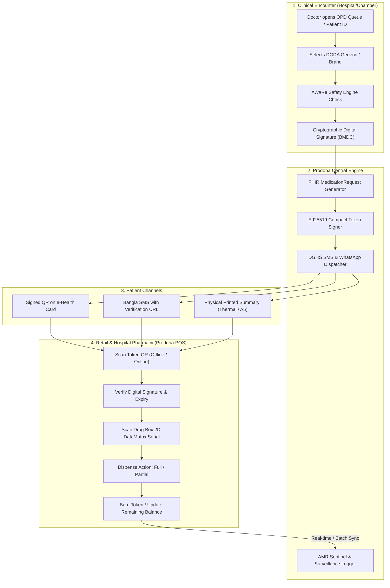
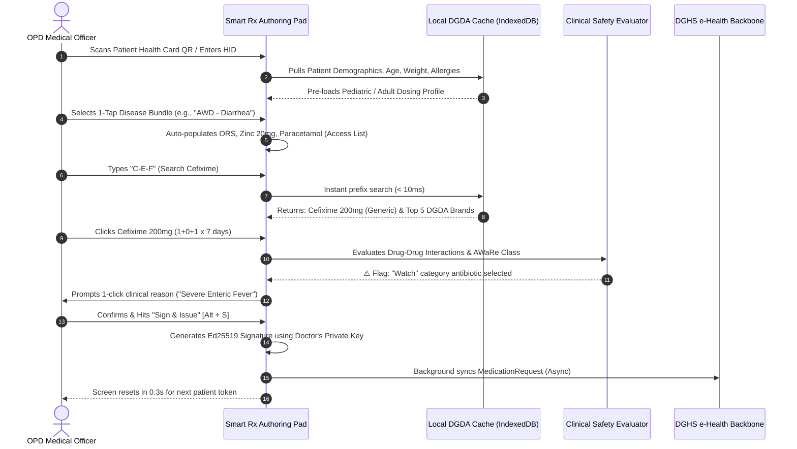
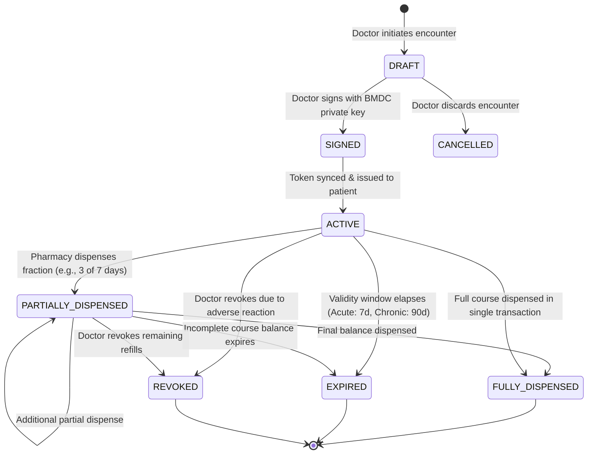
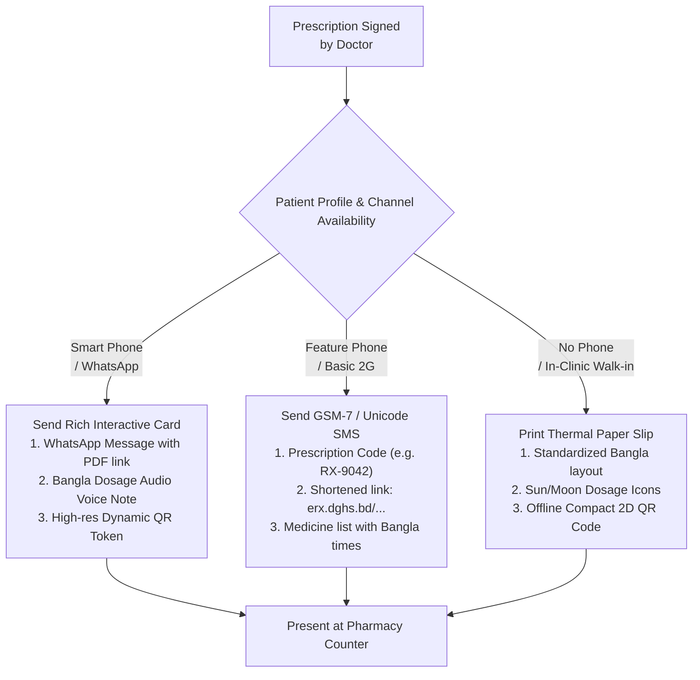
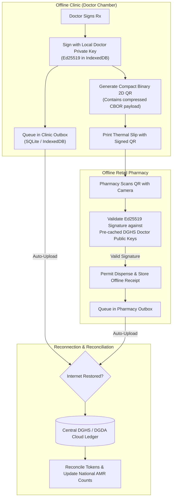

# 🔄 Application Flow — e-Prescription & Prodona Verification Engine

## Module 03 — Detailed Interaction Workflows, State Transitions & Edge Case Handling

---

## Table of Contents

- [System Architecture Overview](#system-architecture-overview)
- [Doctor Clinical Authoring Flow](#doctor-clinical-authoring-flow)
  - [48-Second Consultation Optimization Routine](#48-second-consultation-optimization-routine)
  - [Clinical Decision Support & AWaRe Rule Engine](#clinical-decision-support--aware-rule-engine)
- [Prescription Lifecycle State Machine](#prescription-lifecycle-state-machine)
- [Patient Communication & Token Delivery Flow](#patient-communication--token-delivery-flow)
- [Pharmacy Prodona Dispensing Flow](#pharmacy-prodona-dispensing-flow)
  - [Online Dispensing Workflow](#online-dispensing-workflow)
  - [Batch & Anti-Counterfeit Verification Protocol](#batch--anti-counterfeit-verification-protocol)
  - [Partial Dispensing & Token Burning](#partial-dispensing--token-burning)
- [Offline Resiliency & Synchronisation Flow](#offline-resiliency--synchronisation-flow)
  - [Doctor Offline Authoring Flow](#doctor-offline-authoring-flow)
  - [Pharmacy Offline Cryptographic Validation Flow](#pharmacy-offline-cryptographic-validation-flow)
- [DGDA & AMR Surveillance Feedback Loop](#dgda--amr-surveillance-feedback-loop)
- [Edge Cases & Exception Handling Matrix](#edge-cases--exception-handling-matrix)

---

## System Architecture Overview

The interaction flow of Module 03 links the clinical outpatient encounter, cloud persistence, patient notification channels, and retail/hospital pharmacy dispensing counters into a synchronized, tamper-evident loop.



> [!NOTE]
> Every transaction in the system is cryptographically anchored. Even if a rural upazila pharmacy has zero active cellular data, the dispensary can cryptographically verify the doctor's BMDC digital signature embedded directly inside the 2D QR barcode.

---

## Doctor Clinical Authoring Flow

Given that Bangladesh doctors face extreme patient volume—exemplified by Dhaka Medical College Hospital (DMCH) handling **~7,000 OPD patients daily** and an average consultation duration of just **48 seconds**—the authoring interface is hyper-optimized for zero-friction data entry.

### 48-Second Consultation Optimization Routine



### Clinical Decision Support & AWaRe Rule Engine

The authoring pad continuously scans the prescription buffer against safety matrices:

1. **WHO AWaRe Safety Interceptor**:
   - **Access**: Green checkmark. Standard dosing tables.
   - **Watch**: Amber modal. Doctor must select an approved diagnostic indication (e.g., Enteric Fever, Complicated UTI, Bronchopneumonia). Prevents reflexive antibiotic prescriptions for common colds and watery diarrhea.
   - **Reserve**: Crimson lockdown. Requires dual entry: Lab Culture Sensitivity Report ID and Senior Consultant PIN.
2. **Pediatric Weight-Based Auto-Dosing**:
   - For patients under 12 years, the interface locks dosage input until child weight is entered, automatically calculating suspension volume in milliliters (ml) and spoon increments (*চামচ*).
3. **Known Allergies & Contraindications**:
   - Cross-references patient allergy tags stored on the e-Health Card (e.g., Penicillin hypersensitivity blocks Amoxicillin instantly).

---

## Prescription Lifecycle State Machine

A digital prescription flows through strict status gates to eliminate multiple-dispense fraud and prevent the recycling of old antibiotic slips.



### State Definitions & Permissions

| State | Allowed Dispense? | Doctor Edit? | System Behavior |
|:---|:---:|:---:|:---|
| **`DRAFT`** | ❌ No | ✅ Full | Uncommitted local state on clinic terminal; no valid QR code generated. |
| **`SIGNED`** | ❌ Pending | ❌ Locked | Cryptographically signed; queued for transmission to patient & DGHS server. |
| **`ACTIVE`** | ✅ Yes | ❌ Locked | Verified on ledger; ready for full or partial dispense at any registered pharmacy. |
| **`PARTIALLY_DISPENSED`**| ✅ Yes (Balance only)| ❌ Locked | Dispensed quantity burned; balance remaining valid until expiration timestamp. |
| **`FULLY_DISPENSED`** | ❌ No (Locked) | ❌ Locked | Token burned; any scan attempt triggers on-screen alert: *"ইতোমধ্যে সরবরাহ করা হয়েছে"*. |
| **`EXPIRED`** | ❌ No | ❌ Locked | System auto-rejects; customer must obtain a fresh clinical consultation. |
| **`REVOKED`** | ❌ No | ❌ Locked | Cancelled by issuing doctor (e.g., drug allergy or diagnosis correction). |

---

## Patient Communication & Token Delivery Flow

Patients across Bangladesh experience diverse technological access—from urban smartphone owners to rural farmers with basic feature phones or zero mobile devices.



### Bangla Feature Phone SMS Template
For non-smartphone users, the SMS gateway delivers clear, actionable text under 140 Unicode characters:

```text
[স্বাস্থ্য অধিদপ্তর - ই-প্রেসক্রিপশন]
রোগী: আমেনা বেগম | আইডি: RX-33819
১. Cefixime 200mg: ১টি করে দিনে ২ বার (খাবারের পর) - ৭ দিন
২. Napa Extend: ১টি করে দিনে ৩ বার (জ্বর থাকলে)
ফার্মেসিতে RX-33819 কোডটি দেখিয়ে ওষুধ নিন।
```

---

## Pharmacy Prodona Dispensing Flow

The pharmacy counter is the critical enforcement gateway. It halts the rampant practice where **45% of antibiotics are sold without prescription** and only **7.56% of pharmacies have registered pharmacists**.

### Online Dispensing Workflow

```mermaid
sequenceDiagram
    autonumber
    actor Cust as Patient / Customer
    actor Pharm as Pharmacy Dispenser
    participant Scanner as Prodona POS Scanner
    participant Server as Prodona Cloud Ledger
    participant DGDA as DGDA Batch Registry
    participant Inventory as Pharmacy Local POS Inventory

    Cust->>Pharm: Presents QR Code / SMS Token
    Pharm->>Scanner: Scans QR code via web camera / handheld scanner
    Scanner->>Server: POST /api/v1/prodona/verify (Token ID + Geo-location)
    Server->>Server: Verifies digital signature, expiry & dispense balance
    Server-->>Scanner: Displays validated Rx (Drugs, Doses, Remaining Qty)
    
    alt Medication is Antibiotic (AWaRe Watch/Reserve)
        Scanner->>Pharm: Prompts mandatory registration: "Dispensed by certified staff"
        Pharm->>Scanner: Dispenser enters License / Staff ID
    end
    
    Pharm->>Scanner: Scans Medicine Packaging (GS1 2D DataMatrix)
    Scanner->>DGDA: Validates Batch Number & Expiry Date
    DGDA-->>Scanner: Batch Confirmed Genuine (Square Pharma - Exp 2027)
    
    Pharm->>Scanner: Selects Quantity: "সম্পূর্ণ (Full)" or "আংশিক (Partial)"
    Pharm->>Scanner: Clicks "নিশ্চিত করুন (Confirm Dispense)"
    Scanner->>Server: POST /api/v1/prodona/dispense (Items, Quantities, Batch)
    Server->>Server: Locks token ledger; updates status to FULLY_DISPENSED
    Server->>Inventory: Deducts local stock in pharmacy system
    Server-->>Scanner: Dispensing Approved! Generates Printed Bill
    Server->>Cust: Triggers confirmation SMS with adherence tips
```

### Batch & Anti-Counterfeit Verification Protocol

To intercept the estimated **Tk 600 Crore counterfeit medicine racket**, the Prodona POS software implements continuous serial verification against the DGDA National Batch Registry:

1. **Step 1: 2D DataMatrix Decoding**: The scanner parses the GS1 standard string:
   - `(01)` Global Trade Item Number (GTIN)
   - `(17)` Expiration Date (YYMMDD)
   - `(10)` Batch / Lot Number
   - `(21)` Unique Unit Serial Number
2. **Step 2: Collision & Recycled Serial Check**: If the serial number has already been scanned and finalized at a different location (e.g., scanned in Chittagong 2 hours ago and now scanned in Sylhet), the system throws a high-priority fraud alert.
3. **Step 3: Recall Lockout**: If DGDA has flagged the batch due to contamination or failed potency tests, the POS terminal disables the dispense button entirely.

---

## Offline Resiliency & Synchronisation Flow

Internet connectivity in rural upazilas and haor/char regions of Bangladesh is notoriously intermittent. Module 03 implements a cryptographic offline-first protocol ensuring care never stops.



### Offline Signed QR Structure (Ed25519)
The QR code printed on the patient slip contains a compact, binary CBOR payload:

```json
{
  "ver": 1,
  "rx_id": "8f3b-419a-9e12",
  "doc_bmdc": "A-48912",
  "pt_nid_hash": "e3b0c44298fc",
  "timestamp": 1798950200,
  "meds": [
    {"d": 1042, "g": "Cefixime 200mg", "q": 14, "s": "1-0-1", "dur": 7},
    {"d": 508, "g": "Paracetamol 500mg", "q": 20, "s": "1-1-1", "dur": 5}
  ],
  "sig": "3a8f9c...[64-byte Ed25519 signature]"
}
```

Because the signature is signed with the doctor's verified private key, any pharmacy running the Prodona PWA can cryptographically verify authenticity using the doctor's pre-downloaded public key without pinging a central server!

---

## DGDA & AMR Surveillance Feedback Loop

Module 03 turns every pharmacy in Bangladesh into an automated real-time surveillance sentinel for Antimicrobial Resistance (AMR).

```mermaid
flowchart LR
    SALE["Pharmacy Dispense Event"] --> FLAG{"Prescription Attached?"}
    
    FLAG -->|Yes| OK["Classify by AWaRe Category\n(Access / Watch / Reserve)"]
    FLAG -->|No (Legacy Paper / OTC)| OTC["Log: OTC Antibiotic Dispensed\n(Store ID, Drug Name, Upazila)"]
    
    OK --> DHIS2["Aggregate to DHIS2 & DGDA\nvia /api/dataValueSets"]
    OTC --> DHIS2
    
    DHIS2 --> HEATMAP["National AMR Surveillance Heatmap"]
    HEATMAP --> ALERT{"Watch/Reserve OTC Sales > 20% in Upazila?"}
    ALERT -->|Yes| INSPECT["🚨 Trigger Inspection Order\nto DGDA District Superintendent"]
    ALERT -->|No| NORM["Normal Surveillance Scorecard"]
```

---

## Edge Cases & Exception Handling Matrix

| Scenario / Edge Case | Failure Mode / Risk | System Safeguard & Fallback Protocol |
|:---|:---|:---|
| **Patient loses phone or printed slip** | Patient cannot prove prescription at pharmacy | Pharmacy enters Patient NID or Health Card Number; system queries central cloud, triggers OTP to patient's registered SIM, and displays prescription. |
| **Doctor has zero internet during power cut** | Prescription cannot be synced to cloud | Authoring Pad operates as an offline PWA. Signs transaction locally using Ed25519 key; prints/renders compact QR; queues sync to background outbox. |
| **Pharmacy lacks internet connection** | Cannot ping central cloud for token burning | Prodona PWA verifies signature offline via doctor's public key cache. Stores encrypted transaction in local IndexedDB; commits token burn upon network reconnection. |
| **Patient buys only 3 days of a 7-day antibiotic course** | Patient stops midway, fostering resistant superbugs | Prodona allows "Partial Dispense (আংশিক প্রদান)". System prints warning on bill, logs balance on token, and automatically sends SMS reminder on Day 3: *"আপনার অ্যান্টিবায়োটিক শেষ হতে চলেছে। বাকি ৪ দিনের ওষুধ গ্রহণ করুন।"* |
| **Counterfeit / Cloned 2D Barcode scanned** | Fake drugs with cloned serials reach patient | Prodona POS checks serial against DGDA ledger. If serial was previously marked `DISPENSED`, screen locks in red, alerts cashier, and logs pharmacy GPS to DGDA Enforcement portal. |
| **Doctor attempts to prescribe 'Reserve' antibiotic in OPD** | Excessive outpatient usage of Colistin / Meropenem | System blocks authoring pad. Displays: *"রিজার্ভ অ্যান্টিবায়োটিক বহির্বিভাগে দেওয়া নিষিদ্ধ।"* (Reserve antibiotics prohibited in OPD). Requires Inpatient Admission ID + Culture Sensitivity Report. |
| **Illiterate patient unable to read dosage** | Ingests wrong dose, overdoses, or skips medication | System provides: (1) Printed slip with Sun/Noon/Moon pictograms, (2) Optional automated Interactive Voice Response (IVR) phone call in colloquial Bangla explaining when to take each medicine. |
