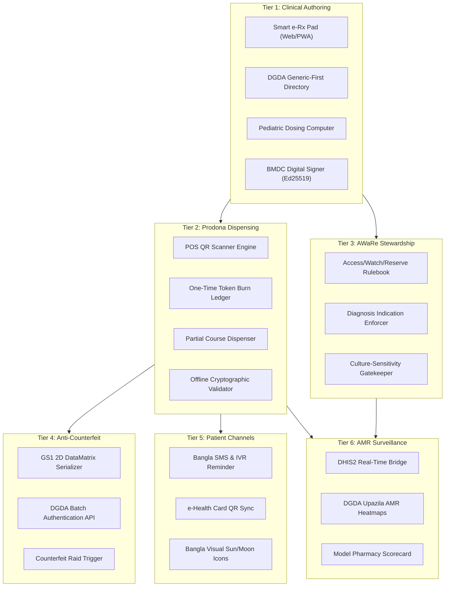
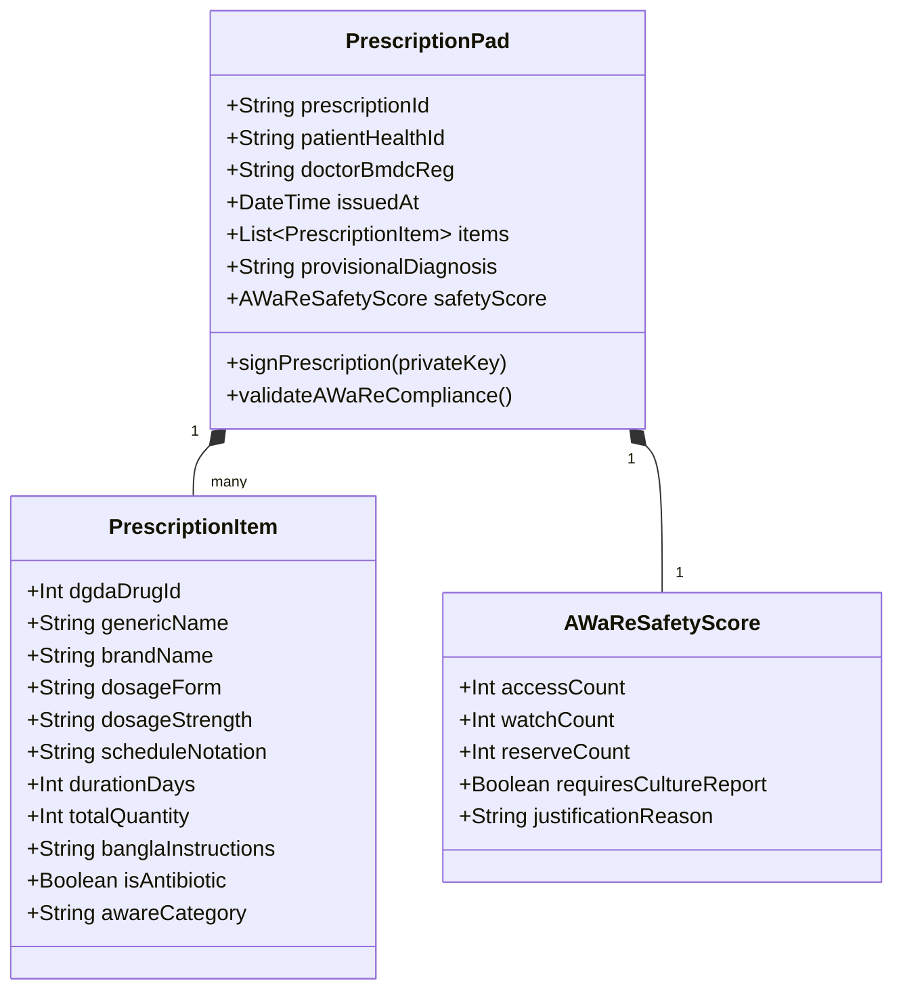
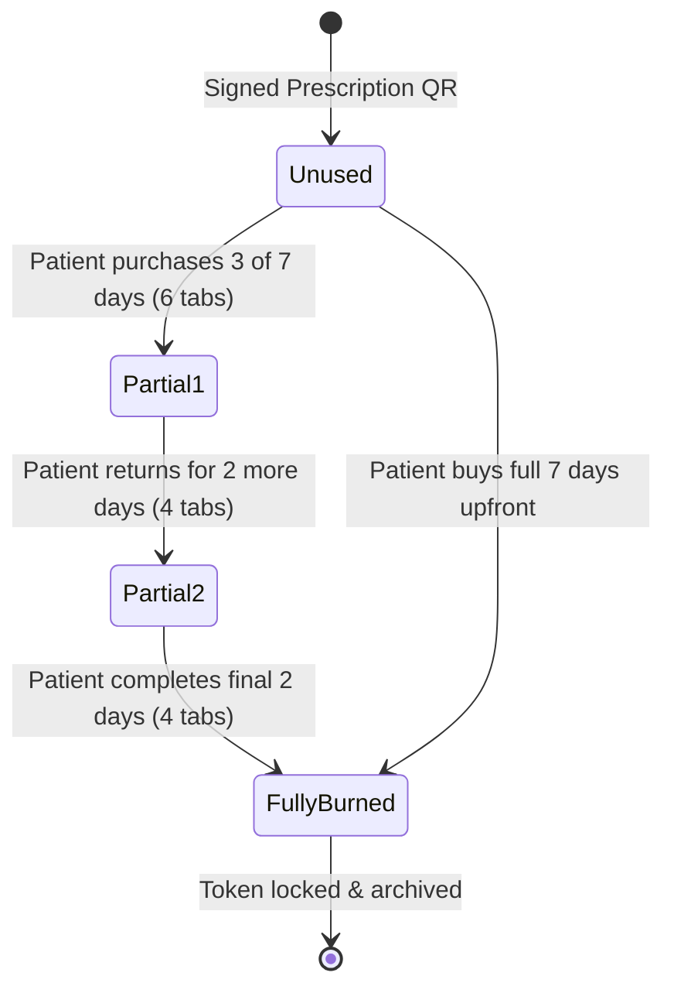
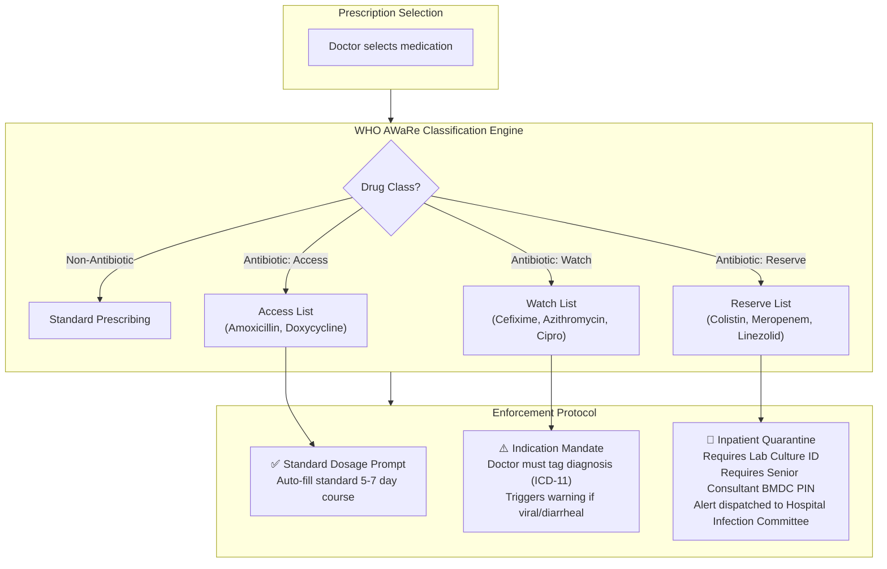
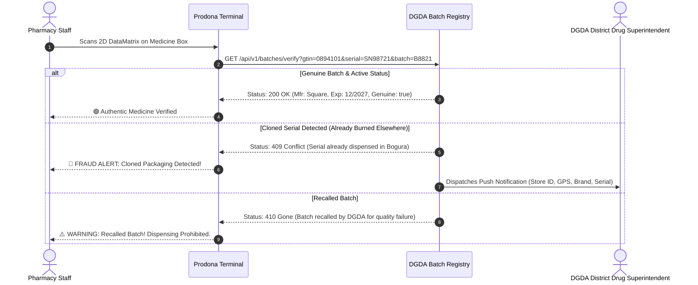
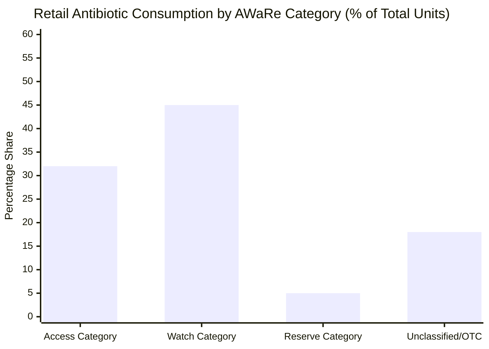

# ⚡ Functional Specifications & Feature Catalog — Module 03

## Verifiable e-Prescription, Prodona Dispensing & WHO AWaRe Antimicrobial Sentinel

---

## Table of Contents

- [Functional Architecture & Feature Matrix](#functional-architecture--feature-matrix)
- [Domain 1: High-Speed Clinical Authoring Engine](#domain-1-high-speed-clinical-authoring-engine)
  - [48-Second Consultation Accelerator](#48-second-consultation-accelerator)
  - [DGDA Generic-First Intelligent Search](#dgda-generic-first-intelligent-search)
  - [Pediatric & Geriatric Dose Safety Computer](#pediatric--geriatric-dose-safety-computer)
- [Domain 2: Prodona (প্রদোনা) Dispensing & Token Verification](#domain-2-prodona-প্রদোনা-dispensing--token-verification)
  - [Cryptographic QR Token Verification](#cryptographic-qr-token-verification)
  - [Partial Dispensing & Token Burning](#partial-dispensing--token-burning)
  - [Legacy POS "Prescription Seen? Y/N" Integration](#legacy-pos-prescription-seen-yn-integration)
- [Domain 3: WHO AWaRe Antimicrobial Stewardship](#domain-3-who-aware-antimicrobial-stewardship)
  - [Access, Watch, Reserve Decision Rules](#access-watch-reserve-decision-rules)
  - [Microbiological Culture-Sensitivity Gatekeeper](#microbiological-culture-sensitivity-gatekeeper)
- [Domain 4: Anti-Counterfeit & DGDA Batch Verification](#domain-4-anti-counterfeit--dgda-batch-verification)
- [Domain 5: Patient & Public Multi-Channel Engagement](#domain-5-patient--public-multi-channel-engagement)
  - [Bangla SMS & Dosage Audio Synthesizer](#bangla-sms--dosage-audio-synthesizer)
  - [Thermal Print Pictogram Layout](#thermal-print-pictogram-layout)
- [Domain 6: National AMR Surveillance & DGDA Analytics](#domain-6-national-amr-surveillance--dgda-analytics)
- [Feature Priority & Compliance Matrix](#feature-priority--compliance-matrix)

---

## Functional Architecture & Feature Matrix

Module 03 is structured into six functional tiers spanning bedside prescription generation, retail dispensary verification, anti-counterfeit scanning, and national regulatory oversight.

---

## Domain 1: High-Speed Clinical Authoring Engine

Given that the average medical consultation in Bangladesh lasts only **48 seconds** (*BMJ Global Health*), any software that increases typing overhead will fail in high-volume facilities like Dhaka Medical College Hospital (DMCH) or Keraniganj Upazila Health Complex (UHC).

### 48-Second Consultation Accelerator

- **1-Tap Disease Protocol Bundles**: Pre-configured clinical sets authored by national specialty societies (e.g., Acute Watery Diarrhea, Uncomplicated Hypertension, Community-Acquired Pneumonia, Dengue Outpatient Protocol). One click loads all baseline drugs, diagnostics, and patient instructions.
- **Keyboard-Driven Workflow**: Full mouse-less operation using hotkeys (`[Alt+N]` New Rx, `[Alt+D]` Add Drug, `[Alt+S]` Sign & Print, `[Esc]` Cancel).
- **Recent Patient Auto-Fetch**: When scanning the e-Health Card or entering the 10-digit National Health ID (HID), existing chronic medications, drug allergies, and past lab values are rendered in < 300ms.

### DGDA Generic-First Intelligent Search

- **DGDA Formulary Alignment**: Integrates all registered pharmaceutical products under the Directorate General of Drug Administration.
- **Generic Equivalence Engine**: When a doctor types a brand name (e.g., *"Napa"*), the system displays the underlying generic (*Paracetamol 500mg*) and lists all bio-equivalent registered brands (*Ace*, *Fast*, *Reset*, *Renova*) sorted by approved MRP.
- **Offline IndexedDB Caching**: Preserves the complete 25,000+ DGDA active product registry in the browser cache, enabling zero-latency auto-complete even during complete internet disconnection.

### Pediatric & Geriatric Dose Safety Computer

- **Weight-Based Dosing Calculator**: Automatically calculates liquid antibiotic doses (mg/kg/day) based on child weight entered at OPD triage. Converts milligrams into practical domestic measuring units (*"১ চামচ করে দিনে ৩ বার"*).
- **Renal Dosing Adjustments**: Flags high-risk antibiotics (e.g., Gentamicin, Vancomycin) if the patient's recorded Serum Creatinine from Module 02 indicates an eGFR < 30 mL/min.

---

## Domain 2: Prodona (প্রদোনা) Dispensing & Token Verification

The Prodona Dispensing Terminal transforms chaotic over-the-counter sales into an auditable, closed-loop transaction.

### Cryptographic QR Token Verification

Every prescription generates a compact 2D QR code encoded with an **Ed25519 digital signature**. 
- The pharmacy camera scans the QR code directly from the patient's phone screen or printed paper slip.
- The Prodona application verifies the cryptographic signature against the DGHS Doctor Registry public key table.
- Prevents tampering: altering the quantity from "10 tablets" to "50 tablets" invalidates the digital hash immediately.

### Partial Dispensing & Token Burning

Field research in Bangladesh demonstrates that poverty frequently forces patients to purchase only 2 or 3 days of an expensive prescribed medication.

- **Balance Tracking**: The system decrements the quantity dispensed and prints an updated balance token.
- **Anti-Hoarding Safeguard**: Once the prescribed quantity reaches zero, the token is permanently burned. Re-scanning displays a prominent red banner: *"প্রেসক্রিপশনটি ইতোমধ্যে সম্পূর্ণ সরবরাহ করা হয়েছে।"*

### Legacy POS "Prescription Seen? Y/N" Integration

For retail pharmacies using third-party point-of-sale software that have not yet fully transitioned to Prodona QR scanning, Module 03 exposes a lightweight **1-click API plugin**:
- Cashiers must click **"Prescription Seen? [Y / N]"** whenever an antibiotic brand is selected in their cash register.
- If **"No"** is clicked, the transaction is logged as an Over-The-Counter (OTC) antibiotic sale and tagged for DGDA retail inspection tracking.

---

## Domain 3: WHO AWaRe Antimicrobial Stewardship

Module 03 tackles the reality that **~45% of antibiotics are sold without a prescription** and only **7.56% of pharmacies employ registered pharmacists** (PMC 2025).

### Access, Watch, Reserve Decision Rules

1. **Access Antibiotics (Green List)**:
   - Primary line of defense against common bacterial infections.
   - Prescribable at all health tiers (Community Clinics, UHCs, District Hospitals, Private Chambers).
   - Generates automated adherence alerts via SMS to ensure the patient completes the full course.
2. **Watch Antibiotics (Yellow List)**:
   - Higher resistance potential; critically important human medicines.
   - Prescribing requires an explicit clinical indication tag (e.g., Culture pending, Enteric fever, Severe pyelonephritis).
   - Monitored weekly by the DGDA Antimicrobial Stewardship unit.
3. **Reserve Antibiotics (Red List)**:
   - Strictly reserved for confirmed multi-drug resistant superbugs in intensive care units.
   - Blocked in Outpatient (OPD) settings. If an OPD doctor attempts to prescribe Colistin, the system blocks the action and prompts inpatient referral.

---

## Domain 4: Anti-Counterfeit & DGDA Batch Verification

In an industry where an estimated **Tk 600 Crore** of counterfeit medicines circulate across Bangladesh, Module 03 operationalizes batch-level verification at the retail counter.

---

## Domain 5: Patient & Public Multi-Channel Engagement

Recognizing the digital divide between urban centers and rural villages, Module 03 delivers multi-modal prescription access:

### Bangla SMS & Dosage Audio Synthesizer

- **Low-Literacy Voice Note (IVR)**: For patients who cannot read Bengali script, an automated IVR call or WhatsApp audio note states the dosing instructions in clear colloquial Bangla:
  > *"আসসালামু আলাইকুম। ডাঃ এ. রহমানের প্রেসক্রিপশন অনুযায়ী আপনার লাল ক্যাপসুলটি রোজ সকালে ও রাতে ভরা পেটে খাবেন। জ্বর না কমলে ডাক্তারের পরামর্শ নিন।"*
- **SMS Refill & Adherence Reminders**: Automated reminders sent on Day 3 and Day 5 of antibiotic courses to prevent premature cessation of medication.

### Thermal Print Pictogram Layout

When printed in low-resource OPD clinics, the paper receipt replaces complex Latin abbreviations (`TDS`, `BD`, `PRN`) with universally understood visual pictograms:

| Time of Day | Pictogram | Bangla Label | Latin Abbreviation Equivalent |
|:---:|:---:|:---|:---:|
| **Morning** | ☀️ | সকাল (ভরা পেটে) | Mane / Post Cibum |
| **Midday** | ⛅ | দুপুর (ভরা পেটে) | Meridie / Post Cibum |
| **Night** | 🌙 | রাত (শোবার আগে) | Nocte / Hora Somni |
| **As Needed** | ⚡ | জ্বর/ব্যথা হলে | Pro Re Nata (PRN) |

---

## Domain 6: National AMR Surveillance & DGDA Analytics

Module 03 aggregates anonymized pharmacy-level dispense events into national surveillance platforms.

- **Upazila-Level Heatmaps**: Visualizes the ratio of Access-to-Watch antibiotic consumption across all 495 upazilas in Bangladesh.
- **AMR Outbreak Detection**: Automatically flags sudden surges in Reserve antibiotic requests in specific geographic districts, alerting the Institute of Epidemiology, Disease Control and Research (IEDCR).
- **Model Pharmacy Compliance Scoring**: Awards digital compliance badges to retail pharmacies that consistently log verified digital prescriptions and maintain zero unprescribed antibiotic sales.

---

## Feature Priority & Compliance Matrix

| Feature Code | Feature Name | Priority | FHIR / Standards | Primary Stakeholder |
|:---|:---|:---:|:---|:---|
| **F-RX-01** | Smart OPD Rx Pad with Hotkeys | P0 (Must Have) | FHIR MedicationRequest | OPD Doctors |
| **F-RX-02** | DGDA Generic & Brand Formulary | P0 (Must Have) | DGDA Drug Registry | Doctors & Pharmacists |
| **F-RX-03** | Ed25519 Signed QR Token Generator | P0 (Must Have) | Cryptographic CBOR / QR | Patients & Retailers |
| **F-RX-04** | WHO AWaRe Validation Engine | P0 (Must Have) | WHO AWaRe 2023 | DGDA / Public Health |
| **F-RX-05** | Prodona One-Time Token Burner | P0 (Must Have) | FHIR MedicationDispense | Retail Pharmacies |
| **F-RX-06** | Bangla SMS & Pictogram Slip Generator | P0 (Must Have) | Unicode / GSM-7 | Patients |
| **F-RX-07** | Partial Dispense & Refill Ledger | P1 (High) | FHIR MedicationDispense | Low-income Patients |
| **F-RX-08** | Offline Doctor PWA with Local Signer | P1 (High) | IndexedDB / ServiceWorker | Rural Upazila Clinics |
| **F-RX-09** | GS1 2D DataMatrix Batch Checker | P1 (High) | GS1-128 / DGDA Anti-Fake | DGDA / Consumers |
| **F-RX-10** | DHIS2 Aggregate AMR Feed | P2 (Medium) | DHIS2 /api/dataValueSets | IEDCR / MoHFW |
| **F-RX-11** | Dial-in IVR Bangla Audio Dosage Voice | P2 (Medium) | Asterisk / VoIP Gateway | Illiterate Patients |
| **F-RX-12** | Model Pharmacy Accreditation Portal | P2 (Medium) | DGDA Licensing Rules | Pharmacy Owners |
