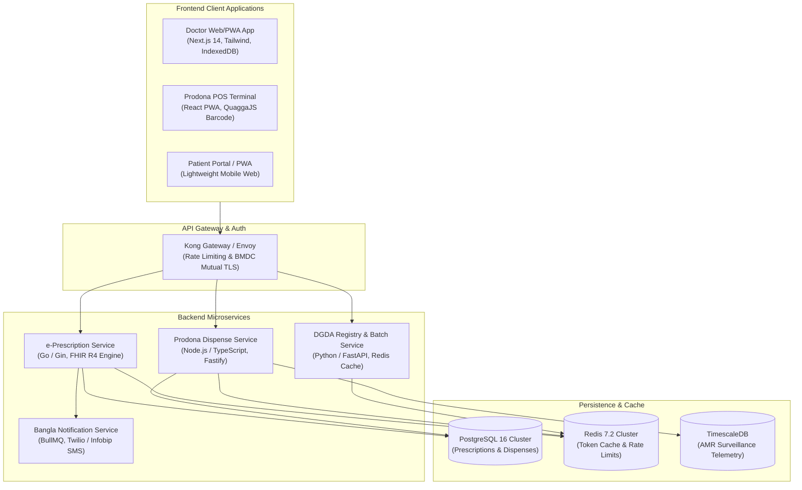
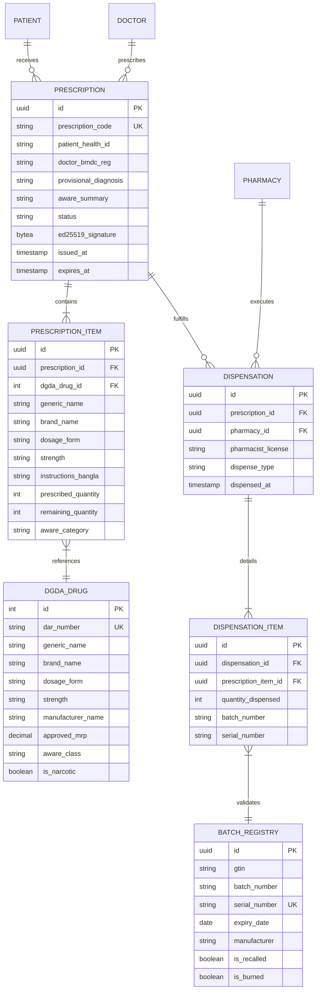
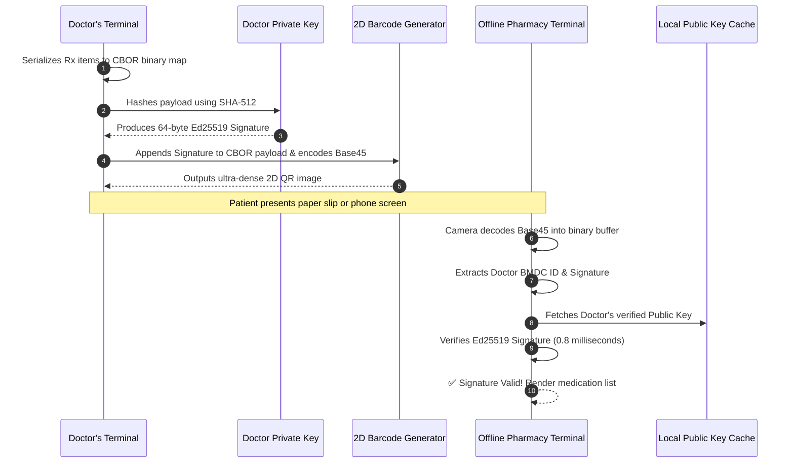
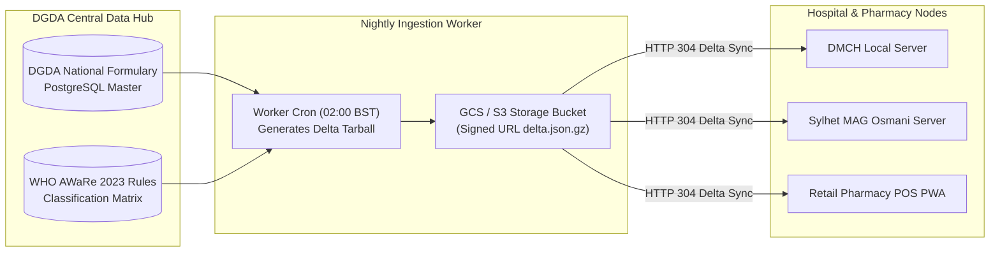
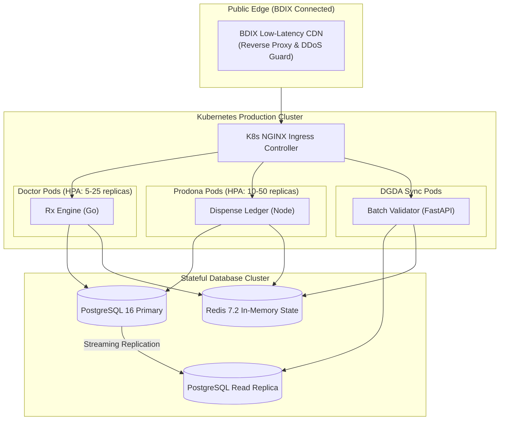

# 🛠️ Technical Architecture & Implementation Blueprint — Module 03

## Verifiable e-Prescription & Prodona Dispensing Engine

---

## Table of Contents

- [Architectural Topology & Tech Stack](#architectural-topology--tech-stack)
- [Data Model & Entity-Relationship Diagram](#data-model--entity-relationship-diagram)
  - [PostgreSQL Relational Schema](#postgresql-relational-schema)
  - [ER Diagram](#er-diagram)
- [HL7 FHIR R4 Implementation Guide](#hl7-fhir-r4-implementation-guide)
  - [FHIR MedicationRequest Profile](#fhir-medicationrequest-profile)
  - [FHIR MedicationDispense Profile](#fhir-medicationdispense-profile)
- [Cryptographic Verification Engine (Ed25519 Compact Token)](#cryptographic-verification-engine-ed25519-compact-token)
  - [Binary Encoding & CBOR Compression](#binary-encoding--cbor-compression)
  - [Offline Verification Algorithm](#offline-verification-algorithm)
- [RESTful & gRPC API Specifications](#restful--grpc-api-specifications)
  - [Issue Prescription: `POST /api/v1/prescriptions`](#issue-prescription-post-apiv1prescriptions)
  - [Verify Token: `POST /api/v1/prodona/verify`](#verify-token-post-apiv1prodonaverify)
  - [Record Dispense: `POST /api/v1/prodona/dispense`](#record-dispense-post-apiv1prodonadispense)
  - [DGDA Batch Serial Check: `GET /api/v1/batches/verify`](#dgda-batch-serial-check-get-apiv1batchesverify)
- [WHO AWaRe & DGDA Formulary Sync Protocol](#who-aware--dgda-formulary-sync-protocol)
- [Bangla SMS Gateway & Localization Engine](#bangla-sms-gateway--localization-engine)
- [Deployment Architecture & Infrastructure](#deployment-architecture--infrastructure)

---

## Architectural Topology & Tech Stack

Module 03 is designed as a distributed, offline-resilient microservice suite built on modern cloud-native standards.



### Technology Matrix

| Layer | Component | Selected Technology | Technical Justification |
|:---|:---|:---|:---|
| **Frontend PWA** | Doctor Pad & Prodona POS | Next.js 14, React, Tailwind CSS | Offline ServiceWorker, fast rendering, low bundle size (< 80KB core) |
| **Local Cache** | Client Offline DB | IndexedDB with Dexie.js | Stores complete DGDA drug dictionary (~25k records, 14MB compressed) |
| **Backend Core** | Prescription Service | Go 1.22 (Gin framework) | Sub-millisecond response times, ultra-low memory footprint |
| **Dispensing Engine**| Prodona Dispensing | Node.js / TypeScript | Rapid FHIR JSON serialization and asynchronous ledger reconciliation |
| **Database** | Primary Relational DB | PostgreSQL 16 + TimescaleDB | ACID compliance for dispense balances; time-series for AMR analytics |
| **Cryptography** | Digital Signatures | Ed25519 (RFC 8032) | High-speed, 64-byte signature fitting comfortably in 2D QR codes |
| **Interoperability**| Healthcare Data Model | HL7 FHIR Release 4 | Compliant with DGHS National Health Data Exchange standards |

---

## Data Model & Entity-Relationship Diagram

### ER Diagram



---

## HL7 FHIR R4 Implementation Guide

The prescription workflow strictly implements **FHIR Release 4** resources profiled for Bangladesh's DGHS e-Health standards.

### FHIR MedicationRequest Profile

```json
{
  "resourceType": "MedicationRequest",
  "id": "rx-bd-894210",
  "meta": {
    "profile": [
      "http://dghs.gov.bd/fhir/StructureDefinition/bd-medication-request"
    ]
  },
  "status": "active",
  "intent": "order",
  "category": [
    {
      "coding": [
        {
          "system": "http://terminology.hl7.org/CodeSystem/medicationrequest-category",
          "code": "outpatient",
          "display": "Outpatient"
        }
      ]
    }
  ],
  "subject": {
    "reference": "Patient/HID-9801249872",
    "display": "মোঃ রফিকুল ইসলাম (Md. Rafiqul Islam)"
  },
  "requester": {
    "reference": "Practitioner/BMDC-A-48912",
    "display": "ডাঃ এ. কে. এম. মাহবুবুর রহমান"
  },
  "reasonCode": [
    {
      "coding": [
        {
          "system": "http://id.who.int/icd/release/11/mms",
          "code": "1A00",
          "display": "Cholera"
        }
      ],
      "text": "তীব্র পানিবাহিত ডায়রিয়া (Acute Watery Diarrhea)"
    }
  ],
  "medicationCodeableConcept": {
    "coding": [
      {
        "system": "http://dgda.gov.bd/registry",
        "code": "DGDA-012984",
        "display": "Cefixime 200mg Capsule (Brand: Cef-3)"
      },
      {
        "system": "http://who.int/aware",
        "code": "WATCH",
        "display": "Watch Group Antibiotic"
      }
    ],
    "text": "সেফিক্সিম ২০০ মিগ্রা"
  },
  "dosageInstruction": [
    {
      "sequence": 1,
      "text": "১টি ক্যাপসুল দিনে ২ বার খাবারের পর (৭ দিন)",
      "timing": {
        "repeat": {
          "frequency": 2,
          "period": 1,
          "periodUnit": "d"
        }
      },
      "doseAndRate": [
        {
          "doseQuantity": {
            "value": 1,
            "unit": "Capsule",
            "system": "http://unitsofmeasure.org",
            "code": "tbl"
          }
        }
      ]
    }
  ],
  "dispenseRequest": {
    "numberOfRepeatsAllowed": 0,
    "quantity": {
      "value": 14,
      "unit": "Capsule"
    },
    "expectedSupplyDuration": {
      "value": 7,
      "unit": "days",
      "system": "http://unitsofmeasure.org",
      "code": "d"
    }
  }
}
```

---

## Cryptographic Verification Engine (Ed25519 Compact Token)

To enable reliable offline verification across rural retail pharmacies without internet access, Module 03 encodes the prescription into a **compact binary payload (CBOR)** signed via **Ed25519**.



### Binary CBOR Encoding Layout

```text
+-------------------+--------------------+------------------------+-------------------+
| Version (1 Byte)  | Timestamp (4 Bytes)| Doctor BMDC (6 Bytes)  | Patient ID (8 B)  |
+-------------------+--------------------+------------------------+-------------------+
| Drug Items Array (Packed Variable-Length Generic ID + Qty + Schedule)               |
+-------------------------------------------------------------------------------------+
| Ed25519 Cryptographic Signature (64 Bytes)                                         |
+-------------------------------------------------------------------------------------+
Total Payload: ~140-190 Bytes (Generates a clean Version 6 / 41x41 matrix QR code)
```

---

## RESTful & gRPC API Specifications

### Issue Prescription: `POST /api/v1/prescriptions`

Headers:
- `Content-Type: application/json`
- `Authorization: Bearer <jwt-token>`
- `X-BMDC-Signature: <base64-ed25519-sig>`

**Request Body:**
```json
{
  "patient_health_id": "HID-884192019",
  "provisional_diagnosis": "Acute Bronchitis with secondary bacterial infection",
  "icd11_code": "CA20",
  "items": [
    {
      "dgda_drug_id": 4108,
      "generic_name": "Azithromycin",
      "brand_name": "Zimax 500mg",
      "dosage_form": "Tablet",
      "strength": "500mg",
      "schedule": "1-0-0",
      "timing_bangla": "খাবারের ১ ঘণ্টা আগে অথবা ২ ঘণ্টা পর",
      "duration_days": 5,
      "total_quantity": 5,
      "aware_category": "WATCH"
    },
    {
      "dgda_drug_id": 901,
      "generic_name": "Fexofenadine",
      "brand_name": "Fexo 120mg",
      "dosage_form": "Tablet",
      "strength": "120mg",
      "schedule": "0-0-1",
      "timing_bangla": "রাতে খাবারের পর",
      "duration_days": 10,
      "total_quantity": 10,
      "aware_category": "ACCESS"
    }
  ]
}
```

**Response Body (`201 Created`):**
```json
{
  "status": "success",
  "prescription_code": "RX-884192",
  "qr_payload_base45": "HC1:6BF29..8AZ71",
  "sms_dispatched": true,
  "aware_warning": {
    "watch_count": 1,
    "requires_justification": true,
    "audit_logged": true
  },
  "created_at": "2026-11-03T10:15:30Z"
}
```

---

### Record Dispense: `POST /api/v1/prodona/dispense`

**Request Body:**
```json
{
  "prescription_code": "RX-884192",
  "pharmacy_license_no": "DGDA-RET-DH-10492",
  "pharmacist_bmdc_id": "REG-PH-8891",
  "dispense_mode": "PARTIAL",
  "dispensed_items": [
    {
      "dgda_drug_id": 4108,
      "quantity": 3,
      "batch_number": "BX-2024-99",
      "serial_number": "SN-0894101-88127"
    }
  ]
}
```

**Response Body (`200 OK`):**
```json
{
  "status": "success",
  "dispense_id": "disp-901824",
  "remaining_balance": [
    {
      "dgda_drug_id": 4108,
      "remaining_quantity": 2,
      "expires_at": "2026-11-10T10:15:30Z"
    },
    {
      "dgda_drug_id": 901,
      "remaining_quantity": 10,
      "expires_at": "2026-11-17T10:15:30Z"
    }
  ],
  "amr_telemetry_logged": true
}
```

---

## WHO AWaRe & DGDA Formulary Sync Protocol

The DGDA registry synchronization occurs in two tiers:



---

## Bangla SMS Gateway & Localization Engine

Module 03 incorporates an internal localization synthesizer translating standard pharmacological dosage syntax (`1+0+1`, `OD`, `TDS`, `QDS`) into grammatically clean Bengali SMS notifications:

```typescript
export function formatBanglaDosage(schedule: string, duration: number, form: string): string {
  const scheduleMap: Record<string, string> = {
    "1+0+0": "সকালে ১টি",
    "0+0+1": "রাতে ১টি",
    "1+0+1": "সকালে ও রাতে ১টি করে",
    "1+1+1": "সকালে, দুপুরে ও রাতে ১টি করে",
    "0+1+0": "দুপুরে ১টি"
  };

  const banglaDigits = (num: number): string => 
    num.toString().replace(/\d/g, d => "০১২৩৪৫৬৭৮৯"[parseInt(d)]);

  const readableSchedule = scheduleMap[schedule] || schedule;
  return `${readableSchedule} (${banglaDigits(duration)} দিন)`;
}
```

---

## Deployment Architecture & Infrastructure

The production stack is deployed across high-availability Kubernetes (K8s) clusters in a sovereign data center compliant with the Bangladesh Cyber Security Act 2023.



- **Zero-Downtime Rolling Updates**: Kubernetes rolling deployment strategy with health checks (`/healthz` and `/readyz`).
- **Data Sovereignty**: All patient identifiable information (PII) and cryptographic signing keys are stored exclusively on servers located within the borders of Bangladesh.
