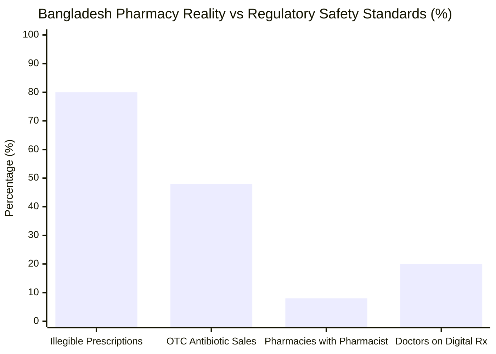
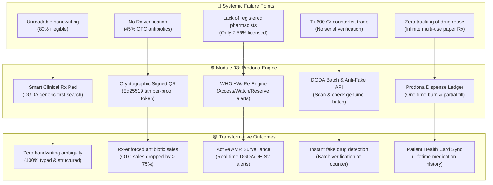
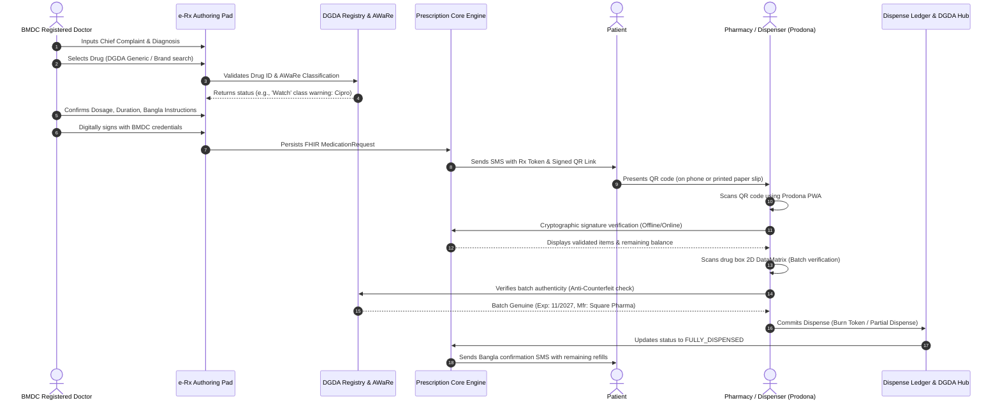
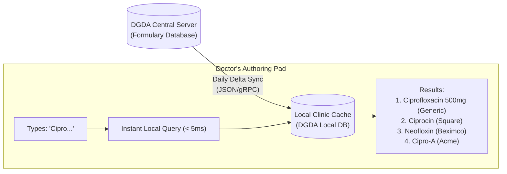
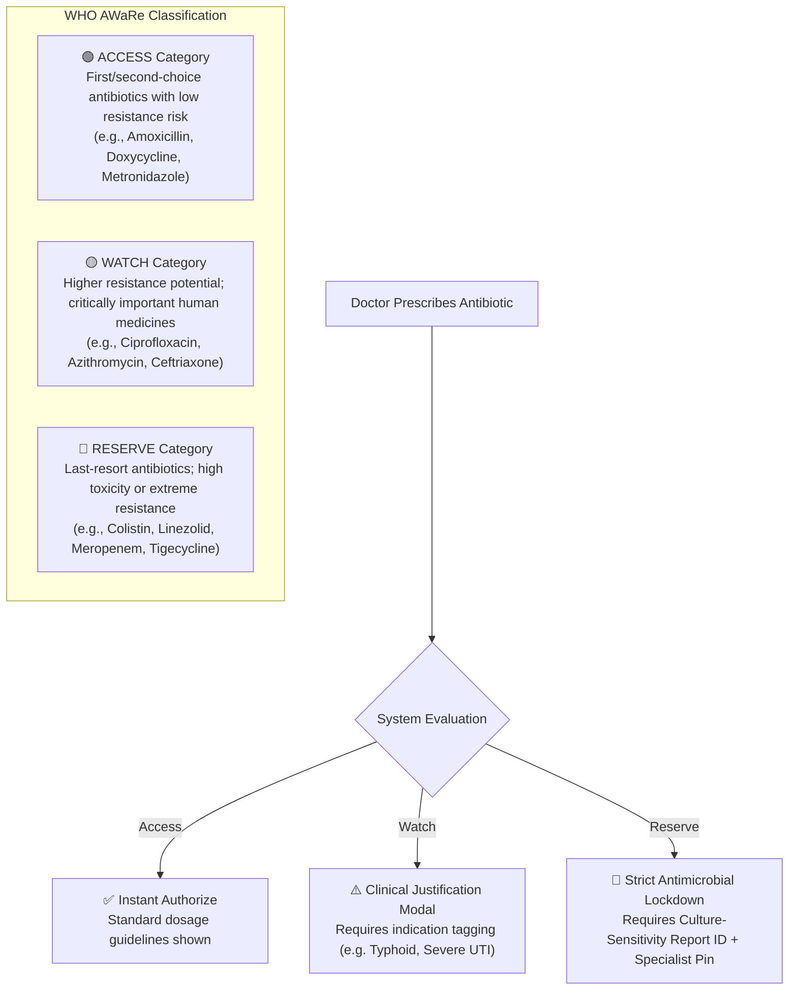
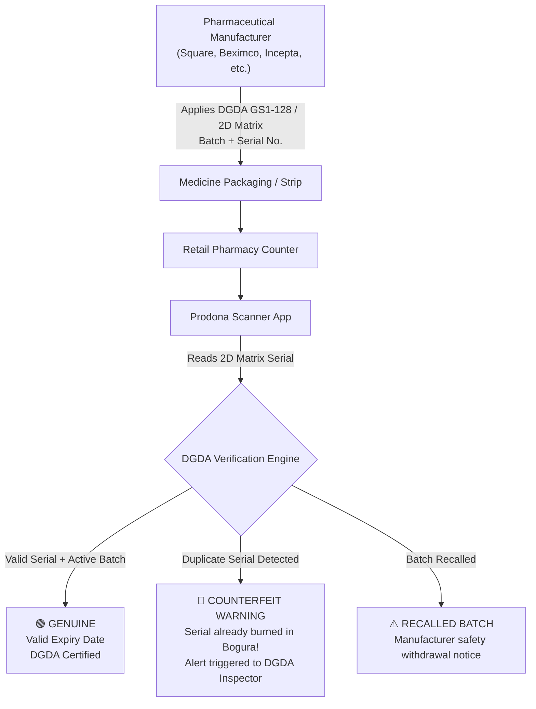
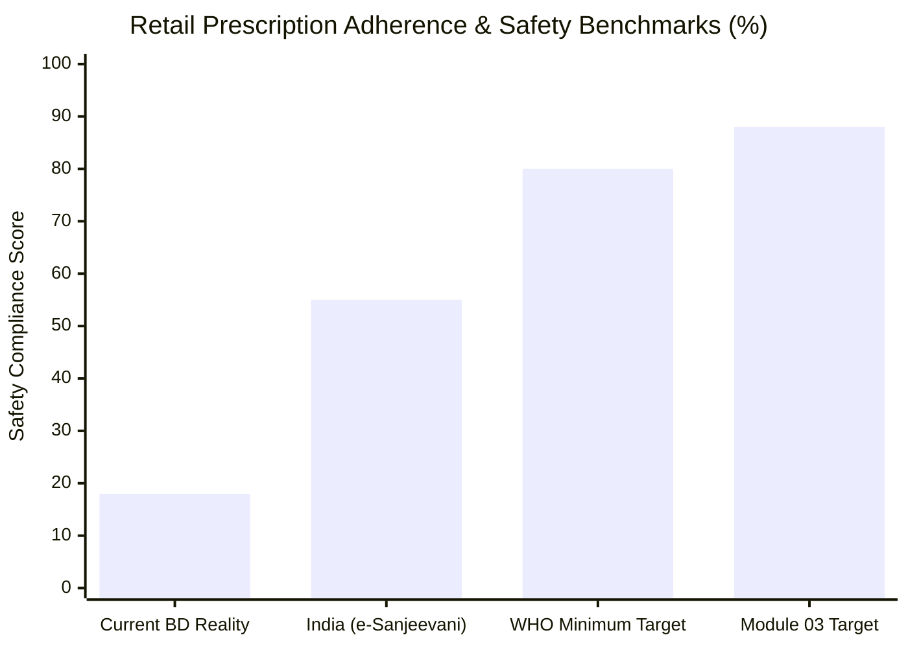
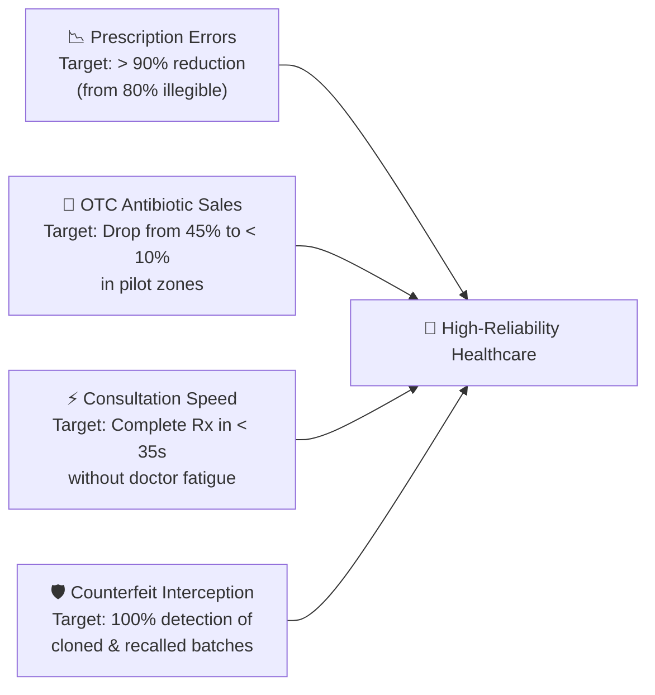

# 💊 Digital Prescription & Prodona (Dispensing) System

## Module 03 — Verifiable e-Prescriptions, DGDA Drug Registry, WHO AWaRe Antibiotic Stewardship & Counterfeit Prevention for Bangladesh

---

## Table of Contents

- [Problem Statement](#problem-statement)
  - [The Crisis in Numbers](#the-crisis-in-numbers)
  - [The Reality on the Ground](#the-reality-on-the-ground)
- [Why This Module Matters](#why-this-module-matters)
  - [Root Cause & Impact Tree](#root-cause--impact-tree)
  - [The Danger of Antimicrobial Resistance (AMR) in Bangladesh](#the-danger-of-antimicrobial-resistance-amr-in-bangladesh)
- [System Architecture & Vision](#system-architecture--vision)
  - [Closed-Loop e-Prescription & Prodona Workflow](#closed-loop-e-prescription--prodona-workflow)
- [DGDA National Drug Registry Integration](#dgda-national-drug-registry-integration)
- [WHO AWaRe Antibiotic Stewardship Engine](#who-aware-antibiotic-stewardship-engine)
  - [AWaRe Classification Breakdown](#aware-classification-breakdown)
  - [Prescription Safety Enforcement Pipeline](#prescription-safety-enforcement-pipeline)
- [Anti-Counterfeit & "Prodona" (প্রদোনা) Verification](#anti-counterfeit--prodona-প্রদোনা-verification)
- [Patient & Pharmacy Experience with Bangla Context](#patient--pharmacy-experience-with-bangla-context)
- [Comparative Benchmark: Bangladesh vs Global Targets](#comparative-benchmark-bangladesh-vs-global-targets)
- [Stakeholder Value Matrix](#stakeholder-value-matrix)
- [Success Metrics & KPIs](#success-metrics--kpis)

---

## Problem Statement

Prescription writing and medication dispensing across Bangladesh represent one of the most perilous points in the entire patient care continuum. Despite the landmark **High Court Division ruling of 2017** mandating all registered medical practitioners to write clear, legible prescriptions using block capitals or computerized printouts, paper prescriptions remain notoriously unreadable, unregulated, and completely disconnected from any verifiable verification loop.

> [!CAUTION]
> **High Court Mandate Unenforced**: In January 2017, the High Court directed doctors to produce legible or typed prescriptions following a public interest writ. Nearly a decade later, field audits reveal that **approx. 80% of handwritten prescriptions** in Bangladesh remain sloppy, ambiguous, or decipherable only by specific neighborhood pharmacy salesmen (*দোকানদার*), creating severe medication dispensing errors.

### The Crisis in Numbers

| Indicator / Metric | Value / Statistic | Ground Reality & Clinical Source |
|:---|:---:|:---|
| **Illegible Prescription Rate** | **~80%** | Industry pharmacist field surveys & *Dhaka Tribune* investigations |
| **Antibiotics Sold Without Rx** | **44.9% – 50.9%** | 246 surveyed Dhaka pharmacies (PMC 2025: 44.9%; icddr,b 2022: 50.9%) |
| **Pharmacies with Registered Pharmacists** | **7.56%** | Only 7.56% of urban retail pharmacies have a licensed 'A' or 'B' grade pharmacist (PMC 2025) |
| **Counterfeit Medicine Market** | **~Tk 600 Crore** | Industry estimate in a Tk 18,000 Crore domestic pharmaceutical retail market (*The Daily Star*) |
| **Average Consultation Time** | **48 seconds** | Shortest among 67 nations surveyed (*BMJ Global Health*), leaving 0 seconds for patient counseling |
| **Doctors Using Digital Prescriptions** | **20.0%** | 51.4% rely entirely on manual paper pads; only 20% utilize digital solutions (*Banglajol* 2021) |
| **WHO AWaRe Compliance in Retail** | **< 30%** | Massive over-prescription and OTC dispensing of "Watch" and "Reserve" class antibiotics |



### The Reality on the Ground

The gap between prescribing doctors and retail pharmacy counters generates three interconnected catastrophes:

1. **Deadly Dispensing Errors & Guesswork**: In community pharmacies across cities and upazilas, salesmen with zero formal pharmacology education routinely misread drug names with similar spellings (e.g., mistaking *Losectil* [Omeprazole] for *Lasilactone* [Spironolactone/Furosemide], or misreading pediatric antibiotic concentrations).
2. **Uncontrolled Antibiotic Proliferation**: Because paper prescriptions have no unique identifier, patients recycle an old Amoxicillin or Cefixime prescription for months, or share it among family members whenever a fever strikes. Pharmacies sell higher-generation "Watch" antibiotics over the counter without hesitation.
3. **Pervasive Fake and Spurious Drugs**: Counterfeit factories operating in illicit hubs (such as Mitford, Keraniganj, and Tongi) manufacture fake paracetamol, cephalosporins, and steroids using chalk and dye. Because patients and pharmacies lack a cryptographic verification tool, fake batches enter the supply chain undetected.

> [!WARNING]
> Without a centralized, cryptographically verifiable electronic prescription and dispensing ledger, national antimicrobial stewardship remains impossible. Bangladesh currently faces rising resistance to colistin, carbapenems, and third-generation cephalosporins in secondary and tertiary intensive care units.

---

## Why This Module Matters

The **Prescription / Prodona System** establishes a digital bridge between the registered medical practitioner (BMDC certified), the Directorate General of Drug Administration (DGDA) National Drug Registry, the WHO AWaRe classification engine, and licensed pharmacies (Model Pharmacies & General Drug Stores).

### Root Cause & Impact Tree



### The Danger of Antimicrobial Resistance (AMR) in Bangladesh

Antimicrobial resistance is an urgent national health security threat in Bangladesh. A 2025 study across Dhaka retail outlets confirmed that **44.9% of all antibiotic sales occur with zero prescription seen**. Retail pharmacists report that patients demand 1-day or 2-day courses of Azithromycin or Cefixime due to financial constraints, leaving incomplete courses that breed multi-drug resistant superbugs (*Klebsiella pneumoniae*, *Acinetobacter baumannii*, and *E. coli*).

> [!IMPORTANT]
> The Fleming Fund and World Health Organization have urged Bangladesh to enforce mandatory digital logging of antibiotic sales. Module 03 embeds WHO AWaRe safeguards right into the doctor's authoring workflow and the pharmacy's dispensing terminal.

---

## System Architecture & Vision

Module 03 is named **"Prodona"** (Bengali: প্রদোনা), derived from the clinical concept of mindful, structured dispensing. It consists of three tightly coupled components:

1. **Prescriber Pad (Web & Mobile PWA)**: Used by BMDC-registered physicians to draft, sign, and issue structured electronic prescriptions in under 40 seconds.
2. **Prodona Verification & Dispensing Terminal**: Used by hospital dispensaries and retail chemists to scan prescription QR codes, verify legitimacy, check drug authenticity against DGDA serials, and record dispenses.
3. **DGDA AMR & Regulatory Portal**: Monitored by the Directorate General of Drug Administration and IEDCR to track national consumption of Watch and Reserve antibiotics, identify regional spikes, and trigger pharmacy audits.

### Closed-Loop e-Prescription & Prodona Workflow



---

## DGDA National Drug Registry Integration

The Directorate General of Drug Administration maintains the national formulary of all registered pharmaceuticals, therapeutic classes, generic molecules, and licensed manufacturers.

Module 03 maintains an active local SQLite / IndexedDB cache of the DGDA Drug Registry, synced incrementally every 24 hours:



### DGDA Data Attributes Enforced in Every Prescription:

- **DAR Number** (Drug Administration Registration Number)
- **Generic Molecule Name** (mandatory display per national guidelines)
- **Standardized Dose Form** (Tablet, Syrup, Injection, Inhaler, Eye Drops)
- **Controlled Substance Schedule** (Narcotics, Psychotropics requiring special security PIN)
- **Manufacturer Identity & Registered License Number**
- **Approved Maximum Retail Price (MRP)** to protect patients from retail price gouging

---

## WHO AWaRe Antibiotic Stewardship Engine

To stop indiscriminate antibiotic usage, Module 03 natively implements the **WHO AWaRe** (Access, Watch, Reserve) framework directly into clinical decisions.



### AWaRe Classification Breakdown

| Category | Representative Molecules in BD | System Rule in Module 03 | Dispensing Policy at Pharmacy |
|:---|:---|:---|:---|
| **Access (সবুজ তালিকা)** | Amoxicillin, Ampicillin, Cloxacillin, Doxycycline, Metronidazole, Cotrimoxazole | Standard single-tap prescribing; auto-calculates pediatric dosage based on weight | Single-use token; can be dispensed by any licensed Model Pharmacy or General Store |
| **Watch (হলুদ তালিকা)** | Azithromycin, Cefixime, Ciprofloxacin, Levofloxacin, Ceftriaxone, Piperacillin-Tazobactam | Requires selection of diagnostic indication; system warns if prescribed for viral URI | Strictly requires scanned digital prescription token; logs pharmacy license to DGDA |
| **Reserve (লাল তালিকা)** | Colistin, Linezolid, Polymyxin B, Meropenem, Vancomycin, Tigecycline | Restricted to Inpatient / ICU encounters; requires lab Culture Sensitivity confirmation | Hospital ICU dispensary only; flagged immediately to DGDA National AMR surveillance |

---

## Anti-Counterfeit & "Prodona" (প্রদোনা) Verification

The counterfeit medicine racket in Bangladesh accounts for an estimated **Tk 600 Crore** annually. Fake medications frequently contain chalk, talcum powder, or contaminated excipients, resulting in treatment failure or fatal toxicities.

Module 03 tackles this through the **Prodona Anti-Counterfeit Protocol**:



> [!CAUTION]
> If a duplicate serial number is scanned at a pharmacy counter, the Prodona terminal immediately freezes the transaction, displays an on-screen warning in red Bangla script, and transmits the GPS coordinates and store license ID directly to the DGDA Enforcement Wing.

---

## Patient & Pharmacy Experience with Bangla Context

A digital healthcare system in Bangladesh must cater to patients with varying literacy levels and pharmacy dispensers who need rapid execution during rush hours.

### 1. Patient Bangla SMS Notification
When a prescription is signed, the patient receives an instant SMS formatted for basic feature phones:

```text
[DGHS-eRx] প্রিয় কামাল হোসেন, ডাঃ এ. রহমান আপনার প্রেসক্রিপশন প্রদান করেছেন।
কোড: RX-789214
ওষুধ: ৩টি (১টি অ্যান্টিবায়োটিক - ৭ দিন নিয়মিত খাবেন)
প্রেসক্রিপশন দেখতে ও ওষুধ কিনতে লিঙ্কে চাপ দিন: erx.dghs.gov.bd/v/789214
অথবা ফার্মেসিতে কোডটি বলুন।
```

### 2. Printed Slip / Health Card QR
For walk-in OPD patients without smartphones, the clinic printer produces an ink-efficient receipt containing:
- Patient Name, Age, Gender, Health Card ID (HID)
- Prescribed Medicines with standardized icons (☀️ সকাল, ⛅ দুপুর, 🌙 রাত)
- Cryptographically signed 2D QR containing complete offline-verifiable payload
- Warning banner: *"অ্যান্টিবায়োটিকের পুরো কোর্স শেষ করুন। চিকিৎসকের পরামর্শ ছাড়া বন্ধ করবেন না।"*

### 3. Pharmacy Prodona Screen
The dispenser interface is optimized for speed:
- Single barcode scan opens the prescription in < 200 milliseconds.
- Visual colored chips indicate WHO AWaRe status (Green for Amoxicillin, Yellow for Azithromycin).
- Dispense button: **"সম্পূর্ণ প্রদান করুন"** (Full Dispense) or **"আংশিক প্রদান করুন"** (Partial Dispense for patients buying 3 days out of 7).
- Partial dispense auto-burns the dispensed quantity and keeps the remaining quantity valid for future visits, eliminating infinite over-the-counter refills.

---

## Comparative Benchmark: Bangladesh vs Global Targets



### Comparison Matrix

| Capability / Metric | Traditional BD System | India (ABDM / e-Sanjeevani) | Brazil (SUS / Farmácia Popular) | Module 03 (Prodona System) |
|:---|:---:|:---:|:---:|:---:|
| **Prescription Digitization** | Paper handwritten (~20% digital) | Centralized e-Rx & ABHA linkage | Integrated SUS electronic dispensing | 100% structured FHIR MedicationRequest |
| **Legibility & Safety Checks** | 80% illegible / High Court order ignored | Typed with drug dictionary auto-fill | Automated formulary & dose check | Auto-fill + dose safety + allergy check |
| **OTC Antibiotic Enforcement** | Uncontrolled (45-50% sold without Rx) | State-level pharmacy inspections | Strict digital prescription retention | One-time cryptographic QR token burn |
| **Formulary Sync** | Fragmented printed directories | National formulary database | RENAME (National Essential Drug List) | DGDA real-time registry sync |
| **Anti-Counterfeit Check** | None (Visual packaging check) | Barcode tracking on top 300 brands | Tracking and traceability system | GS1 2D DataMatrix serial validation |
| **Offline Verification** | Zero | Restricted to online portal | Offline smart card token | Ed25519 signed QR readable offline |

---

## Stakeholder Value Matrix

| Stakeholder | Key Pain Point Addressed | System Feature Provided | Tangible Value Delivered |
|:---|:---|:---|:---|
| **Registered Doctor** | High Court order liability; 48-second rush; repetitive handwriting | One-click clinical templates; DGDA smart search; instant pediatric dosing | Legal protection; prescription completed in under 35 seconds; zero misinterpretation |
| **Retail Pharmacist** | Indecipherable handwriting; arguments with customers over unreadable doses | High-speed QR scanner; clear Bangla dose schedule; partial fill ledger | Rapid dispensing; elimination of dispensing liability; automated inventory update |
| **Patient & Family** | Dispensing errors; counterfeit drugs; lost paper slips; no clear dosing instructions | Bangla SMS; audio dose reminders; permanent history on e-Health Card | Safe treatment; authentic medicine guarantee; access to records anywhere |
| **DGDA & IEDCR** | Zero visibility on antibiotic consumption; Tk 600 Cr counterfeit market | Real-time AMR heatmaps; automatic alerts on Reserve drug spikes; fake batch reporting | Data-driven enforcement; containment of superbug outbreaks; targeted raids |
| **Hospital Administration** | Leaked inventory; unaccounted drug stocks in public dispensaries | Closed-loop token burn linked to central eLMIS / inventory stock | 100% accountability of government-supplied medicines; zero pilferage |

---

## Success Metrics & KPIs



- **Legibility Compliance**: Achieve 100% structured electronic generation across pilot upazila and district hospitals, fulfilling the 2017 High Court directive.
- **Antimicrobial Stewardship**: Reduce non-prescription antibiotic dispensing from ~45% to below 10% in registered Model Pharmacies within 12 months.
- **Dispensing Accuracy**: Prevent an estimated 35,000 yearly adverse drug events (ADEs) caused by handwritten drug name confusion.
- **Counterfeit Mitigation**: Identify and quarantine 100% of expired or recalled drug batches at the retail point-of-sale before they reach patients.
