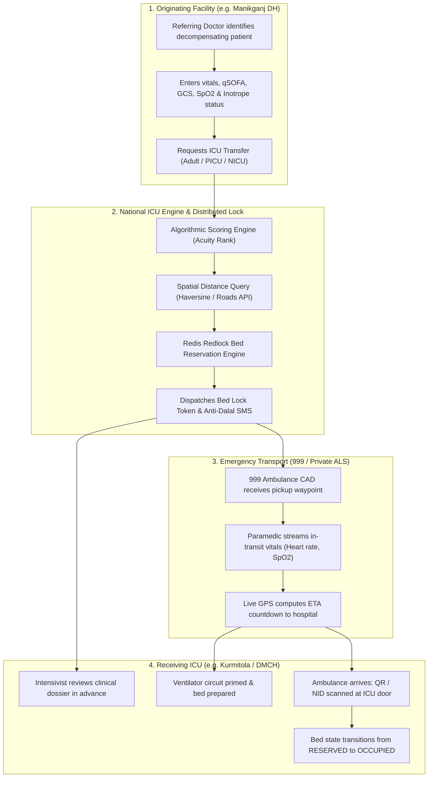
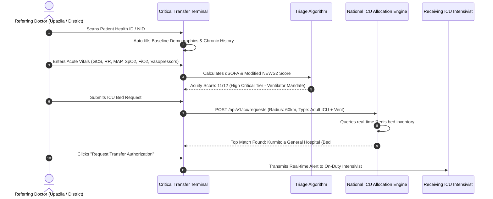
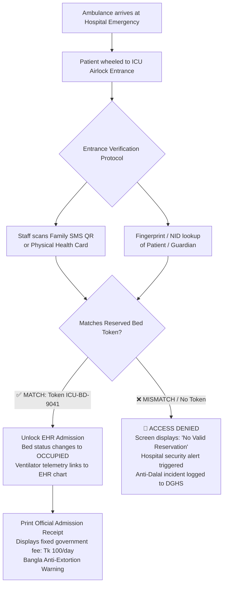
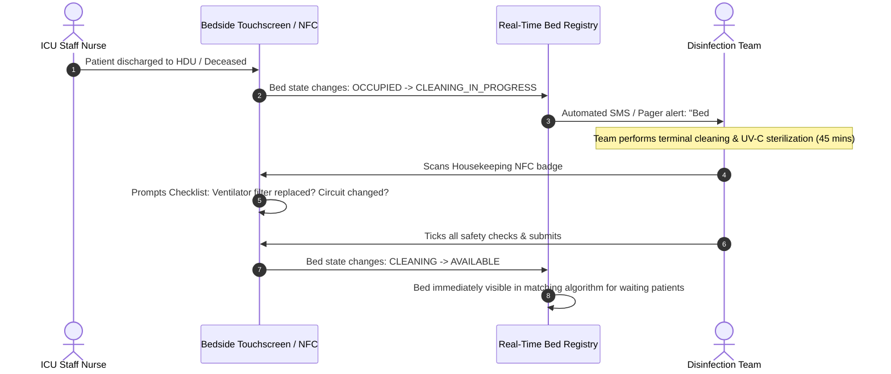

# 🔄 Application Flow — ICU Bed Allocation & Critical Care Triage

## Module 04 — Detailed Patient Referral, Real-Time Allocation, In-Transit Telemetry & Admission Protocols

---

## Table of Contents

- [System Architecture & Interaction Overview](#system-architecture--interaction-overview)
- [Journey 1: Referring Doctor ICU Request & Triage Scoring](#journey-1-referring-doctor-icu-request--triage-scoring)
  - [Automated Clinical Acuity Calculation](#automated-clinical-acuity-calculation)
  - [Algorithmic Bed Search & Match Protocol](#algorithmic-bed-search--match-protocol)
- [Journey 2: Receiving Hospital Intensivist Handshake & Bed Locking](#journey-2-receiving-hospital-intensivist-handshake--bed-locking)
  - [Bed Reservation State Machine](#bed-reservation-state-machine)
  - [Distributed Lock & Redlock Coordination](#distributed-lock--redlock-coordination)
- [Journey 3: Emergency Dispatch & In-Transit Telemetry](#journey-3-emergency-dispatch--in-transit-telemetry)
  - [999 Emergency CAD Webhook Integration](#999-emergency-cad-webhook-integration)
  - [Ambulance GPS & Vital Signs Streaming](#ambulance-gps--vital-signs-streaming)
- [Journey 4: Bedside Arrival, Biometric Admission & Anti-Dalal Check](#journey-4-bedside-arrival-biometric-admission--anti-dalal-check)
- [Bed Lifecycle & Housekeeping State Machine](#bed-lifecycle--housekeeping-state-machine)
- [Surge Protocols & Mass Casualty Flow](#surge-protocols--mass-casualty-flow)
- [Edge Cases & Exception Handling Matrix](#edge-cases--exception-handling-matrix)

---

## System Architecture & Interaction Overview

The ICU Bed Availability & Allocation System synchronizes four active stakeholders: the **Referring Clinician** (Upazila or District Hospital), the **Central Matching Engine**, the **Emergency Transport Crew** (999 ALS Ambulance), and the **Receiving ICU Intensivist** (Tertiary Hospital).



> [!NOTE]
> All bed reservations feature an automated **Dynamic Transit Timer**. If an ambulance from Manikganj has an estimated travel time of 75 minutes, the receiving bed is reserved for $75 + 30\text{ minutes grace period}$. If the ambulance does not check in before expiration, the lock is auto-released to prevent bed hoarding.

---

## Journey 1: Referring Doctor ICU Request & Triage Scoring

A Medical Officer at an Upazila Health Complex or District Hospital encounters a deteriorating patient suffering from septic shock, severe head trauma, or acute respiratory distress syndrome (ARDS).



### Automated Clinical Acuity Calculation

To prevent arbitrary referrals and ensure patients with reversible conditions receive immediate priority:
1. **Respiratory Component**:
   - $RR \ge 25\text{ bpm}$ or $\text{SpO2} < 88\%$ on room air $\rightarrow +3$ points.
   - High-flow nasal cannula or non-rebreather mask requirement $\rightarrow +2$ points.
2. **Cardiovascular Component**:
   - $\text{Mean Arterial Pressure (MAP)} < 65\text{ mmHg}$ despite fluid resuscitation $\rightarrow +3$ points.
   - Requirement of inotropes (Noradrenaline / Dopamine) $\rightarrow +3$ points.
3. **Neurological Component**:
   - Glasgow Coma Scale (GCS) $\le 8$ (unprotected airway mandate) $\rightarrow +4$ points.
4. **Calculated Stratification**:
   - **Score $\ge 8$**: Emergency Priority 1 (Immediate Bed Allocation & Transit Lock).
   - **Score $5 - 7$**: Priority 2 (High Dependency Unit / Step-Down Allocation).
   - **Score $< 5$**: Priority 3 (Ineligible for central ICU lock; ward management advised).

---

## Journey 2: Receiving Hospital Intensivist Handshake & Bed Locking

The receiving hospital intensivist maintains complete clinical governance over their unit while being bound by national transparency rules.

```mermaid
sequenceDiagram
    autonumber
    participant Engine as Central Allocation Engine
    actor Intensivist as Receiving ICU Intensivist (DMCH / Kurmitola)
    participant UI as ICU Bedside Dashboard
    participant Redis as Distributed Lock (Redlock)
    actor Family as Patient Family (SMS)

    Engine->>UI: Audio-Visual Siren: "Incoming Critical Transfer Request"
    UI->>Intensivist: Displays Digital Transfer Dossier (Vitals, ECG photo, Labs)
    Intensivist->>UI: Reviews clinical salvageability & ventilation requirements
    
    alt Approved by Intensivist
        Intensivist->>UI: Clicks "Accept Transfer & Lock Bed" (Within 3 minutes)
        UI->>Redis: REDLOCK acquire(bed_kgh_06, ttl: 90 mins)
        Redis-->>UI: Lock Acquired Successfully
        UI->>Engine: Status: BED_LOCKED (Token: ICU-BD-9041)
        Engine->>Family: Dispatches Anti-Dalal Transparency SMS
    else Rejected with Clinical Counter-Indication
        Intensivist->>UI: Clicks "Unable to Accept" + Reason (e.g., Bed reserved for Post-Op)
        UI->>Engine: Rejection logged; Engine auto-reroutes to next ranked hospital
    else Timeout (No Response in 180 seconds)
        Engine->>Engine: Auto-escalates to Duty Senior Consultant / Reroutes request
    end
```

### Bed Reservation State Machine

```mermaid
stateDiagram-v2
    [*] --> AVAILABLE: Bed cleaned & disinfected
    AVAILABLE --> LOCK_PENDING: Request matched; awaiting doctor confirmation (180s)
    LOCK_PENDING --> AVAILABLE: Request rejected or doctor timeout
    
    LOCK_PENDING --> RESERVED_IN_TRANSIT: Intensivist accepts transfer
    RESERVED_IN_TRANSIT --> OCCUPIED: Patient arrives & biometric QR scanned
    RESERVED_IN_TRANSIT --> AVAILABLE: Transit timeout expired (No arrival)
    
    OCCUPIED --> STEP_DOWN: Patient stabilized; transferred to HDU/Ward
    OCCUPIED --> DECEASED: Patient expires
    
    STEP_DOWN --> CLEANING: Bed vacated
    DECEASED --> CLEANING: Bed vacated
    
    CLEANING --> AVAILABLE: Housekeeping scans NFC; bed sanitized
    CLEANING --> OUT_OF_ORDER: Equipment malfunction identified
    OUT_OF_ORDER --> AVAILABLE: Bio-medical engineering completes repair
```



---

## Journey 3: Emergency Dispatch & In-Transit Telemetry

In Bangladesh, a critical point of mortality occurs while the patient is inside an ambulance battling traffic gridlock on the Dhaka-Aricha or Dhaka-Chittagong highways.

### 999 Emergency CAD Webhook Integration

1. The moment the receiving intensivist locks the bed, the allocation engine emits a webhook to the **National Emergency Service 999 CAD system**:
   - `Event`: `AMBULANCE_DISPATCH_REQUIRED`
   - `Patient`: Name, Age, Oxygen requirement, Origin Coordinates
   - `Destination`: Hospital Name, ICU Wing, Gate Number, Assigned Bed ID
2. The nearest available **Advanced Life Support (ALS) Ambulance** equipped with an on-board transport ventilator is dispatched.

```mermaid
sequenceDiagram
    autonumber
    participant Engine as ICU Allocation Engine
    participant CAD as 999 Dispatch Server
    actor Amb as ALS Ambulance Crew
    participant Mobile as Paramedic Mobile App
    participant Receiving as Receiving ICU Monitor

    Engine->>CAD: POST /api/v1/cad/dispatch (Origin, Destination, Oxygen=High)
    CAD->>Amb: Dispatches ALS Ambulance Unit #42
    Amb->>Mobile: Confirms Pickup & Connects Telemetry Sensors
    
    loop Every 30 Seconds during Transit
        Mobile->>Engine: Stream Telemetry: GPS, Speed, SpO2, Heart Rate, ETA
        Engine->>Receiving: WebSocket Push: "Ambulance 12km away (ETA 18 min) - SpO2: 91%"
    end
    
    Note over Amb,Receiving: Traffic delay occurs at Gabtoli
    Mobile->>Engine: Detected speed < 5 km/h; recalculates ETA (+15 min)
    Engine->>Engine: Dynamically extends Bed Lock TTL by 15 minutes
    Engine->>Receiving: Alert: Transit delay acknowledged; bed lock maintained
```

---

## Journey 4: Bedside Arrival, Biometric Admission & Anti-Dalal Check

The critical defense against gate-crashing and middleman cartels (*দালাল চক্র*) occurs at the physical entrance of the Intensive Care Unit.



> [!CAUTION]
> Under no circumstances can hospital billing or electronic health record (EHR) software generate an ICU admission encounter without a valid, cryptographic reservation token from Module 04. This single technical constraint completely neutralizes informal "VIP" gate-crashing and middleman bribes.

---

## Bed Lifecycle & Housekeeping State Machine

A common cause of artificial bed scarcity is the delayed turnaround time between when a patient is discharged or dies and when the bed is sterilized for the next patient.



---

## Surge Protocols & Mass Casualty Flow

During seasonal epidemics (such as severe **Dengue shock syndrome** outbreaks in Dhaka) or mass casualty events (fires, building collapses), Module 04 activates **Surge Capacity Mode**:

1. **HDU Step-Up Conversion**: High Dependency Unit beds equipped with non-invasive ventilation (BiPAP/CPAP) are dynamically reclassified as Level 2 Critical Care beds.
2. **Pediatric Expansion**: Inpatient pediatric beds with oxygen concentrators are surfaced for pediatric dengue shock cases.
3. **Regional Diversion Warnings**: If Dhaka metropolitan ICU occupancy reaches **98%**, the system triggers automated diversion notices to surrounding district hospitals (Gazipur, Narayanganj, Manikganj, Mymensingh), urging local stabilization and telemedicine consults before transfer.

---

## Edge Cases & Exception Handling Matrix

| Scenario / Edge Case | Failure Mode / Threat | System Defense & Protocol |
|:---|:---|:---|
| **Ambulance breaks down during transit** | Patient stranded on highway; reserved bed hoarded indefinitely | Paramedic app features a **"Mechanical Breakdown"** button. System immediately summons nearest secondary ambulance via 999 CAD and recalculates transit lock timer. |
| **Patient dies in transit before reaching hospital** | Bed remains locked while other dying patients wait | Paramedic records transit mortality on mobile app. System instantly releases the bed lock back to `AVAILABLE` for the next patient on the waiting queue. |
| **Hospital experiences internal Code Blue (Post-Op arrest)** | Inpatient emergency requires the sole vacant ICU bed | Intensivist presses **"Internal Emergency Override"**. System reallocates the incoming transfer patient to the second-best matched facility and sends priority rerouting to the ambulance. |
| **Total cellular data blackout on highway** | Paramedic app cannot stream live GPS vitals | System utilizes SMS-based fallback heartbeat. Mobile app transmits encrypted periodic SMS pings every 5 minutes containing GPS coordinates directly to the DGHS SMS gateway. |
| **Middleman produces fake printed token** | Dalal attempts to gain ICU entry with forged paper | Token contains an asymmetric Ed25519 signature. ICU entrance scanner validates the cryptographic public key; forged tokens fail signature validation instantly. |
| **Ventilator suffers sudden mechanical failure** | Bed marked available but equipment is unusable | Nurse changes status to `OUT_OF_ORDER`. System removes bed from search algorithm and dispatches automated maintenance ticket to DGHS electro-medical workshop. |
| **Power outage / Generator failure in receiving ICU** | Loss of clinical monitors and oxygen supply | Receiving hospital triggers **"Facility Emergency Lockdown"**. All incoming transfers automatically diverted; regional command center alerted. |
