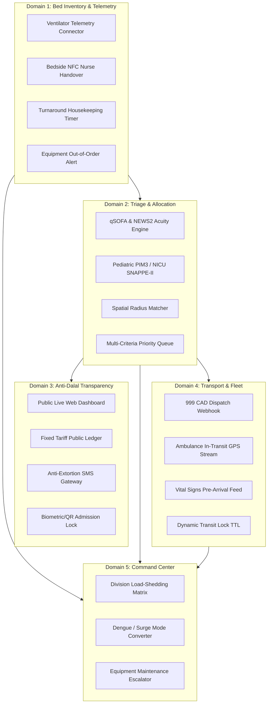
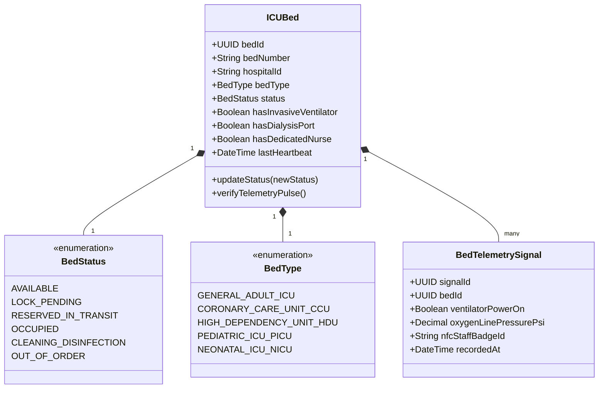
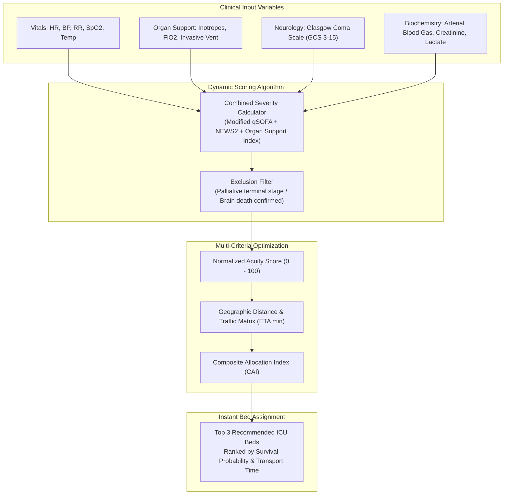
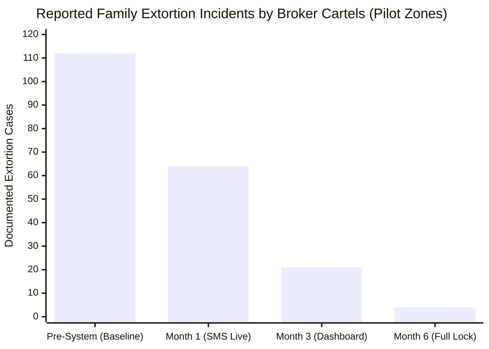
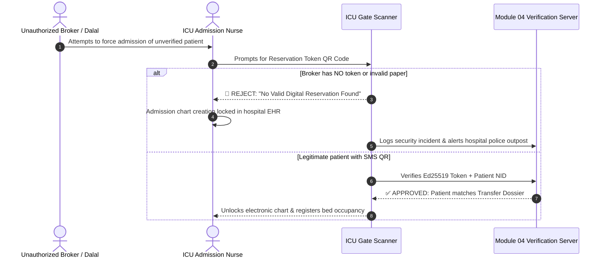
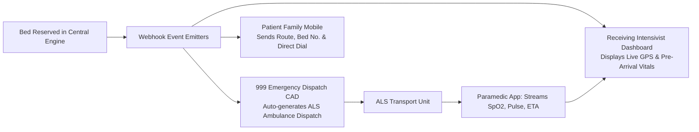
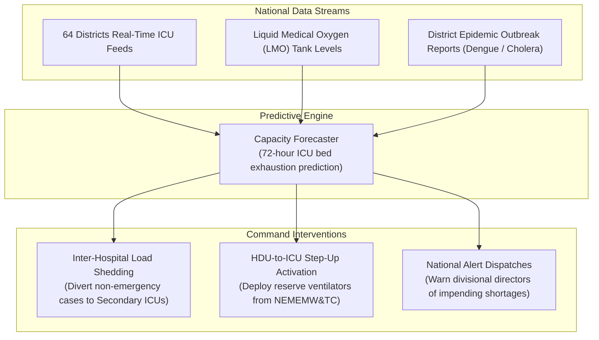

# ⚡ Functional Specifications & Feature Catalog — Module 04

## Real-Time ICU Bed Registry, Dynamic Triage Engine & Critical Care Dispatch

---

## Table of Contents

- [Functional Architecture Overview](#functional-architecture-overview)
- [Domain 1: Bed Inventory & Telemetric Verification](#domain-1-bed-inventory--telemetric-verification)
  - [Hardware & Telemetry Connectors](#hardware--telemetry-connectors)
  - [Bed Categorization Hierarchy](#bed-categorization-hierarchy)
  - [Nurse Handover & Shift Pulse](#nurse-handover--shift-pulse)
- [Domain 2: Clinical Triage & Algorithmic Allocation](#domain-2-clinical-triage--algorithmic-allocation)
  - [Acuity Scoring Calculation Engine](#acuity-scoring-calculation-engine)
  - [Spatial Multi-Criteria Matching Algorithm](#spatial-multi-criteria-matching-algorithm)
  - [Pediatric & Neonatal Triage Matrix](#pediatric--neonatal-triage-matrix)
- [Domain 3: Anti-Dalal Transparency & Public Dashboards](#domain-3-anti-dalal-transparency--public-dashboards)
  - [Public Live Bed Monitor](#public-live-bed-monitor)
  - [Anti-Extortion SMS Engine](#anti-extortion-sms-engine)
  - [Admission Gatekeeping & Tamper-Proof QR](#admission-gatekeeping--tamper-proof-qr)
- [Domain 4: Emergency Transport & Pre-Hospital Fleet Integration](#domain-4-emergency-transport--pre-hospital-fleet-integration)
  - [999 Emergency Dispatch Webhook Bridge](#999-emergency-dispatch-webhook-bridge)
  - [Dynamic In-Transit GPS Lock & Telemetry](#dynamic-in-transit-gps-lock--telemetry)
- [Domain 5: DGHS Command Center & Epidemic Surge Management](#domain-5-dghs-command-center--epidemic-surge-management)
- [Solving Brazil's SISREG Failures: Architectural Defense Grid](#solving-brazils-sisreg-failures-architectural-defense-grid)
- [Feature Priority & Compliance Matrix](#feature-priority--compliance-matrix)

---

## Functional Architecture Overview

Module 04 organizes critical care orchestration into five interlocking functional domains designed to replace informal phone calls and physical wandering with automated, data-driven workflows.

---

## Domain 1: Bed Inventory & Telemetric Verification

This domain guarantees the physical truth of bed availability, addressing the critical flaw in systems like Brazil's SISREG where beds remained empty but marked occupied, or vice versa.

### Hardware & Telemetry Connectors

- **Serial / RS-232 / MQTT Bridge**: Continuously captures running status from bedside ventilators (Servo-air, Mindray, Hamilton, Dräger). Detects active ventilation versus standby state.
- **Oxygen Manifold Pressure Telemetry**: Integrates with central liquid medical oxygen (LMO) pipelines. Disables ventilator-dependent bed matching if line pressure falls below 45 PSI.
- **Turnaround Housekeeping Timer**: When a bed transitions to `CLEANING_DISINFECTION`, an automated 45-minute countdown starts. If not marked `AVAILABLE` within 60 minutes, the charge nurse receives an escalation alert.

### Bed Categorization Hierarchy

1. **General Adult ICU**: Invasive mechanical ventilator, multi-parameter monitor, arterial line capabilities, minimum 1:2 nurse-to-patient ratio.
2. **Coronary Care Unit (CCU)**: Dedicated cardiac telemetry, intra-aortic balloon pump (IABP) readiness, temporary pacemaker pacing facilities.
3. **High Dependency Unit (HDU)**: Step-down care; non-invasive ventilation (BiPAP/CPAP), continuous pulse oximetry, high-flow nasal cannula (HFNC).
4. **Pediatric ICU (PICU)**: Child-specific ventilators, pediatric consumables, pediatric intensivist coverage.
5. **Neonatal ICU (NICU)**: Level 3 incubators, radiant warmers, neonatal ventilators, phototherapy units, surfactant administration capabilities.

---

## Domain 2: Clinical Triage & Algorithmic Allocation

Critical care beds must be allocated based on clinical salvageability and objective severity, not financial influence or personal connections.

### Spatial Multi-Criteria Matching Algorithm

The matching engine computes the **Composite Allocation Index (CAI)**:

$$\text{CAI} = (\text{Acuity Score} \times 0.50) + \left(\frac{1}{\text{Transit Time in Minutes}} \times 0.35\right) + (\text{Hospital Capability Tier} \times 0.15)$$

- Guarantees that a critically unstable patient is routed to the closest capable facility rather than sent across the city to an overcrowded tertiary hospital like DMCH.
- Incorporates live Dhaka traffic conditions via Google Maps Roads API / OpenStreetMap matrix routing.

---

## Domain 3: Anti-Dalal Transparency & Public Dashboards

To dismantle the predatory middleman syndicate (*দালাল চক্র*) that extorts **Tk 30,000 to 100,000** per admission, the platform institutes total operational transparency.

### Public Live Bed Monitor

- Real-time public interface accessible at `icu.dghs.gov.bd` without login requirements.
- Public metrics displayed:
  - Total Sanctioned ICU Beds by Division
  - Currently Occupied Beds
  - Currently Reserved Beds (In-Transit)
  - Vacant / Disinfecting Beds
  - Hospital Contact Number, Address, and Emergency Gate Directions
  - Maximum Statutory User Fee (Public hospital: Tk 100/day; Accredited private tier caps)
- **Zero Patient Identifiable Information (PII)** is visible on the public page, ensuring compliance with medical privacy laws.

### Admission Gatekeeping & Tamper-Proof QR

---

## Domain 4: Emergency Transport & Pre-Hospital Fleet Integration

Because patient decompensation en route to Dhaka is a leading cause of mortality, Module 04 links bed reservation directly with emergency transport.

### Dynamic In-Transit GPS Lock & Telemetry

- **Adaptive Time-to-Live (TTL)**: The bed lock expiration timer continuously recalculates based on live GPS speed from the ambulance.
- If traffic jams at Gazipur or Gabtoli add 25 minutes of transit delay, the system extends the bed hold time automatically.
- **Pre-Arrival Handshake**: 10 minutes prior to arrival, the receiving ICU receives a final audible siren on the bedside console, prompting the nursing team to draw baseline medications and calibrate the ventilator.

---

## Domain 5: DGHS Command Center & Epidemic Surge Management

The Directorate General of Health Services (DGHS) Command Center monitors national critical care capacity through an executive geospatial dashboard.

---

## Solving Brazil's SISREG Failures: Architectural Defense Grid

Module 04 was engineered specifically to prevent the catastrophic failure modes documented in Brazil's nationwide bed regulation platform (SISREG).

| Brazil SISREG Vulnerability (TCE-SC Audit) | Why It Happened in SISREG | Module 04 Defense in Bangladesh |
|:---|:---|:---|
| **33% Authorizations Issued Late** | Centralized human bureaucratic committees manually reviewed paper requests during working hours | **Algorithmic Instant Matching (< 15 seconds)**: Machine triage matches bed based on objective clinical equations (qSOFA/NEWS2) 24/7/365. |
| **54% Admissions Bypassed System** | Doctors made verbal agreements over telephone; hospital clerks created local charts without regulator consent | **Cryptographic Lockout**: Hospital billing and clinical EHR cannot create an ICU encounter without an Ed25519-signed central token. |
| **Stale, Inaccurate Bed Availability** | Data was entered manually once a day; empty beds were hidden for favored VIP patients | **Multi-Modal Bed Heartbeat**: Combines ventilator telemetry, oxygen pressure switches, and mandatory nurse handover NFC pulses. |
| **No In-Transit Bed Protection** | Beds were offered on a first-come basis; patients died when arriving at already-filled units | **GPS-Coupled Dynamic Transit Lock**: Bed state shifts to `RESERVED_IN_TRANSIT` with active countdown tied to live ambulance telemetry. |
| **Extortion & Predatory Middlemen** | Bed availability was hidden from the public; brokers sold unofficial information | **Public Real-Time Dashboard (`icu.dghs.gov.bd`)** and automated anti-extortion SMS sent directly to families. |

---

## Feature Priority & Compliance Matrix

| Feature ID | Feature Name | Priority | Protocol / Standard | Target User |
|:---|:---|:---:|:---|:---|
| **F-ICU-01** | Real-Time Telemetric Bed State Engine | P0 (Must Have) | Redis Redlock / WebSockets | Hospital ICU Units |
| **F-ICU-02** | Automated qSOFA & NEWS2 Triage Engine | P0 (Must Have) | Clinical Algorithm | Referring Physicians |
| **F-ICU-03** | Anti-Dalal Public Live Availability Portal | P0 (Must Have) | Responsive Web / W3C | Citizens & Families |
| **F-ICU-04** | Cryptographic Token Admission Gatekeeper | P0 (Must Have) | Ed25519 / FHIR Encounter | ICU Admission Staff |
| **F-ICU-05** | Anti-Extortion SMS Gateway | P0 (Must Have) | Unicode / GSM-7 | Patient Families |
| **F-ICU-06** | 999 Emergency CAD Webhook Connector | P1 (High) | RESTful Webhooks | 999 Dispatchers |
| **F-ICU-07** | In-Transit GPS & Vitals Streaming Engine | P1 (High) | MQTT / WebSockets | Paramedics & Receivers |
| **F-ICU-08** | Bedside Nurse NFC Shift Check Terminal | P1 (High) | NFC Type 4 / Android | ICU Duty Nurses |
| **F-ICU-09** | Ventilator Serial/MQTT Hardware Bridge | P2 (Medium) | RS-232 / MQTT | Biomedical Engineers |
| **F-ICU-10** | Housekeeping UV-C Disinfection Tracker | P2 (Medium) | State Machine | Sanitation Crews |
| **F-ICU-11** | DGHS Command Center Predictive Heatmap | P2 (Medium) | Mapbox / TimescaleDB | DGHS Health Ministry |
| **F-ICU-12** | Dialysis Port & Organ Support Registry | P2 (Medium) | FHIR Device Profile | Nephrologists & ICU |
