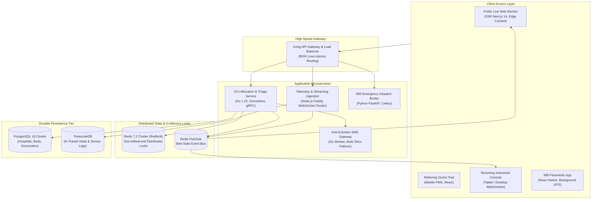
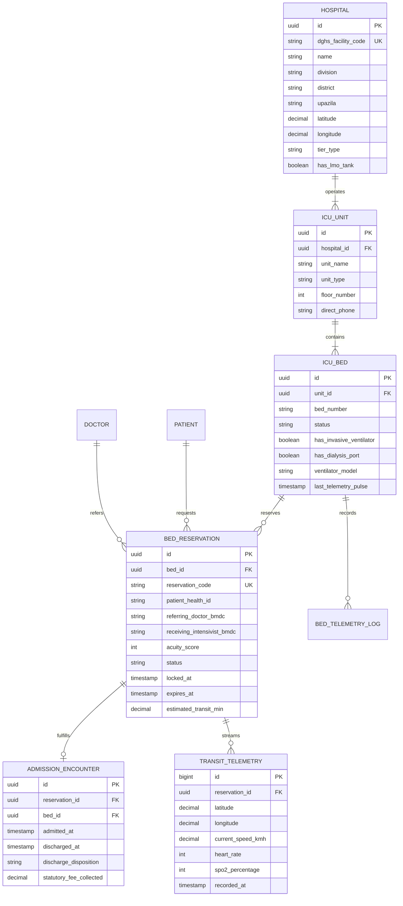
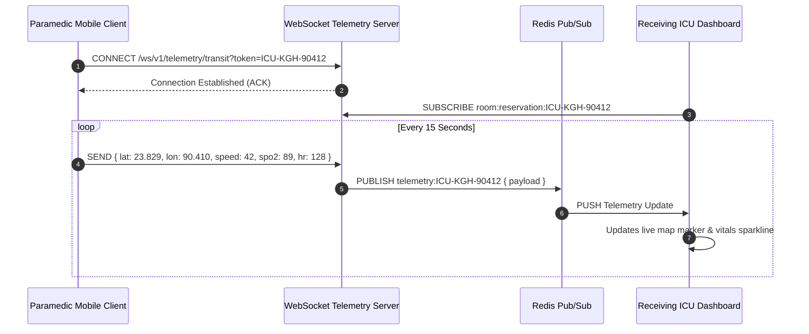
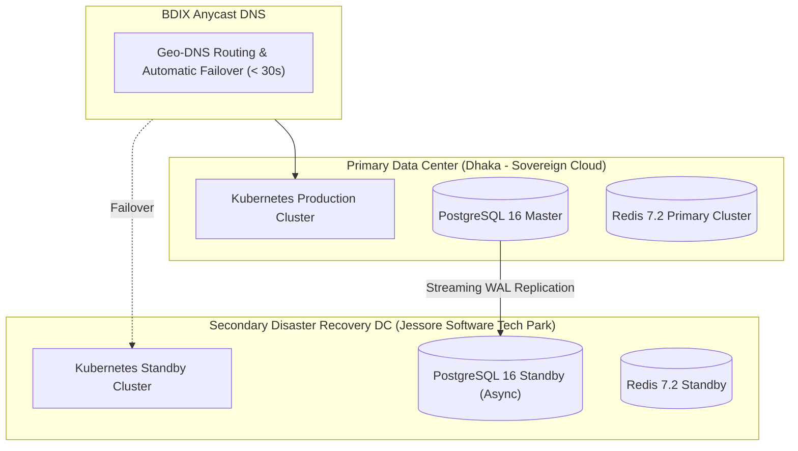

# 🛠️ Technical Architecture & Implementation Blueprint — Module 04

## Real-Time ICU Bed Allocation, Telemetric Ingestion & Dispatch Engine

---

## Table of Contents

- [System Architecture & High-Concurrency Topologies](#system-architecture--high-concurrency-topologies)
  - [Distributed Lock Architecture (Redis Redlock)](#distributed-lock-architecture-redis-redlock)
  - [Real-Time Telemetry & WebSocket Engine](#real-time-telemetry--websocket-engine)
- [Database Architecture & Entity-Relationship Model](#database-architecture--entity-relationship-model)
  - [Relational PostgreSQL Schema](#relational-postgresql-schema)
  - [Entity-Relationship Diagram](#entity-relationship-diagram)
- [HL7 FHIR R4 Critical Care Profiles](#hl7-fhir-r4-critical-care-profiles)
  - [FHIR Location (ICU Bed Profile)](#fhir-location-icu-bed-profile)
  - [FHIR Encounter (Critical Care Transfer & Admission)](#fhir-encounter-critical-care-transfer--admission)
- [RESTful, WebSocket & Webhook API Contracts](#restful-websocket--webhook-api-contracts)
  - [Live Bed Query: `GET /api/v1/icu/beds/live`](#live-bed-query-get-apiv1icubedslive)
  - [Submit Transfer & Lock Bed: `POST /api/v1/icu/reservations`](#submit-transfer--lock-bed-post-apiv1icureservations)
  - [Admit Patient & Verify Token: `POST /api/v1/icu/admit`](#admit-patient--verify-token-post-apiv1icuadmit)
  - [In-Transit Telemetry WebSocket: `WS /ws/v1/telemetry/transit`](#in-transit-telemetry-websocket-ws-wsv1telemetrytransit)
- [IoT & Ventilator Telemetry Bridge (Serial/MQTT)](#iot--ventilator-telemetry-bridge-serialmqtt)
- [Anti-Dalal Security, Biometrics & Audit Ledger](#anti-dalal-security-biometrics--audit-ledger)
- [Deployment, High-Availability & Disaster Recovery](#deployment-high-availability--disaster-recovery)

---

## System Architecture & High-Concurrency Topologies

Module 04 manages zero-latency state transitions for life-critical assets. Because multiple doctors across Bangladesh may compete for the same vacant ICU bed simultaneously, the architecture guarantees **strict serializability and idempotency** via distributed in-memory locking.



### Distributed Lock Architecture (Redis Redlock)

When a doctor locks an ICU bed for an incoming transfer, the system executes an atomic **Redlock algorithm** across a multi-node Redis cluster to prevent double-booking:

```typescript
// Distributed Lock Implementation for ICU Bed Reservation
import Redlock from 'redlock';
import { redisClients } from './redisCluster';

const redlock = new Redlock(redisClients, {
  driftFactor: 0.01,
  retryCount: 3,
  retryDelay: 200, // milliseconds
  retryJitter: 100
});

export async function lockICUBed(bedId: string, ttlMs: number): Promise<string> {
  const resourceKey = `locks:icu:bed:${bedId}`;
  const lock = await redlock.acquire([resourceKey], ttlMs);
  return lock.value; // Unique token required to release or extend lock
}
```

---

## Database Architecture & Entity-Relationship Model

### Entity-Relationship Diagram



---

## HL7 FHIR R4 Critical Care Profiles

Module 04 data schemas align with international HL7 FHIR R4 profiles, adapted for Bangladesh's DGHS e-Health specifications.

### FHIR Location (ICU Bed Profile)

```json
{
  "resourceType": "Location",
  "id": "bed-dmch-icu-04",
  "meta": {
    "profile": [
      "http://dghs.gov.bd/fhir/StructureDefinition/bd-icu-bed"
    ]
  },
  "status": "active",
  "name": "DMCH Adult ICU Bed 04",
  "description": "General Adult Critical Care Bed with Invasive Ventilator",
  "mode": "instance",
  "type": [
    {
      "coding": [
        {
          "system": "http://terminology.hl7.org/CodeSystem/v3-RoleCode",
          "code": "ICU",
          "display": "Intensive Care Unit"
        }
      ]
    }
  ],
  "physicalType": {
    "coding": [
      {
        "system": "http://terminology.hl7.org/CodeSystem/location-physical-type",
        "code": "bd",
        "display": "Bed"
      }
    ]
  },
  "managingOrganization": {
    "reference": "Organization/DGHS-FAC-10001",
    "display": "Dhaka Medical College Hospital"
  },
  "partOf": {
    "reference": "Location/dmch-unit-icu-main",
    "display": "Main Adult ICU Complex (Floor 3)"
  },
  "extension": [
    {
      "url": "http://dghs.gov.bd/fhir/StructureDefinition/bed-operational-status",
      "valueCode": "RESERVED_IN_TRANSIT"
    },
    {
      "url": "http://dghs.gov.bd/fhir/StructureDefinition/bed-equipment",
      "extension": [
        { "url": "hasVentilator", "valueBoolean": true },
        { "url": "hasDialysis", "valueBoolean": false },
        { "url": "oxygenLinePressurePsi", "valueDecimal": 52.4 }
      ]
    }
  ]
}
```

---

## RESTful, WebSocket & Webhook API Contracts

### Live Bed Query: `GET /api/v1/icu/beds/live`

Retrieves public real-time availability across facilities without exposing protected health information (PII).

**Query Parameters:**
- `division` (string, optional, e.g., `Dhaka`)
- `district` (string, optional, e.g., `Dhaka`)
- `bed_type` (string, optional, e.g., `ADULT_ICU`, `PICU`, `NICU`, `HDU`)

**Response Body (`200 OK`):**
```json
{
  "status": "success",
  "timestamp": "2026-11-03T11:45:00Z",
  "summary": {
    "total_sanctioned": 142,
    "available_now": 6,
    "reserved_in_transit": 8,
    "cleaning_turnaround": 3,
    "occupied": 125
  },
  "facilities": [
    {
      "facility_code": "DGHS-FAC-10042",
      "hospital_name": "Kurmitola General Hospital",
      "division": "Dhaka",
      "district": "Dhaka",
      "contact_phone": "+880255067101",
      "beds": [
        {
          "bed_id": "bed-kgh-icu-06",
          "bed_number": "ICU-06",
          "type": "GENERAL_ADULT_ICU",
          "status": "AVAILABLE",
          "has_ventilator": true,
          "has_dialysis": true,
          "statutory_daily_fee_bdt": 100.00,
          "last_verified_seconds_ago": 18
        }
      ]
    }
  ]
}
```

---

### Submit Transfer & Lock Bed: `POST /api/v1/icu/reservations`

Called by the referring doctor to compute acuity and reserve the target bed with Redlock.

**Request Body:**
```json
{
  "patient_health_id": "HID-8841029410",
  "referring_facility_code": "DGHS-FAC-20412",
  "referring_doctor_bmdc": "A-54910",
  "triage_vitals": {
    "heart_rate_bpm": 138,
    "systolic_bp_mmhg": 82,
    "diastolic_bp_mmhg": 50,
    "respiratory_rate_bpm": 34,
    "spo2_percentage": 84,
    "fio2_percentage": 60,
    "gcs_score": 7,
    "on_vasopressors": true,
    "provisional_diagnosis": "Severe Septic Shock secondary to perforated appendicitis"
  },
  "target_bed_id": "bed-kgh-icu-06",
  "transport_mode": "ALS_AMBULANCE"
}
```

**Response Body (`201 Created`):**
```json
{
  "status": "success",
  "reservation_code": "ICU-KGH-90412",
  "bed_id": "bed-kgh-icu-06",
  "hospital_name": "Kurmitola General Hospital",
  "acuity_score": 11,
  "acuity_tier": "CRITICAL_TIER_1",
  "lock_duration_minutes": 90,
  "expires_at": "2026-11-03T13:15:00Z",
  "anti_dalal_token": "ED25519-SIG-8921-A94F",
  "sms_dispatched_to_family": true,
  "cad_dispatch_job_id": "cad-999-job-77120"
}
```

---

### In-Transit Telemetry WebSocket: `WS /ws/v1/telemetry/transit`

Establishes a bi-directional streaming connection between the ambulance paramedic app and the receiving ICU console.



---

## IoT & Ventilator Telemetry Bridge (Serial/MQTT)

To automate the detection of bed occupancy and eliminate human reporting delays, a lightweight edge daemon runs on an embedded gateway (Raspberry Pi / Industrial ESP32) connected to ICU ventilators:

```mermaid
flowchart LR
    VENT["ICU Ventilator\n(Mindray / Servo-air / Hamilton)"] -->|RS-232 / RJ45 Serial| EDGE["Bedside Edge Gateway\n(Micro-controller / Pi)"]
    
    EDGE -->|Parse Data Packets\n(Baud 9600 / 8N1)| LOGIC{"Patient Connected?\n(Flow > 0 & Tidal Vol > 0)"}
    
    LOGIC -->|Yes| OCC["Status: ACTIVE_VENTILATION"]
    LOGIC -->|No| STANDBY["Status: STANDBY_DISCONNECTED"]
    
    OCC & STANDBY -->|MQTT over TLS (Port 8883)| BROKER["Central EMQX Broker\ntopic: hospitals/+/icu/+/telemetry"]
    
    BROKER --> INGEST["Telemetry Ingestion Worker"]
    INGEST --> STATE_UPDATE["Updates Redis Bed State"]
```

---

## Anti-Dalal Security, Biometrics & Audit Ledger

To prevent corruption and unauthorized gate-crashing, Module 04 embeds cryptographic verification at every lifecycle touchpoint:

1. **Dual Digital Handshake**: Both the referring doctor and the receiving intensivist must digitally sign the reservation using their BMDC credentials.
2. **Admission Unlock Pin**: The receiving hospital cannot admit a patient into an ICU bed without providing the patient's National Health ID (HID) or Biometric Fingerprint Hash matching the reservation token.
3. **Immutable Audit Trail**: Every status change (`AVAILABLE` $\rightarrow$ `RESERVED` $\rightarrow$ `OCCUPIED`) is committed to a write-only, tamper-evident audit ledger stored in TimescaleDB:

```sql
CREATE TABLE icu_audit_ledger (
    audit_id BIGSERIAL PRIMARY KEY,
    bed_id UUID NOT NULL,
    action_type VARCHAR(50) NOT NULL,
    actor_id VARCHAR(100) NOT NULL,
    actor_role VARCHAR(50) NOT NULL,
    ip_address INET NOT NULL,
    gps_coordinates POINT,
    previous_state VARCHAR(50),
    new_state VARCHAR(50),
    occurred_at TIMESTAMPTZ NOT NULL DEFAULT NOW()
);
```

---

## Deployment, High-Availability & Disaster Recovery



- **99.99% Availability Mandate**: Maximum allowable unplanned downtime is less than 52 minutes per calendar year.
- **Sub-50ms Latency**: BDIX (Bangladesh Internet Exchange) peering ensures fast mobile responses even on congested 3G/4G cellular towers.
- **Automated Failover**: In the event of catastrophic network severance in Dhaka, traffic switches to the Jessore Disaster Recovery site within 30 seconds.
