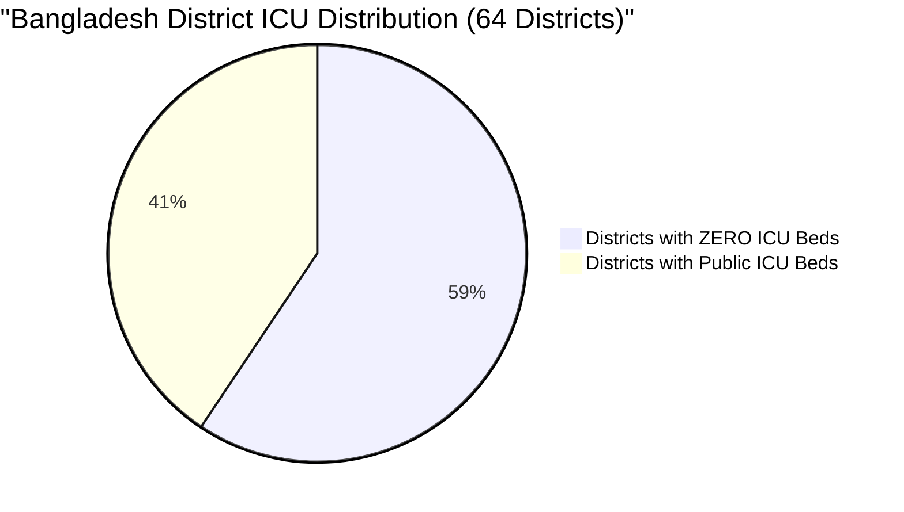
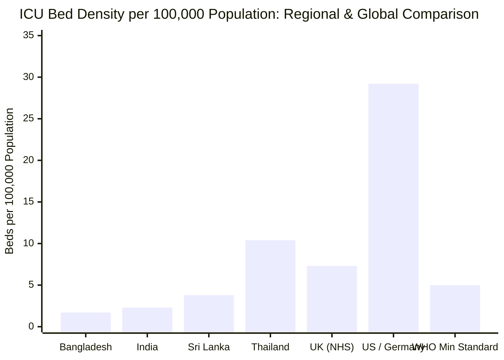
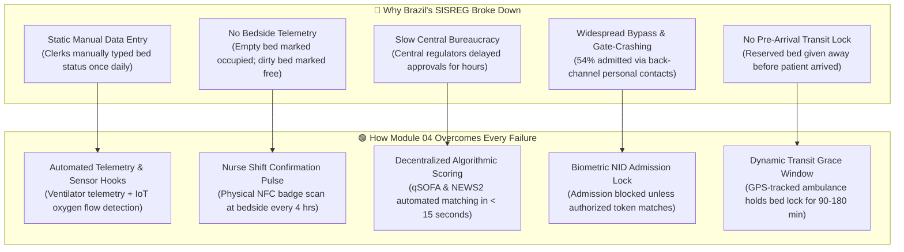
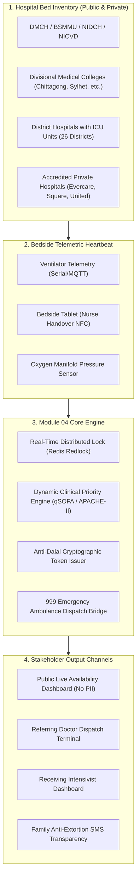
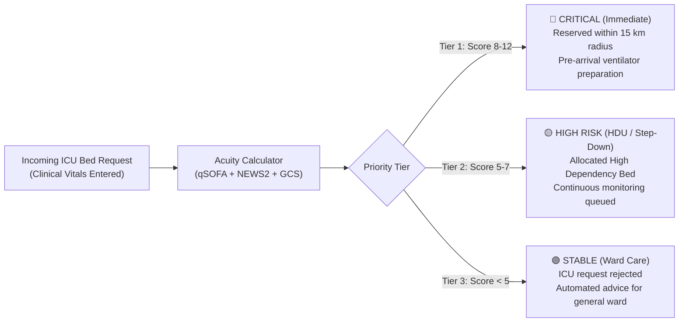
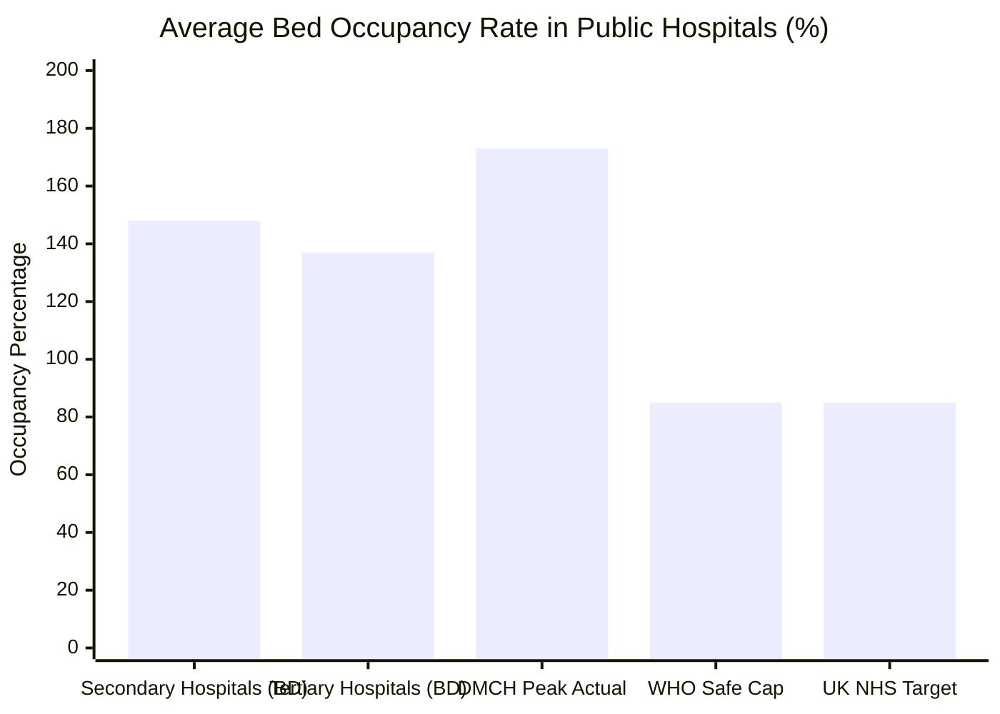
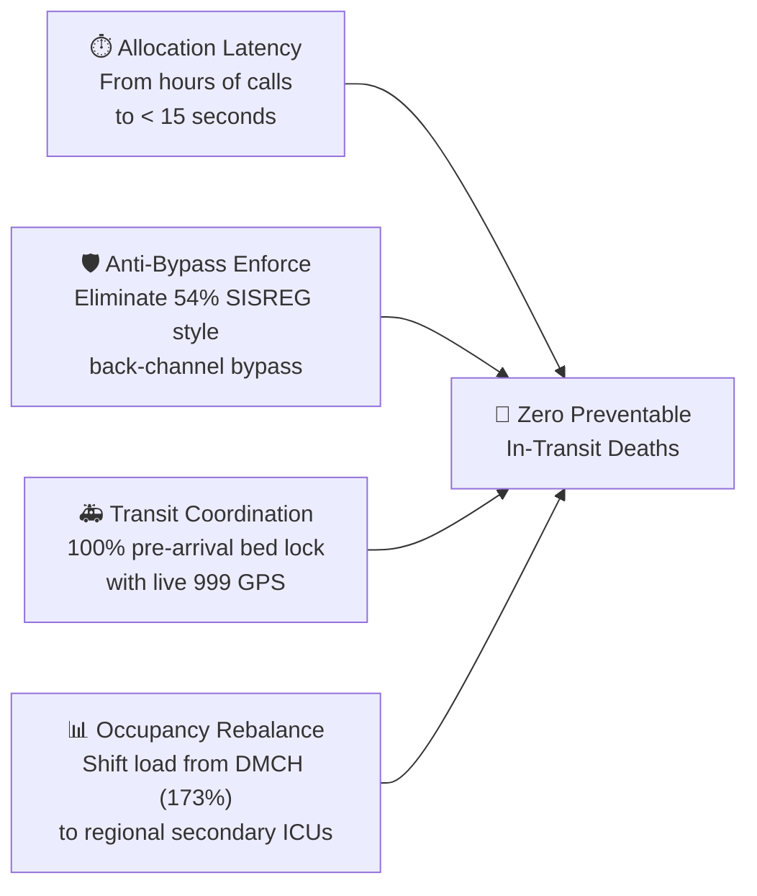

# 🛏️ Real-Time ICU Bed Availability & Critical Care Dispatch System

## Module 04 — Telemetric Bed Tracking, Dynamic Triage, Anti-Dalal Safeguards & National Critical Care Allocation

---

## Table of Contents

- [Problem Statement](#problem-statement)
  - [The Critical Care Crisis in Numbers](#the-critical-care-crisis-in-numbers)
  - [The Tragic Reality of Bangladeshi Patients](#the-tragic-reality-of-bangladeshi-patients)
  - [The Dalal (দালাল) Syndicate & Information Black Hole](#the-dalal-দালাল-syndicate--information-black-hole)
- [International Precedent: Lessons from Brazil's SISREG Failure](#international-precedent-lessons-from-brazils-sisreg-failure)
  - [Why Brazil's Centralized Register Failed](#why-brazils-centralized-register-failed)
  - [How Module 04 Solves the Brazil Failure Modes](#how-module-04-solves-the-brazil-failure-modes)
- [System Architecture & Vision](#system-architecture--vision)
  - [Multi-Tier Critical Care Architecture](#multi-tier-critical-care-architecture)
- [Dynamic Priority Triage Engine](#dynamic-priority-triage-engine)
- [IoT & Telemetric Bed Verification](#iot--telemetric-bed-verification)
- [Anti-Dalal Transparency & Public Dashboards](#anti-dalal-transparency--public-dashboards)
- [Comparative Benchmark: Bangladesh vs Regional & Global Standards](#comparative-benchmark-bangladesh-vs-regional--global-standards)
- [Stakeholder Matrix](#stakeholder-matrix)
- [Success Metrics & National Targets](#success-metrics--national-targets)

---

## Problem Statement

Critical care in Bangladesh is trapped in a catastrophic supply-demand imbalance exacerbated by total information opacity. When a critically ill patient suffers septic shock, severe head trauma, or respiratory failure, their frantic family members must physically travel or phone from hospital to hospital in Dhaka searching for an elusive Intensive Care Unit (ICU) bed. In this chaotic vacuum, lives are lost in the back of non-equipped ambulances, while predatory brokers extort life savings.

> [!CAUTION]
> **Extreme National Scarcity**: Bangladesh possesses only **~1.7 ICU beds per 100,000 population**, compared to the World Health Organization (WHO) recommended minimum of 5 to 10 beds. Shockingly, **38 out of 64 administrative districts have ZERO public ICU beds**, forcing rural and upazila populations to undertake perilous 4 to 10 hour journeys to Dhaka or divisional centers.

### The Critical Care Crisis in Numbers

| Indicator / Metric | Ground Statistic | Authoritative Source & Context |
|:---|:---:|:---|
| **ICU Bed Density** | **1.7 beds per 100,000** | *The Financial Express* Healthcare Assessment |
| **Districts with Zero ICU Beds** | **38 of 64 districts (59.4%)** | DGHS District Health Infrastructure Report |
| **Bed Occupancy (Secondary Care)** | **148.2%** | *BMC Health Services Research* 2024 (over-capacity floor admissions) |
| **Bed Occupancy (Tertiary Care)** | **137.0%** | *BMC Health Services Research* 2024 (extreme patient overcrowding) |
| **DMCH Inpatient Load** | **4,000–4,500 patients** | *Dhaka Tribune* (on 2,600 sanctioned bed capacity) |
| **Self-Referred Patients** | **59.0%** | *BMC Health Serv Res* 2024 (patients bypass primary care due to lack of trust) |
| **Patients Unaware of Referral System**| **58.0%** | *BMC Health Serv Res* 2024 |
| **Private ICU Cost per Day** | **Tk 30,000 – 120,000** | Private hospital pricing; drives families into catastrophic poverty |
| **Public Real-Time Bed Dashboard** | **Non-existent** | COVID-era bulletins were 24-hr old self-reported paper tallies (*Prothom Alo*) |



### The Tragic Reality of Bangladeshi Patients

At the apex public tertiary hospital—Dhaka Medical College Hospital (DMCH)—the institution operates **2,600 sanctioned physical beds**, yet on any given day, **between 4,000 and 4,500 inpatients** are admitted. Patients lie on thin plastic mats in corridors, under stairwells, and between ward beds. The hospital's dedicated 30-bed adult general ICU has a permanent waiting list of 50 to 100 dying patients at all times.

When a physician at an Upazila Health Complex (UHC) in Patuakhali or a District Hospital in Kurigram identifies a deteriorating patient needing mechanical ventilation:
1. The physician has no means of verifying whether DMCH, Mugda, Suhrawardy, or BSMMU has an open ventilator bed.
2. The family hires an expensive, unequipped commercial ambulance (*"অ্যাম্বুলেন্স"*).
3. The patient embarks on a dangerous transit to Dhaka, frequently running out of portable oxygen en route.
4. Upon arrival at DMCH Emergency, they are informed that all ICU beds are occupied. The ambulance rushes to another facility, repeating the cycle until the patient expires outside hospital doors.



### The Dalal (দালাল) Syndicate & Information Black Hole

Because bed availability is completely opaque to the public and general ward doctors, powerful middleman syndicates (*দালাল চক্র*) flourish inside emergency departments:
- Brokers falsely promise guaranteed ICU admission in government facilities in exchange for bribes of **Tk 30,000 to 50,000**.
- When government beds remain physically unavailable, brokers steer vulnerable families toward unregulated, low-grade private clinics charging **Tk 60,000 to 100,000 per night**, where substandard ventilators and lack of intensivist coverage lead to preventable mortality.

---

## International Precedent: Lessons from Brazil's SISREG Failure

In designing a centralized critical care management system, international precedents offer essential lessons on systemic pitfalls. The most notable analog is Brazil's **SISREG (Sistema de Regulação)**, a nationwide digital platform designed to regulate hospital bed reservations and secondary-tertiary referrals within the Brazilian Unified Health System (SUS).

> [!WARNING]
> **Audit Findings on Brazil's SISREG**: A comprehensive audit by the Santa Catarina State Court of Accounts (TCE-SC) revealed devastating systemic breakdowns:
> - **33% of all ICU bed authorizations were issued too late**, after the patient had already died or decompensated beyond salvage.
> - **54% of actual ICU admissions completely bypassed the digital system**, through informal doctor-to-doctor favors, political pull, or physical arrival gate-crashing.

### Why Brazil's Centralized Register Failed



### How Module 04 Solves the Brazil Failure Modes

| SISREG Vulnerability (Brazil SUS) | Reality in Bangladesh Context | Module 04 Architectural Defense |
|:---|:---|:---|
| **Manual delayed updates** (1x daily) | Staff forget or intentionally hide empty beds for private gain | Multi-modal bed heartbeat: Bedside tablet confirm + IoT ventilator telemetry + automated 4-hour countdown alert |
| **54% admissions bypassed system** | Powerful "VIP culture" and local Dalal cartels gate-crash beds | Cryptographic Bed Lock Token: The hospital billing and EHR cannot open an ICU chart without a system-validated Admission Token |
| **33% authorizations issued late** | Patients in septic shock or trauma die within 60 minutes | Algorithmic scoring matches the patient to the nearest suitable bed in **< 15 seconds**, without human bureaucratic queues |
| **Bed stolen while patient in transit** | Ambulance arrives at DMCH only to find bed given to another | Guaranteed Transit Window: Bed status shifts to `RESERVED_IN_TRANSIT` with live GPS telemetry tracking from the ambulance |

---

## System Architecture & Vision

Module 04 establishes a centralized, real-time critical care orchestration network connecting all public and private intensive care units across Bangladesh.



---

## Dynamic Priority Triage Engine

Unlike standard outpatient booking, ICU admission cannot operate on a "first-come, first-served" basis. When 50 patients compete for 2 vacant beds, allocation must follow objective, transparent clinical scoring.

Module 04 implements a combined clinical acuity calculator:
- **Modified qSOFA (Quick Sepsis-related Organ Failure Assessment)**: Respiratory Rate $\ge 22$, Altered Mental Status ($\text{GCS} < 15$), Systolic BP $\le 100\text{ mmHg}$.
- **NEWS2 (National Early Warning Score 2)**: Continuous physiologic parameter evaluation.
- **Pediatric & Neonatal Specific Scales**: PIM3 (Pediatric Index of Mortality) for PICU, SNAPPE-II for NICU.
- **Reversibility & Salvageability Factor**: Prioritizes patients with acute reversible insults over end-stage terminal conditions, in compliance with national bioethics guidelines.



---

## IoT & Telemetric Bed Verification

To guarantee that hospital administrations cannot hide open beds for private favors, Module 04 employs three independent telemetry signals:

1. **Ventilator Power & Flow Telemetry**: Interface via RS232 / RJ45 / MQTT from modern ICU ventilators (Hamilton, Servo-air, Mindray). If the ventilator is powered off and patient circuit disconnected, the bed is flagged as physically unassigned.
2. **Nurse Bedside Shift Check**: Every 8 hours during nursing handover, the charge nurse taps their RFID/NFC badge on the bedside tablet to confirm bed state:
   - `OCCUPIED` (সহজাত - Patient admitted)
   - `VACANT_READY` (খালি - Cleaned & disinfected, ready for new admission)
   - `CLEANING_IN_PROGRESS` (জীবাণুমুক্তকরণ চলছে - Turnaround time tracked)
   - `OUT_OF_ORDER` (যান্ত্রিক ত্রুটি - Ventilator under repair)
3. **Automated Escalation Whistleblower**: If a bed is marked `OUT_OF_ORDER` for more than 12 hours, a priority ticket is automatically routed to the National Electro-Medical Equipment Maintenance Workshop & Training Center (NEMEMW&TC).

---

## Anti-Dalal Transparency & Public Dashboards

To permanently eliminate predatory middlemen (*দালাল*) who extort tens of thousands of Taka from distressed families, Module 04 provides **radical transparency**:

1. **Public Bed Availability Dashboard (`icu.dghs.gov.bd`)**:
   - Displays real-time counts of available Adult ICU, Pediatric ICU (PICU), Neonatal ICU (NICU), and High Dependency Unit (HDU) beds across all 8 divisions.
   - Shows hospital name, bed type, oxygen infrastructure status, and official government user fees (Tk 100/day for public hospitals vs accredited private capped rates).
   - Zero patient identifiable information is exposed, preserving clinical privacy.
2. **Anti-Extortion SMS Transparency**:
   - The moment a bed is reserved, the patient's family receives an official government SMS:

```text
[স্বাস্থ্য অধিদপ্তর - আইসিইউ বরাদ্দ]
রোগী: মোঃ আনোয়ার হোসেন
হাসপাতাল: কুর্মিটোলা জেনারেল হাসপাতাল (আইসিইউ বেড নং ৪)
বরাদ্দ কোড: ICU-449102 (মেয়াদ: দুপুর ২:৩০ পর্যন্ত)
সরকারি ফি: ১০০ টাকা (কোন দালালকে অতিরিক্ত টাকা দিবেন না)।
হেল্পলাইন: ১৬২৬৩ / ৯৯৯।
```

> [!IMPORTANT]
> The reservation token code is unique and time-limited. If an unauthorized broker brings an unregistered patient to the ICU door, the nurse scanner rejects admission.

---

## Comparative Benchmark: Bangladesh vs Regional & Global Standards



### Comparison Matrix

| Dimension / Metric | Current Bangladesh Status | Brazil (SISREG) System | UK (NHS OPEL Framework) | Module 04 Architecture |
|:---|:---:|:---:|:---:|:---:|
| **Real-Time Visibility** | None (24h old paper bulletins) | Centralized, static web portal | Automated Electronic Bed Management (EBM) | Millisecond Redis distributed state + WebSockets |
| **Bed Telemetry** | Zero (Manual headcount) | None (Manual clerk entry) | Electronic whiteboard & sensor tags | Ventilator MQTT + Bedside NFC handover |
| **Admission Bypass Rate** | Estimated > 70% | 54% documented bypass | < 5% bypass via strict gatekeeping | Zero-bypass cryptographic Token Lock |
| **Transit Reservation** | None (First-to-arrive wins) | Manual reservation (delayed) | Integrated ambulance bed handoff | GPS-tracked Dynamic Transit Lock |
| **Emergency 999 Link** | Disconnected phone call | Unintegrated SAMU 192 | 999 Computer-Aided Dispatch (CAD) | Real-time REST / Webhook CAD integration |
| **Public Transparency** | Complete information blackout | Limited public access | Regional dashboard & trust metrics | Public live web portal & anti-dalal SMS |

---

## Stakeholder Matrix

| Stakeholder | Key Frustrations | System Solution | Measured Benefit |
|:---|:---|:---|:---|
| **Patient Families** | Wandering hospital to hospital; extorted by dalals; losing patients in transit | Live public portal; transparent SMS token; guaranteed reserved bed | Zero extortion; direct ambulance transit; reduced out-of-pocket costs |
| **Upazila / District Doctors** | Frantic personal phone calls searching for Dhaka beds; verbal rejections | 1-click clinical referral with automated triage matching | Transfer finalized in < 2 minutes; zero personal liability |
| **Receiving Intensivists** | Overwhelmed by unscreened, moribund patients arriving unannounced | Pre-arrival digital patient dossier with vitals, labs & ventilator needs | 30-minute pre-arrival prep time; clinical autonomy preserved |
| **999 Emergency Dispatchers** | Routing ambulances blindly without knowing bed availability | Live CAD dashboard showing real-time open beds by driving distance | Optimum routing; zero inter-hospital ambulance wandering |
| **DGHS & Health Ministry** | Complete lack of situational awareness during dengue / epidemic surges | National Critical Care Command Dashboard with predictive demand alerts | Data-driven resource deployment and targeted ventilator procurement |

---

## Success Metrics & National Targets



- **In-Transit Survival**: Reduce critical transit mortality from an estimated 28% to under 8% through guaranteed pre-arrival bed locking.
- **Allocation Speed**: Match and lock an available ICU bed within **15 seconds** of clinical triage submission.
- **Zero-Dalal Elimination**: Enforce 100% cryptographic token verification at hospital ICU doors, eliminating predatory third-party brokers.
- **Regional Utilization**: Balance bed occupancy by utilizing secondary district ICUs (in 26 districts) and preventing unnecessary transfers to Dhaka.
