# 🔄 Module 05: Application Flows — Integrated Digital Healthcare System

> **Complete system-wide flows** showing how all 8 modules work together as one connected healthcare ecosystem.

---

## 📋 Table of Contents

- [Complete Patient Journey (End-to-End)](#complete-patient-journey-end-to-end)
- [Data Flow Architecture](#data-flow-architecture)
- [Referral Flow (ReferLoop)](#referral-flow-referloop)
- [Emergency Flow](#emergency-flow)
- [FHIR Resource Flow](#fhir-resource-flow)
- [Consent & Privacy Flow](#consent--privacy-flow)
- [Offline-to-Online Sync Flow](#offline-to-online-sync-flow)
- [Inter-Facility Data Sharing](#inter-facility-data-sharing)
- [Notification Orchestration Flow](#notification-orchestration-flow)
- [Analytics & Reporting Flow](#analytics--reporting-flow)

---

## Complete Patient Journey (End-to-End)

This is the **gold standard flow** — a single patient visit from arrival to follow-up, touching every module in the system.

### Scenario: Rashida Begum visits Upazila Health Complex, Savar

Rashida (Health ID: `BD-HID-2026-00459832`) has been experiencing persistent headaches and dizziness for 2 weeks. She was screened at her Community Clinic in Ashulia, where the CHCP measured high blood pressure (160/100 mmHg) and referred her to the UHC.

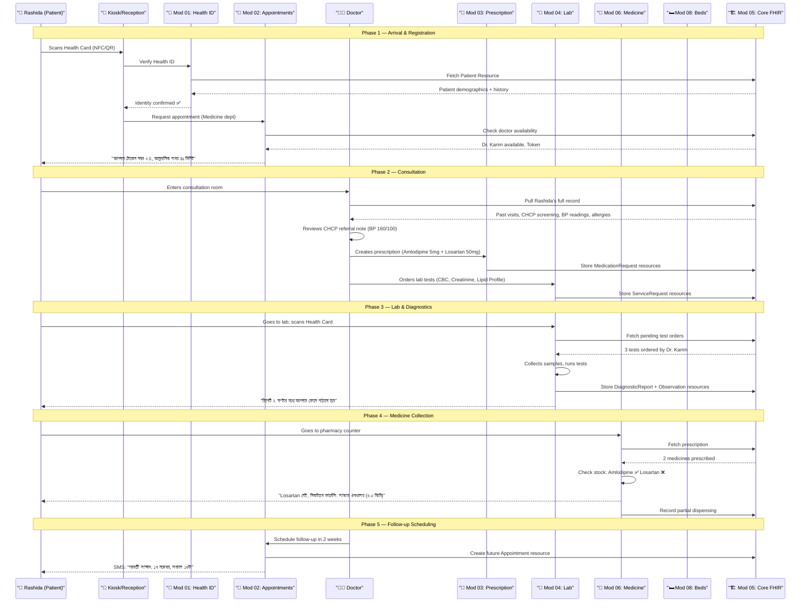

> [!NOTE]
> **Total FHIR resources created in this single visit**: Patient (updated), Encounter, Condition, 2x MedicationRequest, 3x ServiceRequest, 3x Observation, 1x DiagnosticReport, 1x MedicationDispense, 1x Appointment. All linked by Rashida's Health ID.

### Step-by-Step Breakdown

| Step | Module | FHIR Resource | Action |
|------|--------|---------------|--------|
| 1. Arrival | 01 - Health ID | Patient | Identity verification |
| 2. Token | 02 - Appointment | Appointment | Queue position assigned |
| 3. History Pull | 05 - Core | Bundle | Aggregate patient record |
| 4. Consultation | 05 - Core | Encounter | Visit record created |
| 5. Diagnosis | 05 - Core | Condition | ICD-11 coded condition |
| 6. Prescription | 03 - Prescription | MedicationRequest | 2 medicines prescribed |
| 7. Lab Order | 04 - Lab | ServiceRequest | 3 tests ordered |
| 8. Sample Collection | 04 - Lab | Specimen | Samples collected |
| 9. Results | 04 - Lab | DiagnosticReport | Results with LOINC codes |
| 10. Dispensing | 06 - Medicine | MedicationDispense | Partial dispensing |
| 11. Stock Alert | 06 - Medicine | SupplyDelivery | Low stock flagged |
| 12. Follow-up | 02 - Appointment | Appointment | Future visit scheduled |

---

## Data Flow Architecture

### How Data Moves Between All 8 Modules Through the FHIR Backbone

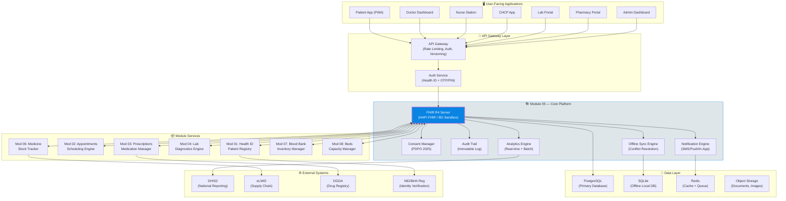

### Data Flow Rules

> [!IMPORTANT]
> **Every data access must pass through three gates:**
> 1. **Authentication** — Is this user who they claim to be? (Health ID + PIN/OTP)
> 2. **Consent** — Has the patient authorized this access? (PDPO 2025 consent record)
> 3. **Audit** — Is this access logged immutably? (Audit trail entry created)

### Data Exchange Protocol

| Source Module | Target Module | Data Type | Protocol | Frequency |
|---------------|---------------|-----------|----------|-----------|
| 01 → Core | Patient demographics | FHIR Patient | On registration |
| 02 → Core | Appointment data | FHIR Appointment | On booking |
| Core → 03 | Patient allergies | FHIR AllergyIntolerance | On prescription start |
| 03 → Core | Medication orders | FHIR MedicationRequest | On prescribing |
| 03 → 06 | Prescription data | FHIR MedicationRequest | On prescribing |
| 04 → Core | Lab results | FHIR DiagnosticReport | On result entry |
| 06 → Core | Dispensing records | FHIR MedicationDispense | On dispensing |
| 07 → Core | Transfusion data | FHIR Procedure | On transfusion |
| 08 → Core | Bed assignments | FHIR Encounter | On admission |
| Core → DHIS2 | Aggregate reports | ADX/CSV | Daily batch |

---

## Referral Flow (ReferLoop)

### The Problem Today

Currently, **59% of patients self-refer** to tertiary hospitals, bypassing the referral chain entirely. This causes:
- Tertiary hospitals at **200%+ occupancy**
- Primary and secondary facilities **underutilized**
- Patients traveling **100+ km unnecessarily**
- Specialists overwhelmed with cases that could be handled locally

### The ReferLoop Solution

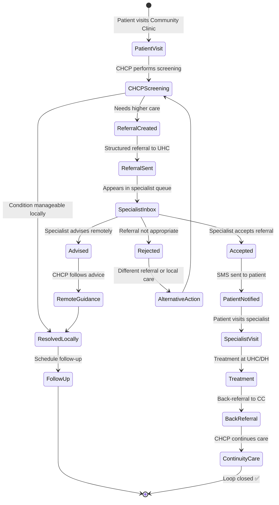

### Detailed Referral Sequence

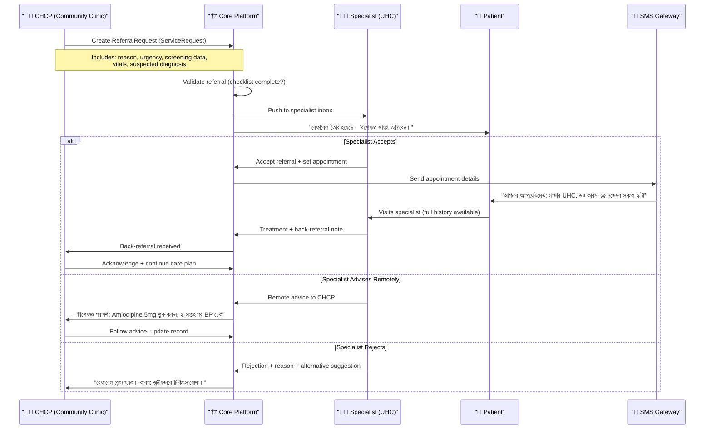

### Referral Metrics Dashboard

| Metric | Current | With ReferLoop (Y1) | Target (Y3) |
|--------|---------|---------------------|-------------|
| Self-referral rate | 59% | 40% | <20% |
| Referral acceptance rate | N/A | 75% | 85% |
| Back-referral completion | N/A | 50% | 80% |
| Average referral response time | N/A | <24 hours | <4 hours |
| Referral data completeness | N/A | 70% | 95% |

---

## Emergency Flow

### Critical Scenario: Road Traffic Accident, Manikganj Highway

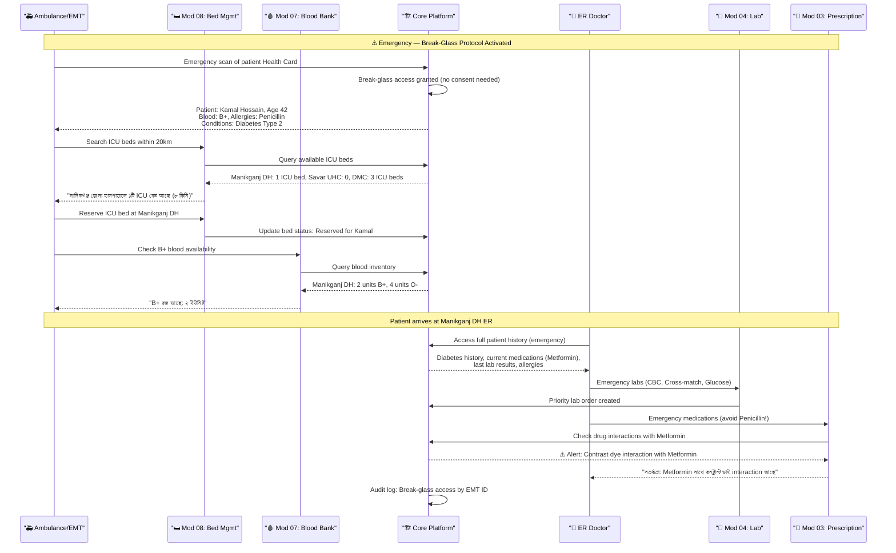

> [!CAUTION]
> **Break-Glass Protocol**: In emergencies, the system bypasses patient consent requirements to save lives. However, ALL access is logged, the patient is notified afterward, and the audit trail is reviewed by a compliance officer within 72 hours. This complies with PDPO 2025 Section 27 (vital interest exception).

### Emergency Flow State Diagram

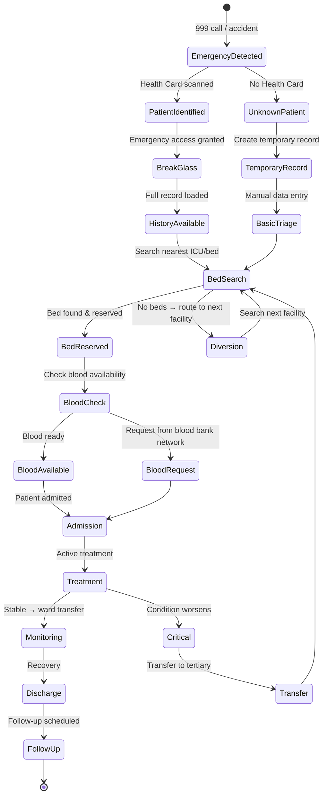

---

## FHIR Resource Flow

### Which FHIR Resources Are Created at Each Step

```mermaid
flowchart LR
    subgraph Registration["Step 1: Registration"]
        R1["Patient"]
        R2["RelatedPerson"]
    end
    
    subgraph Appointment["Step 2: Booking"]
        A1["Appointment"]
        A2["Schedule"]
        A3["Slot"]
    end
    
    subgraph Encounter["Step 3: Visit"]
        E1["Encounter"]
        E2["Condition"]
        E3["Observation (Vitals)"]
    end
    
    subgraph Prescription["Step 4: Prescribing"]
        P1["MedicationRequest"]
        P2["Medication"]
        P3["AllergyIntolerance"]
    end
    
    subgraph Lab["Step 5: Lab Tests"]
        L1["ServiceRequest"]
        L2["Specimen"]
        L3["DiagnosticReport"]
        L4["Observation (Results)"]
    end
    
    subgraph Pharmacy["Step 6: Dispensing"]
        PH1["MedicationDispense"]
        PH2["SupplyDelivery"]
    end
    
    subgraph Referral["Step 7: Referral"]
        RF1["ServiceRequest (Referral)"]
        RF2["Task"]
        RF3["Communication"]
    end

    Registration --> Appointment --> Encounter --> Prescription --> Lab --> Pharmacy
    Encounter --> Referral

    style Registration fill:#00b894,color:#fff
    style Appointment fill:#00cec9,color:#fff
    style Encounter fill:#0984e3,color:#fff
    style Prescription fill:#6c5ce7,color:#fff
    style Lab fill:#fdcb6e,color:#333
    style Pharmacy fill:#e17055,color:#fff
    style Referral fill:#d63031,color:#fff
```

### Complete FHIR Resource Mapping

| Clinical Action | FHIR Resource | Profile | Module |
|----------------|---------------|---------|--------|
| Patient registration | `Patient` | BD-Core-Patient | 01 |
| Emergency contact | `RelatedPerson` | Base | 01 |
| Book appointment | `Appointment` | Base | 02 |
| Doctor schedule | `Schedule` | Base | 02 |
| Start consultation | `Encounter` | BD-Core-Encounter | 05 |
| Record diagnosis | `Condition` | BD-Core-Condition | 05 |
| Record vitals | `Observation` | BD-Vitals | 05 |
| Prescribe medicine | `MedicationRequest` | BD-Core-MedicationRequest | 03 |
| Drug reference | `Medication` | BD-Medication | 03 |
| Record allergy | `AllergyIntolerance` | Base | 03 |
| Order lab test | `ServiceRequest` | BD-Lab-Order | 04 |
| Collect sample | `Specimen` | Base | 04 |
| Lab result | `DiagnosticReport` | BD-Lab-Report | 04 |
| Result value | `Observation` | BD-Lab-Observation | 04 |
| Dispense medicine | `MedicationDispense` | Base | 06 |
| Track stock | `SupplyDelivery` | Base | 06 |
| Blood unit | `BiologicallyDerivedProduct` | Base | 07 |
| Transfusion | `Procedure` | Base | 07 |
| Bed assignment | `Location` | BD-Facility | 08 |
| Admission | `Encounter` | BD-Inpatient | 08 |
| Referral | `ServiceRequest` | BD-Referral | 05 |
| Consent | `Consent` | BD-Consent | 05 |
| Audit entry | `AuditEvent` | Base | 05 |

---

## Consent & Privacy Flow

### PDPO 2025 Compliance

Bangladesh's **Personal Data Protection Ordinance 2025** (ব্যক্তিগত তথ্য সুরক্ষা অধ্যাদেশ ২০২৫) mandates strict consent requirements for health data processing.

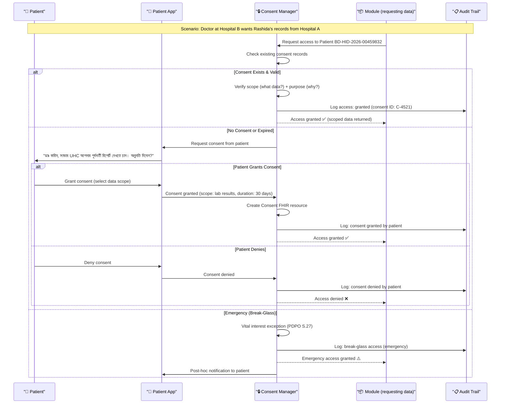

### Consent Granularity Levels

| Level | What Patient Controls | Example |
|-------|----------------------|---------|
| **Module-level** | Which modules can access data | "Lab can access, Blood Bank cannot" |
| **Data-type-level** | Which types of data | "Share vitals but not mental health records" |
| **Provider-level** | Which specific providers | "Dr. Karim can access, Dr. Rahman cannot" |
| **Time-limited** | Duration of access | "Access for 30 days only" |
| **Purpose-specific** | Why they need access | "For treatment only, not research" |

> [!WARNING]
> **Consent is revocable at any time.** When a patient revokes consent, all cached copies of their data in the requesting module must be purged within 24 hours. The FHIR Consent resource is updated to status `inactive`.

---

## Offline-to-Online Sync Flow

### The Reality of Bangladesh's Connectivity

| Metric | Value |
|--------|-------|
| Internet penetration (mobile) | ~55% |
| 4G coverage (geographic) | ~45% |
| Community clinics with reliable internet | <20% |
| Average downtime per day (rural) | 4-8 hours |
| Cyclone-related outages per year | 2-5 events |

> [!IMPORTANT]
> **Offline-first is not optional — it's a survival requirement.** A Community Clinic in Sunamganj may have no connectivity for days during monsoon. The system must work without internet and sync when connectivity returns.

### Sync Architecture

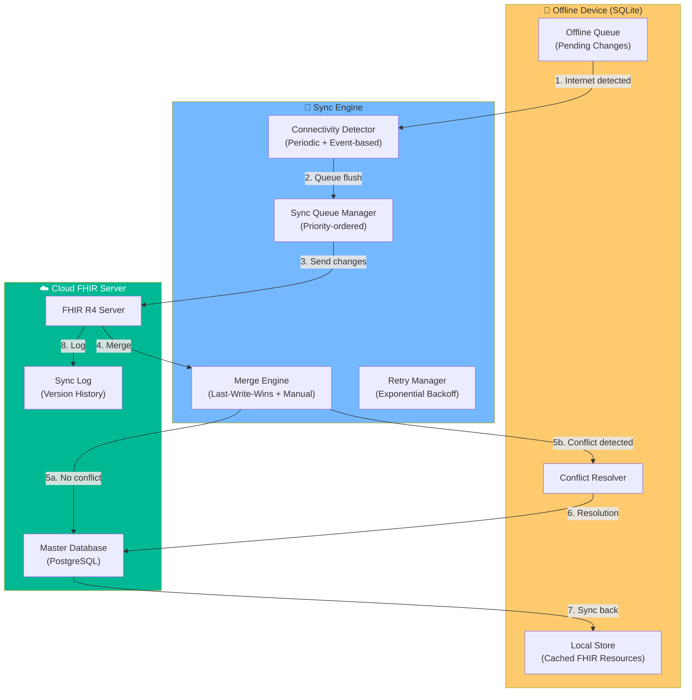

### Conflict Resolution Strategy

| Scenario | Strategy | Example |
|----------|----------|---------|
| Same field edited at two facilities | **Last-write-wins** with timestamp | BP updated at CC and UHC → latest timestamp wins |
| New resource created offline | **Auto-merge** (no conflict) | New prescription created offline → syncs as-is |
| Resource deleted at one, edited at another | **Keep edited version** + flag | Medicine removed from prescription at A, dose changed at B → keep B, flag for review |
| Critical data conflict | **Manual resolution** | Two different diagnoses for same visit → doctor reviews both |

### Sync Priority Order

| Priority | Data Type | Max Offline Age | Sync Order |
|----------|-----------|-----------------|------------|
| 🔴 P0 | Emergency encounters | 1 hour | First |
| 🔴 P1 | Lab results (critical) | 2 hours | Second |
| 🟡 P2 | Prescriptions | 4 hours | Third |
| 🟡 P3 | Appointments | 8 hours | Fourth |
| 🟢 P4 | Vitals / observations | 24 hours | Fifth |
| 🟢 P5 | Administrative data | 48 hours | Last |

---

## Inter-Facility Data Sharing

### How Hospital A's Data Is Visible at Hospital B

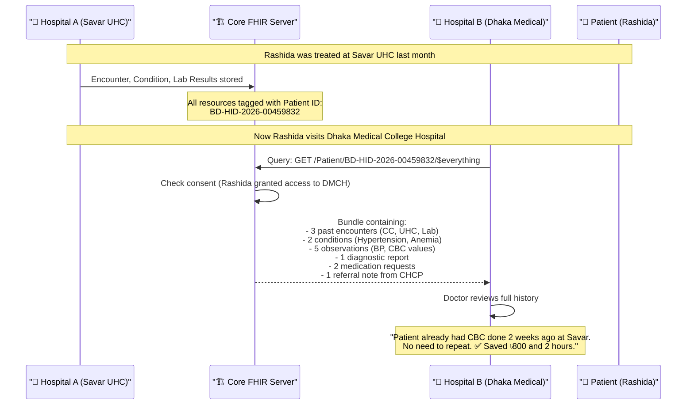

> [!TIP]
> **The `$everything` operation** returns a FHIR Bundle containing all resources linked to a patient. This is the single most powerful interoperability feature — it turns 48-second consultations into informed 5-minute consultations by giving doctors the full picture instantly.

### Data Visibility Matrix

| Data at Hospital A | Visible at Hospital B? | Condition |
|--------------------|-----------------------|-----------|
| Demographics | ✅ Always | Part of Health ID |
| Allergies | ✅ Always | Safety-critical |
| Active medications | ✅ Always | Drug interaction check |
| Past diagnoses | ✅ With consent | Patient must authorize |
| Lab results | ✅ With consent | Patient must authorize |
| Consultation notes | ✅ With consent | Patient must authorize |
| Mental health records | 🔒 Explicit consent only | Higher privacy bar |
| HIV/STI status | 🔒 Explicit consent only | Higher privacy bar |
| Billing information | ❌ Never shared | Facility-internal only |

---

## Notification Orchestration Flow

### Multi-Channel Notification System

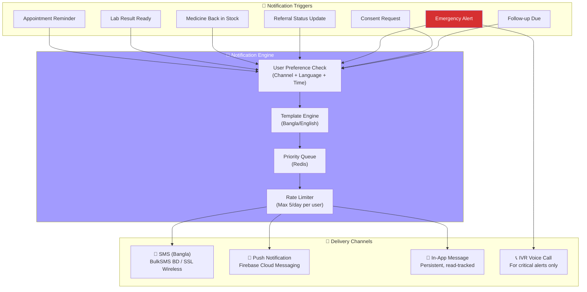

### Sample Notification Templates (Bangla)

| Trigger | SMS Template |
|---------|-------------|
| Appointment Reminder | `[স্বাস্থ্য সেবা] আপনার অ্যাপয়েন্টমেন্ট: আগামীকাল সকাল ১০টা, সাভার UHC, ডাঃ করিম। টোকেন: ২৩` |
| Lab Result | `[স্বাস্থ্য সেবা] আপনার রক্ত পরীক্ষার রিপোর্ট তৈরি। দেখতে লগইন করুন: healthbd.gov.bd/r/4521` |
| Medicine Stock | `[স্বাস্থ্য সেবা] আপনার প্রয়োজনীয় Losartan 50mg এখন সাভার UHC তে পাওয়া যাচ্ছে।` |
| Referral Accepted | `[স্বাস্থ্য সেবা] আপনার রেফারেল গৃহীত হয়েছে। ডাঃ আহমেদ, DMCH, ১৫ নভেম্বর সকাল ৯টা।` |

---

## Analytics & Reporting Flow

### From Facility-Level to National Dashboard

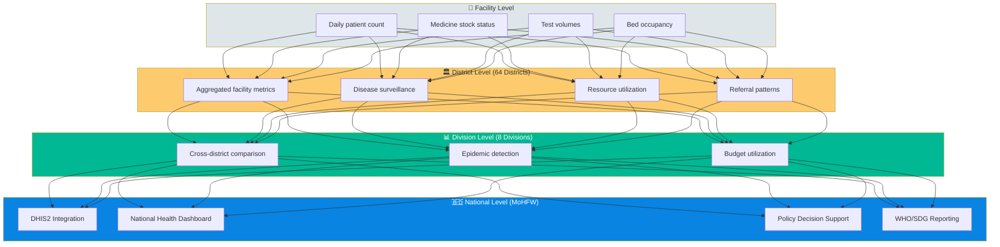

> [!NOTE]
> **DHIS2 auto-fill**: Instead of community health workers manually entering data into DHIS2 (District Health Information Software), the platform automatically generates DHIS2-compatible reports from transactional data. This saves an estimated **2-3 hours per facility per week** of manual reporting time.

---

## Flow Summary

| Flow | Modules Involved | Key FHIR Resources | Primary User |
|------|-----------------|---------------------|-------------|
| Complete Patient Journey | All 8 | Patient, Encounter, MedicationRequest, DiagnosticReport | All users |
| Data Flow Architecture | 05 (Core) | All resources | System architects |
| ReferLoop (Referral) | 01, 02, 05 | ServiceRequest, Task, Communication | CHCPs, Doctors |
| Emergency | 05, 07, 08 | Encounter, Location, BiologicallyDerivedProduct | EMTs, ER Doctors |
| FHIR Resource Flow | All 8 | All 25+ resource types | Developers |
| Consent & Privacy | 05 | Consent, AuditEvent | Patients, Compliance |
| Offline-to-Online Sync | 05 | All (queued) | System, CHCPs |
| Inter-Facility Sharing | 05, all | Bundle ($everything) | Doctors |
| Notification | 05, all | Communication | All users |
| Analytics & Reporting | 05, all | MeasureReport | Admins, MoHFW |

---

*Module 05 — Application Flows | Integrated Digital Healthcare System | Bangladesh Digital Health Initiative*
