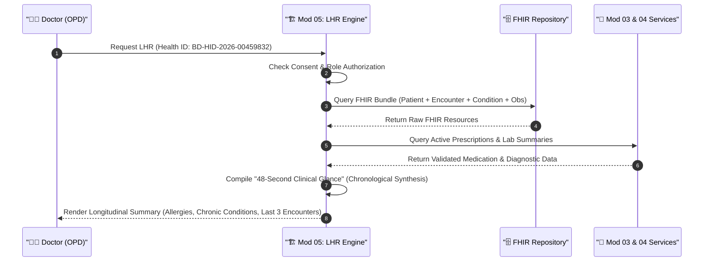
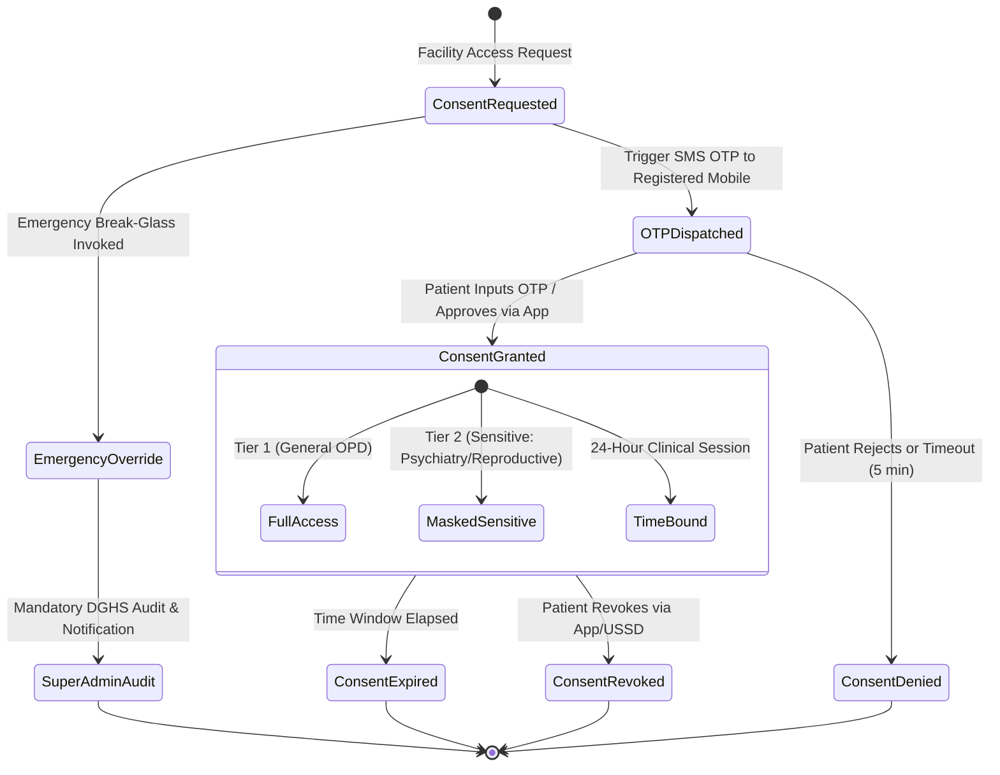
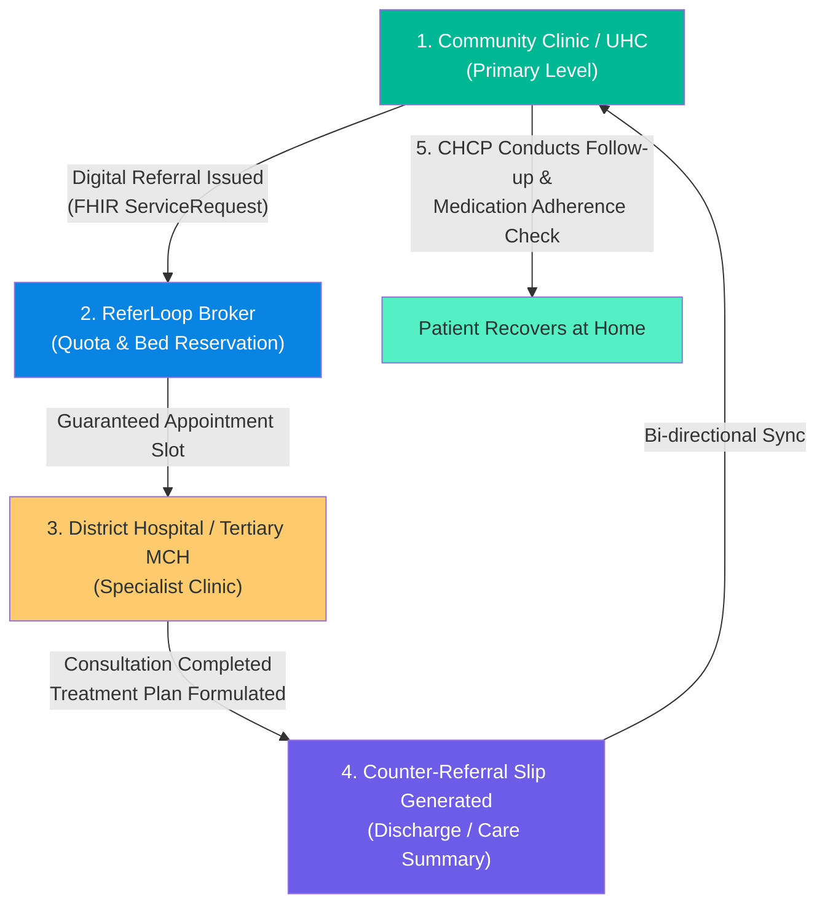
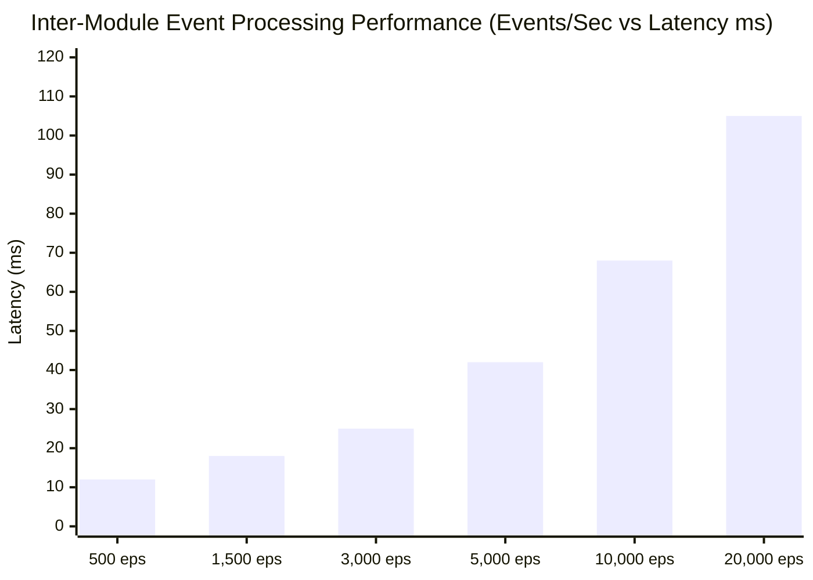
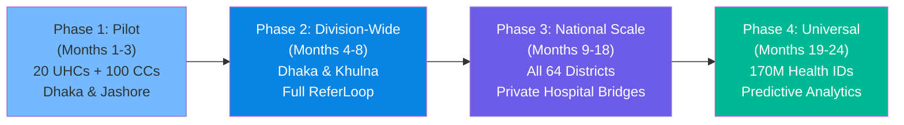

# 🌟 Module 05: Core Platform Features — Integrated Digital Healthcare System

> **Comprehensive feature specification** for the core interoperability engine, longitudinal patient records, consent architecture, role-based access control, epidemiological surveillance, and national healthcare orchestration for Bangladesh.

---

## 📋 Table of Contents

- [Architectural Overview & Feature Taxonomy](#architectural-overview--feature-taxonomy)
- [Feature 1: Universal Longitudinal Health Record (LHR) Engine](#feature-1-universal-longitudinal-health-record-lhr-engine)
- [Feature 2: Bangladesh Core FHIR Profile (BD Core IG) Engine](#feature-2-bangladesh-core-fhir-profile-bd-core-ig-engine)
- [Feature 3: Dynamic Consent & Privacy Guard (PDPO 2025 Compliant)](#feature-3-dynamic-consent--privacy-guard-pdpo-2025-compliant)
- [Feature 4: Role-Based Access Control (RBAC) & Contextual ABAC](#feature-4-role-based-access-control-rbac--contextual-abac)
- [Feature 5: ReferLoop — Closed-Loop National Referral Engine](#feature-5-referloop--closed-loop-national-referral-engine)
- [Feature 6: Distributed Event Bus & Cross-Module Orchestration](#feature-6-distributed-event-bus--cross-module-orchestration)
- [Feature 7: Offline-First Synchronization & Edge Caching](#feature-7-offline-first-synchronization--edge-caching)
- [Feature 8: National Epidemiological Early Warning & Outbreak Sentinel](#feature-8-national-epidemiological-early-warning--outbreak-sentinel)
- [Feature 9: Civil Surgeon District Health Command Center](#feature-9-civil-surgeon-district-health-command-center)
- [Feature 10: Bangla Vernacular Clinical Terminology Mapping](#feature-10-bangla-vernacular-clinical-terminology-mapping)
- [Feature Matrix & Module Cross-Reference](#feature-matrix--module-cross-reference)
- [Rollout Phasing & Readiness Criteria](#rollout-phasing--readiness-criteria)

---

## Architectural Overview & Feature Taxonomy

Module 05 serves as the **digital nervous system** of Bangladesh's health ecosystem. Rather than implementing isolated clinical logic, it establishes the unifying fabric connecting all clinical, diagnostic, pharmaceutical, and operational touchpoints across 14,500+ Community Clinics, 424 Upazila Health Complexes (UHCs), 64 District Hospitals, and 37 Government Medical College Hospitals.

```mermaid
flowchart TD
    subgraph Clients["Edge Access Points"]
        CHCP["Community Clinic CHCP Tablet"]
        DOC["Hospital OPD Doctor Desktop"]
        PAT["Citizen Web / Bangla App"]
        KIOSK["Self-Service QR/NFC Kiosk"]
    end

    subgraph Gateway["Zero-Trust API Gateway"]
        APIGW["Reverse Proxy & Load Balancer"]
        AUTH["Auth0 / Keycloak OIDC Provider"]
        RATE["Rate Limiting & DDoS Shield"]
    end

    subgraph CoreEngine["Module 05: Core Interoperability Fabric"]
        LHR["Universal Longitudinal Record Engine"]
        FHIR["HAPI FHIR R4 Server (BD Core IG)"]
        CONSENT["PDPO 2025 Consent Guard"]
        RBAC["RBAC / ABAC Context Evaluator"]
        REFER["ReferLoop Referral Broker"]
        EVENTBUS["Kafka/RabbitMQ Event Orchestrator"]
        EWS["Epidemiological Surveillance Sentinel"]
    end

    subgraph ModuleSilos["Integrated Functional Modules"]
        M1["Mod 01: Health ID & Registration"]
        M2["Mod 02: Appointment & Triage"]
        M3["Mod 03: Digital Prescription"]
        M4["Mod 04: Lab & Diagnostic Reports"]
        M6["Mod 06: Medicine Stock & DGDA"]
        M7["Mod 07: Blood Bank Network"]
        M8["Mod 08: Bed & ICU Allocation"]
    end

    Clients --> Gateway
    Gateway --> CoreEngine
    CoreEngine <--> ModuleSilos

    style CoreEngine fill:#0984e3,color:#fff,stroke-width:2px
    style Gateway fill:#6c5ce7,color:#fff
    style ModuleSilos fill:#00b894,color:#fff
```



> [!IMPORTANT]
> **Core Mandate**: In an environment where the average primary consultation lasts only **48 seconds** (the shortest out of 67 countries evaluated globally), Module 05 must reconstruct and render a patient's complete clinical synopsis in under **250 milliseconds**.

---

## Feature 1: Universal Longitudinal Health Record (LHR) Engine

The Longitudinal Health Record (LHR) engine aggregates, normalizes, and sequences clinical events spanning a citizen's lifetime, transitioning Bangladesh away from the **51.4% paper record** environment that succumbs annually to flood and disaster losses.



### Key Capabilities

1. **The 48-Second Clinical Glance**:
   - Compresses years of medical interactions into an actionable, single-screen heads-up display.
   - Highlights critical contraindications, documented allergies, chronic conditions (Hypertension, Type 2 Diabetes, CKD), and current active medications.
   - Designed for high-stress Upazila Health Complex OPDs seeing 400–600 patients daily per doctor.

2. **Cross-Facility Timeline Reconstruction**:
   - Assembles encounters across Community Clinics, Upazila Health Complexes, District Hospitals, and private diagnostic centers.
   - Normalizes varied timestamps, regional facility identifiers, and provider roles into a single coherent timeline.

3. **Duplication Elimination Engine**:
   - Detects identical diagnostic investigations ordered within clinically redundant timeframes (e.g., repeating a Serum Creatinine or Complete Blood Count within 48 hours without acute clinical change).
   - Mitigates Bangladesh's staggering **79.31% out-of-pocket spending** by preventing duplicate tests.

4. **Bi-Directional Audit Trail**:
   - Every read, access, export, or print event is logged with cryptographic non-repudiation, capturing the accessing professional's BMDC registration number, facility code, timestamp, and purpose of access.

---

## Feature 2: Bangladesh Core FHIR Profile (BD Core IG) Engine

The system adopts HL7® FHIR® R4 customized for Bangladesh under the **BD Core Implementation Guide (BD Core IG)**, establishing mandatory extensions for national identification schemes, local administrative boundaries, and vernacular terminology.

### BD Core Resource Specification

| FHIR Resource | BD Core Profile Name | Bangladesh Localization / Extensions | Coding Standard |
|---------------|----------------------|---------------------------------------|-----------------|
| `Patient` | `BDCore-Patient` | National ID (NID 10/17 digit), Birth Registration Certificate (BRC 17 digit), Geo-location (Division, District, Upazila, Union, Ward, Village) | NID Registry / BBS Geocode |
| `Encounter` | `BDCore-Encounter` | Service Tier (Community Clinic, UHC, DH, MCH), Payment Type (Free Gov, Paid Private), Token Number | DGHS Facility Registry |
| `Condition` | `BDCore-Condition` | ICD-11 coding, Bangla synonym mapping, Epidemiological reporting flags (e.g., Dengue, Malaria, Kala-azar) | WHO ICD-11, DGHS Disease Codes |
| `MedicationRequest` | `BDCore-MedicationRequest` | DGDA National Drug Code (NDC), Generic Molecule ID, Free Public Medicine quota tracking | DGDA Registry, WHO ATC |
| `DiagnosticReport` | `BDCore-DiagnosticReport` | Integrated Lab ID, Specimen collection district, Reference ranges calibrated for South Asian demographics | LOINC, SNOMED CT |
| `Consent` | `BDCore-Consent` | PDPO 2025 compliance status, OTP verification token, Departmental privacy mask | PDPO 2025 Code System |

---

## Feature 3: Dynamic Consent & Privacy Guard (PDPO 2025 Compliant)

In compliance with the **Personal Data Protection Ordinance (PDPO) 2025**, Module 05 puts patients in full legal and operational control of their sensitive health records through an automated, granular consent manager.



### Consent Enforcement Levels

```
                     ┌─────────────────────────────────────────┐
                     │          Patient Master Consent         │
                     └────────────────────┬────────────────────┘
                                          │
                  ┌───────────────────────┴───────────────────────┐
                  ▼                                               ▼
     ┌────────────────────────┐                      ┌────────────────────────┐
     │   Routine Clinical     │                      │   Sensitive Clinical   │
     │   (OPD, Vitals, Labs)  │                      │ (Reproductive, Mental) │
     └───────────┬────────────┘                      └───────────┬────────────┘
                 │                                               │
     ┌───────────┴────────────┐                      ┌───────────┴────────────┐
     │ Auto-Granted during    │                      │ Explicit OTP Required  │
     │ Active Token / Visit   │                      │ Every Request Session  │
     └────────────────────────┘                      └────────────────────────┘
```

> [!NOTE]
> **Bangla SMS Consent Prompt Example**:
> *"ডাঃ তানভীর আহমেদ (ঢাকা মেডিকেল কলেজ) আপনার পূর্বের প্রেসক্রিপশন ও ল্যাব রিপোর্ট দেখতে সম্মতি চেয়েছেন। সম্মতি দিতে OTP কোড 482915 বলুন। কোডের মেয়াদ ৫ মিনিট। অনিচ্ছায় কোড শেয়ার করবেন না।"*

### Emergency Break-Glass Protocol

When unconscious or polytrauma patients arrive at casualty/ER departments:
1. Attending emergency physicians can trigger **Emergency Break-Glass** access without an OTP.
2. The system unlocks all historical allergy, surgery, blood grouping, and medication records.
3. Automatically dispatches an immediate alert SMS to the patient's registered emergency contact.
4. Generates an immutable, high-priority audit incident reviewed weekly by the hospital's Clinical Governance Committee.

---

## Feature 4: Role-Based Access Control (RBAC) & Contextual ABAC

Access to healthcare resources is mediated by a multi-layered access engine combining strict **Role-Based Access Control (RBAC)** with **Attribute-Based Access Control (ABAC)** taking into account physical location, department assignment, and active clinical encounter relationships.

### Comprehensive Healthcare RBAC Matrix

| Role | Demographics | Vitals & Triage | Clinical Notes | Prescriptions | Lab Results | Inventory/Beds | Audit Logs |
|------|:------------:|:---------------:|:--------------:|:-------------:|:-----------:|:--------------:|:----------:|
| **Patient** | Self Read/Edit | Self Read | Self Read | Self Read | Self Read | Public Read | Self Audit |
| **CHCP (Community Clinic)** | Read/Write (Catchment) | Read/Write | Read/Write (Basic) | Read/Write (OTC Only) | View Diagnostic | View Clinic Stock | None |
| **Medical Officer (UHC/DH)** | Read | Read | Full Read/Write | Full Read/Write | Full Read/Order | View Dept Stock | Access Own |
| **Consultant / Specialist** | Read | Read | Full Read/Write | Full Read/Write | Full Read/Order | View Ward Status | Access Own |
| **Staff Nurse** | Read | Read/Write | View Nursing Notes | Read Dispensed | View Completed | View Ward Beds | Access Own |
| **Dispensary Pharmacist** | Read Demographics | None | None | Read Active / Dispense | None | Full Read/Write | Dispense Log |
| **Lab Technologist** | Read Demographics | None | None | View Test Orders | Full Read/Write | View Reagents | Entry Log |
| **Hospital Superintendent** | Facility Aggregates | Facility Aggregates | Departmental Review | Quality Review | Turnaround Review | Full Facility Manage | Facility Audit |
| **Civil Surgeon (District)** | District Aggregates | District Aggregates | None | Trend Analysis | Disease Outbreak | District Overview | District Audit |
| **DGHS National Admin** | Anonymized National | Anonymized National | None | National Surveillance | National Outbreak | National eLMIS Sync | System Wide |

---

## Feature 5: ReferLoop — Closed-Loop National Referral Engine

Today, **59% of patients self-refer directly to tertiary medical college hospitals**, bypassing primary and secondary levels. This overwhelms tertiary centers (occupancy rates regularly exceed 137%–148%), while Upazila facilities remain under-utilized. **ReferLoop** transforms referrals into a structured, trackable, bi-directional loop.



### Operational Mechanisms

- **Guaranteed Fast-Track Priority**: Patients arriving with an official digital ReferLoop token are assigned dedicated queue slots, eliminating the 4-hour queues typical of tertiary outpatient desks.
- **Counter-Referral Loop (Discharge Back to Primary Care)**: Upon tertiary stabilization, specialists formulate a follow-up plan that automatically routes tasks back to the local CHCP (e.g., bi-weekly blood pressure checks, wound dressing, insulin compliance).
- **Referral Analytics & Loop Closure Metric**: Tracks whether referred patients arrived at the destination hospital within 14 days, triggering community health worker follow-up if lost to care.

---

## Feature 6: Distributed Event Bus & Cross-Module Orchestration

The core platform coordinates actions across all 7 satellite modules via high-throughput, fault-tolerant message streaming. When an action occurs in one module, dependent processes across the ecosystem fire autonomously.



### Event Routing Topology

```
[Module 01: Registration]
        │
        ├── event: PATIENT_VERIFIED ───────► [Module 05: Core LHR Engine]
        │
[Module 03: Digital Prescription]
        │
        ├── event: PRESCRIPTION_COMMITTED ─► [Module 06: Medicine Stock] (Deduct Stock)
        │                                  └► [Module 05: Core LHR] (Append History)
        │
[Module 04: Lab Diagnostics]
        │
        ├── event: RESULT_PUBLISHED ───────► [Module 05: Core LHR] (Update Observations)
        │                                  └► [Notification Service] (Bangla SMS to Patient)
        │
[Module 08: Bed & ICU Management]
        │
        └── event: BED_DISCHARGED ─────────► [Module 02: Appointment] (Release Waitlist)
                                           └► [Module 05: ReferLoop] (Trigger Counter-Referral)
```

---

## Feature 7: Offline-First Synchronization & Edge Caching

Recognizing that **73.4% of rural households own phones but personal smartphone use is only 26%**, and rural fiber connectivity in char, haor, and coastal zones is prone to monsoon outages, Module 05 provides resilient offline operations.

### Edge Sync Protocols

1. **Local SQLite / IndexedDB Storage**: CHCP tablets store full demographic and vital logs locally when connectivity drops.
2. **Deterministic CRDT Conflict Resolution**: Conflicts between edge edits and central updates resolve using Conflict-Free Replicated Data Types, prioritizing clinically critical additions over administrative overwrites.
3. **Opportunistic Delta Sync**: Transmits compressed binary protocol buffers over 2G/EDGE networks immediately when a tower ping succeeds.

---

## Feature 8: National Epidemiological Early Warning & Outbreak Sentinel

Module 05 continually analyzes anonymized clinical diagnostic codes and syndromic indicators to detect infectious disease outbreaks days before traditional manual reporting pathways.

### Automated Outbreak Triggers

- **Dengue Surveillance**: Clusters of acute fever + thrombocytopenia (Platelets < 100,000/μL) from Module 04 trigger geospatial density maps.
- **Cholera / Acute Watery Diarrhea**: Sudden spikes in IV Saline dispensing in Module 06 across an Upazila alert the Institute of Epidemiology, Disease Control and Research (IEDCR).
- **Nipah Virus Monitoring**: Unexplained encephalitis cases in seasonal date palm sap harvesting districts (Faridpur, Rajbari) escalate to national containment protocols within 60 minutes.

---

## Feature 9: Civil Surgeon District Health Command Center

Provides each of Bangladesh's **64 Civil Surgeons** with a unified operational cockpit showing cross-facility performance across the district:

1. **Referral Absorption Rate**: Proportion of patients successfully managed at Upazila Health Complexes without tertiary escalation.
2. **Diagnostic Equipment Uptime Tracker (YantraTrack)**: Live operational status of X-Ray, Ultrasonography, and ECG machines across all sub-districts (combating the finding that **52% of diagnostic equipment sits idle**).
3. **Physician Attendance & Consultation Velocity**: Real-time monitoring of consultation durations to ensure adherence to clinical examination standards.

---

## Feature 10: Bangla Vernacular Clinical Terminology Mapping

Rural patients articulate symptoms using regional idioms. Module 05's terminology engine translates these expressions into standardized international medical concepts:

| Patient Complaint (Bangla) | Literal Meaning | Standard Clinical Concept | ICD-11 / SNOMED Code |
|----------------------------|-----------------|---------------------------|----------------------|
| *"বুকে চাপ ধরে আসে"* | Pressure grabbing the chest | Angina Pectoris / Ischemic Heart Disease | BA80 / 225566008 |
| *"মাথা ঘুরায় ও চোখে শর্ষে ফুল দেখি"* | Head spinning, seeing mustard flowers | Vertigo / Orthostatic Hypotension | MB41.0 / 399153001 |
| *"হাত-পা ঝিনঝিন করে"* | Hands and feet tingling / buzzing | Peripheral Neuropathy / Paresthesia | 8C00 / 91019004 |
| *"পেট ফেঁপে ঢেঁকুর ওঠে"* | Abdomen bloated with frequent belching | Dyspepsia / Flatulence | MD90 / 84162001 |
| *"ঘন ঘন প্রস্রাব ও পানি পিপাসা"* | Frequent urination and unquenchable thirst | Polyuria / Polydipsia (Diabetes Suspect) | 5A14 / 28442001 |

---

## Feature Matrix & Module Cross-Reference

| Feature Capability | Module 01 | Module 02 | Module 03 | Module 04 | Module 06 | Module 07 | Module 08 |
|--------------------|:---------:|:---------:|:---------:|:---------:|:---------:|:---------:|:---------:|
| **Health ID Identity Resolution** | **Provider** | Consumer | Consumer | Consumer | Consumer | Consumer | Consumer |
| **Encounter Orchestration** | Consumer | **Provider** | Consumer | Consumer | Consumer | Consumer | Consumer |
| **Prescription & Allergy Sync** | Consumer | Consumer | **Provider** | Consumer | Consumer | Consumer | None |
| **Diagnostic Observations** | Consumer | Consumer | Consumer | **Provider** | None | Consumer | None |
| **Medicine Dispensing Validation** | Consumer | None | Consumer | None | **Provider** | None | None |
| **Blood Compatibility Checks** | Consumer | None | None | Consumer | None | **Provider** | Consumer |
| **Inpatient Bed Allocation** | Consumer | Consumer | None | None | None | None | **Provider** |
| **Universal Consent Guard** | Enforced | Enforced | Enforced | Enforced | Enforced | Enforced | Enforced |
| **Outbreak Sentinel Feed** | Consumer | Consumer | Consumer | Consumer | Consumer | None | Consumer |

---

## Rollout Phasing & Readiness Criteria



### Readiness Gates

- **Data Integrity Gate**: Zero data loss during simulated 72-hour network blackouts across remote coastal Upazila Health Complexes (e.g., Shyamnagar, Sandwip).
- **Latency Gate**: 95th percentile LHR retrieval response under 250 milliseconds under simulated national load of 10,000 concurrent clinicians.
- **Privacy Gate**: 100% compliance with PDPO 2025 consent verification for out-of-facility health record queries.
- **Epidemiological Alert Gate**: Automated delivery of outbreak notifications to IEDCR and district Civil Surgeons in < 15 minutes of threshold trigger.
