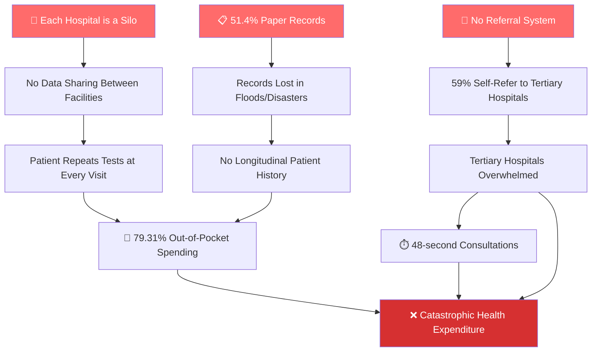
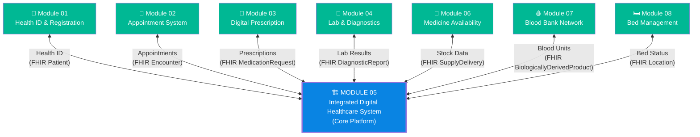
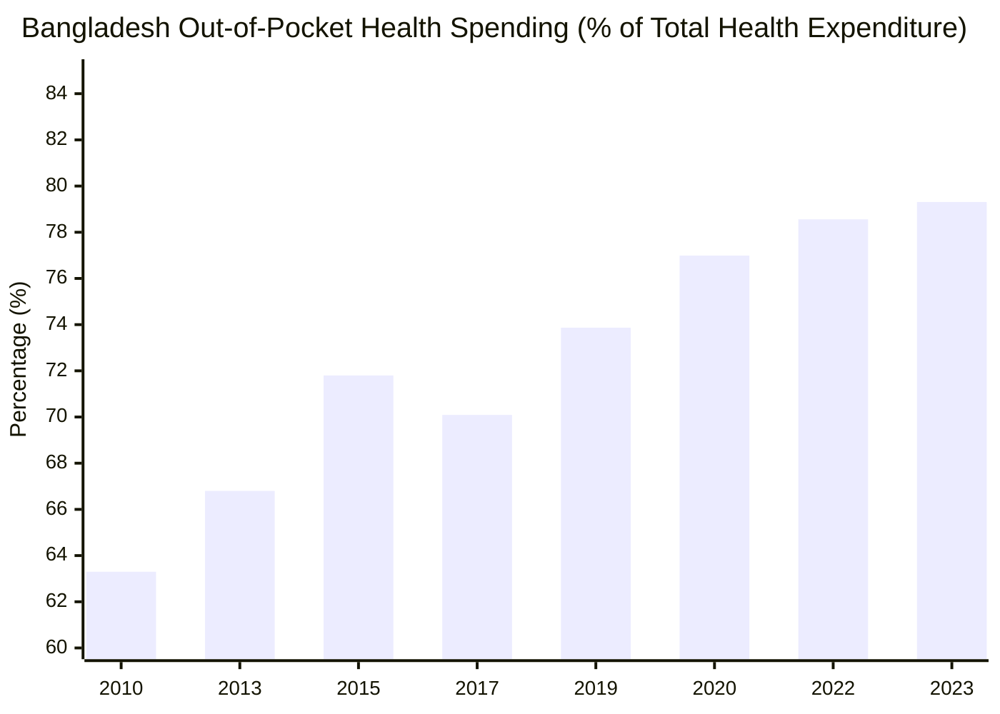
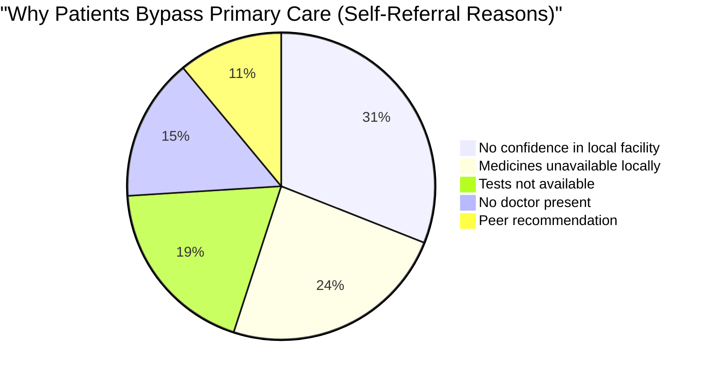
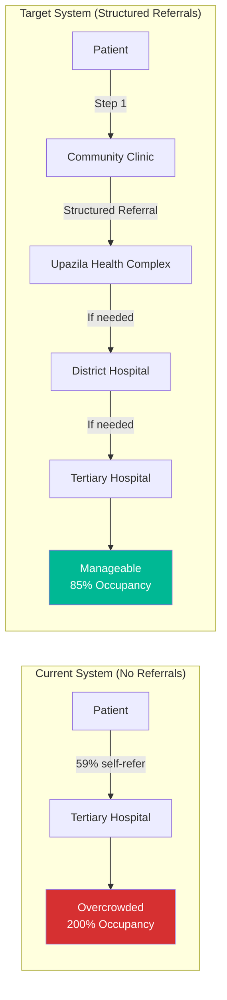
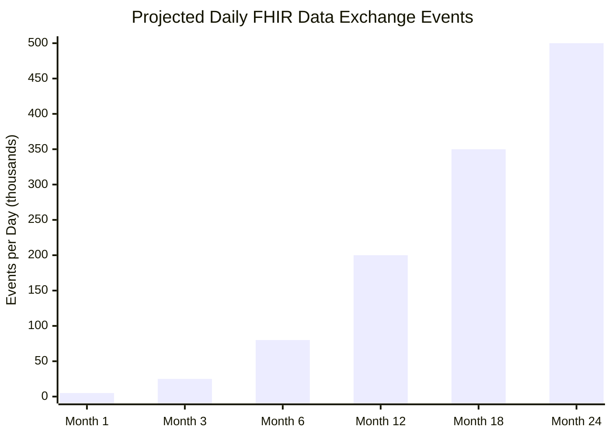

# 🏥 Module 05: Integrated Digital Healthcare System — Core Platform

> **The Umbrella Module** — One platform, one patient record, one connected healthcare ecosystem for 170 million Bangladeshis.

---

## 📋 Table of Contents

- [The Problem](#the-problem)
- [Why an Integrated Platform?](#why-an-integrated-platform)
- [Vision & Mission](#vision--mission)
- [System-Wide Impact Data](#system-wide-impact-data)
- [Target Users](#target-users)
- [How It Connects All Modules](#how-it-connects-all-modules)
- [Success Metrics & KPIs](#success-metrics--kpis)
- [Quick Start](#quick-start)

---

## The Problem

Bangladesh's healthcare system suffers from **systemic fragmentation** at every level. Each hospital, clinic, and community health center operates as an isolated silo — no data flows between them, no continuity of care exists, and patients bear the full burden of navigating a broken system.

> [!CAUTION]
> **51.4% of doctors in Bangladesh still use paper-based records.** When Cyclone Amphan or monsoon floods hit, years of patient history are destroyed in hours. In 2024, flooding in Sylhet and Sunamganj displaced 4.3 million people — their health records were among the first casualties.

### The Fragmentation Crisis — By the Numbers

| Statistic | Value | Source |
|-----------|-------|--------|
| Doctors using paper records | **51.4%** | BMA Survey 2023 |
| Average primary care consultation time | **48 seconds** | Shortest of 67 countries studied (Irving et al.) |
| Out-of-pocket health spending | **79.31%** | WHO Global Health Expenditure Database 2023 |
| Self-referral to tertiary hospitals | **59%** | BMRC Health Systems Study |
| Hospital data sharing capability | **~0%** | No inter-facility HIS interoperability |
| Patients repeating tests at referral | **Majority** | No test result portability |
| Community clinics with functional HIS | **<15%** | DGHS Assessment |

### Root Causes of the Crisis



### The Human Cost

Consider a typical patient journey today:

1. **Fatima** from Bhola visits her community clinic with chest pain
2. The CHCP has no equipment — tells her to go to Upazila Health Complex
3. At UHC, she waits 3 hours, gets an ECG, blood test — results on paper
4. Doctor refers her to Barisal Medical College Hospital — no formal referral letter, just verbal advice
5. At Barisal, **nobody knows she was seen at UHC** — all tests are repeated
6. She pays again: ৳2,500 for duplicate tests
7. She's referred to Dhaka for a specialist — **same cycle repeats**
8. Total: 4 facilities, 3 rounds of identical tests, ৳8,000+ wasted, 2 weeks lost

> [!IMPORTANT]
> **This is not an edge case — this is the default experience.** Without a connected system, every patient is a "new patient" at every facility. The Integrated Digital Healthcare System (IDHS) exists to end this cycle permanently.

---

## Why an Integrated Platform?

This is **not another standalone app**. Module 05 is the **backbone** — the core platform that connects all 7 other modules into a single coherent ecosystem.

### The Module Ecosystem



Without Module 05, the other 7 modules are just **7 more silos**. With Module 05, they become **one system**.

---

## Vision & Mission

### Vision
> **One platform, one patient record, accessible across all 14,500+ community clinics, 424 Upazila Health Complexes, 64 district hospitals, and all medical college hospitals — via a single Health ID.**

### Mission
Build a **FHIR R4-compliant, offline-first, Bangla-native** healthcare platform that:
- Creates a **single longitudinal patient record** from birth to death
- Enables **seamless data exchange** between any two facilities in Bangladesh
- Supports **48-second consultations** with instant access to full patient history
- Reduces **out-of-pocket spending** by eliminating duplicate tests
- Establishes a **structured referral system** to reduce self-referrals from 59% to <20%
- Complies with **PDPO 2025** (Personal Data Protection Ordinance) for patient privacy

---

## System-Wide Impact Data

### Out-of-Pocket Health Expenditure Trend

Bangladesh has one of the highest out-of-pocket (OOP) health spending rates in the world, and it's **getting worse**:



> [!WARNING]
> **79.31% OOP spending in 2023** means for every ৳100 spent on healthcare, ৳79.31 comes directly from patients' pockets. The global average is ~18%. Bangladesh is **4.4x worse** than the world average.

### Healthcare Access Barriers



### Paper vs. Digital Records Adoption

| Record Type | Percentage | Facilities |
|-------------|-----------|------------|
| Paper-only records | **51.4%** | Most community clinics, many UHCs |
| Partial digital (standalone) | **33.2%** | Some UHCs, district hospitals |
| Connected digital (HIS) | **10.8%** | Select medical college hospitals |
| FHIR-interoperable | **<1%** | Pilot projects only |
| Fully integrated | **0%** | None currently |

### The Self-Referral Problem



---

## Target Users

This platform serves **ALL stakeholders** in the Bangladesh healthcare ecosystem:

### User Role Matrix

| Role | Count (Est.) | Primary Use | Access Level |
|------|-------------|-------------|--------------|
| **Patients** | 170M+ | View records, find services, manage consent | Own data only |
| **Doctors** | ~120,000 | Clinical decisions, prescriptions, referrals | Assigned patients |
| **Nurses** | ~80,000 | Patient monitoring, vitals, care plans | Ward-level |
| **CHCPs** | ~14,500 | Community health, screening, basic care | Catchment area |
| **Lab Technicians** | ~25,000 | Test results, reports, quality control | Lab data |
| **Pharmacists** | ~150,000 | Dispensing, stock management, alternatives | Prescription data |
| **Hospital Admins** | ~2,000 | Facility management, reporting, compliance | Facility-wide |
| **District Health Officers** | 64 | District oversight, resource allocation | District-wide |
| **MoHFW Officials** | ~500 | Policy, national dashboards, DHIS2 | National aggregate |
| **DGDA Regulators** | ~200 | Drug pricing, quality monitoring | Regulatory data |

> [!NOTE]
> **Bangla-first interface**: All user interfaces default to বাংলা (Bangla). English is available as a secondary language. Voice-assisted navigation is planned for low-literacy users, especially CHCPs and patients in rural areas.

---

## How It Connects All Modules

### Integration Points

| Module | Data Sent to Core | Data Received from Core |
|--------|-------------------|------------------------|
| 01 — Health ID | Patient demographics, Health ID | Duplicate check results |
| 02 — Appointments | Appointment bookings, queue status | Patient history, doctor availability |
| 03 — Prescriptions | Medication orders, drug interactions | Patient allergies, past medications |
| 04 — Lab & Diagnostics | Test orders, results, reports | Patient context, previous results |
| 05 — Core Platform | **(This module)** | **(This module)** |
| 06 — Medicine Stock | Stock levels, dispensing records | Prescription data, demand forecasts |
| 07 — Blood Bank | Blood unit inventory, transfusion records | Patient blood type, cross-match needs |
| 08 — Bed Management | Bed availability, admissions, discharges | Patient status, transfer requests |

### Data Exchange Volume Projections



---

## Success Metrics & KPIs

### Primary KPIs

| KPI | Baseline | Year 1 Target | Year 3 Target |
|-----|----------|---------------|---------------|
| Facilities connected to platform | 0 | 500 (5 pilot districts) | 5,000+ |
| Data exchange events/day | 0 | 50,000 | 500,000+ |
| Patients with longitudinal record | 0 | 2M | 25M+ |
| Reduction in repeat tests | 0% | 30% | 60% |
| Self-referral rate | 59% | 45% | <20% |
| OOP spending reduction (connected patients) | 79.31% | 70% | 55% |
| Average consultation time improvement | 48 sec | 3 min | 5 min |
| Paper record dependency | 51.4% | 35% | <10% |
| FHIR compliance score | 0% | 80% | 95% |

### Secondary KPIs

| KPI | Target |
|-----|--------|
| System uptime | 99.5% (with offline fallback = 100% availability) |
| Data sync latency (online) | <5 seconds |
| Offline queue sync time | <30 minutes after reconnection |
| User satisfaction (NPS) | >40 |
| PDPO compliance audit score | 100% |
| DHIS2 auto-reporting accuracy | >95% |

---

## Quick Start

> [!TIP]
> **For Hackathon Teams**: Start with Module 05 as your base. Set up the FHIR server, authentication, and core APIs first. Then plug in individual modules one by one. See [IMPLEMENTATION.md](./IMPLEMENTATION.md) for the full technical guide.

### Repository Structure

```
modules/05-integrated-system/
├── README.md              ← You are here
├── APP_FLOW.md            ← Complete patient journeys & system flows
├── FEATURES.md            ← All platform features & feature matrix
└── IMPLEMENTATION.md      ← Technical architecture & build guide
```

### Related Modules

| Module | Link | Integration Priority |
|--------|------|---------------------|
| Health ID & Registration | [Module 01](../01-health-id/) | 🔴 Critical — Foundation |
| Appointment System | [Module 02](../02-appointment/) | 🟡 High |
| Digital Prescription | [Module 03](../03-prescription/) | 🔴 Critical |
| Lab & Diagnostics | [Module 04](../04-lab-diagnostics/) | 🟡 High |
| Medicine Availability | [Module 06](../06-medicine-stock/) | 🟡 High |
| Blood Bank Network | [Module 07](../07-blood-bank/) | 🟢 Medium |
| Bed Management | [Module 08](../08-bed-management/) | 🟢 Medium |

---

## Key Documents

| Document | Description | Lines |
|----------|-------------|-------|
| [APP_FLOW.md](./APP_FLOW.md) | End-to-end patient journeys, data flows, referral loops, emergency flows, FHIR resource flows, consent flows, offline sync, inter-facility sharing | 500+ |
| [FEATURES.md](./FEATURES.md) | All platform features: unified records, FHIR layer, consent, audit, notifications, offline-first, RBAC, analytics, DHIS2, API gateway | 400+ |
| [IMPLEMENTATION.md](./IMPLEMENTATION.md) | Architecture, tech stack, APIs, auth, FHIR mapping, DB schema, deployment, security, DevOps, scaling, costs, risks | 500+ |

---

> **"যেখানেই যান, আপনার স্বাস্থ্য তথ্য আপনার সাথে"**
> *"Wherever you go, your health data goes with you"*

---

*Module 05 — Integrated Digital Healthcare System | Core Platform | Bangladesh Digital Health Initiative*
