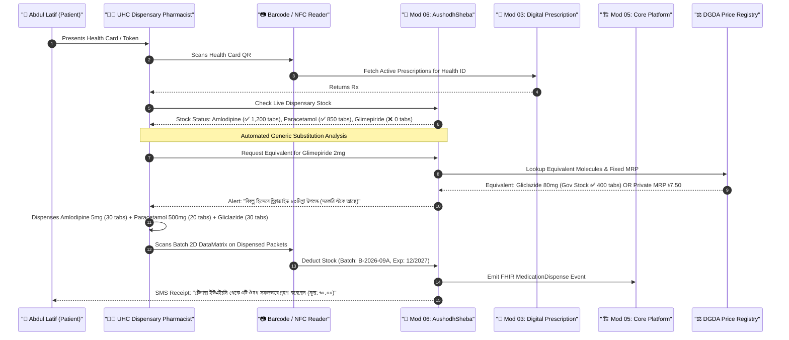
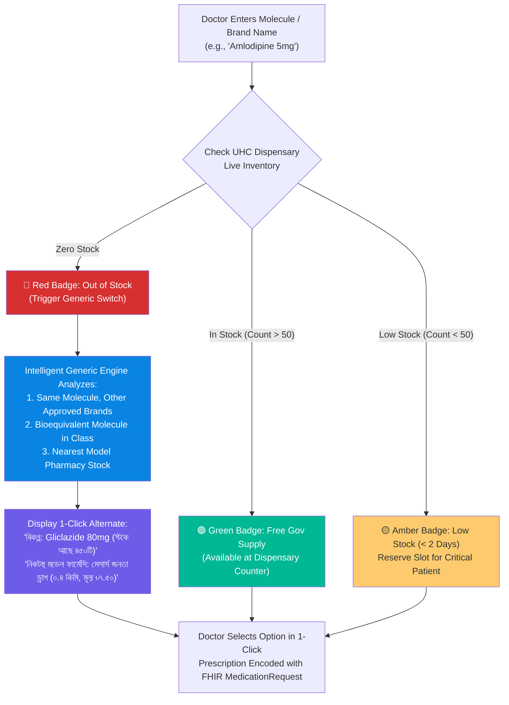
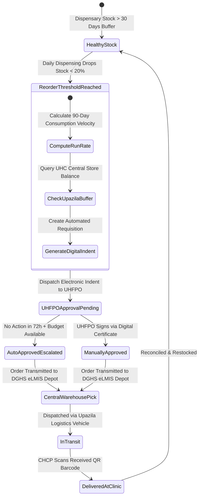
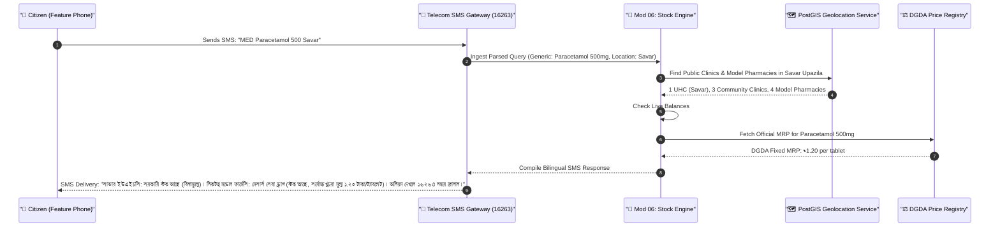
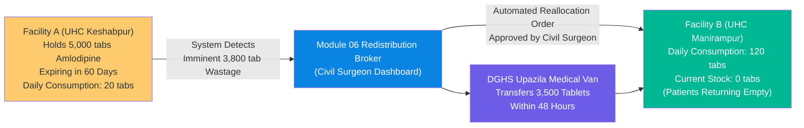
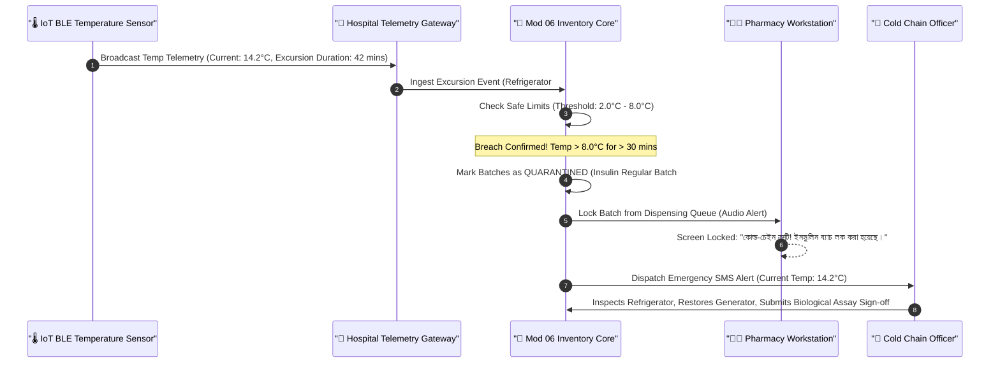
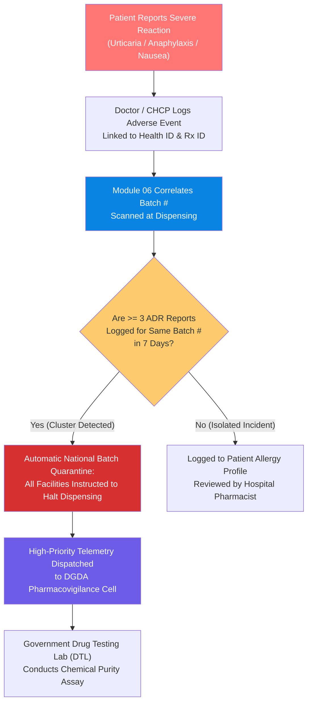
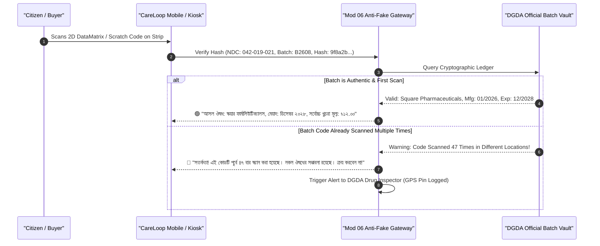

# 🔄 Module 06: Application Flows — Medicine Availability & Inventory Lifecycle

> **Step-by-step operational workflows** covering in-consultation prescribing, dispensary dispensing, community clinic automated restocking, citizen SMS inquiries, cold-chain exception handling, adverse drug reaction (ADR) reporting, and counterfeit verification for Bangladesh.

---

## 📋 Table of Contents

- [End-to-End Patient Dispensing Journey](#end-to-end-patient-dispensing-journey)
- [In-Consultation Stock-Aware Prescribing Flow](#in-consultation-stock-aware-prescribing-flow)
- [Community Clinic Auto-Reorder & Anti-Lapse Flow](#community-clinic-auto-reorder--anti-lapse-flow)
- [Citizen SMS & USSD Stock/Price Inquiry Flow](#citizen-sms--ussd-stockprice-inquiry-flow)
- [Inter-Facility Expiry Balancing & Redistribution Flow](#inter-facility-expiry-balancing--redistribution-flow)
- [Cold-Chain Breach & Automatic Quarantine Flow](#cold-chain-breach--automatic-quarantine-flow)
- [Adverse Drug Reaction (ADR) Pharmacovigilance Flow](#adverse-drug-reaction-adr-pharmacovigilance-flow)
- [Model Pharmacy Onboarding & DGDA Accreditation Flow](#model-pharmacy-onboarding--dgda-accreditation-flow)
- [Anti-Counterfeit Batch Verification Flow](#anti-counterfeit-batch-verification-flow)
- [Audit & Dispense Reconciliation State Machine](#audit--dispense-reconciliation-state-machine)
- [Workflow Performance Indicators & SLA Targets](#workflow-performance-indicators--sla-targets)

---

## End-to-End Patient Dispensing Journey

### Scenario: Abdul Latif at Chaugachha Upazila Health Complex, Jashore

Abdul Latif (62 years old, Health ID: `BD-HID-2026-00812941`) has chronic hypertension and osteoarthritis. In Jashore, where **283 community clinics had zero medicines for 8 months**, Abdul travels to Chaugachha Upazila Health Complex (UHC) after his local clinic was unable to provide his essential medications.



> [!NOTE]
> **Resolution of the Jashore Crisis**: Under the old system, Abdul would have waited in line only to be told Glimepiride was out of stock, forcing him to buy from a private retail shop where prices are marked up **7% to 140%**. Module 06 performs point-of-dispense equivalent substitution, ensuring he leaves with complete treatment.

### Detailed Step-by-Step Breakdown

| Step | Actor | Action | System Response |
|------|-------|--------|-----------------|
| 1. Identification | Patient / Pharmacist | Scans Health Card QR or Enters Health ID | Validates demographic and retrieves active prescription queue |
| 2. Stock Verification | Module 06 Engine | Real-time check of dispensary ledger | Flags available vs out-of-stock items |
| 3. Generic Matching | Module 06 Matcher | Runs therapeutic equivalence logic | Recommends in-stock generic substitute with ৳0 cost |
| 4. Verification & FEFO | Pharmacist | Scans blister pack 2D DataMatrix | Confirms batch matches head of FEFO queue |
| 5. Core Reconciliation | Module 05 | Ingests `MedicationDispense` FHIR resource | Appends to patient's lifetime Longitudinal Health Record |
| 6. Citizen Notification | National SMS Gateway | Dispatches confirmation SMS in Bangla | Provides transparency and prevents ghost dispensing |

---

## In-Consultation Stock-Aware Prescribing Flow

Doctors in Bangladesh spend an average of **48 seconds per primary consultation**. They cannot afford to leave their prescribing screen to check stock registers or call the pharmacy. Module 06 injects inventory radar directly into the doctor's prescription interface in Module 03.



### Prescribing Workflow Decision Matrix

| Stock Indicator | Dispensary Status | Action Presented to Physician | Clinical Consequence |
|-----------------|-------------------|--------------------------------|----------------------|
| **🟢 Gov Stock** | Sufficient (> 100 units) | Add directly to free dispensing queue | Patient pays ৳0 at government dispensary |
| **🟡 Low Buffer** | Critical buffer (10–50 units) | Warns doctor; allocates from emergency quota | Prioritized for destitute / high-risk patients |
| **🔴 Gov Depleted** | 0 units at facility | Displays verified alternative generic in stock | Avoids prescribing drugs the patient cannot get |
| **🔵 Private Model** | Verified private partner stock | Attaches DGDA maximum retail price cap (MRP) | Protects patient from private price gouging |

---

## Community Clinic Auto-Reorder & Anti-Lapse Flow

In 2026, **283 community clinics in Jashore were left without medicines for 8 months**, while simultaneously **94% of public health institutions left their procurement budgets unspent**. Module 06 eliminates manual paperwork and procurement paralysis through automated demand-driven requisitions.



### Auto-Reorder Trigger Parameters

- **Safety Stock Threshold**: Reorder automatically triggers when inventory falls below **14 days of average consumption**.
- **Anti-Budget-Lapse Escalation**: If an institution holds more than 30% of its annual medicine budget uncommitted by **March 31 (Q3)**, the system auto-generates bulk replenishment orders for the top 30 essential NCD medicines (Hypertension, Diabetes, Asthma) and notifies the Directorate General of Health Services (DGHS) and the Ministry of Health and Family Welfare (MoHFW).
- **Zero-Touch Indenting**: Eliminates physical paper signatures; approval uses two-factor authentication via the UHFPO's registered mobile device.

---

## Citizen SMS & USSD Stock/Price Inquiry Flow

Recognizing that **74% of rural citizens do not use smartphones**, Module 06 provides instant accessibility via standard SMS and USSD (`*16263#`) across all telecommunication operators (Grameenphone, Robi, Banglalink, Teletalk).



> [!TIP]
> **Bangla Voice USSD Alternative**:
> Dialing `*16263*6#` connects illiterate citizens to an Interactive Voice Response (IVR) tree in colloquial Bangla, allowing them to speak the medicine name and listen to nearby availability.

---

## Inter-Facility Expiry Balancing & Redistribution Flow

Under the traditional paper system, medicines frequently expire and are destroyed in one Upazila hospital warehouse, while a neighboring facility runs completely dry. Module 06 implements **Dynamic First-Expired-First-Out (FEFO) Balancing**.



### Redistribution Rule Hierarchy

1. **60-Day Expiry Window**: Any essential medicine batch with < 60 days to expiry whose local run-rate will consume < 40% of the volume is flagged for mandatory transfer.
2. **Geographic Proximity**: The redistribution engine matches deficit facilities within a 25 km radius first to minimize transport overhead.
3. **Electronic Waybill**: Handover between pharmacists is cryptographically confirmed via digital signature and QR scanning.

---

## Cold-Chain Breach & Automatic Quarantine Flow

Thermolabile medicines—such as human insulins, oxytocin, rabies vaccines, and hepatitis immunoglobulins—lose potency rapidly during Bangladesh's frequent rural power outages. Module 06 enforces automated temperature surveillance.



---

## Adverse Drug Reaction (ADR) Pharmacovigilance Flow

When substandard or contaminated medicine batches enter the supply chain, rapid detection and recall are critical to preventing casualties.



---

## Model Pharmacy Onboarding & DGDA Accreditation Flow

To ensure private retail pharmacies comply with DGDA price caps and employ certified A-grade pharmacists (addressing the PMC 2025 finding that **only 7.56% of Dhaka pharmacies currently have a registered pharmacist**), Module 06 provides an accreditation onboarding gateway.

```
       ┌────────────────────────────────────────────────────────┐
       │ Retail Pharmacy Submits License & Pharmacist Reg (PC-B)│
       └───────────────────────────┬────────────────────────────┘
                                   │
                                   ▼
       ┌────────────────────────────────────────────────────────┐
       │ DGDA Pharmacy Verification Engine                      │
       │ (Cross-references Pharmacy Council of Bangladesh DB)   │
       └───────────────────────────┬────────────────────────────┘
                                   │
                                   ▼
       ┌────────────────────────────────────────────────────────┐
       │ Physical Geo-Verification by Upazila Drug Inspector    │
       │ (Validates Air Conditioning < 25°C & Digital POS)      │
       └───────────────────────────┬────────────────────────────┘
                                   │
                                   ▼
       ┌────────────────────────────────────────────────────────┐
       │ Accredited as "Model Pharmacy"                         │
       │ (Integrated into Citizen Stock Radar with Verified Tag)│
       └────────────────────────────────────────────────────────┘
```

---

## Anti-Counterfeit Batch Verification Flow

With an estimated **Tk 600 crore in counterfeit drugs** in the market, Module 06 incorporates consumer-driven authentication. Every licensed manufacturer in Bangladesh prints a unique 2D DataMatrix code containing the DGDA National Drug Code (NDC), Batch Number, Expiration Date, and a randomized cryptographic security hash.



---

## Audit & Dispense Reconciliation State Machine

To prevent pilferage from government stocks into private retail channels, every unit entering a facility must be accounted for by an official FHIR `MedicationDispense` record linked to an authenticated Health ID.

```
       ┌────────────────────────┐
       │   Shipment Received    │
       │   (eLMIS Dispatch)     │
       └───────────┬────────────┘
                   │
                   ▼
       ┌────────────────────────┐
       │ In Facility Inventory  │◄─────────────┐
       │ (FEFO Batch Registered)│              │
       └───────────┬────────────┘              │
                   │                           │ (Restock / Return)
         ┌─────────┴─────────┐                 │
         │                   │                 │
         ▼                   ▼                 │
   ┌───────────┐       ┌───────────┐           │
   │ Dispensed │       │ Expired / │           │
   │ to Patient│       │ Damaged   │           │
   │ (Linked to│       │ (Audited  │           │
   │ Health ID)│       │ Write-off)│           │
   └───────────┘       └───────────┘           │
         │                   │                 │
         ▼                   ▼                 │
   ┌───────────────────────────────┐           │
   │ Immutable DGHS Audit Ledger   ├───────────┘
   └───────────────────────────────┘
```

---

## Workflow Performance Indicators & SLA Targets

To guarantee reliable operation across all 64 districts, Module 06 enforces strict Service Level Agreements (SLAs) for each lifecycle step.

| Application Workflow | Operational SLA | Fallback Strategy during Network Blackout |
|----------------------|-----------------|------------------------------------------|
| **Doctor Stock Check** | < 15 milliseconds | Local browser storage cache updated hourly |
| **Dispensary FEFO Deduction** | < 100 milliseconds | Offline SQLite ledger synced upon reconnection |
| **Citizen SMS Response** | < 5 seconds | Local telecom aggregator short-circuit cache |
| **Auto-Requisition Dispatch** | Instantaneous upon 20% trigger | Automatic batch queue during nightly maintenance window |
| **Cold-Chain Alert Delivery** | < 60 seconds to officer phone | Hardware buzzer on local refrigeration unit |
| **Counterfeit Scan Result** | < 500 milliseconds | Pre-computed cryptographic bloom filters on edge |
| **ADR Cluster Alarm** | < 10 minutes from 3rd report | Broadcast SMS to all district civil surgeons |
