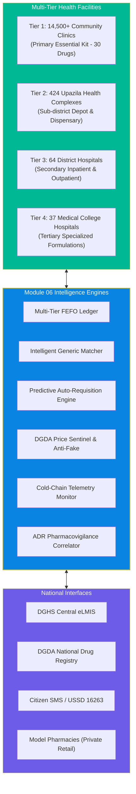
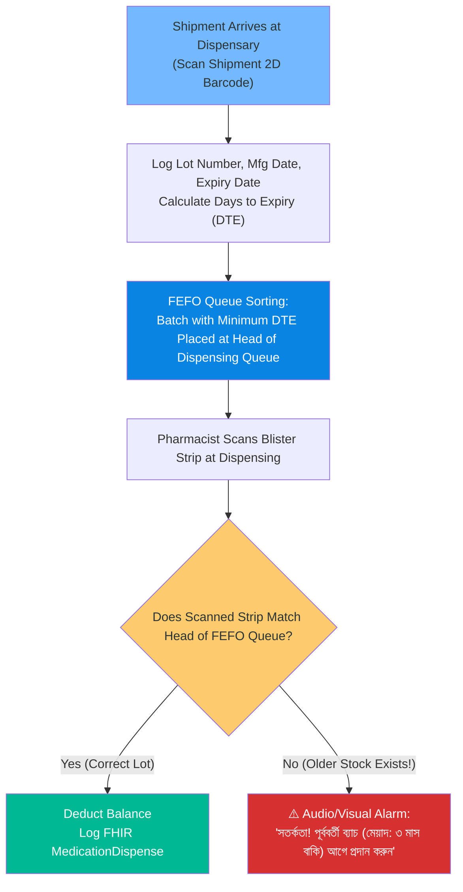
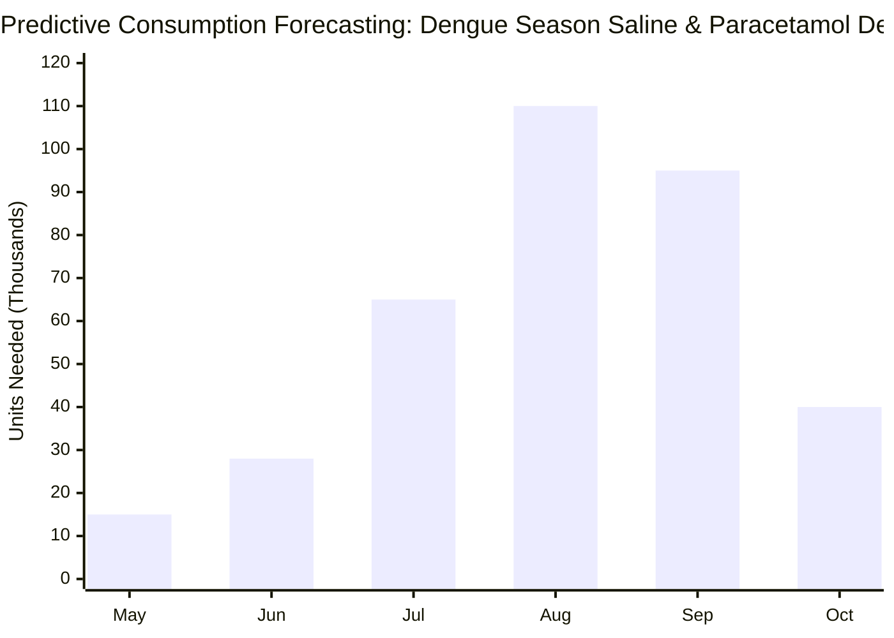
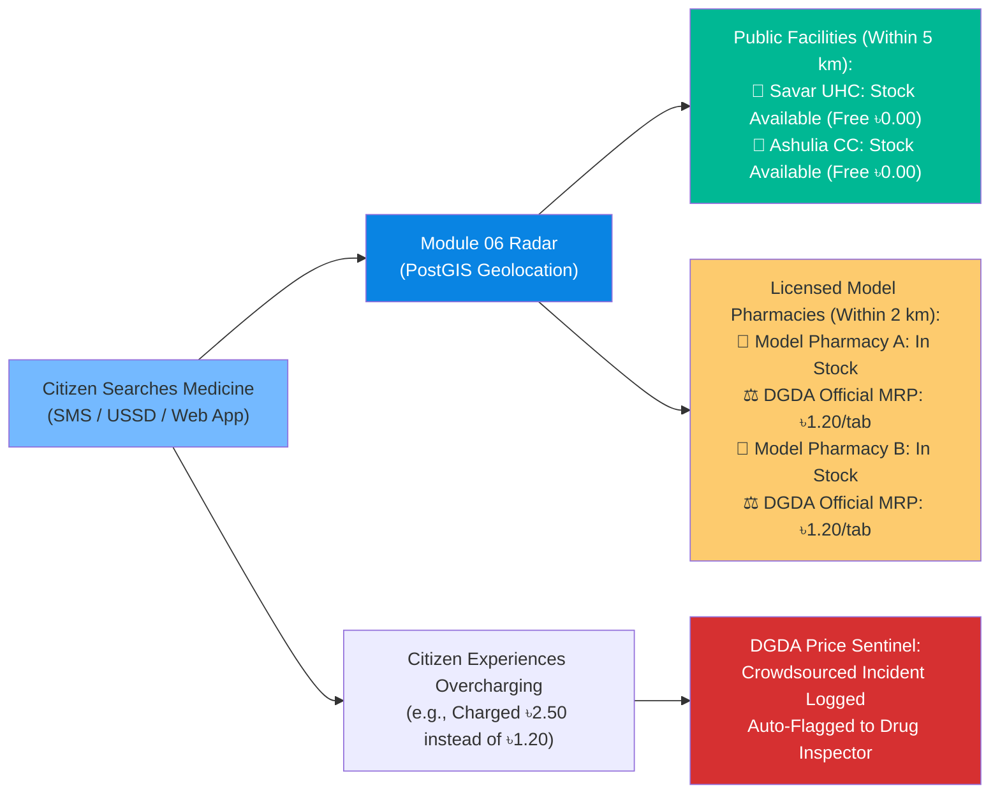
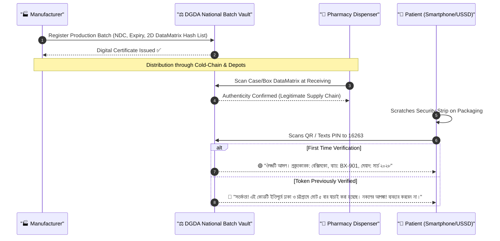
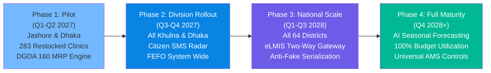

# 🌟 Module 06: Functional Features — Medicine Availability & Pharmacy Network

> **Comprehensive feature specification** for multi-tier hospital inventory, point-of-care generic substitution, eLMIS bridge, citizen stock radar, DGDA price protection, cold-chain telemetry, pharmacovigilance, and counterfeit drug eradication in Bangladesh.

---

## 📋 Table of Contents

- [Functional Architecture & Feature Taxonomy](#functional-architecture--feature-taxonomy)
- [Feature 1: Multi-Tier Inventory & FEFO Expiry Engine](#feature-1-multi-tier-inventory--fefo-expiry-engine)
- [Feature 2: Intelligent Generic Substitution & Equivalence Engine](#feature-2-intelligent-generic-substitution--equivalence-engine)
- [Feature 3: eLMIS Interoperability Bridge & Predictive Auto-Requisition](#feature-3-elmis-interoperability-bridge--predictive-auto-requisition)
- [Feature 4: Citizen Stock Radar & DGDA Price Sentinel](#feature-4-citizen-stock-radar--dgda-price-sentinel)
- [Feature 5: Anti-Counterfeit Batch Authentication & Lot Tracing](#feature-5-anti-counterfeit-batch-authentication--lot-tracing)
- [Feature 6: Cold-Chain Telemetry & Automatic Quarantining](#feature-6-cold-chain-telemetry--automatic-quarantining)
- [Feature 7: Antimicrobial Stewardship (AMS) & Prescription Enforcement](#feature-7-antimicrobial-stewardship-ams--prescription-enforcement)
- [Feature 8: District Civil Surgeon Redistribution & Rebalancing Matrix](#feature-8-district-civil-surgeon-redistribution--rebalancing-matrix)
- [Feature 9: Pharmacovigilance & Batch-Level Adverse Drug Reaction (ADR) Auto-Correlator](#feature-9-pharmacovigilance--batch-level-adverse-drug-reaction-adr-auto-correlator)
- [Feature 10: Model Pharmacy Accreditation & Verified Retail Partner Network](#feature-10-model-pharmacy-accreditation--verified-retail-partner-network)
- [Feature 11: Vernacular Dosage & Administration Instruction Engine](#feature-11-vernacular-dosage--administration-instruction-engine)
- [Feature Matrix & Cross-Module Dependencies](#feature-matrix--cross-module-dependencies)
- [Implementation Phasing & National Rollout Milestones](#implementation-phasing--national-rollout-milestones)

---

## Functional Architecture & Feature Taxonomy

Module 06 (AushodhSheba) establishes end-to-end transparency across Bangladesh's medicine lifecycle. It integrates public supply chains with private retail networks, shifting the paradigm from static paper ledgers to a real-time, demand-driven ecosystem.



> [!IMPORTANT]
> **Core Benchmark**: While PPRC's 2026 audit found only **22% essential medicine availability** in public facilities, Module 06 is engineered to drive availability past **85% within 12 months** through automated demand tracking and inventory transparency.

---

## Feature 1: Multi-Tier Inventory & FEFO Expiry Engine

Module 06 tracks medicines at the unit, blister pack, and batch level across all public health tiers using **First-Expired-First-Out (FEFO)** scheduling, eliminating the administrative neglect that leads to expired stock alongside empty shelves.



### Functional Specifications

1. **Lot-Level Digital Ledger**:
   - Records Batch ID, Manufacturer ID, DGDA Registration Number, Date of Manufacture, Expiry Date, Storage Conditions (Cold-chain 2–8°C vs. Room temp < 30°C).
2. **Dynamic Expiration Warning Horizons**:
   - **90 Days to Expiry**: Yellow flag on dispensary dashboard.
   - **60 Days to Expiry**: Automated notification to Upazila Health & Family Planning Officer (UHFPO) triggering regional inter-facility transfer.
   - **30 Days to Expiry**: Hard lockout requiring explicit supervisor override to dispense.
3. **Barcoding & 2D DataMatrix Parsing**:
   - Native support for GS1-128 and DGDA-mandated 2D DataMatrix symbologies on handheld Honeywell, Zebra, and smartphone camera scanners.

---

## Feature 2: Intelligent Generic Substitution & Equivalence Engine

In Bangladesh, physicians routinely prescribe by brand name. When a specific brand is unavailable, patients are turned away. The **Intelligent Generic Substitution Engine** bridges this gap by mapping brands to standardized generic molecules with verified bioequivalence.

### DGDA Equivalence & Cost-Saving Table

| Prescribed Brand | Generic Molecule | Strength | Dosage Form | Government Stock Equivalent | Private MRP Range | Out-of-Pocket Saving |
|------------------|------------------|----------|-------------|----------------------------|-------------------|----------------------|
| **Napa Extra** | Paracetamol + Caffeine | 500mg + 65mg | Tablet | Paracetamol 500mg (Gov) | ৳3.00 - ৳3.50/tab | **100% Free at Gov / ৳70 saved** |
| **Seclo 20** | Omeprazole | 20mg | Capsule | Omeprazole 20mg (Gov) | ৳6.00 - ৳7.00/cap | **100% Free at Gov / ৳210 saved** |
| **Amdocal 5** | Amlodipine | 5mg | Tablet | Amlodipine 5mg (Gov) | ৳5.00 - ৳6.50/tab | **100% Free at Gov / ৳180 saved** |
| **Sergel 20** | Esomeprazole | 20mg | Tablet | Omeprazole 20mg (Bioequivalent) | ৳8.00 - ৳9.50/tab | **100% Free at Gov / ৳285 saved** |
| **Azithrocin 500** | Azithromycin | 500mg | Tablet | Azithromycin 500mg (Gov) | ৳35.00 - ৳45.00/tab | **100% Free at Gov / ৳210 saved** |
| **Gevisol** | Sodium Alginate + Potassium | 500mg/10ml | Suspension | Antacid Plus (Gov) | ৳180.00/bottle | **100% Free at Gov / ৳180 saved** |

### Substitution Algorithms & Rules

1. **Exact Chemical Match**: Identical molecule, identical salt, identical dosage form and strength (e.g., *Amdocal 5mg* -> *Camlodin 5mg* -> *Amlodipine 5mg*).
2. **Therapeutic Class Equivalence**: When exact chemical molecule is depleted, evaluates clinical class equivalents (e.g., substituting *Esomeprazole 20mg* with *Omeprazole 20mg* for uncomplicated gastritis) with automated physician confirmation.
3. **Safety Cross-Checks**: Verifies patient allergies (retrieved from Module 05 LHR) before suggesting any alternative salt or excipient.

---

## Feature 3: eLMIS Interoperability Bridge & Predictive Auto-Requisition

To resolve the catastrophic paradox where **94% of healthcare institutions left budgets unspent** while clinics ran dry for 8 months, Module 06 connects directly to the central DGHS eLMIS, transforming passive storage into an active, demand-driven supply pipeline.



### Predictive Procurement Logic

```
   ┌────────────────────────────────────────────────────────┐
   │ Real-time Consumption Logs + Disease Surveillance Feed │
   └───────────────────────────┬────────────────────────────┘
                               │
                               ▼
   ┌────────────────────────────────────────────────────────┐
   │ Machine Learning Model: Seasonal Run-Rate Forecaster   │
   │ (Detects monsoon diarrhea, dengue spikes, winter flu)  │
   └───────────────────────────┬────────────────────────────┘
                               │
                               ▼
   ┌────────────────────────────────────────────────────────┐
   │ Budget Utilization Watchdog                            │
   │ IF (Annual Budget Remaining > 40% AND Fiscal Month >= 8)│
   │ THEN Auto-Draft Replenishment Tender                   │
   └────────────────────────────────────────────────────────┘
```

### Core Capabilities

- **Zero-Manual Indenting**: CHCPs no longer submit paper requisition forms. The system computes daily burn rates and automatically dispatches electronic indents to the Upazila Health Complex store.
- **DGHS eLMIS Two-Way Sync**: Pushes facility-level real-time stock balances to the national eLMIS database via HL7 FHIR `SupplyDelivery` resources, while ingesting national warehouse shipment manifests.
- **Budget-Lapse Preventer**: Dispatches escalating SMS and dashboard alerts to Civil Surgeons and UHFPOs when procurement funds risk lapsing at the close of the fiscal year (June 30).

---

## Feature 4: Citizen Stock Radar & DGDA Price Sentinel

Module 06 democratizes medicine data for the public, protecting citizens from unregulated retail price hikes where **retail prices climbed 7% to 140% while mill-gate manufacturer prices remained unchanged** (Financial Express 2024).



### DGDA MRP Watchdog Features

- **The 160+ Essential Price Database**: Hosts official DGDA price ceilings for all regulated essential drugs, updated via automated daily sync with the DGDA gazette.
- **Price Transparency Badge**: Generates printable QR stickers for registered retail pharmacies displaying the government-fixed MRP.
- **Overcharge Whistleblower Gateway**: Allows citizens to submit photographic proof of receipts; automated text extraction verifies whether pharmacies exceeded the DGDA ceiling, automatically triggering regulatory inspections.

---

## Feature 5: Anti-Counterfeit Batch Authentication & Lot Tracing

To counteract the **Tk 600 crore black market in counterfeit drugs**, Module 06 implements end-to-end cryptographic lot tracing from manufacturing plant to patient dispensing.



---

## Feature 6: Cold-Chain Telemetry & Automatic Quarantining

Temperature-sensitive biologicals (insulins, vaccines, oxytocin) spoil rapidly during load-shedding and transport. Module 06 connects with IoT sensors to enforce biological safety.

### Cold-Chain Governance Matrix

| Medicine Category | Storage Requirement | Excursion Limit | System Action on Breach |
|-------------------|---------------------|-----------------|-------------------------|
| **Human Insulins** | 2°C to 8°C | > 15°C for > 2 hours | Automated lock in FEFO dispensing queue |
| **Oxytocin Injections** | 2°C to 8°C | > 25°C for > 30 minutes | Mandatory disposal flag & UHFPO notification |
| **Rabies / Tetanus Vaccines** | 2°C to 8°C | Freeze (< 0°C) or Heat (> 12°C) | Immediate quarantine & alert to EPI manager |
| **Oral Polio Vaccine (OPV)** | -20°C (Depot) / 2-8°C (Local) | VVM (Vaccine Vial Monitor) stage 3 | Discard indicator dispatched |

---

## Feature 7: Antimicrobial Stewardship (AMS) & Prescription Enforcement

With research indicating that **~45% of antibiotics in Bangladesh are dispensed over-the-counter without a prescription**, and only **7.56% of pharmacies have registered pharmacists**, Module 06 enforces strict antimicrobial stewardship based on the WHO AWaRe classification.

```
                  ┌─────────────────────────────────────────┐
                  │       WHO AWaRe Classification          │
                  └────────────────────┬────────────────────┘
                                       │
         ┌─────────────────────────────┼─────────────────────────────┐
         ▼                             ▼                             ▼
  ┌───────────────┐             ┌───────────────┐             ┌───────────────┐
  │  ACCESS Group │             │  WATCH Group  │             │ RESERVE Group │
  │ (Amoxicillin, │             │(Azithromycin, │             │ (Meropenem,   │
  │  Cefalexin)   │             │ Ciprofloxacin)│             │  Colistin)    │
  └───────┬───────┘             └───────┬───────┘             └───────┬───────┘
          │                             │                             │
  ┌───────┴───────┐             ┌───────┴───────┐             ┌───────┴───────┐
  │ Dispensed with│             │ Mandatory E-Rx│             │ Tertiary-Only │
  │ Standard Rx   │             │ (Module 03)   │             │ Culture & ID  │
  │ Verification  │             │ Validation    │             │ Verification  │
  └───────────────┘             └───────────────┘             └───────────────┘
```

> [!CAUTION]
> Retail pharmacies attempting to log sales of "Watch" or "Reserve" category antibiotics without a valid, signed FHIR `MedicationRequest` from Module 03 are flagged immediately to the district licensing authority.

---

## Feature 8: District Civil Surgeon Redistribution & Rebalancing Matrix

To eliminate the tragedy of medicines expiring in one sub-district while neighboring Upazilas experience complete stockouts, Module 06 provides the Civil Surgeon with a district-wide automated balancing terminal.

- **Dynamic Imbalance Detection**: Identifies pairs of facilities where Facility A has > 90 days of excess inventory expiring soon, and Facility B has < 7 days of stock.
- **Automated Transport Dispatch**: Generates an official inter-facility transfer order route for the Upazila Medical Supply Van.
- **Chain of Custody Tracking**: Both transferring and receiving pharmacists digitally sign the handover via tablet, automatically reconciling physical stock counts in both ledgers simultaneously.

---

## Feature 9: Pharmacovigilance & Batch-Level Adverse Drug Reaction (ADR) Auto-Correlator

Detects contaminated, toxic, or adulterated batches rapidly through automated event correlation across all health facilities:

1. **Syndromic Signal Detection**: Detects sudden occurrences of acute kidney injury, hepatic failure, or severe anaphylaxis within 48 hours of dispensing a shared batch number.
2. **Automated National Batch Lockout**: When 3 distinct facilities report severe adverse reactions linked to the same batch, the central DGDA registry initiates an immediate automated dispense lock across all connected terminals.
3. **Manufacturer Root Cause Dossier**: Generates an automated audit packet with patient demographics, lot IDs, and clinical outcomes for DGDA enforcement officers.

---

## Feature 10: Model Pharmacy Accreditation & Verified Retail Partner Network

Supports the Ministry of Health's Model Pharmacy initiative by creating a transparent registry of private accredited retailers:

- **A-Grade Pharmacist Verification**: Integrates directly with the Pharmacy Council of Bangladesh (PCB) database to confirm that dispensing staff hold valid professional registration.
- **Temperature & Storage Audits**: Requires participating shops to maintain digital thermometers with logging capabilities.
- **Patient Rating & Transparency Score**: Citizens can rate service quality and report price compliance directly via the CareLoop mobile app.

---

## Feature 11: Vernacular Dosage & Administration Instruction Engine

Ensures safe medication compliance for citizens with low literacy by generating standardized Bangla pictorial and textual instructions:

| English Medical Shorthand | Standard Bangla Translation | Audio Instruction (Bangla TTS) | Pictorial Symbol |
|---------------------------|-----------------------------|--------------------------------|------------------|
| **1-0-1 After Food** | সকালে ১টি, রাতে ১টি (খাবারের পরে) | *"সকালে একটি এবং রাতে একটি ট্যাবলেট ভরা পেটে খাবেন"* | ☀️ 🍽️ 🌙 🍽️ |
| **0-0-1 Before Sleep** | রাতে ঘুমানোর পূর্বে ১টি | *"রাতে ঘুমানোর আধা ঘণ্টা আগে একটি ট্যাবলেট খাবেন"* | 🌙 🛏️ |
| **1-1-1 30 mins Before Food** | সকাল, দুপুর ও রাতে খাবারের ৩০ মিনিট পূর্বে | *"প্রতিবার খাবারের আধ ঘণ্টা পূর্বে ওষুধটি সেবন করবেন"* | ⏳ 🍽️ |
| **1 tsp 3 times daily** | ১ চা চামচ দিনে ৩ বার (৮ ঘণ্টা পরপর) | *"এক চা চামচ করে দিনে তিনবার খাবেন"* | 🥄 x 3 |
| **Complete full 7-day course**| পুরো ৭ দিনের কোর্স অবশ্যই শেষ করবেন | *"সুস্থ বোধ করলেও ওষুধ বন্ধ করবেন না, পুরো ৭ দিন খাবেন"* | 📅 7 Days |

---

## Feature Matrix & Cross-Module Dependencies

| Operational Feature | Mod 01 (ID) | Mod 02 (Appt) | Mod 03 (Rx) | Mod 04 (Lab) | Mod 05 (Core) | DGDA Registry | eLMIS Depot |
|---------------------|:-----------:|:-------------:|:-----------:|:------------:|:-------------:|:-------------:|:-----------:|
| **Stock-Aware Prescribing** | Read | None | **Primary** | None | Sync | Read | Sync |
| **FEFO Dispensary Ledger** | Read | None | Read | None | Sync | Read | Read |
| **Generic Substitution** | None | None | **Primary** | None | Sync | **Primary** | None |
| **Citizen Stock Radar** | Read | Read | None | None | Read | Read | Sync |
| **Auto-Reorder Engine** | None | None | Read | None | Sync | None | **Primary** |
| **Counterfeit Verifier** | Read | None | None | None | Sync | **Primary** | None |
| **Cold-Chain Guardian** | None | None | None | None | Sync | Read | Sync |
| **Antimicrobial Guard** | Read | None | **Primary** | Read (Culture) | Sync | Read | None |
| **ADR Pharmacovigilance** | Read | None | Read | Read | Sync | **Primary** | None |

---

## Implementation Phasing & National Rollout Milestones



### Target Readiness Milestones

1. **Jashore Community Clinic Recovery**: 100% of the 283 previously starved community clinics in Jashore equipped with live tablet-based inventory and restored to full stock within 60 days of pilot launch.
2. **DGDA Price Compliance**: 95% compliance with the official 160-molecule MRP ceiling across participating model pharmacies in pilot districts.
3. **Budget Absorption**: Zero instances of unspent medicine procurement budgets lapsing across participating Upazila Health Complexes.
4. **Counterfeit Eradication**: 100% serialization scan compliance for all essential drugs dispensed in public health centers.
5. **Cold-Chain Integrity**: Zero temperature excursion losses of critical insulin and vaccines across participating facilities.
