# Module 07: Health Card — Application Flows

## 📋 Table of Contents

- [Flow Overview](#flow-overview)
- [Flow 1: Health Card Registration](#flow-1-health-card-registration)
- [Flow 2: QR Code Scan & Lookup](#flow-2-qr-code-scan--lookup)
- [Flow 3: Consent Management](#flow-3-consent-management)
- [Flow 4: Proxy Access](#flow-4-proxy-access)
- [Flow 5: Cross-Facility Data Sharing](#flow-5-cross-facility-data-sharing)
- [Flow 6: Health Card Update](#flow-6-health-card-update)
- [Flow 7: Lost Card Recovery](#flow-7-lost-card-recovery)
- [Flow 8: Emergency Break-Glass Access](#flow-8-emergency-break-glass-access)
- [Flow 9: Offline Registration & Sync](#flow-9-offline-registration--sync)
- [Error Handling & Edge Cases](#error-handling--edge-cases)

---

## Flow Overview

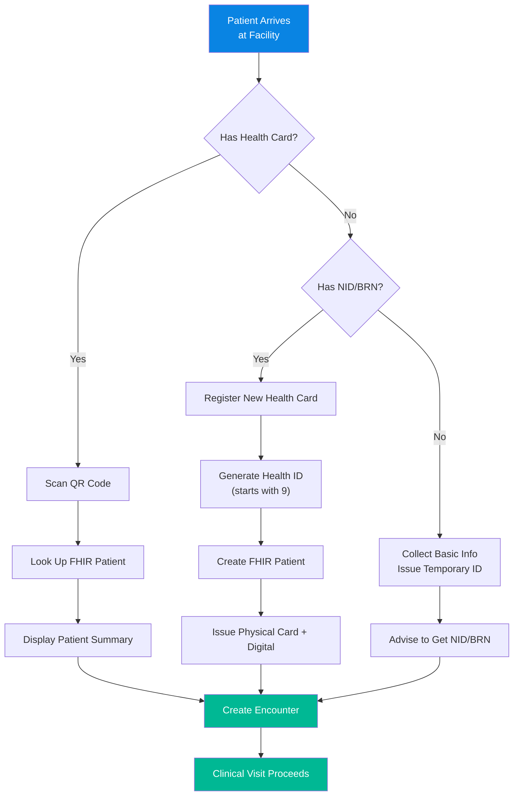

> [!NOTE]
> All flows assume the **BD Core IG v0.4.6** FHIR profiles and the SHR Master Client Index. The FHIR sandbox endpoint is `sandbox.fhir.dghs.gov.bd/fhir`.

---

## Flow 1: Health Card Registration

### Overview
A new patient visits a healthcare facility for the first time and needs to be registered in the national e-Health system. This is the most critical flow — it creates the patient's digital identity.

### Preconditions
- Patient has a valid NID (National ID, 10 or 17 digits) or BRN (Birth Registration Number, 17 digits)
- Facility has connectivity (or uses offline mode — see Flow 9)
- Registration staff is logged into the system

### Detailed Sequence

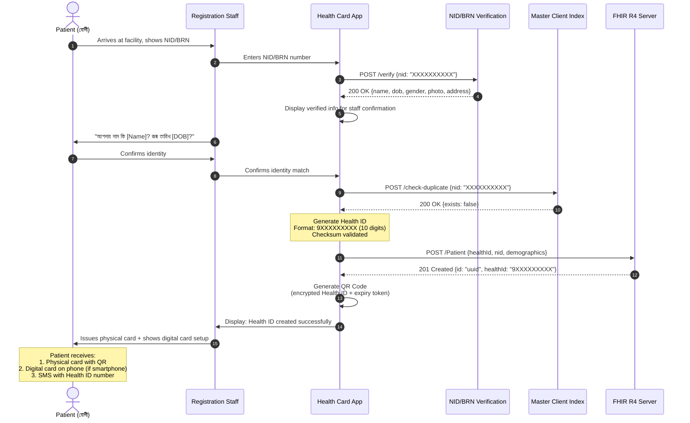

### Step-by-Step Details

| Step | Action | System | Bangla Prompt (if applicable) |
|------|--------|--------|-------------------------------|
| 1 | Patient presents NID/BRN | — | — |
| 2 | Staff enters ID number | Health Card App | "জাতীয় পরিচয়পত্র / জন্ম নিবন্ধন নম্বর লিখুন" |
| 3 | System verifies with NID API | NID Verification | — |
| 4 | Staff confirms patient identity | Health Card App | "তথ্য নিশ্চিত করুন" |
| 5 | Check for duplicates | Master Client Index | — |
| 6 | Generate Health ID | ID Generator | — |
| 7 | Create FHIR Patient resource | FHIR Server | — |
| 8 | Generate QR code | QR Engine | — |
| 9 | Issue physical card | Card Printer | — |
| 10 | Set up digital card | PWA | "আপনার ডিজিটাল হেলথ কার্ড তৈরি হয়েছে" |
| 11 | Send confirmation SMS | SMS Gateway | "আপনার স্বাস্থ্য পরিচয় নম্বর: 9XXXXXXXXX" |

### Post-conditions
- Patient has a unique Health ID starting with `9`
- FHIR Patient resource exists on the SHR
- Physical card printed (if printer available)
- Digital card accessible via PWA (if smartphone)
- SMS confirmation sent to registered mobile number
- Consent flow triggered (see Flow 3)

> [!TIP]
> **For rural facilities without printers:** Generate a temporary paper slip with Health ID + QR code. Patient can get a proper card at the next district hospital visit. The digital Health ID works regardless.

---

## Flow 2: QR Code Scan & Lookup

### Overview
A returning patient presents their Health Card (physical or digital) at any facility. The facility scans the QR code to retrieve the patient's record.

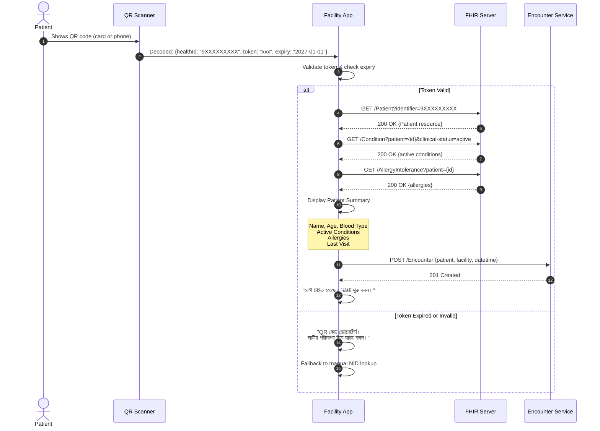

### QR Code Content Structure

```json
{
  "v": 1,
  "hid": "9XXXXXXXXX",
  "t": "encrypted_token_base64",
  "exp": "2027-06-15T00:00:00Z",
  "sig": "digital_signature_base64"
}
```

> [!IMPORTANT]
> The QR code does **NOT** contain any medical data. It contains only the Health ID, an encrypted verification token, an expiry date, and a digital signature. All medical data is retrieved from the FHIR server after authentication.

---

## Flow 3: Consent Management

### Overview
Bangladesh's PDPO 2025 requires explicit consent for processing health data. On first visit (or when consent is due for renewal), patients are shown a consent screen in Bangla.

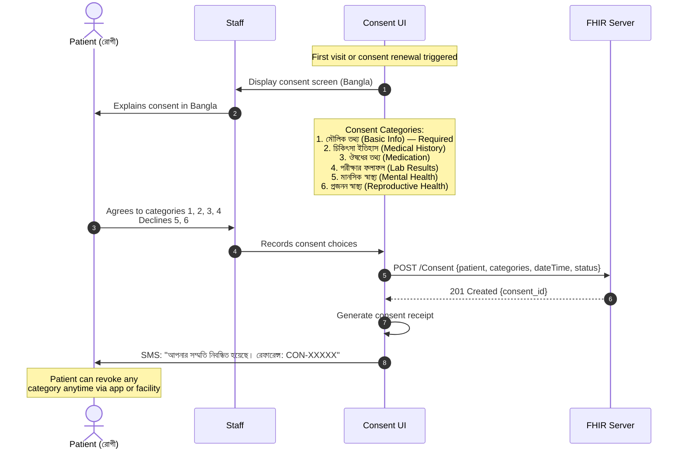

### Consent Data Categories

| Category | Bangla | Required | Default |
|----------|--------|----------|---------|
| Basic Demographics | মৌলিক তথ্য | ✅ Yes | Granted |
| Medical History | চিকিৎসা ইতিহাস | No | Ask |
| Medication Records | ঔষধের তথ্য | No | Ask |
| Lab Results | পরীক্ষার ফলাফল | No | Ask |
| Mental Health | মানসিক স্বাস্থ্য | No | Denied |
| Reproductive Health | প্রজনন স্বাস্থ্য | No | Denied |
| Immunization | টিকা তথ্য | No | Ask |
| Emergency Access | জরুরি প্রবেশ | No | Ask |

### Consent Revocation

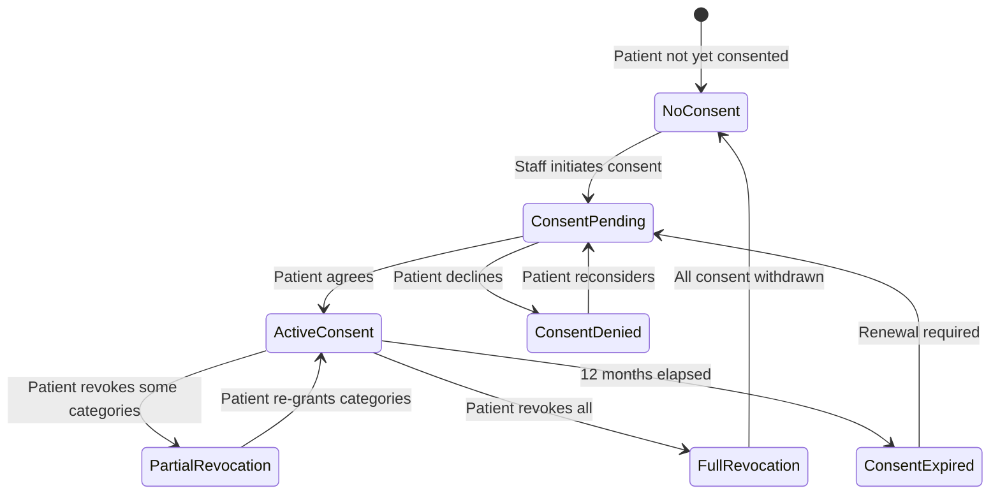

> [!WARNING]
> **Consent revocation must be immediate.** When a patient revokes consent for a category, all future queries for that data type must return empty results within 60 seconds. Historical data is not deleted but is access-blocked.

---

## Flow 4: Proxy Access

### Overview
In rural Bangladesh (~63% of population), many patients — especially elderly, children, and those with disabilities — cannot manage their own digital health records. A proxy (family member) is appointed to manage access.

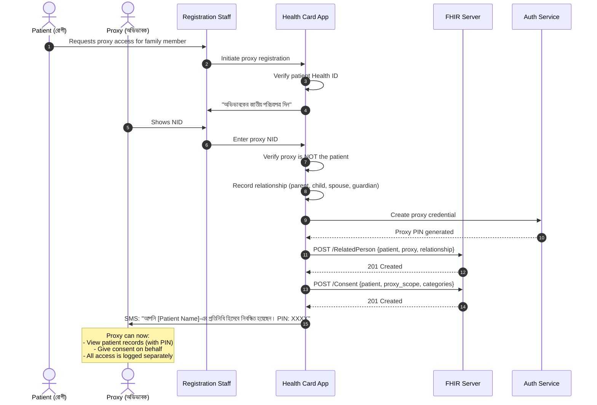

### Proxy Access Rules

| Rule | Details |
|------|---------|
| Maximum proxies per patient | 3 |
| Proxy must have NID | Required for identity verification |
| Proxy PIN | 4-digit, separate from patient's credentials |
| Access logging | Every proxy access logged with proxy ID |
| Patient notification | Patient notified of every proxy access (SMS) |
| Revocation | Patient can revoke proxy access anytime |
| Automatic expiry | Proxy access expires after 12 months, requires renewal |
| Restricted categories | Proxy cannot access mental health or reproductive health by default |

---

## Flow 5: Cross-Facility Data Sharing

### Overview
A patient registered at Facility A visits Facility B. Facility B needs to access the patient's history from Facility A.

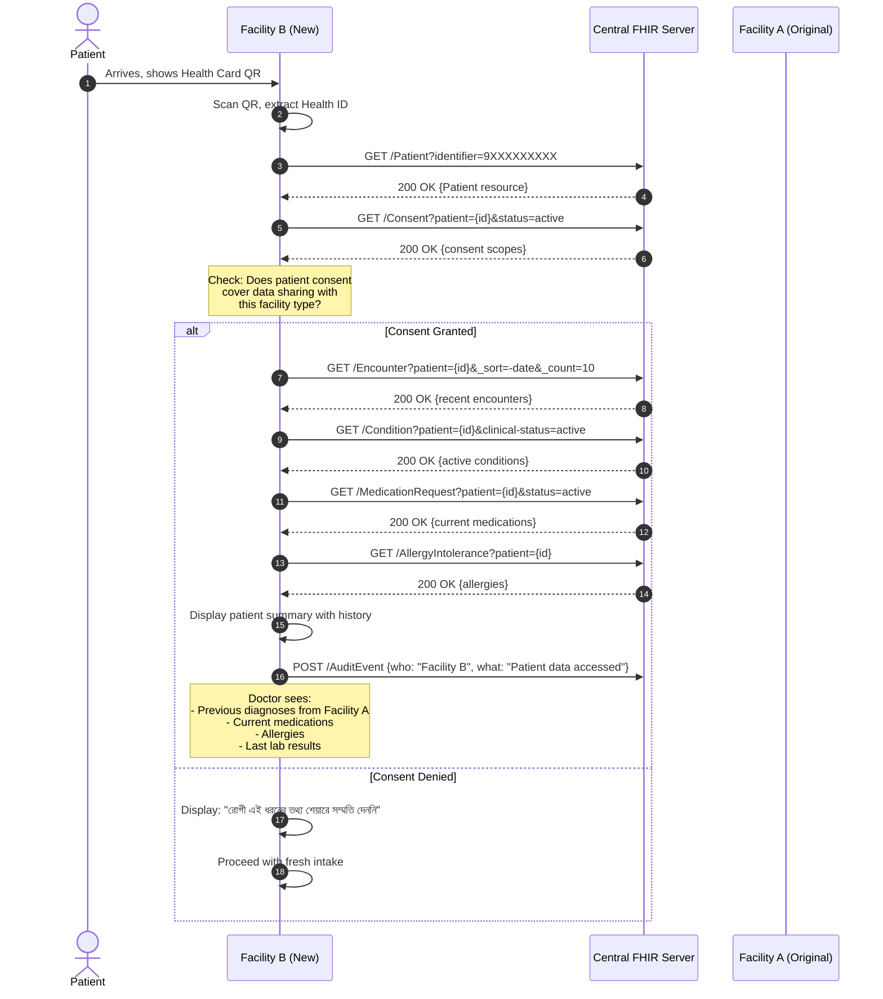

> [!TIP]
> **For districts with poor connectivity:** The system caches the patient's summary locally (encrypted) for 24 hours after a successful fetch. If the next facility visit happens within 24 hours and connectivity fails, the cached summary can be used (with appropriate audit logging).

---

## Flow 6: Health Card Update

### Overview
When patient information changes (address, phone number, emergency contacts, marital status, etc.), a verified update flow ensures data integrity.

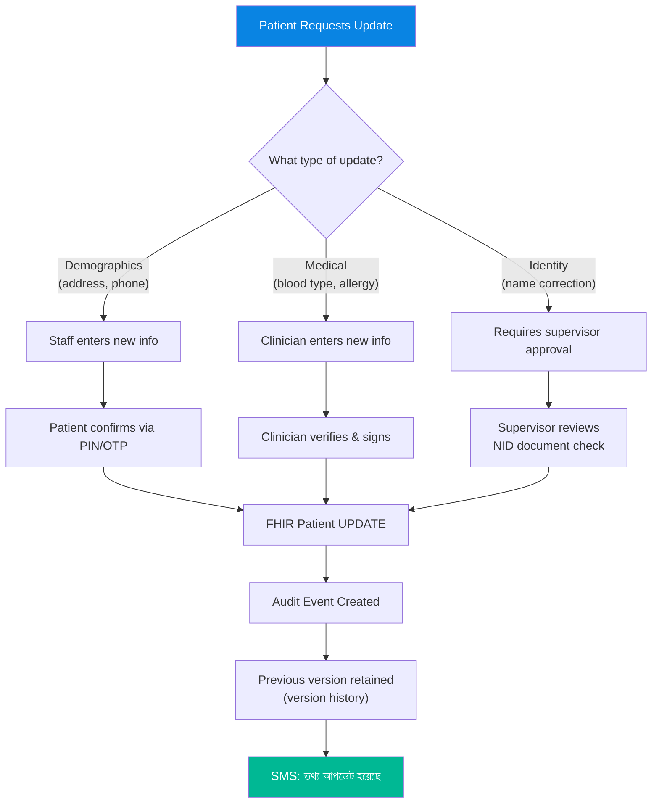

### Update Authorization Matrix

| Field Category | Who Can Update | Requires |
|---------------|---------------|----------|
| Phone number | Patient, Staff | OTP verification |
| Address | Patient, Staff | Patient confirmation |
| Emergency contacts | Patient, Staff | Patient confirmation |
| Blood type | Clinician only | Lab report reference |
| Allergies | Clinician only | Clinical documentation |
| Name correction | Supervisor + Patient | NID document review |
| Date of birth correction | System admin only | NID/BRN verification |
| NID/BRN linkage | System admin only | Identity documents |

---

## Flow 7: Lost Card Recovery

### Overview
A patient who has lost their physical Health Card can recover their Health ID and get a new card issued.

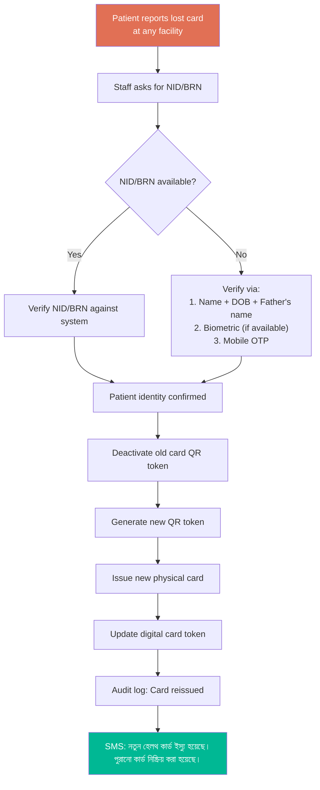

> [!IMPORTANT]
> The **Health ID number itself does NOT change** when a card is reissued. Only the QR token and physical card are replaced. This ensures continuity of all linked medical records.

---

## Flow 8: Emergency Break-Glass Access

### Overview
When a patient is unconscious, unresponsive, or otherwise unable to provide consent, ER doctors can invoke "break-glass" emergency access to retrieve minimal critical health information.

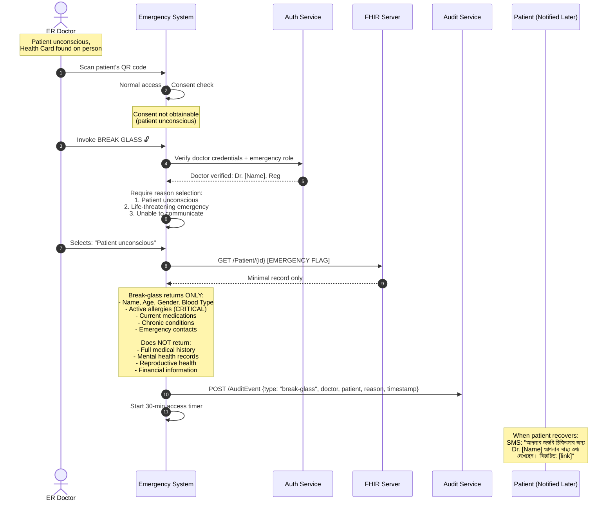

### Break-Glass Parameters

| Parameter | Value |
|-----------|-------|
| Access duration | 30 minutes (auto-expires) |
| Data scope | Allergies, medications, chronic conditions, blood type, emergency contacts |
| Excluded data | Mental health, reproductive health, full history |
| Required credentials | BMDC-registered doctor with ER privileges |
| Audit level | Full audit trail — doctor ID, time, data accessed, reason |
| Patient notification | SMS + in-app notification when patient recovers |
| Review process | All break-glass events reviewed by hospital ethics within 48 hours |
| Abuse penalty | Account suspension, BMDC notification |

---

## Flow 9: Offline Registration & Sync

### Overview
Many rural facilities in Bangladesh lack reliable internet connectivity. The system supports full offline registration with intelligent sync when connectivity is restored.

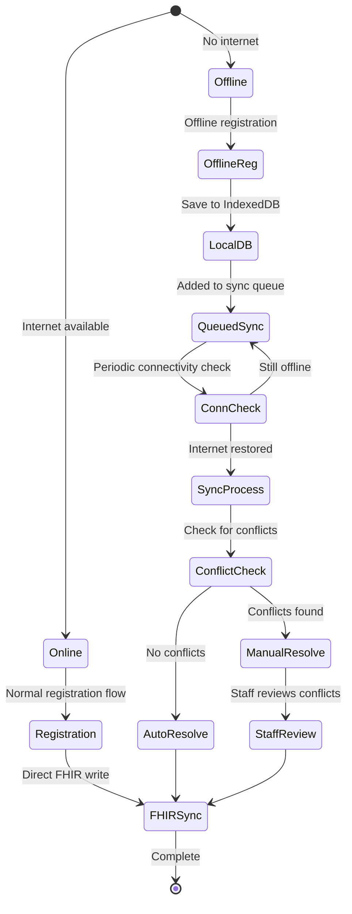

### Offline Capabilities

| Capability | Offline Support | Sync Strategy |
|-----------|----------------|---------------|
| New patient registration | ✅ Full | Queue + auto-sync |
| QR code generation | ✅ Temporary QR (valid 72h) | Replace with permanent on sync |
| Health ID generation | ✅ Provisional ID (prefix `P9`) | Replace with permanent ID on sync |
| Patient lookup (cached) | ✅ If previously cached | Auto-refresh on sync |
| Patient lookup (new) | ❌ Not available | Requires connectivity |
| Consent recording | ✅ Full | Queue + auto-sync |
| Encounter creation | ✅ Full | Queue + auto-sync |
| Cross-facility lookup | ❌ Not available | Requires connectivity |

### Conflict Resolution Rules

| Conflict Type | Resolution Strategy |
|--------------|-------------------|
| Duplicate Health ID | Server ID takes precedence; provisional ID mapped |
| Demographics mismatch | Latest timestamp wins; both versions retained for audit |
| Consent conflict | Most restrictive consent wins (patient protection) |
| Duplicate registration | Master Client Index deduplication; records merged |

> [!CAUTION]
> **Provisional Health IDs (prefix `P9`) are valid for a maximum of 72 hours.** If a facility remains offline for more than 72 hours, new registrations are paused and patients are given paper-only records until connectivity is restored.

---

## Error Handling & Edge Cases

### Common Error Scenarios

| Scenario | System Response | User Message (Bangla) |
|----------|----------------|----------------------|
| NID verification API down | Fallback to manual verification + offline queue | "NID যাচাই সাময়িকভাবে অনুপলব্ধ। ম্যানুয়াল যাচাই করুন।" |
| Duplicate NID detected | Block registration, show existing record | "এই NID দিয়ে ইতিমধ্যে নিবন্ধন আছে।" |
| QR code damaged/unreadable | Fallback to NID manual lookup | "QR কোড পড়া যাচ্ছে না। NID নম্বর দিন।" |
| FHIR server timeout | Retry 3x, then offline mode | "সার্ভারে সংযোগ হচ্ছে না। অফলাইন মোডে চলছে।" |
| Consent service down | Cache consent locally, sync later | "সম্মতি সাময়িকভাবে স্থানীয়ভাবে সংরক্ষিত হবে।" |
| Break-glass abuse detected | Alert hospital admin + BMDC | Internal alert only |
| Proxy PIN forgotten | OTP to proxy's registered mobile | "PIN ভুলে গেছেন? OTP পাঠানো হচ্ছে।" |
| Card printer offline | Generate digital QR only | "কার্ড প্রিন্টার অনুপলব্ধ। ডিজিটাল কার্ড তৈরি হয়েছে।" |

### Rate Limits

| Operation | Rate Limit | Reason |
|-----------|-----------|--------|
| NID verification | 10/min per facility | API provider limit |
| Patient lookup | 100/min per facility | Server load management |
| Break-glass access | 5/hour per doctor | Abuse prevention |
| Consent updates | 20/min per patient | Prevent rapid toggling |
| QR code scans | 200/min per facility | Normal clinical throughput |

### Data Validation Rules

| Field | Validation | Error Message |
|-------|-----------|---------------|
| NID | 10 or 17 digits, numeric only | "NID ১০ বা ১৭ সংখ্যার হতে হবে" |
| BRN | 17 digits, starts with birth year | "জন্ম নিবন্ধন নম্বর সঠিক নয়" |
| Mobile | 11 digits, starts with 01 | "মোবাইল নম্বর ০১ দিয়ে শুরু হতে হবে" |
| Health ID | 10 digits, starts with 9 | System-generated only |
| Date of Birth | Cannot be future, age ≤ 130 | "জন্ম তারিখ সঠিক নয়" |
| Blood Type | One of: A+, A-, B+, B-, AB+, AB-, O+, O- | "রক্তের গ্রুপ সঠিক নয়" |

---

> [!NOTE]
> **Document Version:** 1.0.0 | **Last Updated:** November 2026 | **Diagrams:** 9 Mermaid diagrams
> All flows follow FHIR R4 standards and BD Core IG v0.4.6 specifications.
