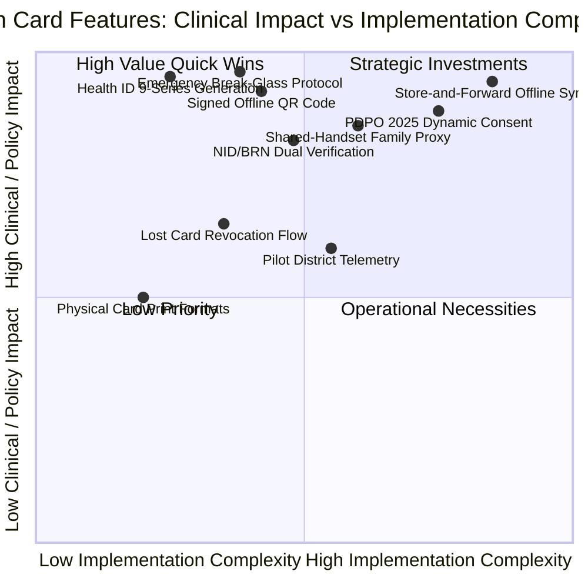
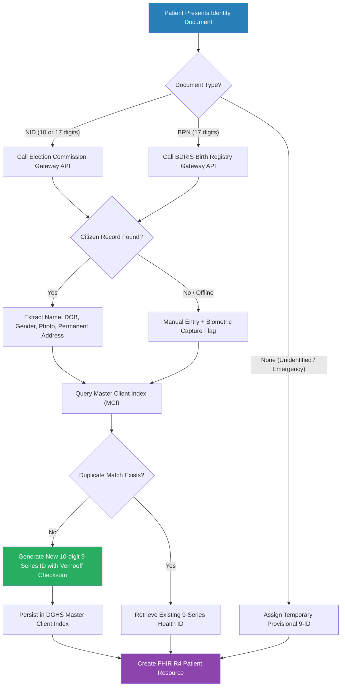
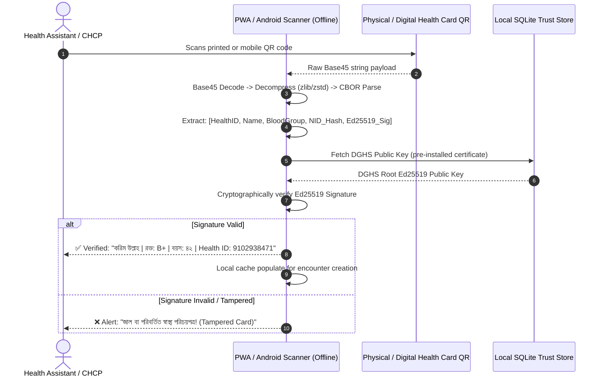
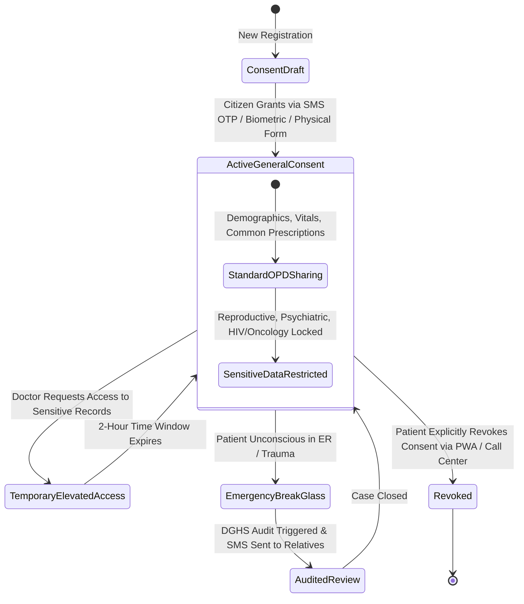
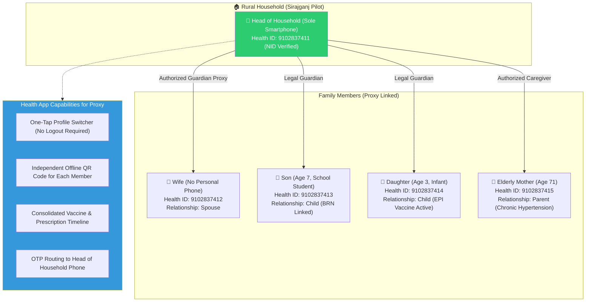
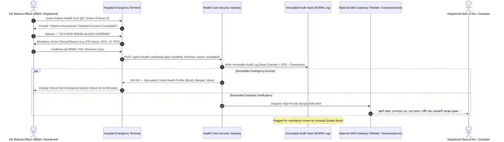
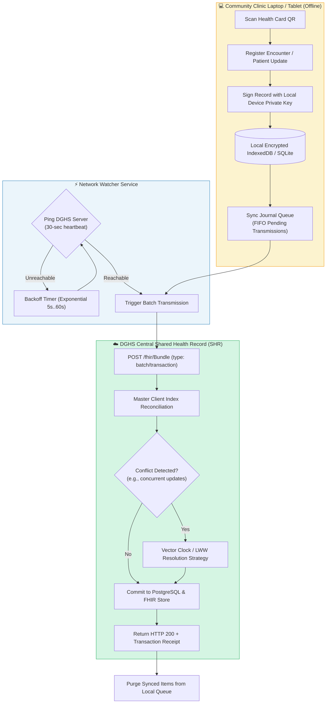
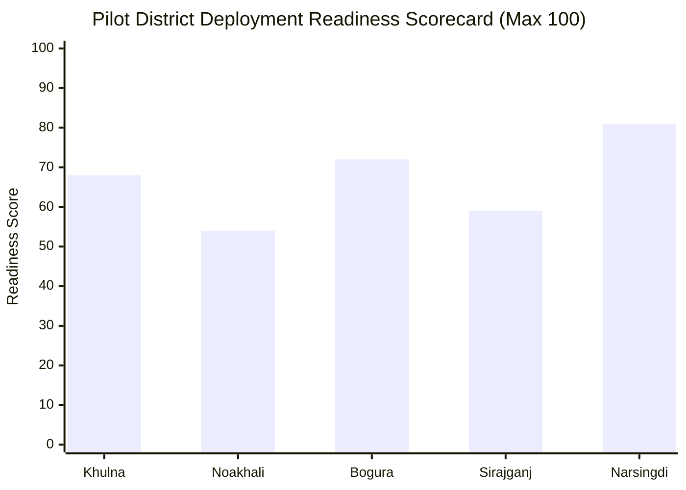

# Module 07: BD Health Card — Feature Specifications & Capabilities

## 📋 Document Overview

This document provides a comprehensive functional and technical breakdown of the features comprising the **Bangladesh National Health Card System (জাতীয় ডিজিটাল স্বাস্থ্য পরিচয়পত্র)**. It details core identity services, cryptography, offline operational resilience, multi-dependent proxy access, emergency break-glass protocols, and compliance with the **Personal Data Protection Ordinance (PDPO) 2025**.

---

## 🧭 Master Feature Matrix

| Feature ID | Feature Name | Primary Beneficiary | Criticality | Pilot Readiness | FHIR R4 Resource |
|---|---|---|---|---|---|
| **FEAT-07-01** | National Health ID (9-series) Generation & MCI Linkage | All Citizens | 🔴 Critical | Ready | `Patient`, `Person` |
| **FEAT-07-02** | High-Density Signed QR Code (Offline-Verifiable) | Patients, Clinics | 🔴 Critical | Ready | `Patient.identifier` |
| **FEAT-07-03** | PDPO 2025 Dynamic Patient Consent Engine | Citizens, Doctors | 🔴 Critical | Ready | `Consent` |
| **FEAT-07-04** | Shared-Handset Proxy & Dependent Profile Delegation | Families, Elderly | 🟡 High | Ready | `RelatedPerson` |
| **FEAT-07-05** | Emergency "Break-Glass" Life-Saving Access Protocol | ER / Trauma Staff | 🔴 Critical | Ready | `AuditEvent`, `Encounter` |
| **FEAT-07-06** | Store-and-Forward Offline Resilience Queue | Rural UHCs, CCs | 🔴 Critical | Ready | `Bundle` (batch) |
| **FEAT-07-07** | Dual Identity Verification (NID + BRN Bridge) | Citizens, Children | 🟡 High | Ready | `Patient.identifier` |
| **FEAT-07-08** | Digital Health Card PWA & Physical Card Dual Issue | Patients | 🟢 Medium | Ready | `Media` |
| **FEAT-07-09** | Lost Card Revocation & Zero-Data-Loss Recovery | Citizens | 🟡 High | Ready | `AuditEvent` |
| **FEAT-07-10** | Pilot District Monitoring & Telemetry (5 Districts) | Civil Surgeons | 🟢 Medium | Ready | `MeasureReport` |

---

## 🪪 Feature 1: National Health ID (9-series) Generation & Validation Engine

### 1. Description & Context
Every citizen in Bangladesh registered in the national health system receives a permanent, globally unique, 10-digit **Health ID** starting with the prefix digit **`9`** (e.g., `9104827391`). This prefix differentiates the health identifier from National ID (10-digit smart NID or 17-digit legacy NID) and Birth Registration Numbers (17-digit BRN).

### 2. Identifier Structure & Checksum Math
The Health ID follows a strict 10-digit format:
$$\text{Health ID} = \underbrace{9}_{\text{Fixed Prefix}} \, \underbrace{d_2 \, d_3 \, d_4 \, d_5 \, d_6 \, d_7 \, d_8 \, d_9}_{\text{8-digit Sequential / Shuffled Space}} \, \underbrace{c}_{\text{Verhoeff Checksum}}$$

- **Prefix (`9`)**: Designates the identifier as a Bangladesh Health Identifier issued by the Directorate General of Health Services (DGHS).
- **Body (8 digits)**: 100 million unique spaces per sub-series. Randomized generation prevents enumeration attacks while maintaining sequence density.
- **Checksum ($c$)**: Calculated using the **Verhoeff algorithm** (dihedral group $D_5$), which catches 100% of single-digit transcription errors and 95.4% of adjacent transposition errors (common when rural health assistants handwrite numbers on paper slips).

### 3. De-duplication Engine (Master Client Index)
To prevent duplicate registrations across different clinics, the Master Client Index (MCI) executes a 3-stage probabilistic deduplication algorithm:
1. **Deterministic Match**: Exact match on verified NID or verified BRN.
2. **Fuzzy Demographic Match**: Double Metaphone phonetic matching on Bangla names transliterated to English + exact DOB + Upazila geocode.
3. **Biometric Deduplication (Tier 3)**: When fingerprint scanners are available at Upazila Health Complexes (UHCs), minutiae template hashes (ANSI/NIST-ITL 1-2007) are queried against the central civil registry.

> [!NOTE]
> For children under 18 who do not yet possess an NID, their 17-digit BRN is tied to either the mother's or father's verified Health ID, establishing an auditable family lineage tree in the FHIR `RelatedPerson` graph.

---

## 📱 Feature 2: High-Density Signed QR Code Architecture

### 1. Problem Addressed
In rural Bangladesh, over 62% of Community Clinics suffer from intermittent cellular internet connectivity (2G or complete dropouts during storms and monsoon seasons). A static URL QR code (e.g., `https://health.gov.bd/p/9104827391`) is useless when the scanner cannot reach the internet.

### 2. High-Density Self-Contained Signed QR Payload
The BD Health Card uses a **micro-payload signed CBOR (Concise Binary Object Representation)** structure compressed with Zstandard and encoded into an alphanumeric **Base45** string. This enables any health clinic device (even an offline Android tablet) to verify card authenticity, read vital demographic details, blood group, and emergency contact without contacting central servers.

### 3. Payload Binary Schema (Total: 184 Bytes)
The binary payload contains:
- **Magic Header (2 bytes)**: `0xBD` `0x01` (BD Health Card Version 1).
- **Health ID (8 bytes unsigned int)**: Stored as 64-bit integer, omitting the leading '9' for bit efficiency.
- **Demographics (48 bytes)**: Truncated UTF-8 Full Name (max 32 chars), Gender (2 bits), Blood Group (4 bits: A+, A-, B+, B-, AB+, AB-, O+, O-, Bombay), Year of Birth (12 bits), Upazila Code (16 bits BBS GeoCode).
- **Emergency Medical Flags (6 bytes)**: Major allergies (Penicillin, Sulfa), Diabetics Type 1/2 flag, Severe Hypertension, Organ Donor Consent.
- **Public Key Signature (64 bytes)**: Ed25519 digital signature generated by DGHS Central Key Management Service (AWS KMS / Vault with FIPS 140-2 Level 3 HSM).

> [!TIP]
> The resulting QR code has an error correction level of **Level M (15% redundancy)**, allowing the card to scan reliably even if scratched, soiled with mud, or worn down after months in a farmer's wallet.

---

## 🔒 Feature 3: Granular PDPO 2025 Patient Consent Engine

### 1. Regulatory Context
The **Bangladesh Personal Data Protection Ordinance (PDPO) 2025** mandates that health data constitutes "Sensitive Personal Data." Automated blanket data sharing between clinics without explicit citizen consent is strictly prohibited and subject to civil penalties.

### 2. Multi-Tier Consent Framework
The Health Card implements a 4-tier consent model modeled directly on the **FHIR R4 `Consent`** resource:

### 3. Consent Directive Parameters
Each consent record captures:
- **Patient Identifier**: Reference to `Patient/9XXXXXXXXX`.
- **Scope**: `patient-privacy`.
- **Category**: `IDS` (Information Disclosure).
- **Provisions**:
  - `permit`: Standard consultation notes, vital signs, routine blood tests, vaccine logs.
  - `deny`: Psychiatric notes, HIV/STI tests, termination of pregnancy records, substance abuse history (requires elevated secondary OTP).
- **Time Limitation**: Standard clinical consultation token expires automatically after **120 minutes** from initial check-in.

---

## 👨‍👩‍👧‍👦 Feature 4: Shared-Handset Proxy & Dependent Profile Management

### 1. Bangladesh Rural Reality
According to BTRC and BBS surveys:
- Mobile SIM penetration in Bangladesh is ~99%, but smartphone penetration is **only ~47%**.
- In rural households, **one smartphone is commonly shared** by the head of household (often the father or eldest son), while his wife, elderly parents, and children have either feature phones or no phone.
- Requiring every citizen to have their own mobile app or independent smartphone immediately disenfranchises millions of rural women and children.

### 2. Family Proxy Architecture
The system supports a hierarchical **Master Proxy Account** model linked to the FHIR R4 `RelatedPerson` resource:

### 3. Verification & Anti-Coercion Protections
- **Spousal Consent**: A spouse can delink her profile at any time at a Community Clinic or UHC without requiring the husband's confirmation.
- **Adult Milestone**: Upon turning 18, a child dependent receives an automated SMS advising them that their profile can now be transferred to an independent phone.
- **Physical NFC/Card Option**: Even if the shared smartphone is away in the fields or factory with the father, the mother carries her **physical laminated QR card** to the Community Clinic, which functions completely independently.

---

## 🚨 Feature 5: Emergency "Break-Glass" Life-Saving Override Protocol

### 1. Clinical Rationale
In acute emergency scenarios — severe road traffic accidents (RTA) on the Dhaka-Chittagong highway, post-partum hemorrhage (PPH) in rural maternity centers, or unconscious stroke patients — obtaining OTP or fingerprint consent is physically impossible. A rigid consent wall would cause preventable fatalities.

### 2. Break-Glass Workflow & Safeguards
The **Break-Glass Protocol** permits an authorized physician (verified BMDC registration number) to immediately bypass consent restrictions to view:
- Blood group and crossmatch history.
- Known life-threatening drug allergies (e.g., penicillin anaphylaxis).
- Current anticoagulant prescriptions.
- Active diagnoses (e.g., ischemic heart disease, severe asthma, chronic kidney disease).

### 3. Anti-Abuse Measures
- **Mandatory Reason Codes**: The doctor must choose from predefined emergency ICD-10 emergency reasons (`R40.2` Coma, `T78.2` Anaphylactic shock, `O72` Postpartum hemorrhage, `V89` Traffic accident) and write minimum 10 characters clinical justification.
- **Automated SMS Notification**: The patient's registered mobile number and all family proxy numbers immediately receive an SMS notification in Bangla.
- **Automated DGHS Audit Flag**: Every break-glass activation is flagged in the Civil Surgeon's monthly compliance dashboard. Unauthorized access carries penalties under Section 34 of PDPO 2025 and BMDC Code of Ethics.

---

## 📶 Feature 6: Store-and-Forward Offline Resilience Queue

### 1. Ground Realities in the 5 Pilot Districts
Field audits conducted across the 5 DGHS pilot districts revealed acute infrastructure constraints:

| Pilot District | Health Facilities | Avg Daily Outages | 2G/No-Data Coverage Zones | Backup Generator / Solar |
|---|---|---|---|---|
| **Khulna** (Coastal / Sundarbans delta) | 9 UHCs, 218 CCs | 4.2 hours/day | 34% in Dacope & Koyra | 45% CCs have solar |
| **Noakhali** (Char / Coastal islands) | 8 UHCs, 194 CCs | 5.1 hours/day | 41% in Hatiya island | 28% CCs have solar |
| **Bogura** (Northern river char regions) | 12 UHCs, 312 CCs | 3.8 hours/day | 22% in Sariakandi chars | 35% CCs have solar |
| **Sirajganj** (Jamuna floodplains) | 9 UHCs, 245 CCs | 4.5 hours/day | 29% in Chauhali chars | 30% CCs have solar |
| **Narsingdi** (Semi-urban / industrial) | 6 UHCs, 162 CCs | 2.1 hours/day | 12% in Belabo / Raipura | 62% CCs have solar |

### 2. Architecture of the Offline Engine
The client application (built as an offline-first Progressive Web App using IndexedDB and native SQLite storage on Android) manages a local queue called the **Store-and-Forward Journal**:

### 3. Conflict Resolution Strategy
When an offline clinic updates a patient's address or record while another clinic performed a consultation online, conflict is resolved using:
- **Demographic Master**: Authoritative updates (NID name changes) always follow the verified Election Commission source.
- **Clinical History**: Append-only design. Consultations and encounter logs are never overwritten; they are appended with timestamped vector clocks and facility identifier tags, ensuring **zero data loss**.

---

## 🪪 Feature 7: Lost Card Revocation & Zero-Data-Loss Recovery

### 1. Workflow Description
When a citizen loses their physical laminated card or their mobile device is stolen:
1. **Reporting**: The citizen visits any Community Clinic, Union Health Center, or Upazila Health Complex, or dials the DGHS Health Call Center (16263).
2. **Identity Verification**: The citizen provides their NID, BRN, or mobile phone number + biometric fingerprint verification on the clinic reader.
3. **Instant Token Invalidation**: The central key registry marks the specific QR serial number as `REVOKED`. The patient's 10-digit 9-series Health ID remains unchanged.
4. **Instant Re-issuance**: A new QR code with a fresh generation epoch counter (`epoch_version = epoch_version + 1`) is generated and printed. The previous physical card's QR code becomes cryptographically invalid on all online scanners and will fail offline blacklist checks on next sync.

---

## 📊 Pilot District Readiness & Target Feature Rollout

### Pilot District Feature Phasing Table

| Phase | Milestone | Features Deployed | Target Timeline | Target Facilities |
|---|---|---|---|---|
| **Phase 1: Foundation** | Core 9-Series ID Issuance | FEAT-01, FEAT-02, FEAT-07 | Month 1–2 | 5 District Hospitals + 10 UHCs |
| **Phase 2: Offline Resilience** | Store-and-Forward Sync | FEAT-06, FEAT-08 | Month 3–4 | 50 Upazila Health Complexes |
| **Phase 3: Consent & Safety** | PDPO Consent & Break-Glass | FEAT-03, FEAT-05, FEAT-04 | Month 5–6 | All 1,131 Community Clinics in 5 Districts |
| **Phase 4: Full Scale** | Disaster Recovery & National Sync | FEAT-09, FEAT-10 | Month 7+ | National Rollout across 64 Districts |

---

## ⚠️ Edge Cases & Boundary Handling

1. **Foundling / Unidentified Emergency Victims**:
   - If an unconscious patient has no identification or phone, the ER issues a **Provisional Emergency ID** prefixed with `999` (e.g., `9990184712`).
   - All tests, blood transfusions, and clinical encounters are logged under this temporary container.
   - Upon discharge or identification by family, the system performs an atomic FHIR `$merge` operation, consolidating the provisional records into their permanent verified Health ID without losing a single lab report.
2. **Citizens without NID or BRN (Refugee / Displaced / Slum Populations)**:
   - Special NGO / UNHCR coordination allows assigning community-verified Health IDs linked to biometric iris/fingerprint templates.
3. **Power Outages Over 48 Hours (Monsoon Floods in Sirajganj/Noakhali)**:
   - Field health assistants utilize battery-powered mini Bluetooth thermal printers powered by 12V motorbike batteries or solar lanterns to issue printed emergency barcodes with offline-persisted local SQLite storage.
