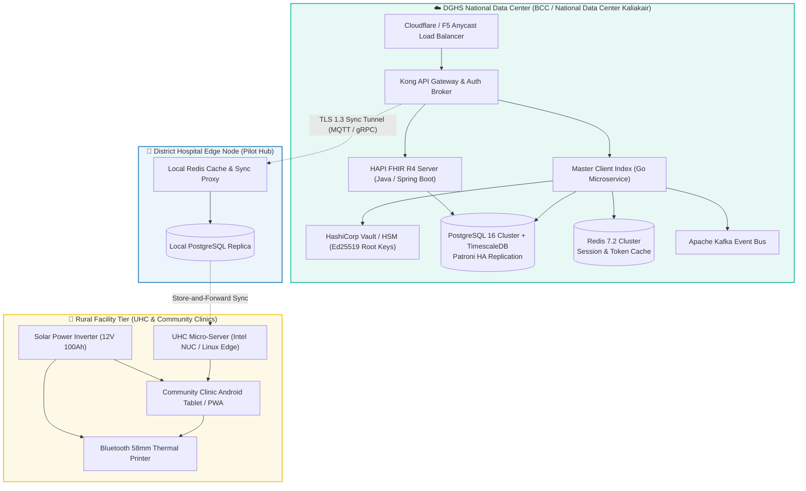
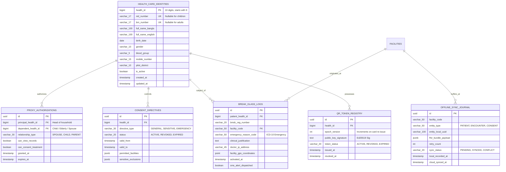
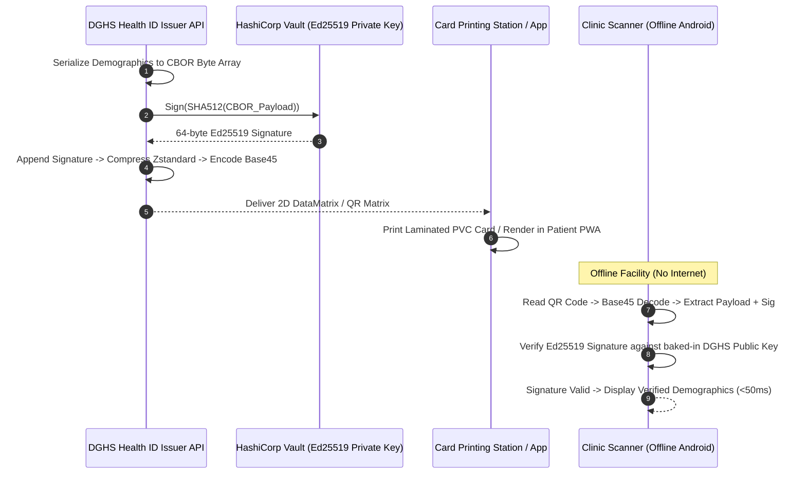
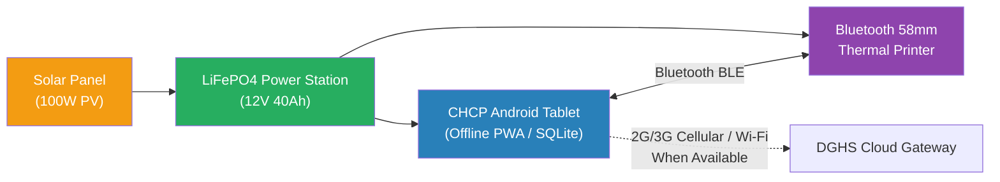
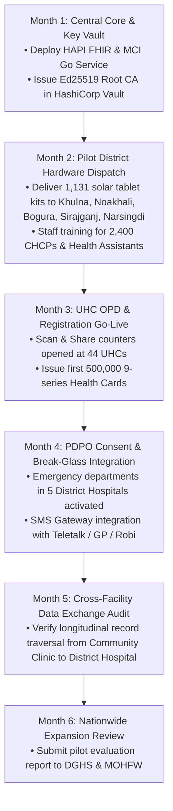

# Module 07: BD Health Card — Technical Implementation Guide

## 📋 Document Overview

This document specifies the technical architecture, data structures, FHIR R4 schemas, PostgreSQL relational schemas, RESTful APIs, cryptographic protocols, and edge deployment topology for the **Bangladesh National Health Card System (জাতীয় ডিজিটাল স্বাস্থ্য পরিচয়পত্র)**. It translates the functional capabilities of the health card into production-ready specifications optimized for both central cloud scaling and rural edge resilience across the 5 pilot districts (**Khulna, Noakhali, Bogura, Sirajganj, Narsingdi**).

---

## 🏗️ System Architecture & Component Topology

The system uses a **hybrid edge-cloud architecture** designed to operate seamlessly under unreliable power and cellular networks.



---

## 💻 Tech Stack Specification

| Tier / Layer | Technology Selected | Justification & Bangladesh Suitability |
|---|---|---|
| **Edge & Client PWA** | Flutter 3.22 / React PWA with Workbox | Offline-first, cross-platform Android 8+ compatibility for low-cost Chinese smartphones used by CHCPs |
| **Local Edge Storage** | SQLite (SQLCipher 256-bit AES) + IndexedDB | Zero-maintenance embedded storage on field tablets; runs without database server processes |
| **API Gateway** | Kong Gateway Enterprise / OpenResty | High-throughput rate-limiting, JWT signature checks, and mTLS offloading |
| **Core Business Logic** | Go 1.22 (Golang) Microservices | Low memory footprint (<25MB RAM per pod), zero GC pauses, ideal for high concurrency during morning clinic rushes |
| **FHIR R4 Engine** | HAPI FHIR JPA Server / Firely FHIR Engine | Full compliance with HL7 FHIR R4 and DGHS BD Core Implementation Guide v0.4.6 |
| **Relational Database** | PostgreSQL 16 + Patroni HA | Rock-solid ACID guarantees for civil identity indexes, JSONB for flexible FHIR payloads, PostGIS for geocoding |
| **Audit & Telemetry** | TimescaleDB (Timeseries extension) | Immutable, write-optimized time-series partitioning for emergency break-glass logs and cold-chain telemetry |
| **Key Management** | HashiCorp Vault with PKCS#11 HSM | FIPS 140-2 Level 3 compliant storage for DGHS Ed25519 Health Card QR signing keys |
| **Message Broker** | Apache Kafka / RabbitMQ | Event-driven replication of identity updates between central MCI and rural edge nodes |

---

## 📄 FHIR R4 BD Core Profiles (v0.4.6)

The BD Health Card directly implements the **Bangladesh Core Implementation Guide (BD Core IG v0.4.6)** published on `sandbox.fhir.dghs.gov.bd/fhir`.

### 1. BD Core Patient Profile Example (JSON)
The following JSON payload illustrates the structure of a citizen record assigned a `9-series` Health ID, linked to both NID and BRN, with custom extensions for local geocodes and pilot district designations:

```json
{
  "resourceType": "Patient",
  "id": "bd-patient-9104829103",
  "meta": {
    "versionId": "1",
    "lastUpdated": "2026-11-03T10:15:30+06:00",
    "profile": [
      "http://fhir.dghs.gov.bd/StructureDefinition/bd-core-patient"
    ]
  },
  "extension": [
    {
      "url": "http://fhir.dghs.gov.bd/StructureDefinition/pilot-district",
      "valueCode": "BOGURA"
    },
    {
      "url": "http://fhir.dghs.gov.bd/StructureDefinition/blood-group",
      "valueCodeableConcept": {
        "coding": [
          {
            "system": "http://snomed.info/sct",
            "code": "112144000",
            "display": "Blood group B positive"
          }
        ]
      }
    },
    {
      "url": "http://fhir.dghs.gov.bd/StructureDefinition/emergency-contact-phone",
      "valueString": "+8801712984712"
    }
  ],
  "identifier": [
    {
      "use": "official",
      "type": {
        "coding": [
          {
            "system": "http://terminology.hl7.org/CodeSystem/v2-0203",
            "code": "NI",
            "display": "National Health Identifier (9-series)"
          }
        ]
      },
      "system": "http://dghs.gov.bd/identifier/health-id",
      "value": "9104829103"
    },
    {
      "use": "secondary",
      "type": {
        "coding": [
          {
            "system": "http://terminology.hl7.org/CodeSystem/v2-0203",
            "code": "NNBD",
            "display": "National Identity Card (NID)"
          }
        ]
      },
      "system": "http://nid.gov.bd/identifier",
      "value": "19842691823000142"
    }
  ],
  "active": true,
  "name": [
    {
      "use": "official",
      "text": "মোসাঃ ফাতেমা বেগম",
      "family": "বেগম",
      "given": ["ফাতেমা"]
    },
    {
      "use": "usual",
      "text": "Fatema Begum"
    }
  ],
  "telecom": [
    {
      "system": "phone",
      "value": "+8801712984712",
      "use": "mobile"
    }
  ],
  "gender": "female",
  "birthDate": "1984-06-12",
  "address": [
    {
      "use": "home",
      "type": "physical",
      "line": ["গ্রাম: চর শেরপুর, ওয়ার্ড: ০৩"],
      "city": "Sariakandi",
      "district": "Bogura",
      "state": "Rajshahi",
      "postalCode": "5830",
      "country": "BGD"
    }
  ]
}
```

### 2. BD Core Consent Profile Example (JSON)
Under the **PDPO 2025** mandate, access to this record is governed by an explicit FHIR `Consent` resource:

```json
{
  "resourceType": "Consent",
  "id": "bd-consent-83921",
  "status": "active",
  "scope": {
    "coding": [
      {
        "system": "http://terminology.hl7.org/CodeSystem/consentscope",
        "code": "patient-privacy"
      }
    ]
  },
  "category": [
    {
      "coding": [
        {
          "system": "http://loinc.org",
          "code": "59284-0",
          "display": "Patient Consent"
        }
      ]
    }
  ],
  "patient": {
    "reference": "Patient/bd-patient-9104829103",
    "display": "Fatema Begum (9104829103)"
  },
  "dateTime": "2026-11-03T10:18:00+06:00",
  "performer": [
    {
      "reference": "Patient/bd-patient-9104829103"
    }
  ],
  "organization": [
    {
      "reference": "Organization/dghs-facility-bogura-dist-hosp",
      "display": "Bogura 250 Bed District Hospital"
    }
  ],
  "policyRule": {
    "coding": [
      {
        "system": "http://dghs.gov.bd/policy/pdpo2025",
        "code": "STANDARD_HEALTHCARE_EXCHANGE"
      }
    ]
  },
  "provision": {
    "type": "permit",
    "period": {
      "start": "2026-11-03T10:18:00+06:00",
      "end": "2026-11-03T12:18:00+06:00"
    },
    "actor": [
      {
        "role": {
          "coding": [
            {
              "system": "http://terminology.hl7.org/CodeSystem/v3-ParticipationType",
              "code": "PRCP"
            }
          ]
        },
        "reference": {
          "reference": "Practitioner/bmdc-a-74892",
          "display": "Dr. Tanvir Ahmed (BMDC A-74892)"
        }
      }
    ]
  }
}
```

---

## 🗄️ Database Architecture & Relational Schema (PostgreSQL)



### PostgreSQL DDL Definitions
```sql
-- 1. Master Identity Table
CREATE TABLE health_card_identities (
    health_id BIGINT PRIMARY KEY CHECK (health_id >= 9000000000 AND health_id <= 9999999999),
    nid_number VARCHAR(17) UNIQUE,
    brn_number VARCHAR(17) UNIQUE,
    full_name_bangla VARCHAR(150) NOT NULL,
    full_name_english VARCHAR(150) NOT NULL,
    birth_date DATE NOT NULL,
    gender VARCHAR(10) NOT NULL CHECK (gender IN ('male', 'female', 'other')),
    blood_group VARCHAR(5) CHECK (blood_group IN ('A+', 'A-', 'B+', 'B-', 'AB+', 'AB-', 'O+', 'O-', 'BOMBAY')),
    mobile_number VARCHAR(15) NOT NULL,
    pilot_district VARCHAR(20) NOT NULL CHECK (pilot_district IN ('KHULNA', 'NOAKHALI', 'BOGURA', 'SIRAJGANJ', 'NARSINGDI', 'GENERAL')),
    is_active BOOLEAN DEFAULT TRUE,
    created_at TIMESTAMPTZ DEFAULT CURRENT_TIMESTAMP,
    updated_at TIMESTAMPTZ DEFAULT CURRENT_TIMESTAMP
);

-- Indexing for instantaneous lookups
CREATE INDEX idx_health_card_nid ON health_card_identities(nid_number);
CREATE INDEX idx_health_card_brn ON health_card_identities(brn_number);
CREATE INDEX idx_health_card_mobile ON health_card_identities(mobile_number);
CREATE INDEX idx_health_card_district ON health_card_identities(pilot_district);

-- 2. Immutable Break-Glass Audit Vault Table
CREATE TABLE break_glass_logs (
    id UUID PRIMARY KEY DEFAULT gen_random_uuid(),
    patient_health_id BIGINT NOT NULL REFERENCES health_card_identities(health_id),
    bmdc_reg_number VARCHAR(20) NOT NULL,
    facility_code VARCHAR(50) NOT NULL,
    emergency_reason_code VARCHAR(50) NOT NULL,
    clinical_justification TEXT NOT NULL CHECK (length(clinical_justification) >= 10),
    doctor_ip_address VARCHAR(45) NOT NULL,
    facility_gps_coordinates POINT,
    activated_at TIMESTAMPTZ DEFAULT CURRENT_TIMESTAMP,
    sms_alert_dispatched BOOLEAN DEFAULT FALSE
);

-- TimescaleDB hypertable for tamper-resistant partition scaling
SELECT create_hypertable('break_glass_logs', 'activated_at', if_not_exists => TRUE);
```

---

## 🔐 Cryptographic Specification & Signed QR Protocol

### 1. Key Hierarchy & Asymmetric Signing
- **Root Authority**: DGHS Master Health Certification Authority (DGHS CA).
- **Algorithm**: **Ed25519 (RFC 8032)** — provides 128-bit security level with tiny 64-byte signatures and 32-byte public keys.
- **Verification Speed**: An Android tablet with an ARM Cortex-A53 processor can verify up to **1,850 Ed25519 signatures per second**, imposing zero latency during morning clinic check-in surges.



---

## 🔌 API Endpoint Specifications

### 1. `POST /api/v1/health-card/issue`
Issues a new 10-digit 9-series Health ID after validating NID or BRN.

**Request Payload:**
```json
{
  "documentType": "NID",
  "documentNumber": "19842691823000142",
  "fullNameBangla": "মোসাঃ ফাতেমা বেগম",
  "fullNameEnglish": "Fatema Begum",
  "birthDate": "1984-06-12",
  "gender": "female",
  "bloodGroup": "B+",
  "mobileNumber": "+8801712984712",
  "pilotDistrict": "BOGURA",
  "facilityCode": "DGHS_FAC_BG_0192"
}
```

**Response Payload (`201 Created`):**
```json
{
  "status": "SUCCESS",
  "healthId": "9104829103",
  "qrPayloadBase45": "HC1:NC6...compressed_base45_string...",
  "checksumType": "VERHOEFF",
  "issuedAt": "2026-11-03T10:15:30+06:00",
  "fhirPatientUrl": "https://sandbox.fhir.dghs.gov.bd/fhir/Patient/bd-patient-9104829103"
}
```

### 2. `POST /api/v1/health-card/break-glass`
Executes an immediate life-saving emergency override.

**Request Payload:**
```json
{
  "patientHealthId": "9104829103",
  "bmdcRegNumber": "BMDC-A-74892",
  "facilityCode": "FAC_BOGURA_DIST_HOSP",
  "emergencyReasonCode": "ICD10_R40.2_COMA",
  "clinicalJustification": "Patient brought from Bogura highway accident in shock with GCS 6. Immediate blood transfusion required.",
  "emergencyTokenDurationMinutes": 60
}
```

**Response Payload (`200 OK`):**
```json
{
  "status": "AUTHORIZED_BREAK_GLASS",
  "accessSessionId": "bg-sess-8b9a12c0-449e-4e89",
  "tokenExpiresAt": "2026-11-03T11:18:00+06:00",
  "patientSummary": {
    "fullName": "Fatema Begum",
    "bloodGroup": "B+",
    "knownAllergies": ["Penicillin (Severe Anaphylaxis)"],
    "chronicConditions": ["Type 2 Diabetes Mellitus"],
    "emergencyContact": "+8801712984712"
  },
  "smsDispatchedToGuardian": true
}
```

---

## 🏕️ Pilot District Deployment Architecture

### Hardware & Power Kit for Rural Clinics (Sirajganj & Noakhali Islands)
Because rural facilities face severe load-shedding, each field kit deployed to the 5 pilot districts consists of:
1. **Ruggedized 10-inch Android Tablet (Android 13)** with 8,000 mAh battery, sunlight-readable display, integrated 2D barcode imager.
2. **Solar Micro-Inverter Station**: 100W Monocrystalline PV panel + 12V 40Ah LiFePO4 battery pack providing **72 hours** of continuous clinic runtime without grid power.
3. **Bluetooth 58mm Thermal Receipt Printer**: Direct thermal (zero ink ribbons needed) for printing physical paper Health Card tokens with QR.
4. **Offline Local Cache**: Embedded SQLite database holds full public key certificate revocation lists and a local cache of up to 5,000 recently registered patients.



### Rollout Implementation Roadmap


