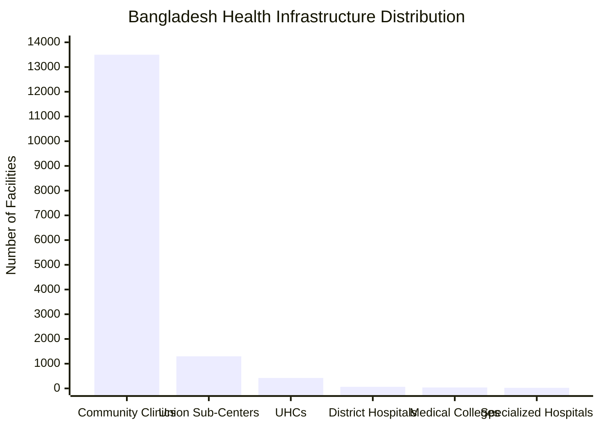
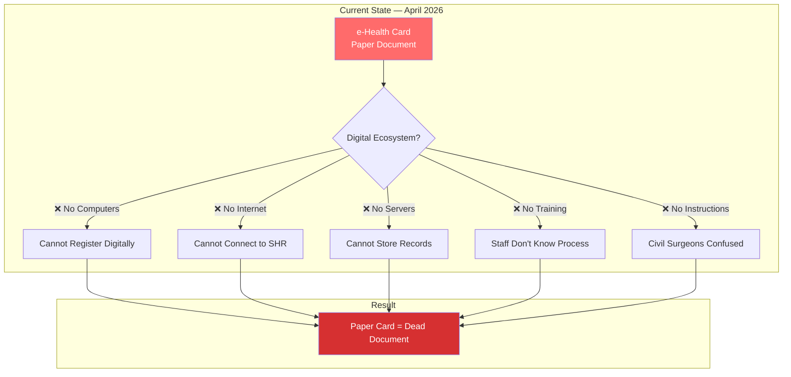
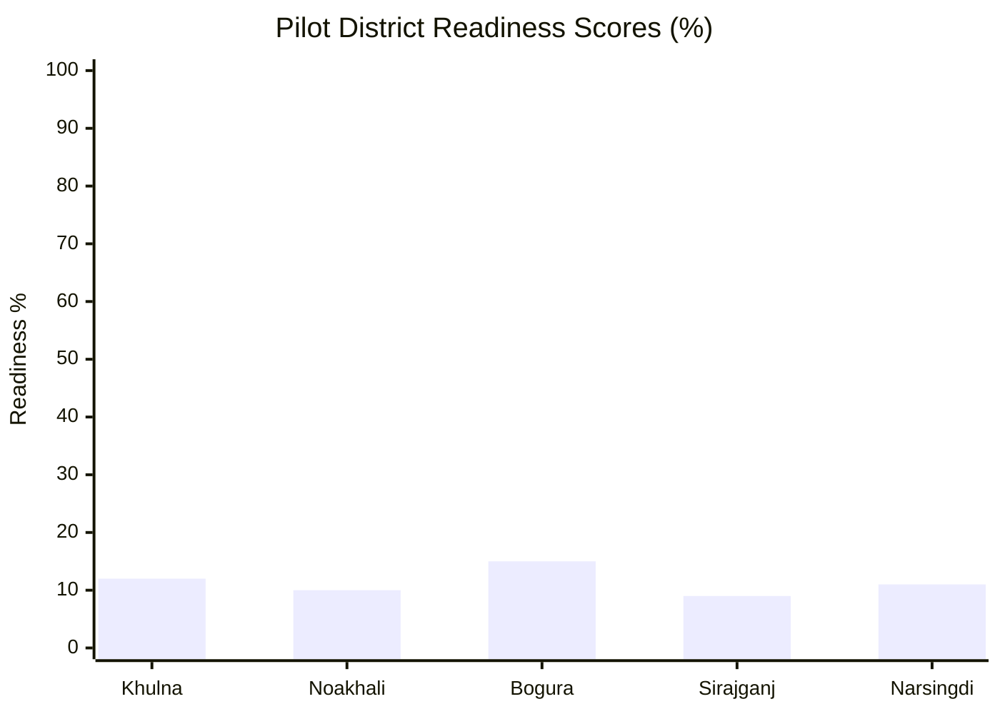
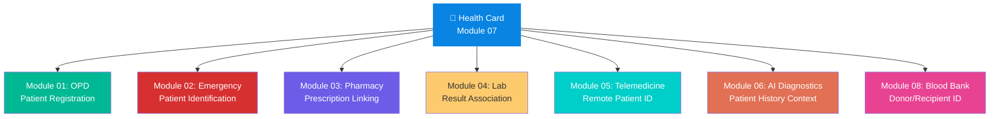
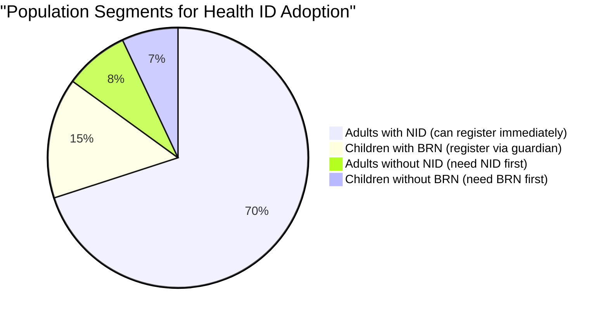
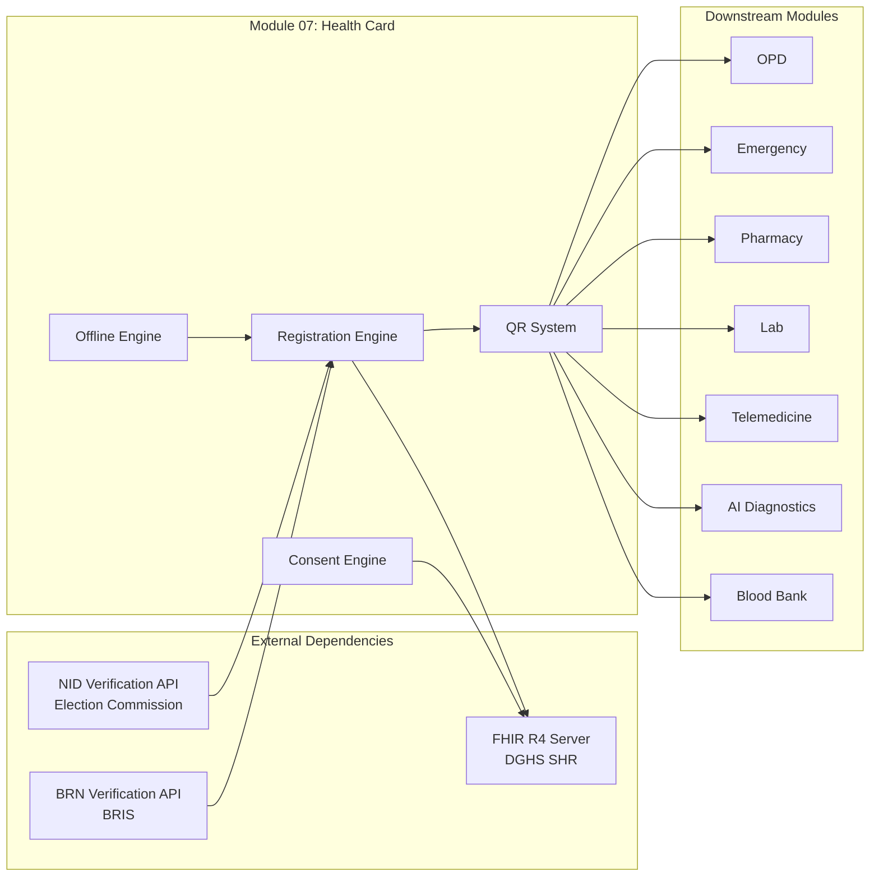

# Module 07: BD Health Card Integration — জাতীয় ডিজিটাল স্বাস্থ্য পরিচয়পত্র

## 🏗️ The Foundation of Bangladesh's Digital Health Ecosystem

> [!IMPORTANT]
> **This is Module Zero in disguise.** Every other module in this platform — OPD, Emergency, Pharmacy, Lab, Telemedicine, AI Diagnostics, Blood Bank — reads and writes through the Health Card ID. If this module fails, the entire ecosystem collapses. There is no Plan B.

---

## 📋 Table of Contents

- [Context & Background](#context--background)
- [The Problem](#the-problem)
- [Why This Module is the Foundation](#why-this-module-is-the-foundation)
- [PDPO 2025 Compliance](#pdpo-2025-compliance)
- [Impact & Statistics](#impact--statistics)
- [Target Users](#target-users)
- [Success Metrics](#success-metrics)
- [Module Dependencies](#module-dependencies)
- [Quick Links](#quick-links)

---

## Context & Background

### Bangladesh's e-Health Card Initiative

Bangladesh's **e-Health Card** is the nation's digital health identity system, designed to provide every citizen with a unique, verifiable health identity linked to the national **Shared Health Record (SHR)** platform. The system is built around the following pillars:

| Component | Details |
|-----------|---------|
| **Health ID Format** | Starts with `9`, unique per individual |
| **Identity Linkage** | Linked to NID (National ID) for adults, BRN (Birth Registration Number) for children |
| **Master Client Index** | SHR Master Client Index creates and manages Health IDs |
| **FHIR Standard** | FHIR R4 compliant — sandbox at `sandbox.fhir.dghs.gov.bd/fhir` |
| **BD Core IG** | Version 0.4.6 covers identity (UHID/NID/BRN), facility registry, immunisation, lab, condition, medication profiles |
| **Issuing Authority** | Directorate General of Health Services (DGHS) |

### Bangladesh Healthcare Statistics

| Metric | Value | Source |
|--------|-------|--------|
| Total Population | ~170 million (2026 est.) | BBS |
| NID Coverage (18+) | ~120 million registered | EC Bangladesh |
| Birth Registration Coverage | ~56% of children under 5 | UNICEF BD |
| Total Health Facilities | ~13,500+ government facilities | DGHS HIS |
| Upazila Health Complexes | 424 | MOHFW |
| District Hospitals | 64 | MOHFW |
| Community Clinics | ~13,500 | DGHS |
| Physicians per 10,000 | 6.7 | WHO |
| Internet Penetration | ~38% (mobile-dominant) | BTRC |
| Mobile Phone Penetration | ~99% (SIM-based) | BTRC |
| Smartphone Penetration | ~47% | GSMA |



---

## The Problem

### Pilot Reality Check — April 2026

The e-Health Card was piloted in **5 districts**: Khulna, Noakhali, Bogura, Sirajganj, and Narsingdi. The results were sobering:

> [!CAUTION]
> **Civil surgeons in pilot districts received NO instructions** on how to implement the e-Health Card system. Facilities lacked computers, stable internet, servers, and trained staff. The card exists on paper, but the digital ecosystem around it is non-functional.



### Pilot District Readiness Assessment

| District | Population | UHCs | District Hospital | Internet at Facilities | Computers Available | Staff Trained | Readiness Score |
|----------|-----------|------|-------------------|----------------------|--------------------|--------------|----|
| Khulna | 2.32M | 9 | ✅ | ~30% | ~20% | 0% | 🔴 12% |
| Noakhali | 3.64M | 9 | ✅ | ~25% | ~15% | 0% | 🔴 10% |
| Bogura | 3.74M | 12 | ✅ | ~35% | ~25% | 0% | 🔴 15% |
| Sirajganj | 3.28M | 9 | ✅ | ~20% | ~15% | 0% | 🔴 9% |
| Narsingdi | 2.43M | 6 | ✅ | ~28% | ~18% | 0% | 🔴 11% |



### Gap Analysis: Paper Card vs Digital Ecosystem

| Capability | Paper Card (Current) | Proposed Digital System |
|-----------|---------------------|------------------------|
| Patient Identification | ✅ Name & NID printed | ✅ Unique Health ID (9XXXXXXXXX) |
| Cross-facility recognition | ❌ Not standardized | ✅ Universal QR lookup |
| Medical history | ❌ Not on card | ✅ Full FHIR-linked record |
| Consent management | ❌ None | ✅ Granular PDPO-compliant consent |
| Offline functionality | ✅ Paper works offline | ✅ PWA with offline mode |
| Duplicate prevention | ❌ No deduplication | ✅ NID/BRN-linked, deduplicated |
| Data portability | ❌ Impossible | ✅ Patient-owned data export |
| Emergency access | ❌ No mechanism | ✅ Break-glass with audit trail |

---

## Why This Module is the Foundation



> [!NOTE]
> Every module interaction starts with: **"Show me your Health ID."** Without this, patient data cannot be linked, histories cannot be retrieved, prescriptions cannot be tracked, and lab results float in a void.

### Data Flow Through Health Card

Every clinical event in the platform creates a chain:

```
Patient arrives → Scans Health ID → FHIR Patient retrieved → Encounter created →
Clinical data recorded → Linked to Health ID → Available at next facility visit
```

---

## PDPO 2025 Compliance

### Personal Data Protection Ordinance 2025

Bangladesh enacted the **PDPO 2025** (ব্যক্তিগত তথ্য সুরক্ষা অধ্যাদেশ ২০২৫), which classifies health data as **sensitive personal data** requiring enhanced protections.

> [!WARNING]
> **Some sections of PDPO 2025 become effective around May 2027.** Our system must be designed for full compliance from Day 1, even if enforcement hasn't started yet. Retrofitting consent systems is exponentially harder than building them in.

| PDPO Requirement | Our Implementation |
|-----------------|-------------------|
| Explicit consent for health data | Granular consent per data category |
| Right to access | Patient data download portal |
| Right to correction | Verified update flow with audit |
| Right to erasure | Scoped deletion with medical record retention rules |
| Data breach notification | Automated breach detection + 72hr notification |
| Cross-border transfer restrictions | All data stored in BD data centers |
| Data protection officer | Role defined in system architecture |
| Consent withdrawal | One-tap revocation with immediate effect |

---

## Impact & Statistics

### Health ID Adoption Potential



### Projected Impact Metrics

| Metric | Current (No Health ID) | Year 1 (5 Districts) | Year 3 (All 64) |
|--------|----------------------|----------------------|------------------|
| Patient identification errors | ~15-20% | <5% | <1% |
| Duplicate medical records | ~30% | <10% | <3% |
| Cross-facility data availability | 0% | 40% (pilot) | 85% |
| Patient consent documentation | ~5% | 90% (pilot) | 95% |
| Average registration time | 15-20 min | 5 min | 2 min |
| Emergency patient ID (unknown) | ~8% of ER visits | <3% | <1% |

---

## Target Users

> [!TIP]
> This is the **only module that targets literally everyone** in the healthcare ecosystem. Every other module has a subset of users — this one touches all.

| User Group | Estimated Count | Primary Interaction |
|-----------|----------------|-------------------|
| **Patients** | ~170M population | Carries Health Card, manages consent |
| **Physicians** | ~115,000 registered | Scans card, accesses patient history |
| **Nurses** | ~80,000 | Registers patients, updates records |
| **Community Health Workers** | ~50,000+ | Enrolls rural patients, offline registration |
| **Hospital Administrators** | ~13,500 facilities | Manages facility-level registration |
| **Pharmacists** | ~100,000+ | Verifies prescriptions via Health ID |
| **Lab Technicians** | ~50,000+ | Links results to Health ID |
| **Civil Surgeons** | 64 (one per district) | Oversees district-level rollout |
| **DGHS/MOHFW Officials** | ~500 | System administration, policy |

---

## Success Metrics

### Key Performance Indicators (KPIs)

| KPI | Target (Year 1) | Target (Year 3) | Measurement Method |
|-----|-----------------|-----------------|-------------------|
| % population with Health ID | 10% (pilot districts) | 60% national | System registration count |
| % facilities using Health ID | 80% (pilot facilities) | 90% national | Facility activity logs |
| Consent compliance rate | 95% | 99% | Consent record audit |
| Average registration time | <5 minutes | <2 minutes | System timestamps |
| Cross-facility data sharing success | 70% | 95% | FHIR query success rate |
| Patient satisfaction with card | >70% | >85% | Survey data |
| Offline sync success rate | 90% | 98% | Sync queue metrics |
| Duplicate Health ID rate | <2% | <0.1% | Deduplication audit |

---

## Module Dependencies



---

## Quick Links

| Document | Description |
|----------|-------------|
| [APP_FLOW.md](./APP_FLOW.md) | Detailed application flows with 7+ Mermaid diagrams |
| [FEATURES.md](./FEATURES.md) | Complete feature catalog with specifications |
| [IMPLEMENTATION.md](./IMPLEMENTATION.md) | Technical implementation guide with code & schemas |

---

> [!NOTE]
> **Document Version:** 1.0.0 | **Last Updated:** November 2026 | **Module Owner:** Health Identity Team
> **BD Core IG Reference:** v0.4.6 | **FHIR Sandbox:** `sandbox.fhir.dghs.gov.bd/fhir`
