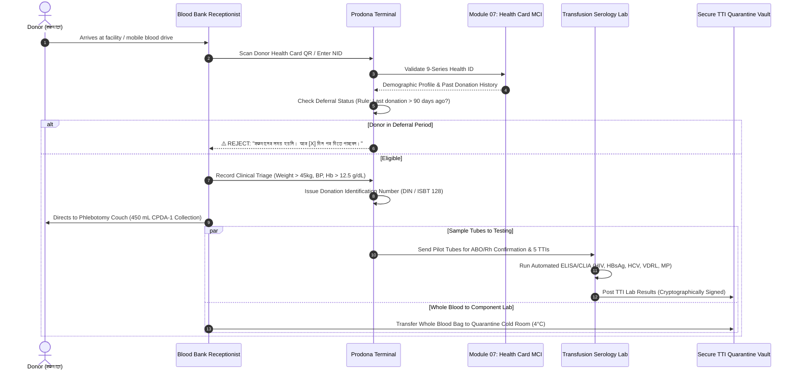
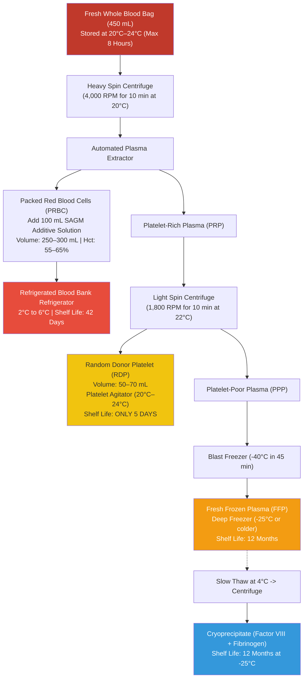
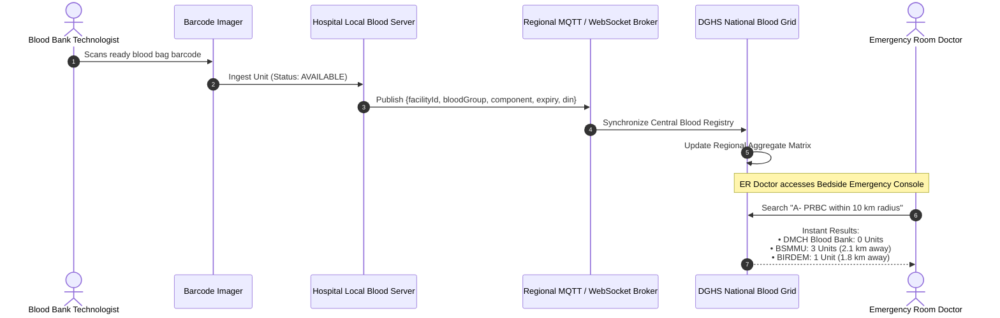
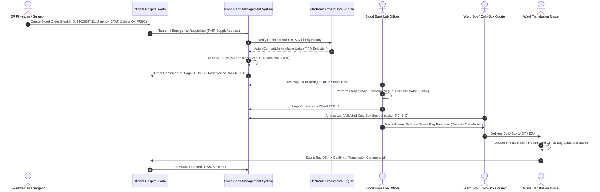
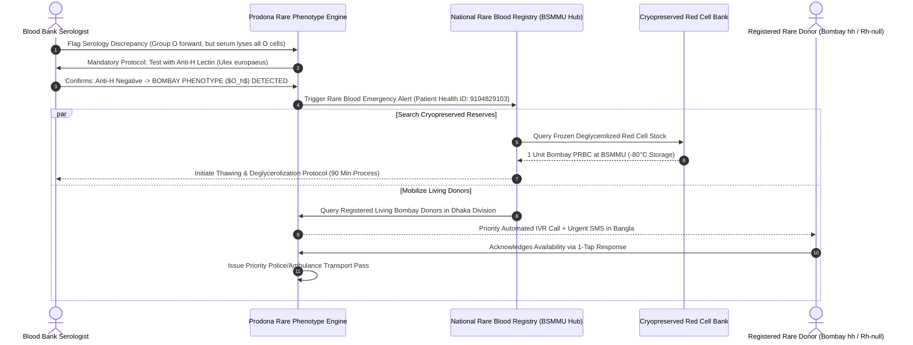
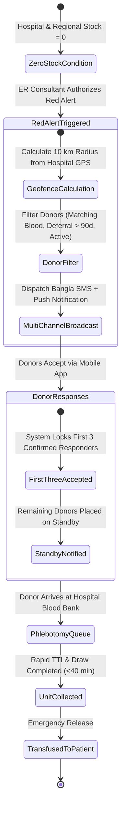
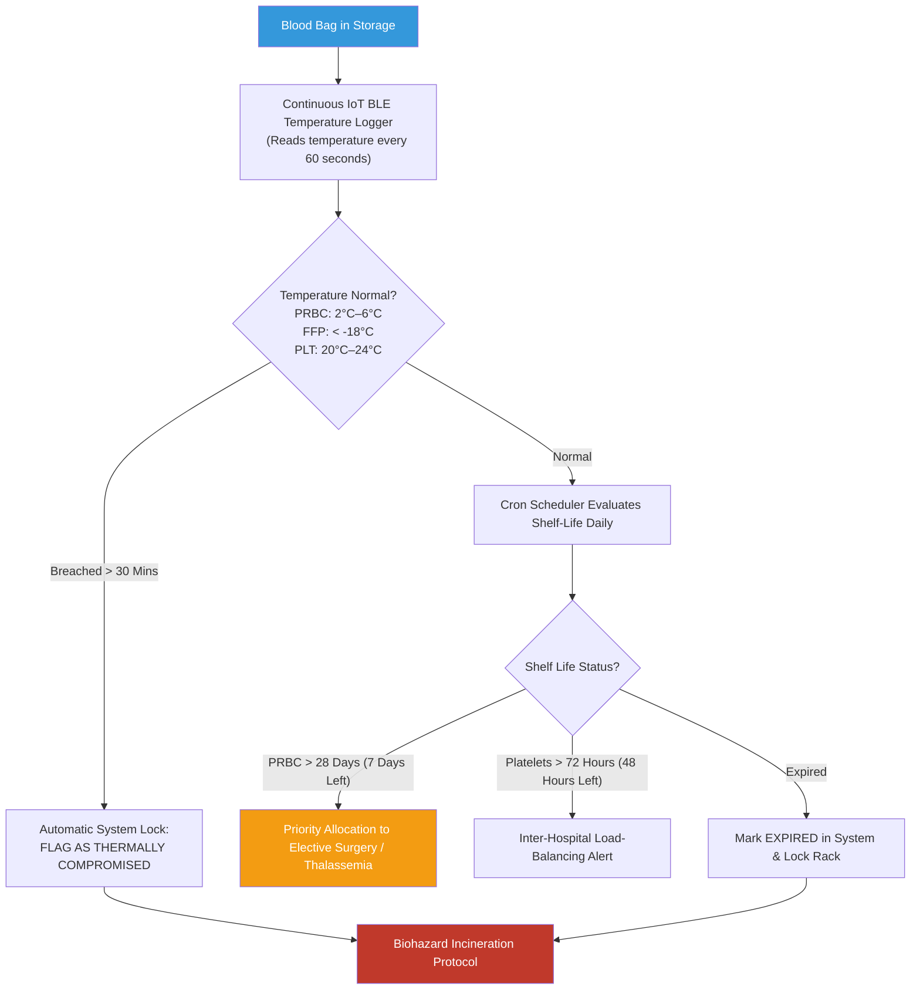

# Module 08: Blood Bank (Prodona / প্রদানা) — Application & Clinical Workflows

## 📋 Table of Contents

- [End-to-End System Flow Architecture](#end-to-end-system-flow-architecture)
- [Flow 1: Voluntary Donor Intake, Health ID Linkage & TTI Screening](#flow-1-voluntary-donor-intake-health-id-linkage--tti-screening)
- [Flow 2: Whole Blood Ingestion, Component Fractionation & Barcoding](#flow-2-whole-blood-ingestion-component-fractionation--barcoding)
- [Flow 3: Real-Time Hospital Stock Aggregation & Regional Visibility](#flow-3-real-time-hospital-stock-aggregation--regional-visibility)
- [Flow 4: Emergency ER Requisition, Electronic Crossmatch & Custody Handover](#flow-4-emergency-er-requisition-electronic-crossmatch--custody-handover)
- [Flow 5: Rare Blood & Bombay Phenotype Emergency Mobilization](#flow-5-rare-blood--bombay-phenotype-emergency-mobilization)
- [Flow 6: Red Alert Emergency Geo-Broadcast (Zero Stock Lifeline)](#flow-6-red-alert-emergency-geo-broadcast-zero-stock-lifeline)
- [Flow 7: FIFO Expiry Tracking, Cold-Chain IoT Logging & Biohazard Discard](#flow-7-fifo-expiry-tracking-cold-chain-iot-logging--biohazard-discard)
- [Flow 8: Adverse Transfusion Reaction & Hemovigilance Investigation](#flow-8-adverse-transfusion-reaction--hemovigilance-investigation)
- [Error Handling & Edge Case Matrix](#error-handling--edge-case-matrix)

---

## End-to-End System Flow Architecture

```mermaid
flowchart TD
    DONOR["Voluntary / Replacement Donor"] --> INTAKE["1. Donor Intake & Health ID Check<br/>(90-Day Deferral Rule Enforced)"]
    INTAKE --> DRAW["2. Phlebotomy (450 mL Bag)"]
    DRAW --> TTI["3. Mandatory 5-Pathogen TTI Testing<br/>(HIV, HBV, HCV, Syphilis, Malaria)"]
    DRAW --> COMP["4. Component Fractionation<br/>(Refrigerated Centrifuge)"]
    
    COMP --> DERIVE["Derived Units:<br/>• PRBC (Red Cells)<br/>• FFP (Plasma)<br/>• Platelets (RDP)"]
    
    TTI --> RELEASE{"TTI Results Clean?"}
    RELEASE -->|No (Positive)| BIOHAZARD["Quarantine & Autoclave Discard"]
    RELEASE -->|Yes (Negative)| INVENTORY["5. Real-Time Hospital Blood Inventory<br/>(Available for Clinical Order)"]
    
    DERIVE --> INVENTORY
    
    PATIENT["ER / OT Patient in Need<br/>(Trauma, PPH, Thalassemia)"] --> REQ["6. Emergency Requisition via Health ID"]
    REQ --> SEARCH["7. Check Hospital Blood Grid"]
    
    SEARCH -->|In Stock Locally| MATCH["8. Crossmatch & Electronic Hold"]
    SEARCH -->|Out of Stock Locally| INTER_HOSP["9. Inter-Hospital Transfer or<br/>Emergency Geo-Broadcast"]
    
    MATCH --> DISPATCH["10. Cold-Chain Verified Handover"]
    INTER_HOSP --> MATCH
    DISPATCH --> TRANSFUSION["11. Bedside Transfusion & Hemovigilance"]

    style DONOR fill:#3498db,color:#fff
    style INVENTORY fill:#27ae60,color:#fff
    style PATIENT fill:#e74c3c,color:#fff
    style BIOHAZARD fill:#c0392b,color:#fff
    style TRANSFUSION fill:#2ecc71,color:#fff
```

---

## Flow 1: Voluntary Donor Intake, Health ID Linkage & TTI Screening

### Overview
This flow ensures that no donor is bled unless medically fit, prevents repeat donations within the mandatory deferral window (90 days for adult males, 120 days for adult females), and binds all laboratory safety tests directly to the national Master Client Index.



### Preconditions & Eligibility Rules
- **Minimum Weight**: 45 kg (females), 50 kg (males).
- **Hemoglobin Level**: $\ge 12.5\text{ g/dL}$ for females, $\ge 13.0\text{ g/dL}$ for males (screened via copper sulfate specific gravity or digital HemoCue).
- **Pulse & Blood Pressure**: Systolic 100–140 mmHg, Diastolic 60–90 mmHg, regular pulse 60–100 bpm.
- **Permanent Deferrals**: History of jaundice after age 11, chronic hepatitis B/C, HIV, cardiac disease, epilepsy, cancer.
- **Temporary Deferrals**: Recent tattoo/piercing (6 months), malaria treatment (3 months), dengue recovery (6 months), typhoid (12 months), dental extraction (72 hours).

---

## Flow 2: Whole Blood Ingestion, Component Fractionation & Barcoding

### Overview
Modern clinical practice requires that whole blood be fractionated into its sub-components within **8 hours of collection** to preserve labile clotting factors and viable platelets.



### Digital Barcode Generation (National DIN Standard)
Each component bag receives a high-density GS1 / ISBT 128 compliant 2D DataMatrix label encoding:
1. **Donation Identification Number (DIN)**: 16 digits (Country: `050` Bangladesh, Facility: 4 digits, Year: 2 digits, Sequence: 7 digits).
2. **Product Code**: `E0398` (PRBC SAGM), `E0502` (Platelets 5D), `E0879` (FFP).
3. **ABO / Rh Blood Group**: Validated against both tube and forward/reverse automated serology.
4. **Exact Expiration Timestamp**: Calculated dynamically based on additive solution and component chemistry.

---

## Flow 3: Real-Time Hospital Stock Aggregation & Regional Visibility



---

## Flow 4: Emergency ER Requisition, Electronic Crossmatch & Custody Handover

### Overview
When a trauma patient in hemorrhagic shock arrives at the emergency department, every minute of administrative friction increases mortality. This flow provides paperless requisition, electronic hold, crossmatch validation, and cold-chain transport tracking.



> [!IMPORTANT]
> **The 60-Minute Holding Lock**: If a reserved blood bag is not picked up within 60 minutes and no crossmatch is underway, the reservation automatically expires, and the unit is released back into the general emergency pool. This prevents hoarding of scarce blood groups.

---

## Flow 5: Rare Blood & Bombay Phenotype Emergency Mobilization



---

## Flow 6: Red Alert Emergency Geo-Broadcast (Zero Stock Lifeline)

When a hospital emergency room has an active life-threatening case (e.g., massive postpartum hemorrhage or arterial rupture) and **all networked hospital blood banks within a 15 km radius have zero stock** of the matching blood group:



### Sample Automated Emergency Bangla SMS
> **জরুরি রক্তদান অনুরোধ (PRODONA RED ALERT)**: ঢাকা মেডিকেল কলেজ জরুরি বিভাগে একজন প্রসূতি মায়ের জন্য অবিলম্বে ১ ব্যাগ **O Negative (O-)** রক্তের প্রয়োজন। আপনার শেষ রক্তদান ৯০ দিনের বেশি আগে হওয়ায় আপনি যোগ্য। সাহায্য করতে চাইলে এখনই লিংকে ট্যাপ করুন অথবা কল করুন: 01713XXXXXX। পরিবহন খরচ ও অগ্রাধিকার নিশ্চিত করা হবে।

---

## Flow 7: FIFO Expiry Tracking, Cold-Chain IoT Logging & Biohazard Discard



---

## Flow 8: Adverse Transfusion Reaction & Hemovigilance Investigation

### Overview
If a patient develops an acute adverse reaction (fever, chills, hemoglobinuria, dyspnea, hypotension) during transfusion:
1. **Immediate Bedside Stop**: Nurse stops infusion instantly, disconnects line, and leaves IV line open with normal saline.
2. **System Incident Log**: Nurse taps **"REPORT ADVERSE REACTION"** on the hospital console.
3. **Automated Co-Component Quarantine**: If the transfused unit was PRBC, the system **instantly places the sister FFP and Platelet units derived from the same donation ID under quarantine**, locking them from release across any hospital in Bangladesh.
4. **Investigation Pipeline**: Blood bag remnant, post-transfusion patient blood sample, and urine sample are routed to the reference laboratory for direct antiglobulin test (Coombs), repeat crossmatch, and blood culture.
5. **National Directorate Report**: An automated hemovigilance alert is generated for the DGHS National Blood Transfusion Council.

---

## Error Handling & Edge Case Matrix

| Edge Case Scenario | Potential Impact | Automated System Mitigation |
|---|---|---|
| **Donor Conceals Recent Dengue / Fever** | Transfusion-transmitted viral infection to recipient | Mandatory digital cross-reference against national Module 02 (Test Reports) for recent positive NS1 or IgM records |
| **Blood Bank Power Failure Over 4 Hours** | Temperature excursion in storage refrigerators | IoT sensor triggers battery-powered GSM dialer to Duty Medical Officer + auto-quarantines affected units |
| **Emergency O-Negative Stock Completely Depleted** | Uncrossmatched resuscitation impossible in ER trauma | Emergency switch to Low-Titer Group O-Positive (LTOWB) Whole Blood protocol authorized for adult male trauma |
| **Patient Has Rare Irregular Antibodies (Anti-Kell, Anti-E)** | Delayed hemolytic transfusion reaction | Automated antibody screen registry flags patient; crossmatch engine blocks unphenotyped units |
| **Courier Transports Blood Bag Without Ice Box** | Warming above 10°C leads to bacterial proliferation | Digital RFID/BLE data logger placed in transport box verifies temperature continuity upon arrival |
