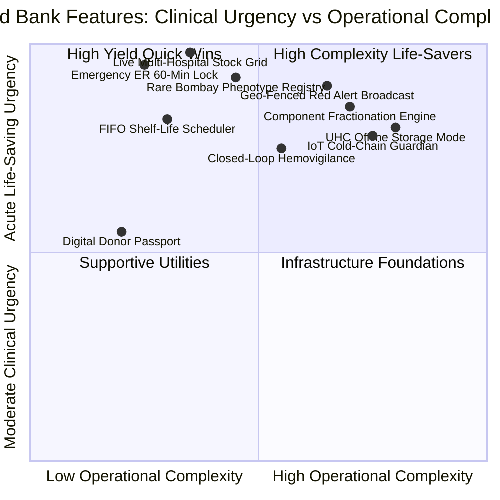
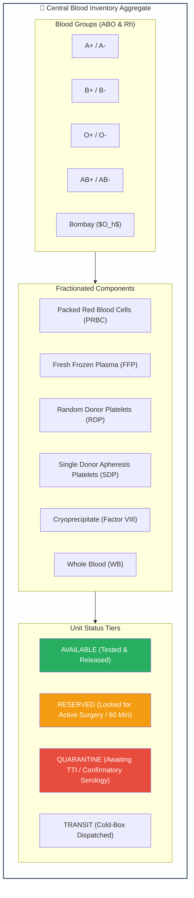
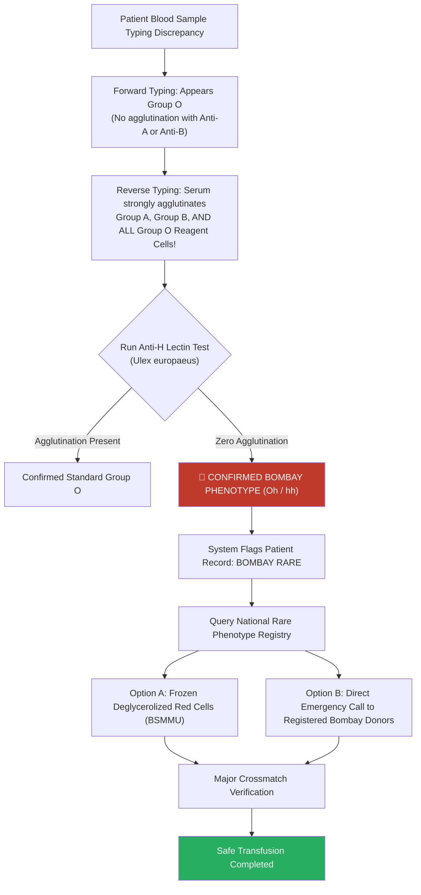
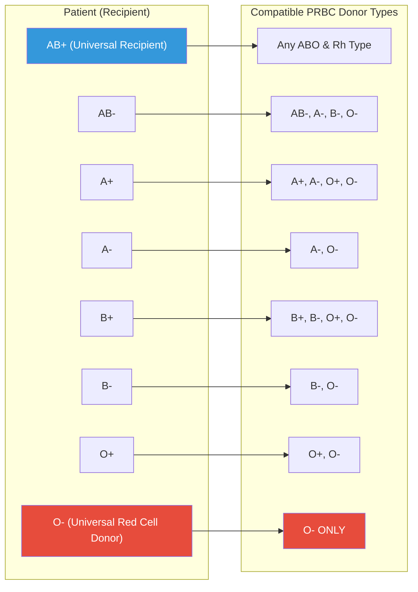
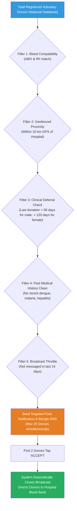

# Module 08: Blood Bank (Prodona / প্রদানা) — Feature Specifications & Capabilities

## 📋 Document Overview

This document provides a comprehensive technical catalog of the functional features comprising the **Prodona (প্রদানা) Blood Banking & Transfusion Network**. It details real-time hospital stock visibility, automated component derivation, First-In, First-Out (FIFO) shelf-life optimization, rare blood and Bombay phenotype management, emergency ER electronic crossmatching, geo-fenced donor broadcasting, and digital hemovigilance compliance.

---

## 🧭 Master Feature Matrix

| Feature ID | Feature Name | Primary Beneficiary | Criticality | Deployment Tier | FHIR R4 Mapping |
|---|---|---|---|---|---|
| **FEAT-08-01** | Real-Time Multi-Hospital Blood Stock Grid | ER Clinicians, Patients | 🔴 Critical | National Cloud | `BiologicallyDerivedProduct` |
| **FEAT-08-02** | Component Derivation & Shelf-Life Scheduler | Blood Bank Labs | 🔴 Critical | Hospital Node | `SupplyDelivery` |
| **FEAT-08-03** | FIFO Picking & Expiry Prevention Engine | Inventory Managers | 🟡 High | Hospital Node | `InventoryReport` |
| **FEAT-08-04** | National Rare Blood & Bombay Phenotype Registry | Hematologists, Rare Donors | 🔴 Critical | National Cloud | `Observation`, `Patient` |
| **FEAT-08-05** | Emergency ER Requisition & 60-Min Lock | Trauma Teams, Surgeons | 🔴 Critical | Hospital Node | `SupplyRequest` |
| **FEAT-08-06** | Geo-Fenced Emergency Red-Alert Broadcast | Hemorrhaging Patients | 🔴 Critical | SMS Gateway | `CommunicationRequest` |
| **FEAT-08-07** | Digital Donor Passport & Health ID Linkage | Voluntary Donors | 🟢 Medium | Patient Mobile App | `Patient`, `Media` |
| **FEAT-08-08** | IoT Cold-Chain Temperature Guardian | Quality Auditors | 🟡 High | Edge Micro-Service | `DeviceMetric` |
| **FEAT-08-09** | Closed-Loop Hemovigilance & Reaction Quarantine | Transfusion Committees | 🔴 Critical | Central Registry | `AdverseEvent` |
| **FEAT-08-10** | Upazila Blood Storage Center (BSC) Offline Mode | Rural UHC Surgeons | 🟡 High | Rural Edge Node | `Bundle` |

---

## 🏥 Feature 1: Centralized Hospital Blood Stock Visibility & Aggregator Engine

### 1. Functional Scope & Bangladesh Context
In Bangladesh's fragmented healthcare system, blood stocks are trapped within institutional silos:
- Government Medical College Hospitals (e.g., DMCH, SSMC, CMCH)
- Autonomous Specialized Institutes (e.g., BSMMU, NICVD, NITOR)
- Major NGO Blood Banks (e.g., Bangladesh Red Crescent Society, Quantum Foundation)
- Military & Armed Forces Transfusion Centers (e.g., CMH Dhaka)
- Licensed Private Hospital Blood Banks (e.g., Evercare, Square, United)

Feature 1 breaks down these barriers by providing a **unified real-time query interface**. Any authenticated emergency doctor or authorized citizen can view verified, available inventory across all networked facilities within a selectable geographic radius (5 km, 15 km, 50 km).

### 2. Live Inventory Categorization Matrix
Inventory is updated in real-time via event hooks and displayed across 5 distinct blood components:

### 3. Real-Time Heartbeat Synchronization
- Each blood bank node transmits an encrypted MQTT telemetry heartbeat every **60 seconds**.
- When a bag is scanned out for crossmatching, its state changes from `AVAILABLE` to `RESERVED` within **< 200 milliseconds** across the regional grid, preventing race conditions where two distinct hospitals attempt to requisition the same unit.

---

## 🧪 Feature 2: Component Derivation & Cold-Chain Expiry Engine (FIFO)

### 1. Multi-Component Generation Workflow
Upon completion of phlebotomy (450 mL whole blood in CPDA-1 triple-bag or quadruple-bag systems), the blood bank technician scans the parent bag. The system automatically creates child component records inheriting the primary Donation Identification Number (DIN):

$$\text{Parent Bag DIN: } \texttt{050-2026-1048291} \longrightarrow \begin{cases} 
\text{PRBC (Red Cells): } & \texttt{DIN} + \texttt{-PRBC} \\
\text{FFP (Plasma): } & \texttt{DIN} + \texttt{-FFP} \\
\text{RDP (Platelets): } & \texttt{DIN} + \texttt{-PLT} 
\end{cases}$$

### 2. Dynamic Shelf-Life Schedules & Storage Guardrails

| Component Type | Permitted Storage Temp | Standard Shelf Life | Expiry Alert Trigger | Clinical Application |
|---|---|---|---|---|
| **Packed Red Blood Cells (PRBC SAGM)** | 2°C to 6°C | **42 Days** | Day 35 (7 days prior) | Anemia, surgical blood loss, chronic thalassemia |
| **Fresh Frozen Plasma (FFP)** | -20°C to -40°C | **365 Days** | Day 335 (30 days prior) | Massive transfusion coagulopathy, DIC, severe burns |
| **Platelet Concentrate (RDP)** | 20°C to 24°C (Agitated) | **5 Days (120 Hours)** | Hour 72 (48 hours prior) | Dengue shock syndrome, leukemia, thrombocytopenia |
| **Single Donor Apheresis Platelets (SDP)** | 20°C to 24°C (Agitated) | **5 Days (120 Hours)** | Hour 72 (48 hours prior) | Refractory thrombocytopenia, pediatric hematology |
| **Cryoprecipitate** | -20°C or colder | **365 Days** | Day 335 (30 days prior) | Hemophilia A, Von Willebrand disease, hypofibrinogenemia |
| **Whole Blood (CPDA-1)** | 2°C to 6°C | **35 Days** | Day 28 (7 days prior) | Active military battlefield resuscitation, adult LTOWB trauma |

### 3. FIFO Optimization Algorithm
When an order for PRBC is placed, the system **never picks bags at random**. It automatically directs the technologist to the oldest compatible non-expired unit in the storage rack:
$$\text{Pick Priority} = \min(\text{Expiry Timestamp}) \quad \text{where } \text{Status} = \texttt{AVAILABLE} \land \text{ABO/Rh} = \text{Compatible}$$
This simple rule drives blood bag expiration wastage down from Bangladesh's current average of **~14% to less than 2%**.

---

## 🧬 Feature 3: Rare Blood Network & Bombay Phenotype ($O_h$) Registry

### 1. The High-Risk Clinical Dilemma
Because standard blood typing reagents only test for A and B antigens, individuals with the **Bombay phenotype (hh)** are mistakenly categorized as **Group O**. If an ER physician transfuses standard Group O red cells, the recipient's high-titer anti-H antibodies trigger immediate complement-mediated intravascular hemolysis, shock, acute tubular necrosis, and death within hours.

### 2. Capabilities of the Rare Blood Registry
- **National Registry Database**: Securely archives phenotyped donors for Bombay phenotype, Rh-null, Bombay variants ($A_h, B_h$), and rare Kell (K-k+), Duffy ($Fy^{a-b-}$), and Kidd null phenotypes.
- **Direct Encrypted Mobilization**: Bypasses public broadcasts (to protect donor privacy) and initiates private, high-priority voice calls and SMS to verified rare donors with guaranteed transportation logistics.
- **BSMMU Cryopreservation Linkage**: Tracks frozen red cell units stored at -80°C in glycerol at the Department of Transfusion Medicine, Bangabandhu Sheikh Mujib Medical University (BSMMU).

---

## ⏱️ Feature 4: Emergency ER Requisition, Electronic Crossmatch & Cold-Chain Dispatch

### 1. Electronic Crossmatch Compatibility Matrix
The system embeds the clinical rules for safe blood selection:

### 2. Digital Chain-of-Custody & Transport Guardrails
When a blood bag leaves the transfusion center for the Operating Theater (OT) or Intensive Care Unit (ICU):
1. **Cold-Box Scan**: The courier's insulated carrier box is scanned to confirm presence of validated phase-change gel packs maintaining **2°C to 6°C**.
2. **Bedside 2-Person Verification**: The transfusion nurse and attending doctor scan the patient's Health Card QR code and the blood bag's 2D barcode at the patient's bedside.
3. **Mismatch Alarm**: If the bag blood group is incompatible with the patient's record, the handheld terminal triggers an **ear-piercing audio alarm and red strobe display**, locking the transfusion checklist.

---

## 📢 Feature 5: Emergency Geo-Broadcast & Voluntary Donor Lifeline

### 1. Trigger Conditions
The **Red Alert Emergency Geo-Broadcast** activates **only when**:
- Local hospital blood bank inventory of matching type is **0 units**.
- Regional networked hospital inventories within 15 km are **0 units**.
- An attending physician certifies an imminent life-threatening emergency (e.g., massive PPH, rupture of aortic aneurysm, severe trauma with hemorrhagic shock).

### 2. Intelligent Smart Filter Algorithm
To prevent donor harassment, the broadcast algorithm applies 5 successive filters:

### 3. Anti-Commercial Protections
- **No Cash or Direct Communication**: Patients and relatives never receive the donor's personal phone number, completely eliminating commercial negotiations or extortion.
- **Hospital Blood Bank Only**: Donors report directly to the official hospital transfusion center; donations in private cabins or unmonitored settings are prohibited.

---

## 🪪 Feature 6: Donor Engagement, Digital Donor Passport & Health ID Linkage

### 1. The Digital Donor Passport (রক্তদাতা পাসপোর্ট)
Every citizen who donates blood has their voluntary contribution recorded in their longitudinal Health ID profile:
- **Lifetime Donation Counter**: Badges awarded at milestones (Bronze: 3 donations, Silver: 10 donations, Gold: 25 donations, Platinum: 50+ donations).
- **Automated Health Check Summary**: Each donation yields free laboratory screening for Hb, BP, and confidential TTI results accessible only through their authenticated Health Card app.
- **Family Priority Voucher**: In recognition of their altruism, active donors receive a digital priority voucher guaranteeing emergency blood reservation for their first-degree relatives (spouse, parents, children) should they ever require surgery.

---

## 🛡️ Feature 7: National Hemovigilance & Adverse Reaction Tracking

### 1. Closed-Loop Traceability
Every transfusion in Bangladesh is tracked from **vein to vein**:
$$\text{Donor Health ID} \xrightarrow{\text{phlebotomy}} \text{Donation ID (DIN)} \xrightarrow{\text{fractionation}} \text{Component DIN} \xrightarrow{\text{transfusion}} \text{Recipient Health ID}$$

### 2. Adverse Reaction Reporting & Sister-Unit Recall
If an acute hemolytic reaction, Transfusion-Related Acute Lung Injury (TRALI), or Transfusion-Associated Circulatory Overload (TACO) occurs:
- The hospital logs the incident in Prodona within **30 minutes**.
- The system immediately issues an **emergency recall order for any un-transfused sister components** (e.g., FFP or platelets from the same donor bag) sitting in other facilities, instantly locking their status to `RECALLED_QUARANTINE`.

---

## 📶 Feature 8: Upazila Blood Storage Center (BSC) Offline Resilience

In rural Upazila Health Complexes (e.g., Dacope in Khulna or Chauhali in Sirajganj) where full component centrifuges are absent, Prodona operates in **Blood Storage Center (BSC) Mode**:
- Receives pre-tested, pre-screened PRBC bags from the District Hospital Transfusion Center.
- Operates on local SQLite storage on an Android tablet, allowing emergency check-outs even during extended electrical grid and internet blackouts.
- Syncs transactions back to the national grid as soon as cellular connectivity resumes.
