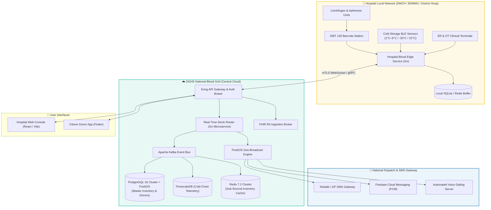
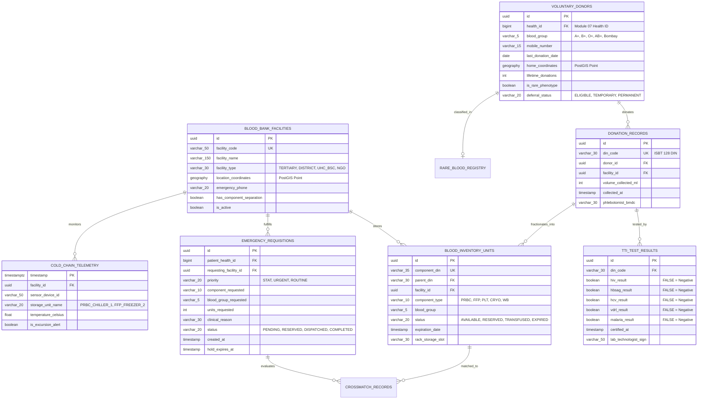
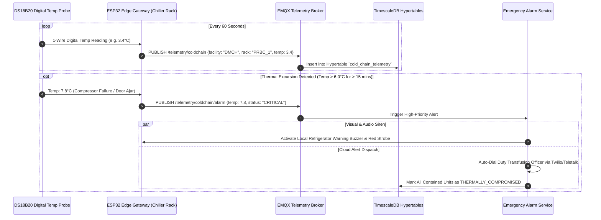
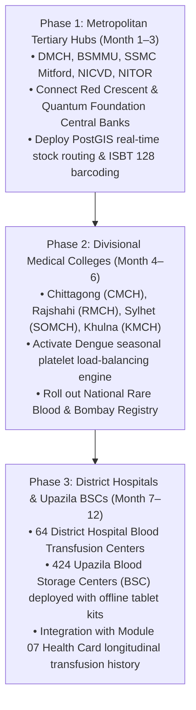

# Module 08: Blood Bank (Prodona / প্রদানা) — Technical Implementation Guide

## 📋 Document Overview

This document specifies the technical architecture, data schemas, FHIR R4 resources, PostgreSQL relational database designs, REST/WebSocket APIs, IoT telemetry ingestion pipelines, and national deployment roadmap for the **Prodona (প্রদানা) Blood Banking & Transfusion Network**. It bridges central DGHS cloud registries with hospital laboratory analyzers, operating theater terminals, and remote Upazila Blood Storage Centers.

---

## 🏗️ System Architecture & Component Blueprint



---

## 💻 Tech Stack Specification

| Tier / Function | Technology Selected | Technical Justification |
|---|---|---|
| **Hospital Local Server** | Go 1.22 (Golang) Native Binary | Single self-contained static binary; runs on modest dual-core hardware at District Hospitals without Docker |
| **Real-Time Gateway** | WebSockets (Gorilla) + MQTT (EMQX) | Delivers instant sub-second blood unit reservations to prevent simultaneous claims by multiple trauma teams |
| **Relational & Spatial DB** | PostgreSQL 16 with PostGIS 3.4 | PostGIS provides high-performance spatial indexing (`ST_DWithin`, `ST_Distance`) for 10 km donor radius queries |
| **Telemetry Storage** | TimescaleDB | Hypertables with automated chunk compression store millions of per-minute refrigerator temperature data points |
| **Central In-Memory Cache** | Redis 7.2 Cluster | Houses live count of available units partitioned by facility and blood group for instantaneous map rendering |
| **FHIR R4 Interoperability** | HAPI FHIR Java Core / Go FHIR SDK | Standardizes transfusion records as `BiologicallyDerivedProduct`, `SupplyRequest`, and `SupplyDelivery` |
| **Mobile Applications** | Flutter 3.22 (Dart) | Single codebase for iOS and Android, supports offline Bluetooth scanning and Bangla font rendering |
| **Hardware Cold-Chain IoT** | ESP32-WROOM + DS18B20 digital probes | Industrial-grade waterproof sensors (accuracy $\pm 0.1^\circ\text{C}$) broadcasting over BLE and Wi-Fi |

---

## 📄 FHIR R4 Resource Mappings

### 1. FHIR `BiologicallyDerivedProduct` (PRBC Unit Example)
This resource represents an individual, tested, and released blood unit available in the inventory:

```json
{
  "resourceType": "BiologicallyDerivedProduct",
  "id": "bd-blood-unit-050-2026-1048291-prbc",
  "meta": {
    "versionId": "1",
    "lastUpdated": "2026-11-03T11:20:00+06:00",
    "profile": [
      "http://fhir.dghs.gov.bd/StructureDefinition/bd-core-blood-product"
    ]
  },
  "identifier": [
    {
      "system": "http://dghs.gov.bd/identifier/isbt128-din",
      "value": "050-2026-1048291-PRBC"
    }
  ],
  "productCategory": "biologicalAgent",
  "productCode": {
    "coding": [
      {
        "system": "http://snomed.info/sct",
        "code": "256429008",
        "display": "Packed red blood cells"
      }
    ],
    "text": "PRBC in SAGM Additive Solution (Leukoreduced)"
  },
  "status": "available",
  "quantity": {
    "value": 280,
    "unit": "mL"
  },
  "collection": {
    "collector": {
      "reference": "Practitioner/bmdc-lt-91823",
      "display": "Lab Tech Rafiqul Islam"
    },
    "collectedDateTime": "2026-11-03T08:30:00+06:00"
  },
  "processing": [
    {
      "description": "Centrifuged at 4000 RPM at 20C, plasma removed, 100mL SAGM added",
      "timeDateTime": "2026-11-03T10:15:00+06:00"
    }
  ],
  "storage": [
    {
      "description": "Refrigerated Blood Bank Storage",
      "temperature": {
        "value": 3.8,
        "unit": "Cel"
      },
      "scale": "celsius"
    }
  ],
  "extension": [
    {
      "url": "http://fhir.dghs.gov.bd/StructureDefinition/blood-group-abo",
      "valueCode": "O"
    },
    {
      "url": "http://fhir.dghs.gov.bd/StructureDefinition/blood-group-rh",
      "valueCode": "POSITIVE"
    },
    {
      "url": "http://fhir.dghs.gov.bd/StructureDefinition/expiration-timestamp",
      "valueDateTime": "2026-12-15T08:30:00+06:00"
    },
    {
      "url": "http://fhir.dghs.gov.bd/StructureDefinition/facility-location",
      "valueReference": {
        "reference": "Location/dmch-blood-bank-rack-r2",
        "display": "DMCH Transfusion Center Rack R2-ShelfB"
      }
    }
  ]
}
```

### 2. FHIR `SupplyRequest` (Emergency ER Requisition)
```json
{
  "resourceType": "SupplyRequest",
  "id": "bd-blood-req-84920",
  "status": "active",
  "category": {
    "coding": [
      {
        "system": "http://terminology.hl7.org/CodeSystem/supplyrequest-kind",
        "code": "central",
        "display": "Central Stock"
      }
    ]
  },
  "priority": "stat",
  "itemCodeableConcept": {
    "coding": [
      {
        "system": "http://snomed.info/sct",
        "code": "256429008",
        "display": "Packed red blood cells"
      }
    ],
    "text": "O+ PRBC (2 Bags)"
  },
  "quantity": {
    "value": 2,
    "unit": "Units"
  },
  "requester": {
    "reference": "Practitioner/bmdc-a-58291",
    "display": "Dr. Farhana Yasmin (ER Registrar, DMCH)"
  },
  "deliverFor": {
    "reference": "Patient/bd-patient-9102837411",
    "display": "Trauma Victim (Health ID: 9102837411)"
  },
  "authoredOn": "2026-11-03T11:45:00+06:00",
  "reasonCode": [
    {
      "coding": [
        {
          "system": "http://hl7.org/fhir/sid/icd-10",
          "code": "T79.4",
          "display": "Traumatic shock"
        }
      ]
    }
  ]
}
```

---

## 🗄️ Relational Database Schema (PostgreSQL + PostGIS)



### PostgreSQL DDL Definitions
```sql
-- Enable PostGIS for geographic proximity queries
CREATE EXTENSION IF NOT EXISTS postgis;
CREATE EXTENSION IF NOT EXISTS timescaledb;

-- 1. Facilities Table with Geospatial Indexing
CREATE TABLE blood_bank_facilities (
    id UUID PRIMARY KEY DEFAULT gen_random_uuid(),
    facility_code VARCHAR(50) UNIQUE NOT NULL,
    facility_name VARCHAR(150) NOT NULL,
    facility_type VARCHAR(30) NOT NULL CHECK (facility_type IN ('TERTIARY_HOSPITAL', 'DISTRICT_HOSPITAL', 'UHC_BSC', 'NGO_BANK', 'MILITARY')),
    location_coordinates GEOGRAPHY(POINT, 4326) NOT NULL,
    emergency_phone VARCHAR(20) NOT NULL,
    has_component_separation BOOLEAN DEFAULT FALSE,
    is_active BOOLEAN DEFAULT TRUE,
    created_at TIMESTAMPTZ DEFAULT CURRENT_TIMESTAMP
);

CREATE INDEX idx_facilities_geo ON blood_bank_facilities USING GIST(location_coordinates);

-- 2. Inventory Units with Expiration Indexing
CREATE TABLE blood_inventory_units (
    id UUID PRIMARY KEY DEFAULT gen_random_uuid(),
    component_din VARCHAR(35) UNIQUE NOT NULL,
    parent_din VARCHAR(30) NOT NULL,
    facility_id UUID NOT NULL REFERENCES blood_bank_facilities(id),
    component_type VARCHAR(10) NOT NULL CHECK (component_type IN ('PRBC', 'FFP', 'PLT_RDP', 'PLT_SDP', 'CRYO', 'WB')),
    blood_group VARCHAR(10) NOT NULL CHECK (blood_group IN ('A+', 'A-', 'B+', 'B-', 'AB+', 'AB-', 'O+', 'O-', 'BOMBAY')),
    status VARCHAR(20) NOT NULL DEFAULT 'QUARANTINE' CHECK (status IN ('QUARANTINE', 'AVAILABLE', 'RESERVED', 'IN_TRANSIT', 'TRANSFUSED', 'EXPIRED', 'DISCARDED')),
    expiration_date TIMESTAMPTZ NOT NULL,
    rack_storage_slot VARCHAR(30),
    created_at TIMESTAMPTZ DEFAULT CURRENT_TIMESTAMP
);

CREATE INDEX idx_inventory_lookup ON blood_inventory_units(facility_id, blood_group, component_type, status);
CREATE INDEX idx_inventory_fifo ON blood_inventory_units(expiration_date ASC) WHERE status = 'AVAILABLE';

-- 3. High-Speed Geo-Proximity Query for Available Donors
-- Query: Find eligible O- donors within 10 km radius of DMCH
CREATE OR REPLACE FUNCTION get_eligible_nearby_donors(
    p_blood_group VARCHAR,
    p_hospital_lat FLOAT,
    p_hospital_lon FLOAT,
    p_radius_meters INT
)
RETURNS TABLE (
    donor_id UUID,
    health_id BIGINT,
    mobile_number VARCHAR,
    distance_meters FLOAT
) AS $$
BEGIN
    RETURN QUERY
    SELECT 
        d.id,
        d.health_id,
        d.mobile_number,
        ST_Distance(d.home_coordinates, ST_SetSRID(ST_MakePoint(p_hospital_lon, p_hospital_lat), 4326)::geography) AS distance_meters
    FROM voluntary_donors d
    WHERE d.blood_group = p_blood_group
      AND d.deferral_status = 'ELIGIBLE'
      AND d.last_donation_date <= (CURRENT_DATE - INTERVAL '90 days')
      AND ST_DWithin(d.home_coordinates, ST_SetSRID(ST_MakePoint(p_hospital_lon, p_hospital_lat), 4326)::geography, p_radius_meters)
    ORDER BY distance_meters ASC
    LIMIT 20;
END;
$$ LANGUAGE plpgsql;
```

---

## 🔌 API Endpoint Specifications

### 1. `GET /api/v1/blood/stock/summary`
Retrieves live stock counts within a geographic bounding box.

**Query Parameters:**
- `lat`: `23.7258`
- `lon`: `90.3975`
- `radiusKm`: `15`
- `component`: `PRBC`
- `bloodGroup`: `B+`

**Response (`200 OK`):**
```json
{
  "searchRadiusKm": 15,
  "component": "PRBC",
  "bloodGroup": "B+",
  "totalAvailableUnits": 14,
  "facilities": [
    {
      "facilityId": "f-dmch-01",
      "facilityName": "Dhaka Medical College Hospital",
      "distanceKm": 0.4,
      "availableUnits": 8,
      "reservedUnits": 3,
      "oldestUnitExpiry": "2026-11-28T18:00:00+06:00"
    },
    {
      "facilityId": "f-bssmu-02",
      "facilityName": "BSMMU Transfusion Medicine Dept",
      "distanceKm": 2.1,
      "availableUnits": 6,
      "reservedUnits": 1,
      "oldestUnitExpiry": "2026-12-04T12:00:00+06:00"
    }
  ]
}
```

### 2. `POST /api/v1/blood/requisitions/urgent`
Creates an emergency ER requisition with a 60-minute holding lock.

**Request Payload:**
```json
{
  "patientHealthId": "9102837411",
  "requestingDoctorBmdc": "BMDC-A-58291",
  "facilityCode": "FAC_DMCH_001",
  "priority": "STAT",
  "componentType": "PRBC",
  "bloodGroup": "O+",
  "unitsRequired": 2,
  "clinicalIndication": "Severe RTA hemorrhagic shock, BP 70/40"
}
```

**Response (`201 Created`):**
```json
{
  "status": "RESERVED",
  "requisitionId": "req-982103-ab",
  "holdExpiresAt": "2026-11-03T12:45:00+06:00",
  "allocatedUnits": [
    {
      "componentDin": "050-2026-1048291-PRBC",
      "rackSlot": "RACK_R2_SLOT_B4",
      "expiryDate": "2026-11-22T08:30:00+06:00"
    },
    {
      "componentDin": "050-2026-1048305-PRBC",
      "rackSlot": "RACK_R2_SLOT_B8",
      "expiryDate": "2026-11-24T14:15:00+06:00"
    }
  ],
  "crossmatchRequired": true,
  "pickupInstructions": "Deliver recipient crossmatch pilot tube to Blood Bank Desk 3 immediately."
}
```

---

## 🏷️ Barcode Specification (ISBT 128 Compliant)

Every blood bag printed in Bangladesh conforms to the national **ISBT 128 2D DataMatrix format**:

$$\texttt{[=050YYSSSSSSS] [=<E0398V00] [=>06200] [=}}026345]}$$

- `[=050YYSSSSSSS]`: **Donation Identification Number (DIN)** (Country code `050` = Bangladesh, `YY` = Year, `SSSSSSS` = Sequence).
- `[=<E0398V00]`: **Product Code** (`E0398` = PRBC SAGM Leukoreduced).
- `[=>06200]`: **ABO/Rh Code** (`06200` = Group O Rh-Positive).
- `[=}}026345]`: **Expiration Julian Date & Time**.

---

## 🌡️ Cold Chain IoT Hardware & Telemetry Pipeline



---

## 🗺️ Phased Rollout Roadmap


