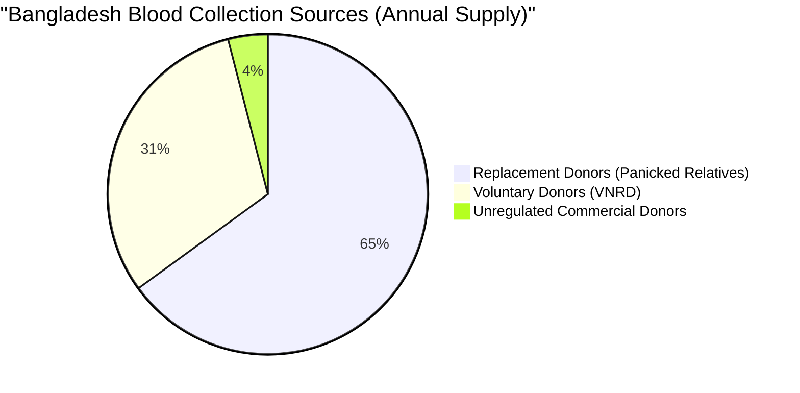
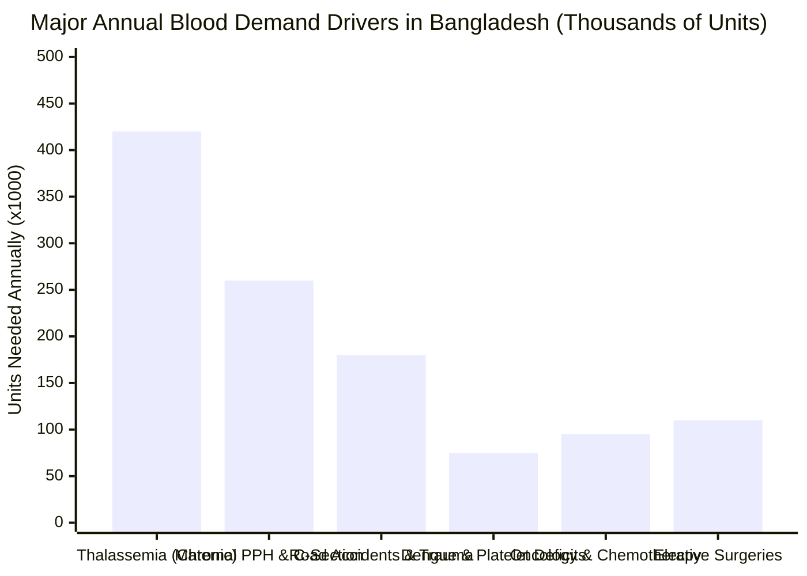
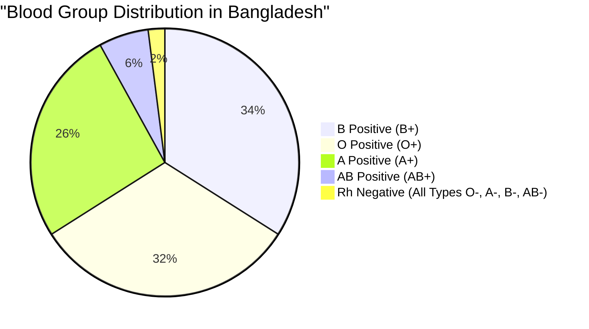
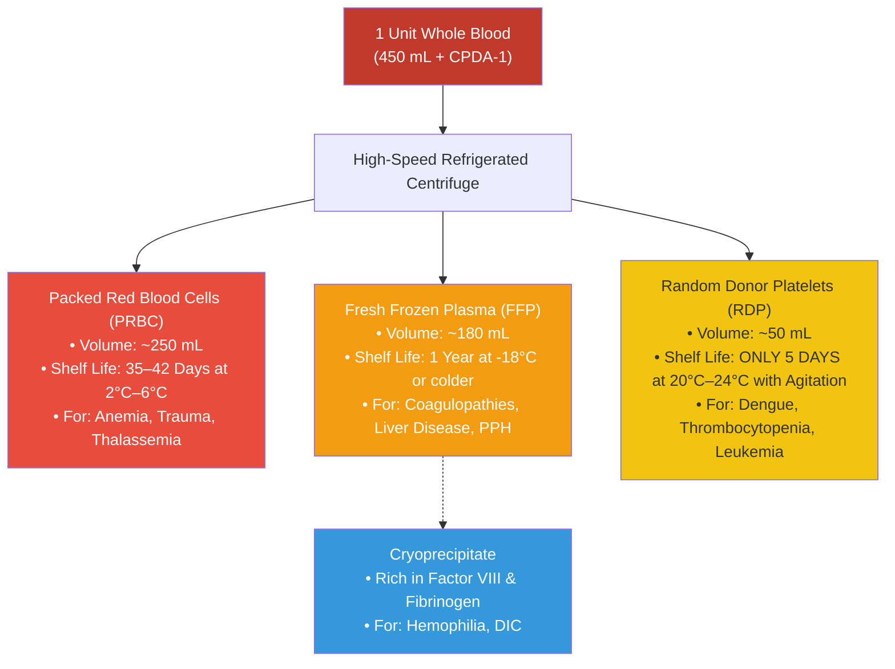
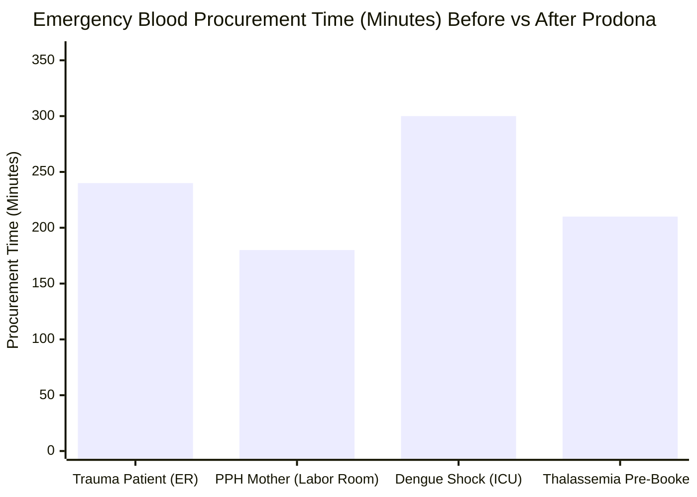

# 🩸 Blood Bank & Component Inventory Management System (Prodona / প্রদানা)

## Module 08 — Real-Time Hospital Blood Inventory, Rare Blood Registry, Component Lifecycle & Emergency Transfusion Network for Bangladesh

---

## 📋 Table of Contents

- [Executive Summary](#executive-summary)
- [The Bangladesh National Blood Crisis](#the-bangladesh-national-blood-crisis)
- [Legal & Regulatory Framework: Safe Blood Transfusion Act 2002](#legal--regulatory-framework-safe-blood-transfusion-act-2002)
- [The Critical Problem: The "App Illusion" vs Hospital Stock Reality](#the-critical-problem-the-app-illusion-vs-hospital-stock-reality)
- [Blood Scarcity & The Rare Phenotype Dilemma in Bangladesh](#blood-scarcity--the-rare-phenotype-dilemma-in-bangladesh)
- [The Component Separation Deficit & Dengue Platelet Agony](#the-component-separation-deficit--dengue-platelet-agony)
- [Geographic Disparities: Blood Deserts in Rural Bangladesh](#geographic-disparities-blood-deserts-in-rural-bangladesh)
- [Target Stakeholders & User Personas](#target-stakeholders--user-personas)
- [The Proposed Digital Solution: Prodona (প্রদানা)](#the-proposed-digital-solution-prodona-প্রদানা)
- [Success Metrics & Comparative Benchmarks](#success-metrics--comparative-benchmarks)
- [Module Dependencies & Ecosystem Integration](#module-dependencies--ecosystem-integration)

---

## Executive Summary

Every year, an estimated **1.0 to 1.1 million units (bags) of blood** are required across Bangladesh to sustain life during traumatic injuries, complex surgeries, pediatric thalassemia transfusions, dengue hemorrhagic epidemics, and acute obstetrical hemorrhages. 

Yet, Bangladesh remains locked in a perpetual, life-threatening blood crisis:
- **Only ~30% to 32% of blood is collected from Voluntary Non-Remunerated Donors (VNRD)**. The remaining ~68% depends on desperate replacement donations by panicked relatives or dangerous, unregulated commercial brokers.
- **Dozens of consumer donor apps exist**, but they solve the wrong problem. When an emergency strikes, relatives do not have 3 to 4 hours to wait for an amateur volunteer to commute across Dhaka traffic, undergo screening, and wait for 5 mandatory Transfusion Transmissible Infection (TTI) laboratory tests.
- **Hospital blood stock visibility is ZERO.** Tested, screened, lifesaving blood bags frequently sit in refrigerators just 2 kilometers away in another hospital, while a mother bleeds to death from Postpartum Hemorrhage (PPH) because her husband is running in the rain from counter to counter with paper requisitions.
- **Rare blood types (especially Rh-negative and the ultra-rare Bombay phenotype)** present fatal bottlenecks due to the lack of a centralized registry and frozen erythrocyte reserves.

> [!IMPORTANT]
> **Module 08: Prodona (প্রদানা - "Gift of Life")** eliminates the midnight running nightmare. It provides an authoritative, real-time national digital inventory of all tested blood units across public, private, and NGO blood banks, automates component separation (PRBC, FFP, Platelets), enforces First-In, First-Out (FIFO) shelf-life monitoring, and coordinates geo-fenced emergency red-alerts.

---

## The Bangladesh National Blood Crisis

### Key Statistics at a Glance

| Metric | Official Figure | Source / Context |
|---|---|---|
| **Annual National Blood Demand** | **1,000,000 – 1,100,000 units** | DGHS Safe Blood Transfusion Program |
| **Voluntary Donation Rate** | **~31%** (Target: 100% WHO benchmark) | Bangladesh Red Crescent / WHO |
| **Replacement / Family Donation** | **~65%** | Panicked relatives recruited at bedside |
| **Commercial / Unregulated Source** | **~4%** | Illegal professional donors in peri-urban slums |
| **Active Thalassemia Major Patients** | **60,000 – 70,000 citizens** | Bangladesh Thalassemia Foundation (requires 1-2 units/month) |
| **Maternal Deaths from PPH** | **~31% of all maternal deaths** | Bangladesh Maternal Mortality Survey (BMMS) |
| **Platelet Demand during Dengue Surges** | **Up to 15,000 units/month in peak season** | DGHS Dengue Control Room (Dhaka & Divisional hubs) |
| **Rh-Negative Population in BD** | **Only 2.5% – 3.0%** | National Blood Transfusion Center (NBTC) |
| **Average Delay in Procuring Emergency Blood** | **3.5 – 6.0 hours** | Hospital audit (DMCH / SSMC Mitford) |
| **Component Separation Rate in Public Hospitals** | **< 35%** (rest transfused as Whole Blood) | Transfusion Medicine Society of Bangladesh |

### Annual Demand Drivers in Bangladesh

1. **Thalassemia Burden**: An estimated **10% to 12% of the population are carriers** ($\beta$-thalassemia trait or HbE trait). Over 60,000 children suffer from Thalassemia Major and require lifelong transfusions every 2 to 4 weeks. They consume nearly **40% of the nation's entire blood supply**.
2. **Postpartum Hemorrhage (PPH)**: Bangladesh's Maternal Mortality Ratio (MMR) remains high at ~136 per 100,000 live births. Obstetrical hemorrhage accounts for **nearly one-third of all maternal deaths**. A hemorrhaging mother in an Upazila Health Complex can bleed to death in **less than 45 minutes**.
3. **Road Traffic Accidents (RTA)**: Over 25,000 severe highway trauma cases occur annually, requiring massive transfusion protocols (MTP: 4 to 10 units of PRBC + FFP + Platelets per patient).

---

## Legal & Regulatory Framework: Safe Blood Transfusion Act 2002

Under the **Safe Blood Transfusion Act 2002 (নিরাপদ রক্ত পরিসঞ্চালন আইন ২০০২)** and the National Blood Policy of Bangladesh:
- **Mandatory 5-Pathogen Screening**: Every collected unit of blood must undergo mandatory testing for five Transfusion Transmissible Infections (TTIs) before release:
  1. Human Immunodeficiency Virus (HIV 1 & 2)
  2. Hepatitis B Surface Antigen (HBsAg)
  3. Hepatitis C Virus (Anti-HCV)
  4. Syphilis (VDRL / RPR)
  5. Malaria parasites (thick and thin smear or rapid antigen test)
- **Prohibition of Paid Blood Donation**: Commercial blood sales are strictly illegal under Section 4 of the 2002 Act. However, illegal "professional blood sellers" still operate clandestinely around major public hospitals, often using drug-dependent individuals whose blood harbors hidden infections.
- **Licensing Standards**: Only facilities authorized by the Directorate General of Health Services (DGHS) and the National Blood Transfusion Council (NBTC) are permitted to operate blood collection, component separation, and crossmatching facilities.

> [!WARNING]
> Because paper-based test certificates can be forged or delayed, unverified replacement blood occasionally slips into clinical use during midnight emergencies. Prodona enforces an **uncompromising digital quarantine gate**: no blood bag can be released from the digital inventory until all 5 TTI automated test results are logged and cryptographically signed by the lab technologist.

---

## The Critical Problem: The "App Illusion" vs Hospital Stock Reality

In recent years, dozens of mobile apps and Facebook volunteer groups have emerged (e.g., Red Crescent, Quantum Foundation, Sandhani, Badhan, Bloodman). While well-intentioned, **donor-matching apps alone cannot solve acute clinical emergencies**.

```mermaid
flowchart TD
    subgraph TODAY["🔴 The Current Midnight Crisis (Paper & Donor Hunt)"]
        A1["ER Doctor writes paper chit:<br/>'Need 2 Bags B+ Blood Urgently'"] --> A2["Relative leaves ER with paper slip"]
        A2 --> A3["Posts on Facebook / Calls Donor Apps"]
        A3 --> A4["Spends 2 hours calling strangers<br/>(Many don't answer or are busy)"]
        A4 --> A5["Volunteer arrives after 2.5 hours travel"]
        A5 --> A6["Screening, Blood Draw & 5 TTI Tests<br/>(Takes another 2.5 hours)"]
        A6 --> A7["Total Elapsed Time: 5 to 7 Hours"]
        A7 --> A8["❌ Fatal Outcome: Patient Bleeds Out in OT"]
    end

    subgraph PRODONA["🟢 The Prodona System (Real-Time Stock Dispatch)"]
        B1["ER Doctor orders 2 Bags B+ PRBC<br/>via Health ID in System"] --> B2["Prodona queries Regional Blood Grid"]
        B2 --> B3{"Tested Stock in Hospital?"}
        B3 -->|Yes| B4["Instant Electronic Crossmatch & Release<br/>(Ready in 12 Minutes)"]
        B3 -->|No| B5["Instant Reservation at Neighboring Hospital<br/>(2.4 km away - Courier Dispatched)"]
        B5 --> B6["Total Elapsed Time: 18 to 25 Minutes"]
        B6 --> B7["✅ Life Saved: Patient Stabilized"]
    end

    style TODAY fill:#fdebd0,stroke:#e74c3c,stroke-width:2px
    style PRODONA fill:#e8f8f5,stroke:#27ae60,stroke-width:2px
    style A8 fill:#c0392b,color:#fff
    style B7 fill:#27ae60,color:#fff
```

### Why Existing Donor Apps Fail in Acute Crises
1. **The Time Paradox**: Finding a donor, getting them to travel through Dhaka's notorious gridlock, drawing blood, and running the 5 mandatory tests takes **4 to 6 hours**. Emergency patients have **30 minutes**.
2. **Invisible Shelves**: Blood banks in nearby private hospitals or military hospitals may have 10 units of tested, compatible B+ PRBC sitting in refrigerated quarantine, but neither the doctor nor the relative has any digital visibility.
3. **Donor Fatigue & Deception**: Volunteer donors are called repeatedly during their 90-day mandatory post-donation deferral window, leading to high call rejection rates and app abandonment.

---

## Blood Scarcity & The Rare Phenotype Dilemma in Bangladesh

### ABO and Rh Distribution in the Population

> [!CAUTION]
> **The Rh-Negative Emergency**: While in European populations Rh-negative blood accounts for ~15% to 18%, in Bangladesh **less than 2.5% to 3.0% of the entire population is Rh-negative**. Specifically:
> - O Negative: ~1.1%
> - B Negative: ~0.9%
> - A Negative: ~0.6%
> - AB Negative: **< 0.1% (Fewer than 1 in 1,000 citizens)**
> When an AB-negative patient is wheeled into DMCH, finding blood via manual phone trees is almost impossible.

### The Bombay Blood Phenotype ($O_h$ / hh)
The **Bombay phenotype** is an ultra-rare blood group discovered in South Asia:
- **Genetics**: Individuals lack the *H gene*, meaning they cannot produce the H antigen (the chemical precursor to both A and B antigens).
- **The Lethal Trap**: In routine forward grouping, Bombay individuals test as **Group O**. However, their serum contains potent **Anti-H antibodies**, which violently attack standard Group O red cells.
- **Transfusion Consequence**: **If a Bombay phenotype patient is transfused with standard O-negative blood, they will suffer immediate, catastrophic intravascular hemolysis and fatal acute renal failure.**
- **Incidence in Bangladesh**: Estimated at **1 in 10,000 to 1 in 25,000** in certain sub-populations due to consanguinity.
- **The Solution in Prodona**: A dedicated **National Rare Blood Registry** with anti-H lectin testing validation, cryopreserved rare red cell inventory at BSMMU, and direct encrypted notification to registered rare donors.

---

## The Component Separation Deficit & Dengue Platelet Agony

In modern transfusion medicine, transfusing **Whole Blood (WB)** is considered obsolete for over 85% of clinical indications. One single whole blood donation should be separated into **three distinct components**, saving **three separate lives**:

### Component Shelf Life & The Dengue Agony
- **Platelets expire in exactly 5 days (120 hours)** and require continuous physical mechanical agitation at 20°C–24°C to prevent clumping.
- During Bangladesh's massive monsoon **Dengue outbreaks (August–November)**, demand for platelets surges by **800%**. Because hospital inventories have no dynamic pooling, platelets sit unagitated and expire in one corner of Dhaka while children die of hemorrhagic shock in another.
- Prodona's **FIFO (First-In, First-Out)** automated shelf-life scheduler issues warnings 48 hours prior to platelet expiration and triggers inter-hospital load-balancing transfers.

---

## Geographic Disparities: Blood Deserts in Rural Bangladesh

A critical structural failure in Bangladesh is the extreme centralization of blood transfusion infrastructure:
- **Dhaka & Chittagong Centralization**: Over **78% of all refrigerated component centrifuges and apheresis machines** are concentrated in Dhaka and Chittagong.
- **Divisional Deficits**: Divisions like Barisal, Mymensingh, Rangpur, and Sylhet face severe regional blood shortages. Patients in remote riverine areas must travel up to 6 hours to find component therapy.
- **Upazila Blood Storage Centers (BSC)**: While all 424 Upazila Health Complexes have operational operating theaters for emergency cesarean sections, **less than 25% have functional blood storage equipment**. Without blood, obstetric surgeons cannot operate, forcing risky transfers of bleeding mothers to distant district hospitals.

Prodona establishes a two-tier network model connecting **Blood Transfusion Centers (BTC)** at Medical Colleges and District Hospitals with **Blood Storage Centers (BSC)** at Upazila Health Complexes via temperature-controlled supply chains.

---

## Target Stakeholders & User Personas

| Stakeholder Persona | Local Context & Responsibilities | Pain Points Addressed by Prodona |
|---|---|---|
| **ER Medical Officer (EMO)** | Frontline physician at DMCH, SSMC, or District Hospital ER managing trauma and shock | Replaces handwritten paper slips with instant digital reservation; views regional stock in 5 seconds |
| **Blood Bank Technologist** | Laboratory staff operating centrifuges, TTI testing analyzers, and crossmatch incubators | Eliminates manual register logbooks; auto-generates ISBT 128 barcodes; tracks FIFO storage racks |
| **Thalassemia Patient Parent** | Travels 50 km monthly with a child suffering from severe $\beta$-thalassemia | Guaranteed pre-reserved, leukoreduced PRBC units booked 48 hours in advance; no last-minute cancellations |
| **Verified Voluntary Donor** | Altruistic citizen registered with Badhan, Sandhani, or Red Crescent | Receives alerts only when genuinely eligible (>90 days); emergency alerts sent only when hospital stock = 0 |
| **Hospital Transfusion Committee** | Senior hematologists and hospital superintendents overseeing clinical governance | Automated hemovigilance audits, adverse reaction tracking, and expiration discard monitoring |

---

## The Proposed Digital Solution: Prodona (প্রদানা)

Prodona bridges the chasm between voluntary donor networks and hospital clinical reality through four synchronized engines:

1. **National Hospital Blood Grid**: Aggregates real-time, unit-level inventory across public medical colleges, district hospitals, military hospitals, and authorized private blood banks.
2. **Component & FIFO Expiry Engine**: Tracks every unit as Whole Blood, PRBC, FFP, Platelets, or Cryoprecipitate with automated shelf-life countdowns and temperature-monitored cold storage telemetry.
3. **Emergency Red-Alert Geo-Broadcast**: When regional hospital inventory for an acute group reaches zero, the system broadcasts a verified SMS/push alert to eligible voluntary donors living within a 10 km radius.
4. **Rare Blood & Bombay Phenotype Network**: Specialized registry connecting verified rare-phenotype citizens directly to tertiary transfusion centers for cryopreserved or directed donations.

---

## Success Metrics & Comparative Benchmarks

| Performance Metric | Current Baseline (2026) | Target with Prodona System |
|---|---|---|
| **ER Blood Procurement Delay** | 180 – 360 minutes | **12 – 25 minutes** |
| **Blood Component Expiration Wastage** | ~14% to 18% discarded due to expiry | **< 2% nationwide** |
| **Voluntary Donation Proportion** | 31% | **65% within 24 months** |
| **Component Separation Proportion** | < 35% in public hospitals | **> 85% nationwide** |
| **Unregulated Commercial Blood Purchases** | ~4% to 6% | **0% (Completely eliminated)** |
| **Adverse Transfusion Reaction Traceability** | < 5% formally reported | **100% hemovigilance compliance** |

---

## Module Dependencies & Ecosystem Integration

- **Module 07: BD Health Card**: Authenticates patient identity, retrieves verified blood group, and anchors longitudinal transfusion history to the citizen's 9-series Health ID.
- **Module 05: Integrated System Core**: Publishes FHIR R4 `SupplyDelivery` and `BiologicallyDerivedProduct` resources to the central Shared Health Record.
- **Module 04: ICU Beds & Emergency Routing**: Coordinates ambulance dispatch with real-time blood availability so trauma patients are routed to hospitals with matching blood units in stock.
- **Module 02: Diagnostic Test Reports**: Synchronizes automated TTI screening analyzer outputs (HBsAg, Anti-HCV, HIV, VDRL, Malaria) directly into the blood unit quarantine release pipeline.
