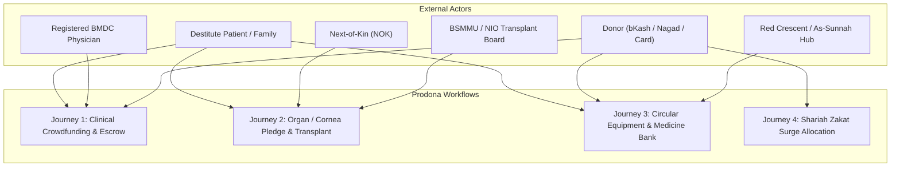
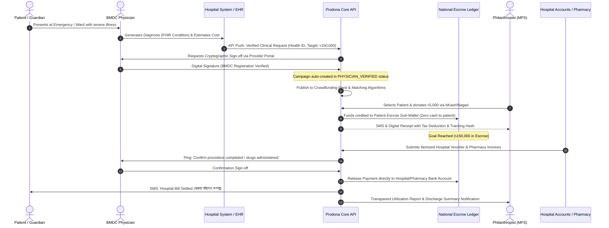
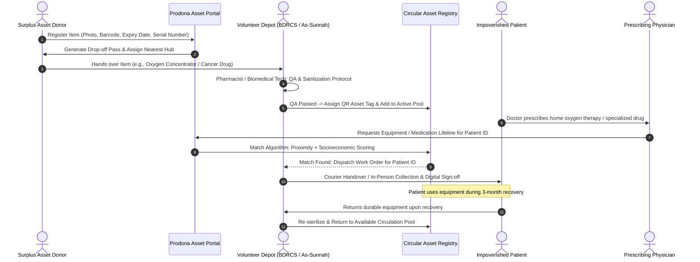
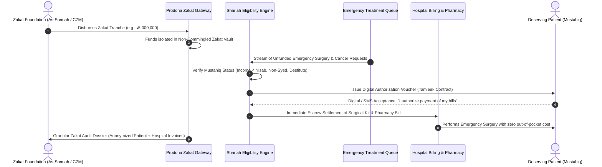
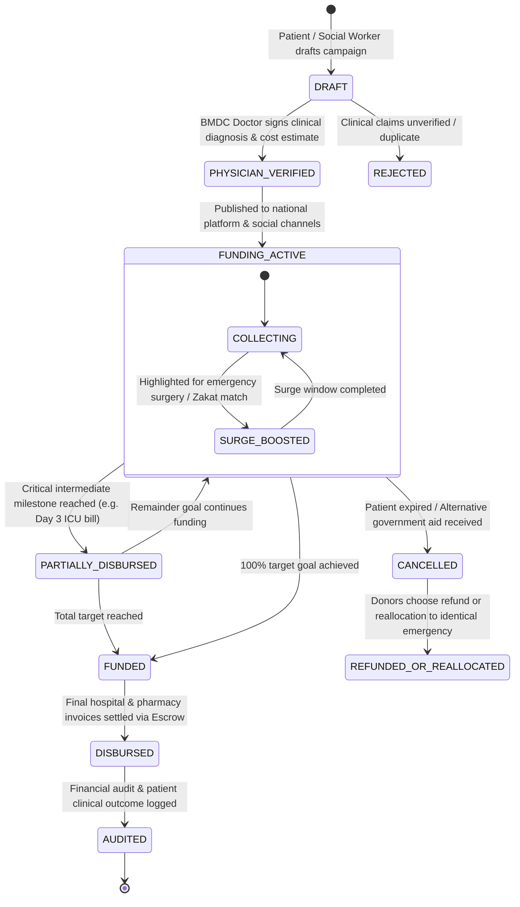
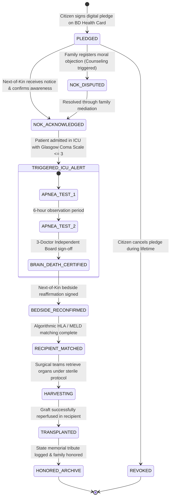
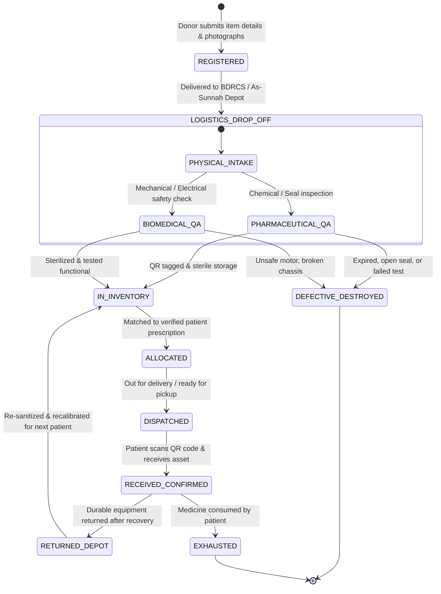
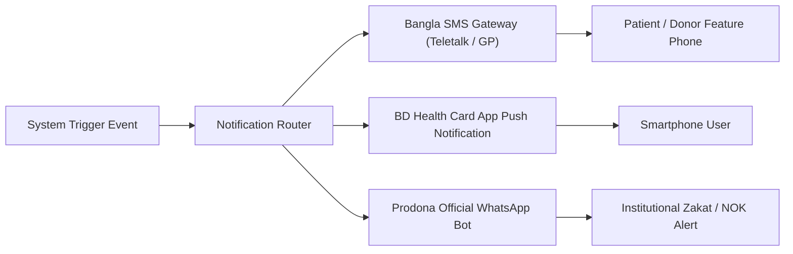

# 🔄 Prodona (প্রদান / অনুদান) — Application Flows & State Machines

## Module 09 — Verified Clinical Lifeline, Organ Pledge Coordination & Circular Asset Exchange

---

## 📋 Table of Contents

- [Architectural Overview of Prodona Flows](#architectural-overview-of-prodona-flows)
- [Journey 1: Fraud-Proof Patient Crowdfunding & Escrow Settlement](#journey-1-fraud-proof-patient-crowdfunding--escrow-settlement)
  - [Workflow Sequence Diagram](#workflow-sequence-diagram)
  - [Step-by-Step Execution Protocol](#step-by-step-execution-protocol)
- [Journey 2: National Organ & Corneal Donation Pledge to Transplant](#journey-2-national-organ--corneal-donation-pledge-to-transplant)
  - [End-to-End Organ Procurement Sequence Diagram](#end-to-end-organ-procurement-sequence-diagram)
  - [Statutory Brain-Death Protocol & NOK Accord](#statutory-brain-death-protocol--nok-accord)
- [Journey 3: Circular Medical Equipment & Surplus Medicine Giving](#journey-3-circular-medical-equipment--surplus-medicine-giving)
  - [Asset Redistribution Sequence Diagram](#asset-redistribution-sequence-diagram)
  - [Quality Control, Sanitization & Dispensing Protocol](#quality-control-sanitization--dispensing-protocol)
- [Journey 4: Emergency Surge & Institutional Zakat Allocation](#journey-4-emergency-surge--institutional-zakat-allocation)
  - [Shariah Tamleek Automated Allocation Sequence Diagram](#shariah-tamleek-automated-allocation-sequence-diagram)
- [Core Lifecycle State Machines](#core-lifecycle-state-machines)
  - [Crowdfunding Campaign State Machine](#crowdfunding-campaign-state-machine)
  - [Organ Pledge & Retrieval State Machine](#organ-pledge--retrieval-state-machine)
  - [Medical Asset & Medicine Inventory State Machine](#medical-asset--medicine-inventory-state-machine)
- [Bangla SMS & Notification Dispatch Engine](#bangla-sms--notification-dispatch-engine)
- [Exception Handling & Rollback Workflows](#exception-handling--rollback-workflows)

---

## Architectural Overview of Prodona Flows

Prodona coordinates complex interactions between four critical entities: impoverished patients seeking medical lifelines, treating clinicians and hospital billing desks, benevolent donors and Zakat foundations, and logistical hubs managing physical medical assets.



---

## Journey 1: Fraud-Proof Patient Crowdfunding & Escrow Settlement

### Workflow Sequence Diagram



### Step-by-Step Execution Protocol

1. **Clinical Initiation**: When an indigent patient arrives at a participating medical college (e.g., Dhaka Medical College Hospital), the attending physician creates an electronic treatment plan. If the patient's family cannot afford surgery, chemotherapy, or ICU care, the physician toggles the `Request Prodona Assistance` flag.
2. **Clinical Verification & Evidence Ingestion**:
   - Prodona connects to **Module 07 (Health Card)** to extract socioeconomic status (checking safety-net indicators, BISP data, or hospital social welfare officer recommendation).
   - Prodona pulls verified diagnostic reports from **Module 02 (Test Reports)** and prescriptions from **Module 03 (Prescriptions)**.
   - The treating specialist signs an electronic cost estimate certifying the clinical necessity and estimated duration of treatment.
3. **Automated Campaign Launch**: The campaign is published with an anonymized or consent-approved patient profile, verified diagnosis tags (e.g., `Acute Myeloid Leukemia`, `Tetralogy of Fallot`), itemized cost breakdown, and treating hospital details.
4. **Multi-Channel Fundraising**:
   - Micro-donors contribute via **bKash Tokenized Checkout**, **Nagad**, **Rocket**, or debit/credit cards.
   - Institutional donors (Zakat funds and corporate CSR desks) match donations or fund campaigns in single bulk transactions.
5. **Direct Escrow Payout**:
   - Donated funds accumulate in an escrow bank account supervised by Bangladesh Bank regulations.
   - Funds **never flow into the personal mobile wallet or bank account of the patient or their relatives**, eliminating predatory siphoning by middlemen.
   - When the hospital billing department issues invoices for surgical consumables, bed charges, or medicines, Prodona executes an automated Electronic Funds Transfer (BEFTN/RTGS/NPSB) directly to the verified hospital or pharmacy bank account.

> [!CAUTION]
> Under no circumstances does Prodona disburse un-itemized liquid cash to patients. In the event of emergency prescription purchases from outside pharmacies, disbursement occurs via single-use digital payment vouchers redeemable only at licensed partner pharmacies connected to **Module 06 (Medicine Stock)**.

---

## Journey 2: National Organ & Corneal Donation Pledge to Transplant

### End-to-End Organ Procurement Sequence Diagram

```mermaid
sequenceDiagram
    autonumber
    actor Citizen as Citizen (Donor)
    actor NOK as Registered Next-of-Kin
    participant Portal as BD Health Portal
    participant Registry as Organ/Tissue Registry
    actor ICU as ICU Intensivist Board
    participant NTCU as BSMMU Transplant Team
    actor Recipient as Waiting Recipient

    Citizen->>Portal: Authenticates via NID & BD Health Card
    Citizen->>Registry: Submits Digital Organ Pledge (Cornea, Kidney, Liver, Heart)
    Registry->>NOK: Automated SMS & Letter: Donor Pledge Acknowledgment Notice
    NOK-->>Registry: Pre-consents / Confirms Awareness
    Note over Citizen, Registry: Years pass; Citizen experiences critical brain trauma
    ICU->>ICU: Statutory 3-Doctor Board declares Brain Death
    ICU->>Registry: Scans Patient Health ID -> Active Organ Pledge Triggered
    Registry->>ICU: Display Legal Pledge & NOK Direct Contact Details
    ICU->>NOK: Bedside Counseling & Formal Written Re-affirmation
    NOK->>Registry: Statutory Bedside Consent Recorded
    Registry->>NTCU: Urgent Organ Harvest Alert: BSMMU & NIO Eye Bank Dispatched
    NTCU->>Registry: Query Waiting List: HLA & MELD Matching Algorithms
    Registry-->>NTCU: Ranked Recipient Matches (Patient ID: 9942, MELD: 32)
    NTCU->>Recipient: Emergency Alert: Report to BSMMU Transplant Theater
    NTCU->>NTCU: Surgical Harvest, Preservation & Successful Transplantation
    Registry->>NOK: National Certificate of Gratitude (মর্যাদাপূর্ণ নাগরিক সম্মাননা)
```

### Statutory Brain-Death Protocol & NOK Accord

1. **Digital Pledge Registration**: Any Bangladeshi citizen aged 18 or above can register their organ donation pledge via the BD Health Card App. The pledge allows modular selection:
   - *Option A*: Corneas only (চক্ষুদান)
   - *Option B*: Solid organs (Kidneys, Liver, Lungs, Heart, Pancreas)
   - *Option C*: Tissues (Skin, Bone)
   - *Option D*: Full Anatomical Body Donation for Medical Education.
2. **Next-of-Kin (NOK) Socialization**: To resolve the primary hurdle in Bangladesh—where grieving relatives reject a deceased member's pledge—the system automatically registers two immediate family members as legal emergency contacts. A gentle, culturally sensitive confirmation is sent in Bangla, opening family dialogue while the donor is alive and healthy.
3. **ICU Brain-Death Verification**:
   - In accordance with the **Human Organ Transplantation Act (Amendment 2018)**, a patient admitted to an intensive care unit who shows signs of brain stem death undergoes two clinical apnea tests separated by 6 hours.
   - The Brain Death Declaration Committee (comprising a General Physician, a Neurologist/Neurosurgeon, and an Anaesthesiologist, none of whom belong to the transplant surgical team) enters the digital certification into Prodona.
4. **Algorithmic Recipient Matching**:
   - *Kidneys*: Matched by ABO compatibility, HLA-A, B, DR antigen mismatch count, panel reactive antibody (PRA) titers, and waiting time.
   - *Liver*: Matched based on MELD (Model for End-Stage Liver Disease) score and pediatric emergency status.
   - *Corneas*: Allocated to the nearest regional eye bank (Sandhani / NIO&H) for keratoplasty within the statutory 6-hour post-mortem window.

---

## Journey 3: Circular Medical Equipment & Surplus Medicine Giving

### Asset Redistribution Sequence Diagram



### Quality Control, Sanitization & Dispensing Protocol

```mermaid
flowchart TD
    A["Donor registers Surplus Asset<br/>(Medicine / Equipment)"] --> B{"Asset Type?"}
    
    B -->|Durable Equipment<br/>(Wheelchair, Bed, Concentrator)| C["Biomedical Engineering QA<br/>• Mechanical integrity check<br/>• Electrical safety & motor test<br/>• Deep UV/chemical sterilization"]
    B -->|Prescription Medicine<br/>(Chemotherapy, Inhalers)| D{"Pharmacological Screening<br/>• Unbroken blister/vial seal?<br/>• > 6 months to expiration?<br/>• Temperature strip intact?"}
    
    D -->|Fails Safety Check| E["Safe Hazardous Disposal<br/>(Waste Protocol)"]
    D -->|Passes Safety Check| F["Barcode Tagged & Cold-Chain Vault"]
    C --> G["Affix Dynamic QR Code & Log Serial Number"]
    
    F --> H["Matched to Verified Patient Lifeline Request"]
    G --> H
    H --> I["Secure Tracked Handover with Digital Receipt"]
```

1. **Surplus Medicine Criteria**:
   - Only sealed, blister-packed tablets, capsules, or unopened sterile vials with manufacturer seals are accepted.
   - Medicines must possess a minimum of **180 days of remaining shelf life** at the date of intake.
   - High-risk narcotics and Schedule-II controlled substances (e.g., Morphine, Pethidine) are strictly prohibited from peer-to-peer donation and must follow statutory hospital disposal.
2. **Durable Medical Equipment Lifecycle**:
   - Each donated device (wheelchair, hospital bed, oxygen concentrator, CPAP/BiPAP) is tagged with a durable QR code linked to its maintenance and sanitization history.
   - Equipment is issued on a **rotational loan contract** (3 to 6 months), requiring return upon patient recovery or demise, ensuring infinite cyclic utility.

---

## Journey 4: Emergency Surge & Institutional Zakat Allocation

### Shariah Tamleek Automated Allocation Sequence Diagram



1. **The Principle of Tamleek (تمليك)**: To satisfy orthodox Islamic jurisprudence, the ownership of Zakat must be unconditionally transferred to an eligible poor individual (*Mustahiq*). Prodona facilitates this electronically:
   - When a patient is verified as falling below the *Nisab* threshold (verified via Module 07 socioeconomic indicators), Prodona issues a personal digital healthcare grant voucher.
   - By clicking a secure SMS link or biometric confirmation at the hospital desk, the patient accepts ownership of the voucher and immediately executes an agency contract (*Wakalah*) authorizing Prodona to pay the hospital on their behalf.
2. **Non-Commingling of Funds**: Zakat capital is strictly segmented in dedicated Islamic banking escrow accounts, completely separated from secular corporate CSR or general interest-bearing accounts.

---

## Core Lifecycle State Machines

### Crowdfunding Campaign State Machine



### Organ Pledge & Retrieval State Machine



### Medical Asset & Medicine Inventory State Machine



---

## Bangla SMS & Notification Dispatch Engine

Prodona features an automated, localized omnichannel notification dispatch system supporting Bangla Unicode SMS, push notifications, and automated IVR (Interactive Voice Response) calls.



### Notification Payload Specifications

| Trigger Event | Recipient | Channel | Bangla Content Template |
|---|---|---|---|
| **Campaign Verified & Live** | Patient / Guardian | SMS | `[প্রদান] আপনার চিকিৎসা অনুদান ক্যাম্পেইন #PR-8821 অনুমোদিত হয়েছে। ডা. রফিকুল ইসলাম ব্যয় নির্ধারণ করেছেন ৳১,৫০,০০০। অনুদান ট্র্যাকিং লিঙ্ক: prodona.gov.bd/c/8821` |
| **Donation Received** | Donor | SMS | `[প্রদান] ধন্যবাদ! শিশু রাফসান (ব্লাড ক্যান্সার)-এর চিকিৎসায় আপনার ৳২,০০০ অনুদান সংরক্ষিত হয়েছে। আপনার টাকা সরাসরি এভারকেয়ার হাসপাতাল বিল হিসেবে ছাড় হবে। TXID: BK-994102` |
| **Hospital Escrow Settled** | Patient & Donor | SMS | `[প্রদান] সুসংবাদ! রাফসানের ৩য় কেমোথেরাপি বিল ৳৪৫,০০০ আজ সরাসরি ল্যাবএইড হাসপাতালকে পরিশোধ করা হয়েছে। ভাউচার দেখতে: prodona.gov.bd/v/4412` |
| **Organ Pledge Acknowledged** | Next-of-Kin (NOK) | SMS | `[জাতীয় অঙ্গদান রেজিস্ট্রি] আপনার পরিবারের সদস্য মোঃ কামরুল হাসান জাতীয় স্বাস্থ্য কার্ডে মরণোত্তর চক্ষু ও কিডনি দানের অঙ্গীকার করেছেন। বিস্তারিত তথ্য: prodona.gov.bd/pledge/info` |
| **Urgent Organ Harvest Alert** | Transplant Surgeon | IVR + App | `[জরুরি অ্যালার্ট] বিএসএমএমইউ আইসিইউ বেড-৪ এ ব্রেইন ডেথ নিশ্চিত হয়েছে। দাতা রক্তের গ্রুপ O+ve, ২ জন শীর্ষ ম্যাচিং গ্রহীতার তালিকা প্রপার্টি ড্যাশবোর্ডে প্রস্তুত। দ্রুত যোগাযোগ করুন।` |
| **Surplus Medicine Matched** | Patient | SMS | `[প্রদান মেডিসিন ব্যাংক] আপনার প্রেসক্রিপশন অনুযায়ী মেরোপেনেম ইনজেকশন (৫টি ভায়াল) প্রস্তুত রয়েছে। অনুগ্রহ করে রেড ক্রিসেন্ট ডিপো, কাকরাইল থেকে সংগ্রহ করুন। কোড: MED-5501` |

---

## Exception Handling & Rollback Workflows

### 1. Patient Demise Before Campaign Completion
- If a patient passes away while a campaign is actively raising funds:
  - The attending physician logs the demise on Module 07, which immediately halts incoming donations.
  - Incurred hospital and morgue fees are settled directly from the accumulated escrow balance.
  - Surplus funds remaining in the escrow sub-wallet are governed by donor consent chosen at payment:
    - *Policy A (Default)*: Transferred to the **Prodona Emergency Pediatric / ICU Reserve Fund** to save an identical matched patient.
    - *Policy B*: Pro-rata refund to the donor's original bKash/Nagad account.

### 2. Overfunding Resolution
- Campaigns automatically close upon reaching **100% of verified clinical cost**.
- If multiple donors checkout concurrently causing overfunding (e.g. 103% achieved):
  - Excess funds are automatically swept into the patient's **Post-Treatment Rehabilitation & Medicine Sub-Account** (up to 15% above estimate) to fund post-operative follow-up visits and rehabilitation.
  - Any amount beyond 115% is automatically transferred to the National Zakat/Emergency Pool with notification sent to the donor.

### 3. Next-of-Kin Bedside Objection During Brain Death
- While the legal framework permits cadaveric retrieval based on prior registered consent, bedside emotional refusal by family members remains a sensitive issue in Bangladesh.
- **Workflow**:
  1. Trigger an immediate bedside visit by a certified **Transplant Grief Counselor** and a certified Islamic scholar from the **Islamic Foundation Bangladesh**.
  2. Educate the family on the posthumous ongoing reward (*Sadaqah Jariyah - সদাকায়ে জারিয়া*) and the legal sanctity of the deceased's personal will (*Wasiyyat*).
  3. If consensus cannot be achieved within 2 hours without exacerbating grief or physical confrontation, the procedure is respectfully stood down and flagged as `NOK_REFUSED`, logging the clinical and sociological rationale for national registry analytics.

---

> [!TIP]
> **Developer Implementation**: All financial transitions between states must be signed using the **Prodona Escrow Ledger Event Bus**. Always verify HMAC-SHA256 signatures on webhooks received from bKash and Nagad before triggering campaign state changes.
