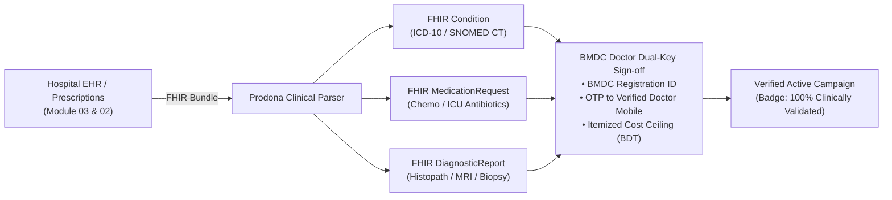
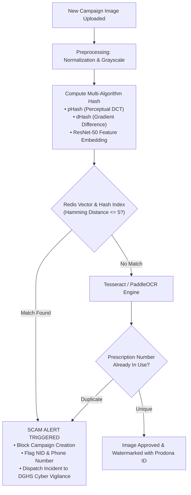
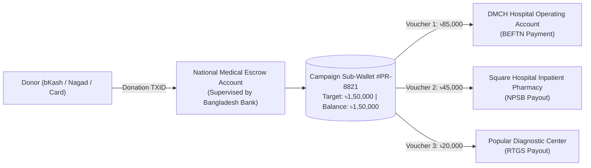
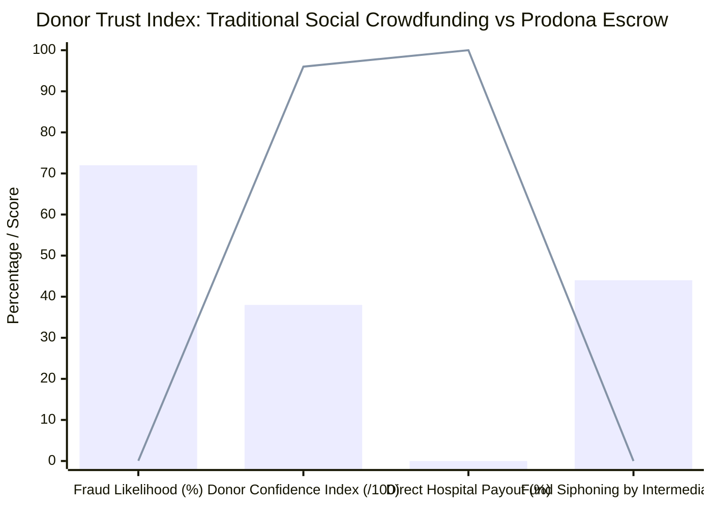
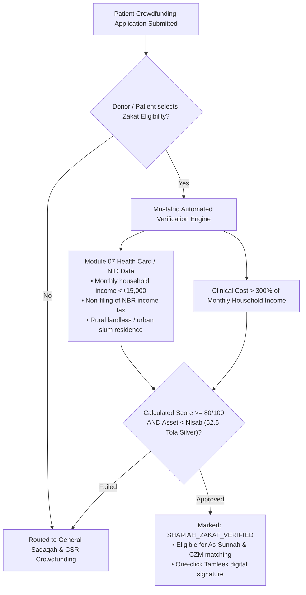
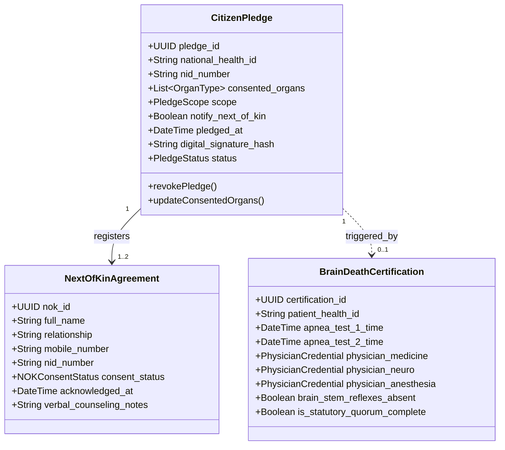
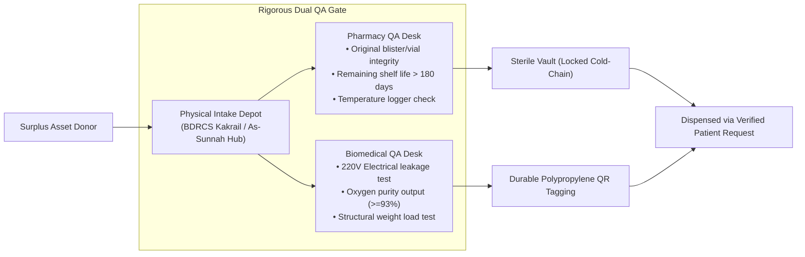
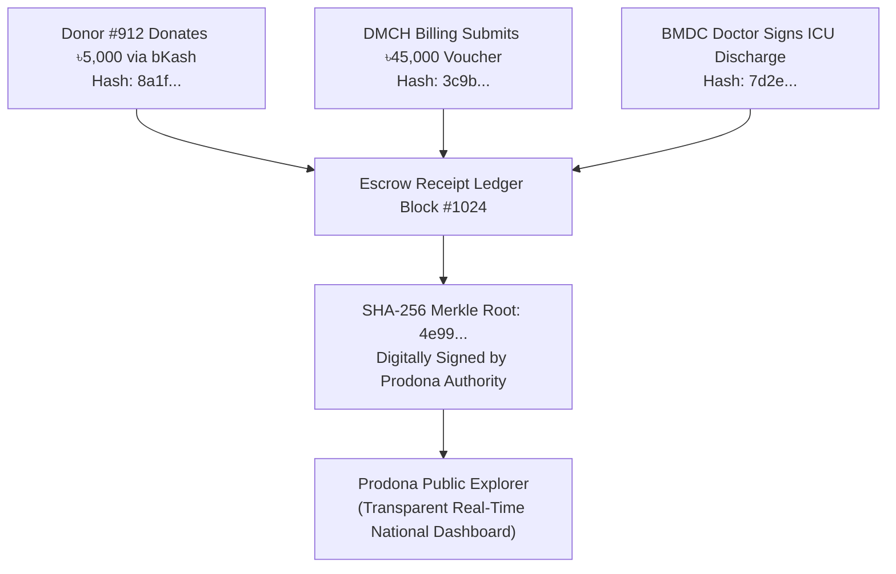
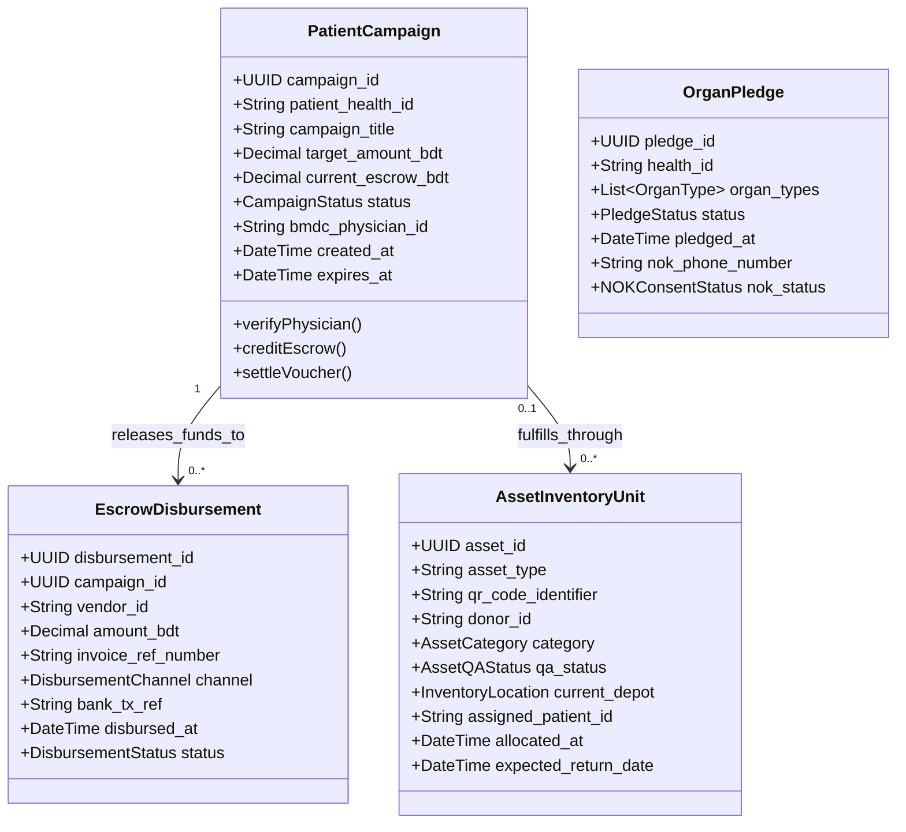
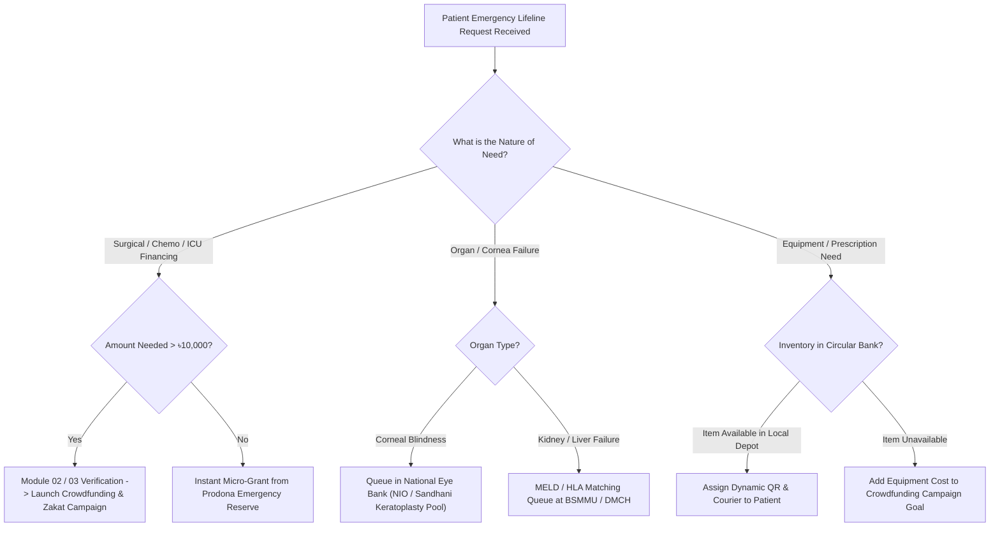

# ⚙️ Prodona (প্রদান / অনুদান) — Functional Features & System Specifications

## Module 09 — Master Feature Matrix, Clinical Verification Engine, Escrow Settlement & Ethical Matching Architecture

---

## 📋 Table of Contents

- [Executive Summary](#executive-summary)
- [Master Feature Priority Matrix (P0 / P1 / P2)](#master-feature-priority-matrix-p0--p1--p2)
- [Feature 1: Fraud-Proof Clinical Crowdfunding Engine](#feature-1-fraud-proof-clinical-crowdfunding-engine)
  - [FHIR R4 Diagnostic Integration & Dual-Key Physician Verification](#fhir-r4-diagnostic-integration--dual-key-physician-verification)
  - [Computer Vision Image Hashing & Duplicate Scam Prevention](#computer-vision-image-hashing--duplicate-scam-prevention)
- [Feature 2: Direct-to-Provider Escrow Settlement Subsystem](#feature-2-direct-to-provider-escrow-settlement-subsystem)
  - [Zero-Cash Intermediary Architecture](#zero-cash-intermediary-architecture)
  - [Itemized Hospital Voucher & Pharmacy Reconciliation](#itemized-hospital-voucher--pharmacy-reconciliation)
- [Feature 3: Shariah-Compliant Zakat & CSR Institutional Gateway](#feature-3-shariah-compliant-zakat--csr-institutional-gateway)
  - [Shariah Classification Matrix & Tamleek Rules](#shariah-classification-matrix--tamleek-rules)
  - [Automated Mustahiq (Destitute Beneficiary) Scoring Engine](#automated-mustahiq-destitute-beneficiary-scoring-engine)
- [Feature 4: National Organ, Corneal & Tissue Registry](#feature-4-national-organ-corneal--tissue-registry)
  - [BD Health Card Digital Pledge Integration](#bd-health-card-digital-pledge-integration)
  - [Statutory 3-Specialist Brain Death Quorum Module](#statutory-3-specialist-brain-death-quorum-module)
- [Feature 5: Living Donor Compatibility & Anti-Trafficking Engine](#feature-5-living-donor-compatibility--anti-trafficking-engine)
  - [HLA & ABO Compatibility Scoring Matrix](#hla--abo-compatibility-scoring-matrix)
  - [Legal Kinship Verification Under Human Organ Transplantation Act](#legal-kinship-verification-under-human-organ-transplantation-act)
- [Feature 6: Circular Medical Equipment & Surplus Medicine Bank](#feature-6-circular-medical-equipment--surplus-medicine-bank)
  - [Intake, Pharmaceutical QA & Biomedical Inspection](#intake-pharmaceutical-qa--biomedical-inspection)
  - [Dynamic QR Asset Tracking & Rotational Loan Management](#dynamic-qr-asset-tracking--rotational-loan-management)
- [Feature 7: Immutable Public Ledger & Impact Dashboard](#feature-7-immutable-public-ledger--impact-dashboard)
  - [Write-Once-Read-Many (WORM) Cryptographic Audit Trail](#write-once-read-many-worm-cryptographic-audit-trail)
  - [Real-Time National Lifeline Telemetry](#real-time-national-lifeline-telemetry)
- [Domain Entity Class Architecture](#domain-entity-class-architecture)
- [Decision Matrix: Patient Lifeline Allocation](#decision-matrix-patient-lifeline-allocation)

---

## Executive Summary

Prodona replaces fractured, scam-ridden charity appeals with an authoritative, interoperable, and ethically verified national healthcare lifeline. The system is engineered around **zero cash leakage**, **absolute clinical proof**, **statutory organ transplant compliance**, and **Shariah-governed philanthropy**.

Every feature is classified by deployment urgency:
- **Priority 0 (P0)**: Mission-critical day-1 capabilities required for clinical safety, fraud prevention, escrow security, and statutory organ registry compliance.
- **Priority 1 (P1)**: Institutional integrations (bKash/Nagad tokenized checkout, As-Sunnah Zakat API, Sandhani Eye Bank dispatch, surplus equipment hubs).
- **Priority 2 (P2)**: Advanced algorithmic enhancements (cross-hospital paired kidney exchange, ML fraud detection, international NRB remittance conduits).

---

## Master Feature Priority Matrix (P0 / P1 / P2)

| Feature ID | Functional Domain | Priority | Capability Description | Primary Integration Points | Target Service Level (SLA) |
|---|---|---|---|---|---|
| **FEAT-09-01** | Crowdfunding | **P0** | **Physician-Signed Campaign Generation**: Auto-extracts diagnoses and cost estimates from EHR; requires BMDC digital signature. | Module 07 (Health Card), Module 02 (Test Reports) | < 30 sec auto-population |
| **FEAT-09-02** | Crowdfunding | **P0** | **Duplicate & Scam Image Hash Filter**: Perceptual hashing (pHash) against national database of ICU and prescription photos. | S3 / MinIO, Redis Perceptual Index | < 200 ms detection latency |
| **FEAT-09-03** | Escrow Finance | **P0** | **Direct-to-Provider Escrow Account**: Multilateral sub-wallet ledger routing funds strictly to hospital/pharmacy bank accounts. | Bangladesh Bank BEFTN/RTGS, Partner Banks | 100% Zero cash diversion |
| **FEAT-09-04** | Escrow Finance | **P0** | **Automated Invoice & Pharmacy Voucher Clearing**: Reconciles itemized medical bills against campaign budget before release. | Module 03 (Prescriptions), Module 06 (Medicine Stock) | Real-time 3-way matching |
| **FEAT-09-05** | Organ Registry | **P0** | **BD Health Card Organ/Cornea Digital Pledge**: Cryptographically bound citizen pledge with NOK emergency dispatch. | Module 07 (Health Card), NID Verification API | Instant ledger sync |
| **FEAT-09-06** | Organ Registry | **P0** | **Statutory 3-Doctor Brain Death Quorum**: Multi-specialist digital certification protocol compliant with 2018 Organ Act. | BMDC Doctor Auth, ICU Bedside Console | Multi-factor quorum auth |
| **FEAT-09-07** | Matching Engine | **P0** | **HLA / MELD Organ Allocation Algorithm**: Automated clinical scoring matching deceased organs to regional waitlist. | National Waitlist Database, Lab HLA Titer | Deterministic scoring < 5 sec |
| **FEAT-09-08** | Zakat Gateway | **P1** | **Shariah Tamleek Grant Engine**: Automated socioeconomic vetting (income < Nisab) with digital patient agency authorization. | BISP / Social Registry, Islamic Banking PSP | Immediate Tamleek voucher |
| **FEAT-09-09** | Circular Bank | **P1** | **Durable Equipment Consignment & Loan**: QR-code tagged rotational loan management for wheelchairs, concentrators, beds. | BDRCS / As-Sunnah Depot Apps | Full custody lifecycle tracking |
| **FEAT-09-10** | Circular Bank | **P1** | **Surplus Specialty Medicine Bank**: Pharmacist-governed intake of unopened chemotherapy, immunosuppressant, and antibiotic vials. | DGHS Drug Administration, WHO Cold-Chain | Min. 180-day expiry enforcement |
| **FEAT-09-11** | Public Ledger | **P1** | **Cryptographic Audit Explorer**: Public explorer tracking every BDT from donor MFS TXID to final hospital settlement receipt. | TimescaleDB, SHA-256 Ledger Tree | 100% Public transparency |
| **FEAT-09-12** | Organ Registry | **P1** | **Sandhani Corneal Retrieval Rapid Dispatch**: Automated hospital demise trigger alerting corneal procurement within 45 mins. | Module 04 (Hospital Bed/ICU), Sandhani Eye Bank | Sub-45 minute dispatch |
| **FEAT-09-13** | Ethics Engine | **P2** | **Living Donor Kinship & Anti-Trafficking Vetting**: Genomic kinship verification and legal affidavit analysis to block commercial trade. | Special Forensic Panel, NID Family Tree | Strict statutory approval |
| **FEAT-09-14** | Matching Engine | **P2** | **Paired Kidney Exchange Engine (PKE)**: Algorithmic cross-matching for incompatible donor-recipient pairs across Bangladesh. | BSMMU / DMCH Transplant Hubs | Multi-center cycle optimization |

---

## Feature 1: Fraud-Proof Clinical Crowdfunding Engine

### FHIR R4 Diagnostic Integration & Dual-Key Physician Verification

Traditional crowdfunding platforms permit anyone to post a plea with unverified text. Prodona reverses this paradigm: campaigns are generated purely from structured clinical data.



1. **Structured Clinical Extraction**: The campaign engine imports HL7 FHIR R4 `Condition` (e.g., `C91.0 Acute lymphoblastic leukemia`), `MedicationRequest`, and `DiagnosticReport` records directly from the hospital EHR.
2. **Physician Dual-Key Sign-off**:
   - The attending physician must authenticate using their registered BMDC number.
   - An asymmetric cryptographic signature is generated using the doctor's private key stored within the **BD Health Card Professional Authenticator**.
   - The physician specifies an **Authorized Medical Expenditure Ceiling** (e.g., ৳3,80,000 for coronary artery bypass graft + 5 days ICU).

### Computer Vision Image Hashing & Duplicate Scam Prevention

To dismantle the widespread syndicate practice of recycling emotive photographs of sick infants or intensive care patients, Prodona implements a multi-tier perceptual hashing pipeline.



---

## Feature 2: Direct-to-Provider Escrow Settlement Subsystem

### Zero-Cash Intermediary Architecture

Prodona completely eliminates physical or digital cash disbursements to patients, relatives, or campaign promoters. 



### Itemized Hospital Voucher & Pharmacy Reconciliation

Disbursement requires a mandatory **3-Way Electronic Voucher Match**:
1. **Invoice Submission**: The hospital billing desk uploads an itemized electronic claim with official institutional tax/VAT registration numbers.
2. **Clinical Consumption Proof**: The clinical team confirms that the surgical procedure was performed or drugs were administered by signing off on the patient's daily electronic nursing administration record (eMAR).
3. **Escrow Liquidation**: Once matched, the escrow engine triggers an automated BEFTN or NPSB transaction directly to the hospital's registered corporate bank account.



---

## Feature 3: Shariah-Compliant Zakat & CSR Institutional Gateway

### Shariah Classification Matrix & Tamleek Rules

Prodona is certified by a council of Islamic jurisprudence scholars to accept and disburse Islamic philanthropic funds according to orthodox Shariah criteria.

| Philanthropic Category | Eligible Use Cases in Prodona | Tamleek (Ownership Transfer) Mechanism | Fund Isolation & Banking Rules |
|---|---|---|---|
| **Zakat (الزكاة)** | Direct surgical costs, lifesaving medicines, blood/chemo for verified *Mustahiq* patients. | Mandatory: Patient signs digital agency contract (*Wakalah*) authorizing direct hospital invoice settlement. | Dedicated Non-Interest Islamic Escrow Account. Zero commingling with interest accounts. |
| **Sadaqah Jariyah (صدقة جارية)** | Purchasing reusable medical equipment (wheelchairs, ICU beds, oxygen concentrators) for the circular bank. | Continuous charitable endowment (*Waqf*); equipment remains the collective property of the community. | Capital Expenditure (CAPEX) asset procurement ledger. |
| **Fidyah & Kaffarah (فدية وكفارة)** | Specialized nutritional supplements and palliative comfort packs for terminal indigent patients. | Direct provision of sustenance items to eligible destitute individuals. | Dedicated Sub-Ledger with food/nutrition vendor routing. |
| **Corporate CSR & Secular Grants** | Hospital infrastructural upgrades, subsidized diagnostics, emergency trauma reserves. | Standard contractual grant agreement with institutional audit trail. | General Escrow Reserve Ledger with 100% tax deduction receipts. |

### Automated Mustahiq (Destitute Beneficiary) Scoring Engine

To determine whether an applicant is eligible for Zakat funds without humiliating physical means tests, Prodona runs an automated algorithmic eligibility score:

$$\text{Mustahiq Score} = w_1 \cdot \text{IncomeDeficit} + w_2 \cdot \text{AssetCeiling} + w_3 \cdot \text{DependencyRatio} + w_4 \cdot \text{DiseaseCatastrophe}$$



---

## Feature 4: National Organ, Corneal & Tissue Registry

### BD Health Card Digital Pledge Integration

Through the **BD Health Card (Module 07)** web portal or mobile app, every adult citizen can securely record an anatomical gift pledge.



### Statutory 3-Specialist Brain Death Quorum Module

To prevent wrongful premature organ procurement and ensure unassailable clinical integrity under the **Human Organ Transplantation Act (Amendment 2018)**, brain death cannot be recorded by a single physician.

Prodona implements a **Cryptographic Quorum Voting Protocol**:
1. **Physician 1 (Medicine Specialist)** enters initial clinical findings: deep coma, absent pupillary reflexes, absent corneal reflexes, absent vestibulo-ocular reflexes.
2. **Physician 2 (Neurologist / Neurosurgeon)** records absence of cranial nerve motor responses and validates standard EEG / Transcranial Doppler findings.
3. **Physician 3 (Anaesthesiologist / Critical Care Specialist)** enters the parameters of two consecutive Apnea Tests (showing $PaCO_2 \ge 60 \text{ mmHg}$ or $\ge 20 \text{ mmHg}$ above baseline without spontaneous respiratory effort).
4. **Digital Quorum Lock**: The status advances to `BRAIN_DEATH_CERTIFIED` only after all three distinct BMDC-registered private keys sign the cryptographic payload within a mandatory 12-hour window.

---

## Feature 5: Living Donor Compatibility & Anti-Trafficking Engine

### HLA & ABO Compatibility Scoring Matrix

For living-related organ donations (primarily kidneys and partial liver lobes), Prodona computes mathematical compatibility while evaluating legal eligibility.

```mermaid
flowchart TD
    Donor["Prospective Living Donor"] & Recipient["Registered Recipient"] --> ABO{"ABO Blood Group Compatible?"}
    
    ABO -->|Incompatible| SwapCheck["Check National Paired Kidney Exchange Pool (Swap)"]
    ABO -->|Compatible| HLA["Compute HLA Mismatch Score<br/>(Loci: HLA-A, HLA-B, HLA-DRB1)"]
    
    HLA --> Crossmatch{"Virtual & Physical Crossmatch<br/>(CDC & Flow Cytometry Titer)"}
    Crossmatch -->|Positive (Titer > 1:32)| HighRisk["Immunological Risk: Desensitization Protocol Required"]
    Crossmatch -->|Negative (Safe)| LegalCheck["Legal Relationship Verification Engine"]
    
    LegalCheck --> Rel{"Authorized Kinship under BD Law?<br/>(Parents, Children, Siblings, Spouse,<br/>Uncles/Aunts, First Cousins)"}
    Rel -->|Non-Relative / Commercial Suspect| LegalBlock["REJECTED: Violation of Section 9 Organ Act 2018"]
    Rel -->|Verified Relative| EthicalBoard["Referred to Statutory Hospital Ethics Committee"]
```

### Legal Kinship Verification Under Human Organ Transplantation Act

The 2018 Amendment expanded the definition of legal living donors to: parents, children, siblings, paternal/maternal aunts and uncles, first cousins, and spouse. To eradicate illegal organ broker rackets (such as historical kidney harvesting networks in Joypurhat and Kalai), Prodona enforces:
1. **NID Family Tree Cross-Matching**: Automated traversal of Election Commission / NID database trees to verify common grandparents or parents.
2. **Genomic Kinship Score**: Mandating short tandem repeat (STR) DNA kinship testing at the National Forensic DNA Profiling Laboratory for non-immediate relatives before surgical clearance.

---

## Feature 6: Circular Medical Equipment & Surplus Medicine Bank

### Intake, Pharmaceutical QA & Biomedical Inspection



### Dynamic QR Asset Tracking & Rotational Loan Management

Every durable medical device circulating in the Prodona network is stamped with an indelible industrial QR code:
- **Scan by Volunteer**: Logs maintenance events, filter replacements (for oxygen concentrators), battery health, and sanitization history.
- **Scan by Patient/Caregiver**: Displays user instructional videos in Bangla, troubleshooting tips, and an automated "Return Device" button once the patient no longer requires the equipment.

---

## Feature 7: Immutable Public Ledger & Impact Dashboard

### Write-Once-Read-Many (WORM) Cryptographic Audit Trail

Every financial transaction, clinical verification sign-off, and asset dispatch is recorded in a tamper-evident audit ledger using append-only Merkle-tree hashing:

$$\text{BlockHash}_n = \text{SHA256}(\text{BlockHash}_{n-1} \parallel \text{Timestamp} \parallel \text{PayloadHash} \parallel \text{Signatures})$$



### Real-Time National Lifeline Telemetry

The public dashboard publishes real-time national impact metrics accessible by citizens, journalists, and regulatory authorities:
- **Total Medical Aid Disbursed (BDT)**
- **Active Hospital Escrow Balances**
- **Verified Organ Pledges Recorded**
- **Cadaveric & Living Transplants Facilitated**
- **Corneas Grafted & Sight Restored**
- **Circulating Assistive Equipment Units**

---

## Domain Entity Class Architecture



---

## Decision Matrix: Patient Lifeline Allocation



---

> [!NOTE]
> All automated algorithms (HLA matching, Mustahiq economic vetting, duplicate image hashing) execute in isolated asynchronous worker pods. No sensitive patient health information (PHI) is exposed to public crowdfunding feeds without de-identification protocols.
