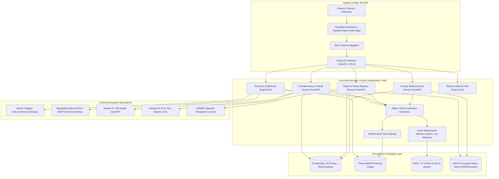
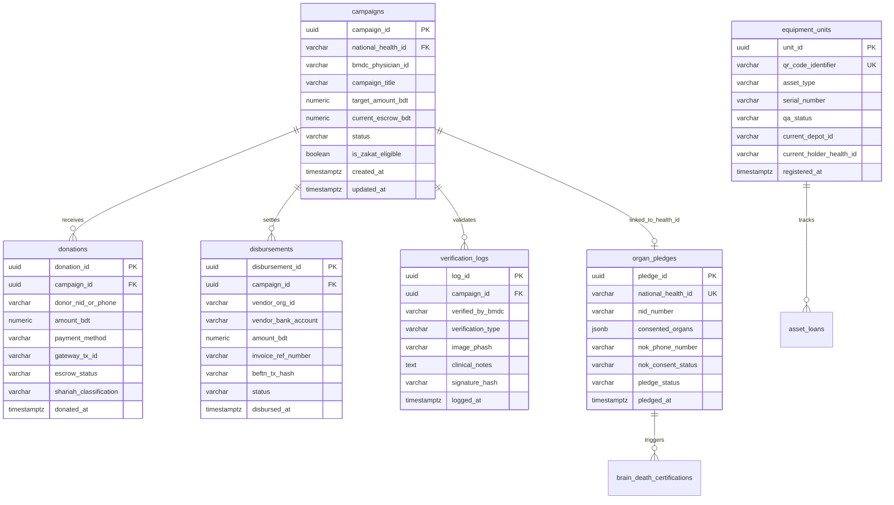
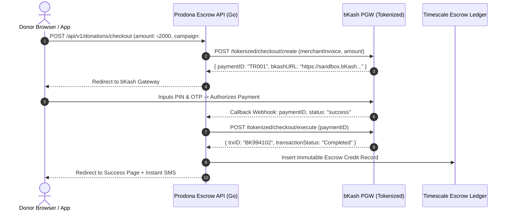
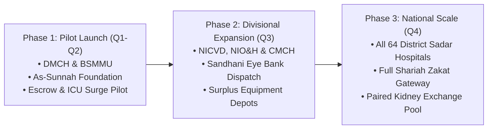

# 🛠️ Prodona (প্রদান / অনুদান) — Technical Implementation & Engineering Specifications

## Module 09 — Microservices Topology, PostgreSQL DDL, HL7 FHIR R4 Profiles, Escrow Integration & Deployment Architecture

---

## 📋 Table of Contents

- [Executive Summary](#executive-summary)
- [Microservices Architecture Topology](#microservices-architecture-topology)
- [PostgreSQL 16 & TimescaleDB Data Architecture](#postgresql-16--timescaledb-data-architecture)
  - [Entity-Relationship Diagram (ERD)](#entity-relationship-diagram-erd)
  - [Production Database Schema (DDL)](#production-database-schema-ddl)
- [HL7 FHIR R4 Profile Mapping & Data Contracts](#hl7-fhir-r4-profile-mapping--data-contracts)
  - [FHIR Condition Profile (Clinical Justification)](#fhir-condition-profile-clinical-justification)
  - [FHIR Consent Profile (Organ Donation Pledge)](#fhir-consent-profile-organ-donation-pledge)
  - [FHIR Claim Profile (Hospital Escrow Settlement)](#fhir-claim-profile-hospital-escrow-settlement)
- [Payment Gateway & Escrow Settlement Subsystem](#payment-gateway--escrow-settlement-subsystem)
  - [bKash Tokenized Checkout Architecture](#bkash-tokenized-checkout-architecture)
  - [Nagad Gateway Integration](#nagad-gateway-integration)
  - [BEFTN / NPSB Automated Payout Reconciliation](#beftn--npsb-automated-payout-reconciliation)
- [Anti-Fraud & WORM Cryptographic Ledger Implementation](#anti-fraud--worm-cryptographic-ledger-implementation)
- [REST & WebSocket API Specifications](#rest--websocket-api-specifications)
- [Deployment Roadmap & Pilot Rollout Strategy](#deployment-roadmap--pilot-rollout-strategy)

---

## Executive Summary

The Prodona technical engine is built for extreme financial integrity, high-throughput payment ingestion, and cryptographic immutability. Because life-or-death surgeries and anatomical donations depend on the system, the infrastructure guarantees **zero single points of failure**, **sub-second webhook processing**, **strict separation of escrow balances**, and **complete adherence to international healthcare standards (HL7 FHIR R4)**.

---

## Microservices Architecture Topology

The platform adopts a decoupled polyglot microservices model:
- **FastAPI (Python 3.11)**: Powers clinical verification, FHIR parsing, medical image hashing, and matching algorithms.
- **Go (Golang 1.22)**: Handles high-throughput payment webhooks, tokenized checkout redirects, and the escrow ledger engine.
- **PostgreSQL 16 with TimescaleDB**: Primary relational store for transactional state and hypertable event logs.
- **Redis 7.2 Cluster**: High-speed caching, distributed locks for escrow settlements, and perceptual hash lookups.
- **MinIO / AWS S3**: S3-compliant object storage for encrypted diagnostic scans, signed affidavits, and hospital invoices with SSE-KMS encryption.



---

## PostgreSQL 16 & TimescaleDB Data Architecture

### Entity-Relationship Diagram (ERD)



### Production Database Schema (DDL)

```sql
-- PostgreSQL 16 Production DDL for Prodona National Platform
CREATE EXTENSION IF NOT EXISTS "uuid-ossp";
CREATE EXTENSION IF NOT EXISTS "pgcrypto";

-- Custom Enum Types
CREATE TYPE campaign_status_enum AS ENUM (
    'DRAFT', 'PHYSICIAN_VERIFIED', 'FUNDING_ACTIVE', 
    'FUNDED', 'PARTIALLY_DISBURSED', 'DISBURSED', 'AUDITED', 'CANCELLED'
);

CREATE TYPE escrow_status_enum AS ENUM (
    'INITIATED', 'AUTHORIZED_BY_GATEWAY', 'SETTLED_IN_ESCROW', 
    'ALLOCATED_TO_VENDOR', 'REFUNDED'
);

CREATE TYPE shariah_type_enum AS ENUM (
    'GENERAL_SADAQAH', 'ZAKAT', 'SADAQAH_JARIYAH', 'FIDYAH_KAFFARAH', 'CORPORATE_CSR'
);

CREATE TYPE pledge_status_enum AS ENUM (
    'PLEDGED', 'NOK_ACKNOWLEDGED', 'TRIGGERED_ICU_ALERT', 
    'BRAIN_DEATH_CONFIRMED', 'HARVESTING', 'TRANSPLANTED', 'REVOKED'
);

CREATE TYPE qa_status_enum AS ENUM (
    'PENDING_INSPECTION', 'PASSED_STERILE', 'PASSED_CALIBRATED', 'FAILED_DESTROYED'
);

-- 1. Campaigns Table
CREATE TABLE campaigns (
    campaign_id UUID PRIMARY KEY DEFAULT gen_random_uuid(),
    national_health_id VARCHAR(32) NOT NULL,
    bmdc_physician_id VARCHAR(32) NOT NULL,
    hospital_org_code VARCHAR(32) NOT NULL,
    campaign_title VARCHAR(255) NOT NULL,
    clinical_summary TEXT NOT NULL,
    icd10_code VARCHAR(16) NOT NULL,
    target_amount_bdt NUMERIC(12, 2) NOT NULL CHECK (target_amount_bdt > 0),
    current_escrow_bdt NUMERIC(12, 2) NOT NULL DEFAULT 0.00 CHECK (current_escrow_bdt >= 0),
    status campaign_status_enum NOT NULL DEFAULT 'DRAFT',
    is_zakat_eligible BOOLEAN NOT NULL DEFAULT FALSE,
    mustahiq_score NUMERIC(5, 2) DEFAULT 0.00,
    physician_signature_hash VARCHAR(128) NOT NULL,
    created_at TIMESTAMPTZ NOT NULL DEFAULT CURRENT_TIMESTAMP,
    expires_at TIMESTAMPTZ NOT NULL,
    updated_at TIMESTAMPTZ NOT NULL DEFAULT CURRENT_TIMESTAMP
);

CREATE INDEX idx_campaigns_health_id ON campaigns(national_health_id);
CREATE INDEX idx_campaigns_status ON campaigns(status);
CREATE INDEX idx_campaigns_zakat ON campaigns(is_zakat_eligible) WHERE is_zakat_eligible = TRUE;

-- 2. Donations Table
CREATE TABLE donations (
    donation_id UUID PRIMARY KEY DEFAULT gen_random_uuid(),
    campaign_id UUID NOT NULL REFERENCES campaigns(campaign_id) ON DELETE RESTRICT,
    donor_identifier VARCHAR(64) NOT NULL, -- Anonymized Hash or Phone
    amount_bdt NUMERIC(12, 2) NOT NULL CHECK (amount_bdt >= 10.00),
    payment_method VARCHAR(32) NOT NULL, -- 'BKASH', 'NAGAD', 'CARD', 'BANK'
    gateway_tx_id VARCHAR(128) NOT NULL UNIQUE,
    escrow_status escrow_status_enum NOT NULL DEFAULT 'INITIATED',
    shariah_classification shariah_type_enum NOT NULL DEFAULT 'GENERAL_SADAQAH',
    is_anonymous BOOLEAN NOT NULL DEFAULT FALSE,
    donated_at TIMESTAMPTZ NOT NULL DEFAULT CURRENT_TIMESTAMP
);

CREATE INDEX idx_donations_campaign_id ON donations(campaign_id);
CREATE INDEX idx_donations_gateway_tx ON donations(gateway_tx_id);

-- 3. Disbursements Table (Direct Vendor Settled)
CREATE TABLE disbursements (
    disbursement_id UUID PRIMARY KEY DEFAULT gen_random_uuid(),
    campaign_id UUID NOT NULL REFERENCES campaigns(campaign_id) ON DELETE RESTRICT,
    vendor_org_name VARCHAR(128) NOT NULL, -- e.g. "Dhaka Medical College Hospital Accounts"
    vendor_routing_no VARCHAR(16) NOT NULL,
    vendor_bank_account VARCHAR(32) NOT NULL,
    amount_bdt NUMERIC(12, 2) NOT NULL CHECK (amount_bdt > 0),
    invoice_ref_number VARCHAR(64) NOT NULL,
    invoice_document_url VARCHAR(512) NOT NULL,
    beftn_eft_trace_no VARCHAR(64) UNIQUE,
    approved_by_officer_id VARCHAR(32) NOT NULL,
    disbursed_at TIMESTAMPTZ NOT NULL DEFAULT CURRENT_TIMESTAMP
);

CREATE INDEX idx_disbursements_campaign ON disbursements(campaign_id);

-- 4. Organ Pledges Registry Table
CREATE TABLE organ_pledges (
    pledge_id UUID PRIMARY KEY DEFAULT gen_random_uuid(),
    national_health_id VARCHAR(32) NOT NULL UNIQUE,
    nid_number VARCHAR(32) NOT NULL,
    consented_organs JSONB NOT NULL, -- ['CORNEA', 'KIDNEY', 'LIVER', 'HEART']
    nok_name VARCHAR(128) NOT NULL,
    nok_relationship VARCHAR(32) NOT NULL,
    nok_phone_number VARCHAR(16) NOT NULL,
    nok_consent_status VARCHAR(32) NOT NULL DEFAULT 'PENDING_ACKNOWLEDGMENT',
    pledge_status pledge_status_enum NOT NULL DEFAULT 'PLEDGED',
    citizen_signature_token VARCHAR(256) NOT NULL,
    pledged_at TIMESTAMPTZ NOT NULL DEFAULT CURRENT_TIMESTAMP,
    updated_at TIMESTAMPTZ NOT NULL DEFAULT CURRENT_TIMESTAMP
);

CREATE INDEX idx_organ_pledges_health_id ON organ_pledges(national_health_id);
CREATE INDEX idx_organ_pledges_status ON organ_pledges(pledge_status);

-- 5. Circular Medical Equipment & Medicine Units Table
CREATE TABLE equipment_units (
    unit_id UUID PRIMARY KEY DEFAULT gen_random_uuid(),
    qr_code_identifier VARCHAR(64) NOT NULL UNIQUE,
    asset_type VARCHAR(64) NOT NULL, -- 'WHEELCHAIR', 'OXYGEN_CONCENTRATOR', 'CHEMOTHERAPY_VIAL'
    brand_model VARCHAR(128),
    serial_number VARCHAR(64),
    expiry_date DATE, -- NULL for durable equipment, NOT NULL for medicines
    qa_status qa_status_enum NOT NULL DEFAULT 'PENDING_INSPECTION',
    inspector_notes TEXT,
    current_depot_id VARCHAR(64) NOT NULL, -- e.g. 'DEPOT-BDRCS-KAKRAIL-01'
    current_holder_health_id VARCHAR(32),
    allocated_at TIMESTAMPTZ,
    expected_return_date DATE,
    registered_at TIMESTAMPTZ NOT NULL DEFAULT CURRENT_TIMESTAMP
);

CREATE INDEX idx_equipment_qr ON equipment_units(qr_code_identifier);
CREATE INDEX idx_equipment_qa ON equipment_units(qa_status);

-- 6. Verification & Anti-Fraud Logs (WORM Table)
CREATE TABLE verification_logs (
    log_id UUID PRIMARY KEY DEFAULT gen_random_uuid(),
    campaign_id UUID NOT NULL REFERENCES campaigns(campaign_id),
    verified_by_bmdc VARCHAR(32) NOT NULL,
    verification_type VARCHAR(32) NOT NULL, -- 'CLINICAL_EVAL', 'PHASH_CHECK', 'VOUCHER_AUDIT'
    image_phash VARCHAR(64),
    clinical_notes TEXT NOT NULL,
    cryptographic_signature_hash VARCHAR(128) NOT NULL,
    logged_at TIMESTAMPTZ NOT NULL DEFAULT CURRENT_TIMESTAMP
);

CREATE INDEX idx_verif_phash ON verification_logs(image_phash);
```

---

## HL7 FHIR R4 Profile Mapping & Data Contracts

Prodona models its core clinical data on international **HL7 FHIR Release 4 (R4)** standards, ensuring full interoperability with hospital electronic health records across Bangladesh.

### FHIR Condition Profile (Clinical Justification)

```json
{
  "resourceType": "Condition",
  "id": "prodona-condition-8821",
  "meta": {
    "profile": ["http://dghs.gov.bd/fhir/StructureDefinition/ProdonaClinicalJustification"]
  },
  "clinicalStatus": {
    "coding": [{
      "system": "http://terminology.hl7.org/CodeSystem/condition-clinical",
      "code": "active",
      "display": "Active"
    }]
  },
  "verificationStatus": {
    "coding": [{
      "system": "http://terminology.hl7.org/CodeSystem/condition-ver-status",
      "code": "confirmed",
      "display": "Confirmed"
    }]
  },
  "category": [{
    "coding": [{
      "system": "http://terminology.hl7.org/CodeSystem/condition-category",
      "code": "encounter-diagnosis",
      "display": "Encounter Diagnosis"
    }]
  }],
  "severity": {
    "coding": [{
      "system": "http://snomed.info/sct",
      "code": "24484000",
      "display": "Severe"
    }]
  },
  "code": {
    "coding": [{
      "system": "http://hl7.org/fhir/sid/icd-10",
      "code": "C91.0",
      "display": "Acute lymphoblastic leukemia"
    }]
  },
  "subject": {
    "reference": "Patient/BD-HID-88410294",
    "display": "Md. Rafsan Hossain"
  },
  "asserter": {
    "reference": "Practitioner/BMDC-A-44821",
    "display": "Prof. Dr. Rafiqul Islam, Pediatric Hemato-Oncology, DMCH"
  },
  "recordedDate": "2026-11-03T10:30:00+06:00"
}
```

### FHIR Consent Profile (Organ Donation Pledge)

```json
{
  "resourceType": "Consent",
  "id": "prodona-organ-pledge-9921",
  "status": "active",
  "scope": {
    "coding": [{
      "system": "http://terminology.hl7.org/CodeSystem/consentscope",
      "code": "patient-privacy",
      "display": "Privacy Consent"
    }]
  },
  "category": [{
    "coding": [{
      "system": "http://loinc.org",
      "code": "64292-6",
      "display": "Organ and tissue donation Consent"
    }]
  }],
  "patient": {
    "reference": "Patient/BD-HID-1029384",
    "display": "Kamrul Hasan (NID: 198826912340001)"
  },
  "dateTime": "2026-08-15T14:22:10+06:00",
  "performer": [{
    "reference": "Patient/BD-HID-1029384"
  }],
  "provision": {
    "type": "permit",
    "purpose": [{
      "system": "http://terminology.hl7.org/CodeSystem/v3-ActReason",
      "code": "ETR",
      "display": "Emergency Treatment & Cadaveric Transplantation"
    }],
    "class": [
      {
        "system": "http://snomed.info/sct",
        "code": "181162001",
        "display": "Entire cornea (body structure)"
      },
      {
        "system": "http://snomed.info/sct",
        "code": "64033007",
        "display": "Entire kidney (body structure)"
      }
    ]
  }
}
```

### FHIR Claim Profile (Hospital Escrow Settlement)

```json
{
  "resourceType": "Claim",
  "id": "prodona-escrow-claim-4412",
  "status": "active",
  "type": {
    "coding": [{
      "system": "http://terminology.hl7.org/CodeSystem/claim-type",
      "code": "institutional",
      "display": "Institutional"
    }]
  },
  "use": "claim",
  "patient": {
    "reference": "Patient/BD-HID-88410294"
  },
  "created": "2026-11-03T11:45:00+06:00",
  "provider": {
    "reference": "Organization/DMCH-HOSP-01",
    "display": "Dhaka Medical College Hospital"
  },
  "priority": {
    "coding": [{
      "code": "urgent"
    }]
  },
  "item": [
    {
      "sequence": 1,
      "productOrService": {
        "text": "Surgical Consumables & Heart-Lung Machine Pack"
      },
      "net": {
        "value": 65000.00,
        "currency": "BDT"
      }
    },
    {
      "sequence": 2,
      "productOrService": {
        "text": "Cardiovascular ICU Bed & Ventilation (48 Hours)"
      },
      "net": {
        "value": 20000.00,
        "currency": "BDT"
      }
    }
  ],
  "total": {
    "value": 85000.00,
    "currency": "BDT"
  }
}
```

---

## Payment Gateway & Escrow Settlement Subsystem

### bKash Tokenized Checkout Architecture

Prodona integrates directly with bKash Tokenized Checkout API v1.2.0 to support 1-click micro-donations and recurring monthly Sadaqah pledges.



```go
// Sample Go Implementation: bKash Tokenized Payment Execution
package escrow

import (
    "bytes"
    "encoding/json"
    "fmt"
    "net/http"
    "time"
)

type BkashExecuteRequest struct {
    PaymentID string `json:"paymentID"`
}

type BkashExecuteResponse struct {
    StatusCode        string `json:"statusCode"`
    StatusMessage     string `json:"statusMessage"`
    PaymentID         string `json:"paymentID"`
    TrxID             string `json:"trxID"`
    Amount            string `json:"amount"`
    CustomerMsisdn    string `json:"customerMsisdn"`
    TransactionStatus string `json:"transactionStatus"`
}

func ExecuteBkashDonation(idToken, paymentID string) (*BkashExecuteResponse, error) {
    url := "https://tokenized.pay.bKash.com/v1.2.0-beta/tokenized/checkout/execute"
    payload := BkashExecuteRequest{PaymentID: paymentID}
    buf, _ := json.Marshal(payload)

    req, err := http.NewRequest("POST", url, bytes.NewBuffer(buf))
    if err != nil {
        return nil, err
    }

    req.Header.Set("Content-Type", "application/json")
    req.Header.Set("Authorization", idToken)
    req.Header.Set("X-APP-Key", "bkash_prodona_app_key")

    client := &http.Client{Timeout: 10 * time.Second}
    resp, err := client.Do(req)
    if err != nil {
        return nil, fmt.Errorf("bKash gateway connection failure: %w", err)
    }
    defer resp.Body.Close()

    var execResp BkashExecuteResponse
    if err := json.NewDecoder(resp.Body).Decode(&execResp); err != nil {
        return nil, err
    }

    if execResp.TransactionStatus != "Completed" {
        return nil, fmt.Errorf("payment failed with status: %s", execResp.StatusMessage)
    }

    return &execResp, nil
}
```

### Nagad Gateway Integration

- Communicates with Nagad PGW using asymmetric RSA private/public key pairs.
- Every payment request is signed with `SHA256withRSA` using Prodona's private key.
- Callback verification verifies Nagad's signature on the return payload to prevent spoofing.

### BEFTN / NPSB Automated Payout Reconciliation

Disbursements to hospitals occur through automated API connections to partner commercial banks (e.g., Islami Bank Bangladesh, BRAC Bank, Sonali Bank):
1. **BEFTN File Generation**: Payouts batch every 4 hours into Bangladesh Electronic Funds Transfer Network (BEFTN) encrypted ISO 20022 clearing files.
2. **Instant NPSB Clearing**: For emergency ICU admissions, funds clear in sub-minute real time via National Payment Switch Bangladesh (NPSB) API integrations.

---

## Anti-Fraud & WORM Cryptographic Ledger Implementation

### Perceptual Image Hashing (Python Pipeline)

```python
# Anti-fraud image duplicate screening engine
import cv2
import imagehash
from PIL import Image
import redis

redis_client = redis.Redis(host="redis-cluster", port=6379, db=0)

def screen_medical_image(image_path: str) -> tuple[bool, str]:
    """
    Computes perceptual hash (pHash) and checks against existing
    campaign prescription and ICU image databases.
    Returns: (is_duplicate: bool, hash_hex: str)
    """
    image = Image.open(image_path).convert("L")
    # Compute 64-bit DCT perceptual hash
    computed_phash = str(imagehash.phash(image))
    
    # Check Hamming distance against Redis vector/hash set
    existing_hashes = redis_client.smembers("prodona:image_phashes")
    for raw_hash in existing_hashes:
        existing_str = raw_hash.decode("utf-8")
        # Calculate Hamming distance
        dist = imagehash.hex_to_hash(computed_phash) - imagehash.hex_to_hash(existing_str)
        if dist <= 5:  # Tolerance threshold for cropped/compressed re-uploads
            return True, computed_phash
            
    # If unique, register hash in database
    redis_client.sadd("prodona:image_phashes", computed_phash)
    return False, computed_phash
```

---

## REST & WebSocket API Specifications

### Core REST Endpoints

| Method | Route | Description | Auth Required |
|---|---|---|---|
| `POST` | `/api/v1/campaigns/create-from-ehr` | Ingests FHIR condition & signs campaign. | BMDC Doctor (JWT) |
| `GET` | `/api/v1/campaigns/{id}` | Fetches public campaign details & verification proof. | Public |
| `POST` | `/api/v1/donations/checkout` | Initiates MFS payment (bKash/Nagad/SSLCommerz). | Public / Donor |
| `POST` | `/api/v1/escrow/disburse` | Settles hospital invoice from campaign escrow. | Hospital Accounts + Auditor |
| `POST` | `/api/v1/organ-pledge/register` | Signs digital organ/corneal donation pledge. | Citizen (Health Card Auth) |
| `POST` | `/api/v1/organ-pledge/brain-death` | Records 3-doctor statutory brain death quorum. | Statutory 3-MD Quorum |
| `POST` | `/api/v1/assets/register-surplus` | Registers surplus equipment or specialty medicine. | Donor |
| `POST` | `/api/v1/assets/{qr_code}/inspect` | Pharmacist / Biomedical QA inspection sign-off. | QA Inspector (mTLS) |

### WebSocket Real-Time Escrow Ticker Specification

- **Endpoint**: `wss://api.prodona.gov.bd/ws/v1/campaigns/{campaign_id}/ticker`
- **Protocol**: JSON over Secure WebSocket
- **Payload Broadcast**:

```json
{
  "event": "ESCROW_DONATION_RECEIVED",
  "campaign_id": "88410294-3b1a-4281-a99f-09214a1c5520",
  "amount_bdt": 2000.00,
  "donor_display": "Anonymous Philanthropist (Dhaka)",
  "new_current_escrow_bdt": 128500.00,
  "target_amount_bdt": 150000.00,
  "percentage_funded": 85.66,
  "tx_hash": "e3b0c44298fc1c149afbf4c8996fb92427ae41e4649b934ca495991b7852b855",
  "timestamp": "2026-11-03T11:46:12Z"
}
```

---

## Deployment Roadmap & Pilot Rollout Strategy



### Phase 1: High-Acuity Pilot (Months 1–6)
- **Clinical Anchor**: Dhaka Medical College Hospital (DMCH) Emergency & Pediatric Surgery Units; Bangabandhu Sheikh Mujib Medical University (BSMMU) Transplant Unit.
- **Philanthropic Partner**: As-Sunnah Foundation (Zakat distribution) and Quantum Foundation.
- **Milestone**: 500 verified patient crowdfunding campaigns completed; zero escrow cash leakage; initial 5 cadaveric and 50 corneal grafts facilitated.

### Phase 2: Specialized Institute Rollout (Months 7–12)
- **Clinical Anchor**: National Institute of Cardiovascular Diseases (NICVD) and National Institute of Ophthalmology & Hospital (NIO&H).
- **Logistics Integration**: Bangladesh Red Crescent Society (BDRCS) central depots managing circular assistive equipment.
- **Milestone**: 100,000 active organ pledges registered on the BD Health Card.

### Phase 3: Nationwide Deployment (Year 2)
- Integration across all 64 District Sadar Hospitals, 495 Upazila Health Complexes (UHC), and all major private hospital billing desks.
- Real-time link with the Ministry of Social Welfare and Prime Minister’s Welfare Fund.

---

> [!IMPORTANT]
> **Production Deployment Checklist**:
> 1. Set environment variables `PRODONA_ESCROW_ENCRYPTION_KEY` and `BKASH_APP_SECRET` using Vault or AWS Secrets Manager.
> 2. Ensure MinIO buckets are mounted with object locking enabled (`WORM` compliance).
> 3. Verify mTLS certificates for all hospital billing API gateways before routing live payment claims.
