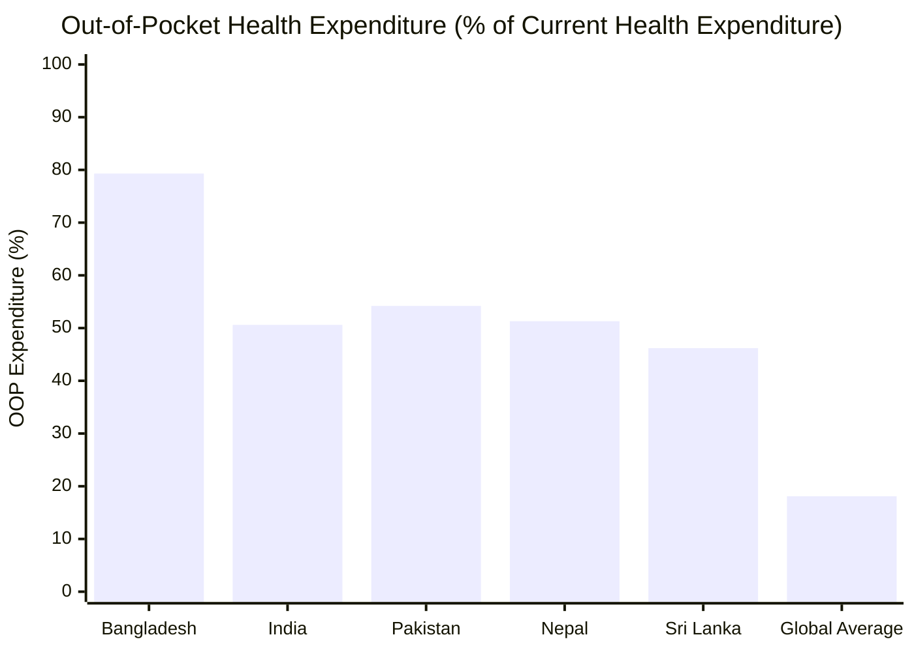
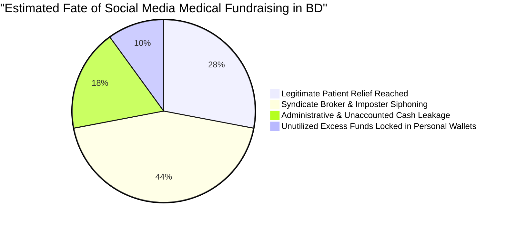
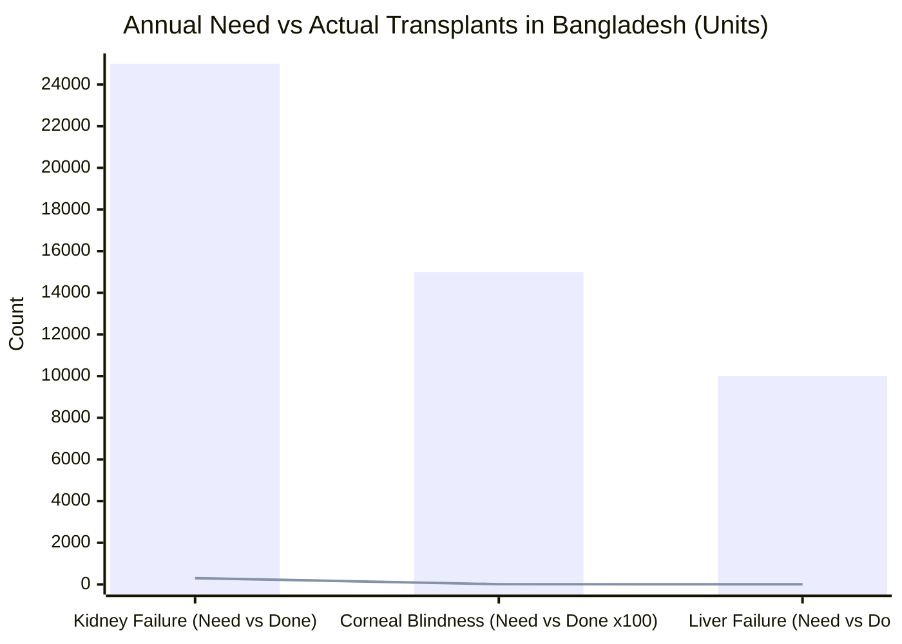
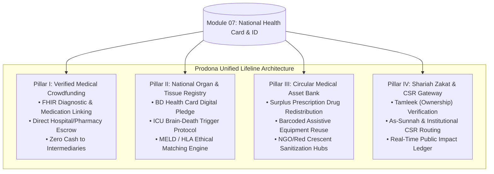
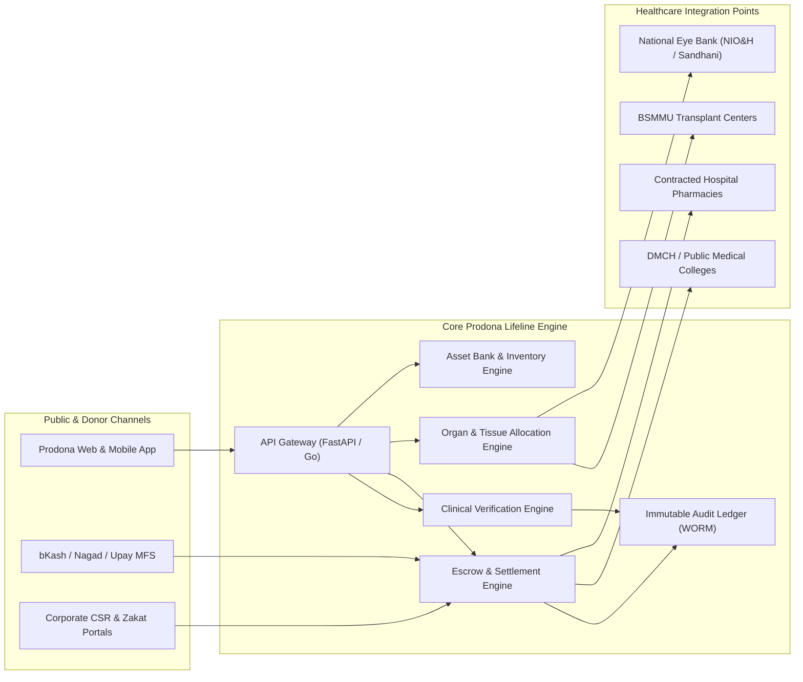
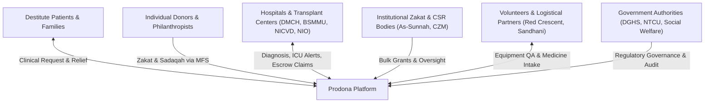
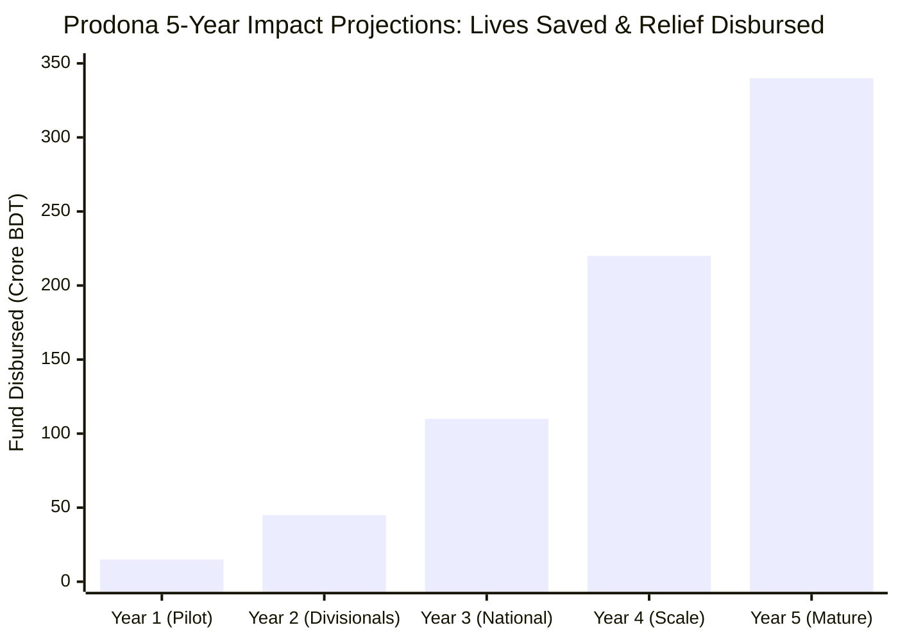
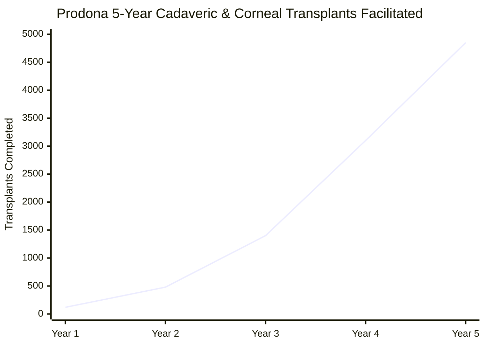
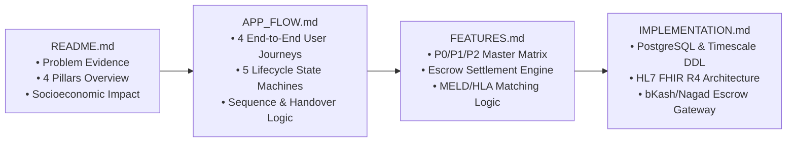

# 🤲 Prodona (প্রদান / অনুদান) — National Medical Crowdfunding, Organ Donation & Patient Lifeline System

## Module 09 — Verified Clinical Crowdfunding, National Cadaveric & Tissue Registry, Circular Medical Asset Bank & Shariah Zakat Gateway for Bangladesh

---

## 📋 Table of Contents

- [Executive Summary](#executive-summary)
- [The Bangladesh Healthcare Crisis: Empirical Evidence](#the-bangladesh-healthcare-crisis-empirical-evidence)
  - [79.31% Out-of-Pocket Expenditure & Medical Impoverishment](#7931-out-of-pocket-expenditure--medical-impoverishment)
  - [The Social Media Medical Fundraising Syndicate & Scams](#the-social-media-medical-fundraising-syndicate--scams)
  - [The National Organ & Corneal Donation Void](#the-national-organ--corneal-donation-void)
  - [The Asset Waste Paradox: Idle Equipment & Surplus Medicine](#the-asset-waste-paradox-idle-equipment--surplus-medicine)
  - [The Bureaucratic Inertia of State Welfare Funds](#the-bureaucratic-inertia-of-state-welfare-funds)
- [Prodona Core Architecture: The Four Pillars](#prodona-core-architecture-the-four-pillars)
- [System Architecture Blueprint](#system-architecture-blueprint)
- [Target Stakeholders & User Ecosystem](#target-stakeholders--user-ecosystem)
- [Comparative Analysis: Prodona vs Status Quo](#comparative-analysis-prodona-vs-status-quo)
- [Impact Benchmarks & Five-Year Target Metrics](#impact-benchmarks--five-year-target-metrics)
- [Legal, Ethical & Shariah Compliance Framework](#legal-ethical--shariah-compliance-framework)
- [Module Roadmap & Technical Documentation Index](#module-roadmap--technical-documentation-index)

---

## Executive Summary

Across Bangladesh, healthcare is the single largest financial shock capable of destroying a family's economic future overnight. When a catastrophic illness—such as pediatric leukemia, acute myocardial infarction, end-stage kidney failure, or polytrauma from a highway crash—strikes an impoverished or lower-middle-class family, the lack of universal health coverage forces them to liquidate farmlands, sell cattle, pull children out of schooling, or turn to high-interest predatory micro-lenders. 

Concurrently, Bangladesh is a deeply philanthropic society. Citizens donate tens of billions of Taka every year in voluntary charity (*Sadaqah*) and mandatory Islamic tithes (*Zakat*). However, this generosity is severely exploited:
- **Unverified Social Media Campaigns**: Syndicates fabricate hospital admission slips and prescription pads, circulating emotive pictures on Facebook to siphon millions of Taka into personal bKash or Nagad accounts.
- **Critical Organ Deficit**: Although thousands die every year of End-Stage Renal Disease (ESRD) and liver cirrhosis, and over 1.5 million citizens suffer from reversible corneal blindness, cadaveric (brain-dead) organ donation remains virtually non-existent due to mistrust, lack of a centralized registry, and fragmented hospital protocols.
- **Idle Medical Resources**: Millions of Taka worth of durable medical equipment (wheelchairs, oxygen concentrators, hospital beds, CPAP machines) and unexpired specialized medications gather dust in affluent homes after a patient's recovery or passing, while adjacent public hospital wards suffer acute shortages.

> [!IMPORTANT]
> **Prodona (প্রদান / অনুদান — "National Lifeline")** is the unified national digital platform that bridges medical distress with philanthropic capital and lifesaving anatomical gifts. Tied permanently to the **National Digital Health ID (Module 07)**, Prodona ensures that **100% of crowdfunding campaigns are clinically verified by certified physicians**, **all donations sit in an escrow smart ledger disbursed strictly to hospital and pharmacy accounts**, **citizens can digitally register legally binding posthumous organ/corneal pledges**, and **surplus medical assets are recirculated to verified impoverished patients**.

---

## The Bangladesh Healthcare Crisis: Empirical Evidence

### 79.31% Out-of-Pocket Expenditure & Medical Impoverishment

According to the latest **World Bank (2023) and Bangladesh National Health Accounts (BNHA-VI)** data, Bangladesh exhibits one of the highest Out-of-Pocket (OOP) healthcare expenditure rates globally.

- **Catastrophic Health Expenditure (CHE)**: Over **16.4% of households** in Bangladesh experience catastrophic healthcare payments (defined as healthcare spending exceeding 10% of total household consumption).
- **Poverty Traps**: Research from the Health Economics Unit (HEU) of the Ministry of Health and Family Welfare (MOHFW) reveals that **5.0 to 6.2 million citizens are forced below the national poverty line every year** solely due to out-of-pocket medical bills.
- **Medication Burdens**: Nearly **64% of total out-of-pocket expenditure** is spent directly on retail pharmaceutical drugs, diagnostic imaging, and surgical consumables at the point of care.

### The Social Media Medical Fundraising Syndicate & Scams

In the absence of an institutionalized medical welfare safety net, families turn to social media platforms such as Facebook, WhatsApp, and TikTok. This has fostered an unregulated, multi-crore illicit fundraising industry:

1. **Forged Prescription Rings**: Syndicates in Dhaka (Mogbazar, Mitford, and Farmgate) forge physician signatures and seals of top institutions like Dhaka Medical College Hospital (DMCH) and National Institute of Cardiovascular Diseases (NICVD) to launch emotionally manipulative crowdfunding campaigns.
2. **Reused Patient Images**: Photographs of deceased or discharged pediatric ICU patients are continuously recycled across multiple social media pages with different personal mobile financial service (MFS) numbers.
3. **Ghost ICU Bills**: Middlemen take 40% to 60% "commission" from desperate families in exchange for boosting crowdfunding posts with paid Facebook advertisements.
4. **Donor Fatigue & Cynicism**: High-profile exposures of fake fundraising syndicates have caused honest, affluent donors and institutional CSR funds to withhold assistance, creating a devastating credibility gap for genuine destitute patients.

### The National Organ & Corneal Donation Void

The disparity between organ failure incidence and actual transplantation in Bangladesh represents an acute humanitarian emergency:

| Clinical Condition / Organ | Estimated Annual Need | Transplants Performed Annually in BD | Primary Bottleneck in Bangladesh |
|---|---|---|---|
| **End-Stage Renal Disease (ESRD / Kidney Failure)** | **20,000 – 25,000 new patients** | **~250 – 300** (almost 100% living-related) | Lack of cadaveric donor registry; commercial trafficking black markets; legal red tape |
| **Corneal Blindness (Reversible)** | **1,500,000+ citizens** | **~800 – 1,100 corneas grafted** | Scarcity of domestic pledges; reliance on imported corneas from Sri Lanka/Nepal |
| **End-Stage Liver Failure / Cirrhosis** | **8,000 – 10,000 patients** | **< 10 living-donor transplants** | High surgical cost (>40 Lakh BDT); absence of deceased donor allocation system |
| **Terminal Heart Failure** | **3,000 – 5,000 patients** | **0 transplants** | Lack of authorized multi-organ brain-death retrieval infrastructure |

- **Cadaveric Underutilization**: Bangabandhu Sheikh Mujib Medical University (BSMMU) achieved historic milestones in cadaveric kidney transplantation in 2023, yet the country records fewer than **5 cadaveric organ donations per year** nationwide.
- **Corneal Despair**: According to the National Institute of Ophthalmology & Hospital (NIO&H), over 1.5 million Bangladeshis live in darkness due to corneal opacities caused by corneal ulcers, trauma, and infections. Over 90% could regain vision through keratoplasty, but eye banks like Sandhani receive fewer than 1,000 corneas annually.
- **Legal Inaction**: The **Human Organ Transplantation Act 1999 (amended in 2018)** permits both living-related and brain-dead cadaveric donations. However, without a national digital registry linked to the National ID (NID) and BD Health Card, families and ICU teams have no legal, transparent mechanism to verify prior consent.

### The Asset Waste Paradox: Idle Equipment & Surplus Medicine

While public hospital wards lack basic infrastructure, urban affluent homes harbor vast stockpiles of unutilized medical assets:
- **Durable Equipment**: Over 180,000 functional mobility and respiratory devices (wheelchairs, oxygen cylinders, medical nebulizers, electric hospital beds, air mattresses, and suction pumps) sit idle in residential closets across Dhaka, Chittagong, and Sylhet after palliative care ends.
- **High-Cost Specialty Medicines**: Unopened, cold-chain-maintained vials of oncology drugs (e.g., Trastuzumab, Pembrolizumab), immunosuppressants (Tacrolimus, Mycophenolate), and expensive antibiotics (Meropenem) worth an estimated **250+ Crore BDT** are discarded or expired each year because families have no legal, safe channel to donate them.
- **Zero Verified Distribution**: Desperate patients in Upazila Health Complexes (UHC) and district sadar hospitals often perish from simple hypoxia due to lack of an oxygen concentrator that sits unused only 15 kilometers away.

### The Bureaucratic Inertia of State Welfare Funds

The Government of Bangladesh maintains medical aid funds, including the **Ministry of Social Welfare Medical Assistance Program (সমাজসেবা অধিদপ্তর চিকিৎসা সহায়তা)** and the **Prime Minister’s Relief and Welfare Fund (প্রধানমন্ত্রীর ত্রাণ ও কল্যাণ তহবিল)**:
1. **Paper-Based Delays**: Obtaining support requires paper application forms, signatures from local Union Parishad chairmen, Upazila Nirbahi Officers (UNO), and Members of Parliament (MP).
2. **Turnaround Time (TAT)**: Processing takes **3 to 6 months** on average. In critical oncology, cardiology, or ICU cases, the patient frequently passes away before the cheque of 25,000 to 50,000 BDT is sanctioned.
3. **Cash Leakage & Counterfeit Claims**: Lack of direct integration with electronic health records results in duplicated applications, fraudulent medical slips, and lack of accountability regarding whether the funds were actually spent on prescribed treatments.

---

## Prodona Core Architecture: The Four Pillars

Prodona transforms medical philanthropy in Bangladesh by establishing four deeply integrated, tamper-evident pillars:

### Pillar I: 100% Verified Clinical Crowdfunding
- **No Self-Declared Campaigns**: No patient or third party can create a campaign by simply uploading a photo. Every campaign is initiated or cryptographically validated by a registered BMDC (Bangladesh Medical and Dental Council) physician using their verified digital credentials on the **National Health ID (Module 07)**.
- **Automated Clinical Evidence**: The platform extracts laboratory results, histopathology reports, surgical estimates, and ICU billing lines directly from Module 02 (Test Reports) and Module 03 (Prescriptions).
- **Direct-to-Provider Escrow Settlement**: Donated funds never land in personal bKash/Nagad wallets. Funds sit in a regulated institutional escrow account and are disbursed directly to the treating hospital, diagnostic facility, or contracted wholesale medicine supplier against verifiable digital invoices.

### Pillar II: National Organ, Corneal & Tissue Registry
- **Unified Health Card Pledge**: Citizens aged 18+ can link an organ pledge to their National Health Card and NID, specifying eligible organs (Corneas, Kidneys, Liver, Lungs, Heart, Pancreas, Skin).
- **Automated Next-of-Kin (NOK) Accord**: Upon digital registration, the system sends an official notification (via SMS and digital letter in Bangla) to registered next-of-kin, initiating an advance consent dialogue to prevent post-mortem family disputes.
- **ICU Brain-Death Trigger**: When an ICU patient with a recorded pledge is declared brain-dead by a statutory 3-physician board (as mandated by BD law), Prodona instantly notifies the National Transplant Coordination Unit (NTCU) at BSMMU.
- **Automated Algorithmic Allocation**: Allocation follows transparent international criteria (HLA tissue matching, blood group compatibility, pediatric priority, and waiting time) free from VIP influence or commercial manipulation.

### Pillar III: Circular Medical Equipment & Medicine Bank
- **Barcode & Batch Tracking**: Citizens register unexpired specialty medicines and assistive medical equipment.
- **Authorized Drop-Off & QA Depots**: Items are delivered to certified hubs managed by partners like the **Bangladesh Red Crescent Society (BDRCS)** and **As-Sunnah Foundation**. Pharmacists inspect packaging integrity, expiration dates (>6 months remaining), and cold-chain indicators.
- **Smart Need-Based Dispensing**: Equipment is loaned on a tracked rotational basis to patients verified as below the poverty threshold via socioeconomic registries.

### Pillar IV: Shariah Zakat & Institutional CSR Gateway
- **Tamleek Compliance**: Adheres to strict Shariah standards (*Tamleek*—ensuring ownership of funds or medication is transferred to a verified *Mustahiq* / eligible recipient).
- **Institutional Integration**: Connects institutional Zakat funds (e.g., As-Sunnah Foundation, Centre for Zakat Management - CZM, Al-Markazul Islami) and corporate CSR programs directly to verified patient treatment queues.

---

## System Architecture Blueprint

---

## Target Stakeholders & User Ecosystem

| User Group | Operational Roles & Needs | Platform Touchpoint |
|---|---|---|
| **Impoverished Patients** | Verified treatment financing; urgent ICU bill relief; free assistive devices; transplant queue placement. | Prodona Patient Portal / Hospital Social Welfare Desk (সমাজসেবা বুথ). |
| **Doctors & Specialists** | Clinical cost estimation; validating diagnosis; certifying brain death; tracking treatment milestones. | BD Health Card Provider Portal / Prodona Clinical App. |
| **Individual Donors** | Transparent crowdfunding; 1-click micro-donations via bKash/Nagad; tracking patient recovery milestones; pledge organ donation. | Prodona Donor Mobile App / Web / Messenger Bot. |
| **Institutional Zakat Bodies** | Shariah-compliant fund deployment; zero fraud; automated *Mustahiq* vetting; tax-exempt audit documentation. | Zakat Institutional Dashboard. |
| **Transplant Coordinators** | Real-time donor alert matching; HLA/MELD recipient selection; emergency organ transport logistics. | BSMMU National Transplant Registry Console. |
| **NGO & Volunteer Hubs** | Inspecting and sanitizing donated medical equipment; medicine authenticity verification; courier dispatch. | Asset Depot & Logistics Management Interface. |

---

## Comparative Analysis: Prodona vs Status Quo

| Operational Dimension | Status Quo (Facebook / Paper / Broker Network) | Prodona National Lifeline System |
|---|---|---|
| **Clinical Verification** | Unverified; paper prescriptions easily forged with Photoshop; zero institutional confirmation. | **100% Cryptographic Validation** against HL7 FHIR DiagnosticReport signed by BMDC-registered doctors. |
| **Fund Disbursement** | Donated funds sent directly to personal bKash/Nagad wallets; high diversion to personal luxury or brokers. | **Zero Cash to Intermediary**: 100% escrowed; direct payout to hospital billing accounts and pharmacy vendors. |
| **Financial Transparency** | Black box; donors have no visibility into total collections, hospital costs, or leftover balances. | **Real-Time Public Ledger**: Every BDT tracked from donation TXID to hospital voucher invoice. |
| **Organ Donation Protocol** | Informal paper donor cards carried in wallets; family members routinely refuse consent at bedside. | **National Health Card Integrated Pledge** with advance digital NOK signing and statutory ICU brain-death alerts. |
| **Corneal Retrieval Rate** | Highly delayed notification; eye banks arrive after 6-hour viability window has elapsed. | **Automated Hospital Demise Trigger** alerting Sandhani / NIO&H eye bank teams within 45 minutes of passing. |
| **Equipment Redistribution** | Dumped in scrap heaps or sold to informal kabariwalas for pennies. | **Inspected, Sanitized & QR-Tagged Circular Bank** providing free rotational loans to verified poor patients. |
| **Processing Speed** | 3 to 6 months for Government Social Welfare checks; 2 to 3 weeks for social media campaigns. | **Sub-Hour Campaign Activation** for acute trauma/ICU emergencies upon physician sign-off. |

---

## Impact Benchmarks & Five-Year Target Metrics

### Core Performance Targets

| Key Metric | Baseline (2024 Pre-Prodona) | Year 1 Target (Pilot) | Year 3 Target (Divisional) | Year 5 Target (National) |
|---|---|---|---|---|
| **Crowdfunded Medical Aid (BDT)** | ~50 Cr (Unregulated/Scattered) | 15 Crore BDT | 110 Crore BDT | 340+ Crore BDT |
| **Fraud & Intermediary Siphon Rate** | > 40% of social campaigns | < 0.1% (Escrowed) | < 0.05% | < 0.01% (Zero Leakage) |
| **Verified Organ Pledges Registered** | < 5,000 (Paper cards) | 50,000 citizens | 500,000 citizens | 2,500,000+ citizens |
| **Cadaveric Kidney/Liver Transplants** | < 5 per year | 35 | 180 | 650+ annually |
| **Corneas Retrieved & Transplanted** | ~1,000 annually | 2,500 | 6,000 | 15,000+ annually |
| **Redistributed Surplus Medical Assets** | Negligible (<500 units) | 8,000 devices | 45,000 devices | 150,000+ devices |
| **Average Campaign Activation Delay** | 14 – 21 days | < 4 hours (Trauma/ICU) | < 2 hours | < 30 minutes |

---

## Legal, Ethical & Shariah Compliance Framework

### 1. Human Organ Transplantation Act 1999 (Amendment 2018)
- **Statutory Brain-Death Declaration**: Prodona adheres strictly to Section 5 of the 2018 Amendment. Brain death must be declared by a committee of three independent medical specialists:
  1. One Professor/Associate Professor of Medicine.
  2. One Professor/Associate Professor of Neuromedicine or Neurosurgery.
  3. One Professor/Associate Professor of Anaesthesiology.
- **Prohibition of Commercial Exploitation**: Section 9 strictly criminalizes the sale or purchase of human organs, carrying penalties of up to 7 years imprisonment. Prodona enforces zero financial transactions in organ allocation; all matching algorithms run purely on medical compatibility and clinical urgency.

### 2. Money Laundering Prevention Act 2012 & Micro-Donation Compliance
- All donations received through bKash, Nagad, and banking channels are processed through escrow accounts monitored by Bangladesh Bank-licensed payment service providers (PSPs).
- Identity verification (e-KYC) is required for donors contributing in excess of 100,000 BDT.
- Foreign donations from non-resident Bangladeshis (NRBs) comply with NGO Affairs Bureau (NGOAB) inward remittance reporting standards.

### 3. Shariah Principles of Zakat & Sadaqah
- **Principle of Tamleek (تمليك - Transfer of Direct Ownership)**: Islamic jurisprudence requires that Zakat funds become the unconditional property of the deserving recipient (*Mustahiq*). Prodona operationalizes this through a digital authorization voucher: the patient is granted direct ownership of the medical escrow balance, which is then redeemed on their behalf to settle legitimate pharmacy and hospital invoices.
- **Asnaf Verification (الأصناف)**: Automated socioeconomic scoring verifies that the beneficiary falls under the Quranic category of *Al-Fuqara* (the poor) or *Al-Masakin* (the destitute), cross-referencing national social safety net registries (BISP/NBR tax non-filing status).

---

## Module Roadmap & Technical Documentation Index

To ensure seamless implementation across Bangladesh's digital health infrastructure, Module 09 is documented across four foundational technical manuals:

1. **[APP_FLOW.md](file:///c:/Users/Pritam/Downloads/mdical-hackton/modules/09-prodona/APP_FLOW.md)**: Deep dive into all four operational journeys (Crowdfunding, Organ Retrieval, Asset Redistribution, Zakat Surge), complete with sequence diagrams and state machines.
2. **[FEATURES.md](file:///c:/Users/Pritam/Downloads/mdical-hackton/modules/09-prodona/FEATURES.md)**: Master feature matrix with P0/P1/P2 priorities, clinical validation algorithms, Shariah rules, and matching mechanics.
3. **[IMPLEMENTATION.md](file:///c:/Users/Pritam/Downloads/mdical-hackton/modules/09-prodona/IMPLEMENTATION.md)**: Production-grade microservices topology, database schemas, FHIR R4 profile specifications, and API endpoints.

---

> [!TIP]
> **Implementation Note for Engineers**: Prodona operates as the vital ethical and financial layer of the National Digital Health Suite. When testing locally, ensure that **Module 07 (Health Card)** and **Module 02 (Test Reports)** mock services are active to enable end-to-end cryptographic campaign validation.
