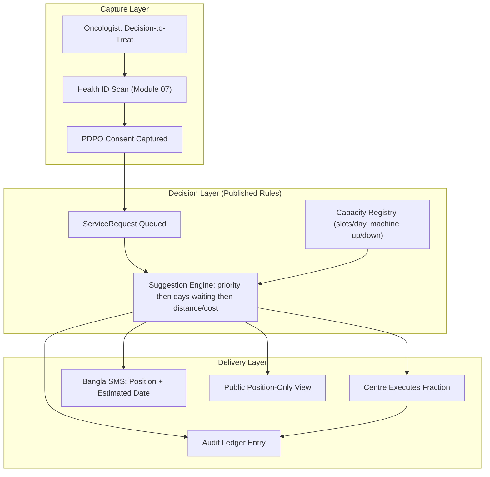
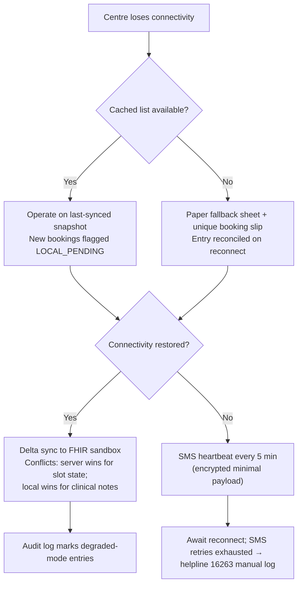

# 🔄 Application Flow — RadioQ National Radiotherapy Waiting List

## Module 09 — Detailed Patient Registration, Rule-Ordered Scheduling, Machine-Down Replan, Slot Offers & PDPO-Safe Tracking

---

## Table of Contents

- [Personas](#personas)
- [System Architecture & Interaction Overview](#system-architecture--interaction-overview)
- [Journey 1: Oncologist Registers Patient to the National List](#journey-1-oncologist-registers-patient-to-the-national-list)
- [Journey 2: Centre Publishes Capacity (Machine Up/Down, Slots per Day)](#journey-2-centre-publishes-capacity-machine-updown-slots-per-day)
- [Journey 3: Machine-Down One-Tap Replan (Signature Flow)](#journey-3-machine-down-one-tap-replan-signature-flow)
- [Journey 4: Patient Receives Position SMS & Checks Public View](#journey-4-patient-receives-position-sms--checks-public-view)
- [Journey 5: Private-Centre Slot Offer (Cost Shown, Never Auto-Assigned)](#journey-5-private-centre-slot-offer-cost-shown-never-auto-assigned)
- [Journey 6: LINAC 2027 Allocation Planning (MoHFW / NICRH)](#journey-6-linac-2027-allocation-planning-mohfwnicrh)
- [Journey 7: No-Show, Cancellation & List Movement](#journey-7-no-show-cancellation--list-movement)
- [National Waiting-List Lifecycle (State Machine)](#national-waiting-list-lifecycle-state-machine)
- [Offline / Degraded Flow](#offline--degraded-flow)
- [Edge Cases & Exception Handling Matrix](#edge-cases--exception-handling-matrix)
- [Summary Table of Flows](#summary-table-of-flows)

---

## Personas

| Persona | Role | Context & Pain | Tech Access |
|:---|:---|:---|:---|
| **Dr. Rahman** | Consultant oncologist, NICRH | ~7,500 waiting; 4 of 6 machines down; slots to end-2028; no cross-centre visibility | Desktop PWA; BMDC-verified login |
| **Sister Ayesha** | Charge nurse / technician, NICRH | Reports breakdowns; confirms machine status; besieged by "my date?" calls | Android; one-tap status button |
| **Rahim Mia** | Patient, 58, Kurigram | Needs 30+ fractions; cannot travel if slot slips | Shared family Android (73.4% households own one; shared phones common — design for proxy use; BBS Jan–Mar 2026) |
| **Farhana** | Rahim's daughter / caregiver | Tracks position via SMS; limited literacy tolerance | Shared phone; Bangla voice-friendly SMS; helpline 16263 |
| **Mr. Karim** | Private-centre manager | Idle LINAC capacity; wants vetted public referrals; must show price honestly | Web portal; slot offer queue |
| **Director, Hospitals Wing** | MoHFW / National Cancer Control Programme | Must allocate 17 LINACs (June 2027) on evidence | Desktop dashboard; aggregate data only |
| **Auditor** | DGHS / C&AG | Verifies no queue-jumping; audits overrides | Read-only audit ledger |

---

## System Architecture & Interaction Overview

One list. Three layers: **capture** (oncologist decision-to-treat), **decide** (published rules, never ad-hoc), **deliver** (centre executes fractions, SMS closes the loop).



> [!NOTE]
> RadioQ never books a private slot automatically. Private offers are **explicit, costed, opt-in** — the patient always sees the price and can decline with zero penalty.

---

## Journey 1: Oncologist Registers Patient to the National List

**Scenario.** Dr. Rahman confirms radiotherapy for a new patient after diagnosis (module 02 diagnostic reports attached via Health ID).

```mermaid
sequenceDiagram
    autonumber
    actor Onc as Oncologist (NICRH)
    participant PWA as RadioQ Provider PWA
    participant HID as Health ID Service (Module 07)
    participant FHIR as BD Core FHIR Sandbox
    participant List as National Waiting List
    participant SMS as SMS Gateway (mock)

    Onc->>PWA: Scans patient Health Card QR
    PWA->>HID: Validate Health ID + pull demographics
    HID-->>PWA: Patient verified (synthetic 9xxxxx in demo)
    Onc->>PWA: Enters cancer site, intent, clinical priority, target window
    PWA->>PWA: Captures PDPO consent (explicit, revocable)
    PWA->>FHIR: POST ServiceRequest (radiotherapy, priority, reasonCode)
    FHIR-->>PWA: ServiceRequest/xxxxx created
    PWA->>List: Enqueue by published rules
    List-->>PWA: Position assigned: 312; estimated window shown
    PWA->>SMS: Queue family SMS (position + estimated date)
    SMS-->>Onc: Mock SMS logged (demo)
```

**Key rules.** The oncologist sets **priority**; the software only orders. `reasonCode` carries the cancer site (sensitive — never shown publicly). Cancellation requires reason code; everything is audited.

---

## Journey 2: Centre Publishes Capacity (Machine Up/Down, Slots per Day)

Sister Ayesha walks in at 07:30. She does not type into a spreadsheet; she taps the RadioQ centre panel.

```mermaid
sequenceDiagram
    autonumber
    actor Nurse as Charge Nurse / Technician
    participant Panel as Centre Capacity Panel
    participant Uptime as 10-yantra-track Feed
    participant Registry as Capacity Registry
    participant List as Suggestion Engine

    Nurse->>Panel: Tap "Machine 3 DOWN — breakdown" (reason: power supply)
    Panel->>Uptime: QR report auto-created (link to Module 10-yantra-track)
    Uptime-->>Panel: Ticket YNT-2214 opened; NEMEMW&TC notified
    Panel->>Registry: Machine 3 status = DOWN; slots/day recalculated (4 → 2)
    Registry->>List: Trigger replan of affected segment
    List-->>Nurse: Replan summary: 41 patients re-matched; 3 flagged for offer
    Nurse->>Panel: Confirms; publishes today's slot board (up/down, slots/day)
```

**Why one button?** SISREG failed on manual daily entry — stale data becomes phantom capacity. RadioQ makes the update a byproduct of the breakdown workflow itself, not a separate chore.

---

## Journey 3: Machine-Down One-Tap Replan (Signature Flow)

**Scenario.** NICRH Machine 2 fails mid-cycle with 340 patients scheduled over the next 90 days. This is the demo's centrepiece.

```mermaid
sequenceDiagram
    autonumber
    actor Nurse as NICRH Duty Technician
    participant Panel as Centre Panel
    participant Engine as Published-Rule Engine
    participant Registry as Capacity Registry
    participant List as National List
    participant SMS as SMS Gateway (mock)
    participant Audit as Immutable Audit Ledger
    participant Dash as MoHFW/NICRH Dashboard

    Nurse->>Panel: "Machine DOWN" + reason code (breakdown)
    Panel->>Registry: Slots/day drops 4 → 2; affected window = 41 patients
    Registry->>Engine: Recompute segment by published rules
    Engine->>Engine: Order: clinical priority → days waiting → distance/cost
    Engine->>List: Write new provisional schedule; flag 3 unreachable patients
    List->>SMS: Staggered SMS to affected (Bangla): new position + estimated date
    SMS-->>List: Delivery receipts (mock); failures queued for retry + voice call
    Engine->>Panel: 3 patients need offer review (no auto-assign)
    Panel->>Audit: Replan event logged (who, when, why, before/after positions)
    Audit->>Dash: Dashboard updates: replan time, backlog delta, uptime KPI
    Note over Nurse,Dash: Design target: full replan + SMS cascade < 5 minutes [design target]
```

**Emergency preemption.** An urgent clinical case (e.g., cord compression) can jump the queue **only** via an oncologist override with typed reason — logged, reportable, never silent.

---

## Journey 4: Patient Receives Position SMS & Checks Public View

Rahim's daughter receives: `আপনার অবস্থান: ৩১২। আনুমানিক তারিখ: মার্চ ২০২৭ (সম্ভাব্য)। হেল্পলাইন: ১৬২৬৩।`

```mermaid
sequenceDiagram
    autonumber
    participant SMS as SMS Gateway
    actor Family as Patient Family (Farhana)
    participant Public as Public Position View
    participant HID as Health ID + OTP

    SMS->>Family: Bangla SMS: position 312; estimated March 2027 [illustrative date]; helpline 16263
    Family->>Public: Opens radioq.dghs.gov.bd (illustrative URL)
    Family->>Public: Enters Health ID + OTP (SMS)
    Public-->>Family: "Position: 312 of 7,500 | Est: Mar 2027 | No diagnosis shown"
    Family->>Public: Taps "Report missed appointment" or "Request callback"
    Public->>HID: Logs request; helpline 16263 follows up
```

**Public view law.** Position only. Never name, diagnosis, cancer site, or hospital-internal notes. PDPO 2025: cancer is sensitive personal data; explicit consent captured at registration; position lookup requires Health ID + OTP.

---

## Journey 5: Private-Centre Slot Offer (Cost Shown, Never Auto-Assigned)

Mr. Karim's centre publishes 20 private LINAC slots/month to the offer pool.

```mermaid
sequenceDiagram
    autonumber
    actor Karim as Private Centre Manager
    participant Offer as Offer Console
    participant Engine as Suggestion Engine
    actor Onc as Oncologist (NICRH)
    actor Family as Patient Family
    participant List as National List
    participant Audit as Audit Ledger

    Karim->>Offer: Publish 20 slots; price shown (e.g., Tk 8,000/session [illustrative])
    Offer->>Engine: Slots enter offer pool (never auto-assigned)
    Engine->>List: Shortlist eligible top-priority patients (by published rules)
    List->>Onc: Onc reviews shortlist; approves 5 offers (clinical fit)
    Onc->>Family: Offer SMS: slot date, centre, **full cost shown**, decline option
    alt Family accepts
        Family->>Offer: Accept (reply SMS or portal)
        Offer->>List: Slot booked; patient removed from public queue; cost receipt issued
    else Family declines
        Family->>Offer: Decline (or no reply in 72h = auto-decline)
        Offer->>List: Position unchanged; patient keeps public-queue place; cannot be penalised
    else Declines due to cost
        Offer->>List: Logged as "declined — cost" (aggregate only, never individual)
    end
    Offer->>Audit: Offer, decision, and cost logged; acceptance analytics to MoHFW
```

**Hard rules.** Cost always shown before consent; decline is free; no patient is ever moved to a private slot without explicit opt-in; MoHFW sees aggregate uptake, not identifiable data.

---

## Journey 6: LINAC 2027 Allocation Planning (MoHFW / NICRH)

```mermaid
sequenceDiagram
    autonumber
    actor Dir as Director, Hospitals Wing (MoHFW)
    participant Planner as LINAC 2027 Allocation View
    participant Registry as Capacity & Demand Data
    participant Geo as PostGIS Demand Heatmap
    participant Report as Allocation Scenario Report

    Dir->>Planner: Open 2027 allocation workspace
    Planner->>Registry: Pull verified demand: 7,500 waiting (NICRH) + divisional returns
    Planner->>Geo: Distance-weighted demand (where are patients travelling from?)
    Dir->>Planner: Model scenario A: 6 LINACs in Dhaka; scenario B: 4 Dhaka + 2 district (e.g., Rangpur, Chattogram [illustrative])
    Planner->>Report: Project backlog clearance, median wait, travel-cost savings per scenario
    Report-->>Dir: Evidence pack for June 2027 allocation committee
    Dir->>Planner: Export PDF; publish methodology (published-rules transparency)
```

**Output.** A defensible, auditable allocation of the 17 LINACs — weighted by verified demand and travel burden, not by institutional lobbying.

---

## Journey 7: No-Show, Cancellation & List Movement

```mermaid
sequenceDiagram
    autonumber
    actor Family as Patient Family
    participant Portal as Centre Portal / Helpline 16263
    participant List as National List
    participant Engine as Published-Rule Engine
    participant SMS as SMS Gateway

    alt Planned cancellation
        Family->>Portal: Cancel ≥ 48h before slot (helpline or portal)
        Portal->>List: Slot released; state → Cancelled; next patient pulled forward
        List->>Engine: Recompute affected segment (same as replan logic)
        Engine->>SMS: Notify promoted patient(s)
    else No-show (missed without notice)
        Portal->>Portal: Slot marked No-show after 24h grace
        Portal->>List: State → No-show; slot released to next in priority order
        List->>SMS: No-show warning SMS + helpline callback; 3 consecutive no-shows → clinical review (not punitive removal)
    else Patient dies or is cured before slot
        Portal->>List: State → Completed/Cancelled (reason: deceased/completed)
        List->>Engine: Replan segment
    end
```

---

## National Waiting-List Lifecycle (State Machine)

```mermaid
stateDiagram-v2
    [*] --> Requested : Oncologist orders radiotherapy (ServiceRequest)
    Requested --> Scheduled : Centre capacity published; rules match patient to slot
    Scheduled --> Treating : First fraction delivered
    Treating --> Completed : Final fraction delivered
    Scheduled --> Cancelled : Patient/clinician cancels (reason logged)
    Requested --> Cancelled : Duplicate, declined, or ineligible
    Scheduled --> NoShow : Missed slot; 24h grace; warning + callback
    NoShow --> Scheduled : Patient re-confirms; new slot offered by same rules
    NoShow --> Cancelled : 3 consecutive no-shows → clinical review, not auto-removal
    Scheduled --> Scheduled : Machine down → one-tap replan (position changes)
    Completed --> [*]
    Cancelled --> [*]
```



Guards: `Scheduled → Treating` requires centre check-in + Health ID scan. `Scheduled → NoShow` requires 24h grace + one warning SMS + helpline attempt. Every transition writes to the audit ledger.

---

## Offline / Degraded Flow

Connectivity in districts is unreliable; RadioQ degrades gracefully, it never blocks clinical work.



**Rules.** Degraded entries are clearly marked; conflicts resolve to the server for slot allocation (never double-book); the SMS heartbeat carries Health ID + machine ID + timestamp only — no diagnosis.

---

## Edge Cases & Exception Handling Matrix

| Scenario / Edge Case | Failure Mode / Threat | System Defense & Protocol |
|:---|:---|:---|
| **Machine breaks down mid-list** | Scheduled patients silently stranded; queue drifts for months | One-tap replan (Journey 3): slots recomputed by published rules; SMS cascade; dashboard records re-plan time; affected segment flagged to MoHFW |
| **Patient no-show** | Slot wasted; next patients delayed | 24h grace; warning SMS + helpline callback; 3 no-shows → clinical review (never automatic removal); slot released by rules |
| **Private slot declined** | Patient loses place or is penalised | Decline never penalises; public position unchanged; auto-decline after 72h silence; decline reasons aggregated (never individual) |
| **Private slot accepted, patient wants to switch back** | Centre lock-in disputes | Switch-back allowed before first fraction; medical notes transfer with consent; audit logged; original queue place restored by rules |
| **Two centres replan the same patient simultaneously** | Double-booking / conflicting SMS | Central Redis lock on `ServiceRequest`; server wins; losing centre gets conflict report; patient never receives two different dates |
| **SMS not delivered** | Patient travels for nothing | Independent delivery receipts; after 2 failures → voice call via helpline 16263; unreachable patients flagged for community health worker visit |
| **Abuse of emergency override** | VIP queue-jumping returns | Override requires oncologist credential + typed reason; monthly override report to DGHS/MoHFW; outliers flagged for review |
| **Capacity data falsified** | Phantom slots; private pipeline hidden | Uptime feed cross-checks (10-yantra-track); unannounced audits; slots-filled KPI exposed to MoHFW; centre certification required to join offer pool |
| **Data breach / unauthorised access** | Cancer diagnosis leaked (sensitive under PDPO 2025) | Position-only public view; consent + purpose limitation; immutable audit log; breach notification workflow; encryption at rest/in transit |
| **Demo/seed confusion** | Synthetic data mistaken for real patients | Every demo screen labelled "SYNTHETIC DEMO DATA"; 9-prefixed Health IDs; separate demo tenant; no real endpoints |

---

## Summary Table of Flows

| # | Flow | Actor → System | Key Artifact | SLA / Target |
|---|------|----------------|--------------|--------------|
| 1 | Register to national list | Onc → FHIR/List | ServiceRequest; position assigned | < 2 minutes at counter |
| 2 | Publish daily capacity | Nurse/Tech → Registry | Machine up/down; slots/day | One tap; by 08:00 daily |
| 3 | Machine-down replan | Tech → Engine | New provisional schedule; SMS cascade | **< 5 min** (design target) |
| 4 | Patient position check | Family → Public view | Position only (PDPO-safe) | OTP < 30s |
| 5 | Private slot offer | Centre → Family | Costed offer; explicit opt-in | 72h response window |
| 6 | LINAC 2027 allocation | MoHFW → Planner | Evidence pack; scenario PDF | Committee deadline June 2027 |
| 7 | No-show / cancellation | Family → List | Slot released; next promoted | 24h grace + callback |
| — | Lifecycle | All | Requested → Scheduled → Treating → Completed / Cancelled / No-show | Full audit trail |
| — | Offline/degraded | Centre → Sync | Local snapshot; SMS heartbeat; conflict policy | RPO ≤ 5 min of heartbeat |

**Cross-references.** Module 07 (Health ID) authenticates every actor; Module 05 (ReferLoop) carries the ServiceRequest over the FHIR spine; Module 02 (test reports) attaches diagnostic evidence; Module 04 (04-icu-beds) supplies the capacity-lock and anti-bypass audit patterns; Module 10-yantra-track supplies machine-uptime truth.
