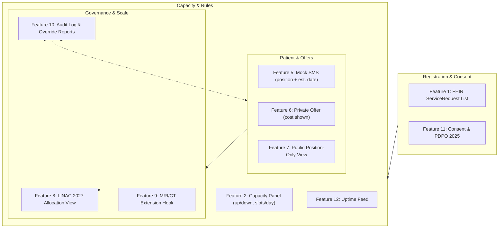

# ⚡ Functional Specifications & Feature Catalog — Module 09

## RadioQ — National Radiotherapy Waiting List, Machine-Down Replan & Published-Rule Scheduling

---

## Table of Contents

- [Functional Architecture Overview](#functional-architecture-overview)
- [Feature 1: National FHIR ServiceRequest List (Health-ID Keyed)](#feature-1-national-fhir-servicerequest-list-health-id-keyed)
- [Feature 2: Centre Capacity Panel — Machine Up/Down + Slots per Day](#feature-2-centre-capacity-panel--machine-updown--slots-per-day)
- [Feature 3: Published-Rule Suggestion Engine (Priority → Days Waiting → Distance/Cost)](#feature-3-published-rule-suggestion-engine-priority--days-waiting--distancecost)
- [Feature 4: Machine-Down One-Tap Replan](#feature-4-machine-down-one-tap-replan)
- [Feature 5: Mock SMS with Position + Estimated Date (Bangla)](#feature-5-mock-sms-with-position--estimated-date-bangla)
- [Feature 6: Private-Centre Slot Offer with Cost Shown (Never Auto-Assigned)](#feature-6-private-centre-slot-offer-with-cost-shown-never-auto-assigned)
- [Feature 7: Public Position-Only View (PDPO-Safe)](#feature-7-public-position-only-view-pdpo-safe)
- [Feature 8: LINAC 2027 Allocation Planning View](#feature-8-linac-2027-allocation-planning-view)
- [Feature 9: MRI/CT Extension Hook (Future Phases)](#feature-9-mrict-extension-hook-future-phases)
- [Feature 10: Admin Audit Log & Override Reporting](#feature-10-admin-audit-log--override-reporting)
- [Feature 11: Health-ID Consent & PDPO 2025 Alignment](#feature-11-health-id-consent--pdpo-2025-alignment)
- [Feature 12: 10-yantra-track Uptime Integration (Machine Truth)](#feature-12-10-yantra-track-uptime-integration-machine-truth)
- [Feature Matrix](#feature-matrix)
- [Out of Scope](#out-of-scope)

---

## Functional Architecture Overview

**Design constraints (hard):** oncologist sets clinical priority; software only orders by published rules; rules published; private slots never auto-assigned (cost always shown); public view = position only; all demo data synthetic and labelled; cancer diagnosis = sensitive personal data under PDPO 2025 (consent + audit). Allocation order: **clinical priority → days waiting → distance/travel cost**; emergency/urgent jump the queue only by clinical rule, auditable.

---

## Feature 1: National FHIR ServiceRequest List (Health-ID Keyed)

**What.** One national, de-duplicated queue of radiotherapy intents. Each entry = FHIR R4 `ServiceRequest` (`intent=order`, oncologist-set `priority`, `occurrenceDateTime`, `reasonCode` = cancer site) linked to `Patient` (Health ID), `Practitioner`, `Organization`.

**Why.** Today every centre books in person; lists never meet; ~7,500 NICRH patients wait blindly (Dhaka Tribune, 20 Oct 2026). A single Health-ID-keyed list is the precondition for any fair allocation.

**How.**
- Register: oncologist scans patient Health Card (Module 07) → confirms site, intent, priority → `ServiceRequest` created via BD Core FHIR R4 sandbox (`sandbox.fhir.dghs.gov.bd`).
- De-duplication: same Health ID + same cancer site + open intent → flagged for review, never silently merged.
- Queue position derived from published rules (Feature 3), never hand-edited.
- Demo seed: **7,500 synthetic patients, 6 synthetic NICRH machines + 3 synthetic private centres** — every screen labelled synthetic.

**Edge cases.** Duplicate intents (flag, don't merge); patient registered at two centres (first-verified wins; second flagged); missing Health ID (paper slip + retro-link); priority changed mid-queue (audit + re-rank segment).

---

## Feature 2: Centre Capacity Panel — Machine Up/Down + Slots per Day

**What.** Each centre (NICRH, divisional/district centres, accredited private centres) publishes live machine status and daily slot counts — the single source of truth for the suggestion engine.

**Why.** SISREG failed on stale manual data (TCE-SC, Nov 2025). BD context: **52% of diagnostic equipment unused** in the past year (PPRC 2026, 22 facilities); NICRH has 4 of 6 LINACs down 2+ years. Paper capacity ≠ real capacity.

**How.**
- Centre panel: one row per machine — status (`UP`/`DOWN`/`MAINTENANCE`), slots/day (editable integers), last confirmed timestamp, technician badge ID.
- One-button update; no spreadsheets; changes write to audit log.
- Cross-check: status must reconcile with Module 10-yantra-track uptime tickets (Feature 12); mismatch → dashboard warning.
- Slot board visible to oncologists and (aggregate only) to MoHFW.

**Edge cases.** Partial-day capacity (morning LINAC 2 up, afternoon down → slots split with reason code); maintenance windows (pre-announced, auto-replan overnight); private centre overstates slots (audit flag + offer-pool suspension).

---

## Feature 3: Published-Rule Suggestion Engine (Priority → Days Waiting → Distance/Cost)

**What.** Deterministic ordering of the national list by three published rules, in order: (1) clinical priority (oncologist-set), (2) days waiting, (3) distance/travel cost.

**Why.** Transparency is the anti-corruption mechanism. Any patient, clinician, auditor or journalist can reproduce the ordering. Eliminates SISREG-style informal favours (54% bypass) and committee delay (33% late).

**How.**
- Rule 1 — priority bands: `urgent` (emergency, e.g., cord compression) > `high` > `routine`. Urgent jumps by clinical rule only; every jump logged with reason.
- Rule 2 — FIFO within band: `days_waiting = today − authored_on`.
- Rule 3 — distance/cost: PostGIS geodesic from registered address to treating centre; tie-broken by estimated travel cost (distance × per-km rate, configurable). Upazila patients weigh heavily — deliberate equity weighting.
- Output: ranked shortlist per available slot; displayed with the three rule components so ordering is explainable.
- Rules published on the portal + printed centre handbook; change requires MoHFW + NCCP sign-off and version bump.

**Edge cases.** Ties on all three (stable sort by Health ID hash — deterministic, arbitrary, documented); urgent mid-queue arrival (re-rank, SMS affected patients); centre closer but fully booked (next-best centre offered with cost/travel shown); patient refuses nearest centre (preference recorded; queue position by rules unchanged).

---

## Feature 4: Machine-Down One-Tap Replan

**What.** One tap ("Machine DOWN — Replan") recomputes the affected schedule segment in seconds and triggers Bangla SMS updates to displaced patients.

**Why.** The #1 queue-collapse event at NICRH (4/6 down). Manual re-planning is impossible at 7,500-patient scale; without automation, delays compound silently.

**How.**
- Trigger: capacity panel status change or 10-yantra-track breakdown ticket.
- Engine: re-orders displaced patients by published rules against residual capacity (other machines, other centres, private offer pool).
- Patients re-matched; those unreachable flagged for Feature 6 review.
- SMS cascade with new position + estimated date; delivery receipts; failures → helpline 16263 callback.
- Replan event → audit ledger; MoHFW dashboard shows re-plan duration (design target **< 5 minutes**) and backlog delta.

**Edge cases.** Multiple machines down same day (single combined replan, not N sequential); patient already in first-fraction course (flag for clinical review — do not auto-move fraction #12); replan during SMS outage (queue SMS; mark "pending notification"); replan rejected by oncologist (override logged; original slot held 72h).

---

## Feature 5: Mock SMS with Position + Estimated Date (Bangla)

**What.** Every queue event sends a short Bangla SMS: position, estimated date window, helpline. **Mock gateway in demo** (logged, not sent); production = telco aggregator.

**Why.** 73.4% of BD households own a smartphone but phones are shared (BBS Jan–Mar 2026); literacy 77.7% (Dec 2024) — messages must be short, Bangla, voice-friendly, and free of diagnosis.

**How.**
- Templates: `আপনার অবস্থান: ৩১২। আনুমানিক: মার্চ ২০২৭ (সম্ভাব্য)। হেল্পলাইন: ১৬২৬৩।` / machine-down update / offer (cost shown) / no-show warning.
- No diagnosis, no cancer site, no PII beyond position.
- Mock mode prints to console + log file; real mode behind `SMS_PROVIDER=mock|telco` env flag.
- Delivery receipts tracked; 2 failures → voice call via helpline 16263.

**Edge cases.** Wrong/changed mobile number (verify at registration + each visit); shared phone (position only — safe); SMS gateway down (retry ×3 → helpline manual log); estimated date slips (proactive "date changed" SMS, never silent).

---

## Feature 6: Private-Centre Slot Offer with Cost Shown (Never Auto-Assigned)

**What.** Accredited private centres publish paid LINAC slots into an offer pool; shortlisted top-priority patients receive an offer SMS **with full cost shown**; explicit opt-in only.

**Why.** NICRH capacity covers a fraction of need; private LINACs exist (Evercare, Square, United — examples). An expert publicly urged coordination with private hospitals (Dhaka Tribune, 20 Oct 2026). This is demand-side relief without corruption: cost up front, opt-in, declinable without penalty.

**How.**
- Centre publishes slots + Tk price per fraction/session (no price → no listing).
- Engine shortlists eligible patients (top of published-rule ranking; oncologist approves clinical fit).
- Offer SMS: date, centre, **total estimated cost**, decline instructions. "Reply 1 to accept, 2 to decline."
- 72h silence = auto-decline; patient's public-queue position unchanged and unpenalised.
- Acceptance → slot booked; removed from public queue; receipt issued; centre paid directly by patient (government not a payer, unless MoHFW later subsidises — out of scope).
- MoHFW sees aggregate uptake (how many chose private, why declined — cost vs distance), never identifiable choices.

**Edge cases.** Patient accepts then defaults (slot released after 7 days; patient may rejoin public queue); cost dispute (receipt + helpline arbitration); private centre lowers price mid-offer (re-issue offer; explicit re-consent); centre tries to poach high-priority patients selectively (audit; offer pool is engine-shortlisted, not cherry-picked).

---

## Feature 7: Public Position-Only View (PDPO-Safe)

**What.** Unauthenticated-ish public page: enter Health ID + OTP → see `Position: 312` and estimated window. Nothing else.

**Why.** PDPO 2025 (gazetted 6 Nov 2025): health data = sensitive personal data; explicit consent required. A position number aids adherence and reduces helpline load without exposing diagnosis.

**How.**
- URL: `radioq.dghs.gov.bd` (illustrative). No account; Health ID + OTP per lookup; rate-limited; no caching of results.
- Displays: position, estimated window, helpline 16263, "your treatment details remain private" notice.
- No appointment time, no hospital name, no clinician, no diagnosis, no site.
- Aggregate stats page (public): total waiting, machines up nationally — de-identified, OPEL-inspired.

**Edge cases.** OTP to changed number (update via centre); position shared by family (acceptable — position only); scraping/bots (rate limit + CAPTCHA after 5 tries); data export request (PDPO rights workflow via DGHS DPO).

---

## Feature 8: LINAC 2027 Allocation Planning View

**What.** MoHFW/NICRH planning workspace modelling allocation of the **17 new LINACs due June 2027 (6 Dhaka, 11 outside Dhaka)**.

**Why.** The allocation is a one-shot national infrastructure decision; current data does not exist to make it defensibly. RadioQ generates it as a byproduct of honest queuing.

**How.**
- Inputs: live list (demand), capacity registry (supply), PostGIS demand heatmap (travel-weighted), uptime history (realized vs nameplate capacity — e.g., NICRH realized ≈ 2/6).
- Scenarios: e.g., A) all 6 Dhaka; B) 4 Dhaka + 2 district hubs; C) 17 distributed by heatmap. Outputs: backlog clearance curve, median decision-to-treat → first fraction, travel-cost savings, slots filled projection.
- All parameters adjustable; methodology published; exportable PDF for the June 2027 committee.
- Success measure: allocation adopted; patients per LINAC per year balanced nationally.

**Edge cases.** Data too thin outside Dhaka (mark confidence low; commission district returns); political pressure to favour a site (published methodology + audit committee); numbers later contradicted (versioned scenarios; superseded runs retained).

---

## Feature 9: MRI/CT Extension Hook (Future Phases)

**What.** Same architecture generalises to MRI/CT/PET waiting lists: one list, same rules, same PDPO posture. Phase 2 (not in demo).

**Why.** Diagnostic backlogs mirror radiotherapy scarcity; PPRC 2026 shows imaging available only 65% of the time (25% provided regularly). One engine, many queues.

**How.**
- Generalize `ServiceRequest` code system (`http://terminology.hl7.org/CodeSystem/...` imaging codes); add `modality` parameter to Feature 3 rules.
- Capacity registry gains scanner rows; uptime feed identical (Feature 12).
- Public view unchanged (position only); SMS templates parameterised by modality.
- Interop: Module 02 (test reports) already files `DiagnosticReport` to Health ID — the queue closes the loop.

**Edge cases.** Cross-modality priority rules (urgent MRI beats routine CT — separate published rule set per modality); shared machines between departments (slot partitioning); MRI backlog ≠ RT backlog (separate lists, shared engine).

---

## Feature 10: Admin Audit Log & Override Reporting

**What.** Immutable, append-only ledger of every state change, override, replan, offer and consent event; monthly override report to DGHS/MoHFW.

**Why.** Brazil's SISREG failed partly because bypass left no enforceable trace. RadioQ assumes adversarial misuse and designs for detection.

**How.**
- Table `audit_ledger`: actor, role, action, before/after, reason code, IP, timestamp, GPS (optional).
- Override report: count, reasons, outliers per oncologist/centre; auto-flag > 3σ from peer median.
- Tamper-evidence: hash-chained rows (prev_hash → row_hash); periodic anchor to external notary log.
- Retention: ≥ 7 years [illustrative — align with MoHFW records policy]; PDPO access rights honoured.

**Edge cases.** Correction requests (append correction entry — never edit history); lost credentials (revoke + audit review); audit export for court (signed bundle).

---

## Feature 11: Health-ID Consent & PDPO 2025 Alignment

**What.** Explicit, revocable, purpose-limited consent captured at registration; everything RadioQ shows traces to it.

**Why.** PDPO 2025: health data = sensitive; explicit consent mandatory for collect/use/transfer; cancer even more so culturally.

**How.**
- Consent screen: purpose ("radiotherapy scheduling only"), retention, sharing (centre + MoHFW aggregate only), withdrawal path.
- Withdrawal: patient may withdraw → removed from scheduling; marked "consent withdrawn"; clinical record retained per medical records law but unused by RadioQ.
- Consent receipt SMS: timestamp + reference number.
- DPO contact published; grievance via 16263 → DGHS data protection officer.
- Enforcement status uncertain under 2026 government — RadioQ complies by design regardless.

**Edge cases.** Patient cannot consent (guardian consent flow, Module 07 proxy access); consent for minors (parent/guardian + assent where applicable); data already shared with centre (withdrawal stops future sharing; past sharing logged).

---

## Feature 12: 10-yantra-track Uptime Integration (Machine Truth)

**What.** Machine status in RadioQ is corroborated by Module 10-yantra-track: QR-scanned breakdown reports + NEMEMW&TC repair tickets + SLA timers.

**Why.** A centre panel says "UP"; the truth is the machine produced beams today. Cross-verification kills phantom capacity — the exact SISREG failure (empty beds marked occupied).

**How.**
- Breakdown ticket (YNT-xxxx) auto-sets RadioQ machine `DOWN` (or requires confirmation for conflicts).
- Repair completion + verification scan → machine `UP`; slots restored; replan offered.
- Uptime KPI per centre published to MoHFW (monthly); feeds NEMEMW&TC SLA enforcement.
- Demo: simulated feed; real build = webhook `POST /integrations/yantra-track/uptime`.

**Edge cases.** Feed down (panel falls back to manual + flagged "unverified"); false "UP" (spot beam-output audit); partial degradation (slots 50%, warning state).

---

## Feature Matrix

| # | Feature | Priority | PDPO-Relevant | Demo Ready | Depends On |
|---|---------|:---:|:---:|:---:|:---|
| F1 | National ServiceRequest list | P0 | Yes | ✅ | Module 05 (FHIR), Module 07 (Health ID) |
| F2 | Capacity panel (up/down, slots/day) | P0 | No | ✅ | F12 |
| F3 | Published-rule suggestion engine | P0 | No | ✅ | F1, F2 |
| F4 | Machine-down one-tap replan | P0 (signature) | No | ✅ | F2, F3, F5 |
| F5 | Mock SMS (position + est. date) | P0 | Yes (no diagnosis) | ✅ | SMS mock gateway |
| F6 | Private slot offer (cost shown) | P1 | Yes | ✅ | F3, F10 |
| F7 | Public position-only view (PDPO-safe) | P0 | Yes | ✅ | F1, F11 |
| F8 | LINAC 2027 allocation view | P1 | Aggregate only | ✅ | F1, F2, PostGIS |
| F9 | MRI/CT extension hook | P2 | Yes | ❌ (Phase 2) | F1–F5 |
| F10 | Admin audit log | P0 | Yes | ✅ | — |
| F11 | Consent & PDPO 2025 alignment | P0 | Yes | ✅ | Module 07 |
| F12 | 10-yantra-track uptime integration | P1 | No | ✅ (simulated) | Module 10-yantra-track (sibling) |

---

## Out of Scope

- **Clinical decision support / dose calculation** — oncologists prescribe; RadioQ schedules, never treats.
- **Automatic private-slot assignment** — always explicit, costed, opt-in.
- **Payment processing** — patient pays centre directly; RadioQ issues no invoices.
- **Real SMS delivery in demo** — mock only; telco integration is Phase 2.
- **Real patient data** — demo is 100% synthetic; 9-prefixed Health IDs; labelled everywhere.
- **MRI/CT/PET live queues** — architecture hook only (Feature 9); Phase 2.
- **E-prescribing / chemotherapy protocols** — Module 03 handles Rx.
- **Diagnostic report generation** — Module 02 (OpenELIS ingest).
- **Bulk data migration from per-centre paper lists** — Phase 1.5 data-entry sprint, manual verification.
- **National oncology registry / cancer surveillance** — separate MoHFW/NCCP programme; RadioQ exports de-identified aggregates only.
- **Legal advice on PDPO 2025** — RadioQ is designed to comply; MoHFW/ICT Division counsel reviews before go-live.
