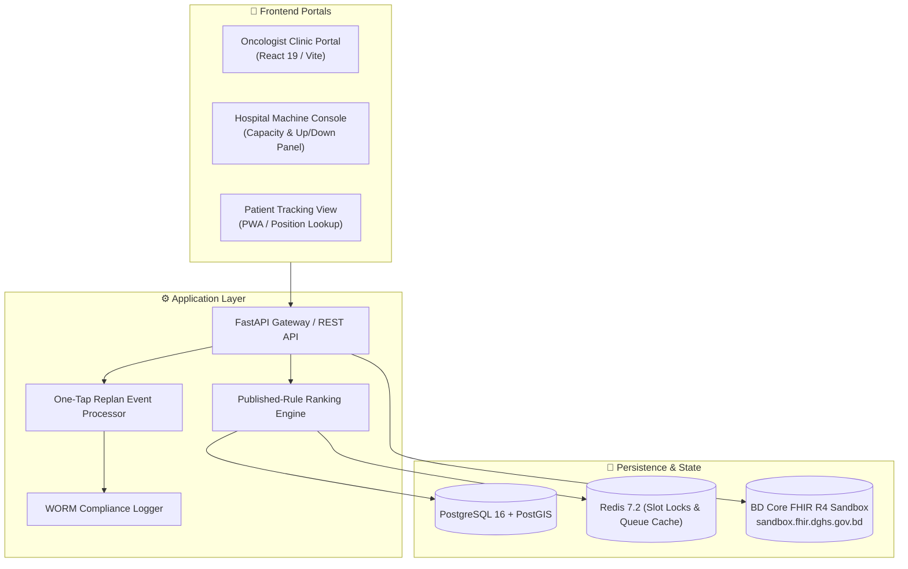
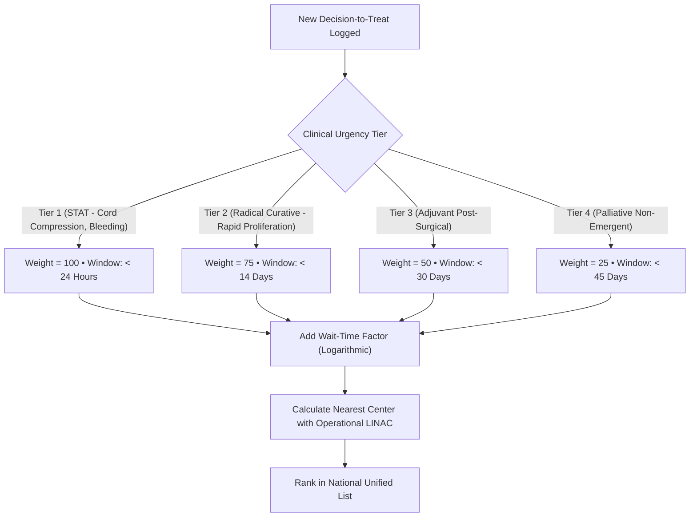
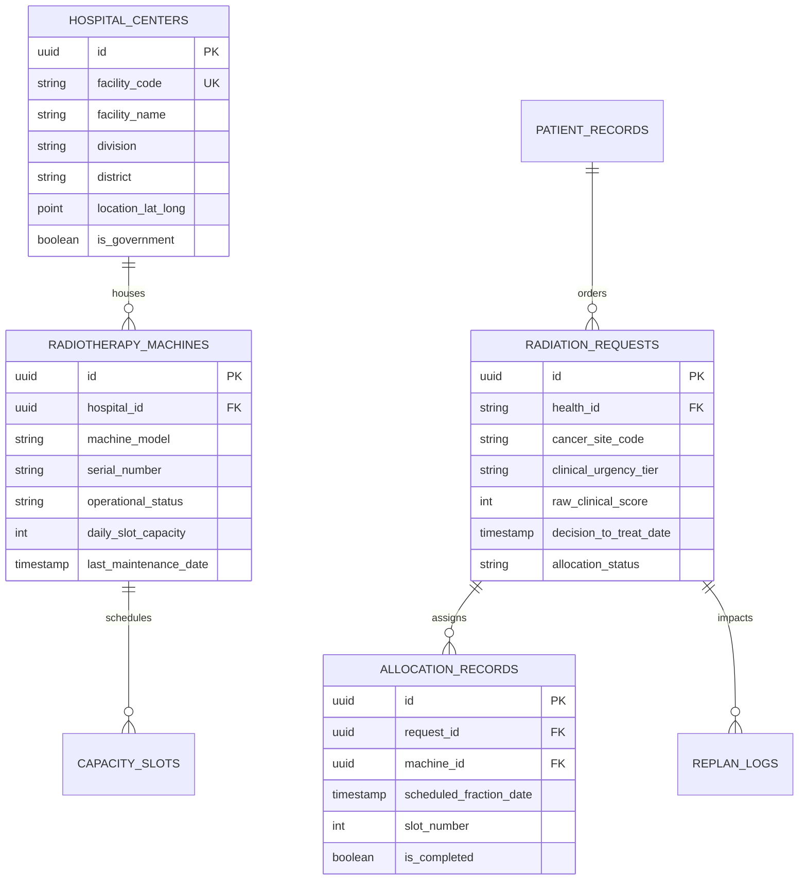

# 🛠️ Technical Implementation Blueprint — Module 09 (RadioQ)

## National Radiotherapy Waiting List, Slot Allocator & Dynamic Replan Engine

---

## 1. System Architecture



---

## 2. HL7 FHIR R4 Profile Mapping

RadioQ adheres directly to the Bangladesh Core Implementation Guide (v0.4.6) where profiles exist, falling back to HL7 FHIR R4 standard structures for specialized oncology radiation orders:

| Domain Entity | FHIR R4 Resource | BD Core Profile | Key Extension Fields |
|---|---|---|---|
| **Cancer Patient** | `Patient` | `BDCore-Patient` | Identifier (9-series Health ID, NID, BRN) |
| **Radiation Order** | `ServiceRequest` | Base R4 / Oncology Extension | `code` (SNOMED-CT 33195004 Radiation therapy), `priority` (stat/urgent/routine), `intent` |
| **Cancer Stage** | `Condition` | `BDCore-Condition` | `stage` (TNM 8th Ed), `bodySite` (ICD-O-3 topology) |
| **Radiotherapy Machine** | `Device` / `Location` | Base R4 | Linear Accelerator (LINAC) / Cobalt-60 unit |
| **Treatment Slot** | `Slot` / `Schedule` | Base R4 | `start`, `end`, `status` (free/busy), machine capacity |
| **Patient Notification** | `Communication` | Base R4 | Bangla SMS notification payload |

---

## 3. Published-Rule Ranking Algorithm

To eliminate corruption, favoritism, and middleman bypass (addressing the cautionary lessons of Brazil's SISREG where 54% of patients bypassed the system), RadioQ calculates an objective **Clinical Priority Score (CPS)**:

$$\text{Composite Score} = (W_{\text{clin}} \times S_{\text{clin}}) + (W_{\text{wait}} \times \ln(\text{Days} + 1)) - (W_{\text{dist}} \times D_{\text{km}})$$



---

## 4. Database Schema (PostgreSQL DDL)



---

## 5. REST API Specifications

### 5.1 Enqueue Radiotherapy Request
- **Endpoint**: `POST /api/v1/radioq/requests`
- **Headers**: `Authorization: Bearer <JWT>`, `Content-Type: application/json`
- **Request Payload**:
```json
{
  "health_id": "9081245671",
  "patient_name": "Begum Rokeya",
  "bmdc_license": "A-49210",
  "cancer_site": "C50.9 (Malignant neoplasm of breast, unspecified)",
  "clinical_urgency": "CURATIVE_RADICAL",
  "intended_fractions": 25,
  "preferred_division": "Dhaka",
  "decision_to_treat_date": "2026-11-03T10:00:00Z"
}
```
- **Response** (`201 Created`):
```json
{
  "request_id": "req-98234-bd",
  "queue_position": 142,
  "estimated_treatment_start": "2026-11-17",
  "allocated_facility": "NICRH - Machine 02",
  "status": "QUEUED"
}
```

### 5.2 One-Tap Machine Breakdown Event
- **Endpoint**: `POST /api/v1/radioq/machines/{machine_id}/fault`
- **Request Payload**:
```json
{
  "machine_id": "nicrh-linac-03",
  "status": "FAULT_OFFLINE",
  "fault_code": "VACUUM_CHAMBER_LEAK",
  "estimated_downtime_days": 14,
  "reported_by_engineer_id": "ENG-712"
}
```
- **Action**: Triggers background dynamic queue re-plan across 17 national LINACs and private partners within 5 seconds.

---

## 6. Pilot Rollout & 2027 LINAC Allocation

1. **Phase 1 (Months 1–3)**: Apex center pilot at NICRH (Mohakhali, Dhaka) + BSMMU Oncology Department.
2. **Phase 2 (Months 4–6)**: Integrate major divisional medical college oncology departments (DMCH, CMCH, RMCH, SOMCH).
3. **Phase 3 (Target June 2027)**: National onboarding of the **17 newly procured LINAC accelerators** across 6 Dhaka centers and 11 district hospitals.

