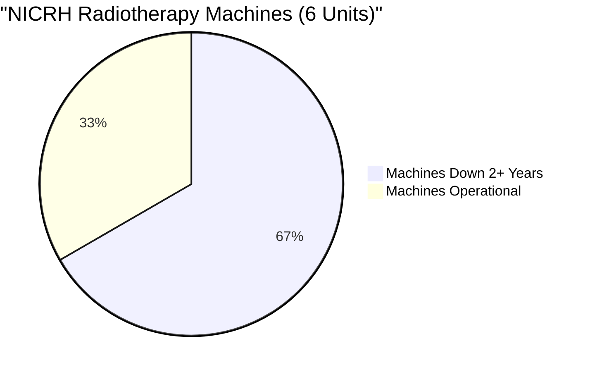
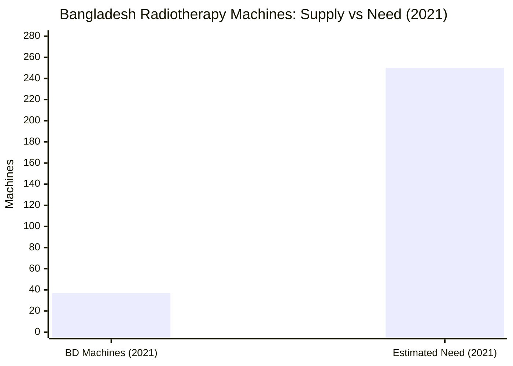
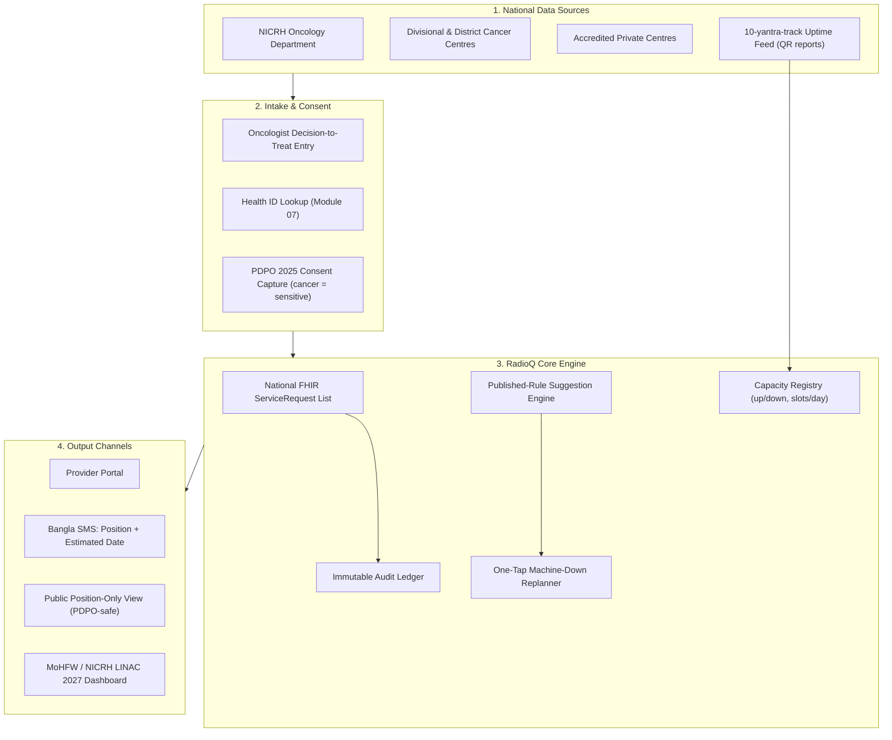
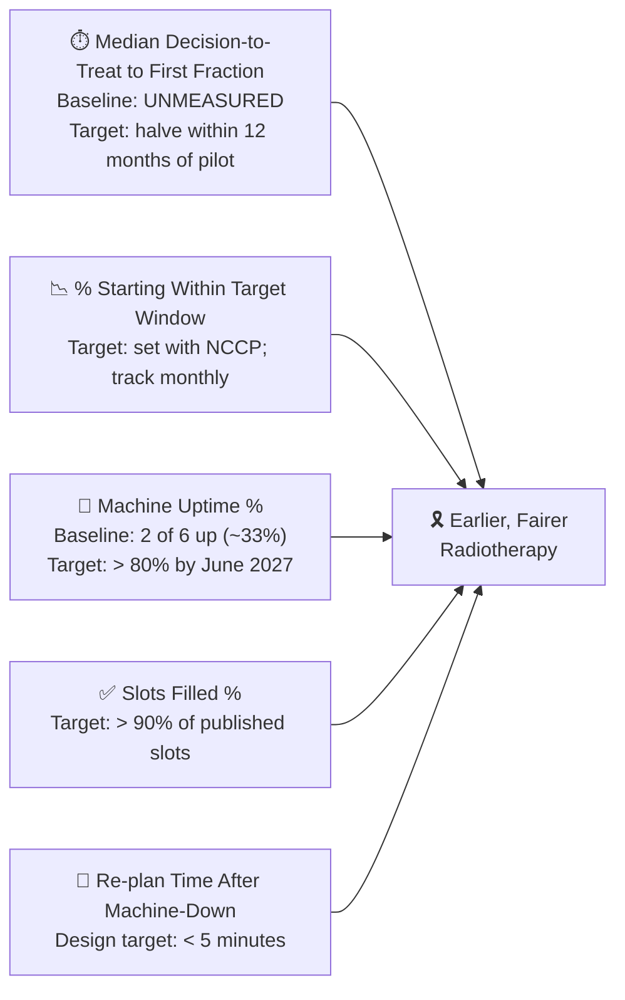

# ☢️ RadioQ — National Radiotherapy Waiting List

## Module 09 — One Shared, Evidence-Based National List for Radiotherapy (Extensible to MRI/CT), Keyed to the Health ID

---

## Table of Contents

- [Problem Statement](#problem-statement)
- [International Precedent: SISREG's Failure and the NHS OPEL Standard](#international-precedent-sisregs-failure-and-the-nhs-opel-standard)
- [System Architecture & Vision](#system-architecture--vision)
- [Capability Deep-Dives](#capability-deep-dives)
- [Comparative Benchmark](#comparative-benchmark-bangladesh-vs-regional--global-standards)
- [Stakeholder Matrix](#stakeholder-matrix)
- [Success Metrics & National Targets](#success-metrics--national-targets)
- [Sources & Data Notes](#sources--data-notes)

---

## Problem Statement

Bangladesh's cancer patients queue in the dark. At the National Institute of Cancer Research & Hospital (NICRH), the national referral oncology institute, radiotherapy appointments are booked **in person, centre by centre, on paper**. No shared, evidence-based national waiting list exists — no visibility into where a patient stands, when treatment starts, or whether another centre has spare capacity.

> [!CAUTION]
> **National Breakdown at the Apex Centre**: **4 of NICRH's 6 radiotherapy machines have been down for 2+ years**. About **7,500 patients are waiting**, with appointments as late as **end-2028**, and new registrations were suspended for about **6 weeks**. Seventeen new linear accelerators (LINACs) are due by **June 2027** — 6 in Dhaka, 11 outside — yet no data-driven national mechanism exists to allocate them fairly (Dhaka Tribune, 20 Oct 2026).

### The Radiotherapy Crisis in Numbers

| Indicator | Ground Statistic | Source & Context |
|:---|:---:|:---|
| **NICRH machines down** | **4 of 6 (2+ yrs)** | *Dhaka Tribune*, 20 Oct 2026 |
| **Patients waiting at NICRH** | **~7,500** | *Dhaka Tribune*, 20 Oct 2026 |
| **Latest appointment offered** | **End-2028** | *Dhaka Tribune*, 20 Oct 2026 |
| **New registrations suspended** | **~6 weeks** | *Dhaka Tribune*, 20 Oct 2026 |
| **New LINACs due by June 2027** | **17 (6 Dhaka, 11 outside)** | *Dhaka Tribune*, 20 Oct 2026 |
| **BD machines (2021)** | **~37 vs need of ~250** | *Daily Star*, 2021 |
| **Spent abroad (context)** | **~US$5bn/yr; ~482,000 to India 2024** | UNB, Dec 2025 — industry estimate |
| **Out-of-pocket spending (context)** | **79.31% (2023)** | World Bank WDI / WHO GHED |
| **Shared national list** | **NOT PRESENT** — in-person per centre | Research gap analysis |
| **Diagnostic equipment unused (context)** | **52% (PPRC, 22 facilities)** | *Prothom Alo*, Jul 2026 |
| **Hackathon idea score** | **U5 F4 I5 J5 D3 = 22/25** | 05_final_ideas, Idea 5 |

### The Human Cost of a Paper Queue

A typical journey begins at an upazila health complex where an oncologist confirms diagnosis and prescribes radiotherapy. The patient travels to NICRH (or another centre) and physically joins a queue with no number, no date, no visibility:

1. Each centre keeps its own list; lists are never shared.
2. Appointments have slipped to **end-2028** for **~7,500 patients** (Dhaka Tribune, 20 Oct 2026).
3. New registrations were suspended for ~6 weeks.
4. An estimated **~US$5 bn/yr** is spent abroad; **~482,000 went to India in 2024** (UNB, Dec 2025 — industry estimate).
5. Families who cannot afford it simply wait — losing the curative window.

> [!NOTE]
> Radiotherapy is uniquely schedule-bound: each fraction must be delivered on a planned cadence. A queue that drifts by months is not merely inconvenient — it changes whether treatment is curative or palliative. A transparent, rule-ordered list is a clinical-safety intervention, not an IT convenience.

---

## International Precedent: SISREG's Failure and the NHS OPEL Standard

The closest analogue to RadioQ is **Brazil's SISREG**, which regulates beds and referrals in Brazil's SUS system. A TCE-SC (Santa Catarina State Court of Accounts, Nov 2025) audit found:

- **33% of ICU bed authorizations were issued too late** — after the patient had died or decompensated beyond salvage.
- **54% of actual ICU admissions bypassed the system** — informal doctor-to-doctor favours, political pull, or physical gate-crashing.
- Internet outages pushed hospitals back to phone calls — automation without connectivity fails.

The UK's **NHS OPEL framework (2024–26)** is the positive counterpart: it standardises how every trust reports capacity and pressure (OPEL 1–4) so the system can see nationally where it is straining — without dictating clinical judgement. India's **July 2026** QR mandate on vaccines, cancer drugs and narcotics shows regulatory momentum for oncology traceability.

> [!WARNING]
> **Status: NOT PRESENT.** No Bangladesh equivalent of a shared radiotherapy waiting list was found in public sources. Appointments are booked in person at each centre; no shared list exists; no national oncology capacity dashboard exists. (Research gap analysis; Dhaka Tribune, 20 Oct 2026.)

### Failure-Mode Lesson Table

| SISREG Vulnerability (Brazil, Nov 2025) | RadioQ Defense |
|:---|:---|
| **33% authorizations issued late** | **Deterministic published rules**: priority → days waiting → distance/cost, in seconds; oncologist retains clinical authority |
| **54% admissions bypassed the system** | **Auditable slot ledger**: every allocation/override logged immutably; overrides need oncologist credential + typed reason, reportable to MoHFW |
| **Manual daily entry; stale availability** | **Automatic capture**: 10-yantra-track QR + photo uptime feed; one-button confirmation; never re-typed |
| **Internet outages → phone calls** | **Offline-tolerant PWA**: cached list; SMS fallback heartbeat; syncs on reconnect |
| **No enforcement teeth** | **Governance**: MoHFW + NICRH participation as a condition of the 17 LINAC allocations (June 2027) |
| **No public visibility** | **Position-only public view** — never diagnosis (PDPO 2025) |

**Lesson from NHS OPEL:** standardise the *reporting*, not the *clinical decision*. RadioQ standardises how every centre reports machine status and slot capacity nationally, while clinical priority remains with the treating oncologist.

---

## System Architecture & Vision

RadioQ is a national orchestration layer — not a new hospital information system. It sits above NICRH and other public/private centres, keyed to the **Health ID (Module 07)** and riding the **BD Core FHIR R4 spine (Module 05)**.

**Vision.** From 7,500 patients waiting invisibly for a date as late as end-2028, to a single national list where every patient has a position, an estimated date, a priority-ordered pathway, automatic replan on machine failure — and where the 17 LINACs due by June 2027 are allocated on evidence, not on who asks loudest.

---

## Capability Deep-Dives

### 1. Published-Rule Suggestion Engine

**The rule order is the product.** The engine does not decide who deserves treatment; it orders the queue by published, auditable rules:

1. **Clinical priority** — set by the treating oncologist; emergency/urgent cases jump the queue (auditable, never silent).
2. **Days waiting** — FIFO within a priority band.
3. **Distance/travel cost** — tie-break by travel burden (PostGIS geodesic + cost weighting), reflecting upazila/district catchment reality.

Rules are **published openly**; anyone can verify why patient A was scheduled before patient B. Overrides need an oncologist credential and typed reason; all are logged and reportable. This is the direct rebuttal of SISREG's informal-favour failure mode — and it never auto-assigns private slots.

### 2. Machine-Down One-Tap Replan

- Centre presses **"Machine Down — Replan"** (one tap; reason code required).
- Engine recomputes the affected segment in seconds: patients re-matched to remaining capacity by published rules, or flagged for private/other-centre offer (cost shown).
- Affected patients receive an updated SMS (position + estimated date); the MoHFW dashboard records the event, re-plan time, and effect.
- **Design target**: replan + SMS cascade in under 5 minutes [design target — no national baseline exists].

### 3. National Capacity Panel & the LINAC 2027 Allocation View

Each centre publishes **machine status (up/down) and slots per day** to the national panel. The **LINAC 2027 allocation view** projects: backlog trajectory under existing 2-of-6 uptime; clearance under scenarios for allocating the **17 new LINACs (June 2027)** toward centres with the highest verified unmet demand (illustrative modelling; parameters adjustable); and a distance-weighted demand heatmap (PostGIS) for site selection.

The ask: use RadioQ data to decide where the 17 machines go, and to govern the queue they inherit. An expert has publicly urged coordination with private hospitals (Dhaka Tribune, 20 Oct 2026) — RadioQ operationalises exactly that, with consent and cost transparency.

### 4. PDPO-Safe Public Position View & Mock SMS

The **Personal Data Protection Ordinance 2025** (gazetted **6 Nov 2025**) classifies health data as **sensitive personal data** requiring explicit consent. RadioQ is designed to it:

- **Public view**: position number only — "Position: 312" — never name, diagnosis, site, or treatment. Lookup via Health ID + OTP.
- **Bangla SMS** (mock): position + estimated date + helpline; no diagnosis.
- **Consent**: explicit, revocable, purpose-limited, audit-logged.
- **Synthetic demo data**: 7,500 seed patients, 9-prefixed synthetic IDs; screens labelled "Synthetic demo data".

### 5. Health-ID-Keyed FHIR ServiceRequest Spine

Every radiotherapy intent is a FHIR R4 **ServiceRequest** (`intent = order`, oncologist-set `priority`, `occurrenceDateTime`, `reasonCode` = cancer site) linked to `Patient` (Health ID), `Practitioner`, `Organization`, with `Task` (slot offer) and `Communication` (SMS). Machine status uses `Device`/`Location`; where BD Core IG has no radiotherapy profile, RadioQ uses **base R4** and says so (see IMPLEMENTATION.md). Module 09 is a native citizen of the **Module 05 FHIR spine**.

---

## Comparative Benchmark: Bangladesh vs Regional & Global Standards

| Dimension | Current BD Status | Brazil (SISREG) | UK (NHS OPEL) | **RadioQ** |
|:---|:---|:---|:---|:---|
| **Shared national list** | None (in-person per centre) | Centralized regulation | National pressure reporting | **Single FHIR list keyed to Health ID** |
| **Capacity visibility** | Zero (phone calls) | Manual, stale | Standardised OPEL 1–4 | **One-button machine up/down + slots/day; uptime feed** |
| **Allocation rule** | Queue-jumping by influence | Human committees | Escalation protocol | **Published rules: priority → days waiting → distance/cost** |
| **Bypass** | Widespread (unmeasured) | 54% bypassed (audited) | Low | **Immutable audit ledger; overrides logged** |
| **Timeliness** | Months–years (end-2028) | 33% late (audited) | Near-real-time | **Seconds to match; replan < 5 min (design target)** |
| **Public transparency** | None | Limited | Trust dashboards | **Position-only view (PDPO-safe)** |
| **Privacy (cancer = sensitive)** | Ungoverned | Unclear | UK GDPR-grade | **PDPO 2025: consent, audit, position-only view** |
| **Private sector** | Uncoordinated | SUS-only | NHS + independent | **Optional private slots; cost shown; never auto-assigned** |
| **Extensibility** | N/A | Beds/referrals | All acute pressure | **MRI/CT/PET queues; uptime truth** |

---

## Stakeholder Matrix

| Stakeholder | Frustrations | RadioQ Solution | Benefit |
|:---|:---|:---|:---|
| **Cancer patients & families** | No visibility; end-2028 appointments; US$5bn/yr abroad | Position SMS in Bangla; published rules; private offers, **cost shown**, never auto-assigned | Informed choice; earlier treatment |
| **Oncologists** | No fair triage tool; queue pressure; invisible backlog | Oncologist-set priority; software orders by published rules; overrides auditable | Clinical authority preserved |
| **NICRH administration** | 4 of 6 machines down; 7,500 waiting; 6-week suspension | One-tap replan; uptime feed; audit ledger | Quantified downtime impact; faster recovery |
| **MoHFW & National Cancer Control Programme** | No data for 17-LINAC allocation; no situational awareness | LINAC 2027 allocation view; demand heatmap; national dashboard | Evidence-based allocation |
| **Private centres (Evercare, Square, United)** | Idle LINAC capacity; no public pipeline | Voluntary slot offers; cost disclosed up front | New paying patients; coordination role |
| **District/upazila physicians** | Patients lost after NICRH referral | Health-ID-linked list; SMS keeps patient informed | Shorter diagnosis-to-treatment interval |
| **Biomedical engineering (NEMEMW&TC)** | Breakdowns reported late | 10-yantra-track QR reports feed machine status | Faster repair dispatch; national uptime KPI |
| **DGHS / ICT Division** | No interoperable oncology asset | BD Core FHIR R4 spine; audit log | Reusable national oncology registry |

---

## Success Metrics & National Targets

- **Median decision-to-treat → first fraction**: headline KPI; no national baseline exists — the pilot must measure and publish it monthly. *Target: 50% reduction within 12 months of a one-district pilot* [design target].
- **% starting within target window**: window set with the national cancer control programme (e.g., urgent within 4 weeks [illustrative]); measured per priority band.
- **Machine uptime %**: baseline at NICRH = **2 of 6 operational** (Dhaka Tribune, 20 Oct 2026); national target **> 80% by June 2027** via 10-yantra-track.
- **Slots filled %**: target **> 90%**.
- **% patients offered private slot who accept**: measures whether cost transparency enables informed uptake; never used to pressure patients.
- **Re-plan time after machine-down**: design target **< 5 minutes**.
- **Audit integrity**: **100% of overrides logged**; zero unlogged slot changes.
- **Scale target**: backlog modelled for the 17 LINACs (June 2027); success = allocation plan adopted by MoHFW.

---

## Sources & Data Notes

1. **Dhaka Tribune, 20 Oct 2026** — NICRH: 4/6 machines down 2+ yrs; ~7,500 waiting; appointments to end-2028; ~6-week suspension; 17 LINACs by June 2027 (6 Dhaka, 11 outside); expert urged private-hospital coordination. https://www.dhakatribune.com/bangladesh/health/422565/7-500-cancer-patients-await-radiotherapy-as
2. **Daily Star, 2021** — ~37 machines vs need of ~250. https://www.thedailystar.net/frontpage/news/cancer-treatment-facilities-scanty-1667677
3. **UNB, Dec 2025** — ~US$5bn/yr abroad; ~482,000 patients to India in 2024 — industry estimate; context only. https://unb.com.bd/category/Bangladesh/usd-5-billion-spent-abroad-annually-due-to-healthcare-gaps-in-bangladesh-dcci/175121
4. **World Bank WDI / WHO GHED** — OOP = 79.31% of current health spending (2023; updated Dec 2025). https://api.worldbank.org/v2/country/BGD/indicator/SH.XPD.OOPC.CH.ZS?format=json&per_page=10
5. **TCE-SC, Nov 2025** — Brazil SISREG audit: 33% late authorizations; 54% bypassed. https://www.tcesc.tc.br/relatorio-do-tcesc-sobre-utis-no-estado-aponta-para-necessidade-de-melhorias-no-sistema-de
6. **NHS England — Integrated OPEL Framework 2024–2026**. https://www.england.nhs.uk/long-read/integrated-opel-framework-2024-to-2026/
7. **Daily Pioneer** — India QR mandate on vaccines/cancer drugs/narcotics from Jul 2026 (regulatory momentum only). https://www.dailypioneer.com/news/qr-codes-made-mandatory-on-vaccines-antimicrobials-cancer-and-narcotic-drugs-to-curb-counterfeits
8. **PDPO 2025** — gazetted 6 Nov 2025; health data = sensitive personal data; explicit consent required; some sections expected ~May 2027 (estimate); enforcement under the 2026 government uncertain. (TBS node/1281356; Daily Star 4015401)
9. **PPRC 2026** (22 facilities, 8 divisions) — 52% of diagnostic equipment unused; 79% of service gaps from malfunctioning equipment (*Prothom Alo*, Jul 2026) — context for capacity truth.
10. **Hackathon research** — 02_bangladesh_problems.md; 03_global_gap_analysis.md; 05_final_ideas.md (Idea 5; 22/25).

**Data notes & honest gaps:**
- No published national radiotherapy wait-time statistics exist beyond the NICRH report; backlog figures refer to NICRH only.
- No national baseline exists for decision-to-treat → first fraction; all targets are design targets to be measured in pilot.
- Private-centre slot pricing is **not published**; demo cost figures are **[illustrative]** and labelled.
- **All demo data is synthetic** — 7,500 synthetic patients with 9-prefixed synthetic Health IDs, 6 synthetic NICRH machines, 3 synthetic private centres.
- BD Core FHIR IG (v0.4.6) has no radiotherapy/waiting-list profile; RadioQ uses **base FHIR R4** for those resources and says so.
- "[illustrative]" = modelled, not published; "[design target]" = engineering goals, not yet measured.
- RadioQ pairs with **Module 10-yantra-track** (uptime → machine status), **Module 05** (FHIR spine / ReferLoop), **Module 07** (Health ID), **Module 02** (diagnostic reports), **Module 04** (capacity-lock & anti-bypass patterns). Module 10 is a sibling design; this document does not depend on its file set.
