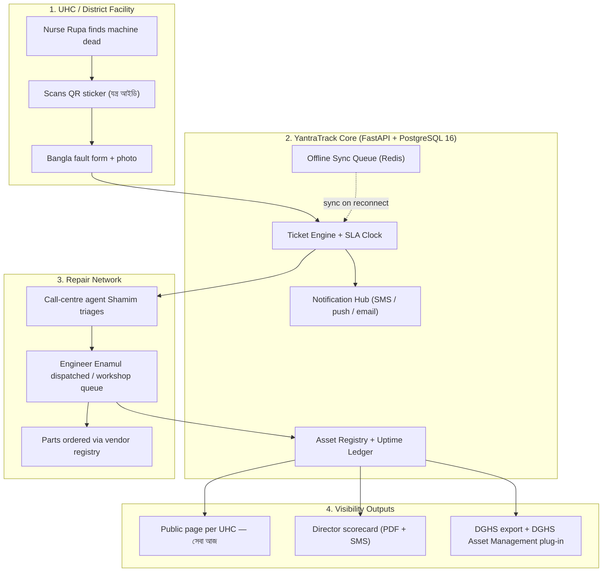
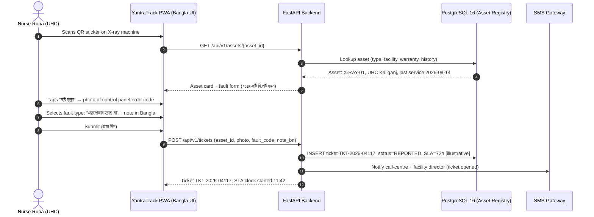
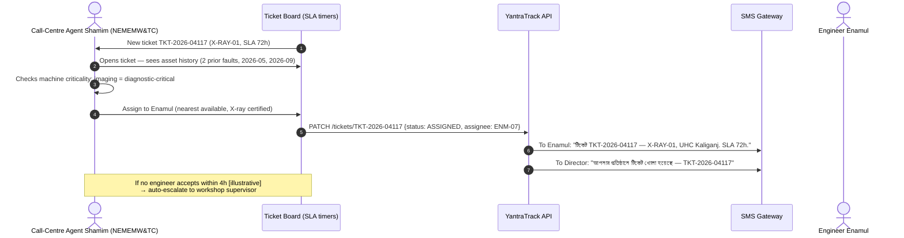
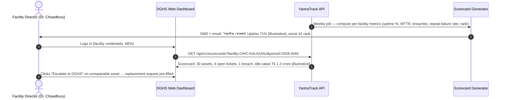
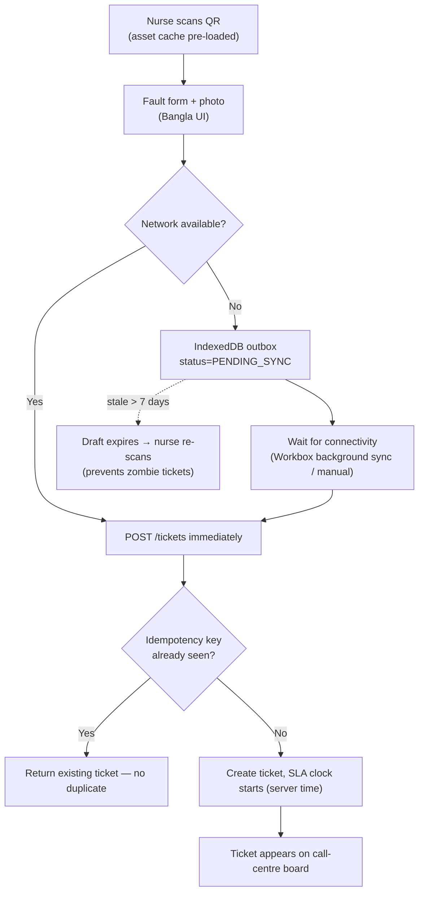

# 🔄 Application Flow — YantraTrack QR Equipment Uptime & Maintenance Register

## Module 10 — Fault Reporting, SLA-Timed Repair, Public Service Visibility & Offline-First Sync

---

## Table of Contents

- [Personas](#personas)
- [System Architecture & Interaction Overview](#system-architecture--interaction-overview)
- [Journey 1: Nurse Scans QR & Reports a Fault (Bangla + Photo)](#journey-1-nurse-scans-qr--reports-a-fault-bangla--photo)
- [Journey 2: NEMEMW Call-Centre Triage & Engineer Dispatch](#journey-2-nememw-call-centre-triage--engineer-dispatch)
- [Journey 3: Engineer Diagnosis — Fix On-Site or Order Part](#journey-3-engineer-diagnosis--fix-on-site-or-order-part)
- [Journey 4: Closure with Before/After Photo Proof](#journey-4-closure-with-beforeafter-photo-proof)
- [Journey 5: Facility Director Reviews Uptime Scorecard](#journey-5-facility-director-reviews-uptime-scorecard)
- [Journey 6: Patient / Family Checks the "Service Available Today" Page](#journey-6-patient--family-checks-the-service-available-today-page)
- [Journey 7: Offline Fault Report at a Spotty UHC — Queue & Sync](#journey-7-offline-fault-report-at-a-spotty-uhc--queue--sync)
- [Ticket Lifecycle State Machine](#ticket-lifecycle-state-machine)
- [Offline-First Sync Flow (Spotty UHC Connectivity)](#offline-first-sync-flow-spotty-uhc-connectivity)
- [Edge Cases & Exception Handling Matrix](#edge-cases--exception-handling-matrix)
- [Summary Table of Flows](#summary-table-of-flows)

---

## Personas

| Persona | Context | Tech | Jobs-to-be-Done |
|:---|:---|:---|:---|
| **Rupa — UHC Nurse** (রুপা, নার্স) | Reports faulty machines; 450–500 OPD/day pressure | Moderate | Scan QR → photo → Bangla note → submit < 60 s |
| **Enamul — Biomedical Engineer (NEMEMW&TC)** | National repair centre; field + workshop bench | High | Receive ticket → fix or order part → close with proof |
| **Shamim — NEMEMW Call-Centre Agent** | Dhaka triage desk; routing, parts, SLA watch | Moderate-high | Assign right technician; escalate breaches; vendor liaison |
| **Dr. Chowdhury — Facility Director** | UHC/District director; answerable to DGHS | Moderate | Weekly scorecard; act on worst-10; justify budget utilisation |
| **Fatema — Patient / Family** | Travelling to UHC; needs X-ray today | Low–moderate | Check "আজকে এক্স-রে উপলব্ধ?" before travelling |
| *(system)* **DGHS / NEMEMW Admin** | National registry, audit, export | High | National dashboard; annual-review export; DGHS plug-in |

---

## System Architecture & Interaction Overview



> [!NOTE]
> **Zero patient data flows anywhere in this diagram.** The only identities involved are staff (facility login) and machines (asset ID). This is why Module 10 carries the lowest privacy risk of the whole BD-HealthLoop stack.

---

## Journey 1: Nurse Scans QR & Reports a Fault (Bangla + Photo)

Rupa notices the UHC's X-ray unit shows "Ready" but the exposure does nothing. Today she would phone someone who may not answer. With YantraTrack:



**UI copy (Bangla):** `যন্ত্রের ত্রুটি রিপোর্ট করুন` · buttons `ছবি তুলুন` `বর্ণনা লিখুন` `জমা দিন` `খসড়া সেভ করুন` · toast `রিপোর্ট জমা হয়েছে — টিকেট নং TKT-2026-04117`. Camera in-app; photo ≤ 500 KB; photo + fault type mandatory; free text optional; 10-second scan-to-submit target.

---

## Journey 2: NEMEMW Call-Centre Triage & Engineer Dispatch



**Repeat-failure awareness:** asset history panel surfaces prior tickets; two failures in 90 days → **condemn-review**, not a third identical repair.

---

## Journey 3: Engineer Diagnosis — Fix On-Site or Order Part

```mermaid
sequenceDiagram
    autonumber
    actor Eng as Engineer Enamul (Field / Workshop)
    participant PWA as Engineer App
    participant API as YantraTrack API
    participant Parts as Spare-Parts & Vendor Registry
    participant Vendor as Empanelled Vendor

    Eng->>PWA: Opens TKT-2026-04117 at site (or workshop intake)
    Eng->>PWA: Diagnoses: faulty high-voltage transformer; needs part HV-TR-220V
    Eng->>PWA: Taps "পার্ট অর্ডার করুন" (order part)
    PWA->>API: POST /tickets/TKT-2026-04117/parts {part_code: HV-TR-220V, qty: 1}
    API->>Parts: Check stock at NEMEMW store → 0; query vendor lead times
    Parts-->>API: Vendor A (Dhaka): 5 days, Tk 48,000 [illustrative]; Vendor B: 12 days
    API->>Parts: Reserve / order from Vendor A (cheapest compliant, SLA-aware)
    API-->>PWA: Ticket status → PART_ORDERED; SLA paused? No — SLA re-based to delivery+24h [illustrative]
    Parts->>Vendor: Purchase order PO-2281 (auto-generated)
    Vendor-->>Parts: Acknowledged; ETA 5 days
    Note over Eng,Parts: On arrival: part scanned into ticket;<br/>warranty auto-linked; installation logged
```

**On-site fix path (no part needed):** Enamul replaces a blown fuse → photos before/after → taps `মেরামত সম্পন্ন` → status FIXED directly (skipping PART_ORDERED).

---

## Journey 4: Closure with Before/After Photo Proof

```mermaid
sequenceDiagram
    autonumber
    actor Eng as Engineer Enamul
    participant PWA as Engineer App
    participant API as YantraTrack API
    participant Pub as Public Page (per UHC)
    actor Dir as Facility Director

    Eng->>PWA: Repair done — test exposure OK
    Eng->>PWA: Captures AFTER photo (machine in operation) + test-shot metadata
    Eng->>PWA: Taps "মেরামত সম্পন্ন" (mark fixed) + one-line note
    PWA->>API: POST /tickets/TKT-2026-04117/close {after_photo, note, test_result: PASS}
    API->>API: Verify before/after photos present; immutable audit ledger write
    API->>API: Recompute asset uptime; set service status = AVAILABLE
    API-->>Pub: Page flips: "এক্স-রে উপলব্ধ — যাচাইকৃত ০৩ নভেম্বর ২০২৬"
    API->>Dir: SMS: "টিকেট TKT-2026-04117 বন্ধ — X-RAY-01 চালু। ডাউনটাইম ৪ দিন [illustrative]"
    API-->>Eng: Closure certificate TKT-2026-04117-C (PDF)
```

**UNREPAIRABLE path:** if the transformer is obsolete, engineer selects `মেরামত অযোগ্য` (unrepairable) + condemnation justification → asset flagged for replacement planning → public page shows `এক্স-রে বন্ধ — প্রতিস্থাপন প্রক্রিয়াধীন` and the case appears in DGHS export.

---

## Journey 5: Facility Director Reviews Uptime Scorecard



**Framing rule:** scorecards are **support, not policing** — every red metric links to a "request support" button (workshop visit, parts, training), never an auto-penalty.

---

## Journey 6: Patient / Family Checks the "Service Available Today" Page

```mermaid
sequenceDiagram
    autonumber
    actor Fam as Fatema (patient's wife)
    participant Pub as yantra.dghs.gov.bd/uhc/kaliganj
    participant Cache as CDN / Edge Cache (60s TTL)
    participant API as Status API

    Fam->>Pub: Opens page on phone (no login)
    Pub->>Cache: Fetch facility status board
    Cache->>API: GET /api/v1/public/facilities/UHC-KALIGANJ/status (if stale)
    API-->>Cache: X-RAY: AVAILABLE (verified 2026-11-03 11:58) · USG: UNDER REPAIR (SLA ETA 2026-11-08)
    Cache-->>Pub: Board renders in Bangla + English
    Pub-->>Fam: "এক্স-রে উপলব্ধ ✓ | আল্ট্রাসনোগ্রাম বন্ধ — মেরামত চলছে (সম্ভাব্য ০৮ নভেম্বর)"
    Fam->>Fam: Decides: travel today for X-ray; postpones ultrasound
```

**Zero PII / zero internals** — only service-level truth + "last verified" + SLA-based ETA. Printable "আজকের সেবা" sheet for the notice board.

---

## Journey 7: Offline Fault Report at a Spotty UHC — Queue & Sync

Upazila connectivity is unreliable (research: 57.4% household internet; rural smartphone 26% individual use — design for worst case). YantraTrack is **offline-first** for the report path:

```mermaid
sequenceDiagram
    autonumber
    actor Nurse as Nurse Rupa (offline)
    participant PWA as PWA + IndexedDB Outbox
    participant API as FastAPI Backend
    participant Redis as Redis Queue
    participant DB as PostgreSQL 16

    Nurse->>PWA: Scans QR (QR payload cached offline) → fills form + photo
    PWA->>PWA: No network → ticket draft saved to IndexedDB outbox (status=PENDING_SYNC)
    PWA-->>Nurse: "খসড়া সংরক্ষিত — ইন্টারনেট এলে স্বয়ংক্রিয় জমা হবে"
    Note over PWA: ...hours later, connectivity returns...
    PWA->>PWA: Background sync (Workbox / manual "Sync now")
    PWA->>API: POST /api/v1/tickets (idempotency key = draft UUID)
    API->>Redis: Enqueue ticket-creation job
    Redis->>DB: Worker inserts ticket; assigns TKT number; starts SLA clock at **server receipt time**
    API-->>PWA: TKT-2026-04131 confirmed; outbox cleared
    PWA-->>Nurse: Notification: "টিকেট জমা হয়েছে — TKT-2026-04131"
```

**Conflict rules:** server receipt time starts the SLA (not device time — clocks lie); duplicate submissions blocked by idempotency key; if the asset was concurrently flagged UNREPAIRABLE elsewhere, the draft syncs as a note on the existing ticket, not a new one.

---

## Ticket Lifecycle State Machine

```mermaid
stateDiagram-v2
    [*] --> REPORTED: Nurse submits (QR scan + photo)
    REPORTED --> ASSIGNED: Call-centre assigns engineer / workshop
    REPORTED --> REJECTED_FALSE: Misuse / false report (see edge cases)

    ASSIGNED --> PART_ORDERED: Part required — vendor/store order placed
    ASSIGNED --> FIXED: On-site fix, no part needed
    ASSIGNED --> UNREPAIRABLE: Obsolete / beyond economic repair

    PART_ORDERED --> FIXED: Part received → installed → test PASS
    PART_ORDERED --> UNREPAIRABLE: Part unavailable / vendor failure → condemn

    FIXED --> [*]: Closed (before/after proof, uptime updated)
    UNREPAIRABLE --> [*]: Closed (condemnation → replacement planning)
    REJECTED_FALSE --> [*]: Closed (audit note; reporter flagged if repeated)

    FIXED --> REPORTED: Repeat failure ≤ 30 days — auto re-open flag
    UNREPAIRABLE --> REPORTED: Replacement asset installed → new lifecycle
```



SLA timers run on `REPORTED → FIXED | UNREPAIRABLE`. `PART_ORDERED` re-bases the SLA to vendor ETA + 24h [illustrative] and is visible on the board as amber, not hidden.

---

## Offline-First Sync Flow (Spotty UHC Connectivity)



**Sync guarantees:** at-least-once delivery + idempotency = exactly-once effect; photos compressed client-side; partial sync (text ok, photo failed) retries photo only; audit log records offline-created-then-synced tickets with device timestamp + server timestamp.

---

## Edge Cases & Exception Handling Matrix

| Scenario / Edge Case | Failure Mode / Threat | System Defense & Protocol |
|:---|:---|:---|
| **Repeated failure — same asset, same fault** | Third identical "fix" papers over a dying machine | 2 failures / 90 d → mandatory condemn-review; repeat-failure KPI; director + DGHS notified |
| **Missing part — vendor out of stock / 12-week lead** | Ticket stuck in PART_ORDERED | SLA re-bases to vendor ETA + 24h; breach → DGHS procurement; alternative vendor suggested |
| **Vendor-only repair (warranty / sealed unit)** | NEMEMW can't open the machine | Routes to empanelled vendor, same SLA; vendor uploads service report + photo; NEMEMW verifies |
| **Misuse / false report (asset unplugged, not broken)** | Queue pollution; wasted trips | "ভুল রিপোর্ট?" close as REJECTED_FALSE; 3 false reports → supervisor review; never auto-punished |
| **Deliberate sabotage** | Machine "fails" only when inspected | Test-shot metadata (kVp / exposure count) required at closure; identical photos across tickets flagged |
| **Duplicate ticket — same asset, two reporters** | Double-counted downtime | 24h dedup on (asset_id, fault_code); second report merges as corroboration |
| **Sticker lost / QR damaged** | Unscannable; phantom inventory | Reprint workflow (admin + audit); serial search fallback; quarterly audit vs register |
| **Photo shows patient / documents** | Privacy leak | On-device blur prompt + review before submit; server-side flag for manual review |
| **Asset retired, still in register** | Inflated downtime denominator | Retirement flow with disposal certificate; uptime computed on active assets only |
| **SLA gaming — engineer closes early** | False FIXED; public page lies | Test-result field + after-photo mandatory; 10% [illustrative] random field audits |
| **Power outage at UHC** | Demo/pilot dies | Offline-first MVP; paper QR fallback + 16263 [optional]; sync on restore |
| **NEMEMW backlog > capacity** | Dashboard shows truth, nothing moves | Pair with procurement/staffing; worst-10 = evidence for budget, not a substitute |

---

## Summary Table of Flows

| # | Flow | Actor | Trigger | End State | Key SLA / Timer | Offline? |
|:---:|:---|:---|:---|:---|:---|:---:|
| 1 | Scan → report fault | Nurse | Dead machine found | Ticket REPORTED | Submit < 60 s | ✅ (outbox) |
| 2 | Triage & dispatch | Call-centre agent | New ticket | ASSIGNED | Accept ≤ 4 h [illustrative] | ❌ |
| 3 | Diagnose → fix / order part | Engineer | ASSIGNED | FIXED / PART_ORDERED | 72 h diagnostic SLA [illustrative] | ✅ field app |
| 4 | Closure with proof | Engineer | Repair done | FIXED + public page flip | Immediate | ✅ |
| 5 | Director scorecard review | Facility director | Weekly job | Informed action / escalation | Weekly cadence | ❌ |
| 6 | Public "service today" check | Patient / family | Before travelling | Informed decision | 60 s cache TTL | ✅ (cached page) |
| 7 | Offline queue & sync | Nurse (no network) | No connectivity | PENDING_SYNC → REPORTED | SLA starts at server receipt | ✅ core design |

**Cross-module hooks:** Journey 4 flips the public page consumed in Journey 6; Journey 3's REJECTED_FALSE and Journey 1's reports feed the audit ledger; Journey 5's scorecards feed the DGHS Annual Health Review export (Feature 11) and the RadioQ capacity API (Feature 12).
