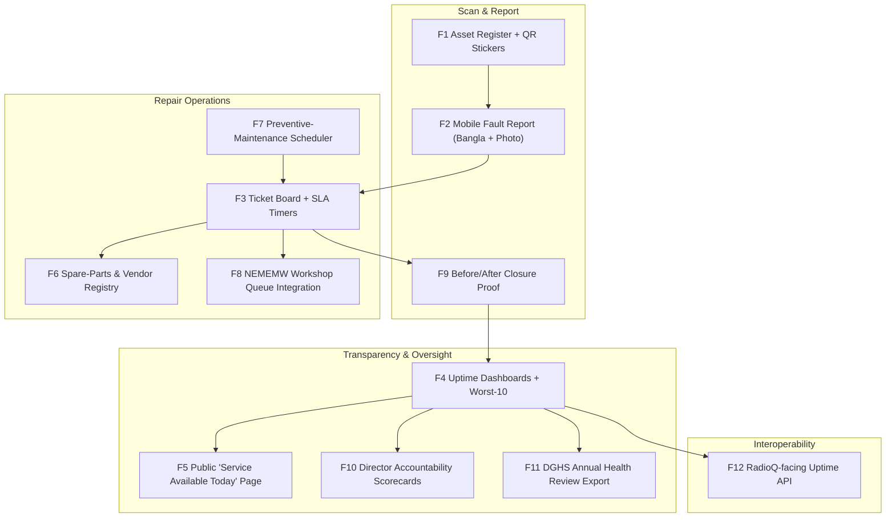

# ⚡ Functional Specifications & Feature Catalog — Module 10

## YantraTrack — QR Equipment Uptime & Maintenance Register

---

## Table of Contents

- [Functional Architecture Overview](#functional-architecture-overview)
- [Feature 1: National Asset Register with QR Sticker Generator](#feature-1-national-asset-register-with-qr-sticker-generator)
- [Feature 2: Mobile Scan → Report Fault (Photo + Bangla)](#feature-2-mobile-scan--report-fault-photo--bangla)
- [Feature 3: Ticket Board with SLA Timers](#feature-3-ticket-board-with-sla-timers)
- [Feature 4: Uptime Dashboards (Facility / Type / Worst-10)](#feature-4-uptime-dashboards-facility--type--worst-10)
- [Feature 5: Public "Service Available Today" Page per UHC](#feature-5-public-service-available-today-page-per-uhc)
- [Feature 6: Spare-Parts & Vendor Registry](#feature-6-spare-parts--vendor-registry)
- [Feature 7: Preventive-Maintenance Scheduler](#feature-7-preventive-maintenance-scheduler)
- [Feature 8: NEMEMW Workshop Queue Integration](#feature-8-nememw-workshop-queue-integration)
- [Feature 9: Photo Before/After Closure Proof](#feature-9-photo-beforeafter-closure-proof)
- [Feature 10: Accountability Scorecards for Facility Directors](#feature-10-accountability-scorecards-for-facility-directors)
- [Feature 11: Export for DGHS Annual Health Review](#feature-11-export-for-dghs-annual-health-review)
- [Feature 12: Open API — RadioQ Consumes Machine Uptime](#feature-12-open-api--radioq-consumes-machine-uptime)
- [Feature Matrix](#feature-matrix)
- [Out of Scope](#out-of-scope)

---

## Functional Architecture Overview

Cross-links: **Module 02** (test-reports — labs depend on these machines), **Module 04** (ICU beds — same NEMEMW escalation path), **Module 05** (FHIR spine), **Module 06** (medicine stock — same transparency philosophy), **RadioQ** (uptime = capacity truth).

---

## Feature 1: National Asset Register with QR Sticker Generator

**What.** Canonical register of every public-hospital machine: asset ID, facility (DGHS code), type, manufacturer/model/serial, install date, warranty, AMC, criticality class, service status. Each record generates a laminated tamper-evident **QR sticker** (asset ID only — no PII).

**Why.** You cannot repair what you cannot see. Rwanda MEMMS built national coverage on this registry core (>80% registered, 2018). Bangladesh has none; YantraTrack is the field layer that populates the DGHS "Asset Management" module — not a parallel registry.

**How.** `Asset`/`Facility`/`AssetCategory` model; MVP loads **30 synthetic PPRC-shaped assets** at one UHC; QR payload `YTK1:<uuid>` HMAC-signed; A6 print templates; bulk CSV import; optional FHIR `Device`/`Location` projection (most assets are not clinical FHIR devices — see IMPLEMENTATION.md).

**Edge cases.** Unregistered machine found on audit → "orphan asset" intake flow with photo + facility claim; duplicate serials → flag for review; sticker swapped between machines → photo-at-registration + random physical audits; retired assets → disposal certificate closes the record.

---

## Feature 2: Mobile Scan → Report Fault (Photo + Bangla)

**What.** A Bangla-first PWA screen reached by scanning any asset QR: shows the asset card (machine, facility, last service, open tickets), a fault-type picker (`এক্সপোজার হচ্ছে না`, `পাওয়ার নেই`, `ত্রুটি কোড দেখাচ্ছে`, `অন্যান্য`), a mandatory **photo**, and a short Bangla note. Submit in **< 60 seconds**, fully usable offline (see APP_FLOW Journey 7).

**Why.** The current channel is letters/paper/phone that go unanswered (Rangpur MCH). 10 seconds is the adoption make-or-break at a 450–500 OPD/day UHC.

**How.** React 19 + Vite + Tailwind PWA; camera via `getUserMedia`; photo ≤ 500 KB; IndexedDB outbox + idempotency keys; Workbox background sync; **server receipt time starts the SLA**. ~20 fault codes (illustrative) map to criticality → SLA.

**Edge cases.** No network → outbox; duplicate submission → merge as corroboration; wrong asset scanned → pre-submit confirmation card; photo contains patient → on-device blur prompt + server-side flag for review; non-staff scan → asset card is public-safe (no internal data), report requires staff login; shared family phone → staff PIN option.

---

## Feature 3: Ticket Board with SLA Timers

**What.** Kanban board for NEMEMW call-centre + facility engineers: columns `REPORTED → ASSIGNED → PART_ORDERED → FIXED / UNREPAIRABLE` (+ `REJECTED_FALSE`), each card showing asset, facility, fault, age, and a **live SLA countdown** (green → amber → red). Filters: facility, machine type, engineer, breach status. SLA policy per criticality class; breach triggers SMS (engineer → director → DGHS).

**Why.** Letters have no clock. An SLA converts silence into a visible, escalating breach — the exact failure mode at Rangpur (requests, no reply) becomes a red timer within 24–72h [illustrative policy].

**How.** SSE/WebSocket board; SLA deadlines from server receipt; `PART_ORDERED` re-bases SLA to vendor ETA + 24h; breach = deadline passed without resolution; breach SMS (engineer → director → DGHS); append-only audit ledger; role-gated columns.

**Edge cases.** Clock skew → server time only; SLA gaming (early false close) → mandatory test result + photo, 10% [illustrative] random field audits; board flooding → auto-archive REJECTED_FALSE after 30 days; concurrent edits → optimistic locking + conflict toast; holiday/leave → engineer out-of-office auto-reassigns queue.

---

## Feature 4: Uptime Dashboards (Facility / Type / Worst-10)

**What.** Three lenses on one truth: (1) **per-facility** uptime % (active assets operational ÷ total active), MTTR, open tickets, SLA breaches; (2) **per machine type** national reliability (which X-ray models fail most — informs procurement!); (3) **worst-10 facilities** league table for DGHS review. Trend lines, month-on-month delta, drill-down to ticket level.

**Why.** PPRC's 52% idle + 79% malfunction diagnosis needs a continuous measurement instrument, not a triennial survey. Also feeds procurement: if Model X fails 3× more than Model Y, the next tender should care.

**How.** Materialised views refreshed on ticket close; uptime = 100 × asset-hours operational ÷ asset-hours in service (rolling 30/90/365 d); cached; public page reads sanitised subset.

**Edge cases.** Asset down for *planned* maintenance ≠ failure → exclude scheduled downtime (flagged by Feature 7); facility under-reports → audit cross-check vs physical inventory; low-N facilities → suppress ranking, show "insufficient data"; uptime gaming via mass UNREPAIRABLE → UNREPAIRABLE closures excluded from "operational" but counted in "capacity lost" metric shown alongside.

---

## Feature 5: Public "Service Available Today" Page per UHC

**What.** No-login page per facility: each diagnostic service with live status — `এক্স-রে উপলব্ধ ✓` / `এক্স-রে বন্ধ — মেরামত চলছে (সম্ভাব্য ০৮ নভেম্বর)` — plus last-verified timestamp and one-line "what to do" (e.g., nearest alternative UHC [illustrative]). Bangla + English; printable "আজকের সেবা" sheet; embeddable widget for DGHS site.

**Why.** Patients currently discover dead machines by arriving — 25% imaging regularly provided (17% UHC) means most trips risk failure. Radical visibility forces the fix and respects patient time and money (79.31% OOP spending context).

**How.** Sanitised read-model; 60 s CDN cache; AVAILABLE only if FIXED + no open critical ticket; "last verified" from latest closure/audit; zero PII; WCAG AA; 2G text fallback; printable "আজকের সেবা" sheet.

**Edge cases.** Stale data → show "সর্বশেষ যাচাই: …" prominently; disputed status → "রিপোর্ট করুন" link queues a verification ticket; all services down → page shows emergency notice + 16263 helpline [optional]; misinformation screenshots → status codes versioned, every flip audit-logged.

---

## Feature 6: Spare-Parts & Vendor Registry

**What.** Catalogue of parts (HV transformers, X-ray tubes, CR plates, lab reagents for analysers…), stock levels at NEMEMW store + district stores, empanelled vendors with lead times, prices, SLA compliance history, and auto-generated POs from tickets. Low-stock alerts pre-position fast-moving parts.

**Why.** A repair without a part is a letter, not a fix. MEMMS covers parts because parts are where repairs actually die; manual letter-and-tender procurement is invisible and slow.

**How.** `Part`/`Vendor`/`PurchaseOrder` tables; vendor portal (accept/decline, upload challan); part scan-in auto-unblocks tickets; price history for procurement; AMC/warranty parts flagged "no PO — claim under contract".

**Edge cases.** Vendor fails delivery → auto-reorder to next-ranked vendor + breach escalation; counterfeit part → serial verification at scan-in; price gouging → price-history flag vs median; sole-source obsolete part → condemn-review path (Feature 9); vendor data entry burden → PO via SMS link [illustrative].

---

## Feature 7: Preventive-Maintenance Scheduler

**What.** Recurring maintenance plans per asset category (e.g., X-ray: tube check + calibration every 6 months; autoclave: pressure vessel inspection annually — intervals [illustrative], aligned to manufacturer manuals). Auto-generates tickets, assigns engineers, blocks "AVAILABLE" status during PM window, and logs compliance.

**Why.** 79% of service gaps trace to malfunction; prevention is cheaper than repair. MEMMS includes maintenance; BD currently does it ad hoc (often never).

**How.** Cron scheduler; plans templated per machine type; PM tickets with checklist; overdue PM = amber (not breach); PM photo + checklist; compliance % feeds scorecard; missed PM voids warranty claim — flagged.

**Edge cases.** PM during patient surge → reschedule with reason (logged); PM finds fault → spawns corrective ticket linked to PM; duplicate PM + corrective on same asset → merged view; assets with no manual → generic plan + flag for biomedical review.

---

## Feature 8: NEMEMW Workshop Queue Integration

**What.** Digital queue for the national workshop: intake (walk-in / courier / field pickup), bench assignment, diagnosis, parts wait, QC, dispatch back. Priority lanes: diagnostic-critical, life-support-adjacent, routine. Dashboard for workshop manager: WIP, avg turnaround, bench utilisation, backlog ageing.

**Why.** NEMEMW&TC is today a black box reached by letter (Rangpur: no reply). Queue visibility is the minimum bar for accountability — and the data basis for staffing/budget asks.

**How.** `WorkshopJob` linked to ticket; QR job cards travel with machine; SLA inherited; WIP/turnaround/backlog reports weekly; capacity model (jobs/week vs engineers) → overload alert; pairs with DGHS procurement.

**Edge cases.** Machine abandoned at workshop → 90-day unclaimed alert to facility; machine unfixable at intake → immediate condemn path; courier damage in transit → condition photos at intake/dispatch; workshop downtime → all SLAs re-base with notice.

---

## Feature 9: Photo Before/After Closure Proof

**What.** Mandatory paired photos at closure: "before" (fault evidence / error code / damage) and "after" (machine operating / test shot), plus optional test metadata (kVp, exposure count, printout photo for labs). Immutable, timestamped, GPS-tagged (facility-level, not precise), audit-logged. Engineer one-liner in Bangla or English.

**Why.** Paper "repaired" sign-offs are unverifiable; Module 04 uses the same falsifiability principle for beds. Photos make closures falsifiable and disputes resolvable — and feed remote QC by senior engineers.

**How.** App enforces before → work → after sequence; EXIF stripped except timestamp; compressed, thumbnails inline; audit ledger write-once; UNREPAIRABLE needs condemnation + disposal route; random 10% [illustrative] field verification.

**Edge cases.** Missing "before" (emergency call) → allow with mandatory note + supervisor approval; blurry/duplicate photos → client-side quality check + server similarity check vs same asset; photo privacy (patient in frame) → blur prompt + review queue; storage growth → 3-year hot, archive cold, ~2 MB/ticket [illustrative].

---

## Feature 10: Accountability Scorecards for Facility Directors

**What.** Weekly one-page scorecard per facility: assets registered, uptime %, MTTR, SLA breaches, PM compliance, repeat-failure rate, idle-equipment value (Tk returned to service), national rank + worst-10 flag. SMS headline + PDF + web detail. Red metrics link to "request support" (workshop visit, parts, training) — **support, not policing**.

**Why.** The PPRC pair — 52% idle machines, 94% unspent budgets — means funds exist but accountability doesn't. A director who sees "rank #54 of 64, 1 breach, Tk 1.2 crore idle [illustrative]" and a support button acts; a blame letter gets filed.

**How.** Mondays 06:00 (Asia/Dhaka) job; metrics from ledger; PDF via headless renderer; SMS gateway; delivery receipt logged; director acknowledges in-app; non-ack → DGHS after 14 d; archive for annual review.

**Edge cases.** New director inherits bad rank → onboarding note + trend view; disputed metric → "contest" button opens review ticket with data appendix; facility merges/splits → scorecard genealogy; non-response → escalate, never auto-penalise; small facilities → rank with sample-size caveat.

---

## Feature 11: Export for DGHS Annual Health Review

**What.** One-click (or scheduled) national export: CSV/XLSX + PDF summary for the DGHS Annual Health Review — assets by type/facility/division, uptime trends, breach statistics, idle-value recovery, PM compliance, condemn pipeline, and per-district league tables. PPRC-compatible indicator definitions for trend continuity.

**Why.** PPRC-type studies recur because baseline data vanish between cycles. A standing export makes the Annual Health Review equipment chapter evidence-based by default — and lets MoHFW answer "are machines fixed?" with data, not anecdotes.

**How.** Pre-built 12-table report pack [illustrative]; versioned indicator dictionary; audit-logged downloads; CSV + print PDF; DHIS2-compatible where feasible; authorised DGHS roles only.

**Edge cases.** Mid-year definition change → versioned dictionary, dual-run reports; facilities with < N assets → suppressed cells; export leaked → watermarks + role-scoped downloads; data delay → "as of" stamp mandatory; comparing years with different asset counts → normalised rates only.

---

## Feature 12: Open API — RadioQ Consumes Machine Uptime

**What.** Read-only public-ish API for authorised consumers: `GET /api/v1/uptime?facility=…&type=…` returns current service availability + 30-day uptime + open critical tickets + expected resolution. **RadioQ** (shared radiotherapy/diagnostics waiting list, Idea 5 in hackathon-research) uses it to allocate patients to *actually working* capacity — uptime = capacity truth. Module 02 (lab reports) and Module 04 (ICU beds) may also consume it.

**Why.** NICRH: 4 of 6 radiotherapy machines down; ~7,500 waiting; appointments to end-2028. Any queue built on nominal capacity is fiction. RadioQ's fairness depends on YantraTrack's honesty.

**How.** API key per consumer; rate-limited; JSON + FHIR `Device`/`Location` optional profile for the FHIR-aligned; OpenAPI 3.1 spec; webhook on status flip (`asset.available` / `asset.unavailable`); SLA for API itself 99.5% [illustrative]; cached 60s; versioned (`/v1/`).

**Edge cases.** Consumer marks stale data as live → mandatory "last verified" passthrough; uptime=100 lie via mass UNREPAIRABLE → expose `capacity_lost_pct` alongside; API abuse → keys revocable, IP allowlist for government consumers; RadioQ offline → caches last status, degrades gracefully.

---

## Feature Matrix

| ID | Feature | Priority | Key Protocol / Standard | Primary Users |
|:---|:---|:---:|:---|:---|
| **F-YTK-01** | Asset register + QR sticker generator | P0 | QR (ISO/IEC 18004), HMAC | DGHS, facility admins |
| **F-YTK-02** | Mobile scan → fault report (Bangla) | P0 | PWA, IndexedDB, Workbox | Nurses, technologists |
| **F-YTK-03** | Ticket board + SLA timers | P0 | WebSocket/SSE, state machine | NEMEMW agents, engineers |
| **F-YTK-04** | Uptime dashboards (3 lenses) | P0 | SQL materialised views | DGHS, directors |
| **F-YTK-05** | Public "service today" page | P0 | CDN, WCAG 2.2 AA | Patients, families |
| **F-YTK-06** | Spare-parts & vendor registry | P1 | PO workflow, vendor portal | NEMEMW, vendors |
| **F-YTK-07** | Preventive-maintenance scheduler | P1 | Cron, checklist engine | Engineers, facilities |
| **F-YTK-08** | NEMEMW workshop queue integration | P1 | Barcode job cards | Workshop manager |
| **F-YTK-09** | Before/after photo closure proof | P0 | Immutable audit ledger | Engineers, QC |
| **F-YTK-10** | Director accountability scorecards | P1 | Scheduled PDF + SMS | Facility directors |
| **F-YTK-11** | DGHS Annual Health Review export | P2 | CSV/XLSX/PDF, dictionary | DGHS |
| **F-YTK-12** | Uptime API for RadioQ | P2 | REST + webhooks, OpenAPI 3.1 | RadioQ, Module 02/04 |

---

## Out of Scope

- **Repair itself** — YantraTrack tracks and proves repairs; it does not fix machines or hold a screwdriver.
- **Procurement of new machines / spare parts purchasing** — it generates demand signals and POs; budget approval stays with DGHS/MoHFW/EDCL.
- **NEMEMW staffing reform** — the dashboard evidences the backlog; it cannot hire engineers. Pair with procurement.
- **Patient records / clinical data** — none collected, stored, or processed. Zero.
- **Private hospitals initially** — public sector first; private via accreditation incentive later [illustrative].
- **IoT/telemetry auto-detection** (ventilator RS-232-style hooks) — possible future for high-end assets; MVP is human-scan, because it works on a 2009 X-ray with no ports.
- **Asset disposal/resale marketplace** — condemnation is recorded; resale is out.
- **Duplicate of DGHS "Asset Management" module** — YantraTrack plugs in as field front-end; scope of the DGHS module is uncertain and YantraTrack must not fork it.
- **openMEDIS adoption** — named in notes; not evaluated; not assumed.
