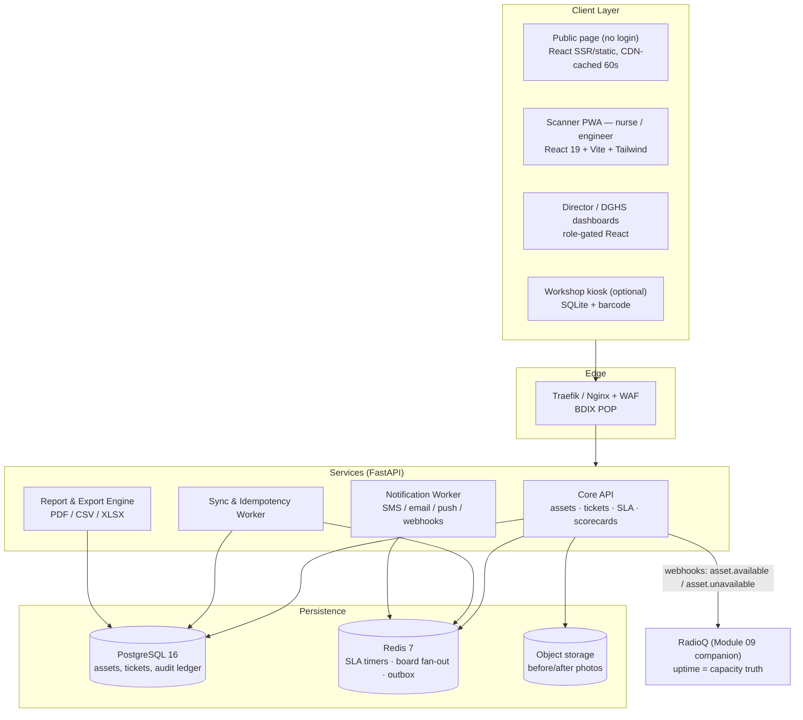
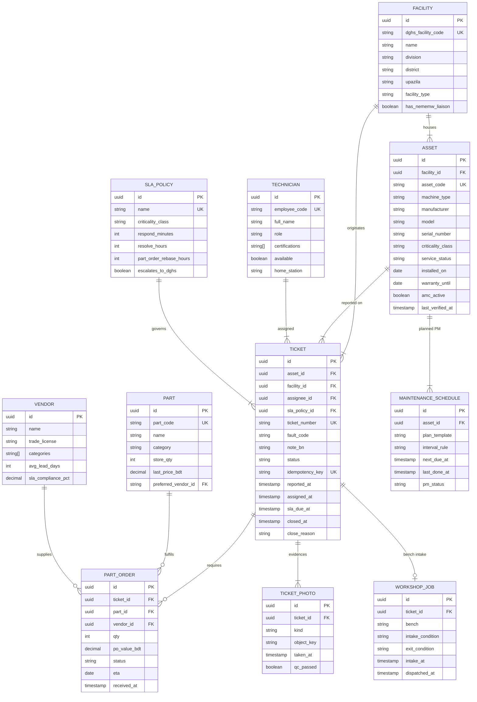
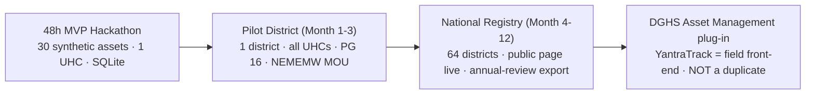

# 🛠️ Technical Architecture & Implementation Blueprint — Module 10

## YantraTrack — QR Equipment Uptime & Maintenance Register

---

## Table of Contents

- [Technology Stack](#technology-stack)
- [System Architecture Overview](#system-architecture-overview)
- [Data Model & Entity-Relationship Diagram](#data-model--entity-relationship-diagram)
- [FHIR R4 — An Honest Note (Most Assets Are Not FHIR Devices)](#fhir-r4--an-honest-note-most-assets-are-not-fhir-devices)
- [REST API Specification](#rest-api-specification)
- [Photo Storage & QR Generation](#photo-storage--qr-generation)
- [Offline-First Sync Design](#offline-first-sync-design)
- [Security, Facility Login & Audit Ledger](#security-facility-login--audit-ledger)
- [Rollout Plan: 48h MVP → Pilot District → National → DGHS Plug-In](#rollout-plan-48h-mvp--pilot-district--national--dghs-plug-in)
- [Risk Register](#risk-register)
- [3-Minute Demo Script](#3-minute-demo-script)
- [Module Cross-References](#module-cross-references)
- [Sources & Data Notes](#sources--data-notes)

---

## Technology Stack

Aligned to the BD-HealthLoop platform spine (Module 05). Django/Laravel are acceptable for internal admin screens, but the default is the platform standard — FastAPI + React 19 PWA — because the scanner must work offline on a mid-range Android in a UHC.

| Layer | Choice | Notes |
|:---|:---|:---|
| **Scanner / mobile UI** | **React 19 + Vite + Tailwind PWA** | Bangla-first; installable; works offline (IndexedDB outbox); camera via `getUserMedia` |
| **Admin / dashboards** | React 19 + Vite + Tailwind (same app, role-gated routes) | Director scorecards, DGHS dashboards; SSR not required |
| **API** | **FastAPI (Python 3.12)** | OpenAPI 3.1 auto-docs; async; pydantic v2 validation |
| **Database** | **PostgreSQL 16** | `pg_trgm` for search; materialised views for uptime; row-level security per facility |
| **Cache / queues / pub-sub** | **Redis 7** | SLA timers, ticket board fan-out (SSE/WebSocket), idempotency keys, sync queue |
| **QR generation** | **segno** (Python, ISO/IEC 18004) or `qrcode` | HMAC-signed payloads `YTK1:<uuid>:<sig>`; print templates A6 |
| **Photo storage** | S3-compatible object store (MinIO on-prem / AWS S3 / BDIX-hosted) | ≤ 500 KB compressed; 3-yr hot → cold archive; EXIF stripped except timestamp |
| **Offline store** | **IndexedDB** (via `idb` / Dexie) on device; SQLite for workshop kiosk option | Conflict: server receipt time wins; idempotency keys |
| **Auth** | DGHS facility login (OIDC) + local TOTP MFA for directors/admins | Staff-only writes; public reads need no auth |
| **Notifications** | SMS gateway (multi-telco failover) + SMTP + Web Push | Bangla Unicode SMS; delivery receipts logged |
| **Background jobs** | Celery / RQ on Redis | Weekly scorecards, SLA breach sweep, PM scheduler, exports |
| **Observability** | OpenTelemetry + Grafana + Loki | Audit log is append-only Postgres + off-box copy |
| **Hosting** | DGHS/BDIX sovereign cloud (primary, Dhaka) + Jessore DR (standby) | See Module 04 deployment pattern; BDIX peering for low latency |
| **MVP shortcut** | **SQLite** acceptable for the 48h hackathon MVP | Zero-config; migrate to PG 16 at pilot |

---

## System Architecture Overview

---

## Data Model & Entity-Relationship Diagram

A separate **append-only `audit_ledger`** table (actor, action, before/after state, device+server timestamps, IP) records every status flip; corrections are new rows, never edits.

---

## FHIR R4 — An Honest Note (Most Assets Are Not FHIR Devices)

**Most of what YantraTrack registers — autoclaves, X-ray generators, lab centrifuges, CR readers — are not clinical devices in the FHIR `Device` sense, and pretending otherwise would be theatre.** FHIR is used narrowly and optionally:

- Optional `Device` mapping for assets that *are* clinical devices (e.g., patient monitors, ventilators when tracked) — with `Device.identifier` = asset code, `Device.location` = facility, `Device.status` mapped from `service_status`.
- Optional `Location` mapping for facility hierarchy (matches Module 04/05 patterns).
- **Not mapped:** consumables, generic workshop tooling, infrastructure (generators) — plain relational rows.
- Export for DGHS can emit `Device`/`Location` bundles **on request**, but the canonical store is relational; FHIR is a projection, never the source of truth.
- No `Patient`, `Encounter`, `Observation` — **zero patient data, by design.** PDPO 2025 (sensitive health data) therefore barely engages; see Security.
- If BD-Core FHIR IG adopts an asset/device profile later, the projection layer absorbs it without schema migration.

---

## REST API Specification

Base URL: `https://yantra.dghs.gov.bd/api/v1` · Auth: OIDC bearer (staff) · Public endpoints marked 🌐.

| Method & Path | Auth | Purpose | Key Notes |
|:---|:---|:---|:---|
| `GET /assets/{asset_code}` | Staff | Asset card for scan screen | Includes open tickets, last service |
| `POST /assets` | DGHS admin | Register asset (+ generate QR payload) | Bulk CSV variant `POST /assets/bulk` |
| `GET /assets/{id}/qr.pdf` | Staff/admin | Print QR sticker sheet | A6/A4; HMAC-signed payload |
| `POST /tickets` | Staff | Create fault ticket | Idempotency-Key header required; photo refs via `POST /uploads` first |
| `GET /tickets?facility=&status=&sla=breach` | Staff | Ticket board query | Cursor pagination; SSE stream variant `/tickets/stream` |
| `PATCH /tickets/{id}/assign` | Agent/supervisor | Assign engineer | Triggers SMS; audit write |
| `POST /tickets/{id}/parts` | Engineer | Request part / raise PO | Auto-links vendor; SLA re-base |
| `POST /tickets/{id}/close` | Engineer | Close with before/after proof | Requires ≥2 photos + test result; UNREPAIRABLE needs justification |
| `POST /tickets/{id}/reopen` | System/agent | Repeat failure ≤ 30 d | Auto-flag; counter increments |
| `GET /uptime?facility=&type=&window=30d` | Staff + API key | Uptime metrics | Consumed by RadioQ / Module 02 / 04 |
| `GET /public/facilities/{code}/status` 🌐 | None | Public "service available today" | Sanitised; 60 s cache; "last verified" mandatory |
| `GET /dashboards/worst10` | DGHS | Worst-10 facilities league | Rolling 30/90 d; exportable |
| `GET /scorecards/{facility}?period=` | Director/DGHS | Weekly scorecard data | PDF variant `?format=pdf` |
| `GET /exports/annual-review?year=` | DGHS | Annual Health Review pack | CSV/XLSX/PDF; audit-logged download |
| `POST /sync/tickets` | Staff (offline) | Batch outbox flush | Idempotent replay; returns per-item status |
| `GET /health` 🌐 | None | Liveness/readiness | For BDIX anycast failover |

**Webhooks** (outbound, HMAC-signed): `asset.available`, `asset.unavailable`, `ticket.breach`, `ticket.closed` → subscribers: RadioQ, DGHS dashboard, SMS gateway.

---

## Photo Storage & QR Generation

- **Photos:** client-side resize to max 1280px, JPEG q≈70 (≤ 500 KB); server verifies MIME sniffing; EXIF stripped except `DateTimeOriginal`; object keys `tickets/<yyyy>/<mm>/<ticket>/<uuid>.jpg`; lifecycle: hot 3 yr → cold archive; thumbnails 320px inline.
- **Before/after pairing enforced** at `/close`; mismatched pair → `422` with reason; unrepairable closures require condemnation note ≥ 20 chars.
- **QR:** payload `YTK1:<asset_uuid>:<hmac8>`; error-correction level M; quiet zone 4 modules; print DPI 300; sticker stock: laminated vinyl, tamper-evident (VOID on peel) [procurement spec, illustrative]; reprints audit-logged with reason codes (`LOST`, `DAMAGED`, `NEW_INSTALL`).

---

## Offline-First Sync Design

- **Outbox pattern:** PWA writes `{draft_uuid, asset_code, fault, photo_blob, queued_at}` to IndexedDB (`yantra-outbox`); UI shows `খসড়া সংরক্ষিত`.
- **Sync triggers:** connectivity restore (`online` event + Workbox BackgroundSync), app open, manual "Sync now".
- **Server receipt time** starts SLA — device clocks untrusted.
- **Idempotency:** `draft_uuid` as idempotency key; replays return existing ticket.
- **Partial failure:** text ticket syncs, photo retries independently; after 5 failures photo flags `UPLOAD_FAILED` — ticket still valid, QC sees missing photo.
- **Expiry:** drafts > 7 days purged with user notice.
- **Workshop kiosk (optional):** SQLite mirror + nightly two-way sync for zero-connectivity workshops.

---

## Security, Facility Login & Audit Ledger

> [!IMPORTANT]
> **YantraTrack collects ZERO patient data — the single biggest privacy win in the BD-HealthLoop stack.** No names, no NID, no diagnoses, no encounter data. PDPO 2025's sensitive-health-data regime is therefore a non-issue by design, not by policy waiver.

- **Facility login:** OIDC via DGHS (or facility LDAP bridge); staff roles: `nurse`, `technologist`, `engineer`, `agent`, `director`, `dghs_admin`, `vendor` (portal-scoped). Directors/DGHS require TOTP MFA.
- **Authorization:** Postgres RLS — staff see only their facility; DGHS sees all; vendors see only their POs; public sees sanitised status only.
- **Audit ledger:** append-only; every write logs actor, role, IP, device hash, before/after; weekly off-box copy; tamper-evidence via hash chaining [illustrative implementation].
- **QR anti-forgery:** HMAC-signed payloads; scan of unsigned/foreign QR → "অজানা স্টিকার" screen, no data leak.
- **Rate limiting & WAF:** public status endpoint 60 req/min/IP; login brute-force lockout; security headers (CSP, HSTS); dependency scanning in CI.
- **Privacy by design:** photo review queue screens for patient identifiers; staff can report exposures; takedown SLA 72h [illustrative].
- **Data residency:** all data in BD (Dhaka primary / Jessore DR); no cross-border transfer.
- **Vendor access:** time-boxed, PO-scoped, auto-expires; all vendor actions audited.

---

## Rollout Plan: 48h MVP → Pilot District → National → DGHS Plug-In

**Phase 0 — 48h MVP (hackathon).** 30 synthetic assets at one UHC (shaped on PPRC categories); QR stickers printed; nurse fault-report flow; ticket board with SLA timers; uptime dashboard; public status page; 3-minute demo. SQLite fine.

**Phase 1 — Pilot district (months 1–3).** One district (suggest: one with documented equipment failure, e.g. Rangpur division given Rangpur MCH evidence). All public facilities onboarded; real NEMEMW engineers; SLA policy tuned; baseline uptime measured; weekly scorecards; public page indexed; evaluation vs PPRC indicators.

**Phase 2 — National registry (months 4–12).** All UHCs → district hospitals → medical colleges → specialised hospitals; NEMEMW workshop queue live; vendor registry; PM scheduler; annual-review export; RadioQ integration for radiotherapy capacity truth.

**Phase 3 — DGHS "Asset Management" plug-in.** YantraTrack becomes the **field front-end** of the DGHS module: single asset registry, shared facility codes, MoHFW-owned data. **Do NOT duplicate.** If the DGHS module's scope is confirmed minimal, YantraTrack is donated as its front-end; if it is confirmed absent, YantraTrack *is* the interim asset layer with a migration hatch. openMEDIS noted, not evaluated — not a dependency.

**Non-negotiable pairing:** rollout **with** procurement + workshop staffing. Module 10 makes the backlog visible; it does not clear it. The worst-10 list is the budget case, not the budget.

---

## Risk Register

| # | Risk | L | I | Mitigation |
|:---:|:---|:---:|:---:|:---|
| R1 | **Politics of blame** — directors hide failures, under-report | M | H | Frame as support not policing; "request support" button on every red metric; ranks with sample-size caveats; recognition for most-improved, not only shame for worst |
| R2 | **NEMEMW capacity** — visibility without repair power; backlog grows visibly | H | H | Pair with procurement & staffing reform; DGHS gets backlog costing; escalate breach data to MoHFW; vendor lane offloads bench load |
| R3 | **Adoption** — scan flow too heavy; reports dry up | M | H | 10-second design; offline-first; Bangla UI; champion nurse per facility; 10-min training; weekly usage nudge |
| R4 | **Data quality** — sticker loss, unregistered machines, phantom assets | M | M | Reprint workflow; quarterly physical audits vs register; orphan intake; audit-linked scorecards |
| R5 | **False / malicious reports** | L | M | REJECTED_FALSE outcome; 3 strikes → supervisor review; never auto-punish; anomaly detection on repeat reporters |
| R6 | **Duplicate / conflict with DGHS Asset Management module** | M | M | Plug-in strategy; shared facility codes; weekly sync with DGHS PMO; abort-and-merge plan if scope overlaps |
| R7 | **Vendor capture** — PO flow favours incumbents | L | M | Open empanelment; price-history flags; rotating evaluation; all POs audit-logged |
| R8 | **Connectivity** — UHCs offline for days | H | M | Offline-first outbox; SMS fallback alerts; workshop kiosk SQLite; sync audit |
| R9 | **Security / forged QRs / data leak** | L | M | HMAC QRs; RLS; WAF; zero patient data; pen-test before pilot; bug bounty [illustrative] |
| R10 | **SLA gaming** — early false closures to beat timers | M | M | Mandatory test proof + photo; random 10% [illustrative] field audits; repeat-failure auto-flag; scorecard integrity index |
| R11 | **Donor dependency / unsustainable funding** | M | M | Government-owned from day 1 (DGHS/NEMEMW); donors fund pilot only; open-source core; no proprietary lock-in |
| R12 | **Scope creep** — becomes full CMMS/EAM suite | M | L | Hard out-of-scope list (FEATURES.md); change control via DGHS PMO; "repair tracking only" mantra |

---

## 3-Minute Demo Script

**Stage setup:** laptop on table with QR sticker "X-RAY-01 — UHC Kaliganj"; projector shows dashboards; phone for "nurse" and second phone for "engineer". Synthetic data; label clearly: *"All data synthetic — shaped on PPRC 2026."*

| Time | Beat | On Screen / Action | Line |
|:---|:---|:---|:---|
| 0:00 | The hook | Title + PPRC stats slide | "52% of diagnostic equipment unused. 79% of service gaps are malfunctions. 94% of budgets unspent. This is not a money problem — it's an information problem." |
| 0:30 | The sticker | Close-up of QR on laptop | "Every machine gets one.যন্ত্র (Yantra) = machine. No app install — just scan." |
| 0:45 | Nurse reports | Phone scans QR → Bangla form → photo → submit | "রুপা, a nurse, reports in Bangla: 'एक्सপোজার হচ্ছে না' — photo attached. Forty-one seconds." |
| 1:15 | SLA clock starts | Ticket board: TKT-2026-04117, SLA 72h countdown, engineer gets SMS | "NEMEMW call-centre assigns Enamul. The clock is visible. It cannot be un-seen." |
| 1:45 | Engineer fixes | Engineer app: before photo → part/fuse → after photo → "মেরামত সম্পন্ন" | "He fixes it, photographs before and after. Closure is falsifiable — not a signature on paper." |
| 2:10 | Uptime updates | Dashboard: UHC Kaliganj uptime 71% → 74% [illustrative]; MTTR logged | "The ledger updates. The director's Monday scorecard writes itself." |
| 2:30 | Public flip | Public page: `এক্স-রে উপলব্ধ ✓ — যাচাইকৃত আজ ০৩ নভেম্বর` | "A family in Shibganj now knows before travelling. The machine is not just fixed — it's *visibly* fixed." |
| 2:50 | The ask | Map: 1 pilot district highlighted | "One district. Real NEMEMW. Measured uptime. Then every UHC — feeding the DGHS Asset Management module, and RadioQ's capacity truth. Every penny, visible." |

**Fallback if live demo fails:** pre-recorded 90s clip + screenshots; keep laptop offline-capable (outbox demo works without network — a feature, not a bug).

---

## Module Cross-References

- **Module 02 — Test Reports:** labs run on these machines; a dead analyser silently voids reporting; uptime API is its upstream truth.
- **Module 04 — ICU Beds:** `OUT_OF_ORDER` beds already trigger NEMEMW tickets; YantraTrack generalises nationwide with an SLA clock.
- **Module 05 — Integrated System:** shared facility codes, OIDC, audit conventions, BDIX hosting pattern.
- **Module 06 — Medicine Stock:** transparency philosophy sibling — publish the truth, force the fix.
- **RadioQ (Idea 5 / Module 09 companion):** uptime = **capacity truth**; RadioQ consumes `GET /uptime` rather than nominal specs.

---

## Sources & Data Notes

1. **PPRC 2026 (22 facilities)** — 52% unused; 79% malfunction-driven gaps; imaging 65%/25% (UHC 46%/17%); 22% essential-medicine availability; 3,892/6,406 technologists; 94% unspent budget — [Prothom Alo](https://en.prothomalo.com/bangladesh/904ggpi81h) · [TBS](https://www.tbsnews.net/bangladesh/health/health-budgets-not-translating-services-due-governance-gaps-pprc-study-1501371).
2. **3,331 devices out of order / 84 hospitals** — [Prothom Alo editorial](https://en.prothomalo.com/amp/story/opinion/editorial/96jul2ywm5).
3. **Rangpur MCH — 537 out of order; NEMEMW requests unanswered** — [Prothom Alo](https://en.prothomalo.com/amp/story/bangladesh/5siazbihf0) · [local-news](https://en.prothomalo.com/bangladesh/local-news/medical-equipment-mostly-in-disrepair).
4. **Rwanda MEMMS** — since 2012, with CHAI; >80% equipment registered (2018); inventory + spare parts + maintenance — [Enabel/VUB PDF](https://www.be-causehealth.be/wp-content/uploads/2019/04/E-Health-academy-2019-04-30-VUB-Enabel-M-Nyssen.pdf) · [RBC](https://rbc.gov.rw/wp/?p=8070).
5. **Bangladesh NOT PRESENT** — [gap analysis row #42](../../hackathon-research/03_global_gap_analysis.md); DGHS "Asset Management" module scope **[uncertain]** — plug-in, do not duplicate; openMEDIS **not evaluated**.
6. **NEMEMW&TC** — national repair centre; visible only as procuring entity — [BPPA](https://www.bppa.gov.bd/advertisement-goods/details-83702.html).
7. **NICRH radiotherapy crisis** — 4/6 machines down; ~7,500 waiting; 37 vs ~250 machines (2021) — [Dhaka Tribune 2026](https://www.dhakatribune.com/bangladesh/health/422565/7-500-cancer-patients-await-radiotherapy-as) · [Daily Star 2021](https://www.thedailystar.net/frontpage/news/cancer-treatment-facilities-scanty-1667677).
8. **PDPO 2025** — health data = sensitive; gazetted 6 Nov 2025; YantraTrack collects none — [TBS](https://www.tbsnews.net/node/1281356).
9. **SLA values, targets, uptime figures, Tk recovery, audit percentages marked [illustrative]** are engineering estimates pending pilot measurement — not published facts. Sourced figures: PPRC, Rwanda, NICRH, BPPA.
10. **Hackathon** — score 21/25 (U5 F5 I4 J4 D3); demo = synthetic data, labelled as such.
