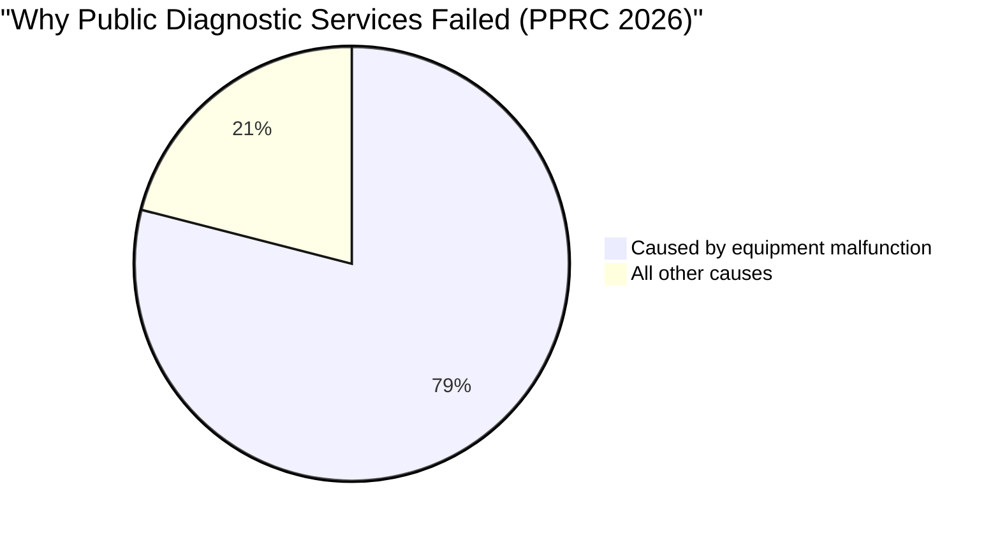
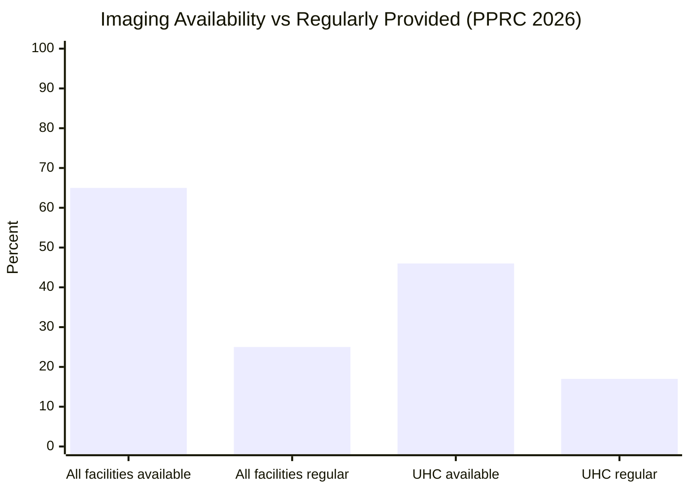
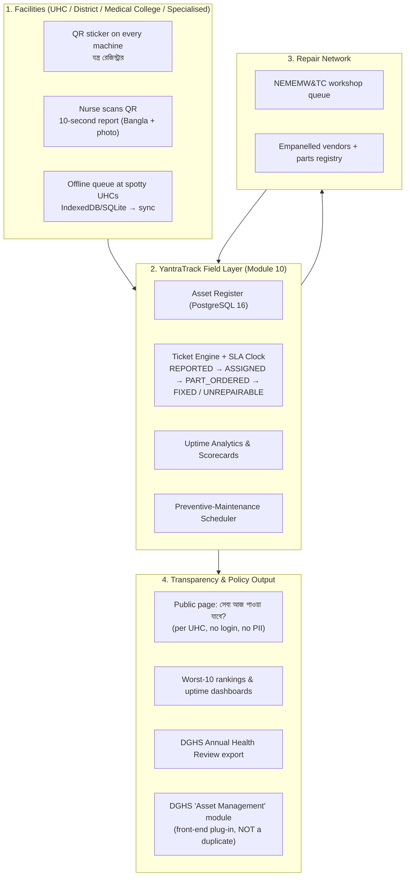
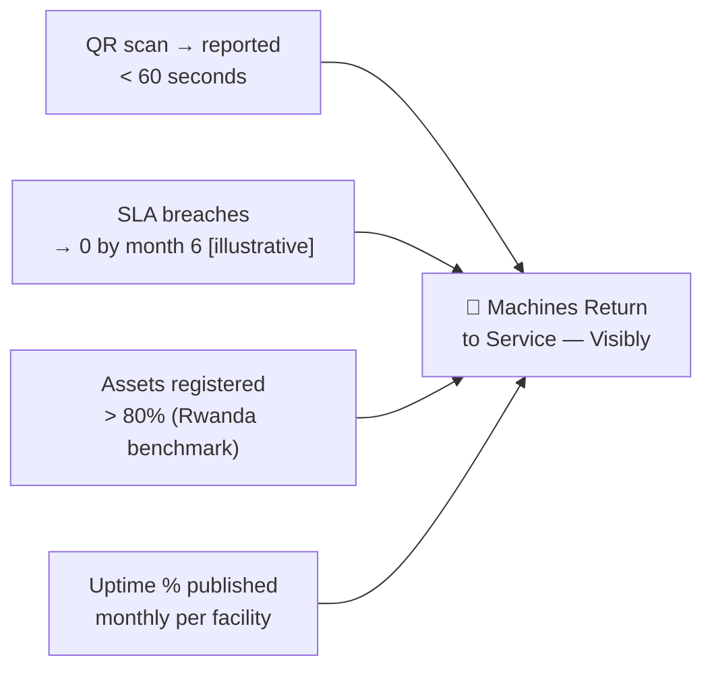

# 🔧 YantraTrack — QR Equipment Uptime & Maintenance Register

## Module 10 — Every Public-Hospital Machine Gets a QR; Scan to Report a Fault; NEMEMW Repairs with an SLA Clock; Patients See What Works Today

**যন্ত্র (Yantra) = machine.** YantraTrack is the field layer for Bangladesh's public-hospital medical equipment: a national QR-tagged asset register, a 10-second fault-report flow, an SLA-timed repair pipeline into the National Electro-Medical Equipment Maintenance Workshop & Training Center (NEMEMW&TC), and a public per-facility page showing which services are actually available today.

**Hackathon fit:** E-Health Hackathon & Symposium (MoHFW + WHO, 3–5 Dec 2026, Dhaka). Track: labs/diagnostics + institutional operations. Score: **U5 · F5 · I4 · J4 · D3 = 21/25**. Angle: matches the PM's "every penny spent transparently" message — unspent budgets and dead machines cannot coexist in a system that publishes both.

---

## Table of Contents

- [Problem Statement](#problem-statement)
  - [The Machine Silence in Numbers](#the-machine-silence-in-numbers)
- [International Precedent: Rwanda MEMMS (Since 2012)](#international-precedent-rwanda-memms-since-2012)
  - [Lesson Table: What Module 10 Copies, Adapts and Avoids](#lesson-table-what-module-10-copies-adapts-and-avoids)
- [System Architecture & Vision](#system-architecture--vision)
- [Capability Deep-Dives](#capability-deep-dives)
- [Comparative Benchmark: Bangladesh Today vs Rwanda MEMMS vs Module 10](#comparative-benchmark-bangladesh-today-vs-rwanda-memms-vs-module-10)
- [Stakeholder Matrix](#stakeholder-matrix)
- [Success Metrics & National Targets](#success-metrics--national-targets)
- [Module Cross-References](#module-cross-references)
- [Sources & Data Notes](#sources--data-notes)

---

## Problem Statement

Bangladesh's public-hospital equipment problem is an **information and process failure, not a money failure**. The PPRC 2026 study (22 facilities, 8 divisions) found **52% of diagnostic equipment unused in the past year**; **malfunctions caused 79% of service gaps**; imaging was available **65%** of the time but provided regularly only **25%** — collapsing to **46% / 17%** at Upazila Health Complexes (UHCs). If money were the binding constraint, idle machines would not sit beside unspent budgets: **94% of institutions ended the year with unspent budget** (PPRC 2026, via TBS).

> [!CAUTION]
> **The ledger of broken machines is already public — it is just not acted on.** Prothom Alo: **3,331 devices out of order across 84 hospitals**. At Rangpur Mother & Child Hospital, **537 machines** were out of order and repair requests to NEMEMW went **unanswered**. At NICRH (Dhaka), **4 of 6 radiotherapy machines had been down >2 years**, leaving **~7,500 patients waiting** with appointments as late as end-2028 — in 2021 the country had ~37 machines vs a need of ~250.

### The Machine Silence in Numbers

| Indicator / Metric | Ground Statistic | Authoritative Source & Context |
|:---|:---:|:---|
| **Diagnostic equipment unused (past year)** | **52%** | PPRC 2026 — [Prothom Alo](https://en.prothomalo.com/bangladesh/904ggpi81h) |
| **Service gaps caused by malfunction** | **79%** | PPRC 2026 — same |
| **Imaging available vs regularly provided** | **65% vs 25%** | PPRC 2026 — same |
| **UHC imaging available vs regularly provided** | **46% vs 17%** | PPRC 2026 — same |
| **Devices out of order nationally** | **3,331 / 84 hospitals** | [Prothom Alo editorial](https://en.prothomalo.com/amp/story/opinion/editorial/96jul2ywm5) |
| **Rangpur MCH machines out of order** | **537** | [Prothom Alo](https://en.prothomalo.com/amp/story/bangladesh/5siazbihf0) |
| **Rangpur MCH → NEMEMW repair requests** | **No reply** | [Prothom Alo](https://en.prothomalo.com/bangladesh/local-news/medical-equipment-mostly-in-disrepair) |
| **Institutions with unspent year-end budget** | **94%** | PPRC 2026, via [TBS](https://www.tbsnews.net/bangladesh/health/health-budgets-not-translating-services-due-governance-gaps-pprc-study-1501371) |
| **Essential-medicine availability (context)** | **22%** | PPRC 2026 — same study |
| **Technologists in post vs sanctioned** | **3,892 vs 6,406** | PPRC 2026 — same |
| **NICRH machines down / patients waiting** | **4 of 6 down; ~7,500 waiting** | [Dhaka Tribune, 20 Oct 2026](https://www.dhakatribune.com/bangladesh/health/422565/7-500-cancer-patients-await-radiotherapy-as) |
| **Radiotherapy machines: country vs need** | **~37 vs ~250** | [Daily Star 2021](https://www.thedailystar.net/frontpage/news/cancer-treatment-facilities-scanty-1667677) |
| **National equipment uptime register (BD)** | **None — NOT PRESENT** | [Gap analysis, row #42](../../hackathon-research/03_global_gap_analysis.md) |

**How the failure chains together:** (1) no scan-and-report channel — faults go unreported or onto paper; (2) the facility writes a **letter** to NEMEMW&TC — no SLA, no tracking; at Rangpur MCH: "no reply"; (3) NEMEMW&TC appears in records only as a **procuring entity** ([BPPA](https://www.bppa.gov.bd/advertisement-goods/details-83702.html)), not an accountable repair network; (4) the machine idles; the patient pays privately or the service never happens (25% regular provision); (5) the budget line goes **unspent** (94%) — nobody can see what is dead vs merely unrepaired. Every link is a data problem. Module 10 closes the loop.

---

## International Precedent: Rwanda MEMMS (Since 2012)

The Global Gap Analysis (03_global_gap_analysis.md, row #42) rates a national equipment registry **NOT PRESENT** in Bangladesh. The reference implementation is Rwanda's **MEMMS (Medical Equipment Maintenance Management System)** — national **since 2012**, run with **CHAI** and the Rwanda Biomedical Centre (RBC).

> [!IMPORTANT]
> **MEMMS covers inventory + spare parts + maintenance — the same three legs YantraTrack implements.** A 2018 review found **> 80% of equipment registered nationally**. Sources: [Enabel/VUB E-Health Academy review (PDF)](https://www.be-causehealth.be/wp-content/uploads/2019/04/E-Health-academy-2019-04-30-VUB-Enabel-M-Nyssen.pdf); [RBC](https://rbc.gov.rw/wp/?p=8070).

**Why Bangladesh doesn't have it yet:** repairs move by letter and tender; the DGHS "Asset Management" module exists as a label but its scope is **[uncertain]** — YantraTrack is pitched as its **field front-end, not a duplicate**; no public transparency surface exists (Module 06 proved this pattern for drugs); openMEDIS is named in notes but **not evaluated**.

### Lesson Table: What Module 10 Copies, Adapts and Avoids

| Rwanda MEMMS Element | Evidence / Outcome | Module 10 Decision | Why |
|:---|:---|:---|---|
| **National inventory registry** | > 80% registered (2018) | **Copy** — asset register is the core | Registry coverage is the headline KPI |
| **Spare-parts tracking in-system** | Covers inventory + parts + maintenance | **Copy** — Part & Vendor registry (Feature 6) | A repair without a part is a letter, not a fix |
| **Maintenance scheduling** | Included in MEMMS | **Copy** — PM scheduler (Feature 7) | 79% of gaps trace to malfunction |
| **Government ownership (RBC) + CHAI** | RBC operates MEMMS | **Copy** — DGHS/NEMEMW own; donors fund pilot only | Avoids Babyl single-vendor collapse (row #9) |
| **Internal tool, not public-facing** | No public surface documented | **Adapt + extend** — public per-UHC page | Radical visibility forces accountability |
| **No external SLA countdown** | Internal tracking only | **Adapt** — SLA clock + breach escalation | Rangpur failure mode becomes a visible breach |
| **Years-long national build** | Built with CHAI over time | **Avoid** — 1 pilot district first | Hackathon MVP reality; politics managed via "support, not policing" |
| **Silent registry** | Not public | **Avoid silence** — worst-10 rankings for DGHS | 94% unspent + 52% idle = money moves when failure is public |

---

## System Architecture & Vision

Three layers: (1) QR-tagged physical asset layer, (2) field-reporting + SLA-timed repair engine, (3) radical-transparency output layer. **Zero patient data** — see [IMPLEMENTATION.md](./IMPLEMENTATION.md) § Security.

**Design principles:** 10-second reporting or it won't happen · no patient data ever · visibility ≠ repair capacity (pair with procurement) · support, not policing · government-owned, not donor-dependent.

---

## Capability Deep-Dives

### 1 — QR-Tagged Asset Register & 10-Second Fault Report
Every machine carries a tamper-evident QR (asset ID, facility, type, serial — no PII). Scanning opens a Bangla-first form: *যন্ত্রের ত্রুটি রিপোর্ট করুন* → *ছবি তুলুন* → *বর্ণনা লিখুন* → *জমা দিন*. Photo + Bangla note mandatory. The register doubles as the national inventory (Rwanda's MEMMS core), pre-loaded with 30 synthetic PPRC-shaped assets for the MVP. Kills the letter-and-tender reporting void and creates the denominator for "% assets registered".

### 2 — SLA-Clock Ticket Pipeline into NEMEMW&TC
Tickets flow `REPORTED → ASSIGNED → PART_ORDERED → FIXED / UNREPAIRABLE`. Each carries an SLA by criticality (diagnostic-critical **72h [illustrative]**; routine **14 days [illustrative]**). On breach: SMS to engineer → director → DGHS weekly breach count. NEMEMW receives a **tracked, timed workshop queue** replacing letters; vendor-only repairs route with the same SLA. Letters have no clock — the SLA converts silence into a visible, escalating breach.

### 3 — Public "Service Available Today" Page
Per-facility, no-login: `yantra.dghs.gov.bd/uhc/<facility>` — `এক্স-রে উপলব্ধ ✓` / `এক্স-রে বন্ধ — মেরামত চলছে` with "last verified" stamps and SLA-based expected resolution. Zero PII, zero internals. Patients learn **before travelling** — same transparency logic as Module 06 (stock) and Module 04 (ICU beds).

### 4 — Uptime Analytics, Worst-10 Rankings & Director Scorecards
Uptime sliced three ways: **per facility**, **per machine type** (procurement signal!), **worst-10 facilities** league table. Directors get a weekly SMS+PDF scorecard (assets registered, open tickets, SLA breaches, MTTR, repeat-failure rate, rank, idle-value recovered). Pairs the two PPRC halves: 52% idle machines + 94% unspent budgets — a director cannot claim "no funds" while both are published.

### 5 — Before/After Closure Proof & Audit Loop
FIXED closures require **two photos** (fault-verified before; functional check after) + one-line engineer note; UNREPAIRABLE requires condemnation justification → replacement planning. Photos immutable, audit-logged; repeat failure ≤ 30 days auto-flags to director and counts toward the repeat-failure KPI. Paper sign-offs are unverifiable; photo proof makes closure falsifiable (Module 04's anti-dalal ledger discipline).

---

## Comparative Benchmark: Bangladesh Today vs Rwanda MEMMS vs Module 10

| Dimension | Current Bangladesh | Rwanda MEMMS (2012– ) | Module 10 YantraTrack |
|:---|:---|:---|:---|
| **National asset registry** | None; DGHS label, scope uncertain | > 80% registered (2018) | Target **> 80%** in pilot; plugs into DGHS module |
| **Fault reporting** | Paper / letter / phone | Internal workflows | **QR + photo + Bangla**, 10 s, offline-capable |
| **Repair tracking** | Rangpur requests unanswered | Maintenance modules | **SLA clock** + breach escalation |
| **Public transparency** | None | Not public-facing | **Public page per UHC** |
| **Spare parts** | Letter-based, invisible | Covered | **Parts & vendor registry** |
| **Preventive maintenance** | Ad hoc | Supported | **Scheduler** with auto-tickets |
| **Accountability surface** | None | Internal | **Scorecards + worst-10** |
| **Patient data** | n/a | n/a | **None collected** — lowest risk of all modules |
| **Time to value** | — | Years (national programme) | **48h MVP**; pilot → national |
| **Failure-mode defence** | Letters vanish | RBC + CHAI partnership | Government-owned; **paired with procurement**; plug-in, not duplicate |

---

## Stakeholder Matrix

| Stakeholder | Frustrations Today | Module 10 Solution | Measured Benefit |
|:---|:---|:---|:---|
| **Patients & families** | Travel, find X-ray dead; no advance signal | Public "service today" page | Informed travel; fewer wasted trips / OOP spend |
| **UHC nurses & technologists** | Faults unreported/ignored | 10-second Bangla scan-report, offline | Fault logged with photo; zero paperwork |
| **Facility directors** | Blind to machine status; blamed anyway | Weekly scorecard + worst-10 + breach SMS | Early warning; defensible performance data |
| **NEMEMW&TC engineers** | Letter dispatch; no queue visibility | Workshop queue + SLA + parts registry | Planned routes; measured MTTR |
| **NEMEMW call-centre agents** | Phone calls, zero context | QR-keyed board, asset history auto-loaded | Fast triage; no "which machine?" |
| **DGHS / MoHFW** | No national picture; PPRC repeats; budget unspent | National dashboard; annual-review export | Data-driven procurement & staffing |
| **Vendors / suppliers** | No demand signal; distrust | Empanelled registry; parts forecasting | Predictable orders; SLA accountability |
| **RadioQ (Module 09 companion)** | Nominal capacity fiction | Uptime API = capacity truth | Real slot allocation |
| **Donors / WHO / World Bank** | Unverifiable equipment outcomes | Pilot evidence pack; before/after uptime | Fundable, measurable intervention |

---

## Success Metrics & National Targets

| KPI | Baseline | Target | Source / Note |
|:---|:---:|:---:|:---|
| **Uptime % per facility** | Unknown — measure in pilot | ≥ **90%** [illustrative] | PPRC: 52% idle — true uptime likely far lower |
| **MTTR** | Unknown [illustrative: weeks–months] | **Halve in 6 months** [illustrative] | No BD baseline; measure from day 1 |
| **% assets registered** | 0 | **> 80%** in pilot | Rwanda MEMMS 2018 |
| **SLA breach count** | Not tracked | **0 critical/month** by month 6 [illustrative] | Policy in IMPLEMENTATION.md |
| **Idle-equipment value recovered** | Not tracked | **≥ Tk 2 crore** pilot [illustrative] | Replacement cost of assets returned |
| **Repeat-failure rate** | Not tracked | **< 10%** / 30 d [illustrative] | Auto-flagged |
| **Public page views/month** | n/a | **≥ 10,000** pilot [illustrative] | Transparency loop is used |
| **Unspent-budget correlation** | 94% unspent (PPRC) | Pilot budget utilisation rises [illustrative] | Needs procurement pairing |

> [!NOTE]
> [illustrative] = planning estimate, not measurement. Sourced: Rwanda >80%; PPRC 52/79/65/25/46/17/22/94%; 3,331 devices; 3,892/6,406 technologists.

---

## Module Cross-References

- **Module 02 — Test Reports:** labs run on these machines; YantraTrack uptime is the lab's upstream truth.
- **Module 04 — ICU Beds:** both escalate equipment failure to NEMEMW&TC; YantraTrack generalises with an SLA clock.
- **Module 05 — Integrated Core:** shared FHIR R4 spine, facility identity, audit conventions.
- **Module 06 — Medicine Stock:** transparency sibling — publish the truth, force the fix.
- **RadioQ (Idea 5; Module 09 companion):** uptime = **capacity truth**; consumes YantraTrack's uptime API (NICRH: 4/6 down).
- **DGHS "Asset Management" module:** YantraTrack is its **field front-end** — never a parallel registry.

---

## Sources & Data Notes

1. **PPRC 2026 (22 facilities)** — 52% unused; 79% malfunction-driven; imaging 65/25 (UHC 46/17); 22% essential-med availability; 3,892/6,406 technologists — [Prothom Alo](https://en.prothomalo.com/bangladesh/904ggpi81h); 94% unspent via [TBS](https://www.tbsnews.net/bangladesh/health/health-budgets-not-translating-services-due-governance-gaps-pprc-study-1501371).
2. **3,331 devices out of order / 84 hospitals** — [Prothom Alo editorial](https://en.prothomalo.com/amp/story/opinion/editorial/96jul2ywm5).
3. **Rangpur MCH — 537 out of order; NEMEMW unanswered** — [Prothom Alo](https://en.prothomalo.com/amp/story/bangladesh/5siazbihf0); [local-news](https://en.prothomalo.com/bangladesh/local-news/medical-equipment-mostly-in-disrepair).
4. **NICRH radiotherapy** — 4/6 down >2y; ~7,500 waiting; 17 LINACs due Jun 2027 — [Dhaka Tribune 2026](https://www.dhakatribune.com/bangladesh/health/422565/7-500-cancer-patients-await-radiotherapy-as); ~37 vs ~250 machines (2021) — [Daily Star](https://www.thedailystar.net/frontpage/news/cancer-treatment-facilities-scanty-1667677).
5. **Rwanda MEMMS** — since 2012, with CHAI; >80% registered (2018); inventory + parts + maintenance — [Enabel/VUB PDF](https://www.be-causehealth.be/wp-content/uploads/2019/04/E-Health-academy-2019-04-30-VUB-Enabel-M-Nyssen.pdf); [RBC](https://rbc.gov.rw/wp/?p=8070).
6. **BD status: NOT PRESENT** — [gap analysis #42](../../hackathon-research/03_global_gap_analysis.md); DGHS module scope **[uncertain]**; openMEDIS **not evaluated**.
7. **NEMEMW&TC** — national repair centre; visible only as procuring entity — [BPPA](https://www.bppa.gov.bd/advertisement-goods/details-83702.html).
8. **PDPO 2025** — health data = sensitive; gazetted 6 Nov 2025; enforcement **[uncertain]**; YantraTrack collects **none**.
9. **[illustrative] markers** = estimates, not facts; Rwanda and PPRC figures are sourced. NOT PRESENT ≠ proof of absence.
10. **Hackathon** — 21/25 (U5 F5 I4 J4 D3); "every penny transparently"; donor pitch = one pilot district + procurement pairing.
