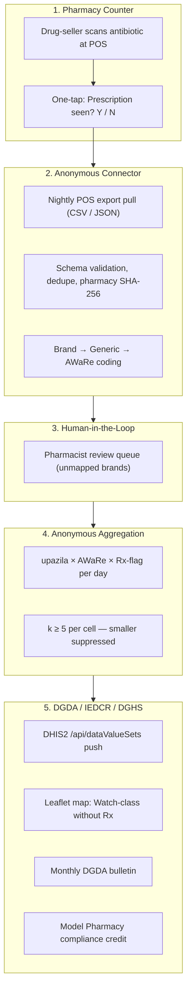
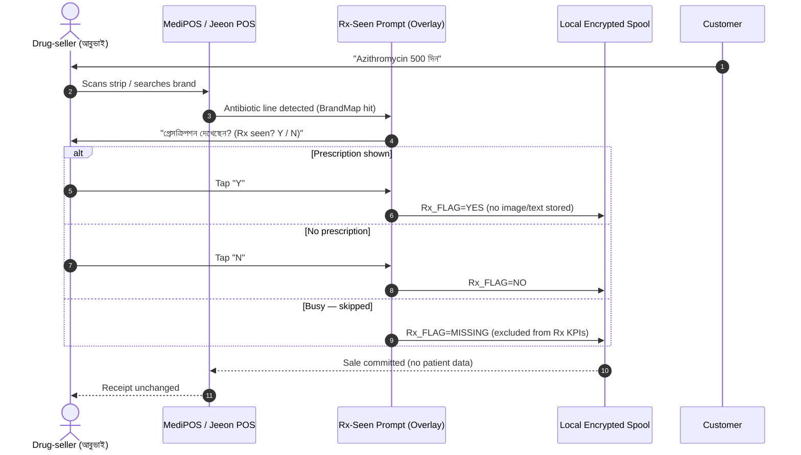
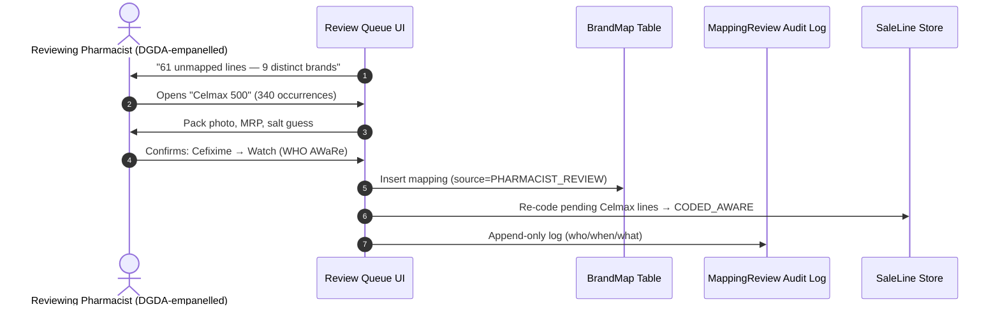
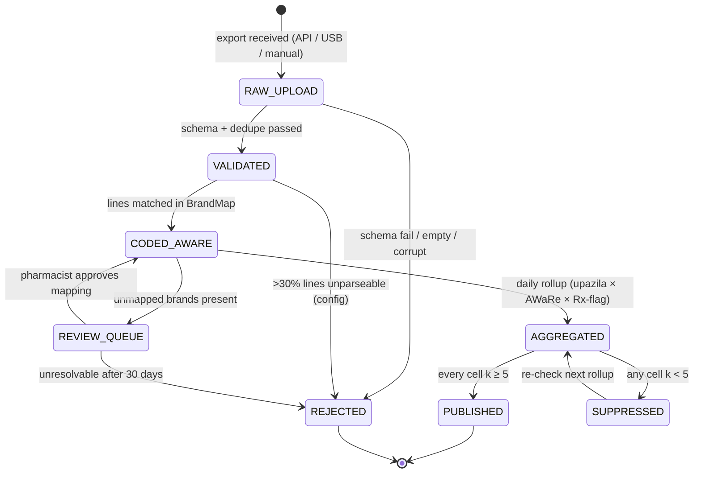

# 🔄 Application Flow — AMR Lens: Antibiotic Sales Surveillance Layer

## Module 11 — POS Ingestion, AWaRe Coding, Anonymous Aggregation & DGDA/IEDCR Reporting

---

## Table of Contents

- [System Interaction Overview](#system-interaction-overview)
- [Personas](#personas)
- [Journey 1: Pharmacist — Point-of-Sale Sale & "Rx Seen?" Tap](#journey-1-pharmacist--point-of-sale-sale--rx-seen-tap)
- [Journey 2: Connector — Nightly POS Ingest & AWaRe Coding](#journey-2-connector--nightly-pos-ingest--aware-coding)
- [Journey 3: Pharmacist — Review Queue for Unmapped Brands](#journey-3-pharmacist--review-queue-for-unmapped-brands)
- [Journey 4: DGDA Analyst — DHIS2 Push, Bulletin & Credit](#journey-4-dgda-analyst--dhis2-push-bulletin--credit)
- [Journey 5: IEDCR Epidemiologist — Watch-Class Spike Response](#journey-5-iedcr-epidemiologist--watch-class-spike-response)
- [Journey 6: POS Vendor Onboarding (MediPOS / Jeeon)](#journey-6-pos-vendor-onboarding-medipos--jeeon)
- [Journey 7: Unconnected Pharmacy — Weekly USB / CSV Drop](#journey-7-unconnected-pharmacy--weekly-usb--csv-drop)
- [Ingestion Pipeline State Machine](#ingestion-pipeline-state-machine)
- [Offline Flow: Pharmacy Without Internet](#offline-flow-pharmacy-without-internet)
- [Edge Cases & Exception Handling Matrix](#edge-cases--exception-handling-matrix)
- [Journey Summary Table](#journey-summary-table)

---

## System Interaction Overview

Five actor groups, one rule: **data moves from counter to regulator without identifying a person — and without naming a shop in public outputs.**



> [!NOTE]
> **No new hardware.** Connector = scheduled job on the existing POS PC (or vendor-side export) + USB/CSV fallback for offline pharmacies.

---

## Personas

| Persona | Role & Context | Goals | Anxieties | Touchpoints |
|:---|:---|:---|:---|:---|
| **আবু রায়হান — আবুভাই** | Proprietor / drug-seller, Mirpur; no registered pharmacist (7.56% do — PMC 2025) | Fast sales; avoid licence trouble; Model Pharmacy credit | Fear of raids; IT cost; losing customers | POS export; Rx-tap; hashed ID; quarterly report |
| **নুসরাত জাহান — Nusrat** | Partnership Manager, POS vendor (MediPOS / Jeeon; 30k+ claimed) | Stickiness; B2B2G revenue; differentiate | Regulatory liability for clients; support burden | Portal; export spec; co-branding |
| **ডাঃ ফারহানা ইয়াসমিন — Dr. Farhana** | DGDA Analyst, stewardship (Fleming Fund; WHO 2024) | Monthly bulletin; evidence for regulation | Junk data; named-shop leaks | Aggregate dashboards; DHIS2 elements |
| **ডাঃ তানভীর আহমেদ — Dr. Tanvir** | IEDCR Epidemiologist, AMR | Early Watch-class spike signal | False alarms; small-cell privacy breach | Anomaly alerts; k≥5 enforcement |
| **রিফাত চৌধুরী — Rifat** | Pilot Auditor (DGDA + Fleming Fund) | Audit k-anonymity, hashing, suppression logs | Finding PII in exports; coerced pharmacies | Audit exports; field visits |

---

## Journey 1: Pharmacist — Point-of-Sale Sale & "Rx Seen?" Tap

Customer asks for "Azithromycin 500" (**Watch**-class). Drug-seller scans; POS shows one binary prompt.



**Rules:** one bit only (Y/N/MISSING) — never the image, doctor, or patient name · sale **never blocked** (~1s) · **Reserve-class** brands add passive banner "Reserve — always reported" (no block) · offline sale spools locally, syncs at night.

---

## Journey 2: Connector — Nightly POS Ingest & AWaRe Coding

02:00 pull of each pharmacy's daily export (or manual upload). Heart of the pipeline.

```mermaid
sequenceDiagram
    autonumber
    participant Scheduler as Nightly Scheduler (02:00)
    participant POS as Pharmacy POS / Export Folder
    participant Ingest as Ingestion Service (FastAPI)
    participant Map as BrandMap (brand→generic→AWaRe)
    participant DB as PostgreSQL 16 / SQLite (MVP)
    participant Alert as Ops Alerting

    Scheduler->>POS: Request daily export (CSV/JSON)
    POS-->>Ingest: antibiotic_sales_2026-11-02.csv
    Ingest->>Ingest: Schema check + dedupe (line_hash); drop non-allow-list cols
    Ingest->>Map: Lookup each brand
    alt Brand found
        Map-->>Ingest: generic + AWaRe (Azithromycin → Watch)
        Ingest->>DB: SaleLine CODED_AWARE
    else Unknown
        Map-->>Ingest: NO_MATCH
        Ingest->>DB: SaleLine UNMAPPED → review queue
    end
    Ingest->>DB: Hash pharmacy_id (SHA-256 + salt)
    Ingest-->>Scheduler: Manifest: 1,240 in / 61 unmapped / 3 dupes dropped
    Scheduler->>Alert: Alert ops if failure >5% or zero rows
```

**Boundary minimisation:** even if a vendor export carries loyalty names, the connector **drops every column not on the allow-list** (`sale_id, timestamp, brand_name, qty, unit_price, rx_flag, pharmacy_ref`) — nothing else is written to disk.

---

## Journey 3: Pharmacist — Review Queue for Unmapped Brands

The 30–50-brand MVP table won't cover every SKU; unknowns wait for a licensed pharmacist — never an algorithm's guess.



**Rules:** only **empanelled DGDA-registered pharmacists** approve; IDs hashed · ambiguous → `ESCALATE`, never auto-accept · SLA: 90% of unmapped lines cleared ≤72h [illustrative] · every decision ships in next weekly BrandMap.

---

## Journey 4: DGDA Analyst — DHIS2 Push, Bulletin & Credit

```mermaid
sequenceDiagram
    autonumber
    actor Analyst as DGDA Analyst (Dr. Farhana)
    participant Agg as Aggregation Engine
    participant DHIS2 as DHIS2 (/api/dataValueSets)
    participant Bulletin as Bulletin Generator
    participant Credit as Credit Engine
    participant Pharm as Pharmacy Portal (private)

    Analyst->>Agg: Request November rollup (2 pilot upazilas)
    Agg->>Agg: Roll up upazila × AWaRe × Rx-flag; enforce k ≥ 5
    Agg->>DHIS2: POST /api/dataValueSets (AMR_WATCH_NO_RX_UPZ, ...)
    DHIS2-->>Agg: 200 OK — importCount.imported = 24 [illustrative]
    Analyst->>Bulletin: Generate monthly bulletin (PDF, Bangla summary)
    Bulletin-->>Analyst: Aggregates only — no shop named
    Analyst->>Credit: Compute per-pharmacy credit
    Credit->>Pharm: Private report: "Watch-no-Rx 38% vs district 44%" [illustrative]
```

**Outputs:** DHIS2 elements (`AMR_ACCESS_RX`, `AMR_WATCH_RX`, `AMR_WATCH_NO_RX`, `AMR_RESERVE_RX`, `AMR_RESERVE_NO_RX`) · 4–6 page bulletin (DGDA sign-off gate) · Model Pharmacy credit points (≥90% coded [target]) · suppression log for auditor.

---

## Journey 5: IEDCR Epidemiologist — Watch-Class Spike Response

```mermaid
sequenceDiagram
    autonumber
    participant Monitor as Anomaly Detector (nightly)
    actor Epi as IEDCR Epidemiologist (Dr. Tanvir)
    participant Map as Leaflet Watch-Share Map
    participant UHC as Upazila Health Complex
    participant Bulletin as DHIS2 / DGDA Bulletin

    Monitor->>Monitor: Upazila X Watch-no-Rx rose 41% → 63% w/w [illustrative]
    Monitor->>Epi: ANOM-2026-014 (threshold: +20pp or 2σ over 8-wk baseline)
    Epi->>Map: Drill: which brands? (azithromycin 71%, cefixime 12%)
    Map-->>Epi: Aggregate only — no shop named
    Epi->>UHC: Context check — seasonal surge? prescribing change?
    UHC-->>Epi: Local context (e.g., monsoon diarrhoea)
    Epi->>Bulletin: Flag in next annex; advisory only — no enforcement
```

**Rules:** trigger = **>20pp or >2σ** vs 8-week baseline, 3 consecutive days · context check **mandatory** before external comms · output always **aggregate + awareness** — never a raid, never a named shop.

---

## Journey 6: POS Vendor Onboarding (MediPOS / Jeeon)

```mermaid
sequenceDiagram
    autonumber
    actor Vendor as POS Vendor Manager (Nusrat)
    participant Portal as Partnership Portal (AMR Lens)
    participant Spec as Open Export Spec v1.0
    participant DGDA as DGDA Programme Office
    participant Pilot as Pilot Cohort (50 shops, 2 upazilas)

    Vendor->>Portal: Register; request pilot MOU
    Portal->>Vendor: Spec + data-processing addendum (aggregate-only clause)
    Vendor->>Portal: Upload synthetic sample (5,000 lines)
    Portal->>Portal: Validate → compatibility score
    alt Compatible
        Portal-->>Vendor: Enable AMR module in next release
        Vendor->>DGDA: Co-sign pilot MOU (no data sale; DGDA owns aggregates)
        DGDA->>Pilot: Onboard 50 pharmacies; 45-min Bangla training
    else Incompatible
        Portal-->>Vendor: Gap report + 2-week remediation window
    end
```

**Vendor value:** free compliance-report feature for clients; differentiation; early seat in DGDA/DGHS vendor ecosystem; zero regulatory exposure.

---

## Journey 7: Unconnected Pharmacy — Weekly USB / CSV Drop

```mermaid
sequenceDiagram
    autonumber
    actor Seller as Offline Drug-seller (rural)
    participant USB as USB Drive / Paper Tally
    participant UHC as Upazila Health Complex (desk)
    participant Ingest as Central Ingestion Service
    actor Auditor as Pilot Auditor (Rifat)

    Note over Seller: Week: records antibiotic sales + Rx Y/N
    Seller->>USB: Friday: export CSV (or tally: brand, qty, rx_flag)
    Seller->>UHC: Weekly drop-off (10 min; sealed envelope for paper)
    UHC->>Ingest: Batch upload (tag source=USB_DROP)
    Ingest->>Ingest: Same validation + coding; k ≥ 5 applies
    Auditor->>UHC: Monthly spot check: USB logs vs POS counters (5 random pharmacies)
```

**Accepted trade-off:** offline data arrives **weekly, not daily** — better a complete weekly picture than an absent daily one.

---

## Ingestion Pipeline State Machine



| State | Meaning | Actor | Exit |
|:---|:---|:---|:---|
| `RAW_UPLOAD` | File received, unverified | Connector | Validation |
| `VALIDATED` | Schema/dedupe/allow-list applied | Connector | Brand coding |
| `CODED_AWARE` | Generic + AWaRe assigned | Engine | Rollup window |
| `REVIEW_QUEUE` | Awaiting empanelled pharmacist | Human | Approve / 30-day timeout |
| `AGGREGATED` | Daily rollup computed | Engine | k-anonymity check |
| `PUBLISHED` | Visible to DGDA/DHIS2 | Engine | Terminal |
| `SUPPRESSED` | Small cell held back | Engine | Next-day re-check |
| `REJECTED` | Failed batch quarantined | Ops | Manual review |

---

## Offline Flow: Pharmacy Without Internet

1. **Weekly USB/CSV drop** at Upazila Health Complex / DGDA field office — sealed envelope for paper tallies.
2. POS exports CSV via USB **or** 2-column tally (brand, qty, Rx Y/N) completed by pen.
3. Desk transcribes/enters weekly; **same k≥5 rule** — small pharmacies simply publish fewer cells.
4. Paper originals **returned or shredded** after transcription (retention ≤ 90 days [policy, illustrative]).
5. Full pilot citizens: credit, bulletin, map — flagged `source=USB` in suppression log.

---

## Edge Cases & Exception Handling Matrix

| Edge Case | Failure Mode | System Defense & Protocol |
|:---|:---|:---|
| **Brand not in mapping table** | Unclassifiable line; silent miscode risk | → **REVIEW_QUEUE**; pharmacist maps ≤72h; line excluded from KPIs until mapped |
| **Missing prescription flag** | Rx-rate KPI diluted | Counts for volume only; excluded from Rx KPIs; coaching via quarterly report — never penalty |
| **Duplicate sale lines** (double-scan / replay) | Inflated volumes; false Watch share | `line_hash` dedupe; >2% duplicates → alert pharmacy + log |
| **Vendor schema drift** (POS update renames columns) | Silent ingest failure | Connector **fails loud** (quarantine + alert), never guesses; 2-week vendor remediation |
| **Zero-sale day** (stock-out / holiday) | False zero reported | Explicit `ZERO_SALES` marker required; missing file ≠ zero sales; ops alert after 2 days |
| **Reserve-class sale without Rx** | Highest-risk event | Always flagged: bulletin annex + DGDA notification ("≥1 Reserve, upazila X") — count/shop never named |
| **Pharmacist withdraws** | Orphaned data mid-pilot | Stop flag; future exports rejected; past k≥5 aggregates retained; credit cycle frozen |
| **Export contains patient names** (vendor bug) | PII breach | **Allow-list drop at ingest** — never written; incident logged; pharmacy + auditor notified; file purged |
| **Cell k < 5** | Re-identification risk | **SUPPRESSED**; never published/exported; re-checked next day; audit-logged |
| **Fake lines to game credit** | Metric inflation | qty z-score outlier detection; auditor spot check; credit withheld pending verification |
| **Upazila with 1–2 reporting pharmacies** | Aggregate identifies shop | Min **3 reporting pharmacies per cell** [policy, illustrative] or district rollup; k≥5 regardless |
| **Connector offline > 7 days** | Staleness; pilot validity | Ops SMS/call; credit paused (not penalised); backfill on reconnect |

---

## Journey Summary Table

| # | Journey | Actor | Trigger | Output / Destination | Cadence |
|:---:|:---|:---|:---|:---|:---|
| 1 | Sale + Rx tap | Drug-seller | Customer request | Sale line with `rx_flag` | Per sale |
| 2 | Nightly ingest + coding | Connector | 02:00 scheduler | CODED_AWARE lines / queue | Daily |
| 3 | Unmapped brand review | Pharmacist | Queue non-empty | BrandMap updated | Weekly / 72h SLA |
| 4 | DHIS2 push + bulletin + credit | DGDA analyst | Month-end | DHIS2 values; PDF; credit | Monthly |
| 5 | Watch-class spike response | IEDCR epidemiologist | Threshold breach | Advisory; bulletin annex | Event-driven |
| 6 | Vendor onboarding | Vendor + DGDA | MOU signed | Compatible export; 50 live | Per partner |
| 7 | Offline weekly drop | Offline drug-seller | Friday drop | Weekly aggregate (k≥5) | Weekly |

**The flow in one line:** Journeys 1–2 are the machine · Journey 3 is the human safeguard · Journeys 4–5 are the national payoff · Journeys 6–7 are how it scales without leaving rural pharmacies behind.
