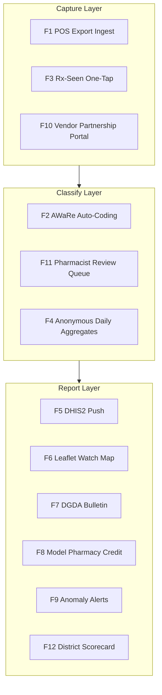

# ⚡ Functional Specifications & Feature Catalog — Module 11

## AMR Lens — Antibiotic Sales Surveillance Layer (POS → AWaRe → DGDA/IEDCR)

---

## Table of Contents

- [Functional Architecture Overview](#functional-architecture-overview)
- [Feature 1: POS Sales-Export Ingest (CSV / JSON, Mock MediPOS)](#feature-1-pos-sales-export-ingest-csv--json-mock-medipos)
- [Feature 2: Brand → Generic → AWaRe Auto-Coding Engine](#feature-2-brand--generic--aware-auto-coding-engine)
- [Feature 3: One-Tap "Rx Seen? Y/N" at Point of Sale](#feature-3-one-tap-rx-seen-y-n-at-point-of-sale)
- [Feature 4: Anonymous Upazila × AWaRe × Rx-Flag Aggregates](#feature-4-anonymous-upazila--aware--rx-flag-aggregates)
- [Feature 5: DHIS2 Push via /api/dataValueSets](#feature-5-dhis2-push-via-apidatavaluesets)
- [Feature 6: Leaflet Choropleth — Watch-Class Without Rx](#feature-6-leaflet-choropleth--watch-class-without-rx)
- [Feature 7: Monthly DGDA Surveillance Bulletin Generator](#feature-7-monthly-dgda-surveillance-bulletin-generator)
- [Feature 8: Model Pharmacy Compliance Credit Report](#feature-8-model-pharmacy-compliance-credit-report)
- [Feature 9: Anomaly Alerts — Watch-Class Spike](#feature-9-anomaly-alerts--watch-class-spike)
- [Feature 10: POS Vendor Partnership Portal](#feature-10-pos-vendor-partnership-portal)
- [Feature 11: Pharmacist Review Queue for Unmapped Brands](#feature-11-pharmacist-review-queue-for-unmapped-brands)
- [Feature 12: Public Awareness Scorecard per District](#feature-12-public-awareness-scorecard-per-district)
- [Feature Priority & Compliance Matrix](#feature-priority--compliance-matrix)
- [Explicit Out-of-Scope](#explicit-out-of-scope-what-module-11-will-never-do)

---

## Functional Architecture Overview

Twelve features, three layers: **capture → classify → report**. The sale — the most opaque transaction in BD healthcare (~45% without Rx, PMC 2025; 50.9% no-Rx, icddr,b 2022) — becomes anonymous, classifiable intelligence.

---

## Feature 1: POS Sales-Export Ingest (CSV / JSON, Mock MediPOS)

**What:** Connector ingesting antibiotic sale lines from POS exports — **CSV/JSON** — including a **mock MediPOS-shaped exporter** for the 48h MVP and vendor testing. Validates schema, dedupes, hashes pharmacy identity, drops non-allow-listed columns.

**Why:** MediPOS and Jeeon (30,000+ claimed) log every sale; neither feeds the regulator (TBS). Ingest is the only path to national scale without new hardware. The mock exporter enables demo/test with **zero real patient or pharmacy data**.

**How:**
- Nightly 02:00 pull (or USB/CSV drop for offline); allow-list only: `sale_id, timestamp, brand_name, qty, unit_price, rx_flag, pharmacy_ref`.
- `line_hash` dedupe; `pharmacy_id` → **SHA-256 + per-deployment salt**; raw ID purged ≤ 7 days [policy, illustrative].
- Failure = **quarantine, never guess**: unknown schema → batch rejected, ops alerted.

**Edge cases:** empty export (`ZERO_SALES` marker required — absence ≠ zero); corrupt/CP1252 files; >30% unparseable → `REJECTED`; partial-day exports; export replay (dedupe catches).

---

## Feature 2: Brand → Generic → AWaRe Auto-Coding Engine

**What:** Lookup mapping **30–50 most common antibiotic brands** (MVP) → generic → **WHO AWaRe** (Access / Watch / Reserve). Auto-codes at ingest; unknowns → Feature 11.

**Why:** AWaRe is the WHO basis for stewardship monitoring; without molecule-level coding, sales data is noise. Pharmacy-level AWaRe data are scarce (MDPI *Antibiotics* 2022). **Reserve always flagged**, no exceptions.

**How:**
- Hand-built table (Azithromycin → Watch; Amoxicillin → Access; Meropenem → Reserve), **pharmacist-reviewed** pre-pilot; versioned (`BrandMap v1.0`); reviewer hash + timestamp logged.
- Match: exact → normalised → fuzzy (Levenshtein ≤ 2) with **human confirmation** — never silent auto-accept.
- Output: `generic_name`, `aware_class`, `coding_confidence` (EXACT / FUZZY_REVIEWED / UNMAPPED).
- Coverage KPI: **≥90% auto-coded** [target, illustrative].
- Non-antibiotics explicitly classified `NOT_ANTIBIOTIC`, excluded.

**Edge cases:** combos (amoxicillin+clavulanate → dominant molecule, flagged combo); multi-strength brands (one mapping covers all); legacy discontinued brands; generic written instead of brand (direct match); mislabelled OTC (review queue).

---

## Feature 3: One-Tap "Rx Seen? Y/N" at Point of Sale

**What:** Binary prompt — **প্রেসক্রিপশন দেখেছেন? (Rx seen? Y/N)** — on the POS at antibiotic checkout. Stores **one bit**; skip allowed (`MISSING`).

**Why:** This bit is the difference between "volume" and "stewardship signal". ~45–51% of antibiotic purchases lack Rx (PMC 2025; icddr,b 2022) — yet nothing records it at the counter. Without it, Module 11 measures nothing actionable.

**How:**
- Overlay triggers only on antibiotic-flagged lines; ~1s; **never blocks sale**; zero free text/images; Bangla-first with English fallback.
- `rx_flag ∈ {YES, NO, MISSING}` on the line; syncs nightly; MISSING excluded from Rx KPIs, counted in volume.
- Reserve-class → same prompt + passive banner "Reserve — always reported" (display only).

**Edge cases:** busy-counter skip (MISSING ≠ NO); illegible/expired Rx (seller judgment, still Y — no image check in v1); Rx for a different drug (undetectable — accepted, flagged in methodology); offline sale (spools locally); staff refusal (skip; coaching via quarterly report, never penalty).

---

## Feature 4: Anonymous Upazila × AWaRe × Rx-Flag Aggregates

**What:** Nightly rollup into **anonymous cells** `(upazila, aware_class, rx_flag, date) → counts`. **Cells < 5 sales suppressed** (k-anonymity ≥ 5) — never leave the vault.

**Why:** Aggregation *is* the privacy architecture — no patient data exists to leak, and small cells can't isolate a shop. DGDA/IEDCR need exactly this grain.

**How:**
- 03:00 idempotent job; cells per rollup-wide cohort; **k≥5 enforced twice** (aggregation + export filter).
- Only published tier reaches DHIS2 / bulletin / map.
- Suppression log: date, cell, count, reason — auditable by pilot auditor.
- Sub-threshold cells re-published next day if they cross k=5.

**Edge cases:** single-pharmacy upazila (publish at district level; min 3 reporting pharmacies per cell [policy, illustrative]); mid-month joiners (partial-week at month close); retroactive re-coding (re-aggregate affected dates); zero-antibiotic day (published zero only if ≥3 pharmacies report it — else suppressed).

---

## Feature 5: DHIS2 Push via `/api/dataValueSets`

**What:** Pushes published cells into **DHIS2** (DGHS backbone) via `POST /api/dataValueSets` — dataElements keyed on upazila org-units (e.g., `AMR_WATCH_NO_RX_UPZ`).

**Why:** Anything outside DHIS2 becomes a parallel silo that dies with the pilot. Native push = DGHS/DGDA institutional adoption from day one (cf. community clinics: 14,213 of 15,564 on DHIS2 tracker, Apr 2024, research compilation).

**How:**
- MVP → **DHIS2 demo API** with synthetic data; production only after DGDA signs the **data-element dictionary** (elements, org-units, category combos: AWaRe × Rx-flag).
- Auth: dedicated **least-privilege service account** (dataValueSets write only); TLS 1.2+; env vault; quarterly rotation.
- Import ack checked (`importCount.imported/updated/ignored`); failures retry ×3 → alert; uptime KPI **≥99%** [target, illustrative].
- Fallback: signed CSV for unmapped districts; same aggregates, same k≥5. Pharmacies never log into DHIS2.

**Edge cases:** DHIS2 downtime (queue + retry; staleness ≤7 days then notify); org-unit mismatch (fail loud); DHIS2 schema change (version pinning + alert); duplicate period push (idempotent overwrite); freeze windows (skip + backfill).

---

## Feature 6: Leaflet Choropleth — Watch-Class Without Rx

**What:** Interactive **Leaflet** map (OSM tiles) of upazilas shaded by **Watch-class sales without Rx as % of all antibiotic sales** — the headline layer.

**Why:** One picture a minister reads in five seconds — which upazilas leak Watch-class drugs without Rx, without naming a shop.

**How:**
- Bins 0–20 / 20–35 / 35–50 / >50% (thresholds with DGDA; baseline ~45–51% nationally).
- Layers: Watch-no-Rx % · Reserve flag count (aggregate) · reporting coverage % · MoM delta. Click → side panel (sparkline, cells suppressed) — **never** a shop list.
- Public (Feature 12) and DGDA-internal views share one engine; public adds nothing.
- Okabe-Ito palette, WCAG-AA, keyboard-navigable, EN + Bangla labels.

**Edge cases:** missing cells (hatched "insufficient data (k<5)" — never zero-filled); boundary changes (versioned GeoJSON, Survey of Bangladesh / DGHS); low coverage (opacity warning); print view for bulletin; offline tiles for ministry demos.

---

## Feature 7: Monthly DGDA Surveillance Bulletin Generator

**What:** Auto-generates the **monthly DGDA/IEDCR AMR bulletin** — 4–6 pages, DGDA-branded, EN + Bangla summary, PDF.

**Why:** Regulators act on documents. A standing bulletin institutionalises surveillance inside DGDA's rhythm (packaging/stewardship regulation agenda, WHO 25 Sep 2024).

**How:**
- Pipeline: aggregation → Jinja2 → WeasyPrint PDF → **DGDA sign-off gate** → publish (internal + public annex). Auto-generated ≠ auto-published.
- Contents: national headline; upazila table (k≥5 only); Reserve annex (always); pharmacy count; suppression count; methodology box; 1-page Bangla summary.
- Every edition checksummed, archived immutably.

**Edge cases:** thin data → publishes "insufficient data" honestly; DGDA asks for shop detail → **refused by design** (steering committee); post-publish error → erratum page, never silent edit; Bangla QA by native speaker.

---

## Feature 8: Model Pharmacy Compliance Credit Report

**What:** Each pharmacy gets a **private quarterly report** — own sales vs district average, Watch/Reserve trend, Rx-rate trend — plus **credit points toward the Model Pharmacy standard**.

**Why:** Voluntary adoption needs a carrot. Model Pharmacy is the existing national quality mark; credit makes participation reputationally and commercially valuable — the Maisha Meds lesson (free tool → adoption) in BD's regulatory vocabulary.

**How:**
- Scoring (illustrative weights; DGDA ratifies): completeness 40% · coding coverage ≥90% → 30% · Rx-flag completion ≥80% → 30%. **No score for selling less** — only for reporting honestly.
- Delivery: sealed PDF via portal (pharmacy login; hashed ID); never email/clear/shared.
- Certificate "AMR Lens Reporting Pharmacy — Q4 2026"; counts toward Model Pharmacy renewal [pending DGDA circular — flagged honestly]. District benchmark = p25/p50/p75 anonymous distribution.

**Edge cases:** gaming (MISSING-spam → coding KPI drops, no credit); multi-branch owners (separate reports/hashes); withdrawal (credits frozen; past certificates valid); disputes (appeal to DGDA pilot office; evidence = logs only).

---

## Feature 9: Anomaly Alerts — Watch-Class Spike

**What:** Nightly detector flags upazilas where **Watch-class share without Rx jumps >20pp or >2σ** over the 8-week baseline, 3 consecutive days.

**Why:** AMR early warning — IEDCR has no sales-side signal today; spikes can precede resistance-pattern shifts (the CAPTURA/IVI gap).

**How:**
- Rolling 8-week mean ± σ per upazila (seasonality-adjusted after 12 months).
- Payload: upazila, delta, top brands (aggregate), pharmacy count, confidence.
- Routing: IEDCR + DGDA; **no shop names**; advisory only.
- Response: UHC context check → awareness letter → bulletin annex. **No enforcement step exists in the tool.**
- False-positive target: <1 actionable alert per 10 flagged [illustrative]; monthly tuning.

**Edge cases:** new upazila (8-week learning mode, no alerts); holiday zero-sales (excluded from mean); one-clinic bulk buy (qty z-score pre-filter); alert fatigue (quarterly threshold review); Reserve-class sale (separate immediate flag).

---

## Feature 10: POS Vendor Partnership Portal

**What:** Self-service portal for **MediPOS / Jeeon / future vendors**: register → download **Open Export Spec v1.0** → upload synthetic test export → compatibility score + gap report → sign pilot MOU → track onboarding.

**Why:** Adoption is the ballgame — vendors decide whether Jeeon's 30k+ claimed outlets can report. Portal cuts integration to ~2 weeks and gives vendors a commercial yes.

**How:**
- Spec: CSV/JSON schema, allow-list, `rx_flag` semantics, encoding, hashing guidance; **open** — no NDAs/fees.
- Harness: ≤5,000 synthetic lines → instant validation report (field coverage, Rx-flag presence, encoding).
- MOU: digital signature; data-processing addendum (**aggregates only; no resale; DGDA owns outputs**).
- Vendor dashboard: pharmacies enabled, lines received, fleet data-quality score, support SLA.
- Governance: quarterly steering (DGDA + vendors + IEDCR); spec changes versioned publicly.

**Edge cases:** vendor insolvency (spec open; USB lane survives); vendor refuses `rx_flag` (politely declined — CSV lane remains); spec fork (board arbitration; reference implementation open-sourced); vendor asks for raw data back (**refused** — aggregates are pharmacy-private too).

---

## Feature 11: Pharmacist Review Queue for Unmapped Brands

**What:** Human-in-the-loop queue — empanelled pharmacists map unknown brands → generic → AWaRe. SLA 72h; append-only audit.

**Why:** No algorithm should invent pharmacology. ~50% of drug sellers lack formal training, but **DGDA-registered pharmacists exist** and can adjudicate 9 unknown brands in minutes — human judgment is the accuracy ceiling.

**How:**
- UI: brand, pack image (if captured), MRP, frequency; side-by-side WHO AWaRe / DGDA formulary reference.
- Decisions: CONFIRM / REJECT / ESCALATE (salt verification). Dual-control for re-mapping existing brands.
- Audit: `MappingReview(reviewer_hash, brand, decision, aware_class, ts, rationale)` — append-only.
- Throughput ~60 decisions/hr/reviewer [illustrative]; pilot ~150/month [illustrative]; approvals ship weekly.

**Edge cases:** conflicting reviewers (senior adjudicates; both logged); combos (dominant molecule, flagged); reviewer absent (auto-reassign); malicious mapping (dual-control + monthly anomaly audit); unknown salt (UNRESOLVABLE → excluded from KPIs).

---

## Feature 12: Public Awareness Scorecard per District

**What:** Public district-level **scorecard**: Watch/Reserve share without Rx trend, reporting coverage, national rank band — aggregates only, **no shop named, ever**.

**Why:** Public pressure without shaming — BD's district-league culture moves behaviour where letters don't; citizen-visible evidence for DGDA's WHO-2024 stewardship agenda.

**How:**
- One page × 64 districts + national rollup; monthly; Bangla-first, EN annex.
- Metrics: Watch-no-Rx % (trend arrow), coverage %, suppressed cells (honesty), "insufficient data" badge when applicable.
- Tone: awareness, not shame — improvement trajectory prominent; no "worst district" framing.
- Print for upazila complexes; DGDA site; QR → anonymous public feedback to DGDA (never to pharmacies).

**Edge cases:** k<5 → "insufficient data" (never estimates); political pressure to rank shops (**refused**; steering-committee guardrail); false self-reported zeros (cross-check vs auditor); literacy barriers (pictograms; voice-note Bangla [exploratory]).

---

## Feature Priority & Compliance Matrix

| ID | Feature | Priority | Protocol / Standard | Target User |
|:---|:---|:---:|:---|:---|
| **F-AMR-01** | POS Sales-Export Ingest + mock MediPOS | P0 | Open Export Spec v1.0 | Connector / DGDA ops |
| **F-AMR-02** | Brand→Generic→AWaRe Auto-Coding | P0 | WHO AWaRe; DGDA formulary | Engine + pharmacist |
| **F-AMR-03** | One-Tap Rx-Seen Prompt | P0 | Binary flag; zero PII | Drug-sellers / POS |
| **F-AMR-04** | Anonymous Daily Aggregates (k≥5) | P0 | k-anonymity ≥ 5 | Aggregation engine |
| **F-AMR-05** | DHIS2 Push `/api/dataValueSets` | P0 | DHIS2 Web API; least-priv acct | DGDA / DGHS |
| **F-AMR-06** | Leaflet Watch-Share Choropleth | P1 | Leaflet + OSM; WCAG-AA | DGDA / IEDCR / public |
| **F-AMR-07** | Monthly DGDA Bulletin Generator | P1 | Jinja2→WeasyPrint; DGDA gate | DGDA / IEDCR |
| **F-AMR-08** | Model Pharmacy Compliance Credit | P1 | Model Pharmacy standard | Participating pharmacies |
| **F-AMR-09** | Watch-Class Spike Anomaly Alerts | P1 | 8-wk baseline; >20pp / 2σ | IEDCR / DGDA |
| **F-AMR-10** | POS Vendor Partnership Portal | P1 | Open spec; MOU | MediPOS / Jeeon |
| **F-AMR-11** | Pharmacist Review Queue | P0 | Dual-control; append-only | Empanelled pharmacists |
| **F-AMR-12** | Public District Scorecard | P2 | Aggregate-only; DGDA sign-off | Public / media |

---

## Explicit Out-of-Scope (What Module 11 Will Never Do)

> [!CAUTION]
> **Hard exclusions, not future phases.** Any drift breaks the module's social licence.

1. **NO patient identifiers — ever.** No names, ages, NID, Health ID, phone, address, prescriptions, or diagnoses are collected, stored, transmitted, displayed, or inferable.
2. **NO enforcement or penalty tool.** Module 11 fines no one, suspends no licence, triggers no raid. Voluntary pilot; outputs inform stewardship, not punishment. Legal action belongs to existing DGDA processes — outside this system.
3. **NO shop-named public reporting.** Public outputs = district/upazila aggregates; k≥5 always; individual pharmacies appear only in **their own private report**.
4. **NO prescription content capture.** One bit (Y/N/MISSING); never image, text, or validity check.
5. **NO clinical decision support.** Surveillance, not practice; no advice, diagnosis, or therapy recommendations.
6. **NOT a POS replacement.** Integrates with existing POS; never sells or mandates pharmacy software.
7. **NO individual antibiotic history.** Health-ID linkage = separate, consent-based future phase ([`07-health-card`](../07-health-card/README.md)); not v1, not default.
8. **NO insurance / claims / pricing use.** AMR surveillance only — never price-setting, taxation, or adjudication.
9. **NO real-time individual tracking.** Aggregates are daily/weekly; no live feed of any counter.
10. **NO fabricated completeness.** Under-reporting is published honestly as "insufficient data".
