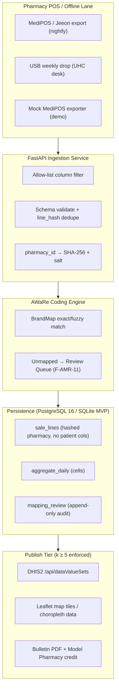
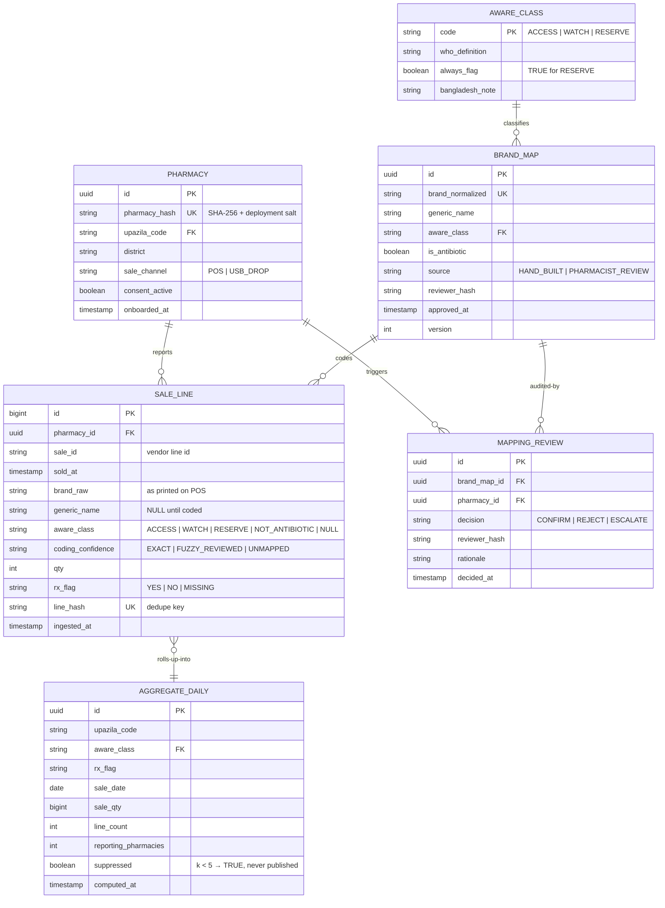
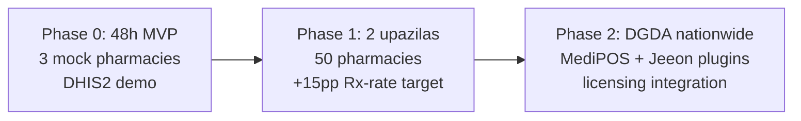

# 🛠️ Technical Architecture & Implementation Blueprint — Module 11

## AMR Lens — Antibiotic Sales Surveillance Layer: Ingest → AWaRe → Aggregate → DHIS2

---

## Table of Contents

- [Tech Stack](#tech-stack)
- [System Architecture](#system-architecture)
- [Database Architecture & Entity-Relationship Model](#database-architecture--entity-relationship-model)
- [FHIR Note (v1: No FHIR Resources)](#fhir-note-v1-no-fhir-resources)
- [REST API Specification](#rest-api-specification)
- [Privacy Architecture (Aggregate-Only, k ≥ 5)](#privacy-architecture-aggregate-only-k--5)
- [Security Architecture](#security-architecture)
- [Rollout Plan: 48h MVP → Pilot → National](#rollout-plan-48h-mvp--pilot--national)
- [Risk Register](#risk-register)
- [3-Minute Demo Script](#3-minute-demo-script)
- [Related Modules & Cross-References](#related-modules--cross-references)

---

## Tech Stack

| Layer | Choice | Notes |
|:---|:---|:---|
| **Ingestion & ETL** | Python 3.12 + pandas | CSV/JSON parsing, dedupe (`line_hash`), allow-list column drop, k-anonymity gate |
| **API** | FastAPI (ASGI, Uvicorn) | Ingest webhook, review-queue API, dashboards backend; OpenAPI auto-docs |
| **Frontend** | Leaflet + Chart.js (vanilla JS, no framework lock-in) | Choropleth map + trend charts; Bangla-first UI; WCAG-AA |
| **Database (prod)** | PostgreSQL 16 | Aggregates, BrandMap, audit logs; partitioning by month on `sale_lines` |
| **Database (MVP)** | SQLite | Zero-config demo; identical schema; migration path via SQL dump |
| **Reporting target** | DHIS2 demo API (`/api/dataValueSets`) | Production only after DGDA signs data-element dictionary |
| **PDF bulletin** | Jinja2 → WeasyPrint | DGDA-branded monthly bulletin |
| **Maps/GeoJSON** | Leaflet + Survey-of-Bangladesh-derived upazila boundaries (DGHS-shared) | Versioned GeoJSON |
| **Hosting** | DGDA/DGHS server (primary) + offline USB lane | No cloud dependency required for pilot; BDIX peering preferred |
| **MVP mock** | Mock MediPOS-shaped exporter (Python) | Synthetic 3-pharmacy feed for demo + vendor test harness |

Deliberately **no** Kubernetes, **no** Kafka, **no** FHIR server in v1 — this is a surveillance pipe, not a hospital system. Complexity is the enemy of adoption.

---

## System Architecture

---

## Database Architecture & Entity-Relationship Model

**Design rules:**

- `sale_lines` stores **no** patient columns — enforced by allow-list at ingest, verified by nightly schema-diff audit.
- `aggregate_daily.suppressed = TRUE` rows are **never** exported by any code path (export queries filter `suppressed = FALSE`; second-person verification in CI).
- `mapping_review` is **append-only** (no UPDATE/DELETE grants for app role).
- Partitioning: `sale_lines` monthly partitions; retention 24 months raw → aggregated thereafter; raw purge after aggregate verification [policy, illustrative].

---

## FHIR Note (v1: No FHIR Resources)

**Module 11 v1 uses no HL7 FHIR resources — by design.** The data is anonymous sales aggregates, not clinical records; forcing FHIR (`MedicationDispense`, `MedicationRequest`) would add a server, profiles, and terminology burden with zero surveillance gain.

- DHIS2 (not FHIR) is the national reporting contract — consistent with DGHS practice.
- FHIR enters only as an **optional, later, read-only** phase: if a pharmacy voluntarily links dispense events to the e-Health Card ([`07-health-card`](../07-health-card/README.md)), a read-only `MedicationRequest` cross-check could validate Rx-flag honesty. That is **out of v1 scope**, requires explicit consent architecture under the PDPO 2025, and is documented here only to show the door exists.
- No FHIR server is deployed, no FHIR endpoint is exposed, no PHI ever touches this system.

---

## REST API Specification

| Method | Endpoint | Auth | Purpose |
|:---|:---|:---|:---|
| `POST` | `/api/v1/ingest/sales` | API key (per pharmacy) | Ingest CSV/JSON batch; returns manifest `{received, coded, unmapped, duplicates}` |
| `GET` | `/api/v1/ingest/status/{batch_id}` | API key | Batch state (`RAW_UPLOAD`→`PUBLISHED`/`REJECTED`) |
| `GET` | `/api/v1/aggregates?upazila=&from=&to=` | DGDA service role | Published cells only (`suppressed=FALSE`) |
| `GET` | `/api/v1/map/watch-no-rx?month=2026-11` | Public (rate-limited) | Choropleth GeoJSON — aggregates, k≥5 pre-filtered |
| `GET` | `/api/v1/bulletin/latest.pdf` | DGDA role | Current monthly bulletin |
| `POST` | `/api/v1/review/decisions` | Empanelled pharmacist (mTLS/OTP) | Submit brand mapping decision; append-only |
| `GET` | `/api/v1/review/queue` | Empanelled pharmacist | Unmapped brands awaiting decision |
| `POST` | `/api/v1/dhis2/push` | DGDA service role | Trigger `/api/dataValueSets` push for period; returns importCount |
| `GET` | `/api/v1/credit/{pharmacy_hash}/report` | Pharmacy API key (own data only) | Private quarterly compliance report |
| `GET` | `/api/v1/audit/suppression-log` | Pilot auditor role | k≥5 suppression events for the period |
| `GET` | `/api/v1/health` | None | Uptime probe (DHIS2 reachability, DB, queue depth) |

**Conventions:** JSON; UTF-8; ISO-8601 dates; errors `{error_code, message, trace_id}`; all list endpoints paginated; no endpoint ever returns a patient field (none exist).

---

## Privacy Architecture (Aggregate-Only, k ≥ 5)

1. **No patient identifiers — ever.** Ingest allow-list drops every column except `sale_id, timestamp, brand_name, qty, unit_price, rx_flag, pharmacy_ref`. Anything else is discarded unread, and the discard is logged as an incident.
2. **Aggregate-only publication.** The single publishable artifact is the cell `(upazila, aware_class, rx_flag, date) → counts`. No row-level data is ever served by any API, export, dashboard, bulletin, or map.
3. **k-anonymity ≥ 5 per cell.** Cells with **fewer than 5 sales** are marked `SUPPRESSED` at aggregation and excluded at every export boundary (double-enforced). Suppression events are auditable.
4. **Hashed pharmacy identity.** `pharmacy_id` → SHA-256 with per-deployment secret salt; raw ID retained only in the intake spool, purged ≤ 7 days [policy, illustrative]. DGDA/public outputs never contain the hash either — only aggregates by geography.
5. **No prescription linkage.** The system stores `rx_flag ∈ {YES, NO, MISSING}` — nothing about the prescription's content, prescriber, or validity.
6. **Voluntary & revocable.** Pharmacies join by choice; withdrawal stops future ingest and freezes credit; historical aggregates (already k≥5) remain.
7. **PDPO 2025 alignment.** Health data is "sensitive personal data" (gazetted 6 Nov 2025); Module 11 collects **none**. Aggregates of sales counts are not personal data — documented in the DPIA for DGDA sign-off.
8. **Data minimisation & retention.** Raw lines → aggregated after verification (24-month ceiling [policy, illustrative]); backups encrypted, same retention; access by named roles only; quarterly access review.

---

## Security Architecture

| Control | Implementation |
|:---|:---|
| **Pharmacy API keys** | Per-pharmacy keys, stored **hashed** (bcrypt); shown once at onboarding; revocable; scoped to ingest + own report only |
| **Hashed pharmacy IDs** | SHA-256 + salt (intake spool only); downstream tables carry `pharmacy_hash` or nothing |
| **TLS everywhere** | TLS 1.2+ for all endpoints; HSTS; BDIX-friendly certs; DHIS2 over HTTPS only |
| **Least-privilege roles** | Roles: `pharmacy` (ingest, own report), `empanelled_pharmacist` (review queue), `dgda_analyst` (aggregates, bulletin), `pilot_auditor` (read-only audit), `service_dhis2` (dataValueSets write only) |
| **DHIS2 service account** | Write `dataValues` only; no metadata, no user admin; IP allow-list optional; quarterly rotation |
| **Audit ledger** | Append-only log: ingests, mapping decisions, pushes, suppressions, key rotations, exports; monthly auditor review |
| **Network** | Pilot on DGDA/DGHS VLAN; no inbound internet exposure; vendor access via portal only (MFA) |
| **Secrets** | Env vault (not in repo); CI secret scanning; salt rotation annually (re-hash spool only) |
| **Export safety** | Every export path filters `suppressed=FALSE`; CI test asserts zero suppressed rows in fixtures |

---

## Rollout Plan: 48h MVP → Pilot → National

**Phase 0 — 48-Hour MVP (hackathon build):**
- Mock MediPOS-shaped exporter generates synthetic sales for **3 mock pharmacies** (Dhaka upazilas).
- Ingest → AWaRe code (30–50 brand table) → aggregate → **DHIS2 demo** `/api/dataValueSets` → Leaflet map highlights **Watch-class sold without Rx**.
- Demo script below; success = end-to-end data element visible in DHIS2 demo + one upazila flagged.

**Phase 1 — 50-Pharmacy Pilot, 2 Upazilas (Months 1–4):**
- DGDA selects 2 upazilas (one peri-urban Dhaka, one rural [sites TBD with DGDA — illustrative]); 25 pharmacies each; ≥10 connected via MediPOS/Jeeon plugin, remainder USB weekly drop.
- Baseline month (no credit yet) → 3 months credited reporting; pharmacist review queue live; k≥5 audited by Rifat; mid-pilot course-correction at day 60.
- KPIs: +15pp Rx-rate; ≥90% mapping coverage; ≥99% DHIS2 push success; zero k<5 leaks; ≥40 pharmacies completing ≥80% reporting months [target, illustrative].

**Phase 2 — DGDA Nationwide (Months 5–18):**
- Jeeon/MediPOS ship AMR module as standard POS feature (portal-driven onboarding); DGDA licensing-software integration for new pharmacy licences.
- Quarterly public district scorecard; annual national AMR-from-sales report; bulletin institutionalised; Fleming Fund / DGDA programme budget line.
- Scale path: 50 → 500 → national; eLMIS adjacency ([`06-medicine-stock`](../06-medicine-stock/README.md)) for supply-side correlation (exploratory, not committed).

**Who pays:** DGDA/IEDCR AMR programme + Fleming Fund-type donors (Fleming Fund already backed DGDA stewardship; WHO 25 Sep 2024 packaging/stewardship regulation). **Pharmacies pay nothing.** Scale via POS vendor distribution, then DGDA licensing integration.

---

## Risk Register

| # | Risk | Likelihood / Impact | Mitigation |
|:---:|:---|:---:|:---|
| R1 | **Fear of enforcement** — pharmacies suspect a "trap" for unlicensed sellers | High / High | Voluntary pilot; **aggregates only; zero penalties; no shop named; no licence action**; DGDA public commitment letter; auditor verifies |
| R2 | **Data quality poor** (missing rx_flag, duplicates, brand chaos) | High / Medium | Pharmacist review queue (72h SLA); MISSING excluded from KPIs; dedupe; data-quality coaching via private quarterly report — never fines |
| R3 | **Vendor lock-in / single-vendor dependency** | Medium / High | **Open CSV/JSON spec**; two vendors + USB fallback; reference implementation open-sourced; spec governance board |
| R4 | **Privacy breach (patient data leaks via vendor export bug)** | Low / High | Allow-list drop at ingest (unread); incident protocol; file purge; DPIA; PDPO 2025 alignment; no PII exists to steal |
| R5 | **k-anonymity violation** (small upazila, few pharmacies) | Medium / High | k≥5 double-enforced; min 3 reporting pharmacies per published cell; district rollup fallback; auditor monthly check |
| R6 | **Gaming for compliance credit** (fake MISSING/NO patterns) | Medium / Low | Outlier z-score detection; random auditor spot checks; credit requires completeness, not "good behaviour" |
| R7 | **Vendor insolvency (Jeeon/MediPOS)** | Low / Medium | Spec open; data already local; pharmacies keep USB lane; pilot survives either vendor |
| R8 | **DGDA/IEDCR deprioritisation after pilot** | Medium / Medium | Bulletin institutionalised; DHIS2-native (no new system to abandon); donor reporting obligation; MOU with exit criteria |
| R9 | **Seasonal confounding** (monsoon spikes misread as stewardship failure) | High / Low | 8-week rolling baseline; UHC context check mandatory before advisory; seasonality-adjusted after 12 months data |
| R10 | **Reserve-class signal missed** (low volume, high risk) | Low / High | **Reserve always flagged** regardless of k (reported as "≥1 Reserve sale, upazila X, month Y" — never count, never shop) |

---

## 3-Minute Demo Script

| Time | Beat | On Screen |
|:---|:---|:---|
| **0:00–0:25** | The hook: **"45% of antibiotics in 246 Dhaka pharmacies were sold without a prescription — and only 7.56% had a registered pharmacist (PMC 2025). DGDA cannot see this."** | Title slide: blind-spot stat; icddr,b 50.9% (2022) secondary stat |
| **0:25–0:50** | **3 mock pharmacies** (Mirpur, Narayanganj, Savar [illustrative names]) sell antibiotics on the mock MediPOS exporter; one taps **"Rx seen? N"**, one taps **Y**, one skips | POS mock: scan Azithromycin 500 → prompt → tap N; receipt prints |
| **0:50–1:30** | **Connector runs live**: ingest → dedupe → AWaRe coding (Azithromycin → **Watch**; Amoxicillin → **Access**; Meropenem → **Reserve, always flagged**) | Terminal/log scroll; BrandMap table; 1 unmapped brand → review queue badge |
| **1:30–2:05** | **DHIS2 demo** shows the new data elements populated (Watch-no-Rx, upazila-level) via `/api/dataValueSets`; importCount 200 OK | Browser: DHIS2 demo → Data Visualizer; element `AMR_WATCH_NO_RX_UPZ` |
| **2:05–2:40** | **Map highlights the spike**: Leaflet choropleth — upazila "Narayanganj Sadar" [illustrative] shaded red: Watch-no-Rx 63% vs 41% baseline; click → sparkline + "insufficient cells suppressed: 2" | Leaflet map; Chart.js sparkline; suppression badge (proves k≥5) |
| **2:40–3:00** | **The ask**: *"One POS vendor + DGDA — a 50-pharmacy, 2-upazila pilot. We bring the pipe; DGDA brings legitimacy; pharmacies pay nothing; no patient data ever moves."* | Ask slide: MOU outline; timeline Phase 1 |

**Demo rules:** no real pharmacy data; no internet dependency (local Docker + DHIS2 demo cached); 3 minutes hard stop; one question only at the end.

---

## Related Modules & Cross-References

- **[`03-prescription`](../03-prescription/README.md)** — Rx-side AWaRe audit (what should be prescribed); Module 11 audits what was actually sold. **Together = both sides of antibiotic use.**
- **[`06-medicine-stock`](../06-medicine-stock/README.md)** — eLMIS supply-side visibility; cross-checks stock-outs vs sales anomalies (exploratory).
- **[`02-test-reports`](../02-test-reports/README.md)** — diagnostics pathway; confirms whether Watch-no-Rx upazilas show rising test positivity (future correlation study, not v1).
- **[`05-integrated-system`](../05-integrated-system/README.md)** — FHIR R4 spine & DHIS2 event bus; Module 11 v1 is deliberately FHIR-free and DHIS2-native.
- **`12-ncd-sathi`** *(planned)* — NCD pharmacy touchpoints; shared pharmacist reviewer pool possible later.
- **[`07-health-card`](../07-health-card/README.md)** — optional future consent-based linkage (see FHIR note); not v1.
