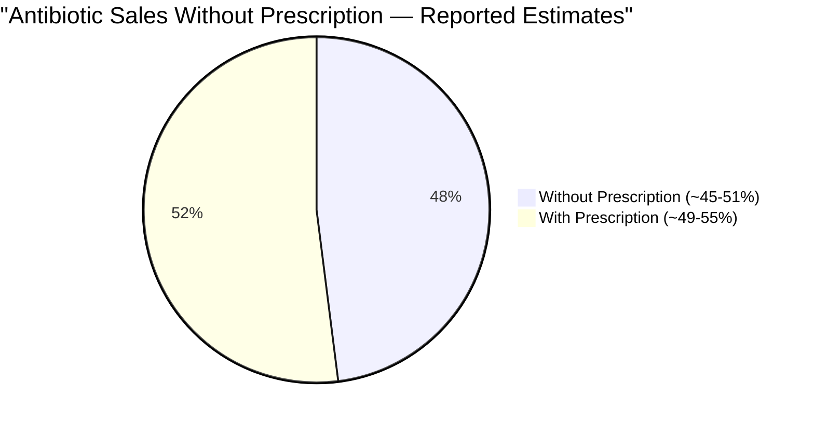
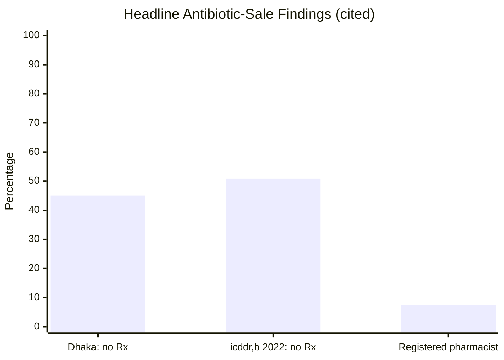
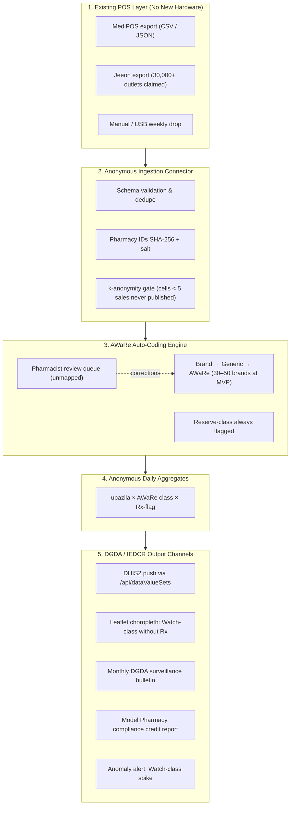
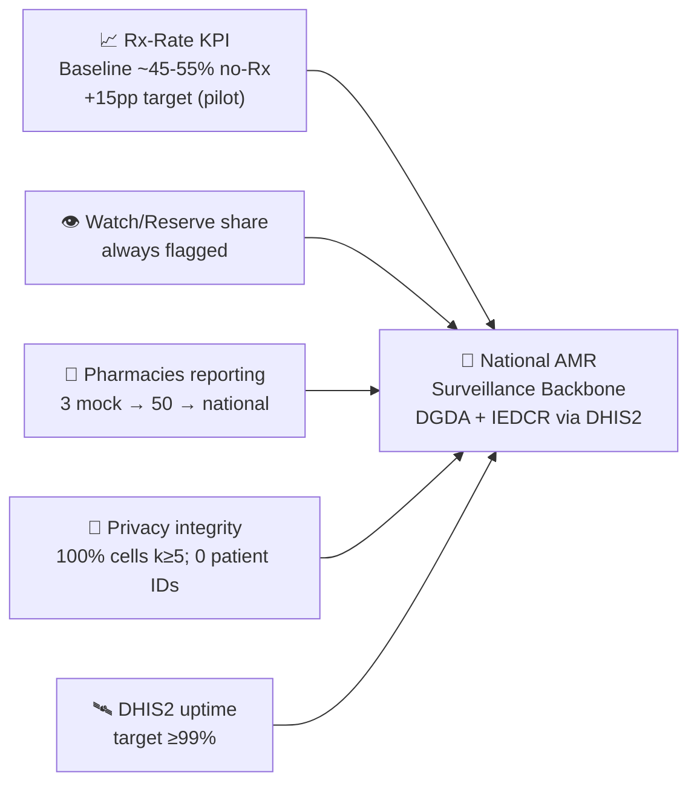

# 🦠 AMR Lens — Antibiotic Sales Surveillance Layer

## Module 11 — Anonymous POS-Based Antibiotic Sales Intelligence for DGDA & IEDCR

> **Tagline:** the POS systems pharmacies already use become anonymous, referral-grade antibiotic-sales intelligence for DGDA & IEDCR — no new hardware, no patient data.

**Platform:** BD-HealthLoop — E-Health Hackathon & Symposium (MoHFW + WHO), 3–5 Dec 2026, Dhaka
**Hackathon score:** U4 · F4 · I4 · J4 · D3 = **19/25**
**Module position:** Companion to [`03-prescription`](../03-prescription/README.md) (Rx-side AWaRe audit) — together they see both sides of national antibiotic use.

---

## Table of Contents

- [Problem Statement](#problem-statement)
  - [The Antibiotic Blind Spot in Numbers](#the-antibiotic-blind-spot-in-numbers)
- [International Precedent: Maisha Meds](#international-precedent-maisha-meds)
  - [The Lesson Table](#the-lesson-table)
- [System Architecture & Vision](#system-architecture--vision)
- [Capability Deep-Dives](#capability-deep-dives)
- [Comparative Benchmark](#comparative-benchmark-bangladesh-vs-maisha-meds-vs-module-11)
- [Stakeholder Matrix](#stakeholder-matrix)
- [Success Metrics & National Targets](#success-metrics--national-targets)
- [Related Modules & Cross-References](#related-modules--cross-references)
- [Sources & Data Notes](#sources--data-notes)

---

## Problem Statement

Bangladesh has one of the world's least-measured antibiotic markets. Nearly half of antibiotic sales cross the counter with no prescription and no record. In **246 Dhaka pharmacies**, **~45% of antibiotics were dispensed without a prescription**, and only **7.56% had a registered pharmacist** (2025) ([PMC12744235](https://www.ncbi.nlm.nih.gov/pmc/articles/PMC12744235/)). An icddr,b study found **50.9% (327/642) of antibiotics were bought without a prescription** (2022) ([DOAJ](https://doaj.org/article/b2563a5093494395a07298723c0c4801)). Pharmacy-level AWaRe data remain **scarce** (MDPI *Antibiotics* 2022, [11(2):247](https://www.mdpi.com/2079-6382/11/2/247/xml)); the CAPTURA/IVI study recommends bringing **private pharmacies into AMR surveillance** ([BioSpectrum Asia](https://www.biospectrumasia.com/news/87/22616/study-recommends-heightened-focus-on-quality-amr-data-generation-in-bangladesh.html)).

The regulator is blind on the largest reservoir of antibiotic use in the country:

- **DGDA** fixes retail prices for only **~160 essential drugs**; retail prices rose **7–140%** in months while mill-gate prices stayed stable (*Financial Express* 2024) — market opacity mirroring data opacity.
- Local POS vendors are **commercial and report nothing to the regulator**: MediPOS and Jeeon (claims **30,000+ pharmacies**, [Crunchbase](https://www.crunchbase.com/organization/jeeon)) log every sale, feed **zero** antibiotic-sales data into surveillance ([TBS](https://www.tbsnews.net/node/347995)).
- WHO's **25 Sep 2024** statement on using AMU data to inform regulatory changes to antibiotic packaging & stewardship in Bangladesh opened the policy door; the **Fleming Fund** already backed DGDA stewardship work ([WHO 2024](https://www.who.int/news/item/25-09-2024-utilizing-data-on-antimicrobial-use-and-knowledge-to-inform-regulatory-changes-to-antibiotic-packaging-and-support-antimicrobial-stewardship-efforts-in-bangladesh)).
- WHO **AWaRe** (**Access / Watch / Reserve**) is the agreed coding basis — **Reserve always flagged**.

> [!IMPORTANT]
> **~45% of antibiotic sales without a prescription is the largest unmeasured reservoir of antibiotic-use data in Bangladesh.** The data exists in every POS — it is simply never reported. Module 11 turns existing POS systems into **anonymous, referral-grade surveillance** for DGDA and IEDCR, with **no new hardware and no patient data**.

### The Antibiotic Blind Spot in Numbers

| Indicator / Metric | Ground Statistic | Authoritative Source & Context |
|:---|:---:|:---|
| **Antibiotics sold without Rx (Dhaka, 246 pharmacies)** | **~45%** | PMC12744235 (2025) — cross-sectional pharmacy audit |
| **Pharmacies with a registered pharmacist** | **7.56%** | PMC12744235 (2025) — same sample |
| **Antibiotics bought without Rx (icddr,b)** | **50.9% (327/642)** | DOAJ (2022) — exit-purchase study |
| **Pharmacy-level AWaRe data** | **Scarce** | MDPI *Antibiotics* 2022, 11(2):247 |
| **Private pharmacies in AMR surveillance** | **Not yet included** | CAPTURA/IVI (BioSpectrum Asia) |
| **Drug sellers without formal training** | **~50%** | PMC (research compilation) |
| **Licensed pharmacies (estimates)** | **107,000–174,000** | Estimate range; no verified national count |
| **POS vendors feeding regulators** | **0** | MediPOS; Jeeon 30k+ claimed (Crunchbase); none report (TBS) |
| **DGDA essential-drug price controls** | **~160 drugs only** | *Financial Express* 2024 |
| **Retail price rise (mill-gate stable)** | **7–140%** | *Financial Express* 2024 |
| **OOP share of health spending** | **79.31% (2023)** | World Bank WDI / WHO GHED |
| **Policy signal** | **WHO 25 Sep 2024** | AMU data → packaging & stewardship regulation |

---

## International Precedent: Maisha Meds

The closest working analogue is **Maisha Meds** (Kenya, Uganda, Nigeria): a free drug-shop POS capturing clinical data at an estimated **4,500–5,000 outlets** (company-reported), backed by a **USAID DIV grant of US$5.25M (2023)** ([MIT Solve](https://solve.mit.edu/solutions/95587); [Daba Finance](https://dabafinance.com/news/USAID-awards-Maisha-Meds)). Its RCT results were **not retrieved** — Module 11 designs against that gap by publishing methods, mappings and open aggregates.

**What it proves:** a free/low-friction POS *is* a viable data pipe for informal drug shops at national scale; point-of-sale capture beats retrospective surveys; donors fund the pipe when surveillance value is real.
**What it doesn't prove / we don't assume:** quantified AMR reduction (RCT not retrieved); durability without donors; regulator uptake.
**Bangladesh gap:** no local actor does this — MediPOS/Jeeon have **no reporting link** to DGDA/IEDCR (TBS). CAPTURA/IVI explicitly recommends closing it.

### The Lesson Table

| # | Lesson | Evidence & Source | Module 11 Response |
|:---:|:---|:---|:---|
| 1 | **Digitise the counter, don't replace it** — free POS hit 4,500–5,000 outlets | Company-reported (MIT Solve) | No POS built; plug into MediPOS / Jeeon + CSV fallback |
| 2 | **Capture at sale, not by survey** | Maisha Meds design; 50.9% no-Rx (icddr,b 2022) | One-tap **"Rx seen? Y/N"** at checkout |
| 3 | **Independent evaluation or no trust** | RCT not retrieved (flagged, not assumed) | Open methodology; pilot KPI = +15pp Rx rate, not anecdotes |
| 4 | **Anchor to the regulator from day one** | Fleming Fund → DGDA; WHO 25 Sep 2024 | **DHIS2** `/api/dataValueSets`; DGDA/IEDCR own bulletin |
| 5 | **Avoid single-vendor dependency** | Babyl Rwanda folded after Babylon collapse (03_global_gap_analysis) | **Open CSV/JSON spec** + 2 vendors + USB offline lane |
| 6 | **Incentives beat mandates in pilots** | Maisha Meds = free tool | Model Pharmacy compliance credit + free quarterly report |
| 7 | **Reserve must be loud, not buried** | WHO AWaRe | **Reserve always flagged**; Watch-no-Rx = headline map layer |

---

## System Architecture & Vision

A **surveillance layer, not a POS** — it sits on existing pharmacy software, anonymises at ingestion, publishes only aggregates.

**Vision:** every antibiotic sale becomes an anonymous, countable, classifiable data point flowing to the national regulator — while the pharmacy keeps selling, the patient keeps buying, and **no person is ever identified**.

---

## Capability Deep-Dives

**1. WHO AWaRe Auto-Coding Engine** — Hand-built, **pharmacist-reviewed** table of the **30–50 most common antibiotic brands** → generic → AWaRe class. Auto-coding at ingest; unmatched lines route to the **pharmacist review queue** (a wrong code is worse than no code). **Reserve always flagged**. Coverage KPI: target **≥90% auto-coded** [target, illustrative].

**2. One-Tap "Prescription Seen?" Capture** — One question at the counter: **প্রেসক্রিপশন দেখেছেন? (Rx seen? Y/N)** — binary, ~1 second, zero free text. This single bit converts sales volume into **stewardship-grade intelligence**. MISSING lines still count for volume, are excluded from Rx KPIs, and trigger coaching — never penalty. Complements [`03-prescription`](../03-prescription/README.md) (Rx-side audit).

**3. Anti-Identification Aggregation (k ≥ 5)** — **No patient identifiers ever** — no names, ages, Health IDs, diagnosis. Cells (`upazila × AWaRe × Rx-flag` per day) with **< 5 sales are suppressed** and never published. **Pharmacy IDs SHA-256-hashed** with per-deployment salt; public outputs name no shop. Aligned with PDPO 2025 (health data = sensitive personal data, gazetted 6 Nov 2025) — we collect none of it.

**4. DHIS2-Native Anonymous Reporting** — Pushes aggregates to **DHIS2** (`/api/dataValueSets`), the DGHS backbone — no parallel silo. Validated on the **DHIS2 demo API**; production only after DGDA signs the data-element dictionary; signed CSV fallback for unmapped districts; same k≥5 gate everywhere. Uptime KPI: target **≥99% push success** [target, illustrative].

**5. Model Pharmacy Compliance Credit** — Voluntary pilot pharmacies earn **compliance credit toward the Model Pharmacy standard** plus a **free quarterly report** (your sales vs district average; Watch-class and Rx-rate trends) — private, actionable, zero cost. Adoption engine: pharmacies join for **licence standing and reputation**, not surveillance fear.

---

## Comparative Benchmark: Bangladesh vs Maisha Meds vs Module 11

| Dimension | Bangladesh Today | Maisha Meds (KE/UG/NG) | Module 11 |
|:---|:---:|:---:|:---:|
| **POS feeding national surveillance** | **0 vendors** | ~4,500–5,000 outlets (company) | Plug-in + CSV fallback; 50-pharmacy pilot → Jeeon-scale |
| **AWaRe-coded sales** | None national | Clinical capture (company); AWaRe not published | **Auto brand→generic→AWaRe**, pharmacist-reviewed |
| **"Prescription seen?" capture** | None | Yes | One-tap Y/N at checkout |
| **Regulator linkage** | None | Donor-funded; link unclear | **DHIS2 `/api/dataValueSets`** — DGDA/IEDCR native |
| **Privacy model** | n/a | Programme-dependent | **Aggregate-only; k≥5; zero patient IDs** |
| **Cost to pharmacy** | n/a | Free POS | **Zero new hardware**; free quarterly report |
| **Evidence** | n/a | USAID DIV $5.25M (2023); RCT not retrieved | Pilot KPIs (+15pp Rx); open methodology |
| **Character** | n/a | Voluntary | **Voluntary, no penalties** — trust first |

---

## Stakeholder Matrix

| Stakeholder | Key Frustrations | System Solution | Measured Benefit |
|:---|:---|:---|:---|
| **Pharmacists / drug-sellers (ঔষধ বিক্রেতা)** | Fear of crackdowns; unclear rules; ~50% untrained | Anonymous reporting; Model Pharmacy credit; free report | Compliance credit; zero exposure |
| **POS vendors (MediPOS, Jeeon)** | Data has no regulatory value; cost pressure | Partnership portal; compliance report = retention tool | New B2B2G line; 30k+ outlets addressable (Jeeon claim) |
| **DGDA** | Blind to OTC antibiotic leak; can't measure stewardship | Monthly bulletin; DHIS2 elements; AWaRe trends | First national OTC antibiotic baseline (WHO 2024 evidence) |
| **IEDCR** | No early signal for AMR-relevant anomalies | Watch-class spike alerts (upazila) | Earlier stewardship response |
| **DGHS / DHIS2** | Parallel reporting burden | Native `/api/dataValueSets`; no duplicate forms | DHIS2 stays the single pipe |
| **Patients / public** | Resistance risk invisible | Aggregate district scorecards | Informed public; no profiling |
| **Fleming Fund / donors** | Funded DGDA stewardship, no sales-side metric | Pilot → scale with hard KPIs | Measurable AMR ROI |
| **Upazila Health Complexes** | No local pharmacy visibility | District/upazila bulletin; USB drop point | Local action; trust channel |

---

## Success Metrics & National Targets

**Pilot KPIs (2 upazilas, 50 pharmacies [pilot design, illustrative]):**

- **% antibiotic sales with Rx:** baseline ~45–55% (45% PMC 2025; 50.9% icddr,b 2022) → **+15 percentage points**.
- **Watch/Reserve share:** tracked weekly; Watch-without-Rx is the headline suppression target; **Reserve always flagged**.
- **# pharmacies reporting:** 3 mock (48h MVP) → **50** (pilot) → national via POS vendors → DGDA licensing integration.
- **Mapping coverage:** ≥90% antibiotic lines auto-coded [target, illustrative]; remainder → review queue.
- **DHIS2 push uptime:** ≥99% [target, illustrative]; failures auto-retry + alert.
- **k-anonymity:** **100%** of published cells ≥ 5 sales; 100% suppression log auditable.
- **Voluntary, zero penalties** — trust is the product.

**National targets (12–24 months, DGDA sign-off):**

- Nationwide AWaRe-coded antibiotic sales surveillance via **≥1 POS vendor** (Jeeon 30k+ claimed) + **DGDA licensing-software integration**.
- Quarterly public **district awareness scorecard** (Watch-no-Rx share) — aggregates only.
- Amalgamation with [`03-prescription`](../03-prescription/README.md) for a whole-market AMR picture; feed IEDCR surveillance; inform DGDA's WHO-2024 packaging/stewardship regulatory work.

---

## Related Modules & Cross-References

- **[`03-prescription`](../03-prescription/README.md)** — Rx-side AWaRe audit; Module 11 = OTC/dispense-side counterpart.
- **[`06-medicine-stock`](../06-medicine-stock/README.md)** — eLMIS availability; separate mission (access) from ours (appropriateness).
- **[`02-test-reports`](../02-test-reports/README.md)** — diagnostics/OpenELIS; shared DHIS2 patterns.
- **[`05-integrated-system`](../05-integrated-system/README.md)** — FHIR R4 spine; Module 11 v1 is **FHIR-free** (see IMPLEMENTATION.md).
- **`12-ncd-sathi`** *(planned)* — NCD stewardship at pharmacy level; cross-links later.

---

## Sources & Data Notes

**Primary sources (cited inline):**

1. ~45% antibiotics without Rx; 7.56% registered pharmacists — *PMC12744235* (2025): https://www.ncbi.nlm.nih.gov/pmc/articles/PMC12744235/
2. 50.9% (327/642) no-Rx (icddr,b, 2022) — *DOAJ*: https://doaj.org/article/b2563a5093494395a07298723c0c4801
3. Pharmacy-level AWaRe scarce — *MDPI Antibiotics* 2022, 11(2):247: https://www.mdpi.com/2079-6382/11/2/247/xml
4. CAPTURA/IVI recommendation — *BioSpectrum Asia*: https://www.biospectrumasia.com/news/87/22616/study-recommends-heightened-focus-on-quality-amr-data-generation-in-bangladesh.html
5. Maisha Meds (4,500–5,000 outlets company-reported; USAID DIV $5.25M, 2023; RCT not retrieved) — *MIT Solve*: https://solve.mit.edu/solutions/95587 ; *Daba Finance*: https://dabafinance.com/news/USAID-awards-Maisha-Meds
6. Jeeon 30,000+ claimed — *Crunchbase*: https://www.crunchbase.com/organization/jeeon ; neither vendor reports — *TBS*: https://www.tbsnews.net/node/347995
7. Fleming Fund → DGDA stewardship; WHO 25 Sep 2024 on AMU & regulation — *WHO*: https://www.who.int/news/item/25-09-2024-utilizing-data-on-antimicrobial-use-and-knowledge-to-inform-regulatory-changes-to-antibiotic-packaging-and-support-antimicrobial-stewardship-efforts-in-bangladesh
8. ~160 essential-drug price controls; retail +7–140% — *Financial Express* (2024): https://thefinancialexpress.com.bd/trade/yawning-gap-between-mill-gate-and-retail-medicine-prices
9. ~50% drug sellers untrained; licensed pharmacies 107k–174k (estimate range); OOP 79.31% — research compilation `hackathon-research/`
10. PDPO 2025 — health data = sensitive personal data; gazetted 6 Nov 2025 (via research compilation, *TBS* / *Daily Star*)
11. WHO AWaRe — Access / Watch / Reserve; Reserve always flagged.

**Honesty flags:** Maisha Meds figures are **company-reported**; **RCT not retrieved** — no causal claim made. Jeeon's 30k+ is **self-reported**. Module 11 pilot targets marked [target/illustrative] are **design goals, not results**. The ~45% and 50.9% figures come from different designs (246-pharmacy audit vs 642-purchase exit study) and are cited as such, never generalised silently. Bangladesh has **no verified national antibiotic-sales census** — Module 11 exists to create the first, anonymously. Unverifiable numbers are labelled **[illustrative]** or omitted, never invented.
