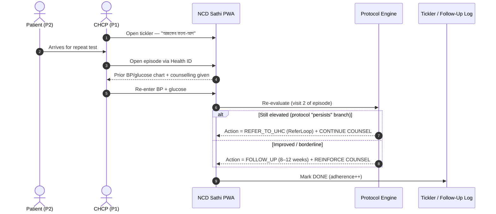
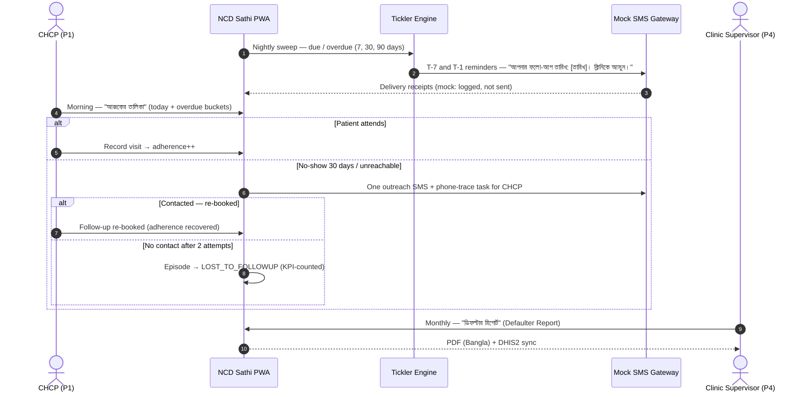
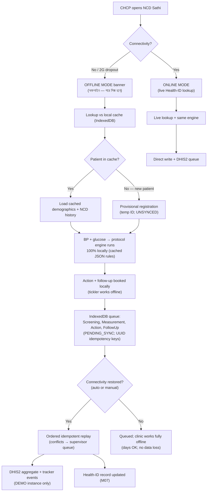
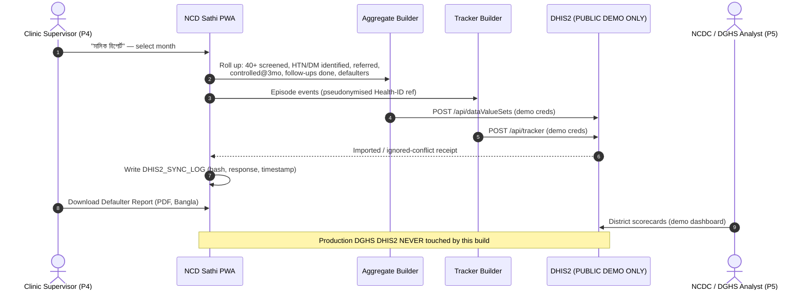

# 🔄 Application Flow — NCD Sathi

## Module 12 — CHCP Screening, Protocol, Referral, Follow-Up & DHIS2 Reporting Journeys

---

## Table of Contents

- [Personas](#personas)
- [Journey 1: First NCD Screening at a Community Clinic](#journey-1-first-ncd-screening-at-a-community-clinic)
- [Journey 2: The 4-Week Repeat Test & Counselling Visit](#journey-2-the-4-week-repeat-test--counselling-visit)
- [Journey 3: Referral to UHC via ReferLoop (BP Still High)](#journey-3-referral-to-uhc-via-referloop-bp-still-high)
- [Journey 4: Follow-Up Tickler, SMS Reminder & Defaulter Tracing](#journey-4-follow-up-tickler-sms-reminder--defaulter-tracing)
- [Journey 5: Offline-First Flow (No Connectivity)](#journey-5-offline-first-flow-no-connectivity)
- [Journey 6: Screening Camp Mode (Mass Screening Day)](#journey-6-screening-camp-mode-mass-screening-day)
- [Journey 7: Monthly DHIS2 Auto-Fill & Defaulter Report](#journey-7-monthly-dhis2-auto-fill--defaulter-report)
- [Patient NCD Episode Lifecycle (State Machine)](#patient-ncd-episode-lifecycle-state-machine)
- [Edge Cases & Exception Handling](#edge-cases--exception-handling)
- [Journey Summary Table](#journey-summary-table)

---

## Personas

| # | Persona | Context & Constraints | What NCD Sathi gives |
|:--|:---|:---|:---|
| P1 | **CHCP — community clinic** | ~70 patients/day ([DOAJ 2021](https://doaj.org/article/ecd5cdd2b63a49848b10cfe31a41f8ee)); no MBBS; cannot prescribe beyond scope; intermittent connectivity; Bangla UI | One-entry workflow; protocol action in seconds; auto DHIS2; offline mode |
| P2 | **Patient 40+ (HTN/DM risk)** | Often undiagnosed (15.8% HTN / 6.0% DM — BDHS 2017–18); may be illiterate; shares phones (73.4% households — BBS 2026) | Nearest-clinic screening; SMS reminders; Health-ID continuity |
| P3 | **UHC doctor (receiving referral)** | Overloaded; incomplete referrals today; wants pre-arrival context | ReferLoop inbox dossier; back-referral note |
| P4 | **Clinic supervisor / UHFPO** | No defaulter visibility; weak data quality | Defaulter report; supervision dashboard; override audit |
| P5 | **NCDC / DGHS analyst** | Needs national NCD denominators | Auto aggregate + tracker; anonymised district scorecards |

---

## Journey 1: First NCD Screening at a Community Clinic

**Trigger:** Patient ≥40 (or younger + risk factors) attends; or a screening camp is running.

```mermaid
sequenceDiagram
    autonumber
    actor Patient as Patient 40+ (P2)
    actor CHCP as CHCP (P1)
    participant App as NCD Sathi PWA
    participant HID as Health-ID Service (Module 07)
    participant Rule as Protocol Engine (2015 Desk Guide JSON)
    participant DB as PostgreSQL 16 / IndexedDB

    Patient->>CHCP: Presents at community clinic
    CHCP->>App: Open app — "নতুন স্ক্রিনিং (New Screening)"
    CHCP->>App: Enter Health ID (9-digit or QR scan)
    App->>HID: Lookup Health ID (pseudonymous; no NID)
    HID-->>App: Profile (age, sex, prior NCD flags) + consent status
    alt Consent not yet captured
        App->>Patient: Bangla consent — "তথ্য সংগ্রহে সম্মত?" (Yes/No)
        Patient-->>App: Consent = YES (timestamped; revocable)
    end
    CHCP->>App: Enter BP (e.g. 152/94) + fasting glucose (e.g. 7.2 mmol/L)
    App->>App: Plausibility validation (range; repeat-confirm if extreme)
    App->>Rule: Evaluate ProtocolRule pack (physician-signed v1.0)
    Rule-->>App: Action = REPEAT_IN_4_WEEKS + COUNSEL
    App->>DB: Save Screening + Measurements + Action (status: COUNSELED)
    App->>App: Book follow-up (4 weeks) → tickler
    App-->>CHCP: Bangla counselling script + patient card
```

**Branch points:** BP above emergency threshold → full-screen **"জরুরি — UHC-তে পাঠান (Urgent: refer now)"**; glucose implausible (e.g. 1.5) → re-enter or lab draw (Module 02); pregnancy flag → **separate antenatal pathway** (see Edge Cases).

---

## Journey 2: The 4-Week Repeat Test & Counselling Visit

**Trigger:** Scheduled follow-up from Journey 1; patient returns.



---

## Journey 3: Referral to UHC via ReferLoop (BP Still High)

**Trigger:** Visit 2 = REFER_TO_UHC, or stock-out auto-refer, or patient request.

```mermaid
sequenceDiagram
    autonumber
    actor CHCP as CHCP (P1)
    participant App as NCD Sathi PWA
    participant ReferLoop as ReferLoop (Module 05)
    participant UHC as UHC Doctor (P3)
    participant SMS as Mock SMS Gateway (Bangla)
    participant HID as Health ID (Module 07)

    CHCP->>App: Tap "UHC-তে রেফার (Refer to UHC)"
    App->>App: Auto-compose bundle<br/>(BP/glucose trend, meds, stock status)
    App->>ReferLoop: POST /ServiceRequest (FHIR R4) + flags
    ReferLoop->>ReferLoop: Validate checklist; route to UHC NCD inbox
    ReferLoop->>SMS: Patient SMS — "আপনার রেফার আইডি: RL-2031। UHC: [নাম], তারিখ: [তারিখ]।"
    ReferLoop->>UHC: Push dossier to NCD inbox
    UHC->>ReferLoop: Accept (+ appointment) / Advise remotely / Reject (+ reason)
    alt Accepted
        UHC-->>App: Acceptance + slot
        App->>HID: Append referral event to record
    else Advised remotely
        UHC-->>App: Advice as task — "ওষুধ চালিয়ে যান, ৪ সপ্তাহ পর BP মাপুন"
    end
    Note over CHCP,UHC: Back-referral returns control to CHCP; loop closed
```

**Key behaviours:** every referral has an ID, a status, a closure event — never an untracked paper slip. Vula (South Africa): 85.5% accepted, 16-min median reply, inappropriate referrals 6.7%→4.2% — [PMC8517757](https://www.ncbi.nlm.nih.gov/pmc/articles/PMC8517757/).

---

## Journey 4: Follow-Up Tickler, SMS Reminder & Defaulter Tracing

**Trigger:** Daily clinic start; scheduled SMS offsets; monthly defaulter run.



---

## Journey 5: Offline-First Flow (No Connectivity)

**Trigger:** Clinic has no/intermittent internet (pilot districts: "facilities lack computers, internet, servers" — Apr 2026, [Bonik Barta](https://en.bonikbarta.com/bangladesh/SyidD595PYwTVnF0)).



**Offline guarantees:** engine fully local (~40 KB rule pack cached); replay idempotent via client UUIDs; no record dropped; SMS queued and flushed on reconnect; conflicts never overwrite clinical measurements.

---

## Journey 6: Screening Camp Mode (Mass Screening Day)

**Trigger:** Union-level NCD screening camp (often paired with e-Health Card enrolment drives).

```mermaid
sequenceDiagram
    autonumber
    actor Org as Camp Organizer / CHCP
    participant App as NCD Sathi PWA (Camp Mode)
    participant HID as Health-ID Enrolment (Module 07)
    participant Rule as Protocol Engine
    participant Batch as Batch DHIS2 Sync

    Org->>App: Enable "ক্যাম্প মোড (Camp Mode)" + camp ID
    Org->>HID: On-spot enrolment or lookup
    loop Each attendee (target 40–60/hour/station [illustrative])
        HID-->>App: Health ID resolved/created
        Org->>App: BP + glucose (fasting station)
        App->>Rule: Evaluate → action card
        App->>App: Tag episode with camp_id
    end
    App->>Batch: Camp aggregate (screened / flagged / referred)
    Batch-->>Org: Summary slip (union parishad / UHFPO)
    Note over Org,Batch: Consent never bypassed; paper backup always printed
```

**Camp rules:** no counselling shortcuts; high-risk → same-day referral slip; stock check vs camp drug kit (Module 06).

---

## Journey 7: Monthly DHIS2 Auto-Fill & Defaulter Report

**Trigger:** End of month; supervisor or NCDC analyst requests it.



---

## Patient NCD Episode Lifecycle (State Machine)

```mermaid
stateDiagram-v2
    [*] --> SCREENED: BP/glucose entered at clinic or camp

    SCREENED --> REPEAT_TEST: Counsel + repeat in 4 weeks
    SCREENED --> COUNSELED: Low risk — lifestyle advice
    SCREENED --> REFERRED: Emergency threshold / high risk / stock-out

    REPEAT_TEST --> COUNSELED: Visit 2 improves — reinforce + routine f/u
    REPEAT_TEST --> REFERRED: Visit 2 persistently high → ReferLoop
    REPEAT_TEST --> FOLLOW_UP: Borderline — review 8–12 weeks

    COUNSELED --> FOLLOW_UP: Booked (4w elevated; longer if normal)
    FOLLOW_UP --> CONTROLLED: Target reached on review
    FOLLOW_UP --> REPEAT_TEST: Above target — repeat cycle
    FOLLOW_UP --> LOST_TO_FOLLOWUP: 30 days overdue; 2 outreach attempts fail
    FOLLOW_UP --> REFERRED: Deterioration / protocol escalation

    REFERRED --> FOLLOW_UP: Back-referral received — resume CHCP care
    REFERRED --> CONTROLLED: UHC treatment achieves target

    CONTROLLED --> FOLLOW_UP: Re-check 3–6 months
    CONTROLLED --> [*]: Discharged to routine care (annual screen)

    LOST_TO_FOLLOWUP --> FOLLOW_UP: Patient returns / traced
    LOST_TO_FOLLOWUP --> [*]: Closed after 12 months; counted in KPI

    note right of REFERRED
        Never a dead-end: expects a back-referral
        or an UHC closure note.
    end note
    note right of LOST_TO_FOLLOWUP
        Explicit state — never silently dropped;
        feeds defaulter report + KPIs.
    end note
```



**Allowed transitions enforced** by the app; illegal jumps (e.g. SCREENED → CONTROLLED without a review measurement) are rejected with a prompt to record the missing visit.

---

## Edge Cases & Exception Handling

| # | Scenario | Risk | System Response |
|:-:|:---|:---|:---|
| E1 | **Drug stock-out** (clinic/UHC) | Unfillable "treatment"; 84% of workers report patients return (Jun 2026, [Dhaka Tribune](https://www.dhakatribune.com/bangladesh/health/413839/inside-bangladesh%E2%80%99s-community-clinics-promise)); Jashore 283 clinics ~8 months ([Bonik Barta](https://en.bonikbarta.com/bangladesh/n79GkolkDClJDR5X)); availability 22% (PPRC 2026) | Module 06 stock flag → action **auto-escalates to REFER_TO_UHC** with stock-out reason; never instructs unaffordable private purchase silently |
| E2 | **Patient refuses referral** | High-risk patient declines (cost/fear/work) | Refusal recorded (1 tap + reason); episode stays REPEAT_TEST with mandatory 4-week review; counselling intensified; refusal flagged in defaulter report; emergency-threshold BP → urgent-referral warning + mandatory "explained risk" tick |
| E3 | **Pregnant patient** | NCD protocol inappropriate; pregnancy HTN is obstetric | Pregnancy flag → **antenatal/pre-eclampsia pathway note**; NCD protocol NOT applied; "ANC-তে রেফার করুন (Refer to ANC)"; supervisor flagged; NCD enrolment deferred to postpartum screen |
| E4 | **Data entry error** | 500/300 mmHg; mg/dL vs mmol/L mix-up | Hard range blocks impossible values; soft range warns + demands repeat; explicit unit toggle with confirm; post-save edits need reason note; full audit log |
| E5 | **Health-ID not found / new patient** | Unregistered at screening | Provisional temp ID (`UNSYNCED`) or enrol at next visit; never blocks care |
| E6 | **Shared phone / illiterate patient** | SMS reaches husband/son | Preferred contact + proxy recipient (shared-phone norm, 73.4% — BBS 2026); tickler continues in-app regardless |
| E7 | **CHCP overrides protocol action** | Clinical disagreement; safety drift | Override only with mandatory reason (≥10 chars + category picklist); audited on supervision dashboard; emergency-BP override → 72h supervisor acknowledgement |
| E8 | **Device lost / stolen** | Data exposure on shared device | PIN/biometric; 5-min lock; remote wipe (pilot MDM); no NID; pseudonymous IDs only |
| E9 | **Duplicate episode (two camps)** | Double-counted screening; inflated KPIs | Health-ID dedup at sync; camp tag compare; supervisor merge; DHIS2 events share Health-ID ref |
| E10 | **SMS delivery failure** | Defaulter unreachable | Mock gateway logs intent; 2 failures → "phone trace needed" task auto-created |
| E11 | **Two CHCPs edit offline** | Conflicting measurements post-sync | Client-UUID idempotency; measurements append-only; conflicts → supervisor queue |
| E12 | **Adverse drug event** | Amlodipine/metformin intolerance | "Adverse event" flag → mini-form (symptom, onset, drug, severity) → **DGDA pharmacovigilance + IEDCR**; severe → urgent referral |
| E13 | **DHIS2 endpoint down** | Month-end reporting blocked | Sync retries with backoff; SYNC_LOG records failure; CSV fallback; **never blocks clinical care** |
| E14 | **Emergency-threshold BP, well-looking patient** | "Walking" hypertensive emergency | Bypass counselling → full-screen urgent action; document refusal if declined; safety outranks protocol convenience |

---

## Journey Summary Table

| # | Journey | Actor | Trigger | Outcome | Artifacts |
|:-:|:---|:---|:---|:---|:---|
| J1 | First screening | CHCP | Patient ≥40 | Screening saved; action emitted; follow-up booked | Screening, Measurement, Action, FollowUp |
| J2 | 4-week repeat & counsel | CHCP | Tickler due | Refer or routine review | Episode updated; adherence++ |
| J3 | Refer to UHC via ReferLoop | CHCP → UHC | Protocol REFER / stock-out / request | Closed-loop referral; back-referral | FHIR ServiceRequest; ReferLoop ledger |
| J4 | Tickler + SMS + defaulter trace | CHCP + Supervisor | Daily/monthly | Reminders (mock); defaulters traced | SMS log; Defaulter Report |
| J5 | Offline-first | CHCP | No connectivity | Care continues; sync later | IndexedDB PENDING_SYNC queue |
| J6 | Camp mode | Camp team | Mass screening day | Bulk screening; camp aggregate | camp_id-tagged episodes |
| J7 | DHIS2 auto-fill | Supervisor / Analyst | Month-end | DHIS2 demo updated; zero re-entry | dataValueSets + tracker; SYNC_LOG |

**Cross-references:** 01-appointment (follow-up slots) · 02-test-reports (lab glucose) · 05-integrated-system (ReferLoop + DHIS2) · 06-medicine-stock (stock-out trigger) · 07-health-card (Health ID + consent).
