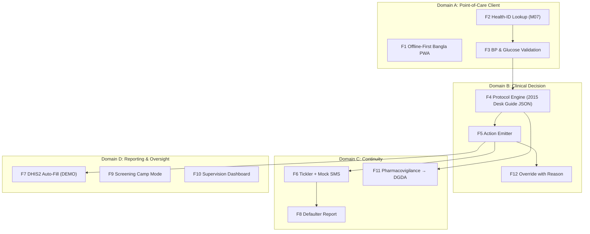

# ⚡ Functional Specifications & Feature Catalog — Module 12

## NCD Sathi — Adult HTN/Diabetes Protocol Assistant for Community Clinics

> Every screen carries: **"সিদ্ধান্ত সহকারী — রোগ নির্ণয় নয় (Decision support, not diagnosis)"**.
> Never prescribes beyond CHCP scope; never replaces a clinician; never touches production DHIS2 in this build.

---

## Table of Contents

- [Functional Architecture Overview](#functional-architecture-overview)
- [Feature 1: Offline-First Bangla PWA](#feature-1-offline-first-bangla-pwa)
- [Feature 2: Health-ID Patient Lookup](#feature-2-health-id-patient-lookup)
- [Feature 3: BP & Glucose Entry with Validation](#feature-3-bp--glucose-entry-with-validation)
- [Feature 4: Protocol Engine — 2015 Desk Guide, Physician-Signed JSON](#feature-4-protocol-engine--2015-desk-guide-physician-signed-json)
- [Feature 5: Action Output — Counsel / Repeat 4 Weeks / Refer to UHC / Follow-Up Date](#feature-5-action-output--counsel--repeat-4-weeks--refer-to-uhc--follow-up-date)
- [Feature 6: Follow-Up Tickler List with Mock SMS Reminders](#feature-6-follow-up-tickler-list-with-mock-sms-reminders)
- [Feature 7: DHIS2 Auto-Fill — Aggregate + Tracker Events](#feature-7-dhis2-auto-fill--aggregate--tracker-events)
- [Feature 8: Monthly Clinic Defaulter Report](#feature-8-monthly-clinic-defaulter-report)
- [Feature 9: Screening Camp Mode (Mass Screening Day)](#feature-9-screening-camp-mode-mass-screening-day)
- [Feature 10: Supervision Dashboard for UHC Managers](#feature-10-supervision-dashboard-for-uhc-managers)
- [Feature 11: Pharmacovigilance Flag (Adverse Events → DGDA)](#feature-11-pharmacovigilance-flag-adverse-events--dgda)
- [Feature 12: Clinician Override with Reason Captured](#feature-12-clinician-override-with-reason-captured)
- [Feature Matrix](#feature-matrix)
- [Out of Scope](#out-of-scope-explicit-non-goals)

---

## Functional Architecture Overview

---

## Feature 1: Offline-First Bangla PWA

**What:** Installable PWA, Bangla-first, fully functional offline; records queue in IndexedDB; sync on reconnect.

**Why:** Pilot districts lack computers/internet/servers; civil surgeons had no instructions (Apr 2026, [Bonik Barta](https://en.bonikbarta.com/bangladesh/SyidD595PYwTVnF0)). ~70 patients/day cannot wait for a spinner.

**How:** React 19 + Vite + Tailwind; service worker caches app shell + ~40 KB rule pack; all clinical logic device-local; IndexedDB `PENDING_SYNC` queue with client UUIDs (idempotent replay); Bangla UI (`নতুন স্ক্রিনিং`, `ফলো-আপ`, `অফলাইন — পরে সিঙ্ক হবে`) + English supervisor fallback; shared-phone tolerant (5-min lock; no lock-screen data).

**Edge cases:** multi-day offline (no data loss) · storage 80% full (shed cache, never clinical rows) · 2G-only (text mode) · two devices edit same episode (conflict queue → supervisor) · reinstall before sync (export prompt).

---

## Feature 2: Health-ID Patient Lookup

**What:** Patient found by **Health ID** (9-digit typed or QR). No NID, no name search, no photo.

**Why:** e-Health Card is the national rail (India ABDM: 79.71 crore ABHA accounts, Jul 2025 — the ID-lookup pattern at scale); minimal PID is a PDPO 2025 requirement (health data = sensitive personal data — [TBS](https://www.tbsnews.net/node/1281356)).

**How:** Scan/enter ID → pseudonymous profile (age, sex, prior NCD flags, last vitals, consent). New patient → provisional temp ID (`UNSYNCED`). Consent at **first screen** (`তথ্য সংগ্রহে সম্মত?`; timestamped; revocable). Lookup audit-logged. Refusal → paper fallback; episode not synced.

**Edge cases:** damaged card → manual digits + checksum · ID valid, no record → provisional create · patient forgets ID → camp-mode mobile+DOB lookup w/ supervisor PIN [illustrative] · duplicate IDs → merge to DGHS-MIS · consent revoked mid-episode → sync stops; local purge.

---

## Feature 3: BP & Glucose Entry with Validation

**What:** Structured BP (mmHg) + glucose (fasting/random; mmol/L ⇄ mg/dL toggle) with layered validation.

**Why:** Garbage in → protocol misfires; 15.8% of adults are undiagnosed hypertensives (BDHS 2017–18) — detection hinges on measurement discipline.

**How:** Hard range blocks impossible values (SBP 50–300; DBP 20–200; SBP>DBP; glucose 1–35 mmol/L). Soft range (SBP>180 or <90) → warn + **repeat on other arm/after rest**. Explicit unit toggle (×18.018). `measurement_source` = auto device / manual (manual outliers force re-measure). Post-save edits need reason note; everything audit-logged.

**Edge cases:** AF (irregular pulse → manual BP caution) · pregnancy flag → exit to antenatal pathway · known DM on metformin, glucose <4 mmol/L → urgent referral card · single extreme reading + normal repeat → record both; engine uses repeat · unit confusion → inline converter + banner.

---

## Feature 4: Protocol Engine — 2015 Desk Guide, Physician-Signed JSON

**What:** Deterministic evaluation of the **DGHS/WHO NCD Desk Guide (2015)** encoded as versioned, **physician-signed** JSON `ProtocolRule`s.

**Why:** The guide is a 2015 PDF ([WHO extranet](https://extranet.who.int/ncdccs/Data/BGD_D1_BGD_NCD%20Desk%20Guide_2015.pdf)) — unusable mid-consultation. WHO SMART Guidelines / DAK prove guidelines can be encoded software-neutrally ([WHO DAK](https://who.int/publications/i/item/9789240020306)). ePOCT+ (RCT, 44,306 children): protocol-CDS changed prescribing safely (23.2% vs 70.1% — [PMC10803249](https://www.ncbi.nlm.nih.gov/pmc/articles/PMC10803249)).

**How:** Pack `ncd-bd-2015.v1.0.json`: `{ rule_id, source_page, condition, action, counselling_ref, urgency, version, signed_by, signed_at, hash }`. Device-local evaluation; **no network call in the decision path**; hash-checked; unsigned/tampered packs refused. Exact thresholds **transcribed verbatim, never paraphrased** — and never restated in app copy or docs. Portable to a future SMART DAK without code change.

**Edge cases:** HTN+DM comorbidity → most-severe action wins, both logged · no glucometer strips → BP-only pathway, "glucose pending" flag · profile uncovered by guide → "refer for clinical assessment" default, never improvise · pack corrupted → engine halts; paper fallback + supervisor alert · sign-off withdrawn → screening-only mode.

---

## Feature 5: Action Output — Counsel / Repeat 4 Weeks / Refer to UHC / Follow-Up Date

**What:** Exactly one primary action card per episode: **(a) Counsel** · **(b) Repeat in 4 weeks** · **(c) Refer to UHC (ReferLoop, Module 05)** · **(d) Follow-up date** — plus Bangla talking points.

**Why:** CHCPs need a decision, not a data dump — 48-second average consultation ([BMJ Open blog 2017](https://blogs.bmj.com/bmjopen/2017/11/08/primary-care-consultations-last-less-than-5-minutes-for-half-the-worlds-population/)).

**How:** Card shows verdict (Bangla), rationale, do-now counselling checklist (salt <5 g/day, 30-min walk, tobacco/betel cessation, adherence), next step + auto-booked date, return-immediately signs. **Repeat 4w** → FollowUp + tickler + SMS. **Refer** → one tap opens ReferLoop bundle (FHIR ServiceRequest; SMS with referral ID). **Follow-up** default 4w (elevated) / 8–12w (borderline) / 3–6mo (controlled); Module 01 slot integration when available. Banner on card: **decision support, not diagnosis**.

**Edge cases:** counsel-only forbidden above safety floor · stock-out flag → REFER regardless of counselling preference · patient wants refill without review → protocol wins; refill noted · ReferLoop down → printable slip + SMS; sync later · multiple valid actions → acuity-ranked; secondary shown as note.

---

## Feature 6: Follow-Up Tickler List with Mock SMS Reminders

**What:** Per-clinic tickler (due today / overdue 7/30/90) + Bangla SMS reminders (T-7, T-1) via a **mock** gateway.

**Why:** Loss to follow-up kills NCD programmes; adherence infrastructure — not drugs — determines control; no national tracing exists today.

**How:** Nightly sweep buckets `due_today / overdue_7 / 30 / 90`; row = Health-ID ref + last vitals + times missed; tap to open episode. SMS (Bangla): `আপনার ফলো-আপ তারিখ: [তারিখ]। ক্লিনিকে আসুন।` — **delivery logged, not sent** (explicit MOCK banner). Consent-bound numbers only; proxy recipient allowed. 2 non-deliveries → auto CHCP phone-trace task; 30-day no-show → LOST_TO_FOLLOWUP candidate (F8). KPIs: adherence %, tracing rate.

**Edge cases:** shared/wrong number → proxy-contact flag · moved upazila → "transfer" route via Health-ID · gateway down → queue retries · patient opts out → in-app tickler only · camp flood → max 1 SMS/day/patient.

---

## Feature 7: DHIS2 Auto-Fill — Aggregate + Tracker Events

**What:** Every finalized episode auto-emits a **tracker event** and contributes to the **monthly aggregate** (`/api/dataValueSets`). **Public demo instance only — never production.**

**Why:** Paper + DHIS2 in parallel "increases the reporting workload" ([PMC7249629](https://www.ncbi.nlm.nih.gov/pmc/articles/PMC7249629/)); 14,000+ clinics on DHIS2 ([DHIS2.org](https://dhis2.org/expanding-routine-data-use-bangladesh/)); 14,213/15,564 on a tracker (BMC PH 2025).

**How:** Aggregate: `adults_40plus_screened, htn_identified, dm_identified, referred, controlled_3mo, followups_done, defaulters_traced` per clinic/month. Tracker: one event per milestone (SCREENED / REPEAT / REFERRED / CONTROLLED), pseudonymised ref. Auto-sync with connectivity; manual "Sync now"; `DHIS2_SYNC_LOG` stores hash/response/timestamps. **Base URL pinned to `play.dhis2.org` demo; production hosts rejected at build + runtime**; CSV fallback; never blocks clinical flow.

**Edge cases:** duplicate replay → idempotency via episode UUID · partial import rejects → listed in SYNC_LOG; re-send · camp in another union → camp tag forces correct org-unit · tracker 403 → alert + CSV · consent revoked → excluded from next aggregate (imported history stays; documented).

---

## Feature 8: Monthly Clinic Defaulter Report

**What:** One-click monthly report: screened / due / seen / defaulted / traced — per clinic; rollable to UHFPO/district; Bangla PDF + DHIS2 sync.

**Why:** Defaulters are invisible today; "defaulter tracing rate" cannot exist without this; NCDC needs denominators, not anecdotes.

**How:** Fixed definitions — **default** = 30 days past follow-up, no visit; **traced** = SMS delivered + call attempt logged, or patient returned; **adherence** = seen ÷ (seen + defaulted). PDF (Bangla headings, English data) + supervisor sign-off block + drill-down to Health-ID refs → CHCP outreach worklist; 6-month adherence sparkline; district league table (no names); feeds national targets.

**Edge cases:** clinic closed (flood/strike) → non-functional days input; denominators adjusted · transferred patient → excluded post-transfer · backlog → pre-flight blocks report until SYNC_LOG clean · zero patients → "no data" banner, never fake zeros · disputed counts → audit view (episode + rule_id + signatures).

---

## Feature 9: Screening Camp Mode (Mass Screening Day)

**What:** Camp mode: rapid intake, on-spot Health-ID enrolment, throughput UI, camp aggregate.

**Why:** National screening needs camps — India screened 14.40 crore via programme machinery; PHU-per-union + 100,000 CHWs plan needs this tooling.

**How:** Camp session (`camp_id`, union, date, team); target **40–60 patients/hour/station [illustrative]**; enrolment via Module 07; measure → action card; high-risk → same-day referral slip + SMS; normal → 12-month recall card; camp aggregate auto-split (org-unit + camp tag); summary slip for union parishad/UHFPO; stock check vs camp kit (Module 06).

**Edge cases:** >300 attendees → queue numbers + overflow print · no glucometer strips → BP-only path, lab draw later (Module 02) · consent rush → non-skippable consent screen · duplicates across stations → dedup at sync · camp outside district → org-unit override needs supervisor PIN.

---

## Feature 10: Supervision Dashboard for UHC Managers

**What:** Web dashboard for UHC managers/UHFPO: clinic scorecards, adherence, override audit, sync health, defaulter league table.

**Why:** A protocol tool without oversight drifts; supervisors need exception-based management.

**How:** Scorecards/clinic: 40+ screened/mo, % BP controlled @3mo, adherence %, sync freshness (h), stock-out referrals. Override audit list w/ reasons; >20% override rate flags review [illustrative threshold]; data-quality flags (corrections, unsigned packs, >72h unsynced, consent-missing). RBAC: CHCP / supervisor / NCDC read-only; no patient names; full audit log; district heatmap; offline clinics greyed with last-sync date.

**Edge cases:** offline supervisor → PDF export · CHCP disputes override flag → annotated, not deleted · unused clinic shows "not onboarded", not fake KPI · name-export attempt → role policy blocks · shared catchment UHFPOs → joint view, both audited.

---

## Feature 11: Pharmacovigilance Flag (Adverse Events → DGDA)

**What:** Structured adverse-event capture at any visit → routed to **DGDA** (pharmacovigilance) + **IEDCR**; severe → urgent referral.

**Why:** Amlodipine/metformin/losartan cause real harms; today PHC adverse events vanish; DGDA lacks a primary-care signal feed; safety is this module's highest-risk dimension.

**How:** Every follow-up shows "পার্শ্বপ্রতিক্রিয়া? (Side effects?)" → mini-form: symptom(s), onset, suspected drug (episode picklist), severity (mild/moderate/severe). **Severe** (anaphylaxis, angioedema) → full-screen urgent referral + notify supervisor (mock now; live DGDA feed in pilot). Mild/moderate → weekly DGDA batch + review date. Dashboards show counts; DGDA line-list = drug + symptom + severity + district — **no patient identity**. Records suspicion; clinician/DGDA decides causality.

**Edge cases:** non-drug side effect → coded "not drug-related [suspected]" · multiple drugs → list all; "unknown" allowed · duplicate report → dedup by episode+symptom · endpoint down → local queue · unsure severity → defaults to highest (safety bias).

---

## Feature 12: Clinician Override with Reason Captured

**What:** Override of the protocol action **only with mandatory reason** (picklist + ≥10-char text); logged, counted, audited.

**Why:** Protocols can't encode every patient; rigidity kills trust and safety — but silent overrides hide drift. Reason-capture turns overrides into learning data.

**How:** Override button after action card renders; reason sheet: category (`clinical judgement / patient refusal / stock-out / measurement doubt / other`) + free text (Bangla/English) + "discussed with supervisor" checkbox. Stored immutable with episode: `overridden_action, original_action, category, text, actor, timestamp`. Dashboard aggregates by category/CHCP/clinic; emergency-BP override without supervisor ack (72h) → escalated alert. Never edits rule pack; patterns feed next physician review (rule-refinement log).

**Edge cases:** short/empty reason → blocked · abusive text → moderated flag · camp time pressure → allowed, next-day flagged review · accidental tap → 10-second undo, then locked.

---

## Feature Matrix

| ID | Feature | Priority | Standard / Protocol | Target User |
|:---|:---|:---:|:---|:---|
| **F-NCD-01** | Offline-First Bangla PWA | P0 | React 19 / IndexedDB / SW | CHCP |
| **F-NCD-02** | Health-ID Lookup (M07) | P0 | Health ID; PDPO 2025 consent | CHCP, Patient |
| **F-NCD-03** | BP & Glucose Validation | P0 | 2015 Desk Guide measurement protocol | CHCP |
| **F-NCD-04** | Protocol Engine (signed JSON) | P0 | WHO SMART DAK-adaptable; DGHS/WHO 2015 | CHCP + Physician |
| **F-NCD-05** | Action Output (4 types) | P0 | 2015 guide; ReferLoop hand-off (M05) | CHCP, Patient |
| **F-NCD-06** | Tickler + Mock SMS | P0 | Unicode Bangla SMS (mock) | CHCP, Patient |
| **F-NCD-07** | DHIS2 Auto-Fill (agg + tracker) | P0 | DHIS2 Web API; **DEMO ONLY** | CHCP, Supervisor, NCDC |
| **F-NCD-08** | Monthly Defaulter Report | P1 | UHFPO reporting; DHIS2 sync | Supervisor, NCDC/DGHS |
| **F-NCD-09** | Screening Camp Mode | P1 | M07 enrolment; M06 stock check | Camp team |
| **F-NCD-10** | Supervision Dashboard (UHC) | P1 | RBAC; audit log | UHC manager, UHFPO |
| **F-NCD-11** | Pharmacovigilance → DGDA | P1 | DGDA pharmacovigilance; IEDCR | CHCP, DGDA, IEDCR |
| **F-NCD-12** | Override with Reason | P0 | Governance; immutable audit | CHCP, Supervisor |

---

## Out of Scope (Explicit Non-Goals)

| # | Not included | Boundary |
|:-:|:---|:---|
| 1 | **Not a diagnosis tool** | Protocol-derived *recommendations*, never diagnoses; every screen: "decision support, not diagnosis" |
| 2 | **No prescribing beyond CHCP scope** | No drug-order function anywhere; referral is the ceiling |
| 3 | **No autonomous clinical decisions** | Physician signs pack; app never alters thresholds; override = reason + audit |
| 4 | **No NID / biometrics** | Health-ID pseudonymous only; PDPO 2025 data minimisation |
| 5 | **No production DHIS2 writes** | Demo only; production needs DGHS-MIS approval + security review |
| 6 | **No replacement of doctors** | UHC doctor stays accountable; app routes to, never around |
| 7 | **No complication diagnosis** (CKD, retinopathy, ECG) | Module 02 labs only when available |
| 8 | **No telemedicine** | ReferLoop = async structured referral, not video |
| 9 | **No other NCDs** (asthma, COPD, mental health) | 2015 guide covers HTN/DM core; new packs need new sign-off |
| 10 | **Not a drug-supply system** | Module 06 owns stock; we only *read* the signal |
| 11 | **No patient-facing app** (this release) | CHCP-facing; patient gets SMS + paper card |
| 12 | **No emergency resuscitation guidance** | 999/emergency out of scope; emergency-BP → urgent referral card |
| 13 | **No data sales / research export** without consent + BMRC ethics | PDPO 2025; aggregates only |
| 14 | **Not an update to clinical authority** | App transcribes the 2015 guide; revisions need re-signing |
