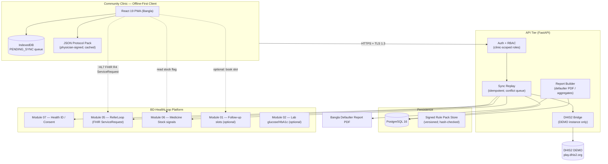
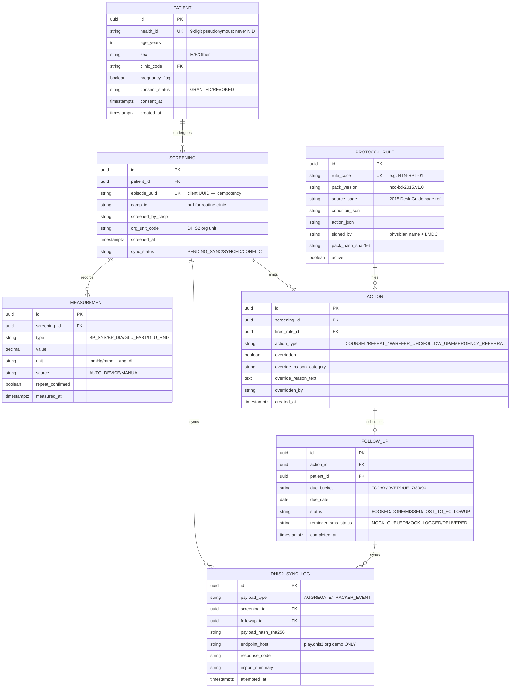

# 🛠️ Technical Architecture & Implementation Blueprint — Module 12

## NCD Sathi — Offline-First Protocol Engine, DHIS2 Auto-Fill & Closed-Loop NCD Care

---

## Table of Contents

- [Tech Stack](#tech-stack)
- [System Architecture](#system-architecture)
- [Database Architecture & ER Diagram](#database-architecture--er-diagram)
- [HL7 FHIR R4 Note](#hl7-fhir-r4-note)
- [REST API Specification](#rest-api-specification)
- [Security & PDPO 2025 Compliance](#security--pdpo-2025-compliance)
- [Rollout Roadmap (48h → District → National)](#rollout-roadmap-48h--district--national)
- [Risks & Mitigations (Clinical Safety First)](#risks--mitigations-clinical-safety-first)
- [3-Minute Demo Script](#3-minute-demo-script)
- [Data Notes & Verification Flags](#data-notes--verification-flags)

---

## Tech Stack

| Layer | Choice | Notes |
|:---|:---|:---|
| **Client** | React 19 + Vite + Tailwind CSS; PWA (service worker, installable) | Bangla-first i18n; low-end Android target; offline shell + rule pack cached |
| **Offline store** | **IndexedDB** (via `idb`) | `PENDING_SYNC` queue; client UUIDs; idempotent replay; server-wins conflicts |
| **Protocol rules** | **JSON `ProtocolRule` pack** (`ncd-bd-2015.v1.0.json`) | Transcribed **verbatim** from DGHS/WHO NCD Desk Guide 2015; **physician-signed** (name, BMDC no., hash, date); structured for **WHO SMART Guidelines / DAK** adaptation ([WHO DAK](https://who.int/publications/i/item/9789240020306)) |
| **Backend** | **FastAPI** (Python 3.12) + Uvicorn | Thin API: auth, sync replay, DHIS2 bridge, report builder |
| **Database** | **PostgreSQL 16** | Episodes, measurements, actions, follow-ups, sync log; row-level clinic scoping |
| **DHIS2** | **DHIS2 Web API → PUBLIC DEMO INSTANCE ONLY** (`https://play.dhis2.org/dev`) | `/api/dataValueSets` (aggregate) + `/api/tracker` (events); **production DGHS DHIS2 is NEVER referenced by this build**; base URL pinned by config + build-time assert |
| **SMS** | **Mock gateway** (log-only adapter) | Bangla Unicode templates; intent logged to `SmsLog`; live gateway only after pilot MoU + PDPO review |
| **Interoperability** | FHIR R4 (optional `Observation` for BP/glucose; `ServiceRequest` for ReferLoop hand-off) | See FHIR note below |
| **Identity** | Health ID (Module 07) — pseudonymous lookup | No NID stored; consent at first screen |
| **Hosting (demo)** | DGHS/BDIX-friendly VPS or Azure BD region [illustrative] | BDIX peering desirable; data residency in Bangladesh preferred under PDPO 2025 |
| **Observability** | OpenTelemetry + structured logs | Sync lag, override rate, error budget per clinic |

**Explicitly NOT used:** on-device ML inference for diagnosis; any autonomous prescribing logic; production DHIS2 credentials; NID/biometric storage; third-party analytics SDKs with patient data.

---

## System Architecture

---

## Database Architecture & ER Diagram

**Design invariants:** measurements append-only; every `ACTION` dereferences the exact signed rule that fired; `DHIS2_SYNC_LOG.endpoint_host` is asserted to a demo whitelist at write time; no row stores NID, phone beyond SMS-consent flag, or name beyond display cache (never synced).

---

## HL7 FHIR R4 Note

Module 12 is **not** an FHIR server; it interoperates via two FHIR resources:

1. **`Observation` (optional, recommended)** — BP and glucose persisted as LOINC-coded observations (`85354-9` blood pressure panel; `2339-0` glucose [mass/volume] or `14749-6` glucose post prandial; local BD profiles per BD Core FHIR IG). Enables Module 02/05 consumers to read NCD vitals without bespoke integration. **Optional in MVP; enabled when Module 05 spine is reachable.**
2. **`ServiceRequest` (required for referral)** — the ReferLoop (Module 05) hand-off: `status=active`, `intent=order`, `priority` per protocol (`urgent` for emergency-threshold BP), `subject` = Health-ID reference, `reasonCode` = protocol-derived suspected condition, `supportingInfo` = BP/glucose `Observation` references + stock-out flag; `performer` = UHC org unit. ReferLoop returns `Task` (accepted/advised/rejected) — see Module 05 APP_FLOW § Referral Flow.

Consent modeled as FHIR `Consent` aligned to Module 07; audit events mirror `AuditEvent` for PDPO accountability. **No DiagnosticReport in this module** (Module 02 owns labs). **No MedicationRequest** — CHCPs cannot prescribe; referral is the ceiling.

---

## REST API Specification

Base: `https://ncdsathi.demo.dghs.gov.bd/api/v1` *(illustrative demo host)* · Auth: OAuth2 client-credentials + clinic staff token · All list endpoints paginated (`limit`, `cursor`) · Errors: RFC 7807 `application/problem+json`.

| Method | Path | Purpose | Key Request / Response | Notes |
|:---|:---|:---|:---|:---|
| `GET` | `/patients/lookup?health_id={id}` | Pseudonymous Health-ID lookup | → `{age, sex, prior_ncd, consent_status}` | No name/NID returned; audit-logged; 404 → provisional registration flow |
| `POST` | `/screenings` | Create episode (idempotent on `episode_uuid`) | `{health_id, camp_id?, chcp_id}` → `{screening_id, episode_uuid}` | 201; replay-safe |
| `POST` | `/screenings/{id}/measurements` | Append BP/glucose | `{type, value, unit, source, repeat_confirmed}` → `{measurement_id, validation: PASS/WARN}` | Hard-range 422; soft-range `WARN` + repeat prompt |
| `POST` | `/screenings/{id}/evaluate` | Run protocol engine | → `{action_type, rule_code, rule_version, counselling_ref, follow_up_days}` | Deterministic; offline-identical logic |
| `POST` | `/screenings/{id}/override` | Override action with reason | `{original_action, new_action, reason_category, reason_text(≥10 chars)}` | 422 if reason missing; audit immutable |
| `POST` | `/screenings/{id}/refer` | ReferLoop hand-off | → `{referloop_id, sms_status: MOCK_LOGGED}` | Creates FHIR `ServiceRequest` via Module 05 |
| `GET` | `/clinics/{code}/tickler?bucket=TODAY|OVERDUE_7|OVERDUE_30` | Follow-up worklist | → `[{health_id, due_date, last_bp, last_glucose, times_missed}]` | Health-ID refs only |
| `POST` | `/followups/{id}/complete` | Mark follow-up done | `{outcome, notes?}` → `{status}` | Adherence KPI hook |
| `POST` | `/followups/{id}/lost` | Mark lost to follow-up (after 2 attempts) | `{attempts[]}` → `{status: LOST_TO_FOLLOWUP}` | Requires ≥2 outreach logs |
| `POST` | `/sync/replay` | Bulk idempotent replay from IndexedDB | `{records[]}` → `{imported, duplicates, conflicts[]}` | Conflict queue → supervisor |
| `GET` | `/clinics/{code}/defaulter-report?month=YYYY-MM` | Monthly report | → `{screened, due, seen, defaulted, traced, adherence_pct, pdf_url}` | Bangla PDF; optional DHIS2 push |
| `POST` | `/dhis2/aggregate` | Push monthly aggregate | `{month, org_unit}` → `{imported, rejected[]}` | **DEMO host pinned**; logs to `DHIS2_SYNC_LOG` |
| `POST` | `/dhis2/tracker-event` | Push episode milestone | `{screening_id, milestone}` → `{imported}` | Dedup by episode_uuid |
| `GET` | `/supervision/scorecards?district={d}` | UHFPO dashboard data | → `[{clinic, screened, controlled_pct, adherence_pct, sync_lag_h, overrides}]` | Role-scoped; no patient names |
| `POST` | `/pharmacovigilance/flags` | Adverse event → DGDA queue | `{screening_id, symptom, onset, suspected_drug, severity}` | Severe → urgent referral card returned |
| `GET` | `/rules/pack` | Fetch signed rule pack (hash-checked) | → `{version, hash, signed_by, rules[]}` | Client refuses mismatched hash |
| `POST` | `/consent` | Record/revoke consent | `{health_id, status, method}` | PDPO audit; revocation stops sync |

---

## Security & PDPO 2025 Compliance

The **Personal Data Protection Ordinance 2025** (gazetted **6 Nov 2025**) classifies **health data as sensitive personal data**; explicit consent is required before collecting, storing, transferring or using it; several sections take effect ≈ **18 months after gazetting (≈ May 2027, estimate)**; enforcement status under the 2026 elected government is **[uncertain]** — [TBS](https://www.tbsnews.net/node/1281356) · [Daily Star](https://www.thedailystar.net/tech-startup/news/bangladeshs-personal-data-protection-ordinance-2025-key-takeaways-4015401).

| Control | Implementation |
|:---|:---|
| **Consent at registration** | First-screen Bangla consent (`তথ্য সংগ্রহে সম্মত?`); versioned consent artifact; revocation = sync stops + local purge; re-consent on purpose change |
| **Minimal PID** | **No NID ever**. Health-ID pseudonymous reference only; name cached display-only on device, never synced; phone stored only if SMS-consented (flag, not number, in analytics) |
| **Aggregate reporting** | DHIS2 receives counts + pseudonymous tracker refs; **no clinician sees another clinic's patients**; national dashboards = aggregates only |
| **Data residency** | Host in Bangladesh (BDIX) preferred; no cross-border transfer without consent + lawful basis; DGDA receives drug+symptom+severity only |
| **Encryption** | TLS 1.3 in transit; AES-256 at rest (PG + IndexedDB); field-level encryption for `health_id` hash column; keys in DGHS-managed KMS [pilot] |
| **Access control** | RBAC: CHCP (own clinic) / Supervisor (own UHFPO catchment) / NCDC (read-only aggregates); MFA for supervisors; step-up auth for exports |
| **Device loss** | 5-min idle lock; PIN/biometric; remote wipe via DGHS MDM [pilot]; lost-device → immediate credential revocation + clinic key rotation |
| **Audit** | Immutable log (who/what/when/old→new) for every clinical write, override, export, sync; 7-year retention aligned to medical-record norms [estimate] |
| **DPIA** | Pre-pilot Data Protection Impact Assessment; consent script review with DGHS legal; patient information sheet in Bangla |
| **Breach response** | 72h notification workflow to DGHS + affected patients (via clinic); tabletop exercise before district rollout |

---

## Rollout Roadmap (48h → District → National)

**Phase 0 — 48-hour hackathon MVP (Dec 2026):** PWA + IndexedDB queue; Health-ID **mock** lookup; BP/glucose entry + validation; protocol engine with **verbatim 2015-guide thresholds pending physician sign-off** (demo pack labelled "NOT FOR CLINICAL USE — demo thresholds"); action cards; mock SMS; DHIS2 **demo** aggregate post; ReferLoop hand-off stub; defaulter PDF; 3-minute demo (below).

**Phase 1 — Physician sign-off & safety gate (Dec 2026–Jan 2027):** named physician validates every threshold vs the 2015 guide; override categories finalised; DGDA/IEDCR flag routing agreed; DPIA + consent script approved; **no patient contact before sign-off**.

**Phase 2 — 10 clinics, one e-Health Card district (Q1 2027):** candidates — **Khulna, Noakhali, Bogura, Sirajganj, Narsingdi** (the 5 pilot districts). DGHS selects based on readiness (power/connectivity/staffing — the Apr 2026 pilot found districts "without instructions, computers, internet, servers" — [Bonik Barta](https://en.bonikbarta.com/bangladesh/SyidD595PYwTVnF0)). Mix: 6 rural + 4 urban clinics; baseline measurement (adults 40+ screened, uncontrolled-BP rate); weekly sync audits; 4-week repeat adherence tracked; mock SMS → single-clinic live SMS pilot after PDPO review.

**Phase 3 — District scale & evaluation (Q2–Q3 2027):** all CCs in selected district; Parbatipur-style evaluation (uncontrolled-BP 60%→26% trajectory as benchmark — [BMJ Open 2023](https://bmjopen.bmj.com/content/13/11/e073743)); stock-out integration with Module 06 live; ReferLoop closed-loop metrics; independent review (icddr,b or BSMMU) — **coordinate, don't duplicate, their CKD/HTN feasibility pilot** ([TBS](https://www.tbsnews.net/node/1385381)).

**Phase 4 — National scale (2027–2028):** align with **PM's plan — PHU in every union + 100,000 new CHWs** ([ehealthhackathonbd.org](https://ehealthhackathonbd.org/)) and **14,000+ DHIS2 clinics** ([DHIS2.org](https://dhis2.org/expanding-routine-data-use-bangladesh/)); tracker into national NCDC programme; DHIS2 production integration **only after** DGHS-MIS formal approval; guide-version governance (2015 guide → successor → SMART DAK).

| Phase | Gate to proceed |
|:---|:---|
| 0→1 | Demo works offline; DHIS2 demo receives correct aggregate; physician engaged |
| 1→2 | Signed rule pack; DGHS CBHC/NCDC MoU; DPIA passed; 10 clinics selected |
| 2→3 | ≥30% adults 40+ screened; ≥60% 4-week adherence; zero safety incidents; sync <72h |
| 3→4 | Independent evaluation positive; production DHIS2 approved; funding (DGHS/CBHC + partners) |

---

## Risks & Mitigations (Clinical Safety First)

| # | Risk | Severity | Mitigation |
|:-:|:---|:---:|:---|
| R1 | **Clinical safety — wrong threshold / missed emergency** (highest-risk module clinically) | **Critical** | Named physician validates & signs every rule; **no prescribing, ever**; emergency-threshold BP forces urgent-referral screen; "decision support, not diagnosis" on every screen; adverse-event flag → DGDA/IEDCR; incident review within 72h; pilot halts on any serious event |
| R2 | **Drug stock-outs undermine treatment** — Jashore 283 clinics ~8 months ([Bonik Barta](https://en.bonikbarta.com/bangladesh/n79GkolkDClJDR5X)); 84% workers report patients return for unavailable medicines (Jun 2026, [Dhaka Tribune](https://www.dhakatribune.com/bangladesh/health/413839/inside-bangladesh%E2%80%99s-community-clinics-promise)); 22% availability (PPRC 2026) | High | Stock flag from Module 06 in rule evaluation → **auto-refer**; never "continue drug X" if unavailable; stock-out referral KPI tracked; escalate to DGHS procurement with data |
| R3 | **Device loss / shared village phone → data exposure** | High | PIN/biometric; 5-min lock; remote wipe; no NID; pseudonymous IDs; minimal on-device cache; MDM in pilot |
| R4 | **Duplication with icddr,b CKD/HTN digital work** | Medium | Formal coordination MoU; shared evaluation framework; position as **CHCP clinic workflow + DHIS2** complement to their CHW feasibility pilot; joint publication |
| R5 | **2015 guide outdated / superseded** | Medium | Versioned rule pack; re-sign on revision; SMART DAK migration path; NCDC owns clinical governance |
| R6 | **Adoption failure — "another app"** (IMCI succeeded via workflow fit; ePOCT+ via task-shifting) | Medium | Embed in existing CC visit; zero extra steps; Bangla; offline; supervisor champions; PHU-100k-CHW alignment creates demand |
| R7 | **DHIS2 demo mistaken for production / data leakage** | Medium | Host whitelist; build-time assert; banner; SYNC_LOG endpoint audit; production gated by DGHS-MIS approval |
| R8 | **False reassurance — "normal" reading ends care** | Medium | Normal screens get 12-month recall + risk-factor counselling; not a clean bill; annual re-screen default |
| R9 | **Compensation/login burden on CHCPs** | Medium | <3 min added time per patient [target]; supervisor-visible time saved; count toward PHU workload metrics |
| R10 | **PDPO 2025 non-compliance (consent/transfer)** | Medium | DPIA; consent artefact; residency in BD; revocation path; legal review pre-pilot; enforcement timing flagged [uncertain] |
| R11 | **Pregnant / missed-pregnancy patient gets NCD protocol** | Low-Med | Pregnancy flag mandatory at intake; antenatal pathway auto-selected; training + supervision audit |
| R12 | **Metric gaming (screening counts inflated)** | Low-Med | Dedup by Health-ID; camp tags; random chart audits; adherence (not volume) as primary KPI |

---

## 3-Minute Demo Script

**0:00 — Hook (20s).** "More than half of hypertension in Bangladesh is undiagnosed — **15.8% of adults, vs 12.2% diagnosed**; **6%** have undiagnosed diabetes (BDHS 2017–18). The 2015 national NCD desk guide exists only as a PDF; clinics type everything twice — paper, then DHIS2."

**0:30 — Screen the 52-year-old (40s).** Open NCD Sathi (Bangla UI). Scan Health-ID QR → profile loads (age 52, no prior NCD, consent on file). Enter BP **152/94**, fasting glucose **6.8 mmol/L**. Validation passes (repeat-confirmed).

**1:00 — Protocol decides (30s).** Engine cites signed rule **HTN-RPT-01 (2015 guide, p.12)** → action card: **"পুনরায় ৪ সপ্তাহে BP মাপুন + পরামর্শ (Repeat in 4 weeks + counsel)"** — salt <5 g/day, 30-min walk, adherence; 4-week follow-up auto-booked; tickler updated; SMS queued (mock). Show: **no drug ordered; banner "সিদ্ধান্ত সহকারী — রোগ নির্ণয় নয় (Decision support, not diagnosis)".**

**1:20 — Second visit, still high (30s).** Tickler → open episode. Re-enter BP **158/96**. Engine → **"UHC-তে রেফার (Refer to UHC)"** → one tap → ReferLoop bundle (BP trend, meds, stock flag) → **FHIR ServiceRequest** → UHC doctor inbox (accept/advise/reject) — show Journey 3.

**1:50 — DHIS2 fills itself (30s).** Open **DHIS2 demo dashboard** → monthly aggregate shows **+1 screened, +1 HTN flagged, +1 referred**; tracker event logged; point at `DHIS2_SYNC_LOG` (host = play.dhis2.org — **demo only**). "No form was typed twice."

**2:20 — The gap it closes (25s).** Contrast: paper register + manual DHIS2 (PMC7249629: "increases the reporting workload"); Jashore 283 clinics medicine-less 8 months → app would have auto-referred; India CPHC-NCD: **26.23 crore enrolled / 14.40 crore screened**; locally, **Parbatipur cut uncontrolled BP 60%→26% in 3 months**.

**2:45 — The ask (15s).** "Pilot **10 clinics in one e-Health Card district** — Khulna, Noakhali, Bogura, Sirajganj or Narsingdi — with DGHS CBHC/NCDC. 48-hour MVP today; physician sign-off before any patient contact; production DHIS2 only after DGHS approval."

---

## Data Notes & Verification Flags

- **No statistic in this document is invented.** BDHS 2017–18 (15.8/12.2/6.0), ~70 patients/day (DOAJ 2021), 14,000+ DHIS2 clinics (DHIS2.org), Parbatipur 60→26 (BMJ Open 2023), ePOCT+ 23.2 vs 70.1 (44,306 children, PMC10803249), CPHC-NCD 26.23/14.40 crore (MoHFW), 22% medicine availability (PPRC 2026), Jashore 283 clinics, 84% (Jun 2026), 51.4% paper records, 79.31% OOP — all sourced in README § Sources.
- **Computed:** ≈28% total HTN (12.2+15.8); ≈1.3× undiagnosed:diagnosed. Labelled as computed where used.
- **[illustrative]:** pilot throughput (40–60/h), <3 min added time, retention norms, hosting region, 20% override-review threshold, sync-SLA targets.
- **Desk-guide thresholds deliberately omitted here** — they live only in the physician-signed JSON pack; this doc never restates clinical cut-offs.
- **Demo thresholds warning:** until sign-off, any demo rule pack is labelled **"NOT FOR CLINICAL USE"**; the hackathon demo uses placeholder thresholds clearly marked as such.
- **PDPO 2025** full effect ≈ May 2027 (estimate); enforcement under 2026 government **[uncertain]** — design for the stricter reading (consent + residency + minimisation).
- **DHIS2:** demo instance `https://play.dhis2.org/dev` only; production requires written DGHS-MIS approval; `DHIS2_SYNC_LOG.endpoint_host` is enforced-whitelisted.
- **e-Health Card pilot unreadiness** (Apr 2026) is the binding constraint on Phase 2 — select district with DGHS after readiness audit, not by preference.
- Siblings: 01-appointment (slot booking) · 02-test-reports (lab glucose) · 05-integrated-system (ReferLoop + DHIS2 spine) · 06-medicine-stock (stock-out signals) · 07-health-card (Health ID + consent).
