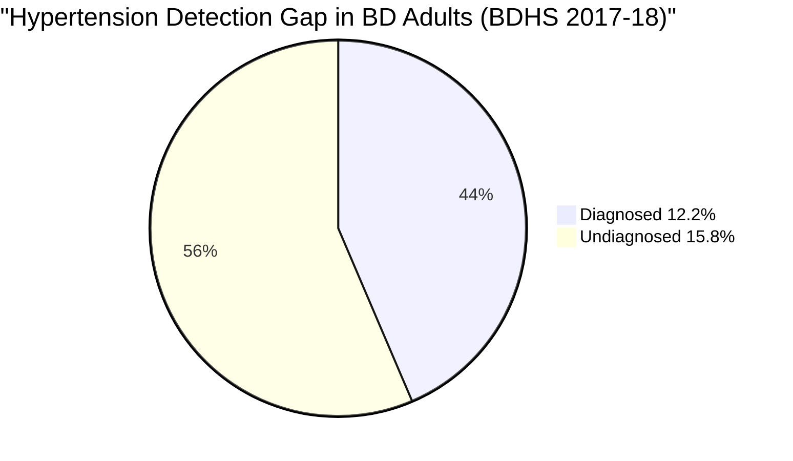
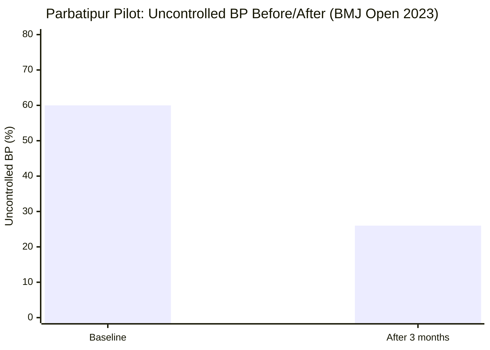
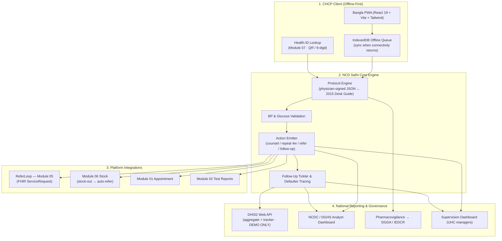

# 🫀 NCD Sathi — Adult HTN/Diabetes Protocol Assistant for Community Clinics

## Module 12 — CHCP-Facing Protocol Engine, DHIS2 Zero Double-Entry & Closed-Loop NCD Care at 14,000+ Community Clinics

> **Tagline:** CHCP enters BP and glucose once; the app walks the national protocol, books the follow-up and fills the DHIS2 report — better care, zero extra paperwork.
> **"Sathi" (সাথী) = companion.** NCD Sathi is the CHCP's companion at the point of care — not a diagnostic device, not an autonomous prescriber.

**Module:** 12 of the BD-HealthLoop suite · **Track:** Primary care · **Hackathon score:** U3 F3 I5 J4 D4 = **19/25** · **Event:** E-Health Hackathon & Symposium, MoHFW + WHO, 3–5 Dec 2026, Dhaka (ehealthhackathonbd.org)

---

## Table of Contents

- [Problem Statement](#problem-statement)
  - [The NCD Crisis in Numbers](#the-ncd-crisis-in-numbers)
- [International Precedent & WHO SMART Guidelines](#international-precedent--who-smart-guidelines)
  - [Lesson Table](#lesson-table)
- [System Architecture & Vision](#system-architecture--vision)
- [Capability Deep-Dives](#capability-deep-dives)
- [Comparative Benchmark](#comparative-benchmark-bangladesh-vs-global-ncd-primary-care-models)
- [Stakeholder Matrix](#stakeholder-matrix)
- [Success Metrics & National Targets](#success-metrics--national-targets)
- [Sources & Data Notes](#sources--data-notes)

---

## Problem Statement

Bangladesh faces a silent, unmanaged epidemic of non-communicable diseases (NCDs) — hypertension and diabetes above all. The frontline is the **community clinic**: **14,000+ clinics**, ~**70 patients/day** each (2021, 32-clinic study arithmetic), ~**490,000 people** seeking care daily. **CHCPs — not doctors — deliver most of this care.**

Yet the national protocol exists only as a **2015 PDF** (DGHS/WHO NCD Desk Guide) that cannot be consulted mid-consultation, and clinics run paper registers **side-by-side with DHIS2**, which "increases the reporting workload" (PMC7249629). The result: hypertensive and diabetic adults are under-screened, under-treated, lost to follow-up — while the CHCP carries an impossible double data-entry burden.

> [!CAUTION]
> **The undiagnosed majority**: **15.8%** of adults have **UNDIAGNOSED hypertension vs only 12.2% diagnosed** — ≈1.3 undiagnosed per diagnosed case (computed). **6.0%** have undiagnosed diabetes (BDHS 2017–18). Every undiagnosed adult is a future stroke, heart attack or kidney failure walking into a clinic today — undetected.

### The NCD Crisis in Numbers

| Indicator / Metric | Ground Statistic | Authoritative Source |
|:---|:---:|:---|
| **Adults with UNDIAGNOSED hypertension** | **15.8%** | BDHS 2017–18 — [DOAJ/BMC 2023](https://doaj.org/article/8e696c7abbe4486187d630b469aa8f43); [Frontiers Public Health 2022](https://www.frontiersin.org/journals/public-health/articles/10.3389/fpubh.2022.1066449/epub) |
| **Adults with DIAGNOSED hypertension** | **12.2%** | Same source; undiagnosed ≈1.3× diagnosed (computed) |
| **Adults with UNDIAGNOSED diabetes** | **6.0%** | Same source |
| **Adults affected by hypertension (total)** | **≈28%** | Computed sum (12.2 + 15.8), not a published figure |
| **Patients per community clinic per day** | **~70** | [DOAJ 2021](https://doaj.org/article/ecd5cdd2b63a49848b10cfe31a41f8ee) |
| **People using community clinics daily** | **~490,000** | [Dhaka Tribune](https://www.dhakatribune.com/bangladesh/health/413839/inside-bangladesh%E2%80%99s-community-clinics-promise) |
| **Clinics already on DHIS2** | **14,000+** | [DHIS2.org](https://dhis2.org/expanding-routine-data-use-bangladesh/); 14,213/15,564 run a DHIS2 tracker (cervical screening, Apr 2024) — [BMC Public Health 2025](https://researchexchange.ocrahope.org/papers/s12889-025-22668-6) |
| **National NCD protocol availability** | **2015 PDF only** | [WHO extranet](https://extranet.who.int/ncdccs/Data/BGD_D1_BGD_NCD%20Desk%20Guide_2015.pdf); [DGHS](https://old.dghs.gov.bd/index.php/en/publications/guideline) |
| **Paper + DHIS2 side-by-side** | "increases the reporting workload" | 2020 — [PMC7249629](https://www.ncbi.nlm.nih.gov/pmc/articles/PMC7249629/) |
| **Essential medicine availability (public)** | **22%** | PPRC 2026, 22 facilities — [Prothom Alo](https://en.prothomalo.com/bangladesh/904ggpi81h) |
| **Workers: patients return, medicines unavailable** | **84%** | Jun 2026 — [Dhaka Tribune](https://www.dhakatribune.com/bangladesh/health/413839/inside-bangladesh%E2%80%99s-community-clinics-promise) |
| **Jashore clinics without medicines** | **283 clinics, ~8 months** | [Bonik Barta](https://en.bonikbarta.com/bangladesh/n79GkolkDClJDR5X) |
| **Rural vs urban doctor density** | **1.1 vs 18.2 per 10,000** | 2022 — [CPTU](https://cptu.gov.bd/advertisement-services/details-7272.html) |
| **Doctors using paper records** | **51.4%** | 2021 — [Banglajol](https://www.banglajol.info/index.php/CMOSHMCJ/article/view/87838/57377) |
| **Out-of-pocket health spending** | **79.31%** (2023) | World Bank WDI / WHO GHED — [World Bank API](https://api.worldbank.org/v2/country/BGD/indicator/SH.XPD.OOPC.CH.ZS?format=json) |

**Why the 2015 Desk Guide fails at the point of care:** (1) it is a static PDF — unusable mid-consultation with 70 patients a day; (2) it has no feedback loop — nothing records whether the patient returned or BP dropped; (3) it duplicates reporting — every screening is hand-copied into paper **and** re-keyed into DHIS2 (PMC7249629). The child IMCI app runs at all **319 Barishal facilities** ([Save the Children](https://www.savethechildren.net/bangladesh/stories/over-300-govt-healthcare-facilities-barishal-will-digitize-treatment-plans)) — **the adult NCD niche is open**; only an icddr,b CHW feasibility pilot exists ([TBS](https://www.tbsnews.net/node/1385381)).

---

## International Precedent & WHO SMART Guidelines

| Precedent | Evidence | What it proves |
|:---|:---|:---|
| **Tanzania — ePOCT+** (protocol CDS) | Cluster RCT, **44,306 children**: antibiotics **23.2% with CDS vs 70.1% without**, no safety loss — [PMC10803249](https://www.ncbi.nlm.nih.gov/pmc/articles/PMC10803249) | Protocol-CDS changes prescribing **safely** at scale |
| **India — CPHC-NCD** (ages 30+) | **26.23 crore enrolled; 14.40 crore screened** by Jan 2023 — [MoHFW](https://ncd-test.mohfw.gov.in/ncdlandingassets/aboutus.html) | National NCD screening feasible at population scale |
| **Bangladesh — Parbatipur** (local proof) | Uncontrolled BP **60% → 26% in 3 months** — [BMJ Open 2023](https://bmjopen.bmj.com/content/13/11/e073743) | The model works **inside Bangladesh** |
| **WHO SMART Guidelines / DAK** | Software-neutral guideline encoding; Ethiopia & Ghana — [WHO DAK](https://who.int/publications/i/item/9789240020306) | Encode rules as portable JSON, not hard-coded logic |
| **India — ABDM / ABHA** (health-ID rail) | 79.71 crore ABHA accounts; 65.09 crore records linked (Jul 2025) — [The Week/PTI](https://www.theweek.in/wire-updates/national/2025/08/01/del53-lsq-health-record.html) | ID lookup as the continuity rail (BD analog: Module 07) |

### Lesson Table

| # | Lesson | Module 12 application |
|:-:|:---|:---|
| 1 | Protocol-CDS changes practice **safely** (ePOCT+) | CHCP sees a protocol action, never a free-text drug order |
| 2 | Scale needs workflow embedding, not standalone apps (CPHC-NCD) | Lives inside the existing clinic visit — vitals entered once, reused |
| 3 | Local proof beats foreign slides (Parbatipur 60→26) | Pilot KPI = uncontrolled-BP rate at 3 months |
| 4 | Guidelines must be software-neutral (SMART/DAK) | **Physician-signed JSON `ProtocolRule`s**, DAK-adaptable |
| 5 | Health-ID rails unlock continuity (ABDM) | **Health ID** lookup (Module 07); no NID stored |
| 6 | Child niche taken; adult NCD open (IMCI, 319 facilities) | Reuse IMCI integration pattern for **adult** HTN/DM |
| 7 | Stock-outs silently kill adherence (Jashore; 84%) | Medicine unavailable → app **auto-refers** (Module 06 signal) |
| 8 | Reporting burden is the adoption killer (PMC7249629) | **Zero double entry** — tracker + aggregate auto-post |

---

## System Architecture & Vision

Module 12 is the **clinical brain** of primary care: it consumes vitals once, applies the national protocol, and emits actions, referrals, follow-ups and DHIS2 reports — no second keystroke.

**Design rule:** every screen carries **"সিদ্ধান্ত সহকারী — রোগ নির্ণয় নয় (Decision support, not diagnosis)"**. No prescribing beyond CHCP scope; every threshold physician-signed before deployment.

---

## Capability Deep-Dives

### 1. The 2015 Desk-Guide Protocol Engine (Physician-Signed JSON)
- **Input:** BP, fasting/random glucose, age, sex, pregnancy, prior dx, meds, clinic stock status. **Engine:** deterministic evaluation of the **DGHS/WHO NCD Desk Guide 2015**, transcribed **verbatim** into versioned, **physician-signed** JSON `ProtocolRule`s (e.g. "BP ≥ threshold → counsel + repeat in 4 weeks + refer if persists" — exact cut-offs live only in the signed pack, never in prose).
- **Portability:** structured for **WHO SMART / DAK** migration; **no network call in the decision path**; **override only with mandatory reason** (audited).
- **Safety rails:** no drug initiation/titration by CHCP; banner on every screen; adverse events → DGDA/IEDCR.

### 2. Offline-First Bangla PWA + Health-ID Lookup
- Community clinics face real connectivity failure (pilot districts "without computers, internet, servers" — Apr 2026, [Bonik Barta](https://en.bonikbarta.com/bangladesh/SyidD595PYwTVnF0)). Full screen → protocol → follow-up flow works **with zero connectivity**; queue in **IndexedDB**; sync on reconnect (see APP_FLOW.md § Journey 5).
- Patient found by **Health ID** (typed or QR) — **no NID, minimal PID**; consent at first screen; Bangla UI (`নতুন স্ক্রিনিং`, `ফলো-আপ`), English fallback for supervisors; SMS templates in Bangla.

### 3. DHIS2 Auto-Fill — Aggregate + Tracker, Zero Double Entry
- Each finalized episode emits a **tracker event** (pseudonymised Health-ID ref) + contributes to the **monthly aggregate** (`dataValueSets`: 40+ screened, HTN/DM identified, referred, controlled@3mo).
- **Zero re-typing** — the clinical record *is* the report. Reuses Modules 02/03 `/api/dataValueSets` pattern; rides national tracker momentum (14,213/15,564 clinics on a DHIS2 tracker).
- **Demo safety:** hackathon build posts **only to the public DHIS2 demo** — never production DGHS.

### 4. Closed-Loop Referral via ReferLoop (Module 05) + Stock-Out Routing (Module 06)
- Protocol says *refer* → **ReferLoop** opens: FHIR `ServiceRequest` + BP/glucose trend to the UHC NCD inbox; patient SMS with referral ID; UHC doctor accepts / advises / rejects; **back-referral** closes the loop. 59% of patients self-refer to tertiary care (BMC Health Serv Res 2024) — this is the credible local alternative (Vula, South Africa: 85.5% accepted, 16-min median reply — [PMC8517757](https://www.ncbi.nlm.nih.gov/pmc/articles/PMC8517757/)).
- **Stock-out trigger:** Module 06 signals first-line NCD medicines unavailable (22% availability; Jashore ~8 months) → app **auto-refers** instead of stranding the patient.

### 5. Follow-Up Tickler & Defaulter Tracing
- **Tickler list** per clinic: due today / overdue 7/30/90; CHCP works it each clinic day. **Mock SMS** (Bangla) T-7/T-1; delivery logged. **Defaulter report** monthly → supervisor + UHFPO + NCDC/DGHS; **defaulter tracing rate** is a headline KPI; loss-to-follow-up is an explicit episode state, never a silent disappearance.

---

## Comparative Benchmark: Bangladesh vs Global NCD Primary-Care Models

| Dimension | BD status quo | Tanzania ePOCT+ | India CPHC-NCD | **Module 12** |
|:---|:---|:---|:---|:---|
| Protocol at point of care | 2015 PDF / memory | Encoded CDS | App risk assessment | **Physician-signed JSON (2015 guide)** |
| Evidence of safety | Unmeasured | RCT 44,306 children; no safety loss | National rollout | **No prescribing; override needs reason; DGDA/IEDCR path** |
| Scale | 14,000+ clinics, paper | RCT setting | **26.23 / 14.40 crore (Jan 2023)** | 10 pilot clinics → e-Health Card district → 14,000+ |
| Reporting burden | Double entry | Built into workflow | Portal + reports | **Zero double entry — auto tracker + aggregate** |
| Patient ID | Paper register | Point-of-care reg. | ABHA-linked | **Health ID (Module 07); no NID** |
| Referral | Informal; 59% self-refer tertiary | In-CDS protocols | NCD clinics | **ReferLoop closed loop (M05) + stock-out trigger (M06)** |
| Offline | Paper yes; DHIS2 no | Offline-capable | Connectivity-dependent | **Offline-first PWA; IndexedDB; sync later** |
| BD validation | — | — | — | **Parbatipur 60%→26% @3mo (BMJ Open 2023)** |

---

## Stakeholder Matrix

| Stakeholder | Frustrations | NCD Sathi Solution | Benefit |
|:---|:---|:---|:---|
| **CHCP** | 70/day; unusable 2015 PDF; double entry | Bangla PWA; one-entry workflow; auto DHIS2 | Protocol-adherent care; paperwork minutes saved |
| **Patients 40+** | Silent disease; lost follow-ups | Nearest-clinic screening; SMS reminders | Earlier detection; controlled BP |
| **UHC doctor** | Incomplete referrals; no feedback | ReferLoop dossier; accept/advise/reject; back-referral | Faster triage; closed loop |
| **Clinic supervisor / UHFPO** | No defaulter visibility; weak data | Monthly defaulter report; supervision dashboard; override audit | Targeted outreach; auditable adherence |
| **NCDC / DGHS analyst** | Late, incomplete NCD data | Auto aggregate + tracker; denominators | Real-time national NCD surveillance |
| **DGDA / IEDCR** | Adverse events invisible at PHC | Pharmacovigilance flag from care flow | Earlier signal detection |
| **MoHFW / DGHS (CBHC, NCDC)** | PHU-per-union + 100,000 CHW plan needs tooling | Ready-made protocol layer for the PHU rollout | Force-multiplier for stated national plan |

---

## Success Metrics & National Targets

**Hackathon judging position:** biggest-burden NCD gap + reusable IMCI pattern; primary-care push = stated judge priority. **19/25** (U3 F3 I5 J4 D4).

| KPI (per clinic/month) | Baseline | Pilot target (6 mo) | Source |
|:---|:---:|:---:|:---|
| % adults 40+ screened | Not measured [illustrative <10%] | **≥30% of registered 40+** | DHIS2 aggregate |
| % BP controlled at 3 months | Parbatipur baseline 60% uncontrolled | **≤40% uncontrolled** (60→26 trajectory) | [BMJ Open 2023](https://bmjopen.bmj.com/content/13/11/e073743) |
| Follow-up adherence rate | Unmeasured [illustrative] | **≥60% attend 4-week review** | Tickler log |
| DHIS2 reporting minutes saved | ~2–4 h/mo double entry [estimate] | **≥75% reduction (zero re-entry)** | Time-and-motion check |
| Stock-out referrals triggered | 0 (invisible) | Tracked; **100% flagged → referred** | Module 06 log |
| Defaulter tracing rate | 0% systematic | **≥50% of 30-day defaulters contacted** | Defaulter report |
| Referral loop closure | N/A | **≥50% back-referrals received** | ReferLoop (Module 05) |

**National alignment:** PHU in every union + **100,000 new Community Health Workers** ([ehealthhackathonbd.org](https://ehealthhackathonbd.org/)) — NCD Sathi is the protocol layer for that workforce. **Scale path:** 48h MVP → **10 clinics** in one e-Health Card district (**Khulna / Noakhali / Bogura / Sirajganj / Narsingdi**) → district-wide → **14,000+ DHIS2 clinics**. Rural doctor density **1.1 vs 18.2 urban** — the tool must work where doctors are not. **Realism check:** 22% essential-medicine availability (PPRC 2026) — control-rate targets assume referral routing, not drug availability.

---

## Sources & Data Notes

**Primary sources:** BDHS 2017–18 — [DOAJ/BMC](https://doaj.org/article/8e696c7abbe4486187d630b469aa8f43) · [Frontiers](https://www.frontiersin.org/journals/public-health/articles/10.3389/fpubh.2022.1066449/epub) · ~70 pts/day — [DOAJ 2021](https://doaj.org/article/ecd5cdd2b63a49848b10cfe31a41f8ee) · 490k daily users — [Dhaka Tribune](https://www.dhakatribune.com/bangladesh/health/413839/inside-bangladesh%E2%80%99s-community-clinics-promise) · 14,000+ DHIS2 clinics — [DHIS2.org](https://dhis2.org/expanding-routine-data-use-bangladesh/) · tracker 14,213/15,564 — [BMC PH 2025](https://researchexchange.ocrahope.org/papers/s12889-025-22668-6) · 2015 Desk Guide — [WHO](https://extranet.who.int/ncdccs/Data/BGD_D1_BGD_NCD%20Desk%20Guide_2015.pdf) · double-entry burden — [PMC7249629](https://www.ncbi.nlm.nih.gov/pmc/articles/PMC7249629/) · Parbatipur — [BMJ Open 2023](https://bmjopen.bmj.com/content/13/11/e073743) · ePOCT+ — [PMC10803249](https://www.ncbi.nlm.nih.gov/pmc/articles/PMC10803249) · CPHC-NCD — [MoHFW](https://ncd-test.mohfw.gov.in/ncdlandingassets/aboutus.html) · WHO DAK — [9789240020306](https://who.int/publications/i/item/9789240020306) · IMCI Barishal (319) — [Save the Children](https://www.savethechildren.net/bangladesh/stories/over-300-govt-healthcare-facilities-barishal-will-digitize-treatment-plans) · icddr,b pilot — [TBS](https://www.tbsnews.net/node/1385381) · Jashore 283 — [Bonik Barta](https://en.bonikbarta.com/bangladesh/n79GkolkDClJDR5X) · 84% medicines — [Dhaka Tribune](https://www.dhakatribune.com/bangladesh/health/413839/inside-bangladesh%E2%80%99s-community-clinics-promise) · 22% availability (PPRC 2026) — [Prothom Alo](https://en.prothomalo.com/bangladesh/904ggpi81h) · PHU + 100,000 CHWs — [ehealthhackathonbd.org](https://ehealthhackathonbd.org/) · pilot unreadiness — [Bonik Barta](https://en.bonikbarta.com/bangladesh/SyidD595PYwTVnF0).

**Data notes & honesty flags:**
- **28% total HTN** and **≈1.3× undiagnosed:diagnosed** are **computed** from BDHS components, not published figures.
- **Baseline screening coverage & reporting minutes** are **[illustrative/estimate]** — no national measurement; pilot must measure them.
- Parbatipur is **local directional evidence, not national effect size**; ePOCT+ evidence is **paediatric** — supports protocol-CDS safety, not adult NCD outcomes directly.
- CPHC-NCD figures are **programme-reported** (MoHFW), not independently audited.
- **2015 thresholds are transcribed verbatim and require named physician sign-off**; app is **decision support, not diagnosis**; thresholds deliberately **not restated in prose** anywhere in this module.
- All DHIS2 traffic targets the **public demo instance only**; production requires DGHS-MIS approval.
- **PDPO 2025** (gazetted 6 Nov 2025): health data = sensitive personal data; explicit consent required; full effect ≈ May 2027 (estimate); enforcement status **[uncertain]**. No NID stored; aggregates reported.
